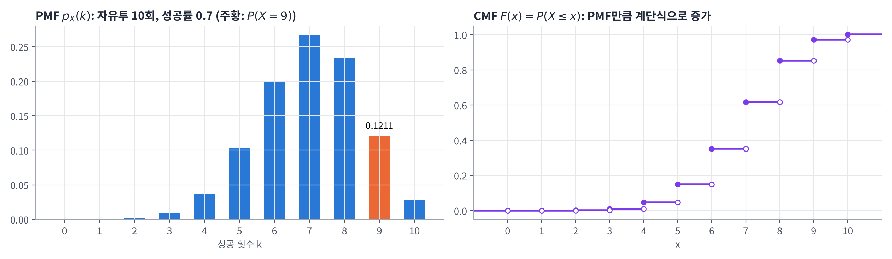
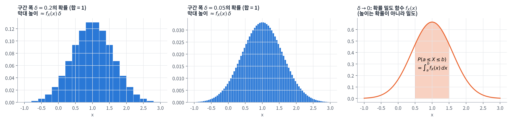
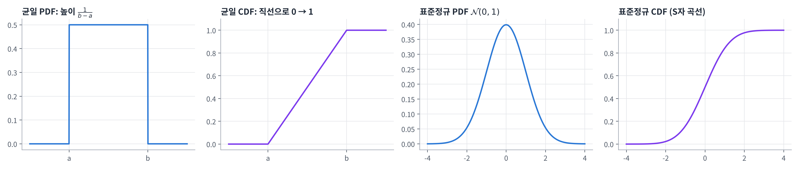
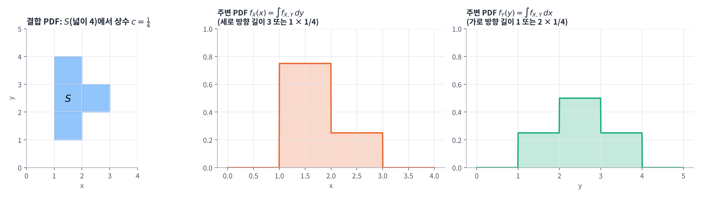
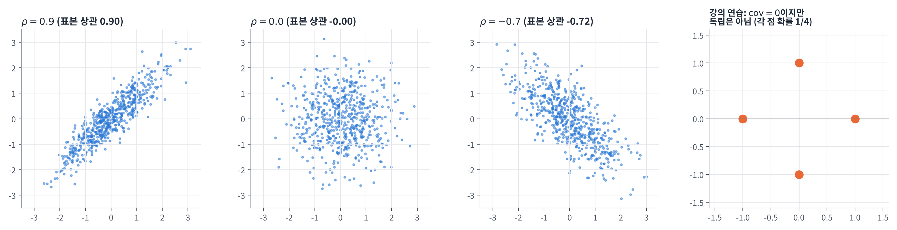
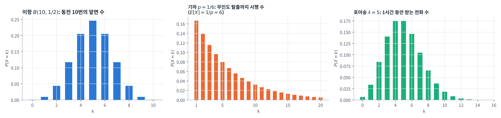
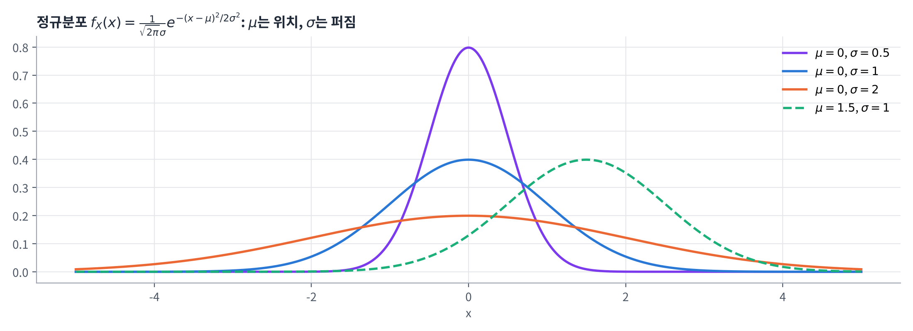
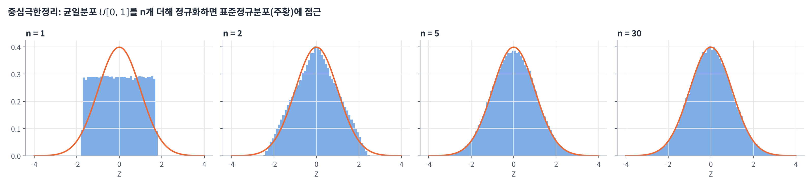

## 학습 목표

- 순열과 조합으로 경우의 수 세기
- 확률변수의 의미와 이산형·연속형의 차이 이해
- PMF, CMF, PDF, CDF의 정의와 성질, 서로의 관계 이해
- 결합 PDF, 주변 PDF, 결합 CDF 계산
- 기대값, 분산, 공분산, 상관계수의 정의와 성질 이해
- 이항, 기하, 포아송, 정규 분포와 중심극한정리 이해

---

## 경우의 수: 순열과 조합

### 순열 (Permutation)

서로 다른 $$n$$개 중 $$r$$개를 **순서를 고려해서** 나열하는 경우의 수

$$
{}_nP_r = n(n - 1)(n - 2)\cdots(n - r + 1) = \frac{n(n - 1)\cdots(n - r + 1)(n - r)\cdots 2 \cdot 1}{(n - r)\cdots 2 \cdot 1} = \frac{n!}{(n - r)!}
$$

- 약속: $${}_nP_0 = 1$$, $$0! = 1$$

### 조합 (Combination)

서로 다른 $$n$$개 중 $$r$$개를 **순서를 고려하지 않고** 고르는 경우의 수

$$
{}_nC_r = \binom{n}{r} = \frac{ {}_nP_r}{r!} = \frac{n!}{r!\,(n - r)!}
$$

- 순열에서 같은 $$r$$개를 나열하는 $$r!$$가지 순서를 하나로 보므로 $$r!$$로 나눔

**예제: 뷔페의 서로 다른 7가지 음식 중 3가지를 접시에 담는 경우의 수**

$$
{}_7C_3 = \frac{ {}_7P_3}{3!} = \frac{7 \times 6 \times 5}{3 \times 2 \times 1} = 35
$$

---

## 확률변수 (Random Variable)

### 정의

- **표본공간의 각 원소에 숫자 값을 대응시키는 함수**
- 실험 결과를 수치로 표현해서, 확률적 사건의 분포를 수학적으로 모델링할 수 있게 함
- 예: 동전을 2번 던지는 실험에서 $$X$$ = 앞면의 개수 → $$HH \mapsto 2$$, $$HT \mapsto 1$$, $$TH \mapsto 1$$, $$TT \mapsto 0$$

| 종류 | 값 | 예 | 확률을 나타내는 함수 |
| --- | --- | --- | --- |
| 이산형 (Discrete) | 셀 수 있는 값 | 주사위 눈 1~6, 성공 횟수 | PMF (확률질량함수) |
| 연속형 (Continuous) | 실수 구간의 모든 값 | 온도, 키, 잡음 전압 | PDF (확률밀도함수) |

- 통신에서 **수신 비트 오류 개수**는 이산형, **잡음 전압**은 연속형 확률변수

---

## 이산형 확률변수

### 확률질량함수 (PMF, Probability Mass Function)

이산형 확률변수 $$X$$가 값 $$x$$를 가질 확률

$$
f(x) = p_X(x) = P(X = x)
$$

**예: 동전 2번, $$X$$ = 앞면 개수**

$$
p_X(x) =
\begin{cases}
\frac{1}{4}, & x = 0 \\
\frac{1}{2}, & x = 1 \\
\frac{1}{4}, & x = 2
\end{cases}
$$

**PMF의 성질**

- 모든 실수 $$x$$에 대해 $$0 \le p_X(x) \le 1$$
- 전체 합: $$\sum_{x} p_X(x) = 1$$
- 임의의 집합 $$A \subset \mathbb{R}$$에 대해 $$P(X \in A) = \sum_{x \in A} p_X(x)$$

**예제 1: $$X$$가 취할 수 있는 값이 1, 2, 3이고 $$P(X = 1) = 0.2$$, $$P(X = 2) = 0.5$$일 때 $$P(X = 3)$$은?**

$$
P(X = 1) + P(X = 2) + P(X = 3) = 1 \quad\Rightarrow\quad P(X = 3) = 1 - P(X = 1) - P(X = 2) = 1 - 0.2 - 0.5 = 0.3
$$

**예제 2: 자유투 성공률 70%인 선수가 10회 던질 때, 성공 횟수 $$X$$**

- (a) $$X$$가 가질 수 있는 값: $$\{0, 1, 2, \dots, 10\}$$
- (b) $$P(X = 9) = {}_{10}C_9 \times 0.7^9 \times 0.3^1 = 0.12106\cdots$$ (7장의 독립시행 확률)

### 누적질량함수 (CMF, Cumulative Mass Function)

$$x$$ 이하의 값을 가질 확률을 모두 더한 함수

$$
F(x) = P(X \le x) = \sum_{i \le x} P(X = i)
$$

**CMF의 성질**

- **비감소성**: $$x_1 < x_2$$이면 $$F(x_1) \le F(x_2)$$
- **경계 조건**: $$F(-\infty) = 0$$, $$F(\infty) = 1$$
- **계단 함수**: 확률변수가 가질 수 있는 값에서만 불연속적으로, 그 값의 PMF만큼 증가



---

## 연속형 확률변수

### 확률밀도함수 (PDF, Probability Density Function)

- 무한한 실수 범위에서 값을 가질 수 있는 확률변수
- 이산형과 달리 **특정한 한 값의 확률은 0**이고, **구간**을 통해 확률을 계산
- PDF $$f_X(x)$$는 음수가 아닌 함수이고, **구간에서 적분하면 확률**이 됨

$$
P(X \in B) = \int_B f_X(x)\, dx, \qquad P(a \le X \le b) = \int_a^b f_X(x)\, dx
$$

**PDF의 성질**

- 모든 $$x$$에 대해 $$f_X(x) \ge 0$$
- 한 점의 확률은 0: $$P(X = a) = \int_a^a f_X(x)\, dx = 0$$
- 따라서 **경계를 포함하든 안 하든 확률이 같음**

$$
P(a \le X \le b) = P(a < X \le b) = P(a \le X < b) = P(a < X < b)
$$

- 정규화 성질

$$
\int_{-\infty}^{\infty} f_X(x)\, dx = P(-\infty < X < \infty) = 1
$$

### 아주 작은 구간에서의 확률

길이 $$\delta$$가 아주 작은 구간 $$[x, x + \delta]$$의 확률은 직사각형 넓이로 근사

$$
P\big(X \in [x, x + \delta]\big) = \int_x^{x + \delta} f_X(t)\, dt \approx f_X(x) \cdot \delta
$$



- 구간 폭 $$\delta$$로 나누면 PDF를 PMF처럼 생각할 수 있음 (막대 높이 $$\approx f_X(x)\delta$$, 막대 합 = 1)
- $$\delta \to 0$$으로 보내면 합이 적분이 됨: $$\sum f_X(x)\delta \to \int f_X(x)\, dx = 1$$
- **(중요!!) $$f_X(x)$$ 자체는 확률이 아니라 밀도** → 1보다 클 수도 있음 (예: $$[0, 0.5]$$의 균일분포는 $$f_X = 2$$)

### 연속 균일 확률변수 (Continuous Uniform)

**연습: 다음 PDF에서 $$c$$는?**

$$
f_X(x) =
\begin{cases}
c, & 0 \le x \le 1 \\
0, & \text{otherwise}
\end{cases}
$$

$$
1 = \int_{-\infty}^{\infty} f_X(x)\, dx = \int_0^1 c\, dx = c\,\big[x\big]_0^1 = c \cdot (1 - 0) = c \quad\Rightarrow\quad c = 1
$$

**일반화: 구간 $$[a, b]$$의 균일분포**

$$
f_X(x) =
\begin{cases}
\frac{1}{b - a}, & a \le x \le b \\
0, & \text{otherwise}
\end{cases}
\qquad
\int_a^b \frac{1}{b - a}\, dx = \frac{1}{b - a}(b - a) = 1
$$

- 높이 $$\frac{1}{b - a}$$ × 폭 $$(b - a)$$ = 넓이 1

### 누적분포함수 (CDF, Cumulative Distribution Function)

$$
F_X(x) = P(X \le x) =
\begin{cases}
\sum_{k \le x} p_X(k), & X \text{ 이산형} \\
\int_{-\infty}^{x} f_X(t)\, dt, & X \text{ 연속형}
\end{cases}
$$



**CDF의 성질**

- **비감소성**: $$x_1 < x_2$$이면 $$F_X(x_1) \le F_X(x_2)$$
- $$F_X(-\infty) = 0$$, $$F_X(\infty) = 1$$
- 이산형이면 CDF는 **계단 모양 (piecewise constant)**, 연속형이면 CDF도 **연속**
- 연속형이면 PDF와 CDF는 **적분·미분 관계**

$$
F_X(x) = \int_{-\infty}^{x} f_X(t)\, dt, \qquad f_X(x) = \frac{dF_X(x)}{dx}
$$

- 구간 확률은 CDF의 차이

$$
P(a < X \le b) = F_X(b) - F_X(a)
$$

---

## 두 확률변수: 결합 분포

### 결합 PDF (Joint PDF)

두 연속 확률변수 $$X$$, $$Y$$를 함께 고려한 확률밀도함수 $$f_{X,Y}(x, y)$$

- 음수가 아닌 함수
- 집합 $$B$$의 확률은 $$B$$ 위에서의 **이중 적분**

$$
P\big((X, Y) \in B\big) = \iint_{(x, y) \in B} f_{X,Y}(x, y)\, dx\, dy
$$

- 예: 직사각형 $$B = \{(x, y) \mid a \le x \le b,\ c \le y \le d\}$$이면

$$
P(a \le X \le b,\ c \le Y \le d) = \int_c^d \int_a^b f_{X,Y}(x, y)\, dx\, dy
$$

### 주변 PDF (Marginal PDF)

결합 PDF에서 **다른 변수를 모두 적분해서 없애면** 한 변수만의 PDF

$$
f_X(x) = \int_{-\infty}^{\infty} f_{X,Y}(x, y)\, dy, \qquad f_Y(y) = \int_{-\infty}^{\infty} f_{X,Y}(x, y)\, dx
$$

**연습: 집합 $$S$$에서 상수 $$c$$, 바깥에서 0인 결합 PDF**

- $$S$$는 $$1 \le x \le 2$$, $$1 \le y \le 4$$의 세로 막대(넓이 3)와 $$2 \le x \le 3$$, $$2 \le y \le 3$$의 정사각형(넓이 1)을 합친 모양 → 넓이 4
- 전체 적분이 1이어야 하므로 $$c \times 4 = 1$$, 즉 $$c = \frac{1}{4}$$

$$
f_{X,Y}(x, y) =
\begin{cases}
\frac{1}{4}, & (x, y) \in S \\
0, & \text{otherwise}
\end{cases}
$$

- 주변 PDF는 각 $$x$$(또는 $$y$$)에서 $$S$$를 가로지르는 **길이 × $$\frac{1}{4}$$**

$$
f_X(x) =
\begin{cases}
\frac{3}{4}, & 1 \le x \le 2 \ (\text{세로 길이 } 3) \\
\frac{1}{4}, & 2 \le x \le 3 \ (\text{세로 길이 } 1) \\
0, & \text{otherwise}
\end{cases}
\qquad
f_Y(y) =
\begin{cases}
\frac{1}{4}, & 1 \le y \le 2 \text{ 또는 } 3 \le y \le 4 \ (\text{가로 길이 } 1) \\
\frac{1}{2}, & 2 \le y \le 3 \ (\text{가로 길이 } 2) \\
0, & \text{otherwise}
\end{cases}
$$



- 검산: $$\int f_X\, dx = \frac{3}{4} + \frac{1}{4} = 1$$, $$\int f_Y\, dy = \frac{1}{4} + \frac{1}{2} + \frac{1}{4} = 1$$

### 결합 CDF (Joint CDF)

$$
F_{X,Y}(x, y) = P(X \le x,\ Y \le y) = \int_{-\infty}^{x}\int_{-\infty}^{y} f_{X,Y}(s, t)\, dt\, ds
$$

- 반대로 결합 PDF는 결합 CDF를 **두 번 편미분**해서 얻음

$$
f_{X,Y}(x, y) = \frac{\partial^2 F_{X,Y}}{\partial x\,\partial y}(x, y)
$$

- 예: $$0 \le x, y \le 1$$에서 균일한 결합 PDF이면 $$F_{X,Y}(x, y) = xy$$ ($$0 \le x, y \le 1$$)이고, $$\frac{\partial^2 (xy)}{\partial x\,\partial y} = 1 = f_{X,Y}(x, y)$$

---

## 기대값과 분산

### 기대값 (Expected Value)

**이산형**

$$
\mu = E[X] = \sum_{i} x_i\, f(x_i)
$$

**예제: 야구 선수의 한 경기 안타 수**

| $$X$$ | 0 | 1 | 2 | 3 | 4 | 합계 |
| --- | --- | --- | --- | --- | --- | --- |
| $$P(X = x)$$ | 0.30 | 0.35 | 0.20 | 0.10 | 0.05 | 1 |

$$
E[X] = 0 \times 0.30 + 1 \times 0.35 + 2 \times 0.20 + 3 \times 0.10 + 4 \times 0.05 = 1.25
$$

→ 한 경기에 평균 1.25개의 안타를 기대할 수 있음

**연속형**: 합 대신 적분

$$
E[X] = \int_{-\infty}^{\infty} x\, f_X(x)\, dx, \qquad E[g(X)] = \int_{-\infty}^{\infty} g(x)\, f_X(x)\, dx
$$

**기대값의 선형성 (Linearity)** ⭐️

| 성질 | 수식 |
| --- | --- |
| 상수 | $$E[k] = k$$ |
| 동차성 (Homogeneity) | $$E[kX] = kE[X]$$ |
| 상수 더하기 | $$E[X + k] = E[X] + k$$ |
| 가법성 (Additivity) | $$E[X + Y] = E[X] + E[Y]$$ |
| 종합 | $$E[k_1 X + k_2 Y] = k_1 E[X] + k_2 E[Y]$$, $$E[aX + b] = aE[X] + b$$ |

- 가법성은 $$X$$, $$Y$$가 **독립이 아니어도** 항상 성립

### 분산 (Variance)

평균으로부터 떨어진 정도(편차)를 제곱한 값의 기대값

$$
\sigma^2 = \mathrm{Var}(X) = E\big[(X - \mu)^2\big] =
\begin{cases}
\sum_i (x_i - \mu)^2 f(x_i), & \text{이산형} \\
\int_{-\infty}^{\infty} (x - \mu)^2 f_X(x)\, dx, & \text{연속형}
\end{cases}
$$

- $$\sigma$$: **표준편차** (분산의 제곱근)

**계산 공식 유도** (기대값의 선형성 이용)

$$
\begin{aligned}
\mathrm{Var}(X) &= E[X^2 - 2\mu X + \mu^2] = E[X^2] - 2\mu E[X] + \mu^2 \\
&= E[X^2] - 2\mu^2 + \mu^2 = E[X^2] - \mu^2 = E[X^2] - \big(E[X]\big)^2
\end{aligned}
$$

**분산의 성질** (선형성 없음)

| 성질 | 수식 | 이유 |
| --- | --- | --- |
| 상수 | $$\mathrm{Var}(k) = 0$$ | 퍼짐이 없음 |
| 상수 더하기 | $$\mathrm{Var}(X + k) = \mathrm{Var}(X)$$ | 위치만 옮겨지고 퍼짐은 그대로 |
| 상수배 | $$\mathrm{Var}(kX) = k^2\,\mathrm{Var}(X)$$ | 편차가 $$k$$배 → 제곱하면 $$k^2$$배 |
| 종합 | $$\mathrm{Var}(aX + b) = a^2\,\mathrm{Var}(X)$$ | |

- 안타 수 예제: $$E[X^2] = 0.35 + 4 \times 0.20 + 9 \times 0.10 + 16 \times 0.05 = 2.85$$ → $$\mathrm{Var}(X) = 2.85 - 1.25^2 = 1.2875$$

---

## 공분산과 상관계수

### 공분산 (Covariance)

$$
\mathrm{cov}(X, Y) = E\big[(X - E[X])(Y - E[Y])\big]
$$

$$E[X] = \mu_x$$, $$E[Y] = \mu_y$$이면 전개해서

$$
\begin{aligned}
\mathrm{cov}(X, Y) &= E\big[XY - X\mu_y - \mu_x Y + \mu_x\mu_y\big] = E[XY] - \mu_x\mu_y - \mu_x\mu_y + \mu_x\mu_y \\
&= E[XY] - \mu_x\mu_y = E[XY] - E[X]E[Y]
\end{aligned}
$$

| 공분산 | 의미 | 예 |
| --- | --- | --- |
| $$\mathrm{cov} > 0$$ | $$X$$, $$Y$$가 **같은 방향**으로 움직이는 경향 | 방사선 노출 시간과 양전자 발생량 |
| $$\mathrm{cov} < 0$$ | **반대 방향**으로 움직이는 경향 | 섭취한 알코올 양과 혈압 (강의 자료의 예) |
| $$\mathrm{cov} = 0$$ | **비상관 (uncorrelated)** | |

**공분산의 성질**

- $$\mathrm{cov}(aX + b,\ cY + d) = ac\cdot\mathrm{cov}(X, Y)$$ (상수를 더하는 것은 영향 없음)
- 자기 자신과의 공분산: $$\mathrm{cov}(X, X) = \mathrm{Var}(X)$$
- 분배 법칙: $$\mathrm{cov}(X, Y + Z) = \mathrm{cov}(X, Y) + \mathrm{cov}(X, Z)$$

**독립과 비상관** ⭐️

- $$X$$, $$Y$$가 **독립**이면 $$E[XY] = E[X]E[Y]$$ → $$\mathrm{cov}(X, Y) = 0$$ (비상관)
- 하지만 **반대는 성립하지 않음**: 비상관이라고 독립은 아님

**연습: $$(X, Y)$$가 $$(1, 0)$$, $$(-1, 0)$$, $$(0, 1)$$, $$(0, -1)$$ 네 경우만 각각 확률 $$\frac{1}{4}$$로 가질 때**

- $$E[X] = \frac{1}{4}(1 - 1 + 0 + 0) = 0$$, $$E[Y] = 0$$
- $$E[XY] = 0$$ (어떤 경우든 $$x$$, $$y$$ 중 하나가 0이라 곱이 0)
- $$\mathrm{cov}(X, Y) = E[XY] - E[X]E[Y] = 0 - 0 = 0$$ → **비상관**
- 그런데 $$P(X = 1) = \frac{1}{4}$$, $$P(Y = 1) = \frac{1}{4}$$이고 $$P(X = 1, Y = 1) = 0 \neq \frac{1}{16}$$ → **독립이 아님**
- 의미: $$X \ne 0$$이면 $$Y$$는 반드시 0 → 강하게 의존하지만, 그 관계가 **직선이 아니라서** 공분산이 잡아내지 못함

### 상관계수 (Correlation Coefficient)

공분산을 두 표준편차로 나누어 **정규화**한 값

$$
\rho(X, Y) = \frac{\mathrm{cov}(X, Y)}{\sqrt{\mathrm{var}(X)\,\mathrm{var}(Y)}}
$$

- 공분산은 단위·크기에 따라 값이 달라지지만, 상관계수는 **항상 $$[-1, 1]$$**
- $$\rho > 0$$: 같은 방향 경향, $$\rho < 0$$: 반대 방향 경향, $$\lvert\rho\rvert$$가 클수록 그 경향(직선 관계)이 강함

**상관계수의 성질**

- 대칭성: $$\rho(X, Y) = \rho(Y, X)$$
- 범위: $$-1 \le \rho(X, Y) \le 1$$
- $$\rho(X, X) = 1$$, $$\rho(X, -X) = -1$$
- $$\rho(aX + b,\ cY + d) = \rho(X, Y)$$ ($$ac > 0$$), $$-\rho(X, Y)$$ ($$ac < 0$$)



공분산 연습과 비상관·비독립을 코드로 확인하면 다음과 같음 (뒷부분은 중심극한정리 확인)

```python
import numpy as np

# 강의 연습: (1,0), (-1,0), (0,1), (0,-1)이 각각 1/4
pts = np.array([[1, 0], [-1, 0], [0, 1], [0, -1]])
X, Y = pts[:, 0], pts[:, 1]
cov = np.mean(X * Y) - np.mean(X) * np.mean(Y)
print(f"E[X] = {X.mean()}, E[Y] = {Y.mean()}, E[XY] = {np.mean(X * Y)}, cov = {cov}")
# 독립이면 P(X=1, Y=1) = P(X=1) P(Y=1) 이어야 함
pX1, pY1 = np.mean(X == 1), np.mean(Y == 1)
pX1Y1 = np.mean((X == 1) & (Y == 1))
print(f"P(X=1)P(Y=1) = {pX1 * pY1}, P(X=1, Y=1) = {pX1Y1} -> 독립 아님")

# 중심극한정리: U[0,1] 을 n개 더한 뒤 정규화
rng = np.random.default_rng(1)
for n in [1, 2, 5, 30]:
    Yn = rng.random((200_000, n)).sum(axis=1)       # 평균 n/2, 분산 n/12
    Z = (Yn - n / 2) / np.sqrt(n / 12)
    print(f"n = {n:2d}: P(|Z| <= 1) = {np.mean(np.abs(Z) <= 1):.4f}, "
          f"P(|Z| <= 2) = {np.mean(np.abs(Z) <= 2):.4f}  (정규분포 0.6827, 0.9545)")
```

실행 결과

```text
E[X] = 0.0, E[Y] = 0.0, E[XY] = 0.0, cov = 0.0
P(X=1)P(Y=1) = 0.0625, P(X=1, Y=1) = 0.0 -> 독립 아님
n =  1: P(|Z| <= 1) = 0.5779, P(|Z| <= 2) = 1.0000  (정규분포 0.6827, 0.9545)
n =  2: P(|Z| <= 1) = 0.6498, P(|Z| <= 2) = 0.9665  (정규분포 0.6827, 0.9545)
n =  5: P(|Z| <= 1) = 0.6728, P(|Z| <= 2) = 0.9566  (정규분포 0.6827, 0.9545)
n = 30: P(|Z| <= 1) = 0.6816, P(|Z| <= 2) = 0.9549  (정규분포 0.6827, 0.9545)
```

---

## 대표적인 이산 확률분포

### 이항 확률변수 (Binomial)

- Bi-는 영어로 "둘"을 의미 (예: 쌍안경 binoculars) → 성공/실패 두 결과
- 성공 확률 $$p$$인 독립시행을 $$n$$번 할 때 성공 횟수 $$X$$

$$
p_X(k) = P(X = k) = \binom{n}{k}p^k(1 - p)^{n - k}, \qquad k = 0, 1, 2, \dots, n
$$

- 예: 동전 10번에서 앞면 수 $$X$$ → $$P(X = k) = {}_{10}C_k\left(\frac{1}{2}\right)^k\left(\frac{1}{2}\right)^{10 - k} = {}_{10}C_k\left(\frac{1}{2}\right)^{10}$$

### 기하 확률변수 (Geometric)

- 성공 확률 $$p$$인 독립시행(베르누이 시행)에서 **처음 성공할 때까지의 시행 횟수** $$X$$

$$
p_X(k) = P(X = k) = (1 - p)^{k - 1}p, \qquad k = 1, 2, \dots
$$

- $$k - 1$$번 실패한 뒤 $$k$$번째에 처음 성공
- 전체 합이 1인지 확인 (등비급수, 공비 $$1 - p$$)

$$
\sum_{k=1}^{\infty}(1 - p)^{k - 1}p = p + (1 - p)p + (1 - p)^2 p + \cdots = \frac{p}{1 - (1 - p)} = 1
$$

**예제: 부루마블 무인도** (두 주사위 눈이 같아야 탈출)

- 두 눈이 같을 확률 $$p = \frac{6}{36} = \frac{1}{6}$$

$$
P(X = k) = \left(1 - \frac{1}{6}\right)^{k - 1}\frac{1}{6}, \qquad k = 1, 2, \dots
$$

- 평균 시행 횟수 $$E[X] = \frac{1}{p} = 6$$ (보충)

### 포아송 확률변수 (Poisson)

- 특정 시간 간격(또는 공간 영역)에서 어떤 사건이 **발생하는 횟수**
- 평균 발생 횟수가 $$\lambda$$일 때

$$
p_X(k) = P(X = k) = e^{-\lambda}\frac{\lambda^k}{k!}, \qquad k = 0, 1, 2, \dots
$$

**예제: 평균 1시간에 5통의 전화를 받는 직장인** ($$\lambda = 5$$)

$$
P(X = k) = e^{-5}\frac{5^k}{k!}
$$



강의 예제의 숫자를 코드로 확인하면 다음과 같음

```python
import numpy as np
from math import comb, exp, factorial

# PMF 예제
print("P(X=3) =", round(1 - 0.2 - 0.5, 2))
print(f"자유투 P(X=9) = {comb(10, 9) * 0.7**9 * 0.3:.5f}")

# 기대값과 분산 (야구 안타 수)
x = np.array([0, 1, 2, 3, 4])
p = np.array([0.30, 0.35, 0.20, 0.10, 0.05])
mu = np.sum(x * p)
var = np.sum(x**2 * p) - mu**2                      # Var = E[X^2] - (E[X])^2
print(f"안타 수: E[X] = {mu:.2f}, Var(X) = {var:.4f}, 표준편차 = {np.sqrt(var):.4f}")

# 기하 분포: 부루마블 무인도 (p = 1/6)
pg = 1 / 6
k = np.arange(1, 400)
pmf = (1 - pg) ** (k - 1) * pg
print(f"기하: 합 = {pmf.sum():.6f}, E[X] = {np.sum(k * pmf):.4f} (1/p = {1 / pg:.0f}), P(X<=3) = {pmf[:3].sum():.4f}")

# 포아송: 1시간 평균 5통 (lambda = 5)
lam = 5
pk = [exp(-lam) * lam**j / factorial(j) for j in range(40)]
print(f"포아송: P(X=5) = {pk[5]:.4f}, P(X=0) = {pk[0]:.4f}, P(X<=3) = {sum(pk[:4]):.4f}, "
      f"E[X] = {sum(j * q for j, q in enumerate(pk)):.4f}")
```

실행 결과

```text
P(X=3) = 0.3
자유투 P(X=9) = 0.12106
안타 수: E[X] = 1.25, Var(X) = 1.2875, 표준편차 = 1.1347
기하: 합 = 1.000000, E[X] = 6.0000 (1/p = 6), P(X<=3) = 0.4213
포아송: P(X=5) = 0.1755, P(X=0) = 0.0067, P(X<=3) = 0.2650, E[X] = 5.0000
```

- 무인도는 평균 6번 만에 탈출하고, 3번 안에 탈출할 확률은 약 42%
- 포아송의 평균은 정확히 $$\lambda = 5$$이고, 한 통도 받지 않을 확률은 0.67%

---

## 정규분포 (Normal, Gaussian)

### 정의

$$
f_X(x) = \frac{1}{\sqrt{2\pi}\sigma}e^{-(x - \mu)^2 / 2\sigma^2}
$$

- $$\mu$$: 평균(위치), $$\sigma$$: 표준편차(퍼짐), $$X \sim \mathcal{N}(\mu, \sigma^2)$$로 씀
- $$\mu = 0$$, $$\sigma = 1$$이면 **표준정규분포**



### 전체 적분이 1임을 확인

$$t = \frac{x - \mu}{\sqrt{2}\sigma}$$로 치환하면 $$dt = \frac{1}{\sqrt{2}\sigma}dx$$

$$
\int_{-\infty}^{\infty}\frac{1}{\sqrt{2\pi}\sigma}e^{-(x - \mu)^2 / 2\sigma^2}dx = \int_{-\infty}^{\infty}\frac{1}{\sqrt{2\pi}\sigma}e^{-t^2}\sqrt{2}\sigma\, dt = \frac{1}{\sqrt{\pi}}\int_{-\infty}^{\infty}e^{-t^2}dt = \frac{1}{\sqrt{\pi}} \cdot \sqrt{\pi} = 1
$$

- 마지막 단계는 가우스 적분 $$\int e^{-t^2}dt = \sqrt{\pi}$$ (3장 연습문제 2.13과 같은 적분)

### 통신에서의 의미

- 열잡음 등 **많은 작은 원인이 더해진 잡음**은 정규분포를 따름 (다음의 중심극한정리)
- 그래서 통신 시스템의 잡음은 보통 **가우시안 잡음**으로 모델링

정규분포의 전체 넓이와 시그마 구간 확률을 계산하면 다음과 같음

```python
import numpy as np
from scipy import integrate, stats

# 정규분포 PDF의 전체 적분 = 1
mu, sigma = 1.0, 2.0
f = lambda x: np.exp(-(x - mu) ** 2 / (2 * sigma**2)) / (np.sqrt(2 * np.pi) * sigma)
area, _ = integrate.quad(f, -np.inf, np.inf)
print(f"정규분포 N(1, 2^2) 전체 넓이 = {area:.6f}")

# 1, 2, 3 시그마 구간 확률: P(mu - k*sigma <= X <= mu + k*sigma) = F(mu + k*sigma) - F(mu - k*sigma)
for kk in [1, 2, 3]:
    p = stats.norm.cdf(kk) - stats.norm.cdf(-kk)
    print(f"P(|X - mu| <= {kk} sigma) = {p:.4f}")

# 균일분포 [a, b]: 평균과 분산
a, b = 2.0, 5.0
E = integrate.quad(lambda x: x / (b - a), a, b)[0]
E2 = integrate.quad(lambda x: x**2 / (b - a), a, b)[0]
print(f"균일 U[2, 5]: E[X] = {E:.4f} ((a+b)/2 = {(a + b) / 2}), Var = {E2 - E**2:.4f} ((b-a)^2/12 = {(b - a) ** 2 / 12})")
```

실행 결과

```text
정규분포 N(1, 2^2) 전체 넓이 = 1.000000
P(|X - mu| <= 1 sigma) = 0.6827
P(|X - mu| <= 2 sigma) = 0.9545
P(|X - mu| <= 3 sigma) = 0.9973
균일 U[2, 5]: E[X] = 3.5000 ((a+b)/2 = 3.5), Var = 0.7500 ((b-a)^2/12 = 0.75)
```

- 평균 ± 1σ, 2σ, 3σ 안에 약 68%, 95%, 99.7%가 들어감 (68-95-99.7 규칙)
- 균일분포의 평균 $$\frac{a + b}{2}$$, 분산 $$\frac{(b - a)^2}{12}$$ (보충 공식)도 적분으로 확인

---

## 중심극한정리 (Central Limit Theorem)

### 조건과 결론

1. $$X_k$$ ($$k = 1, 2, \dots, n$$)는 서로 **독립**
2. 모든 $$X_k$$가 **같은 확률분포**를 가짐
3. 각 $$X_k$$의 평균 $$\mu$$와 분산 $$\sigma^2$$이 존재

이때 합

$$
Y = \sum_{k=1}^{n} X_k
$$

는 $$n$$이 커질수록 **가우시안 분포**에 가까워짐

$$
Y \sim \mathcal{N}(n\mu,\ n\sigma^2), \qquad Z = \frac{Y - E[Y]}{\sigma_Y} \sim \mathcal{N}(0, 1)
$$

- 평균 $$n\mu$$: 기대값의 가법성
- 분산 $$n\sigma^2$$: 독립이면 분산도 더해짐 (공분산 항이 0)
- 즉, **독립이고 동일하게 분포된(i.i.d.) 확률변수의 합은 개수가 많을수록 정규분포를 따름**



- 원래 분포가 정규분포와 전혀 다른 **균일분포**여도 $$n = 5$$ 정도면 거의 정규분포 모양
- 앞의 코드 결과에서도 $$n = 30$$이면 $$P(\lvert Z \rvert \le 1) = 0.6816$$, $$P(\lvert Z \rvert \le 2) = 0.9549$$로 정규분포 값(0.6827, 0.9545)에 근접
- 통신 잡음이 가우시안으로 모델링되는 근거

---

### 강의 자료에서 정정한 부분 정리

| 위치 | 강의 자료 | 정정 | 이유 |
| --- | --- | --- | --- |
| 강의 자료 10쪽 | $$P(X = 3) = 1 - P(X = 2) - P(X = 3)$$ | $$1 - P(X = 1) - P(X = 2)$$ | 오타 (다음 줄 숫자 $$1 - 0.2 - 0.5$$는 맞음) |
| 강의 자료 19쪽 | $$\approx f_X(t)\cdot\delta$$ | $$\approx f_X(x)\cdot\delta$$ | 적분 변수 $$t$$가 아니라 구간 시작점 $$x$$ |
| 강의 자료 34쪽 | $$f_Y(x)$$, "$$\frac{1}{2}$$ if $$2 \le x \le 3$$" | $$f_Y(y)$$, "$$\frac{1}{2}$$ if $$2 \le y \le 3$$" | $$Y$$의 주변 PDF이므로 변수는 $$y$$ |
| 강의 자료 44쪽 | $$\int (X - E[X])^2 f_X(x)\, dx$$ | $$\int (x - E[X])^2 f_X(x)\, dx$$ | 적분 안은 확률변수 $$X$$가 아니라 변수 $$x$$ |
| 강의 자료 25쪽 | descrete | discrete | 철자 |
| 강의 자료 49쪽 | 결론 없이 끝남 | $$\mathrm{cov}(X, Y) = 0$$, 하지만 독립은 아님 | 본문 연습 풀이 참고 |

---

## 최종 핵심 정리

1. 순열 $${}_nP_r = \frac{n!}{(n - r)!}$$, 조합 $${}_nC_r = \frac{n!}{r!(n - r)!}$$
2. 확률변수는 표본공간의 원소에 **숫자를 대응시키는 함수**이며, 이산형은 **PMF**, 연속형은 **PDF**로 표현
3. 연속형은 한 점의 확률이 0이고 **구간 적분이 확률**, PDF 값 자체는 밀도
4. CDF $$F_X(x) = P(X \le x)$$는 비감소, $$0 \to 1$$, 연속형이면 $$f_X = \frac{dF_X}{dx}$$, $$P(a < X \le b) = F_X(b) - F_X(a)$$
5. 결합 PDF를 다른 변수로 적분하면 **주변 PDF**, 결합 CDF를 두 번 편미분하면 결합 PDF
6. 기대값은 **선형** ($$E[aX + b] = aE[X] + b$$), 분산은 $$\mathrm{Var}(X) = E[X^2] - (E[X])^2$$, $$\mathrm{Var}(aX + b) = a^2\mathrm{Var}(X)$$
7. 공분산 $$\mathrm{cov}(X, Y) = E[XY] - E[X]E[Y]$$, 상관계수 $$\rho \in [-1, 1]$$, **독립 → 비상관이지만 비상관 ↛ 독립**
8. 이항(성공 횟수), 기하(첫 성공까지 횟수), 포아송(발생 횟수), 정규분포, 그리고 i.i.d. 합은 **중심극한정리**에 의해 정규분포로 수렴

---

End.
