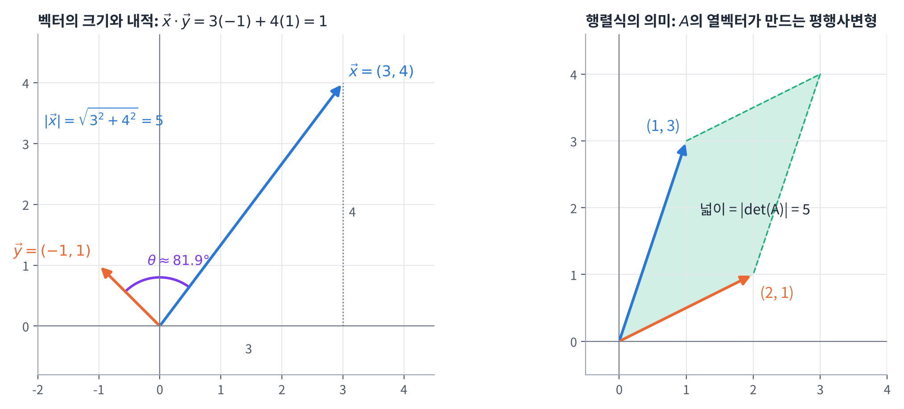
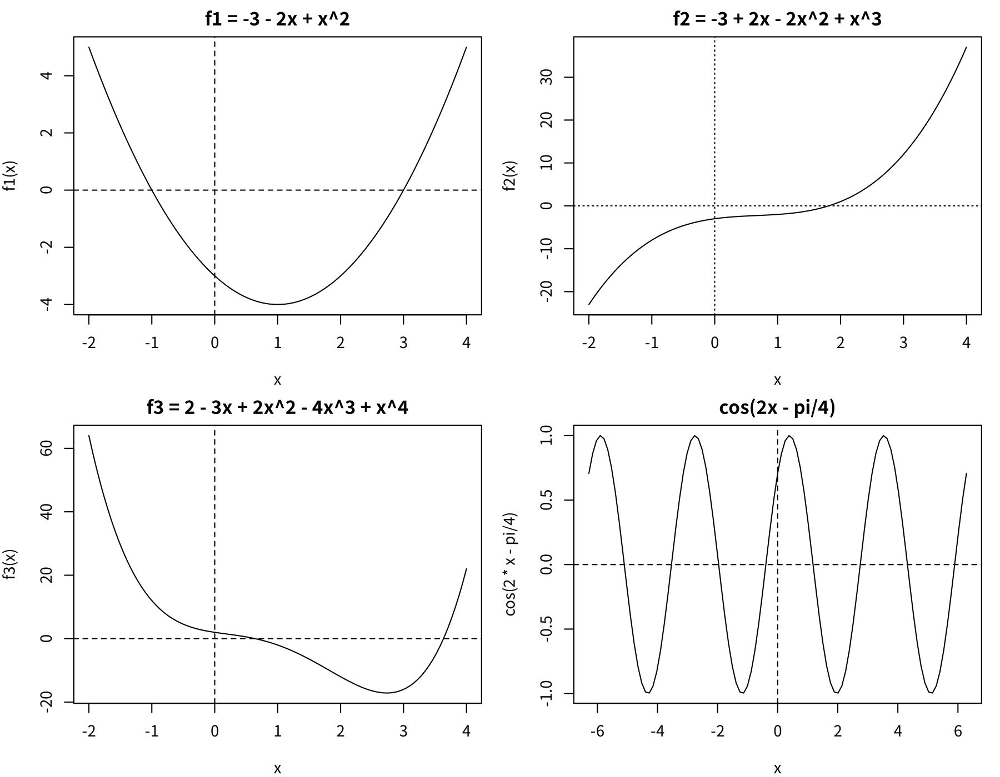
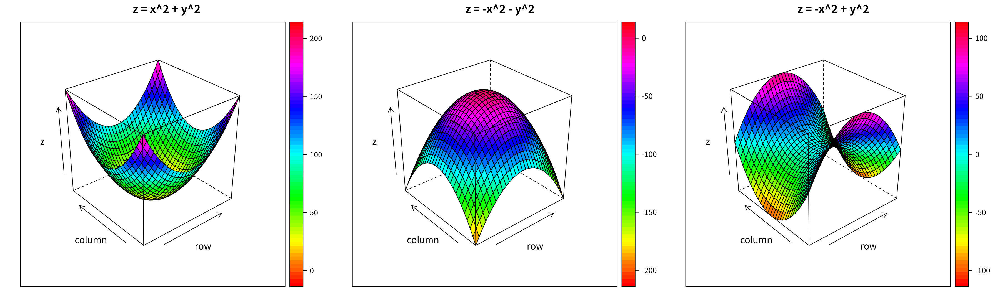
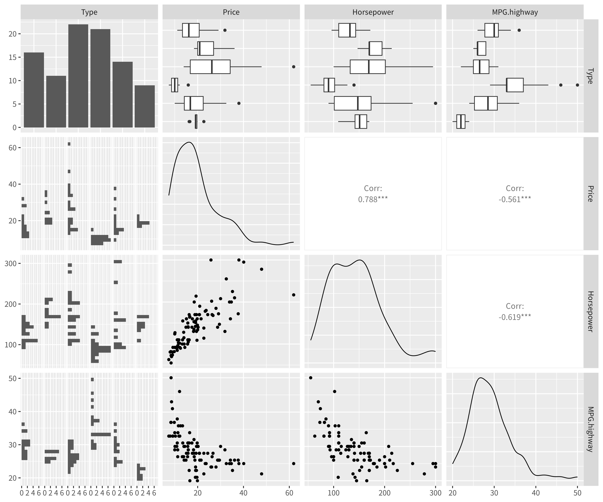

## 학습 목표

- R의 데이터 속성(자료형)과 데이터 구조(벡터, 행렬, 데이터프레임, 리스트, 요인) 구분
- 범주형 데이터와 연속형 데이터의 차이 이해
- 벡터의 크기, 길이, 내적과 행렬 연산(곱, 행렬식, 역행렬)을 R로 계산
- 수열, 반복, 조건문, 반복문, 함수 작성
- `curve()`로 2차원 함수, `wireframe()`으로 3차원 함수 그리기
- Cars93 데이터와 `ggpairs()`로 여러 변수의 관계를 한 번에 보기
- 2주차 과제(3D plot, ggpairs) 풀이

---

## R의 객체 (R Object)

R에서 다루는 모든 것(숫자, 문자, 표, 함수)은 **객체(object)**이며, 객체는 **속성(type)**과 **구조(structure)**로 구분함

### 데이터 속성 (Data Attributes)

| 속성 | 의미 | 예 |
| --- | --- | --- |
| numeric | 숫자, 실수 | `3.14` |
| integer | 정수 | `3L` |
| character | 문자 | `"Alice"` |
| logical | 논리 | `TRUE`, `FALSE` |
| factor | 요인 (범주형) | `factor(c("low", "high"))` |
| complex | 복소수 | `1 + 2i` |

### 데이터의 의미적 유형 (Semantic Data Type) ⭐️

| 유형 | 의미 | 예 | R에서 |
| --- | --- | --- | --- |
| **범주형 데이터** (Categorical, Qualitative) | 집단을 표현하는 변수, **셀 수 있는** 데이터 | 성별, 질병 여부, 직업, 인종 | `factor`, 값의 종류를 `level`(수준)이라고 함 |
| **연속형 데이터** (Continuous, Quantitative) | **셀 수 없는** 측정값 | 길이, 무게, 부피, 밀도, 시간, 임금 | `numeric`, `integer` |

**(중요!!)**

- 이 수업 전체가 "**변수가 범주형인가 연속형인가**"에 따라 분석 방법과 그래프를 고르는 구조
- 범주형 → 빈도, 비율, 막대그래프 / 연속형 → 평균, 표준편차, 히스토그램, 상자도표

### 데이터 구조 (Data Structure)

| 객체 유형 | 차원 | 구성 요소 | 특징 및 용도 | 예시 코드 |
| --- | --- | --- | --- | --- |
| Vector | 1차원 | 동일 자료형 | R의 가장 기본 구조, 하나의 자료형만 가능 | `c(1, 2, 3)` |
| Matrix | 2차원 | 동일 자료형 | 행렬, 수치 연산 등에서 사용 | `matrix(1:6, nrow = 2)` |
| Array | 다차원 | 동일 자료형 | 2차원 이상의 배열 구조 | `array(1:8, dim = c(2, 2, 2))` |
| List | 1차원 | 다양한 자료형 | 서로 다른 타입을 저장, 복잡한 데이터 저장에 유용 | `list(name = "Tom", score = c(90, 80))` |
| Data Frame | 2차원 | 열마다 다른 자료형 | 표 형식 데이터 저장에 가장 많이 사용 | `data.frame(name = c("A", "B"), score = c(80, 90))` |
| Factor | 1차원 | 범주형 데이터 | 범주형/명목형 변수 표현 (순서 가능) | `factor(c("low", "medium", "high"))` |
| Function | N/A | 함수 코드 | 사용자 정의 및 내장 함수 | `function(x) x^2` |
| S3 객체 | 다양 | 리스트 기반 | R의 기본 객체지향 시스템 (예: `lm` 모델 객체) | `model <- lm(y ~ x)` |
| S4 객체 | 다양 | 슬롯 기반 | 좀 더 엄격한 OOP 시스템 | `setClass()`, `new("MyClass")` |
| Environment | N/A | 변수 집합 | 객체들이 저장되는 공간 (변수 저장소 역할) | `globalenv()`, `environment()` |

- 이 밖에 tidyverse의 **티블(tibble)**은 데이터프레임을 개선한 표 구조 (5주차 이후 dplyr에서 자주 등장)

---

## 기본 계산과 변수

### R을 계산기처럼 쓰기

```r
2 + 3
2^3
1 / 2
3 - 2 * 1 + 4
sqrt(2)
pi
sin(pi)
log(10, base = 10)
abs(-1)
factorial(5)
exp(1)
```

실행 결과

```text
[1] 5
[1] 8
[1] 0.5
[1] 5
[1] 1.414214
[1] 3.141593
[1] 1.224647e-16
[1] 1
[1] 1
[1] 120
[1] 2.718282
```

- `sin(pi)`가 정확히 0이 아니라 `1.224647e-16`인 것은 컴퓨터의 **부동소수점 오차** (사실상 0)
- 콘솔 창 정리 단축키: `Ctrl + L`

### 변수 정의와 작업환경 관리

- R에서는 `<-` 기호로 변수에 값을 저장 (`=`도 가능하지만 `<-`가 R의 관례)

```r
x <- 3
y <- 2.1 * (x + 4)^3.1
y

ls()             # 지금 저장된 객체 목록
rm(list = ls())  # 모두 삭제
ls()
```

실행 결과

```text
[1] 875.0306
[1] "x" "y"
character(0)
```

| 함수 | 기능 |
| --- | --- |
| `ls()` | 현재 저장된 변수(객체) 목록 보기 |
| `rm(x, y)` | 변수 `x`, `y` 삭제 |
| `rm(list = ls())` | 모든 변수 삭제 (초기화) |

---

## 벡터 (Vector)

### 벡터의 크기, 길이, 내적

시작점 A와 끝점 B를 갖는 벡터 $$\vec{x} = \overrightarrow{AB}$$는 성분으로 $$\vec{x} = (x_1, x_2, \dots, x_n)$$처럼 표현

| 개념 | 수식 | 의미 | R 함수 |
| --- | --- | --- | --- |
| 크기 | $$\lvert\vec{x}\rvert = \sqrt{x_1^2 + \cdots + x_n^2}$$ | 화살표의 길이 | `norm(x, type = "2")` |
| 길이 | $$n$$ | 성분 개수 = 데이터 크기 = **차원** | `length(x)` |
| 내적 | $$\vec{x}\cdot\vec{y} = \sum x_i y_i$$ | 같은 성분끼리 곱해서 다 더하기 | `crossprod(x, y)` |

```r
x <- c(3, 4)
y <- c(-1, 1)

x[1]
x[c(1, 2)]
norm(x, type = "2")   # 벡터의 크기 = sqrt(3^2 + 4^2)
length(x)             # 성분의 개수
crossprod(x, y)       # 내적 = 3*(-1) + 4*1

# 두 벡터 사이 각도 (cos theta = 내적 / (크기 * 크기))
cos_theta <- sum(x * y) / (sqrt(sum(x^2)) * sqrt(sum(y^2)))
cos_theta
acos(cos_theta) * 180 / pi   # 각도(도)
```

실행 결과

```text
[1] 3
[1] 3 4
[1] 5
[1] 2
     [,1]
[1,]    1
[1] 0.1414214
[1] 81.8699
```

- 내적의 기하학적 의미: $$\vec{x}\cdot\vec{y} = \lvert\vec{x}\rvert\lvert\vec{y}\rvert\cos\theta$$
- $$\theta$$가 작을수록(같은 방향일수록) 두 벡터의 **상관성이 높음**
- 검색엔진은 문서와 검색어를 키워드 벡터로 만들고, 이 각도(코사인 유사도)로 비슷한 문서를 찾음



- 왼쪽: $$\vec{x} = (3, 4)$$의 크기는 $$\sqrt{3^2 + 4^2} = 5$$, $$\vec{y} = (-1, 1)$$과의 내적은 $$1$$, 사이각은 약 $$81.9°$$
- 오른쪽 그림은 아래 행렬식 부분에서 설명

### 수열과 반복 벡터

```r
seq(1, 10)
seq(1, 100, 3)[1:10]       # 1부터 3 간격 (앞 10개만 출력)
seq(15, 209, 6)[1:10]

rep(c(1, 2, 3), each = 3)        # 각 요소를 3번씩
rep(c(1, 2, 3), times = 3)       # 묶음을 3번
rep(c(1, 2, 3), times = c(5, 2, 1))
```

실행 결과

```text
 [1]  1  2  3  4  5  6  7  8  9 10
 [1]  1  4  7 10 13 16 19 22 25 28
 [1] 15 21 27 33 39 45 51 57 63 69
[1] 1 1 1 2 2 2 3 3 3
[1] 1 2 3 1 2 3 1 2 3
[1] 1 1 1 1 1 2 2 3
```

| 함수 | 기능 |
| --- | --- |
| `seq(from, to, by)` | `from`부터 `to`까지 `by` 간격의 수열 (`1:10`은 `seq(1, 10)`과 같음) |
| `rep(x, each = n)` | 각 원소를 $$n$$번씩 반복 |
| `rep(x, times = n)` | 전체 묶음을 $$n$$번 반복 |
| `rep(x, times = c(...))` | 원소마다 반복 횟수를 다르게 |

---

## 조건문과 반복문

### 조건문과 나머지 연산자

```r
x <- 10
y <- 5
if (x > y) {
  print("x가 y보다 크다")
}

10 %% 3
15 %% 5
1034637 %% 876

# 1~100 중 10개를 뽑아 홀짝 판별 (시험문제)
set.seed(20260908)
num <- sample(1:100, 10)
num
ifelse(num %% 2 == 0, "짝수", "홀수")
```

실행 결과

```text
[1] "x가 y보다 크다"
[1] 1
[1] 0
[1] 81
 [1] 56 18 25 95 45 61  9 10 30 47
 [1] "짝수" "짝수" "홀수" "홀수" "홀수" "홀수" "홀수" "짝수" "짝수" "홀수"
```

- `%%`: 나머지 연산자 ($$10 \div 3$$의 나머지 1)
- `ifelse(조건, 참일 때, 거짓일 때)`: 벡터의 **모든 원소에 한 번에** 조건을 적용
- `set.seed()`로 난수의 시작점을 고정하면 실행할 때마다 같은 결과가 나옴 (재현성)

**(중요!!) 시험문제로 표시된 부분**

- "1과 100 사이에서 10개 수를 랜덤하게 뽑아서 홀짝을 판별하라"
- 핵심은 `sample(1:100, 10)` + `num %% 2 == 0` + `ifelse()`의 조합

### 반복문

```r
total <- 0
for (i in 1:10) {
  total <- total + i
}
print(total)
sum(1:10)
sum(1:100)
```

실행 결과

```text
[1] 55
[1] 55
[1] 5050
```

- `for`문으로 직접 더해도 되지만, R은 `sum(1:10)`처럼 **벡터 연산**으로 한 번에 계산하는 것이 일반적이고 빠름

---

## 함수와 그래프

### 함수 정의와 `curve()`

- `function(x) { ... }`로 함수를 만들고, `curve(함수, 시작, 끝)`으로 그래프를 그림
- `abline(h = 0)`은 수평선, `abline(v = 0)`은 수직선, `lty`는 선 종류

```r
par(mfrow = c(2, 2), mar = c(4, 4, 2, 1))
f1 <- function(x) {-3 - 2*x + x^2}
curve(f1, -2, 4, main = "f1 = -3 - 2x + x^2")
abline(h = 0, lty = 2); abline(v = 0, lty = 2)

f2 <- function(x) {-3 + 2*x - 2*x^2 + x^3}
curve(f2, -2, 4, main = "f2 = -3 + 2x - 2x^2 + x^3")
abline(h = 0, lty = 3); abline(v = 0, lty = 3)

f3 <- function(x) {2 - 3*x + 2*x^2 - 4*x^3 + x^4}
curve(f3, -2, 4, main = "f3 = 2 - 3x + 2x^2 - 4x^3 + x^4")
abline(h = 0, lty = 2); abline(v = 0, lty = 2)

curve(cos(2*x - pi/4), -2*pi, 2*pi, main = "cos(2x - pi/4)")
abline(h = 0, lty = 2); abline(v = 0, lty = 2)
```



- $$f_1 = x^2 - 2x - 3 = (x - 3)(x + 1)$$: $$x = -1, 3$$에서 0, $$x = 1$$에서 최솟값 $$-4$$
- `curve(cos(2*x - pi/4), ...)`처럼 함수를 따로 만들지 않고 식을 바로 넣을 수도 있음

### 3차원 그래프: `outer()`와 `wireframe()` (2주차 과제)

- `outer(x, y, f)`: 격자 위의 **모든 $$(x, y)$$ 조합**에 대해 $$f(x, y)$$를 계산해서 행렬로 반환
- `lattice` 패키지의 `wireframe()`으로 그 행렬을 3차원 곡면으로 그림
- `drape = TRUE`는 높이에 따라 색을 입히고, `col.regions = rainbow(100)`은 그 색 팔레트

```r
library(lattice)
x <- seq(-10, 10, length = 30)
y <- x

f_a <- function(x, y) {x^2 + y^2}     # 아래로 볼록 (그릇)
f_b <- function(x, y) {-x^2 - y^2}    # 위로 볼록 (산)
f_c <- function(x, y) {-x^2 + y^2}    # 말안장

z <- outer(x, y, f_a)                 # 격자의 모든 (x, y)에 대해 z 계산
wireframe(z, drape = TRUE, col.regions = rainbow(100), main = "z = x^2 + y^2")

z <- outer(x, y, f_b)
wireframe(z, drape = TRUE, col.regions = rainbow(100), main = "z = -x^2 - y^2")

z <- outer(x, y, f_c)
wireframe(z, drape = TRUE, col.regions = rainbow(100), main = "z = -x^2 + y^2")
```



| 함수 | 모양 | 특징 |
| --- | --- | --- |
| $$z = x^2 + y^2$$ | 아래로 볼록 (그릇) | 원점이 최솟값 |
| $$z = -x^2 - y^2$$ | 위로 볼록 (산) | 원점이 최댓값 |
| $$z = -x^2 + y^2$$ | 말안장 (saddle) | 원점이 한 방향으로는 최대, 다른 방향으로는 최소 |

---

## 행렬 (Matrix)

### 행렬 만들기와 인덱싱

- 모든 성분이 숫자이거나 모두 문자인 2차원 구조, `matrix(값, 행 수, 열 수)`
- 기본은 **열 방향**으로 채우고, `byrow = TRUE`이면 **행 방향**으로 채움

```r
A <- matrix(1:16, 4, 4)            # 열 방향으로 채움
A
matrix(1:16, 4, 4, byrow = TRUE)   # 행 방향으로 채움

A[2, 3]            # 2행 3열
A[1, ]             # 1행 전체
A[, 2]             # 2열 전체
A[1:2, 3:4]        # 부분행렬
A[c(2, 4), c(1, 3)]
dim(A)
```

실행 결과

```text
     [,1] [,2] [,3] [,4]
[1,]    1    5    9   13
[2,]    2    6   10   14
[3,]    3    7   11   15
[4,]    4    8   12   16
     [,1] [,2] [,3] [,4]
[1,]    1    2    3    4
[2,]    5    6    7    8
[3,]    9   10   11   12
[4,]   13   14   15   16
[1] 10
[1]  1  5  9 13
[1] 5 6 7 8
     [,1] [,2]
[1,]    9   13
[2,]   10   14
     [,1] [,2]
[1,]    2   10
[2,]    4   12
[1] 4 4
```

| 코드 | 의미 |
| --- | --- |
| `A[2, 3]` | 2행 3열 원소 |
| `A[1, ]` | 1행 전체 |
| `A[, 2]` | 2열 전체 |
| `A[1:2, 3:4]` | 1~2행, 3~4열 부분행렬 |
| `A[c(2, 4), c(1, 3)]` | 2·4행, 1·3열 |
| `A[-c(1, 3), ]` | 1·3행 **제외** |

### 행렬 연산

강의 자료의 예: $$A = \begin{pmatrix}1 & 2\\3 & 1\end{pmatrix}$$, $$B = \begin{pmatrix}1 & 0\\-1 & 1\end{pmatrix}$$

```r
A <- matrix(c(1, 2,
              3, 1), 2, 2, byrow = TRUE)
B <- matrix(c(1, 0,
              -1, 1), 2, 2, byrow = TRUE)

A - 2 * B         # 행렬 연산
A %*% B           # 행렬 곱 (* 는 원소끼리 곱)
A * B
det(A)            # 행렬식 = 1*1 - 2*3
solve(A)          # 역행렬
solve(A) %*% A    # 단위행렬
```

실행 결과

```text
     [,1] [,2]
[1,]   -1    2
[2,]    5   -1
     [,1] [,2]
[1,]   -1    2
[2,]    2    1
     [,1] [,2]
[1,]    1    0
[2,]   -3    1
[1] -5
     [,1] [,2]
[1,] -0.2  0.4
[2,]  0.6 -0.2
     [,1] [,2]
[1,]    1    0
[2,]    0    1
```

**손으로 확인**

$$
A - 2B = \begin{pmatrix}1 & 2\\3 & 1\end{pmatrix} - 2\begin{pmatrix}1 & 0\\-1 & 1\end{pmatrix} = \begin{pmatrix}-1 & 2\\5 & -1\end{pmatrix}
$$

$$
AB = \begin{pmatrix}1 \times 1 + 2 \times (-1) & 1 \times 0 + 2 \times 1\\3 \times 1 + 1 \times (-1) & 3 \times 0 + 1 \times 1\end{pmatrix} = \begin{pmatrix}-1 & 2\\2 & 1\end{pmatrix}
$$

$$
\det(A) = \begin{vmatrix}1 & 2\\3 & 1\end{vmatrix} = (1)(1) - (2)(3) = -5, \qquad A^{-1} = \frac{1}{\det A}\begin{pmatrix}1 & -2\\-3 & 1\end{pmatrix} = \begin{pmatrix}-0.2 & 0.4\\0.6 & -0.2\end{pmatrix}
$$

| 연산 | R 코드 | 주의 |
| --- | --- | --- |
| 행렬 곱 | `A %*% B` | `A * B`는 **같은 위치 원소끼리** 곱 (행렬 곱이 아님) |
| 행렬식 | `det(A)` | |
| 역행렬 | `solve(A)` | $$A^{-1}A = I$$ (단위행렬) |
| 벡터 합치기 | `cbind(x, y)`, `rbind(x, y)` | 열로 붙이기, 행으로 붙이기 |

- **평행사변형의 넓이 = 행렬식의 절댓값**: $$A$$의 두 열벡터 $$(1, 3)$$, $$(2, 1)$$이 만드는 평행사변형의 넓이는 $$\lvert -5 \rvert = 5$$ (위 그림 오른쪽)

### 연습 문제 (강의 자료 7쪽)

> 1. `x <- seq(-6, 10, 0.05)`, `y <- 3 + x - 2*x^2`일 때 `x[2]`, `y[7]`은?
> 2. 1부터 909까지 3간격으로 띄워서 1 + 4 + 7 + 10 + ... 더하기
> 3. $$A = \begin{pmatrix}1 & 2\\3 & 4\end{pmatrix}$$, $$B = \begin{pmatrix}-1 & 0\\0 & 2\end{pmatrix}$$일 때 $$C = A - 2B$$의 `C[2, 1]`은?

```r
x <- seq(-6, 10, 0.05)
y <- 3 + x - 2*x^2
x[2]
y[7]

s <- seq(1, 909, 3)    # 1, 4, 7, ..., 907
tail(s, 3)
length(s)
sum(s)

A <- matrix(c(1, 2,
              3, 4), 2, 2, byrow = TRUE)
B <- matrix(c(-1, 0,
              0, 2), 2, 2, byrow = TRUE)
C <- A - 2*B
C
C[2, 1]
```

실행 결과

```text
[1] -5.95
[1] -67.68
[1] 901 904 907
[1] 303
[1] 137562
     [,1] [,2]
[1,]    3    2
[2,]    3    0
[1] 3
```

- 1번: `x[2]` $$= -6 + 0.05 = -5.95$$, `x[7]` $$= -6 + 6 \times 0.05 = -5.7$$이므로 `y[7]` $$= 3 - 5.7 - 2(5.7)^2 = -67.68$$
- 2번: 909는 포함되지 않음 (1, 4, 7, …, **907**까지 303개), 합 $$= \frac{303 \times (1 + 907)}{2} = 137{,}562$$
- 3번: $$C = \begin{pmatrix}3 & 2\\3 & 0\end{pmatrix}$$이므로 `C[2, 1]` $$= 3$$

---

## 데이터프레임, 리스트, 요인

### 데이터프레임 (data.frame)

- 엑셀 시트처럼 행과 열로 이루어진 표, **열마다 다른 자료형**이 가능

```r
name <- c("Jisoo", "Chulhee")
score <- c(90, 100)
my <- data.frame(name, score)
my
class(my)
str(my)

my[1, ]          # 1행
my[, 2]          # 2열
my$score         # 열 이름으로 접근
```

실행 결과

```text
     name score
1   Jisoo    90
2 Chulhee   100
[1] "data.frame"
'data.frame':	2 obs. of  2 variables:
 $ name : chr  "Jisoo" "Chulhee"
 $ score: num  90 100
   name score
1 Jisoo    90
[1]  90 100
[1]  90 100
```

- `str()`: 데이터의 **구조**(행·열 수, 각 열의 자료형)를 한 번에 확인 → 데이터를 처음 받으면 가장 먼저 실행
- `$`: 열 이름으로 접근 (`my$score`)

### 리스트와 요인

```r
my_list <- list(name = "Alice", age = 25,
                scores = c(90, 85, 88), passed = TRUE)
my_list$name
my_list[1]          # 리스트 형태로 추출
my_list[[1]]        # 값 자체를 추출
my_list$scores[1]
my_list[[3]][1]

f <- factor(c("low", "high", "medium", "low"),
            levels = c("low", "medium", "high"))
f
levels(f)
table(f)
```

실행 결과

```text
[1] "Alice"
$name
[1] "Alice"

[1] "Alice"
[1] 90
[1] 90
[1] low    high   medium low   
Levels: low medium high
[1] "low"    "medium" "high"  
f
   low medium   high 
     2      1      1
```

| 코드 | 결과 |
| --- | --- |
| `my_list$name` | `"Alice"` (이름으로 접근) |
| `my_list[1]` | 리스트 형태로 추출 (class: list) |
| `my_list[[1]]` | 값 자체를 추출 (class: character) |
| `my_list$scores[1]` | `scores` 벡터의 첫 번째 값 90 |

- 요인(factor)은 범주형 변수를 저장하는 구조이고, `levels`로 **가능한 값의 목록과 순서**를 정함

---

## Cars93 데이터와 ggpairs (2주차 과제)

### Cars93 데이터 살펴보기

- `MASS` 패키지에 들어 있는 1993년 판매 자동차 93종의 데이터 (변수 27개)

```r
library(MASS)
data(Cars93)
dim(Cars93)
class(Cars93$Type)         # 범주형 -> factor
class(Cars93$Horsepower)   # 연속형 -> integer
levels(Cars93$Type)
head(Cars93[, c("Manufacturer", "Model", "Type", "Price", "Horsepower")], 3)
```

실행 결과

```text
[1] 93 27
[1] "factor"
[1] "integer"
[1] "Compact" "Large"   "Midsize" "Small"   "Sporty"  "Van"    
  Manufacturer   Model    Type Price Horsepower
1        Acura Integra   Small  15.9        140
2        Acura  Legend Midsize  33.9        200
3         Audi      90 Compact  29.1        172
```

- `Type`은 factor(**범주형**), `Horsepower`는 integer(**연속형**)
- 앞으로의 분석에서 계속 이 두 종류를 구분해서 사용

### 여러 변수를 한 번에 보기: `ggpairs()`

- `GGally` 패키지의 `ggpairs()`는 선택한 변수들의 **모든 쌍**에 대해 알맞은 그래프를 자동으로 그림
- 패키지는 `install.packages("GGally")`로 **한 번만** 설치하고, `library(GGally)`는 **쓸 때마다** 불러옴

```r
library(MASS)
library(GGally)
my <- subset(Cars93, select = c(Type, Price, Horsepower, MPG.highway))
ggpairs(my)
```



| 위치 | 변수 조합 | 그래프 |
| --- | --- | --- |
| 대각선 | 한 변수 | 범주형은 막대그래프, 연속형은 밀도 곡선 |
| 첫 행 | 범주형(Type) × 연속형 | 집단별 상자도표 |
| 첫 열 | 연속형 × 범주형(Type) | 집단별 히스토그램 |
| 위쪽 삼각형 | 연속형 × 연속형 | **상관계수** (`***`는 매우 유의함) |
| 아래쪽 삼각형 | 연속형 × 연속형 | 산점도 |

- 가격(Price)과 마력(Horsepower)의 상관계수 0.788 → 마력이 클수록 비쌈
- 마력과 고속도로 연비(MPG.highway)의 상관계수 −0.619 → 마력이 클수록 연비가 나쁨
- 한 장의 그림으로 3주차(1변수), 4주차(2변수)에서 배울 그래프를 모두 미리 볼 수 있음

---

### 강의 자료에서 정정한 부분 정리

| 위치 | 강의 자료 | 정정 | 이유 |
| --- | --- | --- | --- |
| 2주차 수업자료 6쪽 | $$AB = \begin{pmatrix}1 & 2\\3 & 1\end{pmatrix}$$ | $$AB = \begin{pmatrix}-1 & 2\\2 & 1\end{pmatrix}$$ | 같은 쪽의 계산식 $$1 \times 1 + 2 \times (-1) = -1$$ 등을 끝까지 계산한 값, R의 `A %*% B`와 일치 |

---

## 최종 핵심 정리

1. R의 모든 것은 객체이며, **속성**(numeric, character, factor 등)과 **구조**(벡터, 행렬, 데이터프레임, 리스트)로 구분
2. **범주형**(factor, 셀 수 있음)과 **연속형**(numeric, 측정값)의 구분이 이후 모든 분석의 출발점
3. 벡터의 크기 `norm()`, 길이 `length()`, 내적 `crossprod()`, 내적은 $$\lvert\vec{x}\rvert\lvert\vec{y}\rvert\cos\theta$$로 두 벡터의 유사도를 나타냄
4. `seq()`, `rep()`, `%%`, `ifelse()`, `for`, `sum()`으로 수열·반복·조건 처리 (홀짝 판별은 시험문제)
5. `function()`으로 함수를 만들고 `curve()`로 2차원, `outer()` + `wireframe()`으로 3차원 그래프
6. 행렬 곱은 `%*%`(`*`는 원소끼리 곱), 행렬식 `det()`은 평행사변형의 넓이, 역행렬은 `solve()`
7. 데이터프레임은 열마다 다른 자료형을 담는 표이고, `str()`로 구조를, `$`로 열을 확인
8. `ggpairs()`는 변수 쌍마다 알맞은 그래프(막대, 상자도표, 산점도, 상관계수)를 한 번에 그려 줌

---

End.
