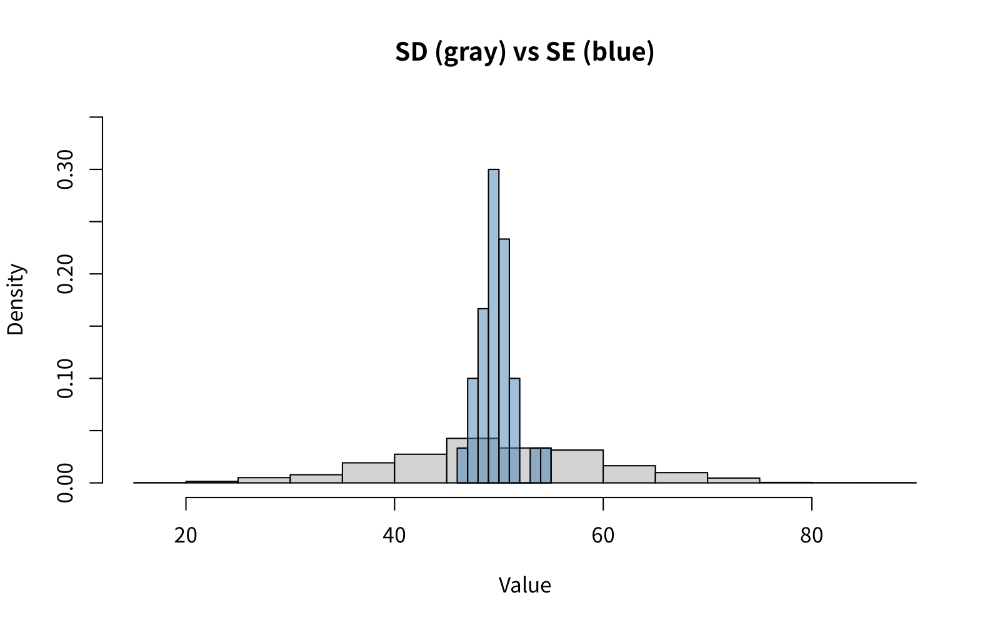
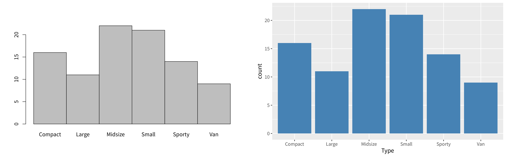
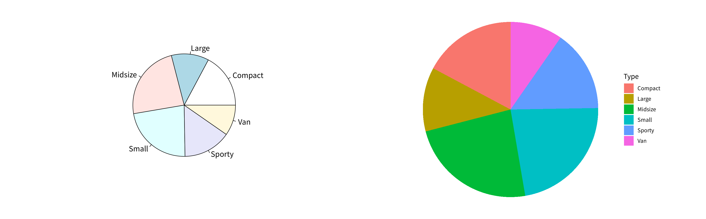
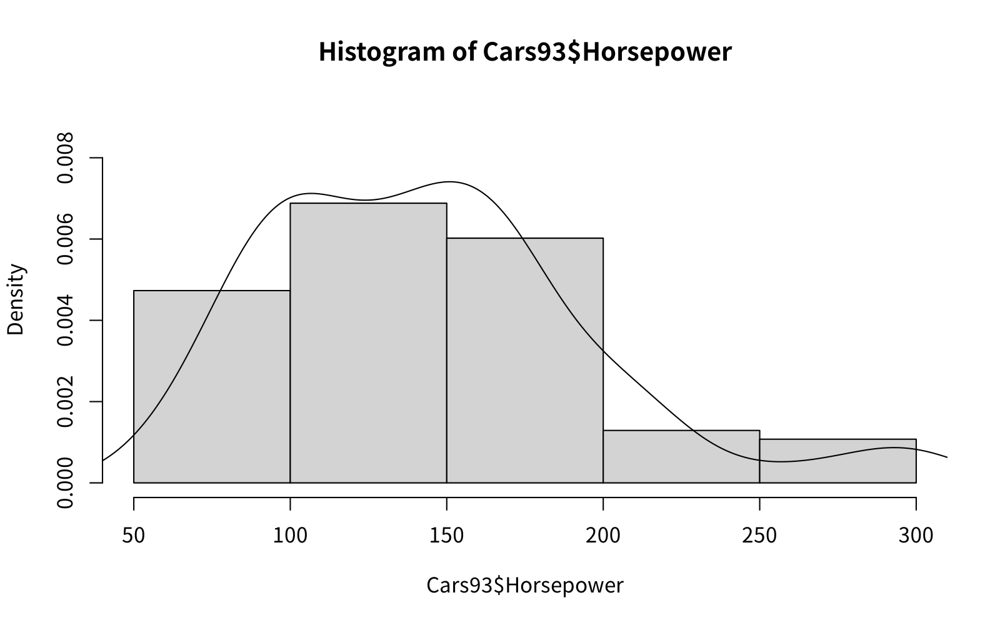
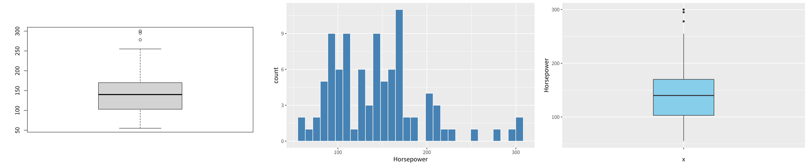

## 학습 목표

- 데이터프레임의 구조 확인과 인덱싱
- 표준편차(SD)와 표준오차(SE)의 차이, 표본 크기와 표준오차의 관계 이해
- **범주형 1변수**: 빈도수, 상대도수, 누적 빈도, 최빈값, 막대그래프, 파이차트
- **연속형 1변수**: 평균, 분산, 표준편차, 중앙값, 사분위수, 히스토그램, 밀도 곡선, 상자도표
- 상자도표로 이상치를 찾고 해당 행을 확인하기
- 변수 유형에 맞지 않는 그래프를 쓰면 생기는 오류 이해
- 3주차 과제(범주형·연속형 1변수 그래프) 풀이

---

## 데이터프레임 다시 보기

```r
df <- data.frame(
  name = c("Alice", "Bob", "Charlie"),
  age = c(25, 30, 22),
  gender = c("F", "M", "M")
)
str(df)

df[1, 2]          # 1행 2열
df$name           # name 열
df[, "gender"]    # gender 열
df[2, ]           # 2행 전체
```

실행 결과

```text
'data.frame':	3 obs. of  3 variables:
 $ name  : chr  "Alice" "Bob" "Charlie"
 $ age   : num  25 30 22
 $ gender: chr  "F" "M" "M"
[1] 25
[1] "Alice"   "Bob"     "Charlie"
[1] "F" "M" "M"
  name age gender
2  Bob  30      M
```

| 코드 | 결과 |
| --- | --- |
| `str(df)` | 3행 3열, 각 열의 자료형 (`chr`, `num`) |
| `df[1, 2]` | 1행 2열 값 → 25 |
| `df$name` | name 열 전체 |
| `df[, "gender"]` | gender 열 (열 이름으로 접근) |
| `df[2, ]` | 2행 전체 (Bob의 정보) |

---

## 표준편차와 표준오차 (SD vs SE)

### 정의 ⭐️

| 통계량 | 의미 | 계산 |
| --- | --- | --- |
| 표준편차 (SD) | **데이터 하나하나**가 평균에서 퍼진 정도 | $$s = \sqrt{\frac{1}{n - 1}\sum (x_i - \bar{x})^2}$$ |
| 표준오차 (SE) | **표본평균**이 퍼진 정도 = 평균 추정의 불확실성 | $$SE = \frac{s}{\sqrt{n}}$$ |

- 표준오차 = **평균의 표준편차** = 표준편차 / $$\sqrt{n}$$
- 표본 크기 $$n$$이 커질수록 표준오차가 작아짐 → **데이터가 많을수록(빅데이터일수록) 모집단의 평균을 정확하게 찾음**

### 시뮬레이션

평균 50, 표준편차 10인 정규분포에서 1000개를 모집단으로 만들고, 크기 30인 표본을 30번 뽑아 표본평균의 퍼짐을 비교

```r
# SD vs SE
set.seed(1)
pop <- rnorm(1000, 50, 10)   # N(50, 10^2)
mean(pop)
sd(pop)

sample_means <- replicate(30, mean(sample(pop, 30)))  # 크기 30인 표본평균 30개
se_sample <- sd(sample_means)
se_sample
sd(pop) / sqrt(30)          # 이론값: 표준편차 / sqrt(n)

hist(pop, freq = FALSE, ylim = c(0, 0.35),
     main = "SD (gray) vs SE (blue)", xlab = "Value")
hist(sample_means, col = rgb(70/255, 130/255, 180/255, 0.5), freq = FALSE, add = TRUE)
```

실행 결과

```text
[1] 49.88352
[1] 10.34916
[1] 1.701013
[1] 1.889489
```



- 회색(모집단 데이터)은 20~80까지 넓게 퍼지지만, 파란색(표본평균)은 50 근처에 몰려 있음
- 표본평균의 표준편차 1.70은 이론값 $$\frac{10.35}{\sqrt{30}} \approx 1.89$$와 비슷 (표본평균을 30개만 뽑아서 차이가 있음)

### 표본 크기에 따른 표준오차

표본평균을 2000번씩 뽑아서 $$n$$에 따른 변화를 확인

```r
set.seed(1)
pop <- rnorm(1000, 50, 10)
for (n in c(10, 30, 100, 300)) {
  means <- replicate(2000, mean(sample(pop, n)))
  cat(sprintf("n = %3d: 표본평균의 SD(=SE) = %.3f, sd(pop)/sqrt(n) = %.3f\n",
              n, sd(means), sd(pop) / sqrt(n)))
}
```

실행 결과

```text
n =  10: 표본평균의 SD(=SE) = 3.259, sd(pop)/sqrt(n) = 3.273
n =  30: 표본평균의 SD(=SE) = 1.859, sd(pop)/sqrt(n) = 1.889
n = 100: 표본평균의 SD(=SE) = 0.982, sd(pop)/sqrt(n) = 1.035
n = 300: 표본평균의 SD(=SE) = 0.494, sd(pop)/sqrt(n) = 0.598
```

- $$n$$이 10 → 100으로 10배 커지면 표준오차는 약 $$\frac{1}{\sqrt{10}} \approx 0.32$$배로 줄어듦
- $$n = 300$$에서 실제 값(0.494)이 이론값(0.598)보다 작은 이유: 1000개짜리 **유한 모집단에서 중복 없이** 뽑기 때문 (유한 모집단 수정계수 $$\sqrt{\frac{N - n}{N - 1}} = \sqrt{\frac{700}{999}} \approx 0.84$$를 곱하면 $$0.598 \times 0.84 \approx 0.50$$으로 일치)

---

## 범주형 1변수 (One Categorical Variable)

### 요약 통계량

| 통계량 | 설명 | 계산 방법 | R 코드 |
| --- | --- | --- | --- |
| 빈도수 (Frequency) | 각 범주에 속하는 관측값 개수 | 각 범주의 관측값 개수를 셈 | `table()` |
| 상대도수 (Relative Frequency) | 각 범주의 비율 | 해당 범주의 빈도수 ÷ 전체 표본 수 | `proportions(table())` |
| 누적 빈도 (Cumulative Frequency) | 범주를 순서대로 합산한 빈도수 | 첫 범주부터 해당 범주까지 빈도수 누적 합 | `cumsum(table())` |
| 누적 상대도수 | 누적된 비율 | 첫 범주부터 해당 범주까지 상대도수 누적 합 | `cumsum(proportions(table()))` |
| 최빈값 (Mode) | 가장 빈도가 높은 범주 | 가장 많은 빈도를 가진 범주 | `which.max(table())` |

### Cars93의 차종(Type)

```r
library(MASS)
data("Cars93")
class(Cars93$Type)     # factor(요인)
levels(Cars93$Type)    # level(수준): factor가 가질 수 있는 값

table(Cars93$Type)                               # 빈도수
round(proportions(table(Cars93$Type)) * 100, 1)  # 상대도수(%)
cumsum(table(Cars93$Type))                       # 누적 빈도
names(which.max(table(Cars93$Type)))             # 최빈값
```

실행 결과

```text
[1] "factor"
[1] "Compact" "Large"   "Midsize" "Small"   "Sporty"  "Van"    

Compact   Large Midsize   Small  Sporty     Van 
     16      11      22      21      14       9 

Compact   Large Midsize   Small  Sporty     Van 
   17.2    11.8    23.7    22.6    15.1     9.7 
Compact   Large Midsize   Small  Sporty     Van 
     16      27      49      70      84      93 
[1] "Midsize"
```

- `factor`의 `levels`는 변수가 가질 수 있는 값의 목록 (Compact, Large, Midsize, Small, Sporty, Van)
- 중형차(Midsize)가 22대(23.7%)로 최빈값

### 막대그래프 (3주차 과제)

```r
library(MASS)
barplot(table(Cars93$Type), space = 0)           # 기본 그래픽

ggplot(Cars93, aes(x = Type)) +                  # ggplot2
  geom_bar(fill = "steelblue")
```



- 왼쪽: 기본 그래픽 `barplot()` (`space = 0`이면 막대 사이 간격 없음)
- 오른쪽: `ggplot2`의 `geom_bar()`, 원자료(raw data)를 넣으면 **알아서 개수를 세서** 막대 높이로 사용
- `fill = "steelblue"`처럼 `aes()` **밖**에 쓰면 모든 막대가 같은 색, `aes(fill = Type)`처럼 **안**에 쓰면 범주마다 다른 색

### 파이차트 (3주차 과제)

```r
library(MASS)
pie(table(Cars93$Type))                          # 기본 그래픽

ggplot(Cars93, aes(x = "", fill = Type)) +       # ggplot2: 막대 하나를 원으로 말기
  geom_bar(width = 1) +
  coord_polar(theta = "y") +
  theme_void()
```



- ggplot2에는 파이차트 함수가 따로 없음 → **막대 하나**(`x = ""`)를 쌓아서 만든 뒤 `coord_polar(theta = "y")`로 원형으로 말아서 만듦
- `theme_void()`: 축과 배경을 모두 지움
- `fill = Model`처럼 범주가 너무 많은 변수(93개 모델)를 쓰면 조각이 너무 작아 읽을 수 없음 → 파이차트는 범주가 적을 때만 사용

---

## 연속형 1변수 (One Continuous Variable)

### 요약 통계량

| 통계량 | 설명 | 계산식 | R 코드 |
| --- | --- | --- | --- |
| 평균 (Mean) | 관측값들의 중심 위치 | $$\bar{x} = \frac{1}{n}\sum x_i$$ | `mean()` |
| 분산 (Variance) | 데이터 흩어짐 정도의 제곱 평균 | $$s^2 = \frac{1}{n - 1}\sum (x_i - \bar{x})^2$$ | `var()` |
| 표준편차 (SD) | 분산의 제곱근, 데이터 산포도 | $$s = \sqrt{s^2}$$ | `sd()` |
| 표준오차 (SE) | 평균 추정의 불확실성 | $$SE = \frac{s}{\sqrt{n}}$$ | `sd(x) / sqrt(length(x))` |
| 95% 신뢰구간 (CI) | 평균에 대한 95% 신뢰구간 | $$\bar{x} \pm t_{\alpha/2, df} \times SE$$ | `t.test(x)$conf.int` |
| 중앙값 (Median) | 크기순으로 가운데 값 | | `median()` |
| 사분위수 (Quartile) | 25%, 50%, 75% 위치의 값 | | `summary()`, `quantile()` |

### 히스토그램과 밀도 곡선 (3주차 과제)

```r
library(MASS)
hist(Cars93$Horsepower, prob = TRUE, ylim = c(0, 0.009))
lines(density(Cars93$Horsepower))               # 밀도 곡선을 겹쳐 그림
```



- `prob = TRUE`: 세로축을 개수가 아니라 **밀도**(막대 넓이의 합 = 1)로 바꿔서 밀도 곡선과 같은 척도로 맞춤
- `lines(density(...))`: 앞의 그래프 위에 **겹쳐** 그림
- 마력은 100~200 사이에 대부분 있고, 오른쪽으로 긴 꼬리가 있음 (오른쪽으로 치우친 분포)

### 요약 통계량 계산

```r
library(MASS)
mean(Cars93$Horsepower)      # 평균
var(Cars93$Horsepower)       # 분산
sd(Cars93$Horsepower)        # 표준편차
median(Cars93$Horsepower)    # 중앙값 (시험에 나옴)
min(Cars93$Horsepower)
max(Cars93$Horsepower)
summary(Cars93$Horsepower)   # Qu. = Quartile(사분위수)
IQR(Cars93$Horsepower)       # Q3 - Q1
```

실행 결과

```text
[1] 143.828
[1] 2743.079
[1] 52.37441
[1] 140
[1] 55
[1] 300
   Min. 1st Qu.  Median    Mean 3rd Qu.    Max. 
   55.0   103.0   140.0   143.8   170.0   300.0 
[1] 67
```

- 평균(143.8)이 중앙값(140)보다 큼 → 큰 값(300 등)이 평균을 끌어올림 (오른쪽 꼬리)
- **(중요!!) 중앙값은 시험에 나온다고 표시된 부분**
- `summary()`의 `1st Qu.`, `3rd Qu.`는 1사분위수(25%), 3사분위수(75%)

### 상자도표와 이상치

상자도표(boxplot)의 구성

| 요소 | 의미 |
| --- | --- |
| 상자 아래·위 | $$Q_1$$(103), $$Q_3$$(170) |
| 상자 안의 굵은 선 | 중앙값 (140) |
| 수염 | $$Q_1 - 1.5 \times IQR$$ ~ $$Q_3 + 1.5 \times IQR$$ 범위 안의 최솟값·최댓값 |
| 점 | 수염 밖의 **이상치 (outlier)** |

- 여기서 $$IQR = Q_3 - Q_1 = 67$$이므로 위쪽 경계는 $$170 + 1.5 \times 67 = 270.5$$ → 이보다 큰 278, 295, 300, 300이 이상치

```r
library(MASS)
out <- boxplot(Cars93$Horsepower, plot = FALSE)$out   # 이상치
out
which(Cars93$Horsepower %in% out)                      # 이상치의 행 번호
Cars93[which(Cars93$Horsepower %in% out),
       c("Manufacturer", "Model", "Type", "Horsepower")]

which.min(Cars93$Horsepower)                           # 최솟값의 위치
Cars93[which.min(Cars93$Horsepower), c("Manufacturer", "Model", "Horsepower")]
```

실행 결과

```text
[1] 295 300 300 278
[1] 11 19 28 48
   Manufacturer    Model    Type Horsepower
11     Cadillac  Seville Midsize        295
19    Chevrolet Corvette  Sporty        300
28        Dodge  Stealth  Sporty        300
48     Infiniti      Q45 Midsize        278
[1] 39
   Manufacturer Model Horsepower
39          Geo Metro         55
```

- `boxplot(...)$out`: 이상치 값만 꺼냄 (`plot = FALSE`이면 그림 없이 계산만)
- `which()`: 조건을 만족하는 **행 번호**, `which.min()`·`which.max()`: 최솟값·최댓값의 위치
- 이상치는 캐딜락 Seville, 쉐보레 Corvette 등 고급·스포츠카이고, 최소 마력은 Geo Metro(55)

### ggplot2로 그리기 (3주차 과제)

```r
library(MASS)
boxplot(Cars93$Horsepower)                      # 기본 그래픽 상자도표

ggplot(Cars93, aes(x = Horsepower)) +
  geom_histogram(fill = "steelblue", colour = "white")

ggplot(Cars93, aes(x = "", y = Horsepower)) +
  geom_boxplot(fill = "skyblue", width = 0.3)
```



- 왼쪽부터 기본 그래픽 상자도표, ggplot2 히스토그램(`geom_histogram`), ggplot2 상자도표(`geom_boxplot`)
- ggplot2 상자도표는 x축이 필요하므로 `x = ""`로 빈 범주 하나를 지정
- `geom_histogram()`의 기본 구간 수는 30개라서 `binwidth`나 `bins`로 바꿔 보는 것이 좋음

### 연습: 시내 연비(MPG.city)로 바꿔서 확인 (시험문제)

강의에서 "요소를 바꿔서 확인하기"로 시험문제라고 표시한 부분. 같은 방법을 `MPG.city`에 적용

```r
library(MASS)
summary(Cars93$MPG.city)
out <- boxplot(Cars93$MPG.city, plot = FALSE)$out
out
Cars93[which(Cars93$MPG.city %in% out),
       c("Manufacturer", "Model", "Type", "MPG.city")]
```

실행 결과

```text
   Min. 1st Qu.  Median    Mean 3rd Qu.    Max. 
  15.00   18.00   21.00   22.37   25.00   46.00 
[1] 46 42 39
   Manufacturer Model  Type MPG.city
39          Geo Metro Small       46
42        Honda Civic Small       42
83       Suzuki Swift Small       39
```

- 이상치는 46, 42, 39이고, 모두 소형차(Small)의 연비가 매우 좋은 경우
- 주의: 이상치 **값**(46, 42, 39)을 그대로 `Cars93[c(39, 42, 46), ]`처럼 행 번호로 쓰면 다른 차가 나옴 → 반드시 `which()`로 **행 번호**를 먼저 구해야 함 (39번, 42번 행은 우연히 값과 번호가 같아서 맞지만, 46번 행은 연비 26인 Hyundai Scoupe)

---

## 변수 유형과 그래프가 맞지 않을 때

| 코드 | 결과 | 이유 |
| --- | --- | --- |
| `ggplot(Cars93, aes(x = Type)) + geom_histogram()` | **오류** | 히스토그램은 연속형 x가 필요한데 Type은 범주형 |
| `ggplot(Cars93, aes(x = MPG.city)) + geom_bar()` | 그려지지만 부적절 | 연속형 값마다 막대를 따로 세어서 히스토그램처럼 묶이지 않음 |
| `ggplot(Cars93, aes(x = Manufacturer)) + geom_bar()` | 그려지지만 읽기 어려움 | 범주가 32개라 x축 글자가 겹침 → 정렬하거나 축을 돌려야 함 |

첫 번째 경우의 실제 오류 메시지

```r
library(MASS)
p <- ggplot(Cars93, aes(x = Type)) +
  geom_histogram(fill = "steelblue", colour = "white")
r <- try(print(p), silent = TRUE)
cat(r)
```

실행 결과

```text
Error in geom_histogram(fill = "steelblue", colour = "white") : 
  Problem while computing stat.
ℹ Error occurred in the 1st layer.
Caused by error in `setup_params()`:
! `stat_bin()` requires a continuous x aesthetic
✖ the x aesthetic is discrete.
ℹ Perhaps you want `stat="count"`?
```

- 오류 메시지가 해결책까지 알려 줌: 범주형은 `stat = "count"`, 즉 `geom_bar()`를 써야 함

**(중요!!) 1변수 그래프 선택 정리**

| 변수 유형 | 요약 | 그래프 |
| --- | --- | --- |
| 범주형 | 빈도, 상대도수, 최빈값 | 막대그래프 `geom_bar()`, 파이차트 |
| 연속형 | 평균, 중앙값, 표준편차, 사분위수 | 히스토그램 `geom_histogram()`, 밀도 곡선, 상자도표 `geom_boxplot()` |

---

### 강의 자료 및 실습 코드에서 정정한 부분 정리

| 위치 | 원래 | 정정 | 이유 |
| --- | --- | --- | --- |
| 3주차 수업자료 3쪽 그래프 제목 | SD (blue) vs SE (red) | SD (gray) vs SE (blue) | 같은 쪽 코드의 `main`과 실제 색(회색, 파란색)에 맞춤 |
| 3주차 실습 코드 | `Sample_means <- ...` 후 `hist(sample_means, ...)` | 변수 이름을 `sample_means`로 통일 | R은 대소문자를 구분해서 `object 'sample_means' not found` 오류 |
| 3주차 실습 코드 (MPG.city) | `sd(Cars93$Horsepower)` | `sd(Cars93$MPG.city)` | 연습 대상 변수와 맞춤 |
| 3주차 실습 코드 (MPG.city) | `Cars93[c(39, 42, 46), ]` | `Cars93[which(Cars93$MPG.city %in% out), ]` | 이상치 값을 행 번호로 사용함 |

---

## 최종 핵심 정리

1. 데이터를 받으면 먼저 `str()`로 구조와 각 변수의 자료형(범주형/연속형)을 확인
2. **표준편차**는 데이터의 퍼짐, **표준오차** $$\frac{s}{\sqrt{n}}$$는 표본평균의 퍼짐이며, $$n$$이 클수록 작아짐 (빅데이터일수록 평균 추정이 정확)
3. 범주형 1변수는 `table()`(빈도), `proportions()`(상대도수), `cumsum()`(누적), 최빈값으로 요약
4. 범주형 그래프는 막대그래프(`barplot`, `geom_bar`)와 파이차트(`pie`, `coord_polar`)
5. 연속형 1변수는 평균, 분산, 표준편차, **중앙값**, 사분위수(`summary()`)로 요약
6. 연속형 그래프는 히스토그램 + 밀도 곡선, 상자도표이며, 평균 > 중앙값이면 오른쪽 꼬리 분포
7. 상자도표의 이상치는 $$Q_3 + 1.5 \times IQR$$ 밖의 값이고, `boxplot()$out`과 `which()`로 해당 행을 찾음
8. 그래프는 변수 유형에 맞게: 범주형에 `geom_histogram()`을 쓰면 오류

---

End.
