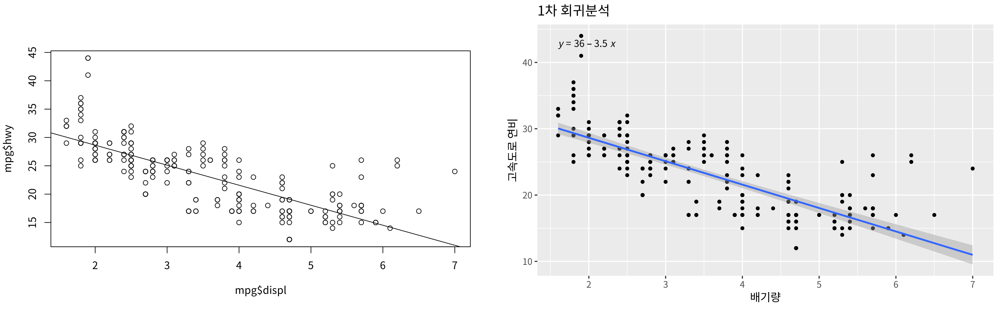
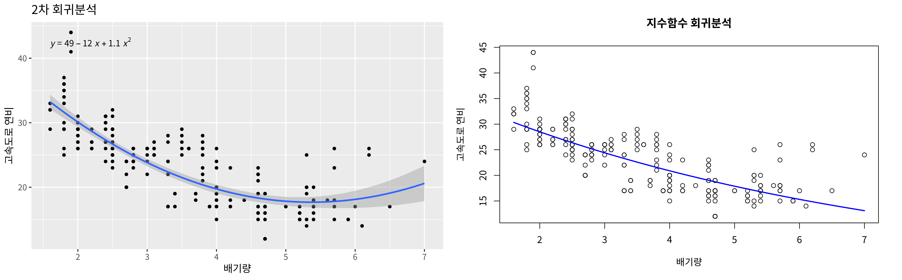
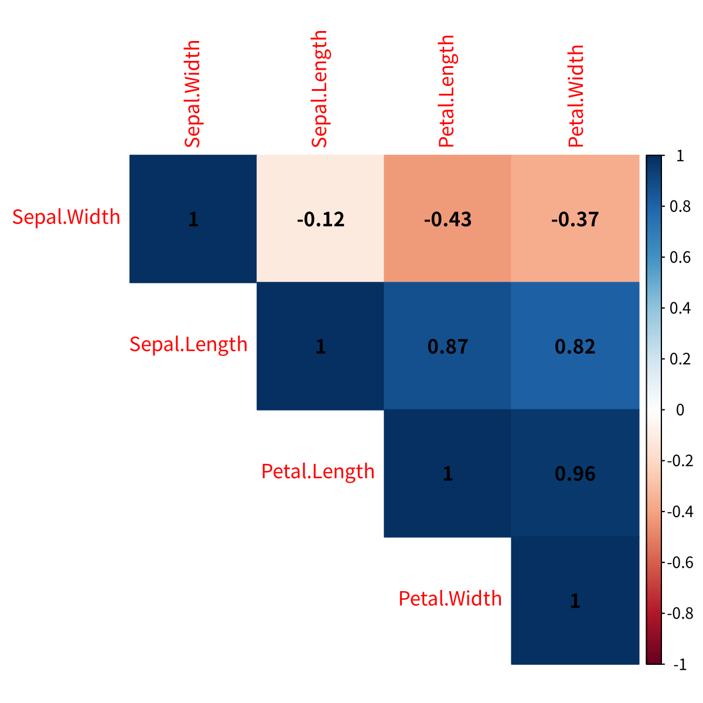
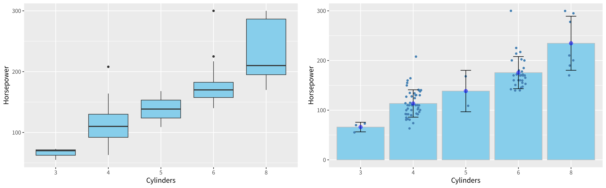
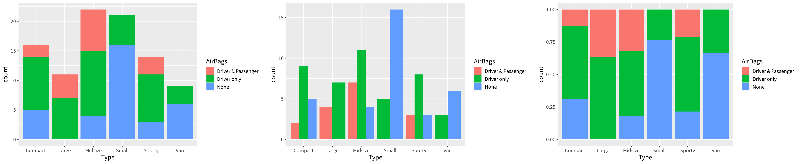
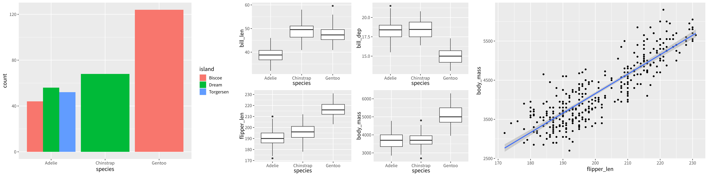
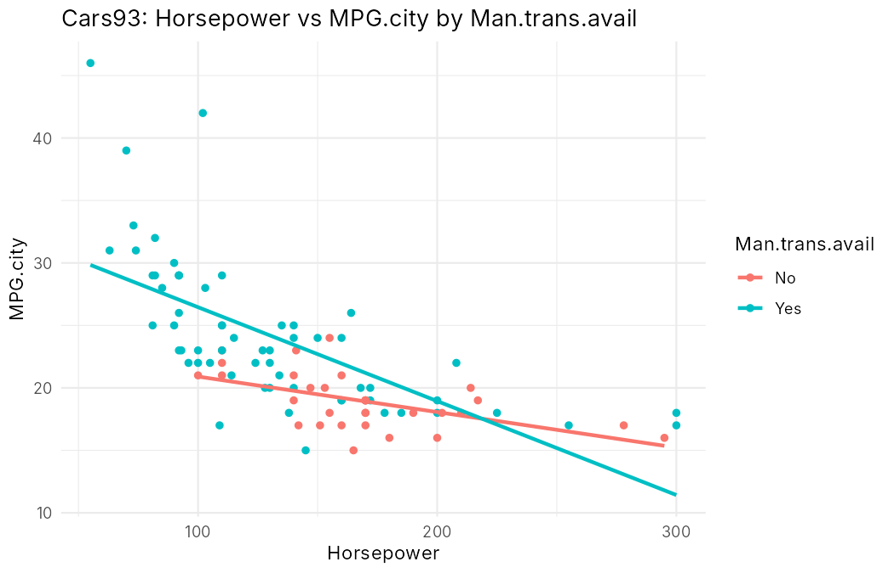
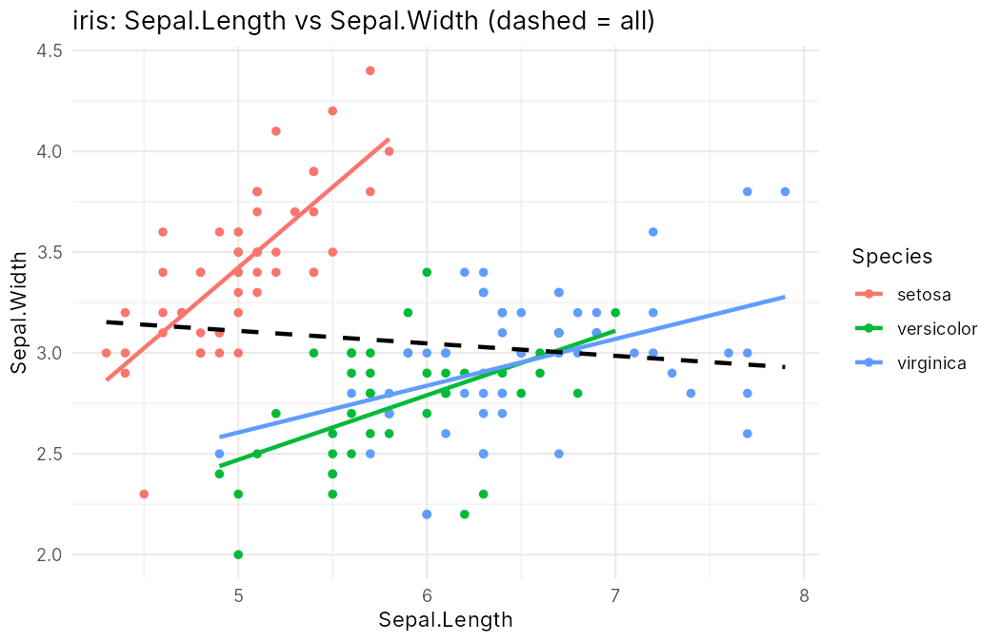
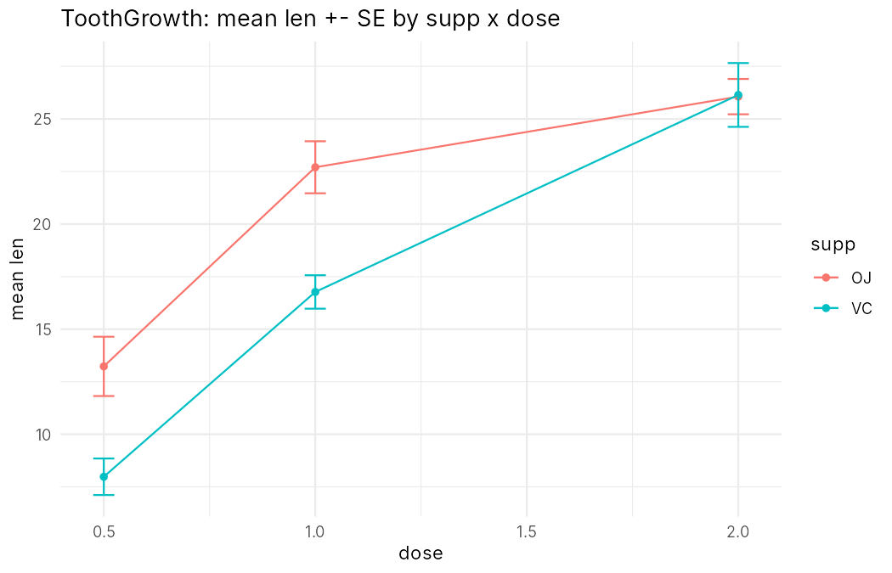

## 학습 목표

- 두 변수의 유형(범주형/연속형) 조합에 따라 분석 방법과 그래프 고르기
- **연속형 × 연속형**: `lm()`으로 1차·2차·지수 회귀식 구하기, 상관계수와 `corrplot`
- **범주형 × 연속형**: 집단별 평균, 상자도표, 에러바 차트
- **범주형 × 범주형**: 교차표, 행·열 비율, 누적·그룹형·비율 누적 막대그래프
- 3변수(연속형 2개 + 범주형 1개, 연속형 1개 + 범주형 2개)로 확장하는 방법
- `CrossTable()`의 칸별 값과 카이제곱 기여도 읽기
- 4주차 과제(회귀 그래프 3개, 상관계수 그래프, 막대그래프 3개, 에러바 차트)와 펭귄 데이터 연습 풀이

---

## 두 변수 분석의 큰 그림 ⭐️

데이터 $$(x_1, y_1), (x_2, y_2), \dots, (x_n, y_n)$$, 표본크기 $$n$$이 있을 때, 관계를 $$y = f(x) + \varepsilon$$로 봄

| | **범주형 Y** | **연속형 Y** |
| --- | --- | --- |
| **범주형 X** | 교차표(빈도, 상대빈도), 모자이크 그래프, 집단 막대그래프 | 집단 비교: 집단 평균, 표준편차, 집단 상자도표 |
| **연속형 X** | AI, 머신러닝, 로지스틱 회귀분석 | 상관계수, 산점도, 직선식 추정(y절편과 기울기) |

**(중요!!)** 6주차 코드에 "머리속에 가지고 있을 것"으로 표시된 분석 구조

| 변수 조합 | 핵심 질문 | 분석 | 대표 그래프 |
| --- | --- | --- | --- |
| 범주형 × 범주형 | 두 범주가 어떻게 결합되는가? | 교차표, 행·열 비율 | stack, dodge, fill 막대그래프 |
| 범주형 × 연속형 | 집단별로 값이 다른가? | 집단 평균, SD | 상자도표, 에러바 |
| 연속형 × 연속형 | 두 값이 함께 변하는가? | 상관계수, 회귀분석 | 산점도 + 회귀선 |
| 범주형 + 연속형 × 연속형 | 집단별로 관계가 다른가? | 집단별 회귀 | 색깔별 산점도 + 회귀선 |

---

## 연속형 × 연속형: 회귀분석

### 회귀분석이란?

- **두 연속형 변수 사이의 최적 직선식**을 찾는 것: $$y = a + bx$$에서 $$a$$(절편)와 $$b$$(기울기)를 데이터로 추정
- "최적"은 각 점과 직선 사이의 세로 거리 제곱합이 가장 작은 직선 (최소제곱법)
- 데이터: ggplot2의 `mpg` (자동차 234대), $$x$$ = 배기량 `displ`, $$y$$ = 고속도로 연비 `hwy`

### 1차 회귀 (직선) (4주차 과제)

```r
str(mpg[, c("displ", "hwy", "cty")])

fit <- lm(hwy ~ displ, data = mpg)   # lm = linear model, y ~ x
fit

plot(mpg$displ, mpg$hwy)
abline(fit)                          # y = a + bx 직선 그리기
```

실행 결과

```text
tibble [234 × 3] (S3: tbl_df/tbl/data.frame)
 $ displ: num [1:234] 1.8 1.8 2 2 2.8 2.8 3.1 1.8 1.8 2 ...
 $ hwy  : int [1:234] 29 29 31 30 26 26 27 26 25 28 ...
 $ cty  : int [1:234] 18 21 20 21 16 18 18 18 16 20 ...

Call:
lm(formula = hwy ~ displ, data = mpg)

Coefficients:
(Intercept)        displ  
     35.698       -3.531
```

- 회귀식: $$\widehat{hwy} = 35.698 - 3.531 \times displ$$
- 해석: 배기량이 1L 늘 때마다 고속도로 연비가 평균 약 **3.5 mpg 감소**
- `lm(y ~ x)`의 `~`는 "y를 x로 설명한다"는 뜻

ggplot2와 `ggpubr`의 `stat_regline_equation()`으로 식까지 그래프에 표시

```r
library(ggpubr)
ggplot(mpg, aes(x = displ, y = hwy)) +
  geom_point() +
  geom_smooth(method = "lm") +
  stat_regline_equation() +   # statistics + regression + line + equation
  labs(title = "1차 회귀분석", x = "배기량", y = "고속도로 연비")
```



- 왼쪽: 기본 그래픽 `plot()` + `abline(fit)`, 오른쪽: ggplot2 `geom_smooth(method = "lm")` (회색 띠는 95% 신뢰구간)
- 그래프 위 식 $$y = 36 - 3.5x$$는 `lm()` 결과를 반올림한 것

### 2차 회귀 (곡선) (4주차 과제)

$$y = a + bx + cx^2$$ 모양. 수식 안에서 제곱을 쓰려면 `I()`로 감싸야 함 (`I(displ^2)`)

```r
library(ggpubr)
fit2 <- lm(hwy ~ displ + I(displ^2), data = mpg)
fit2

ggplot(mpg, aes(x = displ, y = hwy)) +
  geom_point() +
  geom_smooth(method = "lm", formula = y ~ x + I(x^2)) +
  stat_regline_equation(formula = y ~ x + I(x^2)) +
  labs(title = "2차 회귀분석", x = "배기량", y = "고속도로 연비")
```

실행 결과

```text

Call:
lm(formula = hwy ~ displ + I(displ^2), data = mpg)

Coefficients:
(Intercept)        displ   I(displ^2)  
     49.245      -11.760        1.095
```

- 회귀식: $$\widehat{hwy} = 49.245 - 11.760\,displ + 1.095\,displ^2$$
- 배기량이 클 때 연비가 다시 약간 올라가는 모양(2인승 스포츠카 등)을 반영

### 지수 회귀 (4주차 과제)

$$\ln y = a + bx$$, 즉 $$y = e^{a + bx}$$ 모양. $$\ln y$$에 대해 직선 회귀를 한 뒤 `exp()`로 되돌림

```r
fit3 <- lm(log(hwy) ~ displ, data = mpg)    # ln(y) = a + bx
fit3

# 새 x값을 만들어서 fit3으로 y를 예측
new_displ <- seq(min(mpg$displ), max(mpg$displ), length.out = 100)
log_pred <- predict(fit3, newdata = data.frame(displ = new_displ))
pred <- exp(log_pred)                       # log를 되돌림

plot(mpg$displ, mpg$hwy, main = "지수함수 회귀분석", xlab = "배기량", ylab = "고속도로 연비")
lines(new_displ, pred, col = "blue", lwd = 2)
```

실행 결과

```text

Call:
lm(formula = log(hwy) ~ displ, data = mpg)

Coefficients:
(Intercept)        displ  
     3.6611      -0.1554
```



- 회귀식: $$\ln(\widehat{hwy}) = 3.6611 - 0.1554\,displ$$ → $$\widehat{hwy} = e^{3.6611}e^{-0.1554\,displ} \approx 38.9 \times 0.856^{displ}$$
- 해석: 배기량이 1L 늘 때마다 연비가 약 $$1 - e^{-0.1554} \approx 14.4\%$$씩 **비율로** 감소
- `predict(모델, newdata = ...)`로 새 $$x$$값에 대한 예측값을 계산 (`newdata`의 열 이름은 모델의 변수 이름 `displ`과 같아야 함)

### 세 모델 비교 (보충)

```r
fit  <- lm(hwy ~ displ, data = mpg)
fit2 <- lm(hwy ~ displ + I(displ^2), data = mpg)
fit3 <- lm(log(hwy) ~ displ, data = mpg)

# 결정계수 R^2 (1에 가까울수록 직선/곡선이 데이터를 잘 설명)
round(c(linear = summary(fit)$r.squared,
        quadratic = summary(fit2)$r.squared,
        exponential = summary(fit3)$r.squared), 3)

# 배기량 3.0L 차의 고속도로 연비 예측
new <- data.frame(displ = 3)
round(c(linear = unname(predict(fit, new)),
        quadratic = unname(predict(fit2, new)),
        exponential = unname(exp(predict(fit3, new)))), 2)
```

실행 결과

```text
     linear   quadratic exponential 
      0.587       0.672       0.595 
     linear   quadratic exponential 
      25.11       23.82       24.41
```

- 결정계수 $$R^2$$: 모델이 $$y$$의 변동을 얼마나 설명하는지 (0~1)
- 이 데이터에서는 2차 회귀가 0.672로 가장 높음 (지수 모델의 $$R^2$$는 $$\ln y$$ 기준이라 엄밀한 직접 비교는 아님)
- 배기량 3.0L 차의 예측 연비는 모델에 따라 23.8~25.1 mpg

### 연습 (강의 실습)

```r
library(MASS)
coef(lm(cty ~ displ, data = mpg))                    # 연습 1: 시내 연비 ~ 배기량
coef(lm(MPG.city ~ Horsepower, data = Cars93))       # 연습 2: 시내 연비 ~ 마력
```

실행 결과

```text
(Intercept)       displ 
  25.991467   -2.630482 
(Intercept)  Horsepower 
32.74627911 -0.07217434
```

- 연습 1: $$\widehat{cty} = 25.99 - 2.63\,displ$$ (시내 연비도 배기량이 클수록 감소)
- 연습 2: $$\widehat{MPG.city} = 32.75 - 0.072\,Horsepower$$ (마력 100 증가 → 연비 약 7.2 감소)
- 주의: 강의 실습 코드의 `lm(Cars93$MPG.city ~ Cars93$Horsepower, data = Cars93)`나 `aes(x = Cars93$Horsepower)`처럼 `$`를 쓰면 `data` 인자가 무시되어 `predict()`나 집단별 그래프에서 문제가 생김 → `data = Cars93`을 주고 **변수 이름만** 쓰는 것이 올바른 방법

---

## 연속형 × 연속형: 상관계수

### 정의와 성질

$$
r = \frac{\sum (x_i - \bar{x})(y_i - \bar{y})}{\sqrt{\sum (x_i - \bar{x})^2}\sqrt{\sum (y_i - \bar{y})^2}}
$$

- $$X$$와 $$Y$$ 둘 다 연속형일 때 사용
- $$-1 \le r \le 1$$, **단위가 없음** (cm든 m든 같은 값)
- $$r > 0$$: $$x$$가 크면 $$y$$도 큼, $$r < 0$$: $$x$$가 크면 $$y$$는 작음
- 상관계수는 $$x$$와 $$y$$ 사이 **직선 관계의 정도**를 나타냄 → 직선 관계가 보이지 않으면 $$r \approx 0$$

```r
x <- seq(-3, 3, by = 0.1)
cor(x, 2 * x + 1)     # 완벽한 양의 직선 관계
cor(x, -x)            # 완벽한 음의 직선 관계
cor(x, x^2)           # 관계는 있지만 직선이 아님
```

실행 결과

```text
[1] 1
[1] -1
[1] 2.088196e-16
```

- $$y = x^2$$은 $$x$$로 $$y$$가 완전히 결정되는 강한 관계지만 **직선이 아니라서** $$r \approx 0$$ ($$2.1 \times 10^{-16}$$은 반올림 오차)
- 따라서 "$$r = 0$$ → 관계 없음"이 아니라 "**직선 관계가 없음**"

### iris 데이터의 상관계수 그래프 (4주차 과제)

```r
library(corrplot)
cor(iris$Sepal.Length, iris$Sepal.Width)
cor(iris$Sepal.Length, iris$Sepal.Length)   # 자기 자신과는 1

cor_matrix <- cor(iris[, c("Sepal.Length", "Sepal.Width", "Petal.Length", "Petal.Width")])
round(cor_matrix, 2)

corrplot(cor_matrix,
         method = "color",        # 색으로 표현
         type = "upper",          # 위쪽 삼각형만
         order = "hclust",        # 비슷한 변수끼리 정렬
         addCoef.col = "black")   # 상관계수 숫자 표시
```

실행 결과

```text
[1] -0.1175698
[1] 1
             Sepal.Length Sepal.Width Petal.Length Petal.Width
Sepal.Length         1.00       -0.12         0.87        0.82
Sepal.Width         -0.12        1.00        -0.43       -0.37
Petal.Length         0.87       -0.43         1.00        0.96
Petal.Width          0.82       -0.37         0.96        1.00
```



- 꽃잎 길이(Petal.Length)와 꽃잎 너비(Petal.Width)의 상관계수 0.96 → 매우 강한 양의 직선 관계
- 꽃받침 길이와 꽃받침 너비는 −0.12로 거의 직선 관계가 없음
- `order = "hclust"`가 비슷한 변수끼리 모아 주므로 강한 양의 상관(진한 파랑)이 한쪽에 모임

---

## 범주형 × 연속형: 집단 비교

### 집단별 상자도표와 평균

$$x$$ = 실린더 수(범주형), $$y$$ = 마력(연속형). 로터리 엔진(`rotary`)은 1대뿐이라 제외

```r
library(MASS)
levels(Cars93$Cylinders)
my <- subset(Cars93, Cylinders != "rotary")   # rotary 엔진(1대) 제외
levels(my$Cylinders)                          # 수준은 그대로 남아 있음
my$Cylinders <- droplevels(my$Cylinders)      # 쓰지 않는 수준 삭제
levels(my$Cylinders)

aggregate(Horsepower ~ Cylinders, data = my, mean)   # 집단별 평균

ggplot(my, aes(x = Cylinders, y = Horsepower)) +
  geom_boxplot(fill = "skyblue")
```

실행 결과

```text
[1] "3"      "4"      "5"      "6"      "8"      "rotary"
[1] "3"      "4"      "5"      "6"      "8"      "rotary"
[1] "3" "4" "5" "6" "8"
  Cylinders Horsepower
1         3    66.0000
2         4   113.4694
3         5   138.5000
4         6   175.5806
5         8   234.7143
```

- `subset()`으로 행을 지워도 factor의 **수준(level)은 남아서** 그래프 x축에 빈 칸으로 나옴 → `droplevels()`로 정리
- `aggregate(y ~ x, data, mean)`: 집단별 평균 (실린더가 많을수록 마력이 큼)

### 에러바 차트 (4주차 과제)

| 통계량 | 설명 | 계산식 |
| --- | --- | --- |
| 평균 (Mean) | 관측값들의 중심 위치 | $$\bar{x} = \frac{1}{n}\sum x_i$$ |
| 분산 (Variance) | 데이터 흩어짐 정도의 제곱 평균 | $$s^2 = \frac{1}{n - 1}\sum (x_i - \bar{x})^2$$ |
| 표준편차 (SD) | 분산의 제곱근, 데이터 산포도 | $$s = \sqrt{s^2}$$ |
| 표준오차 (SE) | 평균 추정의 불확실성 | $$SE = \frac{s}{\sqrt{n}}$$ |

```r
library(MASS)
library(ggpubr)    # mean_sd 함수
my <- subset(Cars93, Cylinders != "rotary")
my$Cylinders <- droplevels(my$Cylinders)

ggplot(my, aes(x = Cylinders, y = Horsepower)) +
  stat_summary(fun = mean, geom = "bar", fill = "skyblue", color = "gray") +
  geom_jitter(width = 0.15, color = "steelblue") +
  stat_summary(fun.data = mean_sd, geom = "errorbar", width = 0.2) +
  stat_summary(fun = mean, geom = "point", size = 3, color = "blue", alpha = 0.5)
```



- 왼쪽: 집단 상자도표, 오른쪽: 막대(평균) + 점(개별 데이터, `geom_jitter`로 살짝 흩뿌림) + 에러바(평균 ± 표준편차)
- `mean_sd`는 `ggpubr` 패키지의 함수 → `library(ggpubr)` 필요 (표준오차로 그리려면 `mean_se`)
- 3기통·5기통처럼 데이터가 적은 집단은 평균만 보면 오해하기 쉬워서, 개별 점을 함께 그리는 것이 좋음

---

## 범주형 × 범주형: 교차표와 막대그래프

### 교차표 (Cross Table)

$$x$$ = 차종(Type), $$y$$ = 에어백(AirBags)

```r
library(MASS)
mytab <- table(Cars93$Type, Cars93$AirBags)
mytab
addmargins(round(proportions(mytab) * 100, 1))                  # 전체 비율
addmargins(round(proportions(mytab, 1) * 100, 1), margin = 2)   # 행 비율: 각 행의 합 = 100
```

실행 결과

```text
         
          Driver & Passenger Driver only None
  Compact                  2           9    5
  Large                    4           7    0
  Midsize                  7          11    4
  Small                    0           5   16
  Sporty                   3           8    3
  Van                      0           3    6
         
          Driver & Passenger Driver only  None   Sum
  Compact                2.2         9.7   5.4  17.3
  Large                  4.3         7.5   0.0  11.8
  Midsize                7.5        11.8   4.3  23.6
  Small                  0.0         5.4  17.2  22.6
  Sporty                 3.2         8.6   3.2  15.0
  Van                    0.0         3.2   6.5   9.7
  Sum                   17.2        46.2  36.6 100.0
         
          Driver & Passenger Driver only  None   Sum
  Compact               12.5        56.2  31.2  99.9
  Large                 36.4        63.6   0.0 100.0
  Midsize               31.8        50.0  18.2 100.0
  Small                  0.0        23.8  76.2 100.0
  Sporty                21.4        57.1  21.4  99.9
  Van                    0.0        33.3  66.7 100.0
```

| 함수 | 의미 |
| --- | --- |
| `table(x, y)` | 교차표 (빈도) |
| `proportions(tab)` | 전체 대비 비율 |
| `proportions(tab, 1)` | **행 비율** (각 행의 합 = 1) |
| `proportions(tab, 2)` | **열 비율** (각 열의 합 = 1) |
| `addmargins()` | 행 합·열 합 추가 |

- 행 비율을 보면 소형차(Small)의 76.2%가 에어백이 없고, 대형차(Large)는 에어백 없는 차가 0%
- 행 비율에 `addmargins()`를 그냥 쓰면 아래 `Sum` 행이 의미 없는 값(비율의 합)이 되므로 `margin = 2`로 **행 합만** 추가
- 합이 99.9인 것은 반올림 때문

### `CrossTable()`: 칸마다 다섯 가지 값을 한 번에

강의 자료의 교차표 화면은 `gmodels` 패키지의 `CrossTable()` 출력. 칸 하나에 빈도와 비율 네 가지가 세로로 쌓여 나옴.

```r
library(gmodels)
CrossTable(Cars93$Type, Cars93$AirBags)
```

| 칸 안의 줄 | 의미 | 계산 |
| --- | --- | --- |
| `N` | 빈도 | 관측된 개수 $$O$$ |
| `Chi-square contribution` | 이 칸이 카이제곱 통계량에 보탠 양 | $$(O - E)^2 / E$$, $$E$$ = 행 합 × 열 합 / 전체 |
| `N / Row Total` | 행 비율 | `proportions(tab, 1)` |
| `N / Col Total` | 열 비율 | `proportions(tab, 2)` |
| `N / Table Total` | 전체 비율 | `proportions(tab)` |

이 글을 쓴 환경에는 `gmodels`가 설치되어 있지 않아서, 같은 값을 기본 R로 계산해 강의 화면과 맞춰 봤음.

```r
tab <- table(Cars93$Type, Cars93$AirBags)
E <- outer(rowSums(tab), colSums(tab)) / sum(tab)   # 기대빈도
chi_contrib <- (tab - E)^2 / E                      # 칸별 카이제곱 기여도
round(chi_contrib, 3)
sum(chi_contrib)
chisq.test(tab)

# Compact × Driver & Passenger 칸의 다섯 값
c(N = tab["Compact", 1], chi = chi_contrib["Compact", 1],
  row = proportions(tab, 1)["Compact", 1], col = proportions(tab, 2)["Compact", 1],
  total = proportions(tab)["Compact", 1])
```

실행 결과

```text
          Driver & Passenger Driver only  None
  Compact              0.206       0.347 0.123
  Large                2.347       0.720 4.022
  Midsize              2.731       0.067 2.032
  Small                3.613       2.284 9.022
  Sporty               0.145       0.360 0.877
  Van                  1.548       0.324 2.231
[1] 33.00078

	Pearson's Chi-squared test
X-squared = 33.001, df = 10, p-value = 0.0002723

    N   chi   row   col total 
2.000 0.206 0.125 0.125 0.022 
```

- Compact 첫 칸의 2, 0.206, 0.125, 0.125, 0.022가 강의 화면의 첫 칸과 같음
- 기여도가 가장 큰 칸은 **Small × None (9.022)**: 에어백 없는 소형차가 기대(7.68대)보다 훨씬 많음(16대). Large × None(4.022)은 반대로 기대(4.02대)보다 적은 0대
- 기여도를 모두 더한 33.0이 카이제곱 통계량이고, p-value 0.0003으로 차종과 에어백 종류는 **독립이라고 보기 어려움** (보충: 기대빈도 5 미만인 칸이 많아 R이 근사가 부정확할 수 있다는 경고를 냄)

### 막대그래프 세 가지 (4주차 과제)

```r
library(MASS)
ggplot(Cars93, aes(x = Type, fill = AirBags)) + geom_bar()                     # stack (기본)
ggplot(Cars93, aes(x = Type, fill = AirBags)) + geom_bar(position = "dodge")   # 옆으로
ggplot(Cars93, aes(x = Type, fill = AirBags)) + geom_bar(position = "fill")    # 100% 채움
```



| `position` | 그래프 | 보기 좋은 것 |
| --- | --- | --- |
| `"stack"` (기본) | 누적 막대그래프 | 차종별 **전체 개수**와 구성 |
| `"dodge"` | 그룹형 막대그래프 | 범주별 **개수 비교** |
| `"fill"` | 비율 누적 막대그래프 | 차종별 **비율 비교** (막대 높이가 모두 1) |

- y축 변수 대신 `fill = AirBags`로 두 번째 범주형 변수를 색으로 표현

---

## 연습: 펭귄 데이터 (강의 실습)

- R 4.5부터 기본 데이터셋으로 들어간 `penguins` (펭귄 344마리, 열 이름: `bill_len`, `bill_dep`, `flipper_len`, `body_mass` 등)
- R 4.5 이상이면 `library()` 없이 바로 `penguins`를 쓸 수 있음
- 이 글의 실행 결과는 R 4.3에서 `palmerpenguins` 패키지의 같은 데이터를 R 4.5와 같은 열 이름으로 바꿔서 만든 것

> 1. 범주형 × 범주형: species, island 막대그래프
> 2. 범주형 × 연속형: species와 연속형 변수 4개의 상자도표
> 3. 연속형 × 연속형: flipper_len과 body_mass

```r
library(ggpubr)
with(penguins, table(island, species))

ggplot(penguins, aes(x = species, fill = island)) +       # 범주형 x 범주형
  geom_bar(position = "dodge")

p1 <- ggplot(penguins, aes(x = species, y = bill_len)) + geom_boxplot()
p2 <- ggplot(penguins, aes(x = species, y = bill_dep)) + geom_boxplot()
p3 <- ggplot(penguins, aes(x = species, y = flipper_len)) + geom_boxplot()
p4 <- ggplot(penguins, aes(x = species, y = body_mass)) + geom_boxplot()
ggarrange(p1, p2, p3, p4, ncol = 2, nrow = 2)               # 범주형 x 연속형

ggplot(penguins, aes(x = flipper_len, y = body_mass)) +   # 연속형 x 연속형
  geom_point() +
  geom_smooth(method = "lm")
```

실행 결과

```text
           species
island      Adelie Chinstrap Gentoo
  Biscoe        44         0    124
  Dream         56        68      0
  Torgersen     52         0      0
```



- 1번: Gentoo는 Biscoe 섬, Chinstrap은 Dream 섬에만 있고, Adelie만 세 섬에 모두 있음
- 2번: Gentoo는 날개(flipper)와 몸무게가 가장 크지만 부리 깊이(bill_dep)는 가장 작음
- 3번: 날개가 길수록 몸무게가 무거운 뚜렷한 양의 직선 관계
- `ggpubr::ggarrange()`로 여러 ggplot을 한 그림에 배치

---

## 3변수로 확장: $$y = f(x_1, x_2) + \varepsilon$$

강의 자료는 두 가지 조합을 예로 듦.

| 조합 | 예 데이터 | 그래프 |
| --- | --- | --- |
| 연속형 $$y$$, 연속형 $$x_1$$, 범주형 $$x_2$$ | Cars93, iris | 범주를 **색**으로 나눈 산점도 + 집단별 회귀선 |
| 연속형 $$y$$, 범주형 $$x_1$$, $$x_2$$ | ToothGrowth | 집단 평균을 선으로 잇고 에러바(± SE)를 붙인 그래프 |

### 연속형 2개 + 범주형 1개: Cars93

마력(Horsepower)과 시내 연비(MPG.city)의 관계를 수동변속기 선택 가능 여부(Man.trans.avail)로 나눠 봄.

```r
library(MASS); library(ggplot2); library(dplyr)
ggplot(Cars93, aes(Horsepower, MPG.city, colour = Man.trans.avail)) +
  geom_point() +
  geom_smooth(method = "lm", se = FALSE)

Cars93 %>% group_by(Man.trans.avail) %>%
  summarise(n = n(),
            slope = coef(lm(MPG.city ~ Horsepower))[2],
            intercept = coef(lm(MPG.city ~ Horsepower))[1])
```



```text
  Man.trans.avail     n   slope intercept
1 No                 32 -0.0284      23.7
2 Yes                61 -0.0752      34.0
```

- `colour = 범주형`만 넣으면 `geom_smooth()`가 **집단마다 따로** 회귀선을 그림
- 수동변속기가 있는 차(Yes)는 마력이 10 늘 때 연비가 0.75 줄고, 없는 차(No)는 0.28 줄어 기울기가 2.6배 가파름. 마력이 낮은 구간의 고연비 소형차가 대부분 Yes 쪽에 있기 때문

### 연속형 2개 + 범주형 1개: iris

```r
ggplot(iris, aes(Sepal.Length, Sepal.Width, colour = Species)) +
  geom_point() +
  geom_smooth(method = "lm", se = FALSE) +
  geom_smooth(aes(group = 1), method = "lm", se = FALSE,        # 종을 무시한 전체 회귀선
              colour = "black", linetype = 2)

cor(iris$Sepal.Length, iris$Sepal.Width)
iris %>% group_by(Species) %>% summarise(r = cor(Sepal.Length, Sepal.Width))
```



```text
[1] -0.1175698
  Species        r
1 setosa     0.743
2 versicolor 0.526
3 virginica  0.457
```

- 종을 무시하면 상관계수가 $$-0.12$$로 **음수**(검은 파선)인데, 종별로 보면 세 종 모두 **양수**
- 꽃받침이 짧고 넓은 setosa와 길고 좁은 나머지 두 종이 섞이면서 전체 방향이 뒤집힌 것 (보충: 이런 현상을 **심슨의 역설**이라고 함)
- 범주형 변수를 빼먹으면 관계를 거꾸로 해석할 수 있다는 것이 3변수로 봐야 하는 이유

### 연속형 1개 + 범주형 2개: ToothGrowth

기니피그 60마리의 이빨 길이(len)를 보충제 종류(supp: OJ 오렌지주스, VC 비타민C)와 용량(dose: 0.5, 1, 2 mg)으로 나눈 데이터.

```r
tg <- ToothGrowth %>% group_by(supp, dose) %>%
  summarise(n = n(), mean = mean(len), sd = sd(len), se = sd / sqrt(n))
tg

ggplot(tg, aes(dose, mean, colour = supp)) +
  geom_point() + geom_line() +
  geom_errorbar(aes(ymin = mean - se, ymax = mean + se), width = 0.05)
```

```text
  supp dose  n  mean   sd    se
1   OJ  0.5 10 13.23 4.46 1.410
2   OJ  1.0 10 22.70 3.91 1.237
3   OJ  2.0 10 26.06 2.66 0.840
4   VC  0.5 10  7.98 2.75 0.869
5   VC  1.0 10 16.77 2.52 0.795
6   VC  2.0 10 26.14 4.80 1.517
```



- 용량이 늘수록 두 보충제 모두 이빨이 길어짐
- 0.5, 1 mg에서는 OJ가 VC보다 5 ~ 6 길지만 2 mg에서는 거의 같음(26.06 대 26.14). **한 변수의 효과가 다른 변수의 값에 따라 달라지는** 것을 상호작용이라고 하며, 선이 평행하지 않은 것으로 드러남 (보충: 이원분산분석 `aov(len ~ supp * factor(dose))`에서 상호작용 p = 0.022)
- 집단당 10마리라 에러바는 표준편차가 아니라 **표준오차**($$sd / \sqrt{n}$$)로 그려 평균 비교에 맞춤

> 강의 자료는 이런 그래프를 생성형 AI에 요청하는 예도 보여 줌. 예: "Data is Cars93 in R. X is cylinders and y is Horsepower. Draw an errorbar chart using ggplot." 데이터 이름, 변수 역할(x, y), 그래프 종류, 패키지를 함께 적으면 원하는 코드가 나오기 쉬움
{: .prompt-tip }

---

### 강의 자료 및 실습 코드에서 정정한 부분 정리

| 위치 | 원래 | 정정 | 이유 |
| --- | --- | --- | --- |
| 4주차 실습 코드 (연습 2) | `lm(Cars93$MPG.city ~ Cars93$Horsepower, data = Cars93)` | `lm(MPG.city ~ Horsepower, data = Cars93)` | `$`를 쓰면 `data` 인자가 무시됨 (`aes()`도 같음) |
| 4주차 실습 코드 (교차표) | `addmargins(round(proportions(mytab, 1) * 100, 1))` | `addmargins(..., margin = 2)` | 행 비율에서 열 합(`Sum` 행)은 의미 없는 값 |
| 4주차 과제 제출 코드 | `corrplot(..., addCoef.col = "black", t)` | 마지막 `t` 삭제 | 함수에 이름 없는 인자 `t`가 들어감 (오타) |

---

## 최종 핵심 정리

1. 두 변수 분석은 **범주형/연속형 조합**(2 × 2)에 따라 분석과 그래프가 정해짐
2. 회귀분석은 `lm(y ~ x, data)`로 최적 직선식 $$y = a + bx$$를 찾으며, mpg 데이터는 $$\widehat{hwy} = 35.7 - 3.53\,displ$$
3. 2차는 `y ~ x + I(x^2)`, 지수는 `log(y) ~ x` 후 `exp(predict())`로 되돌림
4. `geom_smooth(method = "lm")` + `stat_regline_equation()`으로 회귀선과 식을 그래프에 표시
5. 상관계수 $$-1 \le r \le 1$$은 단위가 없고 **직선 관계**의 정도이며, $$y = x^2$$처럼 곡선 관계는 $$r \approx 0$$
6. 범주형 × 연속형은 `aggregate()`로 집단 평균, 상자도표와 에러바(평균 ± SD)로 비교, 안 쓰는 수준은 `droplevels()`
7. 범주형 × 범주형은 `table()`, `proportions(tab, 1 또는 2)`, `addmargins()`로 교차표를 만들고, 막대그래프는 stack / dodge / fill
8. 범주형 변수를 `fill`이나 `colour`로 추가하면 3변수까지 한 그래프로 비교 가능하며, iris처럼 범주를 무시하면 상관의 방향이 뒤집힐 수도 있음

---

End.
