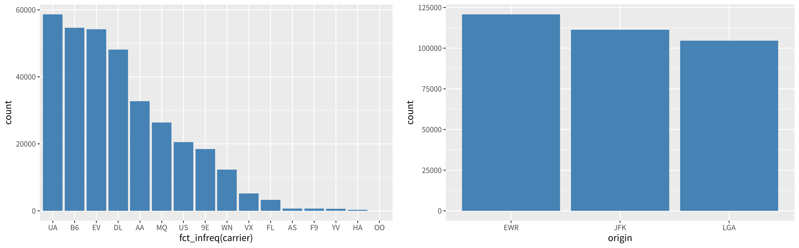
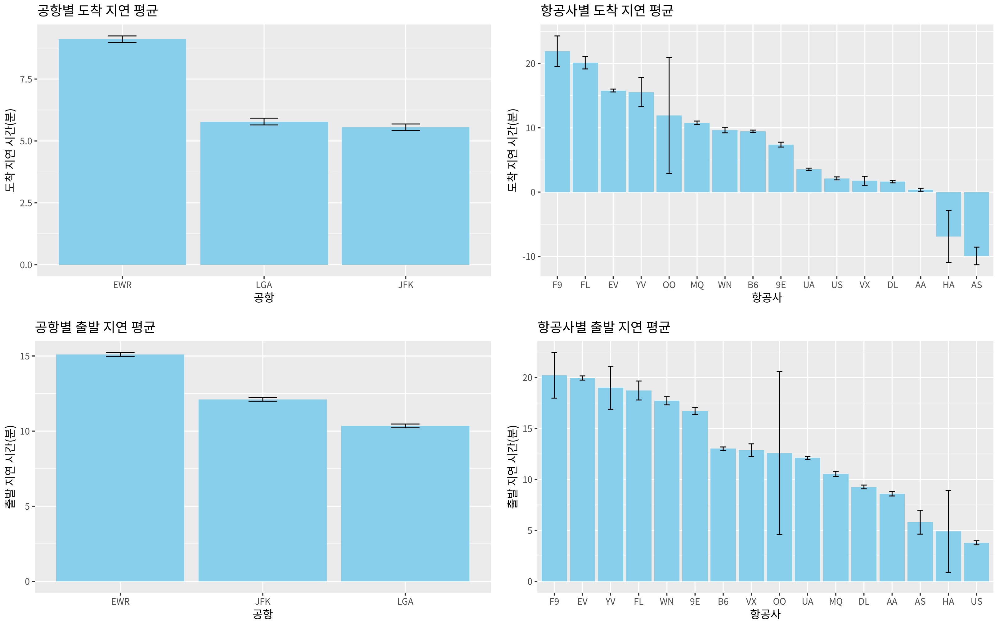

## 학습 목표

- 결측치(NA)를 찾고 `na.rm = TRUE`로 처리하기
- `subset()`으로 원하는 행과 열만 잘라내기
- dplyr의 핵심 함수 `filter`, `select`, `arrange`, `mutate`, `rename`, `slice`, `summarise`, `group_by`, `count`를 파이프 `%>%`로 연결하기
- `ifelse()`와 `case_when()`으로 연속형 변수를 범주형으로 바꾸기
- nycflights13의 `flights` 데이터로 공항별, 항공사별 지연 시간 요약과 그래프 만들기 (5주차 과제)

---

## 결측치(NA) 처리

- 실제 데이터에는 값이 비어 있는 칸이 흔하며, R에서는 `NA`(Not Available)로 표시
- `NA`가 하나라도 있으면 `mean()`, `sd()` 같은 함수의 결과도 `NA`가 됨
- `is.na()`는 각 칸이 `NA`인지 TRUE/FALSE로 알려주고, TRUE는 1로 계산되므로 `sum()`, `colSums()`로 개수를 셀 수 있음

```r
library(MASS)
sum(is.na(Cars93))                    # 전체 결측치 개수
na_cols <- colSums(is.na(Cars93))     # 열별 결측치 개수
na_cols[na_cols > 0]

mean(Cars93$Luggage.room)                  # NA가 있으면 결과도 NA
mean(na.omit(Cars93$Luggage.room))         # NA를 지우고 평균
mean(Cars93$Luggage.room, na.rm = TRUE)    # 같은 결과 (가장 많이 쓰는 방법)
```

실행 결과

```text
[1] 13
Rear.seat.room   Luggage.room 
             2             11 
[1] NA
[1] 13.89024
[1] 13.89024
```

- Cars93에는 결측치가 13개 있으며 뒷좌석 공간(Rear.seat.room)에 2개, 트렁크 공간(Luggage.room)에 11개
- `na.omit()`으로 지우고 계산하든 `na.rm = TRUE`를 주든 결과는 같음
- 단, `na.omit(Cars93)`처럼 데이터프레임 전체에 쓰면 **NA가 하나라도 있는 행 전체**가 사라지므로 주의

---

## subset으로 데이터 쪼개기

- 형식: `subset(데이터, 행 선택 조건, select = c(열 이름들))`
- 조건은 `==`(같다), `<`, `>=` 등으로 쓰고, 두 조건은 `&`(그리고) 또는 `|`(또는)로 연결

```r
library(MASS)
# subset(데이터, 행 선택 조건, select = c(열 이름들))
mini <- subset(Cars93, Type == "Compact")
dim(mini)
median(mini$Price)          # 실제 중앙값은 16.15 (17.70이 아님)

subset(Cars93, Type == "Compact" & Price < 17.70, select = c(Type, Price))
nrow(subset(Cars93, Type == "Compact" | Type == "Large"))   # 또는(|): 16 + 11
```

실행 결과

```text
[1] 16 27
[1] 16.15
      Type Price
12 Compact  13.4
13 Compact  11.4
21 Compact  15.8
25 Compact  13.3
33 Compact  11.3
43 Compact  17.5
55 Compact  16.5
65 Compact  15.7
68 Compact  13.5
74 Compact  11.1
[1] 27
```

- Compact 차종은 16대이고, 그중 가격이 17.70 미만인 차는 10대
- 실습 코드의 17.70은 Compact 가격을 **두 그룹(싼 차, 비싼 차)으로 나누기 위해 정한 기준값**일 뿐이며, 중앙값(16.15)이나 평균(18.21)과는 관계없음
- `Price < 17.70`과 `Price >= 17.70` 두 조건으로 나누면 16대가 빠짐없이 10대와 6대로 나뉨

---

## dplyr 기본 함수와 파이프

| 함수 | 하는 일 | 대상 |
| --- | --- | --- |
| `filter()` | 조건에 맞는 **행** 고르기 | 행 |
| `select()` | 원하는 **열** 고르기 | 열 |
| `arrange()` | 정렬 (`desc()`는 내림차순) | 행 |
| `mutate()` | 새 열 만들기 | 열 |
| `rename()` | 열 이름 바꾸기 (`새이름 = 옛이름`) | 열 |
| `slice()` | 행 번호로 고르기 | 행 |
| `summarise()` | 요약 통계 한 줄로 만들기 | 전체 |
| `group_by()` | 그룹을 나눠서 이후 함수를 그룹별로 적용 | 전체 |

- 파이프 `%>%`는 **왼쪽 결과를 오른쪽 함수의 첫 번째 인자로** 넘김
- `filter(Cars93, 조건)`과 `Cars93 %>% filter(조건)`은 같은 코드이며, 파이프를 쓰면 "데이터 → 거르고 → 고르고 → 정렬" 순서대로 읽을 수 있음
- MASS와 dplyr을 같이 불러오면 `select()`가 겹치는데, **나중에 불러온 dplyr의 것**이 쓰임

```r
library(MASS)
library(dplyr)
filter(Cars93, Horsepower > 250) %>% select(Manufacturer, Model, Horsepower)

Cars93 %>%                                   # 파이프: 왼쪽 결과를 오른쪽 함수의 첫 인자로
  filter(Type == "Compact", Price < 12) %>%   # 쉼표 = 그리고(&)
  select(Manufacturer, Model, Price)

Cars93 %>% arrange(desc(Price)) %>% select(Model, Price) %>% head(3)   # 내림차순
```

실행 결과

```text
  Manufacturer    Model Horsepower
1     Cadillac  Seville        295
2    Chevrolet Corvette        300
3        Dodge  Stealth        300
4     Infiniti      Q45        278
5        Mazda     RX-7        255
  Manufacturer   Model Price
1    Chevrolet Corsica  11.4
2         Ford   Tempo  11.3
3      Pontiac Sunbird  11.1
    Model Price
1    300E  61.9
2     Q45  47.9
3 Seville  40.1
```

- 250마력이 넘는 차는 5대이고, 가장 비싼 차는 Mercedes-Benz 300E (61.9천 달러)

### mutate, rename, slice

```r
library(MASS)
library(dplyr)
Cars93 %>%
  mutate(pph = Price / Horsepower) %>%        # 마력당 가격 (천 달러)
  select(Model, Price, Horsepower, pph) %>%
  arrange(pph) %>%
  head(3)

Cars93 %>% rename(rsr = Rear.seat.room) %>% select(Model, rsr) %>% slice(1:3)
Cars93 %>% slice(c(10, 20, 30)) %>% select(Model, Type)
```

실행 결과

```text
    Model Price Horsepower        pph
1  Escort  10.1        127 0.07952756
2 Elantra  10.0        124 0.08064516
3 Stealth  25.8        300 0.08600000
    Model  rsr
1 Integra 26.5
2  Legend 30.0
3      90 28.0
     Model  Type
1  DeVille Large
2 Concorde Large
3   Vision Large
```

- `mutate()`로 만든 마력당 가격 `pph`가 가장 낮은 차는 Escort이며, 300마력 스포츠카인 Stealth도 3위 안에 들어감
- `rename(rsr = Rear.seat.room)`처럼 **새 이름이 왼쪽**에 옴

---

## summarise와 group_by: 그룹별 요약

```r
library(MASS)
library(dplyr)
Cars93 %>%
  summarise(mean_price = mean(Price, na.rm = TRUE),
            max_price = max(Price),
            min_price = min(Price),
            n = n())                      # n(): 행 개수

aggregate(Price ~ Type, data = Cars93, mean)   # y ~ x: 항상 y가 앞

Cars93 %>%
  group_by(Type) %>%
  summarise(
    mean_price = mean(Price, na.rm = TRUE),
    sd_price = sd(Price, na.rm = TRUE),
    n = n()
  )
```

실행 결과

```text
  mean_price max_price min_price  n
1   19.50968      61.9       7.4 93
     Type    Price
1 Compact 18.21250
2   Large 24.30000
3 Midsize 27.21818
4   Small 10.16667
5  Sporty 19.39286
6     Van 19.10000
# A tibble: 6 × 4
  Type    mean_price sd_price     n
  <fct>        <dbl>    <dbl> <int>
1 Compact       18.2     6.69    16
2 Large         24.3     6.34    11
3 Midsize       27.2    12.3     22
4 Small         10.2     1.95    21
5 Sporty        19.4     7.97    14
6 Van           19.1     1.88     9
```

- `summarise()`만 쓰면 전체 데이터에 대한 한 줄 요약이 나옴
- `group_by(Type)`을 앞에 붙이면 차종마다 한 줄씩 요약이 나오며, 결과는 base R의 `aggregate(Price ~ Type, ...)`과 같음
- 평균 가격은 Midsize가 27.2로 가장 높고 Small이 10.2로 가장 낮음
- Midsize는 표준편차도 12.3으로 가장 커서 싼 차부터 고급차까지 폭넓게 섞여 있음

---

## count와 pivot_wider: 빈도표와 교차표

```r
library(MASS)
library(dplyr)
library(tidyr)
Cars93 %>% count(Type)                        # table()과 같은 빈도표 (데이터프레임)

Cars93 %>%
  count(Type, Cylinders) %>%                  # 긴(long) 형태
  pivot_wider(names_from = Cylinders,         # 넓은(wide) 형태 = 교차표
              values_from = n,
              values_fill = 0)
```

실행 결과

```text
     Type  n
1 Compact 16
2   Large 11
3 Midsize 22
4   Small 21
5  Sporty 14
6     Van  9
# A tibble: 6 × 7
  Type      `4`   `6`   `8`   `5`   `3` rotary
  <fct>   <int> <int> <int> <int> <int>  <int>
1 Compact    15     1     0     0     0      0
2 Large       0     7     4     0     0      0
3 Midsize     7    12     2     1     0      0
4 Small      18     0     0     0     3      0
5 Sporty      8     4     1     0     0      1
6 Van         1     7     0     1     0      0
```

- `count(Type)`은 `table(Cars93$Type)`과 같은 빈도표를 **데이터프레임으로** 돌려줌
- `count(Type, Cylinders)`는 조합마다 한 줄인 긴(long) 형태이고, tidyr의 `pivot_wider()`로 Cylinders를 열로 펼치면 교차표 모양이 됨
- `values_fill = 0`을 주지 않으면 없는 조합이 `NA`로 채워짐

---

## ifelse와 case_when: 연속형을 범주형으로

```r
library(MASS)
library(dplyr)
price <- head(Cars93$Price, 6)
price
ifelse(price < 15, "Low Budget", "High Budget")
ifelse(price < 15, "Low Budget",
       ifelse(price < 30, "Mid Budget", "Luxury"))

Cars93 %>%
  mutate(Price_Category = case_when(
    Price < 15 ~ "Budget",
    Price >= 15 & Price < 30 ~ "Mid Budget",
    Price >= 30 ~ "Luxury"
  )) %>%
  count(Price_Category)
```

실행 결과

```text
[1] 15.9 33.9 29.1 37.7 30.0 15.7
[1] "High Budget" "High Budget" "High Budget" "High Budget" "High Budget"
[6] "High Budget"
[1] "Mid Budget" "Luxury"     "Mid Budget" "Luxury"     "Luxury"    
[6] "Mid Budget"
  Price_Category  n
1         Budget 33
2         Luxury 13
3     Mid Budget 47
```

- `ifelse(조건, 참일 때, 거짓일 때)`는 벡터의 각 원소에 따로 적용됨
- 세 그룹 이상이면 `ifelse()`를 겹쳐 써야 해서 읽기 어려우므로 `case_when(조건 ~ 값, ...)`을 씀
- 가격 기준으로 Budget(15 미만) 33대, Mid Budget(15 이상 30 미만) 47대, Luxury(30 이상) 13대

---

## nycflights13: 뉴욕 공항 출발 항공편

```r
library(dplyr)
library(nycflights13)
dim(flights)
names(flights)
levels(factor(flights$origin))     # 뉴욕의 공항 3개
length(unique(flights$carrier))    # 항공사 16개
```

실행 결과

```text
[1] 336776     19
 [1] "year"           "month"          "day"            "dep_time"      
 [5] "sched_dep_time" "dep_delay"      "arr_time"       "sched_arr_time"
 [9] "arr_delay"      "carrier"        "flight"         "tailnum"       
[13] "origin"         "dest"           "air_time"       "distance"      
[17] "hour"           "minute"         "time_hour"     
[1] "EWR" "JFK" "LGA"
[1] 16
```

- 2013년 뉴욕의 세 공항(EWR, JFK, LGA)에서 출발한 항공편 336,776건, 변수 19개
- 주요 변수: `origin`(출발 공항), `carrier`(항공사), `dep_delay`(출발 지연, 분), `arr_delay`(도착 지연, 분)
- 지연 시간이 음수이면 예정보다 **일찍** 출발 또는 도착한 것

### 빈도 순서대로 막대그래프

```r
library(dplyr)
library(forcats)
library(nycflights13)
ggplot(flights, aes(x = fct_infreq(carrier))) +   # 빈도 내림차순 정렬
  geom_bar(fill = "steelblue")

ggplot(flights, aes(x = origin)) +
  geom_bar(fill = "steelblue")
```



- forcats의 `fct_infreq()`는 범주를 **빈도가 큰 순서**로 다시 정렬해서 막대그래프를 읽기 쉽게 만듦
- 운항편은 UA(United)가 가장 많고, 공항은 EWR이 가장 많음

---

## 5주차 과제: 공항별, 항공사별 지연 시간

> 문제: ① 출발, 도착 지연의 평균과 표준편차 표 ② 공항별 도착 지연 ③ 항공사별 도착 지연 ④ 공항별 출발 지연 ⑤ 항공사별 출발 지연
{: .prompt-info }

### 1번: 요약표

```r
library(dplyr)
library(nycflights13)
flights %>%
  group_by(origin, carrier) %>%
  summarise(
    n = n(),
    mean_arr_delay = mean(arr_delay, na.rm = TRUE),   # 도착 지연 평균
    sd_arr_delay = sd(arr_delay, na.rm = TRUE),
    mean_dep_delay = mean(dep_delay, na.rm = TRUE),   # 출발 지연 평균
    sd_dep_delay = sd(dep_delay, na.rm = TRUE),
    .groups = "drop"
  ) %>%
  arrange(desc(mean_arr_delay)) %>%
  head(8)
```

실행 결과

```text
# A tibble: 8 × 7
  origin carrier     n mean_arr_delay sd_arr_delay mean_dep_delay sd_dep_delay
  <chr>  <chr>   <int>          <dbl>        <dbl>          <dbl>        <dbl>
1 LGA    F9        685           21.9         61.6           20.2         58.4
2 EWR    OO          6           21.5         68.8           20.8         54.6
3 LGA    FL       3260           20.1         54.1           18.7         52.7
4 JFK    EV       1408           17.8         59.3           18.5         56.0
5 EWR    EV      43939           17.0         49.1           20.2         45.8
6 EWR    MQ       2276           16.3         58.6           17.5         54.9
7 LGA    YV        601           15.6         52.9           19.0         49.2
8 LGA    B6       6002           13.5         50.2           14.8         46.7
```

- `group_by(origin, carrier)`처럼 그룹 변수를 두 개 주면 공항 × 항공사 조합마다 한 줄씩 요약
- `.groups = "drop"`은 요약 뒤에 그룹 설정을 풀어서 다음 단계에 영향을 주지 않게 함
- 평균 도착 지연은 LGA의 F9(Frontier)가 21.9분으로 가장 김
- EWR의 OO는 운항편이 6건뿐이라 평균을 그대로 믿기 어려움 (표본 크기 확인 필수)

### 2~5번: 에러바가 있는 막대그래프

```r
library(nycflights13)
# 2번: 공항별 평균 도착 지연
ggplot(flights, aes(x = reorder(origin, -arr_delay, FUN = mean, na.rm = TRUE), y = arr_delay)) +
  stat_summary(fun = mean, geom = "bar", fill = "skyblue") +
  stat_summary(fun.data = mean_se, geom = "errorbar", width = 0.2) +
  labs(title = "공항별 도착 지연 평균", x = "공항", y = "도착 지연 시간(분)")

# 3번: 항공사별 평균 도착 지연
ggplot(flights, aes(x = reorder(carrier, -arr_delay, FUN = mean, na.rm = TRUE), y = arr_delay)) +
  stat_summary(fun = mean, geom = "bar", fill = "skyblue") +
  stat_summary(fun.data = mean_se, geom = "errorbar", width = 0.2) +
  labs(title = "항공사별 도착 지연 평균", x = "항공사", y = "도착 지연 시간(분)")

# 4번, 5번: arr_delay를 dep_delay로 바꿔서 같은 방법
ggplot(flights, aes(x = reorder(origin, -dep_delay, FUN = mean, na.rm = TRUE), y = dep_delay)) +
  stat_summary(fun = mean, geom = "bar", fill = "skyblue") +
  stat_summary(fun.data = mean_se, geom = "errorbar", width = 0.2) +
  labs(title = "공항별 출발 지연 평균", x = "공항", y = "출발 지연 시간(분)")

ggplot(flights, aes(x = reorder(carrier, -dep_delay, FUN = mean, na.rm = TRUE), y = dep_delay)) +
  stat_summary(fun = mean, geom = "bar", fill = "skyblue") +
  stat_summary(fun.data = mean_se, geom = "errorbar", width = 0.2) +
  labs(title = "항공사별 출발 지연 평균", x = "항공사", y = "출발 지연 시간(분)")
```



- `reorder(x, -y, FUN = mean, na.rm = TRUE)`는 x의 범주를 **y 평균의 내림차순**으로 정렬하며, `-`를 빼면 오름차순
- `stat_summary(fun = mean, geom = "bar")`는 그룹 평균을 막대로, `fun.data = mean_se`는 평균 ± 표준오차(SE)를 에러바로 그림
- 운항편이 적은 항공사(OO, HA, YV, F9)는 에러바가 길어 평균이 불안정함
- HA, AS는 도착 지연 평균이 음수로, 평균적으로 예정보다 일찍 도착함

```r
library(dplyr)
library(nycflights13)
flights %>%
  group_by(origin) %>%
  summarise(mean_arr = mean(arr_delay, na.rm = TRUE),
            mean_dep = mean(dep_delay, na.rm = TRUE))
```

실행 결과

```text
# A tibble: 3 × 3
  origin mean_arr mean_dep
  <chr>     <dbl>    <dbl>
1 EWR        9.11     15.1
2 JFK        5.55     12.1
3 LGA        5.78     10.3
```

- 세 공항 모두 출발 지연 평균이 도착 지연 평균보다 큼 (비행 중에 지연을 일부 만회)
- EWR은 출발(15.1분), 도착(9.11분) 지연이 모두 가장 길고, 공항 그래프의 막대 순서가 출발과 도착에서 다른 이유는 JFK와 LGA의 순위가 바뀌기 때문

> **(중요!!)** dplyr은 기말고사에 **무조건 출제**. 문제 형식: "flights에서 FA와 FB별 빈도수를 구하고, NC의 평균과 표준편차를 구하라" (FA, FB는 범주형 변수, NC는 연속형 변수)
{: .prompt-warning }

이 형식은 아래 틀에 변수 이름만 바꿔 넣으면 됨

```r
flights %>%
  group_by(FA, FB) %>%                    # 범주형 변수 두 개로 그룹
  summarise(
    n = n(),                              # 빈도수
    mean_NC = mean(NC, na.rm = TRUE),     # 평균
    sd_NC = sd(NC, na.rm = TRUE),         # 표준편차
    .groups = "drop"
  )
```

---

### 강의 자료 및 실습 코드에서 정정한 부분 정리

| 위치 | 원래 | 정정 | 이유 |
| --- | --- | --- | --- |
| 5주차 실습 코드 (subset) | `Price < 17.70` 주석 "이해 안 됨" | 17.70은 임의로 정한 기준값 | Compact 가격의 중앙값은 16.15, 평균은 18.21로 둘 다 17.70이 아님 |
| 5주차 실습 코드 (교차표) | `addmargins(round(proportions(table(...))*100), 1)` | `addmargins(round(proportions(table(...)) * 100, 1))` | 괄호 위치 때문에 소수점 없이 반올림되고, `1`이 `addmargins()`의 margin 인자로 들어가 합계 행만 붙음 |
| 5주차 실습 코드 (stat_summary) | `stat_summary(func = mean, ...)` | `stat_summary(fun = mean, ...)` | `func`는 없는 인자라 무시되고 기본값 `mean_se()`가 쓰여서 우연히 같은 막대가 나옴 |
| 5주차 실습 코드 (summarise) | `mean_dep_dealy` | `mean_dep_delay` | 오타 |
| 5주차 실습 코드 (theme) | `element_text(family = "AppleGothic")` | 운영체제에 맞는 한글 글꼴 | AppleGothic은 macOS에만 있어 Windows나 Linux에서는 한글이 깨짐 |

---

## 최종 핵심 정리

1. `NA`가 있으면 계산 결과도 `NA`이므로 `colSums(is.na())`로 먼저 확인하고 `na.rm = TRUE`로 계산
2. `subset(데이터, 행 조건, select = 열)`로 행과 열을 동시에 잘라낼 수 있으며, 조건은 `&`와 `|`로 연결
3. dplyr은 **행**(`filter`, `arrange`, `slice`)과 **열**(`select`, `mutate`, `rename`)을 다루는 함수로 나뉨
4. 파이프 `%>%`는 왼쪽 결과를 오른쪽 함수의 첫 인자로 넘겨 분석 순서대로 코드를 읽게 해 줌
5. `group_by()` + `summarise()`가 그룹별 요약의 기본 틀이며, `n()`으로 그룹 크기를 함께 확인
6. `count()`는 빈도표를 데이터프레임으로 만들고, `pivot_wider()`로 교차표 모양으로 펼침
7. `case_when()`으로 연속형 변수를 여러 범주로 나누며, 두 범주면 `ifelse()`로 충분
8. 기말고사 대비: "FA, FB별 빈도와 NC의 평균, 표준편차"는 `group_by(FA, FB) %>% summarise(n(), mean(), sd())` 한 틀로 해결

---

End.
