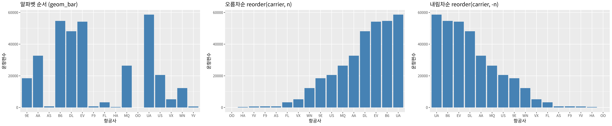
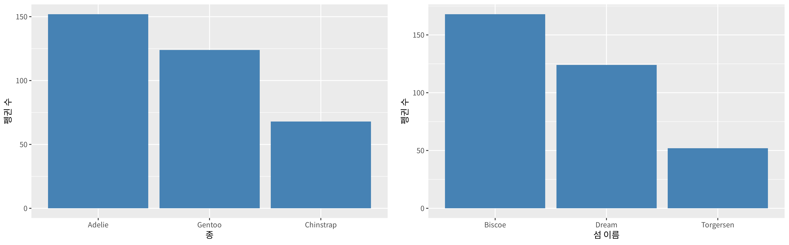
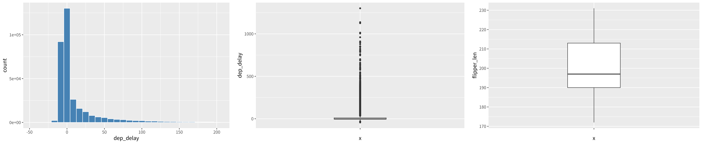
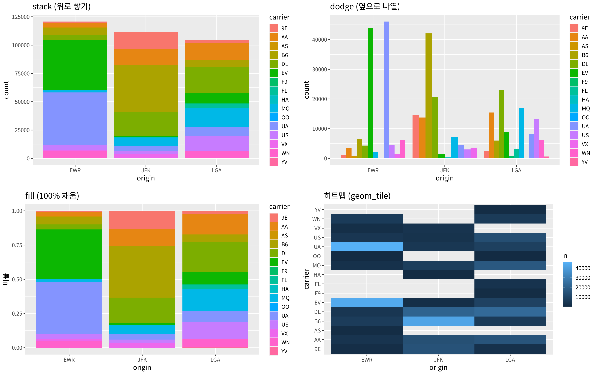
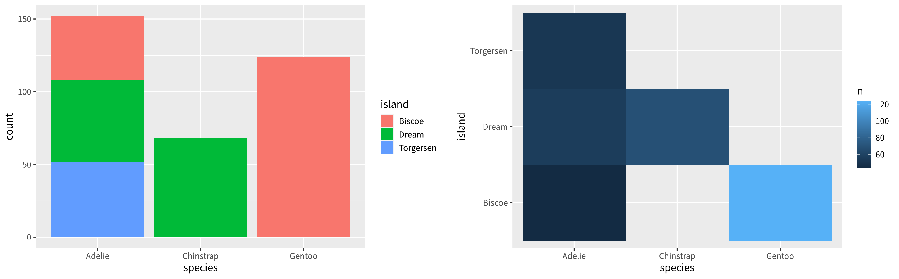
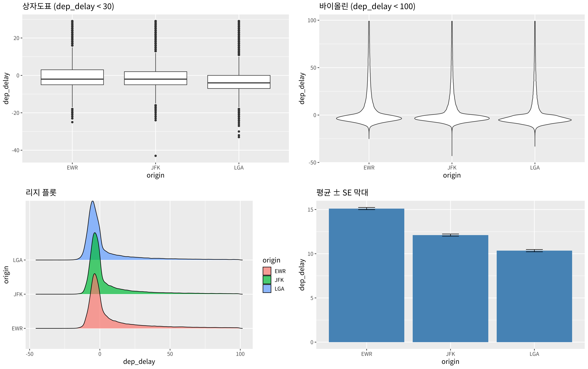
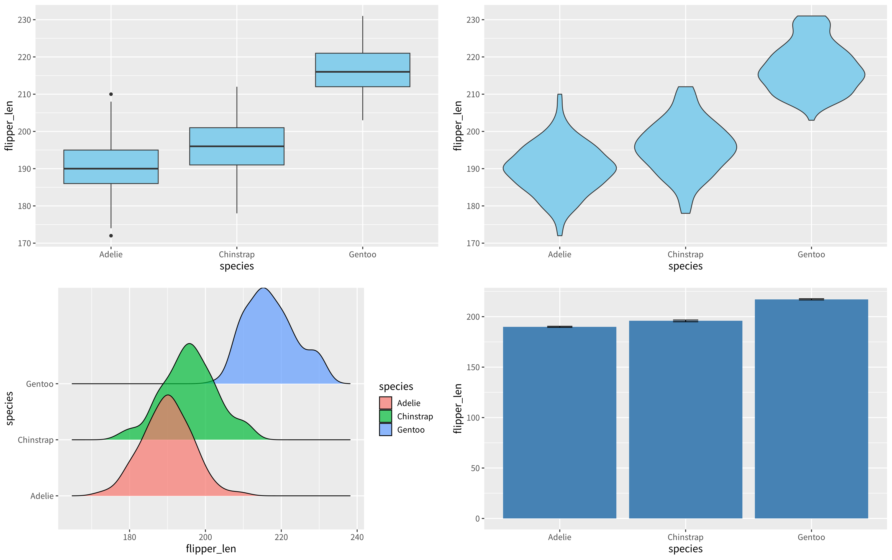
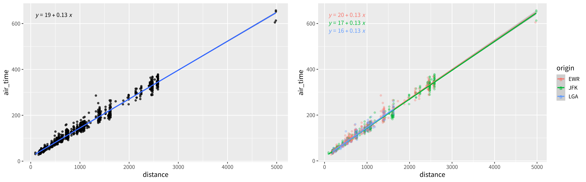
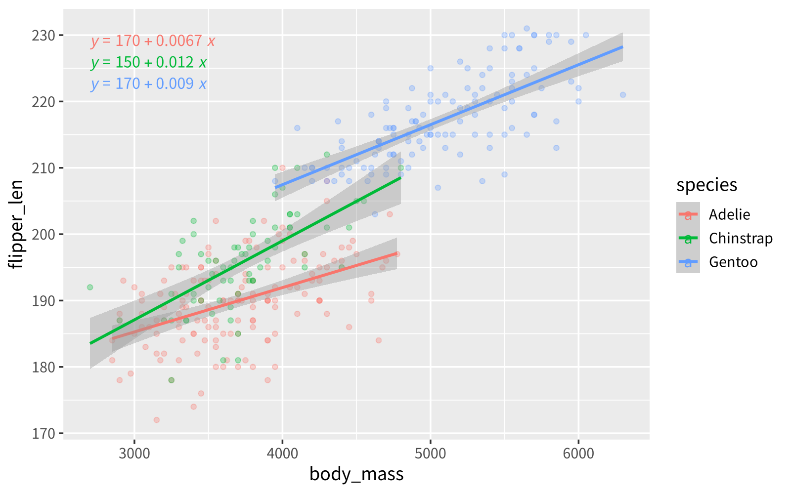

[toc]

## 학습 목표

- 변수 유형(범주형, 연속형)과 개수(1변수, 2변수, 3변수)에 따라 **요약표와 그래프를 고르는 틀**을 머릿속에 정리하기
- 막대그래프를 빈도의 오름차순, 내림차순으로 정렬하기 (시험 출제)
- 범주형 × 범주형: 교차표, stack / dodge / fill 막대, 히트맵
- 범주형 × 연속형: 그룹별 요약표, 상자도표, 바이올린, 리지 플롯, 평균 ± SE 막대
- 연속형 × 연속형과 3변수: 산점도 + 회귀선 + 회귀식 (6주차 과제)

---

## 전체 틀: 무엇을 보고 무엇을 그리나 ⭐️

> **(중요!!)** 6주차 코드 맨 위에 "머리속에 가지고 있을 것"으로 표시된 구조. 변수 유형만 보고 바로 요약표와 그래프가 떠올라야 함
{: .prompt-warning }

| 변수 구성 | 요약표 | 그래프 | ggplot 함수 |
| --- | --- | --- | --- |
| 1변수 범주형 | 빈도, 상대빈도 | 막대그래프 | `geom_bar()`, `geom_col()` |
| 1변수 연속형 | n, 평균, SD, 최소, Q1, 중앙값, Q3, 최대 | 히스토그램, 상자도표 | `geom_histogram()`, `geom_boxplot()` |
| 범주형 × 범주형 | 교차표 (빈도, 비율) | stack / dodge / fill 막대, 히트맵 | `geom_bar(position = )`, `geom_tile()` |
| 범주형 × 연속형 | 그룹별 요약표 | 상자도표, 바이올린, 리지, 평균 ± SE 막대 | `geom_violin()`, `geom_density_ridges()`, `stat_summary()` |
| 연속형 × 연속형 | 회귀식, 상관계수 | 산점도 + 회귀선 | `geom_point()`, `geom_smooth(method = "lm")` |
| 3변수 (연속 2 + 범주 1) | 그룹별 회귀식 | 색으로 그룹을 나눈 산점도 | `aes(colour = 범주형)` |

- 데이터는 nycflights13의 `flights`(336,776편)와 펭귄 데이터 `penguins`(344마리)를 같이 씀
- 이 글에서 쓰는 `penguins`의 열 이름은 R 4.5에 내장된 버전 기준(`bill_len`, `bill_dep`, `flipper_len`, `body_mass`)

---

## 1변수 범주형

### 상대빈도표

```r
library(dplyr)
library(nycflights13)
# 상대빈도표 (relative frequency table)
flights %>%
  count(carrier, sort = TRUE) %>%          # sort = TRUE: 빈도 내림차순
  mutate(prop = round(n / sum(n), 3),      # 상대빈도
         pct = round(prop * 100, 1))       # 백분율
```

실행 결과

```text
# A tibble: 16 × 4
   carrier     n  prop   pct
   <chr>   <int> <dbl> <dbl>
 1 UA      58665 0.174  17.4
 2 B6      54635 0.162  16.2
 3 EV      54173 0.161  16.1
 4 DL      48110 0.143  14.3
 5 AA      32729 0.097   9.7
 6 MQ      26397 0.078   7.8
 7 US      20536 0.061   6.1
 8 9E      18460 0.055   5.5
 9 WN      12275 0.036   3.6
10 VX       5162 0.015   1.5
11 FL       3260 0.01    1  
12 AS        714 0.002   0.2
13 F9        685 0.002   0.2
14 YV        601 0.002   0.2
15 HA        342 0.001   0.1
16 OO         32 0       0
```

- `count(carrier, sort = TRUE)`는 빈도를 세면서 큰 순서로 정렬
- 상대빈도는 $$\text{prop} = n_i / \sum n_i$$이고, 모두 더하면 1
- UA, B6, EV, DL 네 항공사가 전체 운항편의 약 64%를 차지하고, OO는 32편뿐이라 반올림하면 0이 됨

### 막대그래프 정렬 ⭐️

> **(중요!!)** 막대그래프를 **내림차순으로 정렬**하는 것은 시험에 나옴 (수업에서 혼자 해 보라고 한 부분)
{: .prompt-warning }

```r
library(dplyr)
library(nycflights13)
# (1) raw data를 그대로: geom_bar()가 직접 개수를 셈 → 알파벳 순서
flights %>%
  ggplot(aes(x = carrier)) +
  geom_bar(fill = "steelblue") +
  labs(title = "알파벳 순서 (geom_bar)", x = "항공사", y = "운항편수")

# (2) 빈도를 먼저 계산하고 그 값을 막대 높이로: geom_col()
flights %>%
  count(carrier) %>%
  ggplot(aes(x = reorder(carrier, n), y = n)) +      # 오름차순
  geom_col(fill = "steelblue") +
  labs(title = "오름차순 reorder(carrier, n)", x = "항공사", y = "운항편수")

flights %>%
  count(carrier) %>%
  ggplot(aes(x = reorder(carrier, -n), y = n)) +     # 내림차순: n 앞에 -
  geom_col(fill = "steelblue") +
  labs(title = "내림차순 reorder(carrier, -n)", x = "항공사", y = "운항편수")
```



- `geom_bar()`는 **원자료(raw data)** 를 받아 막대 높이(개수)를 직접 셈. 범주는 알파벳 순서
- `geom_col()`은 **이미 계산된 값** `y = n`을 막대 높이로 씀. 그래서 `count()`를 먼저 하고 넘김
- `reorder(범주, n)`은 n이 작은 순서(오름차순), `reorder(범주, -n)`은 큰 순서(내림차순)로 범주를 다시 배열
- 4주차에 배운 `fct_infreq(carrier)`도 `geom_bar()`만으로 내림차순을 만들 수 있는 방법

### origin과 펭귄으로 연습

```r
library(dplyr)
library(nycflights13)
flights %>%
  count(origin, sort = TRUE) %>%
  mutate(prop = round(n / sum(n), 3),
         pct = round(prop * 100, 1))

penguins %>% count(species)
penguins %>% count(island)

penguins %>%
  count(species) %>%
  ggplot(aes(x = reorder(species, -n), y = n)) +
  geom_col(fill = "steelblue") +
  labs(x = "종", y = "펭귄 수")

penguins %>%
  count(island) %>%
  ggplot(aes(x = reorder(island, -n), y = n)) +
  geom_col(fill = "steelblue") +
  labs(x = "섬 이름", y = "펭귄 수")
```

실행 결과

```text
# A tibble: 3 × 4
  origin      n  prop   pct
  <chr>   <int> <dbl> <dbl>
1 EWR    120835 0.359  35.9
2 JFK    111279 0.33   33  
3 LGA    104662 0.311  31.1
    species   n
1    Adelie 152
2 Chinstrap  68
3    Gentoo 124
     island   n
1    Biscoe 168
2     Dream 124
3 Torgersen  52
```



- 세 공항의 비중은 EWR 35.9%, JFK 33%, LGA 31.1%로 비슷함
- 펭귄은 Adelie(152) > Gentoo(124) > Chinstrap(68), 섬은 Biscoe(168) > Dream(124) > Torgersen(52)

---

## 1변수 연속형

```r
library(dplyr)
library(nycflights13)
flights %>%
  summarise(
    n = sum(!is.na(dep_delay)),                   # missing이 아닌 데이터 개수
    mean = mean(dep_delay, na.rm = TRUE),
    sd = sd(dep_delay, na.rm = TRUE),
    min = min(dep_delay, na.rm = TRUE),
    q1 = quantile(dep_delay, 0.25, na.rm = TRUE), # 25%
    median = median(dep_delay, na.rm = TRUE),     # 50%
    q3 = quantile(dep_delay, 0.75, na.rm = TRUE), # 75%
    max = max(dep_delay, na.rm = TRUE)            # 100%
  )

summary(flights$dep_delay)
```

실행 결과

```text
# A tibble: 1 × 8
       n  mean    sd   min    q1 median    q3   max
   <int> <dbl> <dbl> <dbl> <dbl>  <dbl> <dbl> <dbl>
1 328521  12.6  40.2   -43    -5     -2    11  1301
   Min. 1st Qu.  Median    Mean 3rd Qu.    Max.    NA's 
 -43.00   -5.00   -2.00   12.64   11.00 1301.00    8255
```

- `sum(!is.na(x))`는 결측이 아닌 값의 개수. 출발 지연은 8,255편이 `NA`(결항으로 추정)여서 n = 328,521
- 평균(12.6분)이 중앙값(-2분)보다 훨씬 큼. 대부분은 정시 또는 일찍 출발하지만 몇 시간씩 늦은 소수의 비행(최대 1,301분)이 평균을 끌어올린 **오른쪽 꼬리가 긴 분포**
- 이처럼 치우친 분포에서는 평균보다 중앙값과 사분위수가 "보통의 비행"을 더 잘 나타냄

```r
library(dplyr)
library(nycflights13)
flights %>%
  filter(dep_delay < 200) %>%                     # 긴 꼬리를 잘라서 모양 보기
  ggplot(aes(x = dep_delay)) +
  geom_histogram(fill = "steelblue", colour = "white", bins = 30)

flights %>%
  ggplot(aes(x = "", y = dep_delay)) +            # x = "": 상자 하나만
  geom_boxplot(width = 0.3)
```

```r
library(dplyr)
penguins %>%
  summarise(
    n = sum(!is.na(flipper_len)),
    mean = mean(flipper_len, na.rm = TRUE),
    sd = sd(flipper_len, na.rm = TRUE),
    min = min(flipper_len, na.rm = TRUE),
    q1 = quantile(flipper_len, 0.25, na.rm = TRUE),
    median = median(flipper_len, na.rm = TRUE),
    q3 = quantile(flipper_len, 0.75, na.rm = TRUE),
    max = max(flipper_len, na.rm = TRUE)
  )

penguins %>%
  ggplot(aes(x = "", y = flipper_len)) +
  geom_boxplot(width = 0.3)
```

실행 결과

```text
    n     mean       sd min  q1 median  q3 max
1 342 200.9152 14.06171 172 190    197 213 231
```



- 왼쪽: 200분 미만만 그린 히스토그램. 0 근처에 몰려 있고 오른쪽으로 길게 늘어짐
- 가운데: 전체 데이터의 상자도표. 상자(Q1 = -5, Q3 = 11)는 아주 납작하고, 1.5 × IQR을 넘는 점(이상치)이 위쪽으로 수없이 찍힘
- 오른쪽: 펭귄 날개 길이(n = 342, 평균 200.9mm)는 이상치가 없고 비교적 고르게 퍼짐
- `aes(x = "")`는 x축에 그룹이 없을 때 상자 하나만 그리는 방법

---

## 2변수 범주형 × 범주형

### 교차표

```r
library(dplyr)
library(tidyr)
library(nycflights13)
# 교차표: 빈도
flights %>%
  count(origin, carrier) %>%
  pivot_wider(names_from = carrier, values_from = n, values_fill = 0) %>%
  print(width = Inf)                       # 열을 생략하지 않고 모두 출력

# 공항별 항공사 비중 (각 행의 합 = 1)
flights %>%
  count(origin, carrier) %>%
  group_by(origin) %>%
  mutate(prop = round(n / sum(n), 3)) %>%
  ungroup() %>%
  select(-n) %>%
  pivot_wider(names_from = carrier, values_from = prop, values_fill = 0) %>%
  print(width = Inf)
```

실행 결과

```text
# A tibble: 3 × 17
  origin  `9E`    AA    AS    B6    DL    EV    MQ    OO    UA    US    VX    WN
  <chr>  <int> <int> <int> <int> <int> <int> <int> <int> <int> <int> <int> <int>
1 EWR     1268  3487   714  6557  4342 43939  2276     6 46087  4405  1566  6188
2 JFK    14651 13783     0 42076 20701  1408  7193     0  4534  2995  3596     0
3 LGA     2541 15459     0  6002 23067  8826 16928    26  8044 13136     0  6087
     HA    F9    FL    YV
  <int> <int> <int> <int>
1     0     0     0     0
2   342     0     0     0
3     0   685  3260   601
# A tibble: 3 × 17
  origin  `9E`    AA    AS    B6    DL    EV    MQ    OO    UA    US    VX    WN
  <chr>  <dbl> <dbl> <dbl> <dbl> <dbl> <dbl> <dbl> <dbl> <dbl> <dbl> <dbl> <dbl>
1 EWR    0.01  0.029 0.006 0.054 0.036 0.364 0.019     0 0.381 0.036 0.013 0.051
2 JFK    0.132 0.124 0     0.378 0.186 0.013 0.065     0 0.041 0.027 0.032 0    
3 LGA    0.024 0.148 0     0.057 0.22  0.084 0.162     0 0.077 0.126 0     0.058
     HA    F9    FL    YV
  <dbl> <dbl> <dbl> <dbl>
1 0     0     0     0    
2 0.003 0     0     0    
3 0     0.007 0.031 0.006
```

- `count(origin, carrier)` 결과를 `pivot_wider()`로 펼치면 행 = 공항, 열 = 항공사인 교차표
- 두 번째 표는 `group_by(origin)` 뒤에 비율을 구해서 **각 공항 안에서 항공사 비중**(행 비율)을 나타냄
- EWR은 UA(38.1%)와 EV(36.4%), JFK는 B6(37.8%), LGA는 DL(22%)과 MQ(16.2%)가 가장 많음. 공항마다 주력 항공사가 다름

### 막대그래프와 히트맵

```r
library(dplyr)
library(nycflights13)
flights %>%
  ggplot(aes(x = origin, fill = carrier)) +
  geom_bar(position = "stack") + labs(title = "stack (위로 쌓기)")

flights %>%
  ggplot(aes(x = origin, fill = carrier)) +
  geom_bar(position = "dodge") + labs(title = "dodge (옆으로 나열)")

flights %>%
  ggplot(aes(x = origin, fill = carrier)) +
  geom_bar(position = "fill") + labs(title = "fill (100% 채움)", y = "비율")

flights %>%
  count(origin, carrier) %>%
  ggplot(aes(x = origin, y = carrier, fill = n)) +
  geom_tile() + labs(title = "히트맵 (geom_tile)")
```



| position | 막대 높이 | 비교하기 좋은 것 |
| --- | --- | --- |
| `"stack"` | 공항 전체 운항편수 | 공항 간 **전체 크기** |
| `"dodge"` | 항공사별 운항편수 | 공항 안에서 **항공사끼리** 크기 |
| `"fill"` | 항상 1 (비율) | 공항 간 **구성 비율** (위 교차표의 행 비율을 그림으로) |

- 히트맵은 두 범주를 x, y에 놓고 칸의 색으로 빈도를 표현하며, 빈 칸은 그 공항에 없는 항공사 (예: AS는 EWR에만, HA는 JFK에만 있음)
- 항공사가 16개로 많아서 stack, dodge는 색 구분이 어렵고, 이럴 때 히트맵이 더 읽기 쉬움

### 펭귄으로 연습

```r
library(dplyr)
penguins %>%
  ggplot(aes(x = species, fill = island)) +
  geom_bar(position = "stack")

penguins %>%
  count(species, island) %>%
  ggplot(aes(x = species, y = island, fill = n)) +
  geom_tile()
```



- Adelie만 세 섬에 모두 있고, Gentoo는 Biscoe, Chinstrap은 Dream에만 있음 (히트맵의 빈 칸)

---

## 2변수 범주형(x) × 연속형(y)

- x가 집단, y가 연속형이면 **집단별 분포와 평균을 비교**하는 문제

```r
library(dplyr)
library(nycflights13)
flights %>%
  group_by(origin) %>%
  summarise(
    n = n(),
    non_missing = sum(!is.na(dep_delay)),
    mean = mean(dep_delay, na.rm = TRUE),
    sd = sd(dep_delay, na.rm = TRUE),
    q1 = quantile(dep_delay, 0.25, na.rm = TRUE),
    median = median(dep_delay, na.rm = TRUE),
    q3 = quantile(dep_delay, 0.75, na.rm = TRUE),
    max = max(dep_delay, na.rm = TRUE)
  ) %>%
  ungroup()
```

실행 결과

```text
# A tibble: 3 × 9
  origin      n non_missing  mean    sd    q1 median    q3   max
  <chr>   <int>       <int> <dbl> <dbl> <dbl>  <dbl> <dbl> <dbl>
1 EWR    120835      117596  15.1  41.3    -4     -1    15  1126
2 JFK    111279      109416  12.1  39.0    -5     -1    10  1301
3 LGA    104662      101509  10.3  40.0    -6     -3     7   911
```

- 평균 출발 지연은 EWR(15.1) > JFK(12.1) > LGA(10.3), 중앙값은 세 공항 모두 0보다 작음
- 표준편차(약 40분)가 평균 차이(약 5분)보다 훨씬 커서 개별 비행 단위로는 공항 간 차이가 크지 않음

```r
library(dplyr)
library(ggridges)
library(nycflights13)
flights %>%
  filter(dep_delay < 30) %>%
  ggplot(aes(x = origin, y = dep_delay)) +
  geom_boxplot() + labs(title = "상자도표 (dep_delay < 30)")

flights %>%
  filter(dep_delay < 100) %>%
  ggplot(aes(x = origin, y = dep_delay)) +
  geom_violin() + labs(title = "바이올린 (dep_delay < 100)")

# 리지 플롯은 x와 y가 바뀜: x = 연속형, y = 범주형
flights %>%
  filter(dep_delay < 100) %>%
  ggplot(aes(x = dep_delay, y = origin, fill = origin)) +
  geom_density_ridges(alpha = 0.7) + labs(title = "리지 플롯")

flights %>%
  ggplot(aes(x = origin, y = dep_delay)) +
  stat_summary(fun = mean, geom = "bar", fill = "steelblue") +
  stat_summary(fun.data = mean_se, geom = "errorbar", width = 0.2) +
  labs(title = "평균 ± SE 막대")
```



- 상자도표와 바이올린은 그림을 보기 좋게 하려고 `filter(dep_delay < 30)`, `filter(dep_delay < 100)`으로 긴 꼬리를 잘랐음. 잘린 데이터의 그림이므로 평균, 최댓값 같은 해석에는 쓰면 안 됨
- 바이올린은 상자도표에 **분포의 모양(밀도)** 을 더한 그림이며, 0 근처가 가장 두꺼움
- 리지 플롯은 그룹별 밀도곡선을 겹쳐 쌓은 그림
- 평균 ± SE 막대는 **필터 없이 전체 데이터**로 그렸으며, n이 10만 이상이라 SE가 매우 작아 에러바가 짧음

> **(중요!!)** 리지 플롯(`geom_density_ridges`)은 **x와 y가 반대**. 다른 그래프는 `x = 범주형, y = 연속형`이지만 리지는 `x = 연속형, y = 범주형`
{: .prompt-warning }

### 펭귄으로 연습

```r
library(dplyr)
library(ggridges)
penguins %>%
  ggplot(aes(x = species, y = flipper_len)) +
  geom_boxplot(fill = "skyblue")

penguins %>%
  ggplot(aes(x = species, y = flipper_len)) +
  geom_violin(fill = "skyblue")

penguins %>%
  ggplot(aes(x = flipper_len, y = species, fill = species)) +
  geom_density_ridges(alpha = 0.7)

penguins %>%
  ggplot(aes(x = species, y = flipper_len)) +
  stat_summary(fun = mean, geom = "bar", fill = "steelblue") +
  stat_summary(fun.data = mean_se, geom = "errorbar", width = 0.2)
```



- 날개 길이는 Gentoo가 가장 길고 Adelie와 Chinstrap은 비슷하지만 Chinstrap이 약간 더 김
- 리지 플롯에서 Gentoo의 분포가 다른 두 종과 거의 겹치지 않는 것이 보임
- `flipper_len`에 `NA`가 2개 있어서 그래프마다 "Removed 2 rows" 경고가 나오지만 결과에는 영향 없음

---

## 2변수 연속형 × 연속형과 3변수

```r
library(dplyr)
library(ggpubr)
library(nycflights13)
set.seed(2026)                                    # 무작위 추출 결과를 재현하기 위해
flights %>%
  slice_sample(n = 1000) %>%                      # 33만 개 점은 너무 많아서 1000개만
  ggplot(aes(x = distance, y = air_time)) +
  geom_point(alpha = 0.7) +
  geom_smooth(method = "lm") +
  stat_regline_equation()

set.seed(2026)
flights %>%
  slice_sample(n = 1000) %>%
  ggplot(aes(x = distance, y = air_time, colour = origin)) +   # 3번째 변수는 색으로
  geom_point(alpha = 0.3) +
  geom_smooth(method = "lm") +
  stat_regline_equation()
```



- 비행 거리(마일)와 비행 시간(분)은 거의 완벽한 직선 관계. 기울기 0.13은 **1마일당 약 0.13분**, 즉 평균 시속 약 $$60/0.13 \approx 460$$마일
- 절편 약 19분은 거리와 관계없이 드는 시간(이륙, 착륙, 활주)으로 해석할 수 있음
- `slice_sample(n = 1000)`은 무작위로 1000행만 뽑음. 실행할 때마다 다른 표본이 나오므로 `set.seed()`를 먼저 쓰면 결과를 재현할 수 있음
- 오른쪽처럼 `colour = origin`을 주면 `geom_smooth()`와 `stat_regline_equation()`도 **그룹별로** 따로 계산됨. 세 공항의 기울기가 같아서(0.13) 출발 공항은 거리와 비행시간의 관계를 바꾸지 않음

### 6주차 과제: 종별 body_mass와 flipper_len

> 문제: 3변수 species 범주별로, 연속형 body_mass, 연속형 flipper_len을 그려라
{: .prompt-info }

```r
library(dplyr)
library(ggpubr)
nrow(penguins)
nrow(slice_sample(penguins, n = 1000))   # 행이 344개뿐이라 344개만 나옴

penguins %>%
  ggplot(aes(x = body_mass, y = flipper_len, colour = species)) +
  geom_point(alpha = 0.3) +
  geom_smooth(method = "lm") +
  stat_regline_equation()
```

실행 결과

```text
[1] 344
[1] 344
```



- 세 종 모두 몸무게가 무거울수록 날개가 긴 양의 관계
- 그래프의 회귀식은 유효숫자 2자리로 반올림되어 표시되므로 정확한 값은 `lm()`으로 확인

```r
library(dplyr)
# 그래프의 회귀식을 숫자로 확인: 종별로 lm() 적합
penguins %>%
  filter(!is.na(body_mass), !is.na(flipper_len)) %>%
  group_by(species) %>%
  summarise(
    intercept = coef(lm(flipper_len ~ body_mass))[1],
    slope = coef(lm(flipper_len ~ body_mass))[2],
    r = cor(body_mass, flipper_len),
    n = n()
  ) %>%
  as.data.frame()                         # 소수점까지 모두 보이게
```

실행 결과

```text
    species intercept       slope         r   n
1    Adelie  165.2448 0.006676867 0.4682017 151
2 Chinstrap  151.3809 0.011905064 0.6415594  68
3    Gentoo  171.3042 0.009039136 0.7026665 123
```

- 기울기는 Chinstrap(0.0119)이 가장 큼. 몸무게가 1,000g 늘 때 날개가 Chinstrap은 약 11.9mm, Gentoo는 약 9.0mm, Adelie는 약 6.7mm 길어짐
- 상관계수도 Gentoo(0.70) > Chinstrap(0.64) > Adelie(0.47) 순서
- 종을 무시하고 하나의 회귀선을 그리면 종 사이의 차이(Gentoo가 크고 무거움)까지 섞인 기울기가 나오므로, 그룹이 있는 데이터는 3변수로 나눠 보는 것이 중요

---

### 강의 자료 및 실습 코드에서 정정한 부분 정리

| 위치 | 원래 | 정정 | 이유 |
| --- | --- | --- | --- |
| 6주차 실습 코드 (1변수 연속형) | `summarise(n = sum(!is.na(flights$dep_delay)), ...)` | `summarise(n = sum(!is.na(dep_delay)), ...)` | `flights$`를 붙이면 항상 전체 데이터를 셈. 지금은 그룹이 없어 결과가 같지만 `group_by()` 뒤에 쓰면 모든 그룹에 전체 개수가 나옴 |
| 6주차 실습 코드 (주석) | `# 5%0` | `# 50%` | 오타 |
| 6주차 실습 코드 (주석) | "2변수 범주형 body_mass, 연속형 flipper_len" | "2변수 연속형 body_mass, 연속형 flipper_len" | `body_mass`는 연속형 변수 |
| 6주차 실습 코드, 과제 | `penguins %>% slice_sample(n = 1000)` | 생략 가능 | 펭귄은 344행뿐이라 복원 없이 1000개를 뽑을 수 없고, 344행 전체가 순서만 섞여 나옴 |
| 6주차 실습 코드 (theme) | `element_text(family = "AppleGothic")` | 운영체제에 맞는 한글 글꼴 | AppleGothic은 macOS 전용 |

---

## 최종 핵심 정리

1. 그래프 선택은 **변수 유형과 개수**로 결정되며, 6주차의 표(1변수 2개, 2변수 3개, 3변수)를 머릿속에 가지고 있어야 함
2. `geom_bar()`는 원자료로 개수를 세고, `geom_col()`은 `count()`로 미리 계산한 값을 막대 높이로 씀
3. 막대 정렬은 `reorder(범주, n)`이 오름차순, `reorder(범주, -n)`이 내림차순 (시험 출제)
4. 연속형 1변수는 평균과 중앙값을 함께 보고, 출발 지연처럼 오른쪽 꼬리가 길면 중앙값과 사분위수가 더 적절
5. 범주형 × 범주형은 교차표와 `position = "stack"`, `"dodge"`, `"fill"`, 범주가 많으면 히트맵(`geom_tile`)
6. 범주형 × 연속형은 상자도표, 바이올린, 리지, 평균 ± SE 막대로 비교하며, **리지는 x = 연속형, y = 범주형**
7. 연속형 × 연속형은 `geom_point()` + `geom_smooth(method = "lm")` + `stat_regline_equation()`
8. `colour = 범주형`으로 3변수를 그리면 회귀선이 그룹별로 나뉘며, 펭귄은 종마다 기울기가 다름

---

End.
