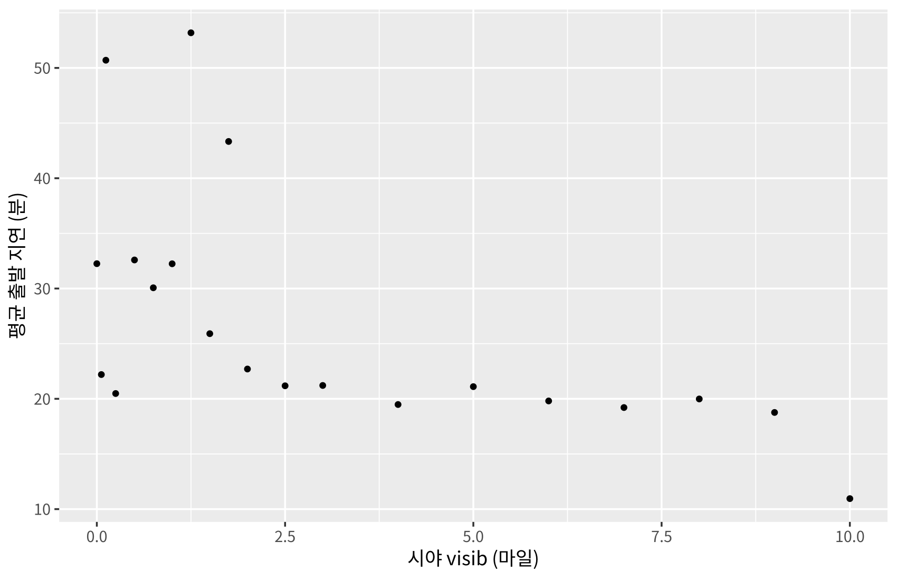
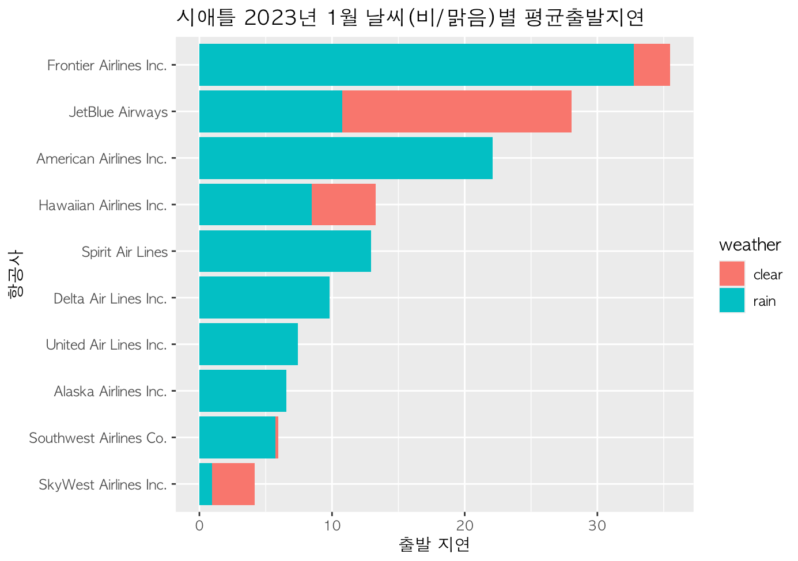
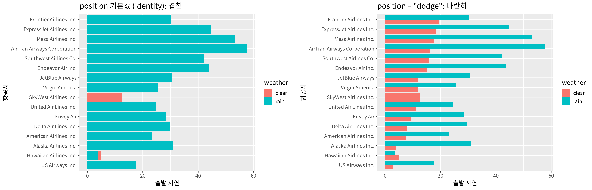

[toc]

## 학습 목표

- `write.csv()`, `read.csv()`로 데이터를 파일로 내보내고 다시 읽기, 작업 폴더(`getwd()`) 이해하기
- `readxl::read_xlsx()`로 엑셀 파일 읽기
- 키(key) 변수로 두 데이터를 합치는 `left_join()`, `right_join()`
- `flights` + `airlines` + `weather`를 합쳐 날씨(시야, 비)와 출발 지연의 관계 보기
- 7주차 과제: 비 올 때와 맑을 때를 구분한 항공사별 평균 출발 지연 그래프

---

## CSV로 내보내기와 읽어 들이기

- CSV(Comma-Separated Values)는 값을 쉼표로 구분한 텍스트 파일로, 엑셀이나 다른 프로그램과 데이터를 주고받을 때 가장 흔히 씀
- 파일 이름만 쓰면 **작업 폴더**(working directory)에 저장되고, 작업 폴더에서 읽음
  - `getwd()`: 현재 작업 폴더 확인
  - `setwd("경로")` 또는 RStudio의 Session → Set Working Directory로 변경

```r
library(dplyr)
library(nycflights13)
write.csv(flights, "flights.csv")        # 작업 폴더(getwd())에 저장
my <- read.csv("flights.csv")             # 다시 읽기
class(my)
dim(my)                                   # 열이 19개에서 20개로 늘어남
names(my)[1:4]                            # 첫 열 X = 저장할 때 붙은 행 번호
my$X <- NULL                              # 필요 없는 열 삭제
my <- tibble(my)                          # 화면에 맞춰 보여주는 tibble로
my
```

실행 결과

```text
[1] "data.frame"
[1] 336776     20
[1] "X"     "year"  "month" "day"  
# A tibble: 336,776 × 19
    year month   day dep_time sched_dep_time dep_delay arr_time sched_arr_time
   <int> <int> <int>    <int>          <int>     <int>    <int>          <int>
 1  2013     1     1      517            515         2      830            819
 2  2013     1     1      533            529         4      850            830
 3  2013     1     1      542            540         2      923            850
 4  2013     1     1      544            545        -1     1004           1022
 5  2013     1     1      554            600        -6      812            837
 6  2013     1     1      554            558        -4      740            728
 7  2013     1     1      555            600        -5      913            854
 8  2013     1     1      557            600        -3      709            723
 9  2013     1     1      557            600        -3      838            846
10  2013     1     1      558            600        -2      753            745
# ℹ 336,766 more rows
# ℹ 11 more variables: arr_delay <int>, carrier <chr>, flight <int>,
#   tailnum <chr>, origin <chr>, dest <chr>, air_time <int>, distance <int>,
#   hour <int>, minute <int>, time_hour <chr>
```

- 다시 읽은 데이터에는 열이 하나 늘어난 **`X` 열**이 생김. `write.csv()`가 기본으로 행 번호(row names)를 첫 열에 같이 저장하기 때문
- `my$X <- NULL`로 열을 지울 수 있지만, 처음부터 `row.names = FALSE`로 저장하는 편이 깔끔함
- `tibble()`로 바꾸면 화면 크기에 맞춰 앞부분과 열 정보만 보여 줘서 큰 데이터를 보기 편함

```r
library(dplyr)
library(nycflights13)
write.csv(flights, "flights.csv", row.names = FALSE)   # 행 번호 없이 저장
my2 <- read.csv("flights.csv")
dim(my2)                                  # 처음부터 19열
class(flights$time_hour)                  # 원래는 날짜-시간
class(my2$time_hour)                      # CSV를 거치면 문자열
invisible(file.remove("flights.csv"))
```

실행 결과

```text
[1] 336776     19
[1] "POSIXct" "POSIXt" 
[1] "character"
```

- CSV에는 **값만** 저장되고 자료형 정보는 저장되지 않음. 날짜-시간(`POSIXct`)이던 `time_hour`가 문자열로 바뀜
- 다시 날짜로 쓰려면 `as.POSIXct()` 등으로 변환해야 하며, 이것이 아래 join에서 다시 읽은 `my`가 아니라 원래 `flights`를 쓰는 이유

### 엑셀 파일 읽기

```r
library(readxl)
friends <- read_xlsx("friends.xlsx")      # 엑셀 파일 읽기 (수업에서는 file.choose()로 선택)
friends
str(friends)
friends$name
```

실행 결과

```text
# A tibble: 3 × 2
  name    age
  <chr> <dbl>
1 Sunny    10
2 Hoon     11
3 Ko       12
tibble [3 × 2] (S3: tbl_df/tbl/data.frame)
 $ name: chr [1:3] "Sunny" "Hoon" "Ko"
 $ age : num [1:3] 10 11 12
[1] "Sunny" "Hoon"  "Ko"
```

- `readxl::read_xlsx()`는 엑셀(.xlsx) 파일을 tibble로 읽음. `패키지::함수`는 `library()` 없이 그 함수만 쓰는 방법
- `file.choose()`를 넣으면 파일 선택 창이 열려서 경로를 직접 쓰지 않아도 됨
- 수업 자료의 `friends.csv`는 이름만 .csv이고 실제 내용은 엑셀 파일이어서 `read.csv()`로는 읽히지 않고 `read_xlsx()`로 읽어야 함

---

## Join: 키로 두 데이터 합치기

- 두 데이터에 **공통으로 있는 열(키)** 이 같은 행끼리 이어 붙이는 것
- `left_join(A, B, by = "키")`: **A(왼쪽)의 모든 행**을 유지하고, B에서 키가 맞는 값을 붙임. 맞는 값이 없으면 `NA`
- `right_join(A, B, by = "키")`: B(오른쪽)의 모든 행을 유지
- 그래서 `weather %>% right_join(flights)`와 `flights %>% left_join(weather)`는 같은 행을 가짐 (열 순서만 다름)

| 데이터 | 한 행의 의미 | 키 |
| --- | --- | --- |
| `flights` | 비행 1편 | `carrier`, `origin`, `time_hour` |
| `airlines` | 항공사 1개 (16행) | `carrier` |
| `weather` | 공항 1곳의 1시간 날씨 | `origin` + `time_hour` |

### 항공사 이름 붙이기

```r
library(dplyr)
library(nycflights13)
airlines                                  # carrier 코드와 항공사 이름

flights %>%
  count(carrier) %>%
  left_join(airlines, by = "carrier") %>% # 왼쪽(flights 요약) 기준으로 이름 붙이기
  arrange(desc(n)) %>%
  head(5)
```

실행 결과

```text
# A tibble: 16 × 2
   carrier name                       
   <chr>   <chr>                      
 1 9E      Endeavor Air Inc.          
 2 AA      American Airlines Inc.     
 3 AS      Alaska Airlines Inc.       
 4 B6      JetBlue Airways            
 5 DL      Delta Air Lines Inc.       
 6 EV      ExpressJet Airlines Inc.   
 7 F9      Frontier Airlines Inc.     
 8 FL      AirTran Airways Corporation
 9 HA      Hawaiian Airlines Inc.     
10 MQ      Envoy Air                  
11 OO      SkyWest Airlines Inc.      
12 UA      United Air Lines Inc.      
13 US      US Airways Inc.            
14 VX      Virgin America             
15 WN      Southwest Airlines Co.     
16 YV      Mesa Airlines Inc.         
# A tibble: 5 × 3
  carrier     n name                    
  <chr>   <int> <chr>                   
1 UA      58665 United Air Lines Inc.   
2 B6      54635 JetBlue Airways         
3 EV      54173 ExpressJet Airlines Inc.
4 DL      48110 Delta Air Lines Inc.    
5 AA      32729 American Airlines Inc.
```

- `flights`에는 항공사 코드(UA, B6, ...)만 있으므로 `airlines`와 `carrier`로 합쳐 이름을 붙임
- 파이프에서 `left_join()`의 왼쪽은 **앞에서 넘어온 데이터**이며, "제일 첫 번째에 나오는 게 기준"이라는 수업 메모가 이 뜻

### 날씨 붙이기: 시야와 출발 지연

```r
library(dplyr)
library(nycflights13)
dim(weather)
names(weather)
weather %>% count(visib) %>% tail(3)      # 시야(마일), 10이 최대
weather %>% count(precip > 0)             # 비가 온 시간 vs 안 온 시간
```

실행 결과

```text
[1] 26115    15
 [1] "origin"     "year"       "month"      "day"        "hour"      
 [6] "temp"       "dewp"       "humid"      "wind_dir"   "wind_speed"
[11] "wind_gust"  "precip"     "pressure"   "visib"      "time_hour" 
# A tibble: 3 × 2
  visib     n
  <dbl> <int>
1     8   581
2     9   808
3    10 21847
# A tibble: 2 × 2
  `precip > 0`     n
  <lgl>        <int>
1 FALSE        24366
2 TRUE          1749
```

- `weather`는 2013년 세 공항의 시간별 날씨 26,115행
- 시야 `visib`는 마일 단위이며 대부분이 최댓값 10(맑음), 강수량 `precip`(인치)이 0보다 큰 시간은 1,749시간뿐

```r
library(dplyr)
library(nycflights13)
flights %>%
  left_join(weather, by = c("origin", "time_hour")) %>%   # 공항과 시각이 같은 날씨 붙이기
  ggplot(aes(x = visib, y = dep_delay)) +
  stat_summary(fun = mean, geom = "point") +
  labs(x = "시야 visib (마일)", y = "평균 출발 지연 (분)")
```



- 날씨는 **공항과 시각이 모두 같아야** 같은 행이므로 `by = c("origin", "time_hour")`처럼 키를 두 개 줌
- 시야가 10마일인 맑은 시간의 평균 출발 지연은 약 11분이고, 시야가 2마일 아래로 떨어지면 20~50분대로 늘어남
- 시야가 낮은 시간은 수가 적어 점마다 들쭉날쭉하며, 이 그래프는 관계(연관성)를 보여줄 뿐 시야가 지연의 **원인**이라는 증거는 아님 (안개, 비, 눈 같은 다른 날씨 요인이 함께 움직임)

---

## 연습: 비 온 시간과 안 온 시간의 평균 출발 지연

```r
library(dplyr)
library(nycflights13)
fw <- weather %>%
  select(origin, time_hour, precip, wind_speed, visib, temp) %>%
  right_join(flights, by = c("origin", "time_hour"))   # 오른쪽(flights) 기준

dim(fw)                                  # flights와 행 수가 같음
sum(is.na(fw$precip))                    # 날씨 기록이 없는 시각의 비행

fw %>%
  filter(!is.na(precip)) %>%
  mutate(rain = precip > 0) %>%          # TRUE = 비, FALSE = 비 안 옴
  group_by(rain) %>%
  summarise(
    n = n(),
    mean_delay = mean(dep_delay, na.rm = TRUE)
  ) %>%
  ungroup()
```

실행 결과

```text
[1] 336776     23
[1] 1556
# A tibble: 2 × 3
  rain       n mean_delay
  <lgl>  <int>      <dbl>
1 FALSE 312218       11.4
2 TRUE   23002       30.9
```

- 합친 `fw`는 `flights`와 행 수(336,776)가 같으며, 1,556편은 같은 시각의 날씨 기록이 없어서 `precip`이 `NA`
- `precip > 0`은 TRUE/FALSE 논리값을 만들고, `group_by(rain)`으로 두 그룹을 비교
- 비가 온 시간의 평균 출발 지연(30.9분)이 안 온 시간(11.4분)보다 약 2.7배 김

### 항공사별로 나눠 보기

```r
library(dplyr)
library(nycflights13)
all_ny <- flights %>%
  left_join(airlines, by = "carrier") %>%
  left_join(weather %>% select(origin, time_hour, precip),
            by = c("origin", "time_hour"))

all_ny %>%
  filter(!is.na(precip)) %>%
  group_by(name) %>%
  summarise(
    n = n(),
    dep_delay_clear = mean(dep_delay[precip == 0], na.rm = TRUE),
    dep_delay_rain = mean(dep_delay[precip > 0], na.rm = TRUE),
    diff = dep_delay_rain - dep_delay_clear,           # 비 올 때 더 늦은 정도
    .groups = "drop"
  ) %>%
  arrange(desc(diff)) %>%
  as.data.frame()
```

실행 결과

```text
                          name     n dep_delay_clear dep_delay_rain      diff
1  AirTran Airways Corporation  3247       16.174497      57.587629 41.413132
2           Mesa Airlines Inc.   598       17.491296      53.160000 35.668704
3            Endeavor Air Inc. 18390       15.043737      43.738748 28.695011
4         Alaska Airlines Inc.   709        3.856707      31.078431 27.221724
5     ExpressJet Airlines Inc. 53925       18.365684      44.683442 26.317757
6       Southwest Airlines Co. 12220       15.962851      42.161893 26.199042
7         Delta Air Lines Inc. 47916        7.847743      29.667097 21.819354
8                    Envoy Air 26293        9.390611      28.367228 18.976617
9              JetBlue Airways 54299       11.788032      30.564044 18.776011
10      American Airlines Inc. 32601        7.596750      23.188808 15.592057
11             US Airways Inc. 20470        2.833945      17.493385 14.659440
12       United Air Lines Inc. 58361       11.149911      24.628557 13.478646
13              Virgin America  5136       12.013417      25.429851 13.416434
14      Frontier Airlines Inc.   683       19.458730      30.320000 10.861270
15      Hawaiian Airlines Inc.   340        5.034591       3.681818 -1.352773
16       SkyWest Airlines Inc.    32       12.586207            NaN       NaN
```

- `mean(dep_delay[precip > 0])`처럼 `summarise()` 안에서 `[조건]`으로 그룹 안의 일부만 골라 평균을 낼 수 있음
- Hawaiian(-1.4분)과 비 온 시간의 비행이 없는 SkyWest를 빼면 모든 항공사가 비 올 때 더 늦게 출발함
- SkyWest는 32편 중 비 온 시간의 비행이 없어 평균이 `NaN`(0개의 평균). Hawaiian, Alaska, Mesa처럼 운항편이 적은 항공사는 비 온 시간 비행이 몇 편 안 되어 평균이 불안정함

---

## 7주차 과제: 날씨(비/맑음)별 항공사 평균 출발 지연

> 문제: 날씨가 흐림일 때와 맑을 때를 구분해서 그래프를 그리기 (수업에서는 anyflights 패키지로 시애틀 2023년 1월 데이터를 받아서 사용)
{: .prompt-info }

### 제출한 그래프 (시애틀, 2023년 1월)



- 제출 코드는 `anyflights::get_flights("SEA", year = 2023, month = 1)`로 시애틀 공항 데이터를 내려받아 위와 같은 순서로 `airlines`, `weather`와 합쳐서 그림
- 이 블로그 글을 쓰는 환경에서는 외부 데이터를 내려받을 수 없어서, 위 그림은 과제로 제출한 결과 그대로이고, 아래 실행 코드는 **같은 분석을 nycflights13 데이터로** 다시 한 것

### 같은 분석을 뉴욕 데이터로: 그리고 그래프의 문제점

```r
library(dplyr)
library(nycflights13)
ny_w <- flights %>%
  left_join(airlines, by = "carrier") %>%
  left_join(weather %>% select(origin, time_hour, precip),
            by = c("origin", "time_hour")) %>%
  filter(!is.na(precip)) %>%
  mutate(weather = if_else(precip > 0, "rain", "clear"))

# (1) 제출 코드 그대로: 두 막대가 같은 자리에 겹쳐 그려짐
ny_w %>%
  ggplot(aes(x = reorder(name, dep_delay, mean, na.rm = TRUE),
             y = dep_delay, fill = weather)) +
  stat_summary(fun = mean, geom = "bar") +
  coord_flip() +
  labs(x = "항공사", y = "출발 지연", title = "position 기본값 (identity): 겹침")

# (2) 정정: position = "dodge"로 나란히
ny_w %>%
  ggplot(aes(x = reorder(name, dep_delay, mean, na.rm = TRUE),
             y = dep_delay, fill = weather)) +
  stat_summary(fun = mean, geom = "bar", position = "dodge") +
  coord_flip() +
  labs(x = "항공사", y = "출발 지연", title = "position = \"dodge\": 나란히")
```



> **주의**: `stat_summary(geom = "bar")`의 position 기본값은 `"identity"`라서 clear 막대와 rain 막대가 **같은 자리에 겹쳐서** 그려짐
{: .prompt-danger }

- 왼쪽 그래프에서 대부분의 항공사가 rain 색만 보이는 이유는 clear 막대가 먼저 그려지고 그 위에 더 긴 rain 막대가 덮었기 때문. clear 평균이 rain보다 큰 Hawaiian과 비 온 시간 비행이 없는 SkyWest만 clear 색이 보임
- 제출한 시애틀 그래프도 같은 코드라서, American, Spirit, Delta 등 rain 색만 보이는 항공사는 clear 평균이 rain보다 작아 **가려진 것**일 수 있음. 겹친 그래프만으로는 clear 값을 읽을 수 없음
- 또 막대 끝이 rain과 clear의 합처럼 보이지만 실제로는 둘 중 **큰 값**까지만 그려짐
- `position = "dodge"`를 주면 오른쪽처럼 두 막대가 나란히 그려져 바르게 비교할 수 있음

---

### 강의 자료 및 실습 코드에서 정정한 부분 정리

| 위치 | 원래 | 정정 | 이유 |
| --- | --- | --- | --- |
| 7주차 실습 코드, 과제 (그래프) | `stat_summary(fun = mean, geom = "bar")` + `fill = weather` | `stat_summary(fun = mean, geom = "bar", position = "dodge")` | 기본값 identity에서는 두 막대가 겹쳐서 작은 값이 가려짐 |
| 7주차 실습 코드 (CSV 저장) | `write.csv(flights, "flights.csv")` 후 `my$X <- NULL` | `write.csv(flights, "flights.csv", row.names = FALSE)` | 행 번호 열 `X`가 처음부터 생기지 않음 |
| 7주차 실습 코드 (주석) | "precip > 0 이면 rain = 1, 나머지는 rain = 0" | rain = TRUE / FALSE | `precip > 0`은 논리값을 만듦 (계산할 때만 1과 0으로 취급) |
| 7주차 실습 코드 (그래프) | `group_by(name) %>% mutate(weather = ...)` | `group_by(name)` 생략 | `if_else()`는 행마다 계산되므로 그룹이 필요 없음 (결과는 같음) |
| 7주차 실습 코드 (요약) | `diff = dep_delay_clear - dep_delay_rain` | `diff = dep_delay_rain - dep_delay_clear` | 원래 식도 계산은 맞지만 "비 올 때 얼마나 더 늦나"를 양수로 읽으려면 순서를 바꾸는 편이 자연스러움 |
| 7주차 실습 자료 | `friends.csv` | `friends.xlsx` | 실제 내용이 엑셀 파일이라 확장자가 맞지 않음 |
| 7주차 실습 코드 (theme) | `element_text(family = "AppleGothic")` | 운영체제에 맞는 한글 글꼴 | AppleGothic은 macOS 전용 |

> **(중요!!)** 중간고사 범위 안내 (7주차 수업 메모): 시험은 1~3주차의 **기본 문법** 위주이며, Cars93 데이터에 대해 평균, 데이터 개수 등을 물어봄. AI 사용 가능
{: .prompt-warning }

---

## 최종 핵심 정리

1. 파일 이름만 쓰면 작업 폴더에 저장되고 작업 폴더에서 읽으므로, `getwd()`로 위치를 먼저 확인
2. `write.csv()`는 기본으로 행 번호를 함께 저장하므로 `row.names = FALSE`를 쓰는 것이 좋음
3. CSV는 값만 저장하기 때문에 날짜-시간 같은 자료형은 다시 읽으면 문자열이 됨
4. 엑셀 파일은 `readxl::read_xlsx()`로 읽고, `file.choose()`로 파일을 골라도 됨
5. `left_join(A, B, by = 키)`는 A의 모든 행을 유지하며, 맞는 값이 없으면 `NA`
6. 날씨처럼 키가 여러 개면 `by = c("origin", "time_hour")`로 모두 지정해야 같은 공항, 같은 시각끼리 합쳐짐
7. 뉴욕 2013년 데이터에서 비 온 시간의 평균 출발 지연(30.9분)은 안 온 시간(11.4분)의 약 2.7배이며, 이는 연관성이지 인과 증거는 아님
8. 그룹 막대를 `stat_summary()`로 그릴 때는 `position = "dodge"`를 꼭 줘야 막대가 겹치지 않음

---

End.
