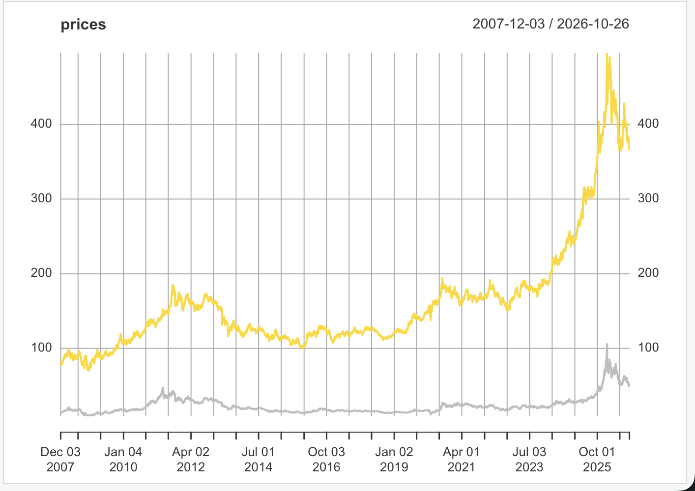
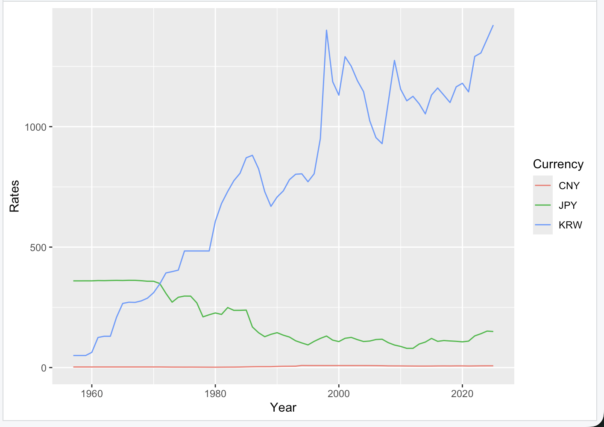
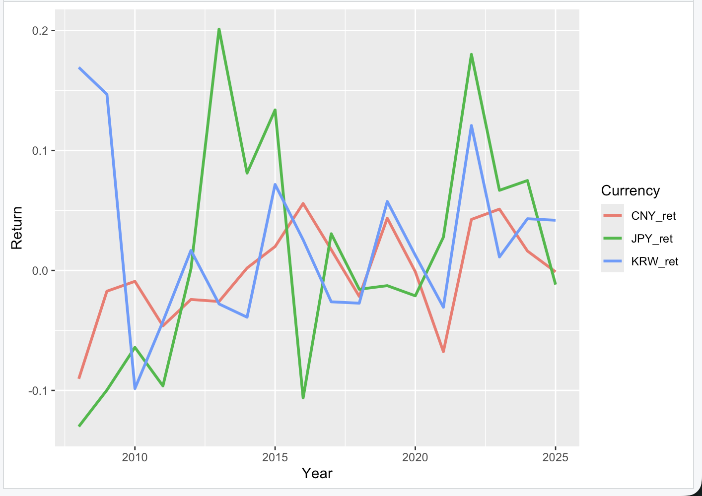

## 학습 목표

- 왜 돈을 배우는가: 소득(Income)과 자산(Asset)의 관계
- 화폐의 역사: 실물화폐 → 금본위제 → 브레튼우즈 → 법정화폐(1971) → 전자화폐, 암호화폐
- 신용창조로 돈이 늘어나는 과정과 M2(통화량)
- 상대적인 돈의 가치인 환율과, 돈이 흘러간 자산(주가지수, 금, 은)
- R로 금융 데이터 가져오기: `quantmod`(Yahoo Finance, FRED), `fortify.zoo()`, `reduce(full_join)`, 로그 눈금, 연간 변화율

> 이번 주 실습은 Yahoo Finance와 FRED에서 **실시간 데이터를 내려받아야** 해서, 이 글을 쓰는 환경에서는 다시 실행할 수 없음. 그래프는 9주차 과제로 제출한 실행 결과(2026년 10월 26일까지의 데이터)를 그대로 싣고, 데이터 없이 확인할 수 있는 계산과 함수 동작만 직접 실행했음
{: .prompt-info }

---

## 소득과 자산: Income ⇒ Asset ⇒ Income

- 소득은 **소비**(생활비, 세금), **저축**(예금, 적금), **투자**(주식, 펀드, 부동산, 코인)로 나뉘고, 저축과 투자가 쌓인 것이 자산
- 자산이 다시 소득(이자, 배당, 월세)을 만들기 때문에 돈의 흐름을 이해하는 것이 중요

| 자산 범주 | 예시 |
| --- | --- |
| 현금성 자산 | 현금, 예금, 비상금 |
| 투자자산 | 주식, 채권, 코인, 펀드, 금 |
| 실물자산 | 부동산, 자동차, 귀금속 |
| 소득형 자산 | 월세 부동산, 배당주, 이자 발생 상품 |
| 연금, 보험 | 국민연금, 연금저축, IRP, 변액보험 |

---

## 돈이란 무엇인가? 화폐의 역사

| 시대 | 시기 | 화폐 제도 | 핵심 특징 |
| --- | --- | --- | --- |
| 고대~중세 | ~17세기 초 | 실물화폐 | 금, 은, 동 자체가 화폐. 왕권이나 국가가 주조 |
| 초기 근대 | 17~19세기 | 대표화폐 (금 보관증서) | 금과 1:1로 바꿀 수 있는 지폐, 초기 은행권 |
| 산업혁명~전간기 | 1816~1930년대 초 | 금본위제 | 국가가 가진 금만큼 지폐 발행. 통화량이 제한됨 |
| 전후 체제 | 1944~1971 | 브레튼우즈 체제 | 금 1온스(31.1g) = 35달러로 달러만 금에 고정, 다른 나라는 달러에 고정환율 |
| 현대 | 1971~현재 | 법정화폐 (Fiat Money) | 1971년 닉슨이 금 태환 중지. 정부 신뢰에 기반한 지폐 |
| 정보화 시대 | 1990년대~현재 | 전자화폐 시스템 | 실물 없이 디지털 계좌 중심 거래 |
| 탈중앙화 실험기 | 2009년~현재 | 암호화폐, 디지털화폐 | 비트코인(민간), CBDC(중앙은행 디지털화폐), 달러 스테이블코인 |

- 1933년 미국 루스벨트 정부는 개인의 금 보유를 금지하고 금을 거둬들였으며, 개인의 금 보유는 1974년 포드 대통령 때 다시 합법이 됨
- 1971년 이후 달러는 금과 완전히 결별했고, 1973년 변동환율제, 1974년 미국과 사우디의 석유 대금 달러 결제(페트로달러)가 달러 수요를 뒷받침함
- 강의 자료 메모: 2024년에 돌았던 "페트로달러 50년 계약 만료설"은 근거 없음

---

## 금과 결별한 돈: 신용창조와 M2

- 금이라는 한도가 없어지면서 중앙은행과 은행 시스템이 **돈의 양을 늘리고 줄일 수 있게** 됨
- M2(광의통화)는 현금과 바로 현금화할 수 있는 예금 등을 합친 통화량 지표

### 은행 예금으로 돈이 늘어나는 과정 (지급준비율 10%)

1. A가 100만 원을 예금
2. 은행은 10만 원만 남기고 90만 원을 B에게 빌려줌
3. B가 90만 원을 다시 은행에 예금하면, 은행은 9만 원을 남기고 81만 원을 C에게 빌려줌
4. 이 과정이 계속 반복됨

통장에 찍힌 돈을 모두 더하면 첫 항이 100, 공비가 0.9인 등비급수가 되어 $$100 + 90 + 81 + \cdots = \dfrac{100}{1 - 0.9} = 1000$$(만 원)

```r
# 지급준비율 10%: 은행은 예금의 10%만 남기고 90%를 다시 빌려줌
deposit <- 100 * 0.9^(0:9)        # 처음 10단계의 예금 (만 원)
round(deposit, 1)
sum(deposit)                      # 10단계까지 합
sum(100 * 0.9^(0:199))            # 200단계까지 합: 1000에 수렴
100 / (1 - 0.9)                   # 등비급수 공식
```

실행 결과

```text
 [1] 100.0  90.0  81.0  72.9  65.6  59.0  53.1  47.8  43.0  38.7
[1] 651.3216
[1] 1000
[1] 1000
```

- 10단계만 반복해도 651만 원, 끝까지 반복하면 **실제 현금 100만 원으로 통장 속 돈 1,000만 원**이 만들어짐
- 일반적으로 지급준비율이 $$r$$이면 최대 $$1/r$$배 (이 배수를 통화승수라고 부름)

### M2와 GDP

- 강의 자료의 FRED 그래프(2000년 이후)에서 미국 M2는 2020년 코로나 때 급증했다가 2022년 이후 줄어듦
- $$M2 / GDP$$는 경제 규모에 비해 돈이 얼마나 많이 풀렸는지를 나타내며, 실제 데이터로 그리는 실습은 다음 글(08)에서 다룸

---

## 상대적인 돈의 가치: 환율

- 환율은 다른 나라 돈과 비교한 **상대적인 가치**. 원/달러 환율이 오르면 1달러를 사는 데 원화가 더 많이 필요하므로 원화 가치가 떨어진 것
- 강의 자료에서는 원/달러(약 1,420원), 원/100엔(약 948원), 달러 인덱스(DXY) 화면을 예로 듦
- **달러 인덱스(DXY)**는 유로, 엔, 파운드 등 주요 통화 묶음에 대한 달러의 가치를 하나의 숫자로 나타낸 지수. 강의 화면 시점(2025년 10월)에는 99.35였고, 장기 그래프에서는 1980년대 중반의 높은 수준에서 내려온 뒤 오르내림을 반복함
- 100엔 환율이 기간 중 최고 956원, 최저 915원이었다면

```r
high <- 956; low <- 915           # 100엔당 원화 (강의 자료의 기간 중 최고, 최저)
high - low                        # 100엔당 차이
(high - low) * 100                # 1만 엔(100엔 × 100)이면
```

실행 결과

```text
[1] 41
[1] 4100
```

- 1만 엔을 바꿀 때 시점에 따라 4,100원 차이가 나므로, 큰 금액일수록 환율 변화의 영향이 커짐

---

## 돈은 어디로 갔나? 나스닥 100, S&P 500, 금, 은

- 1971년 이후 늘어난 돈은 자산으로 흘러갔고, 강의 자료에서는 장기간의 QQQ(나스닥 100 ETF), SPY(S&P 500 ETF), GLD(금 ETF), SLV(은 ETF) 가격 그래프를 비교함
- 강의 화면(2025년 10월 9일 종가 기준)의 숫자

| ETF | 추종 대상 | 가격 | 상승률 | 기간 |
| --- | --- | --- | --- | --- |
| QQQ | 나스닥 100 | 610.70달러 | +1,052.92% | 상장 이후 전체 (MAX) |
| SPY | S&P 500 | 671.16달러 | +1,427.45% | 상장 이후 전체 (MAX) |
| GLD | 금 | 365.43달러 | +716.06% | 상장 이후 전체 (MAX) |
| SLV | 은 | 44.71달러 | +90.99% | 최근 5년 |

- 최근 6개월만 보면 QQQ +31.05%, SPY +22.34%, VOO(뱅가드 S&P 500) +23.64%
- 모두 장기적으로 크게 올랐으며, 특히 최근 몇 년 동안 금과 은이 가파르게 상승함
- 주의: 상승률은 ETF마다 **상장일이 달라** 기간이 서로 다름. SPY는 1993년, QQQ는 1999년, GLD는 2004년 상장이라 SPY가 가장 오래 쌓인 값이고, QQQ는 2000년 닷컴 버블 고점 근처에서 시작해 초반 손실을 안고 출발함. 공정하게 비교하려면 **시작일을 같게 맞추거나**, 실습 3처럼 연간 변화율로 비교해야 함

---

## 실습 1: Yahoo Finance에서 금, 은 가격 가져오기

- `quantmod::getSymbols()`는 종목 코드(ticker)로 가격 데이터를 내려받아 **같은 이름의 xts 객체**를 만들어 줌
- `Ad()`는 수정 종가(Adjusted close: 배당, 분할 등을 반영한 종가)만 꺼냄
- 2007년 12월(글로벌 금융위기 시작)부터 오늘까지의 금 ETF(GLD)와 은 ETF(SLV)

```r
library(quantmod)
start_date <- as.Date("2007-12-01")
end_date <- Sys.Date()

getSymbols(c("GLD", "SLV"), src = "yahoo", from = start_date, to = end_date)

gold_price <- Ad(GLD)              # 수정 종가
silver_price <- Ad(SLV)

prices <- merge(gold_price, silver_price)   # 날짜를 기준으로 합치기
colnames(prices) <- c("Gold", "Silver")

plot(prices, plot.type = "single", col = c("gold", "gray"))
```



- 노란 선이 금(GLD), 회색 선이 은(SLV)이며 단위는 달러
- 금 ETF는 2007년 말 약 80달러에서 2025년 이후 400달러 안팎까지 올랐고, 은도 2025년 이후 급등함
- xts 객체에 `plot()`을 쓰면 시간축이 자동으로 날짜로 표시됨

---

## 실습 2: FRED에서 한, 중, 일 환율 가져오기

- FRED(Federal Reserve Economic Data)는 미국 세인트루이스 연방준비은행의 경제 데이터베이스
- `getSymbols("코드", src = "FRED")`로 같은 방식으로 내려받을 수 있음
- `CCUSMA02KRA618N`, `CCUSMA02CNA618N`, `CCUSMA02JPA618N`은 각각 한국, 중국, 일본의 **연간 대미 환율**(1달러당 자국 통화)

```r
library(dplyr)
library(tidyr)
library(purrr)      # reduce()
library(zoo)        # fortify.zoo()

getSymbols("CCUSMA02KRA618N", src = "FRED")   # 한국
getSymbols("CCUSMA02CNA618N", src = "FRED")   # 중국
getSymbols("CCUSMA02JPA618N", src = "FRED")   # 일본

krw <- fortify.zoo(CCUSMA02KRA618N, names = "Year") %>% rename(KRW = CCUSMA02KRA618N)
cny <- fortify.zoo(CCUSMA02CNA618N, names = "Year") %>% rename(CNY = CCUSMA02CNA618N)
jpy <- fortify.zoo(CCUSMA02JPA618N, names = "Year") %>% rename(JPY = CCUSMA02JPA618N)

df <- list(krw, cny, jpy) %>%
  reduce(full_join, by = "Year") %>%
  pivot_longer(-Year, names_to = "Currency", values_to = "Rates")

ggplot(df, aes(Year, y = Rates, color = Currency)) +
  geom_line()
```

### 사용한 함수의 동작 확인

- 아래는 내려받기 없이 함수만 확인하려고 만든 **설명용 예시 숫자**(실제 환율 아님)

```r
library(dplyr)
library(tidyr)
library(purrr)
library(zoo)
# 설명용 예시 숫자 (실제 환율 아님): 3년치 연간 환율
yrs <- as.Date(c("2021-01-01", "2022-01-01", "2023-01-01"))
KR <- zoo(c(1000, 1100, 1050), yrs)
CN <- zoo(c(6.5, 6.8, 6.6), yrs)
JP <- zoo(c(110, 105, 115), yrs)

krw <- fortify.zoo(KR, names = "Year") %>% rename(KRW = KR)   # zoo → 데이터프레임
cny <- fortify.zoo(CN, names = "Year") %>% rename(CNY = CN)
jpy <- fortify.zoo(JP, names = "Year") %>% rename(JPY = JP)
krw

wide <- list(krw, cny, jpy) %>%
  reduce(full_join, by = "Year")   # full_join(full_join(krw, cny), jpy)와 같음
wide

wide %>%
  pivot_longer(-Year, names_to = "Currency", values_to = "Rates")   # Year는 빼고 나머지를 세로로
```

실행 결과

```text
        Year  KRW
1 2021-01-01 1000
2 2022-01-01 1100
3 2023-01-01 1050
        Year  KRW CNY JPY
1 2021-01-01 1000 6.5 110
2 2022-01-01 1100 6.8 105
3 2023-01-01 1050 6.6 115
# A tibble: 9 × 3
  Year       Currency  Rates
  <date>     <chr>     <dbl>
1 2021-01-01 KRW      1000  
2 2021-01-01 CNY         6.5
3 2021-01-01 JPY       110  
4 2022-01-01 KRW      1100  
5 2022-01-01 CNY         6.8
6 2022-01-01 JPY       105  
7 2023-01-01 KRW      1050  
8 2023-01-01 CNY         6.6
9 2023-01-01 JPY       115
```

- `fortify.zoo()`: 시간 정보가 행 이름(index)에 있는 zoo, xts 객체를 `Year` 열이 있는 데이터프레임으로 바꿈
- `reduce(리스트, full_join, by = "Year")`: 리스트의 데이터를 **앞에서부터 차례로** 합침. 데이터가 10개여도 한 줄로 끝남
- `full_join()`은 양쪽의 모든 행을 유지하므로, 나라마다 데이터가 시작하는 해가 달라도 빠지는 해가 없음 (없는 값은 `NA`)
- `pivot_longer(-Year, ...)`는 Year만 빼고 나머지 열을 (통화, 값) 두 열로 세로로 쌓아서 ggplot이 `color = Currency`로 선을 나눌 수 있게 함



- 원/달러 환율은 1950년대 후반 수십 원에서 1997~1998년 외환위기 때 급등했고, 최근에는 1,400원대
- 엔/달러는 1971년 이전 360엔 고정에서 변동환율제 이후 100엔 안팎으로 내려감 (엔화 가치 상승)
- 위안/달러는 10 이하의 숫자라서 같은 눈금에서는 0 근처의 평평한 선으로 보임. 세 통화의 **단위 차이**가 너무 커서 비교가 어려움

### 로그 눈금으로 같이 보기

```r
ggplot(df, aes(Year, y = Rates, color = Currency)) +
  geom_line(linewidth = 1) +
  scale_y_log10()          # y축을 로그 눈금으로
```

- 로그 눈금에서는 같은 **비율** 변화(예: 2배)가 같은 높이로 보이므로, 단위가 다른 통화도 변화의 모양을 함께 비교할 수 있음

---

## 실습 3: 연간 변화율로 "누구랑 짝인지" 보기

```r
library(lubridate)   # year()

df <- list(krw, cny, jpy) %>%
  reduce(full_join, by = "Year") %>%
  mutate(
    KRW_ret = log(KRW) - lag(log(KRW)),
    CNY_ret = log(CNY) - lag(log(CNY)),
    JPY_ret = log(JPY) - lag(log(JPY))
  ) %>%
  filter(year(Year) >= 2008) %>%
  select(Year, KRW_ret, CNY_ret, JPY_ret) %>%
  pivot_longer(-Year, names_to = "Currency", values_to = "Return")

ggplot(df, aes(x = Year, y = Return, color = Currency)) +
  geom_line(linewidth = 1)
```

```r
library(dplyr)
x <- c(1000, 1100, 1050)          # 위 예시의 KRW
x / lag(x) - 1                    # 단순 변화율: 올해 / 작년 - 1
log(x) - lag(log(x))              # 로그 변화율: log(올해 / 작년)
```

실행 결과

```text
[1]          NA  0.10000000 -0.04545455
[1]          NA  0.09531018 -0.04652002
```

- `lag(x)`는 한 칸 뒤로 민 값(작년 값)이라 첫 해는 `NA`
- 로그 변화율 $$\log(x_t) - \log(x_{t-1}) = \log(x_t / x_{t-1})$$는 변화가 작을 때 단순 변화율 $$x_t / x_{t-1} - 1$$과 거의 같음 (10% → 9.5%)
- 로그 변화율은 여러 해를 **더하면** 전체 기간의 변화가 되는 장점이 있음



- 환율의 변화율이 양수이면 그해 그 통화의 가치가 **떨어진 것** (1달러당 자국 통화가 늘어남)
- 2008, 2009년 원화는 금융위기로 가치가 크게 떨어졌고(약 +0.17, +0.15), 2022년에는 세 통화 모두 달러 대비 약해짐
- "누구랑 짝인지"는 그래프만 보고 단정하기 어려움. 연간 데이터가 18개 정도뿐이므로 `cor()`로 통화 사이의 상관계수를 구해서 함께 확인하는 것이 좋음

---

### 강의 자료 및 실습 코드에서 정정한 부분 정리

| 위치 | 원래 | 정정 | 이유 |
| --- | --- | --- | --- |
| 9주차 실습 코드 (주석) | "올해 수익률 = 올해/작년" | 변화율 = 올해/작년 - 1, 코드는 로그 변화율 log(올해/작년) | 올해/작년은 비율이고, 1을 빼거나 로그를 취해야 변화율 |
| 9주차 실습 코드 (변수 이름) | `end_data <- Sys.Date()` | `end_date` | 오타 (같은 이름으로 계속 써서 실행은 됨) |
| 9주차 실습 코드 (주석) | "나스닥에서 거래되는 금과 은의 ETF 티거" | 티커(ticker), NYSE Arca 상장 | GLD, SLV는 나스닥이 아니라 NYSE Arca에 상장된 ETF |
| 9주차 실습 코드 (그래프) | `geom_line(size = 1)` | `geom_line(linewidth = 1)` | ggplot2 3.4.0부터 선 굵기는 `linewidth` (`size`는 경고) |
| 9주차 실습 코드 (해석) | 환율 변화를 "수익률(Return)"로 표시 | 환율 변화율 | 원/달러 환율 상승은 원화 기준 수익이 아니라 원화 가치 하락 |

---

## 최종 핵심 정리

1. 소득이 저축과 투자를 거쳐 자산이 되고, 자산이 다시 소득을 만든다 (Income ⇒ Asset ⇒ Income)
2. 화폐는 실물화폐 → 금본위제 → 브레튼우즈(금 1온스 = 35달러) → 1971년 이후 법정화폐로 바뀌었고, 본질은 **신뢰**
3. 지급준비율이 $$r$$이면 예금이 최대 $$1/r$$배로 불어나며, 10%면 현금 100만 원이 통장 속 1,000만 원이 됨
4. 환율은 돈의 상대적 가치이며, 원/달러 환율이 오르면 원화 가치가 떨어진 것
5. `quantmod::getSymbols()`로 Yahoo Finance(GLD, SLV)와 FRED(환율) 데이터를 내려받고, `Ad()`로 수정 종가를 꺼냄
6. `fortify.zoo()`로 시계열을 데이터프레임으로, `reduce(full_join)`으로 여러 데이터를 한 번에 합침
7. 단위가 크게 다른 시계열은 `scale_y_log10()`으로 같은 비율 변화를 같은 높이로 비교
8. 연간 변화율은 `log(x) - lag(log(x))`로 구하고, 첫 해는 `NA`가 됨

---

End.
