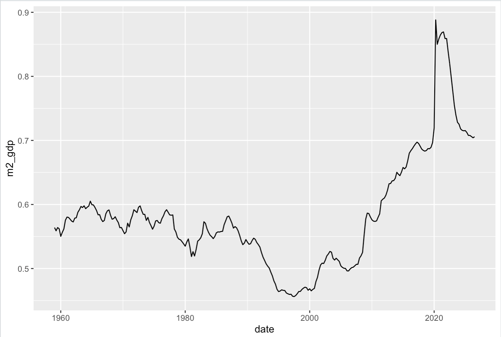
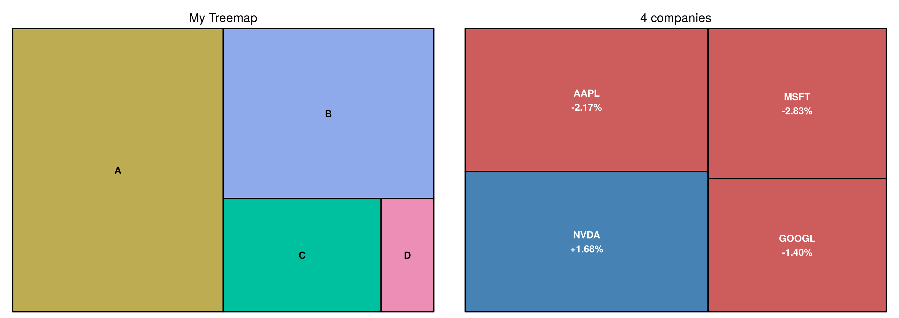
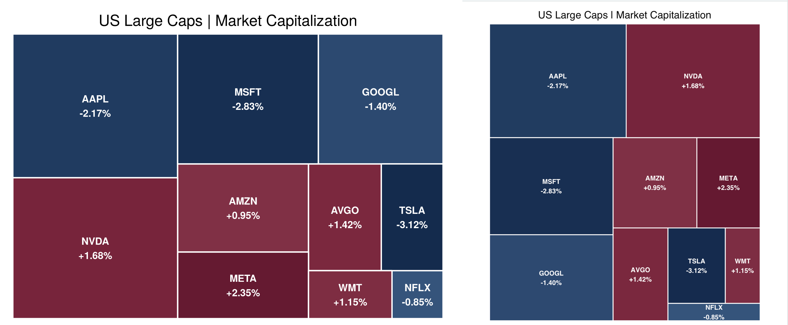
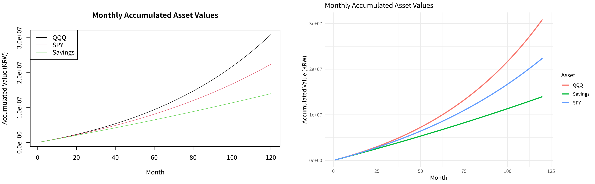

## 학습 목표

- `fredr`로 미국 GDP와 M2를 내려받아 $$M2/GDP$$와 화폐유통속도 이해하기
- `treemap`으로 시가총액과 등락률을 한눈에 보여주는 트리맵 그리기 (10주차 과제 2)
- 새로운 돈인 암호화폐와 CBDC의 차이
- 복리(CAGR)와 적립식 투자의 누적 가치를 등비수열 공식과 `sapply()`로 for loop 없이 계산하고 그래프로 비교

> GDP와 M2 실습은 FRED에서 데이터를 내려받아야 해서 이 글을 쓰는 환경에서는 다시 실행할 수 없음. 그 그래프는 10주차 과제로 제출한 실행 결과를 그대로 싣고, 트리맵과 복리 계산은 모두 직접 실행해서 확인했음
{: .prompt-info }

---

## 실습 1: GDP와 M2, 그리고 M2/GDP

- `fredr` 패키지는 FRED API로 데이터를 가져오며, 먼저 FRED 홈페이지에서 **본인의 API 키**를 발급받아야 함
- `GDP`: 미국 명목 GDP (분기, 연율, 10억 달러)
- `M2SL`: 미국 M2 통화량 (월별). `frequency = "q"`로 분기 자료로 바꿔 GDP와 날짜를 맞춤

```r
library(fredr)
library(tidyverse)

fredr_set_key(Sys.getenv("FRED_API_KEY"))   # 키를 코드에 직접 쓰지 않기

start <- as.Date("1959-01-01")

gdp <- fredr(series_id = "GDP", observation_start = start) %>%
  select(date, gdp = value)

m2 <- fredr(series_id = "M2SL", observation_start = start, frequency = "q") %>%
  select(date, m2 = value)

df <- inner_join(gdp, m2, by = "date") %>%   # 두 데이터에 모두 있는 분기만
  mutate(m2_gdp = m2 / gdp)

# 그래프 1: 2000년 이후 GDP와 M2를 위아래로
df %>%
  pivot_longer(c(gdp, m2), names_to = "series", values_to = "amount") %>%
  filter(year(date) >= 2000) %>%
  ggplot(aes(date, amount, colour = series)) +
  geom_line() +
  facet_wrap(~series, ncol = 1, scales = "free_y")

# 그래프 2 (과제 1): M2 / GDP
df %>%
  ggplot(aes(date, m2_gdp)) +
  geom_line()
```

- `inner_join()`은 **양쪽에 모두 있는 키**의 행만 남김. M2SL은 1959년 1월부터, GDP는 1947년부터 있으므로 겹치는 1959년 이후만 남음
- `facet_wrap(~series, scales = "free_y")`는 GDP와 M2의 크기가 달라도 각자의 y축으로 따로 그려 줌



- $$M2/GDP$$는 경제 규모(GDP)에 비해 돈(M2)이 얼마나 있는지를 나타내는 비율
- 역수 $$V = GDP / M2$$는 **화폐유통속도**로, "1달러가 1년에 몇 번 돌며 거래에 쓰이는가"를 뜻함
- 그래프에서 읽은 대략적인 값으로
  - 1960~80년대: $$M2/GDP$$ 0.52~0.6 사이에서 비교적 안정
  - 1990년대 후반: 약 0.46까지 내려감 (유통속도 약 2.2회)
  - 2008년 금융위기 이후: 꾸준히 올라감
  - 2020년 코로나: 약 0.89까지 급등 (유통속도 약 1.1회)
  - 이후 0.7 근처로 내려옴 (유통속도 약 1.4회)
- 2020년의 급등은 대규모로 돈이 풀린(M2 급증) 동시에 GDP가 줄어든 효과가 겹친 것

---

## 실습 2: 트리맵 (Treemap)

- 트리맵은 전체를 사각형으로 나누어 **넓이로 크기**를, **색으로 다른 값**(예: 등락률)을 보여 주는 그래프
- 주식 시장의 "히트맵"(한경 코스피 맵, finviz 맵)이 대표적인 예
- 강의 자료의 2025년 10월 10일 코스피 맵에서는 시가총액이 가장 큰 삼성전자(+5.96%)와 SK하이닉스(+9.10%)가 화면의 큰 부분을 빨갛게 차지하고, 나머지 다수 종목은 파란색(하락)이었음. 지수만 보면 놓치는 "**큰 두 종목만 오른 날**"이라는 정보가 넓이와 색으로 한눈에 보임
- 한국 시장 맵은 상승이 빨강, 하락이 파랑이고, 미국 finviz 맵은 상승이 초록, 하락이 빨강이라 색의 의미가 반대
- `treemap(데이터, index = 범주, vSize = 넓이 변수, vColor = 색 변수, type = 색 방식)`

```r
library(treemap)
df <- data.frame(name = c("A", "B", "C", "D"),
                 value = c(50, 30, 15, 5))
treemap(df,
        index = "name",        # 사각형을 나누는 범주
        vSize = "value",       # 사각형의 넓이
        title = "My Treemap")
```

```r
library(treemap)
library(dplyr)
nasdaq_df <- tibble(
  company = c("NVDA", "AAPL", "MSFT", "GOOGL"),
  market_cap = c(4.93e12, 5.03e12, 3.88e12, 3.44e12),   # 수업 예시 값 (달러)
  change = c(1.68, -2.17, -2.83, -1.40)                 # 등락률 (%)
)

nasdaq_df <- nasdaq_df %>%
  mutate(
    color = ifelse(change > 0, "steelblue", "indianred"),
    label = paste0(company, "\n", sprintf("%+.2f%%", change))
  )
nasdaq_df

treemap(nasdaq_df,
        index = "label",       # 회사 이름 + 등락률을 표시
        vSize = "market_cap",
        vColor = "color",
        type = "color",        # vColor 열의 색을 그대로 사용
        title = "4 companies")
```

실행 결과

```text
# A tibble: 4 × 5
  company    market_cap change color     label          
  <chr>           <dbl>  <dbl> <chr>     <chr>          
1 NVDA    4930000000000   1.68 steelblue "NVDA\n+1.68%" 
2 AAPL    5030000000000  -2.17 indianred "AAPL\n-2.17%" 
3 MSFT    3880000000000  -2.83 indianred "MSFT\n-2.83%" 
4 GOOGL   3440000000000  -1.4  indianred "GOOGL\n-1.40%"
```



- 왼쪽: A(50)가 전체의 절반, D(5)가 5%의 넓이
- 오른쪽: 넓이는 시가총액, 색은 등락률의 부호. `type = "color"`이면 `vColor` 열에 적힌 **색 이름을 그대로** 칠함
- 수업 코드는 상승을 파란색(steelblue), 하락을 빨간색(indianred)으로 칠했는데, 이는 미국식 표기이고 한국 증시는 반대로 **상승이 빨강, 하락이 파랑**
- `index = "label"`로 회사 이름 아래에 등락률이 함께 표시되며, 수업 코드는 `label` 열을 만들고도 `index = "company"`를 써서 이름만 나왔음
- 시가총액과 등락률은 수업에서 쓴 **예시 값**이며 특정 날짜의 실제 시세로 확인한 값은 아님

### 10주차 과제 2: 회사 10개, 색을 예쁘게

> 문제: 회사 수를 10개로 늘리고, 색을 예쁘게 만들기
{: .prompt-info }

```r
library(treemap)
library(dplyr)
nasdaq_df <- tibble(
  company = c("NVDA", "AAPL", "MSFT", "GOOGL", "AMZN",
              "META", "TSLA", "AVGO", "NFLX", "WMT"),
  market_cap = c(4.93e12, 5.03e12, 3.88e12, 3.44e12, 2.45e12,
                 1.85e12, 1.40e12, 1.65e12, 0.52e12, 0.85e12),
  change = c(1.68, -2.17, -2.83, -1.40, 0.95,
             2.35, -3.12, 1.42, -0.85, 1.15)
)

up_palette <- colorRampPalette(c("#8B4052", "#7A263D", "#530F27"))(100)    # 상승: 다크 레드
down_palette <- colorRampPalette(c("#45658C", "#29466D", "#142B4D"))(100)  # 하락: 다크 블루

max_change <- max(abs(nasdaq_df$change))

nasdaq_df <- nasdaq_df %>%
  mutate(
    intensity = round(abs(change) / max_change * 99) + 1,   # 1 ~ 100
    color = ifelse(change >= 0, up_palette[intensity], down_palette[intensity]),
    label = paste0(company, "\n", sprintf("%+.2f%%", change))
  ) %>%
  arrange(desc(market_cap))

nasdaq_df %>% select(company, change, intensity, color) %>% as.data.frame()

treemap(nasdaq_df,
        index = "label", vSize = "market_cap", vColor = "color", type = "color",
        title = "US Large Caps | Market Capitalization",
        fontsize.title = 17, fontsize.labels = 11,
        fontcolor.labels = "white", fontface.labels = "bold",
        border.col = "white", border.lwds = 2,
        bg.labels = 0, align.labels = c("center", "center"),
        inflate.labels = FALSE, force.print.labels = TRUE,
        algorithm = "pivotSize")
```

실행 결과

```text
   company change intensity   color
1     AAPL  -2.17        70 #203B60
2     NVDA   1.68        54 #77243B
3     MSFT  -2.83        91 #172F52
4    GOOGL  -1.40        45 #2C4970
5     AMZN   0.95        31 #803045
6     META   2.35        76 #651A31
7     AVGO   1.42        46 #7B283E
8     TSLA  -3.12       100 #142B4D
9      WMT   1.15        37 #7E2D42
10    NFLX  -0.85        28 #35547B
```



- 왼쪽이 이번에 다시 실행한 결과, 오른쪽이 제출한 결과. 색과 넓이는 같고, 그림의 가로세로 비율이 달라서 사각형 배치만 조금 다름
- `colorRampPalette(c(색1, 색2, 색3))(100)`은 세 색 사이를 부드럽게 이은 **색 100개**를 만듦
- `intensity`는 등락률의 절댓값을 가장 큰 변동(TSLA 3.12%)에 대한 비율로 1~100 사이의 번호로 바꾼 값이고, 변동이 클수록 진한 색을 고름
- `sprintf("%+.2f%%", change)`: `+`는 양수에도 부호를 붙이고, `.2f`는 소수 둘째 자리, `%%`는 % 문자 자체
- `algorithm = "pivotSize"`는 큰 사각형부터 순서대로 배치하므로 `arrange(desc(market_cap))`과 함께 쓰면 큰 회사가 왼쪽 위에 옴

---

## 새로운 돈: 암호화폐와 CBDC

강의 자료의 비교표를 정리한 것.

| 구분 | 비트코인 | 테더(USDT) | USA₮(USAT) | 이더리움 |
| --- | --- | --- | --- | --- |
| 종류 | 탈중앙화 디지털 화폐 | 달러에 1:1로 연동된 스테이블코인 | 미국 국채와 현금으로 100% 담보된 스테이블코인 | 스마트 컨트랙트 플랫폼의 토큰 |
| 출시 | 2009년, 사토시 나카모토 | 2014년 | 2026년 1월 | 2015년, 비탈릭 부테린 등 |
| 발행량 | 총 2,100만 개로 한정 | 필요에 따라 조절 | 필요에 따라 조절 | 연간 발행량 한도 없음 |
| 관리 | 중앙 관리자 없음 (P2P) | 발행사가 관리 (해외 발행) | 미국 내 발행사가 관리 (미국 규제 준수) | 탈중앙화 |
| 가격 변동 | 매우 큼 ("디지털 골드") | 거의 없음 | 거의 없음 | 매우 큼 |
| 주 용도 | 가치 저장, 투자 | 거래소에서 법정화폐 대신, 송금 | 미국 규제를 지키는 달러 결제 | 탈중앙화 앱(DApp), 디파이, NFT |
| 이자, 스테이킹 | 자체 이자 없음, 일부 플랫폼 예치 시 수익 | 자체 이자 없음, 디파이 예치 시 수익 | 자체 이자 없음 | 지분증명(PoS) 스테이킹 보상 |

- 비트코인과 이더리움은 **탈중앙화**, 두 스테이블코인은 발행사가 준비금을 관리하는 **중앙화** 구조. 강의에서는 스테이블코인을 "탈중앙화 반, 중앙화 반"이라고 표현함
- 스테이블코인의 준비금은 미국 국채, 현금, 단기 금융상품 같은 안전자산이고, 강의 자료는 USAT가 미국의 스테이블코인법(**GENIUS Act**)에 맞춰 월간 감사와 미국 내 은행을 통한 발행 구조를 갖췄다고 설명함
- 스테이블코인 발행사는 받은 달러로 미국 국채를 사므로, 스테이블코인이 늘수록 **미국 국채의 새로운 수요처**가 생긴다는 점도 함께 볼 만함 (보충)

- 강의에서는 통화량을 "중앙은행이 찍는 돈 + 은행 예금 + 회사가 발행하는 스테이블코인 + ..."으로 보고, 돈의 종류가 늘어날수록 돈 1단위의 가치가 떨어지는(인플레이션) 방향을 지적함
- **CBDC**(중앙은행 디지털화폐)는 블록체인과 같은 계열의 기술(분산원장)을 쓰지만, 중앙은행이 발행하므로 돈의 사용처까지 정부가 프로그래밍할 수 있다는 점이 비트코인과 정반대
- 강의 자료에는 2020년 방영된 「심슨 가족」 시즌 31 에피소드 13의 칠판 장면도 나옴. 암호화폐를 소재로 한 에피소드로, 칠판에 비트코인이 쓰는 해시 함수 SHA-256과 RSA 같은 암호 기술 수식이 적혀 있음. 암호화폐가 대중문화의 소재가 될 만큼 알려졌다는 예

### PayPal Mafia (1998)

1998년 PayPal 창업과 초기 경영에 참여한 사람들이 이후 각 분야의 핵심 인물이 되어 "PayPal 마피아"라고 불림. 강의 자료의 표를 요약하면

| 인물 | 강의 자료의 현재 위치 | 강의 자료가 꼽은 영향력 |
| --- | --- | --- |
| 일론 머스크 | SpaceX(xAI 합병), Tesla CEO | 우주, AI, SNS(X). 2026년 6월 SpaceX 상장으로 첫 달러 기준 조만장자가 되었다고 소개 |
| 피터 틸 | Palantir 회장, Founders Fund 파트너 | 국방, 감시 기술, 미국 공화당 쪽 정치 후원 |
| 데이비드 색스 | 백악관 AI, 크립토 담당 이후 대통령 과학기술자문위원회 공동의장 | GENIUS Act 등 미국 크립토 정책 주도 |
| 리드 호프먼 | LinkedIn 창업자, Greylock 파트너 | AI 투자, 미국 민주당 쪽 정치 후원 |
| 맥스 레브친 | Affirm CEO | 핀테크(선구매 후결제) |
| 루크 노섹 | Gigafund(SpaceX 투자 펀드) | SpaceX 상장 서류에서 억만장자로 드러남 |
| 로엘로프 보타 | 전 PayPal CFO | 세쿼이아에서 18년 일한 뒤 SpaceX에 합류 |

- 크립토 바로 뒤에 이 표가 나오는 흐름으로 보면, **결제(PayPal)에서 시작한 같은 인맥이 우주, AI를 거쳐 크립토 정책**까지 닿아 있어 앞으로의 돈의 형태(스테이블코인, CBDC)를 정하는 자리에 있다는 점을 보여 주는 것으로 읽힘
- 인물의 현재 위치와 숫자는 강의 자료 기준이며 이후 바뀔 수 있음

---

## 복리로 내 돈 키우기: CAGR

### CAGR 공식

연평균 복리 수익률(Compound Annual Growth Rate)은 처음 금액이 $$n$$년 뒤 마지막 금액이 되려면 해마다 몇 %씩 불어나야 하는지를 나타내며, 식으로는 $$\text{CAGR} = \left(\dfrac{\text{Ending Value}}{\text{Beginning Value}}\right)^{1/n} - 1$$

- 예를 들어 100이 10년 뒤 200이 되었다면 $$2^{1/10} - 1 \approx 7.2\%$$

### 매달 같은 금액을 넣는 적립식 투자

- 매월 투자 금액 $$M = 100{,}000$$원, 기간 10년, 즉 $$n = 10 \times 12 = 120$$개월, 연 복리 수익률 $$r$$
- 월 수익률은 $$r_m = (1 + r)^{1/12} - 1$$ (12번 복리하면 다시 연 $$r$$이 되도록)
- 매달 초에 $$M$$을 넣고 한 달 동안 불어난다고 하면 $$V_t = (M + V_{t-1})(1 + r_m)$$
- 첫 달에 넣은 돈은 $$n$$개월, 마지막 달에 넣은 돈은 1개월 동안 불어나므로 등비수열의 합으로 정리되어 $$V_n = M \sum_{k=1}^{n} (1 + r_m)^k = M \dfrac{(1 + r_m)\left[(1 + r_m)^n - 1\right]}{r_m}$$

### sapply: for loop 없이 계산하기

```r
# sapply: for loop 없이 벡터의 각 원소에 함수 적용
sapply(1:10, function(x) x^2)

result <- numeric(10)          # for loop로 같은 계산
for (i in 1:10) {
  result[i] <- i^2
}
result
```

실행 결과

```text
 [1]   1   4   9  16  25  36  49  64  81 100
 [1]   1   4   9  16  25  36  49  64  81 100
```

- `sapply(벡터, 함수)`는 벡터의 각 원소에 함수를 적용한 결과를 모아서 돌려줌
- 결과를 담을 벡터를 미리 만들고 인덱스로 채우는 for loop보다 짧고 읽기 쉬움

### QQQ, SPY, 예금 비교

- 강의 가정: QQQ(나스닥 100) 연 18%, SPY(S&P 500) 연 12%, 예금 연 3%. 이 수익률은 **비교를 위한 가정**이며 앞으로의 수익을 보장하는 값이 아님

```r
library(dplyr)
library(tidyr)
M <- 100000                                  # 매월 투자금 (원)
Years <- 10
N_months <- Years * 12
r <- c(QQQ = 0.18, SPY = 0.12, Savings = 0.03)   # 가정한 연 복리 수익률
rm <- (1 + r)^(1/12) - 1                     # 월 수익률
round(rm, 5)

months <- 1:N_months
# 등비수열 합 공식으로 월별 누적 가치 (자산별로 한 열씩)
m_asset <- sapply(rm, function(rm_asset) {
  M * (1 + rm_asset) * ((1 + rm_asset)^months - 1) / rm_asset
})

df_results <- data.frame(Month = months, Principal = M * months)
df_results <- cbind(df_results, m_asset)
head(df_results, 3)
tail(df_results, 1)
```

실행 결과

```text
    QQQ     SPY Savings 
0.01389 0.00949 0.00247 
  Month Principal      QQQ      SPY  Savings
1     1     1e+05 101388.8 100948.9 100246.6
2     2     2e+05 204185.8 202855.6 200740.5
3     3     3e+05 308410.5 305729.4 301482.2
    Month Principal      QQQ      SPY  Savings
120   120   1.2e+07 30908006 22403589 13979191
```

- `rm`이 이름 붙은 벡터라서 `sapply()`의 결과가 QQQ, SPY, Savings라는 **열 이름을 가진 120 × 3 행렬**이 됨
- `months`가 벡터이므로 함수 안의 `(1 + rm_asset)^months`가 120개월을 한 번에 계산함 (벡터화)
- 원금은 10년 동안 1,200만 원으로 같지만, 10년 뒤 가치는 예금 약 1,398만 원, SPY 약 2,240만 원, QQQ 약 3,091만 원

```r
# 공식 결과를 V_t = (M + V_{t-1})(1 + r_m) 점화식으로 한 달씩 계산해서 확인
M <- 100000
rm <- (1 + 0.12)^(1/12) - 1                  # SPY 가정 12%
V <- 0
for (t in 1:120) V <- (M + V) * (1 + rm)
V
M * (1 + rm) * ((1 + rm)^120 - 1) / rm       # 공식
(1 + rm)^12 - 1                              # 월 수익률을 12번 복리하면 다시 연 12%
```

실행 결과

```text
[1] 22403589
[1] 22403589
[1] 0.12
```

- 한 달씩 점화식으로 계산한 값과 공식의 값이 정확히 같음
- $$r_m$$을 12번 복리하면 다시 연 12%가 되어 월 수익률 변환이 맞음을 확인

```r
library(dplyr)
library(tidyr)
M <- 100000
months <- 1:120
r <- c(QQQ = 0.18, SPY = 0.12, Savings = 0.03)
rm <- (1 + r)^(1/12) - 1
m_asset <- sapply(rm, function(rm_asset) M * (1 + rm_asset) * ((1 + rm_asset)^months - 1) / rm_asset)
df_results <- cbind(data.frame(Month = months, Principal = M * months), m_asset)

# base R: 여러 열을 한 번에 선으로
matplot(df_results$Month, df_results[, c("QQQ", "SPY", "Savings")],
        type = "l", lty = 1, col = 1:3,
        xlab = "Month", ylab = "Accumulated Value (KRW)",
        main = "Monthly Accumulated Asset Values")
legend("topleft", legend = c("QQQ", "SPY", "Savings"), col = 1:3, lty = 1)

# ggplot: tidy(long) 형태로 바꿔서
df_long <- pivot_longer(df_results, cols = c("QQQ", "SPY", "Savings"),
                        names_to = "Asset", values_to = "Value")
ggplot(df_long, aes(x = Month, y = Value, color = Asset)) +
  geom_line(linewidth = 1) +
  labs(title = "Monthly Accumulated Asset Values",
       x = "Month", y = "Accumulated Value (KRW)", color = "Asset") +
  theme_minimal(base_family = "Noto Sans CJK KR")
```



- 처음 몇 년은 세 선이 거의 붙어 있다가 시간이 지날수록 벌어짐. 복리는 **기간이 길수록** 효과가 커짐
- `matplot()`은 행렬의 여러 열을 한 번에 선으로 그리는 base R 함수이고, ggplot으로 그리려면 `pivot_longer()`로 긴 형태로 바꿔야 함

---

### 강의 자료 및 실습 코드에서 정정한 부분 정리

| 위치 | 원래 | 정정 | 이유 |
| --- | --- | --- | --- |
| 10주차 실습 코드 (FRED) | API 키를 코드에 직접 입력 | `Sys.getenv("FRED_API_KEY")` 등으로 분리 | 키가 코드와 함께 공유되면 다른 사람이 내 키로 요청할 수 있음 (이 글에서도 키는 뺐음) |
| 10주차 실습 코드 (주석) | "역수 v = CDP/M2" | $$V = GDP / M2$$ | 오타 |
| 10주차 실습 코드 (트리맵) | `label`을 만들고 `index = "company"` | `index = "label"` | 만든 라벨(등락률)이 표시되지 않음 |
| 10주차 실습 코드 (트리맵) | `sprintf("% .2f%%", change)` | `sprintf("%+.2f%%", change)` | 공백 플래그는 양수 앞에 빈칸을 넣고, `+`는 부호를 표시 |
| 10주차 실습 코드 | 같은 트리맵 코드 블록이 5번 반복 | 한 번만 | 중복 |
| 10주차 과제 2 | `pmax(1, round(abs(change) / max_change * 99) + 1)` | `round(abs(change) / max_change * 99) + 1` | `+ 1` 때문에 이미 최솟값이 1이라 `pmax(1, ...)`는 결과를 바꾸지 않음 (결과는 같음) |
| 9주차 강의 자료 (복리 코드) | `geom_line(size = 1)` | `geom_line(linewidth = 1)` | ggplot2 3.4.0부터 선 굵기는 `linewidth` |
| 9주차 강의 자료 (복리 식) | "10개월째 누적가치"를 $$(1 + r_m)^1$$부터 $$(1 + r_m)^{10}$$까지의 합으로 표기 | 같은 식이지만 지수 10은 **첫 달**에 넣은 돈 | 점화식 $$V_t = (M + V_{t-1})(1 + r_m)$$에서 먼저 넣은 돈이 더 오래 불어남 (합은 동일) |

---

## 결론: 돈의 형태는 바뀌어도 본질은 신뢰

강의는 네 문장으로 마무리됨.

| 강의의 결론 | 이 글과 [7편](/posts/Big-Data_07/)에서 본 근거 |
| --- | --- |
| **1971년, 돈은 금과 결별했다.** 그 뒤로 돈의 양은 늘었고, 그 돈은 자산으로 흘러갔다 | M2/GDP가 0.46에서 0.89까지 상승, QQQ, SPY, 금, 은의 장기 상승 |
| **돈의 형태는 바뀌어도 본질은 신뢰다.** 금에서 종이, 디지털, 크립토, CBDC로 바뀌어 왔다 | 화폐의 역사 표, 스테이블코인과 CBDC |
| **탈중앙화를 꿈꾼 기술이 통제의 도구가 될 수 있다.** 기술은 중립이지만 방향은 사람이 정한다 | 같은 분산원장 기술이 비트코인(탈중앙화)과 CBDC(사용처 통제)에 모두 쓰임 |
| **여러분의 시대에 돈은 어떤 형태일까?** | 답은 열려 있음. 다만 앞의 CAGR 계산처럼 복리로 시간을 내 편으로 만드는 원리는 돈의 형태와 상관없이 그대로 적용됨 |

---

## 최종 핵심 정리

1. `fredr`로 GDP(분기)와 M2SL(`frequency = "q"`)을 받아 `inner_join()`으로 날짜를 맞추고, API 키는 코드에 직접 쓰지 않음
2. $$M2/GDP$$는 경제 규모 대비 돈의 양이고, 역수 $$GDP/M2$$는 1달러가 1년에 몇 번 도는지(화폐유통속도)
3. 미국 $$M2/GDP$$는 1990년대 후반 약 0.46에서 2020년 약 0.89까지 올랐다가 0.7 근처로 내려옴
4. 트리맵은 넓이(`vSize`)와 색(`vColor`)으로 두 변수를 동시에 보여 주며, `type = "color"`면 색 이름을 그대로 칠함
5. `colorRampPalette()`로 색 단계를 만들고 등락률 크기에 따라 진하기를 고르면 한눈에 읽히는 트리맵이 됨
6. 비트코인은 발행량이 정해진 탈중앙화 화폐, 테더와 USAT 같은 스테이블코인은 달러에 연동되어 발행사가 관리하는 토큰, CBDC는 중앙은행이 발행해 사용처까지 통제할 수 있는 디지털 화폐이며, 돈의 본질은 형태와 관계없이 신뢰
7. $$\text{CAGR} = (\text{Ending} / \text{Beginning})^{1/n} - 1$$이고, 월 수익률은 $$r_m = (1 + r)^{1/12} - 1$$
8. 적립식 누적 가치는 등비수열 합 공식과 `sapply()`로 for loop 없이 계산하며, 같은 원금 1,200만 원도 10년 뒤 가정한 수익률에 따라 약 1,398만 원에서 3,091만 원까지 차이 남

---

End.
