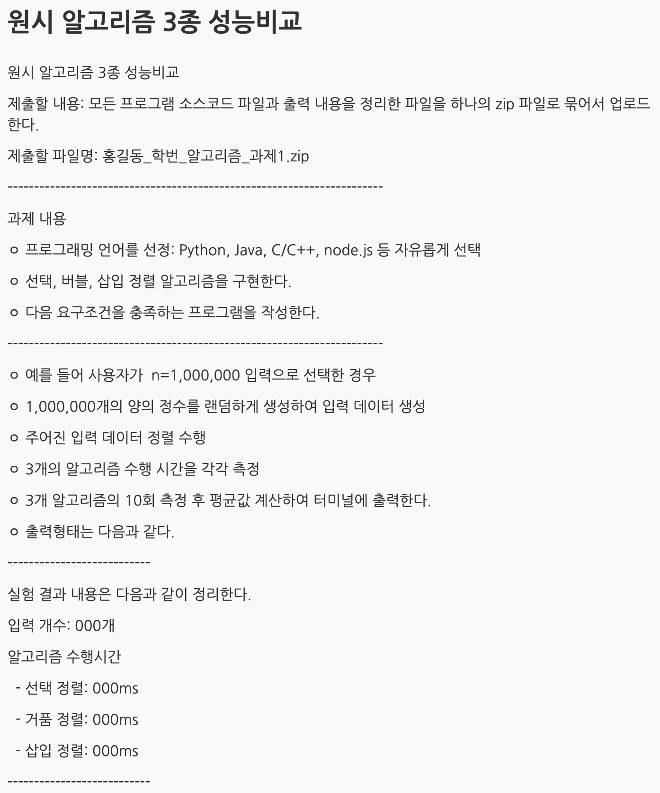
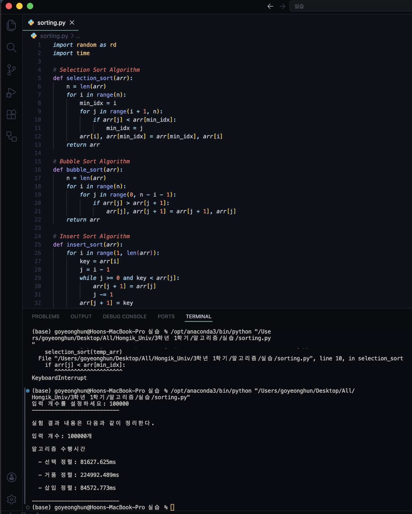

## 학습 목표

- 선택, 거품, 삽입 정렬의 한 패스에서 하는 일
- 패스마다 배열이 어떻게 바뀌는지 직접 추적하기 (시험 단골)
- 세 정렬의 수행 시간이 $$O(n^2)$$인 이유
- 정렬 범위가 줄어드는 정렬(선택, 거품)과 늘어나는 정렬(삽입)의 차이
- 거의 정렬된 입력에서 삽입 정렬이 빠른 이유를 비교 횟수로 확인
- 과제 1: 원시 정렬 3종의 수행 시간 측정

---

## 1. 선택 정렬

강의에서 쓰는 방식은 **최댓값을 골라 맨 오른쪽으로 보내는** 선택 정렬.

1. 정렬 범위에서 최대 원소를 찾음
2. 최대 원소와 범위의 맨 오른쪽 원소를 교환
3. 맨 오른쪽 원소는 정렬이 끝난 것으로 보고 범위에서 제외
4. 원소가 하나 남을 때까지 반복

비교 횟수는 $$(n-1) + (n-2) + \cdots + 1 = \frac{n(n-1)}{2} = O(n^2)$$이고, 입력 상태와 상관없이 항상 같음.

> **(중요!!)** 과정 그림에 빈칸을 뚫어 놓고 패스마다 배열 상태를 쓰게 하는 문제가 매번 나옴
{: .prompt-warning }

## 2. 거품 정렬

- 바로 옆 원소끼리 비교해서 큰 값을 오른쪽으로 보냄 → 한 패스가 끝나면 가장 큰 값이 맨 뒤로 "떠오름"
- 맨 뒤 원소는 정렬된 것으로 보고 범위에서 제외
- 비교 횟수 $$(n-1) + (n-2) + \cdots + 1 = O(n^2)$$
- 선택 정렬과 비교 횟수는 같지만, 교환이 패스마다 여러 번 일어나서 보통 더 느림

## 3. 삽입 정렬

1. 첫 번째 원소는 정렬되어 있다고 가정
2. 다음 원소를 하나 골라, 정렬된 왼쪽 부분에서 자기보다 큰 원소들을 한 칸씩 오른쪽으로 밈
3. 빈 자리에 그 원소를 삽입
4. 마지막 원소까지 반복

- 최악(역순): $$1 + 2 + \cdots + (n-1) = O(n^2)$$
- 평균: 그 절반 정도 $$\frac{1}{2}(1 + 2 + \cdots + (n-1)) = O(n^2)$$
- 최선(이미 정렬됨): 원소마다 비교 한 번 → $$O(n)$$

> **(중요!!)** 선택/거품 정렬은 **n개짜리 배열에서 시작해 정렬 범위를 하나씩 줄여 나가고**, 삽입 정렬은 **1개짜리 정렬된 배열에서 시작해 하나씩 늘려 나감**
{: .prompt-warning }

---

## 4. 패스별 추적과 비교 횟수 (실행)

`[29, 10, 14, 37, 13]`을 세 정렬로 정렬하며 패스마다 배열을 출력하고, 입력 상태에 따라 비교 횟수가 어떻게 달라지는지 셈.

```python
# 강의 방식(최댓값을 맨 오른쪽으로)의 선택 정렬, 거품 정렬, 삽입 정렬을 패스마다 출력
def selection_trace(a):
    a = a[:]
    for last in range(len(a) - 1, 0, -1):          # 정렬 범위 a[0..last]
        k = max(range(last + 1), key=lambda i: a[i])   # 1) 최댓값 찾기
        a[k], a[last] = a[last], a[k]                  # 2) 맨 오른쪽과 교환
        print(f"  pass {len(a) - last}: {a}   (최댓값 {a[last]} 확정)")  # 3) 범위에서 제외
    return a

def bubble_trace(a):
    a = a[:]
    for last in range(len(a) - 1, 0, -1):
        for i in range(last):
            if a[i] > a[i + 1]:
                a[i], a[i + 1] = a[i + 1], a[i]
        print(f"  pass {len(a) - last}: {a}")
    return a

def insertion_trace(a):
    a = a[:]
    for i in range(1, len(a)):
        key, j = a[i], i - 1
        while j >= 0 and a[j] > key:
            a[j + 1] = a[j]; j -= 1
        a[j + 1] = key
        print(f"  {key:>2} 삽입: {a}")
    return a

data = [29, 10, 14, 37, 13]
print("선택 정렬"); selection_trace(data)
print("거품 정렬"); bubble_trace(data)
print("삽입 정렬"); insertion_trace(data)

# 입력 상태에 따른 비교 횟수
def comparisons(sort, a):
    a, c = a[:], 0
    if sort == "bubble":
        for last in range(len(a) - 1, 0, -1):
            for i in range(last):
                c += 1
                if a[i] > a[i + 1]: a[i], a[i + 1] = a[i + 1], a[i]
    elif sort == "selection":
        for last in range(len(a) - 1, 0, -1):
            k = 0
            for i in range(1, last + 1):
                c += 1
                if a[i] > a[k]: k = i
            a[k], a[last] = a[last], a[k]
    else:
        for i in range(1, len(a)):
            key, j = a[i], i - 1
            while j >= 0:
                c += 1
                if a[j] <= key: break
                a[j + 1] = a[j]; j -= 1
            a[j + 1] = key
    return c

import random
random.seed(1)
n = 1000
cases = {"정렬됨": list(range(n)), "거의 정렬됨(10쌍 교환)": list(range(n)),
         "무작위": random.sample(range(n), n), "역순": list(range(n, 0, -1))}
for _ in range(10):
    i = random.randrange(n - 1); cases["거의 정렬됨(10쌍 교환)"][i], cases["거의 정렬됨(10쌍 교환)"][i + 1] = i + 1, i
print(f"\nn = {n}일 때 비교 횟수  (n(n-1)/2 = {n * (n - 1) // 2})")
print(f"{'입력':<16}{'selection':>11}{'bubble':>11}{'insertion':>11}")
for name, a in cases.items():
    print(f"{name:<16}" + "".join(f"{comparisons(s, a):>11}" for s in ("selection", "bubble", "insertion")))
```

실행 결과

```text
선택 정렬
  pass 1: [29, 10, 14, 13, 37]   (최댓값 37 확정)
  pass 2: [13, 10, 14, 29, 37]   (최댓값 29 확정)
  pass 3: [13, 10, 14, 29, 37]   (최댓값 14 확정)
  pass 4: [10, 13, 14, 29, 37]   (최댓값 13 확정)
거품 정렬
  pass 1: [10, 14, 29, 13, 37]
  pass 2: [10, 14, 13, 29, 37]
  pass 3: [10, 13, 14, 29, 37]
  pass 4: [10, 13, 14, 29, 37]
삽입 정렬
  10 삽입: [10, 29, 14, 37, 13]
  14 삽입: [10, 14, 29, 37, 13]
  37 삽입: [10, 14, 29, 37, 13]
  13 삽입: [10, 13, 14, 29, 37]

n = 1000일 때 비교 횟수  (n(n-1)/2 = 499500)
입력                selection     bubble  insertion
정렬됨                  499500     499500        999
거의 정렬됨(10쌍 교환)       499500     499500       1009
무작위                  499500     499500     251387
역순                   499500     499500     499500
```

- 선택 정렬 첫 패스 후 `[29, 10, 14, 13, 37]`, 거품 정렬 첫 패스 후 `[10, 14, 29, 13, 37]`: 둘 다 37이 맨 뒤로 가지만 나머지 배치가 다름
- 삽입 정렬에서 13을 넣을 때 37, 29, 14가 한 칸씩 밀리고 13이 두 번째 자리에 들어감
- 선택과 거품 정렬은 입력과 상관없이 항상 499,500번 비교함
- 삽입 정렬은 정렬된 입력에서 999번($$n-1$$), 거의 정렬된 입력에서 1,009번으로 **선형**에 가깝고, 역순일 때만 499,500번
- 거품 정렬도 "한 패스 동안 교환이 없으면 멈춤" 플래그를 넣으면 정렬된 입력에서 $$O(n)$$이 되지만, 강의와 과제 코드에는 그 플래그가 없음

---

## 5. 과제 1: 원시 정렬 3종 성능 비교



> 선택, 거품, 삽입 정렬을 구현하고, 양의 정수 n개를 무작위로 만들어 세 알고리즘의 수행 시간을 10회 측정한 평균을 출력 (예: n = 1,000,000)
{: .prompt-info }

### 코드

```python
import random as rd
import time

# Selection Sort Algorithm
def selection_sort(arr):
    n = len(arr)
    for i in range(n):
        min_idx = i
        for j in range(i + 1, n):
            if arr[j] < arr[min_idx]:
                min_idx = j
        arr[i], arr[min_idx] = arr[min_idx], arr[i]
    return arr

# Bubble Sort Algorithm
def bubble_sort(arr):
    n = len(arr)
    for i in range(n):
        for j in range(0, n - i - 1):
            if arr[j] > arr[j + 1]:
                arr[j], arr[j + 1] = arr[j + 1], arr[j]
    return arr

# Insert Sort Algorithm
def insert_sort(arr):
    for i in range(1, len(arr)):
        key = arr[i]
        j = i - 1
        while j >= 0 and key < arr[j]:
            arr[j + 1] = arr[j]
            j -= 1
        arr[j + 1] = key
    return arr


# 1. 입력 개수 설정
n = int(input("입력 개수를 설정하세요: "))

# 2. 랜덤 데이터 생성
arr = [rd.randint(1, n) for _ in range(n)]

# 3. 3개의 알고리즘 수행 시간 측정 및 알고리즘의 10회 측정 후 평균값 계산
selection_times, bubble_times, insert_times = [], [], []

for _ in range(10):
    for sort, times in [(selection_sort, selection_times), (bubble_sort, bubble_times), (insert_sort, insert_times)]:
        temp_arr = arr.copy()                      # 매번 같은 입력의 사본을 정렬
        start_time = time.time()
        sort(temp_arr)
        times.append((time.time() - start_time) * 1000)  # ms 변환

avg = lambda xs: sum(xs) / len(xs)

# 4. 결과 출력
print("---------------------------")
print("실험 결과 내용은 다음과 같이 정리한다.")
print(f"입력 개수: {n}개")
print("알고리즘 수행시간")
print(f"  - 선택 정렬: {avg(selection_times):.3f}ms")
print(f"  - 거품 정렬: {avg(bubble_times):.3f}ms")
print(f"  - 삽입 정렬: {avg(insert_times):.3f}ms")
print("---------------------------")
```

(제출한 코드에서 세 정렬의 측정 부분을 반복문 하나로 묶어 줄였음. 동작은 같음)

### 제출 결과 (n = 100,000)



| 정렬 | 평균 수행 시간 |
| --- | --- |
| 선택 정렬 | 81,627.625 ms (약 82초) |
| 거품 정렬 | 224,992.489 ms (약 225초) |
| 삽입 정렬 | 84,572.773 ms (약 85초) |

- n = 1,000,000은 실행이 끝나지 않아서 100,000으로 줄여 실행함
- $$O(n^2)$$이라 n이 10배면 시간은 약 100배. 100,000에서 약 1~4분이었으니 1,000,000이면 **2~6시간**(10회 평균이면 그 10배)이 걸림. 원시 정렬로 백만 개를 정렬하기 어려운 이유

### 다시 실행해 본 결과

같은 함수를 이 글을 쓰는 환경에서 작은 n으로 3회씩 실행함 .

```text
[원시 정렬] 평균 ms (3회)
      n   selection      bubble   insertion
   1000        16.5        34.9        17.3
   2000        61.6       145.6        97.6
   4000       276.4       659.7       295.6
   8000      1110.2      2567.7      1317.7
```

- n이 2배가 될 때마다 시간이 약 4배 → $$O(n^2)$$
- 거품 정렬이 가장 느림: 비교 횟수는 선택 정렬과 같지만 **교환**을 훨씬 많이 함 (선택 정렬은 패스당 교환 1번)
- 무작위 입력에서 삽입 정렬은 비교와 이동을 평균 $$n^2/4$$번 정도 해서 선택 정렬과 비슷함

---

### 강의 자료 및 과제에서 정정한 부분 정리

| 위치 | 원래 | 정정 | 이유 |
| --- | --- | --- | --- |
| 과제 1 코드 | 최솟값을 앞으로 보내는 선택 정렬 | (그대로 두고 설명 추가) | 강의는 최댓값을 뒤로 보내는 방식. 두 방식 모두 $$O(n^2)$$이고 결과도 같음 |
| 삽입 정렬 | 대부분 정렬된 경우 O(n) **가능** | 비교 횟수로 확인: 정렬됨 999번, 거의 정렬됨 1,009번 | 코드로 검증 |

---

## 최종 핵심 정리

1. 선택 정렬은 최댓값을 찾아 맨 오른쪽과 교환하고 범위를 줄이며, 비교 횟수는 항상 $$n(n-1)/2$$
2. 거품 정렬은 인접 원소를 비교, 교환해 최댓값을 뒤로 보내며 비교 횟수는 같지만 교환이 많아 더 느림
3. 삽입 정렬은 정렬된 앞부분에 새 원소를 끼워 넣으며 최악 $$O(n^2)$$, 최선 $$O(n)$$
4. 선택/거품 정렬은 정렬 범위를 n에서 줄여 나가고, 삽입 정렬은 1에서 늘려 나감
5. `[29, 10, 14, 37, 13]`의 첫 패스: 선택 `[29, 10, 14, 13, 37]`, 거품 `[10, 14, 29, 13, 37]`
6. 거의 정렬된 입력에서는 삽입 정렬이 선형에 가깝게 빨라짐 (n = 1000에서 1,009번 비교)
7. 과제 1의 n = 100,000에서 선택 82초, 거품 225초, 삽입 85초로 거품 정렬이 가장 느렸음
8. 원시 정렬은 n이 10배면 시간이 100배가 되므로, 큰 입력에는 $$O(n \log n)$$ 정렬이 필요함

---

End.
