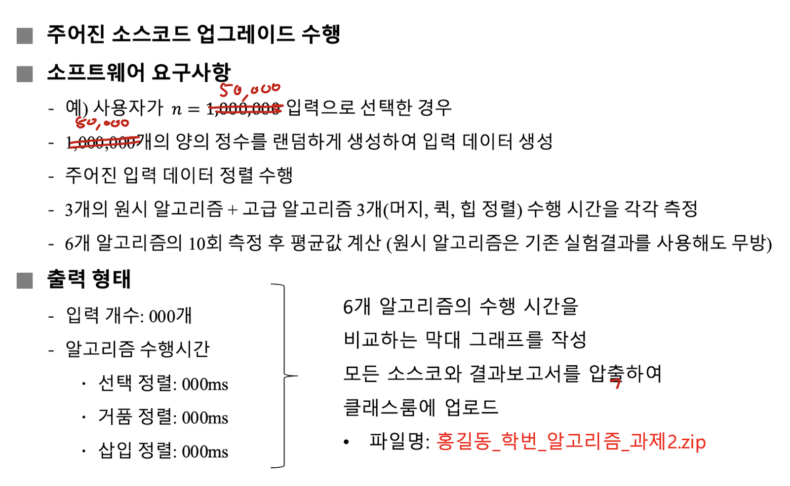
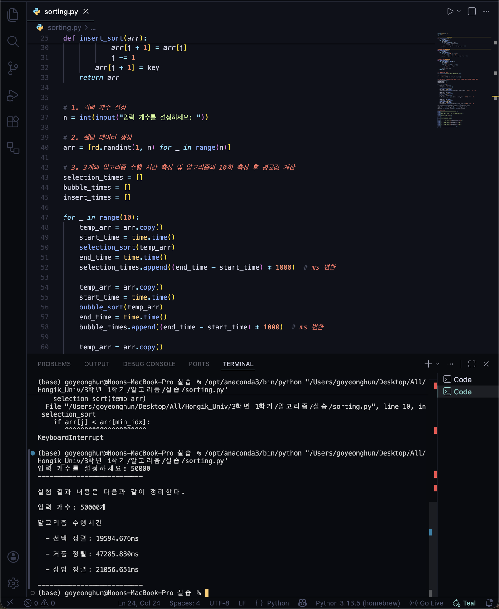
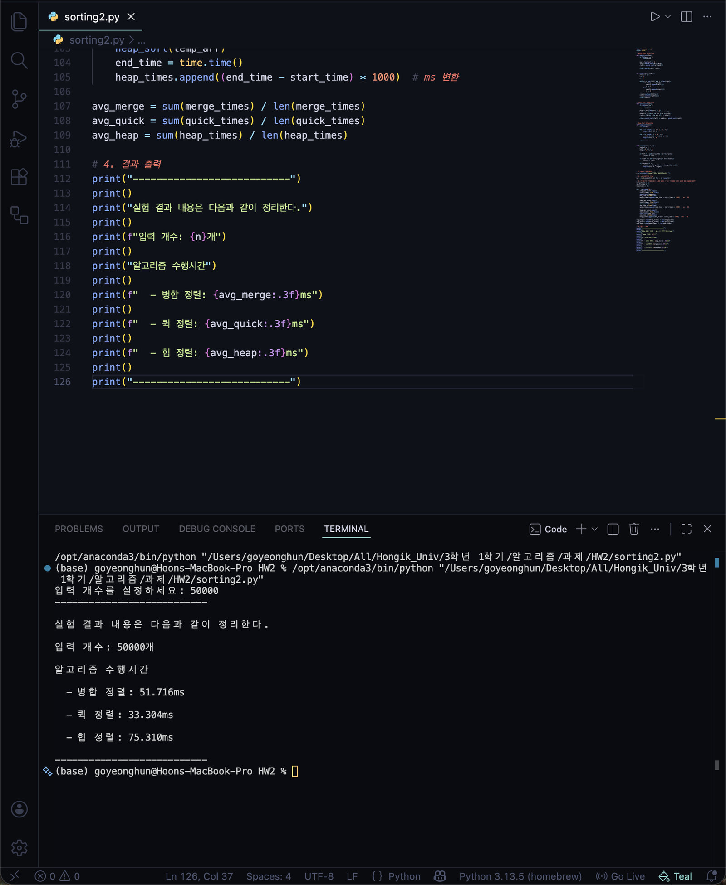
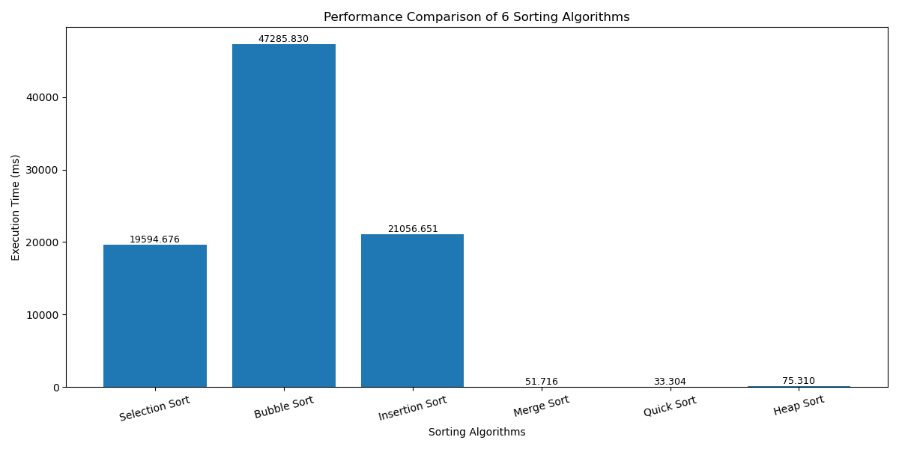
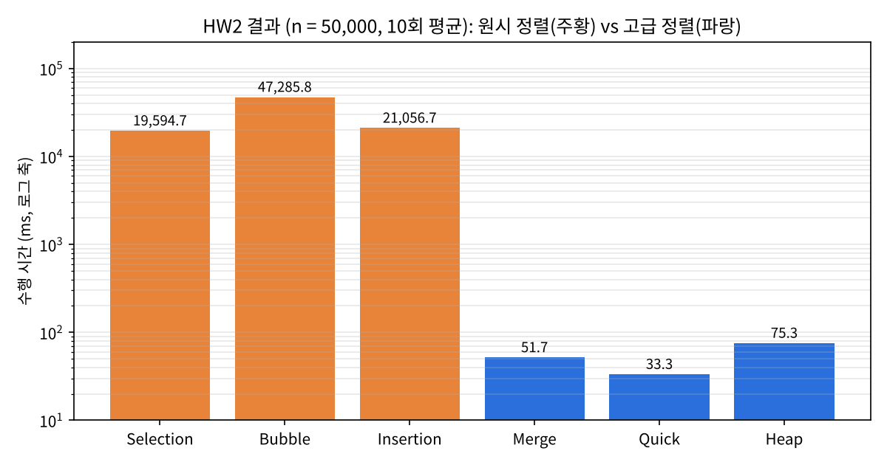
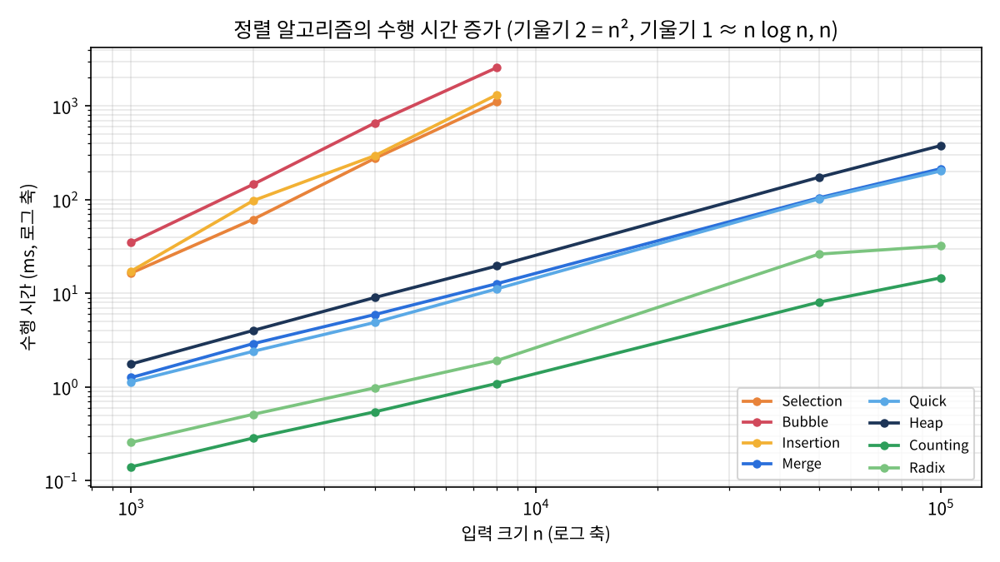

## 학습 목표

- 병합, 퀵, 힙 정렬의 동작과 최악, 평균, 최선 수행 시간
- 퀵 정렬의 최악 입력이 피벗 선택 방법에 따라 달라지는 이유
- 힙의 조건, 배열 인덱스 관계, 힙 만들기(buildHeap)가 $$O(n)$$인 이유
- 비교 정렬의 한계 $$\Omega(n \log n)$$을 넘는 계수 정렬과 기수 정렬, 안정 정렬
- 과제 2: 원시 정렬과 고급 정렬의 수행 시간 비교
- 결과를 로그 축으로 그려야 하는 이유

---

## 1. 병합 정렬

1. 배열을 반으로 나눔
2. 두 부분을 각각 **재귀적으로** 정렬
3. 정렬된 두 부분을 하나로 **병합**: 두 배열의 맨 앞을 비교해 작은 것부터 꺼내 붙임

- 점화식 $$T(n) = 2T(n/2) + n$$이고 [01편](/posts/Algorithm_01/)에서 구한 대로 $$\Theta(n \log n)$$
- 입력 상태와 상관없이 항상 반으로 나누므로 최악, 평균, 최선이 모두 $$\Theta(n \log n)$$
- 병합할 때 추가 배열이 필요해서 메모리를 $$O(n)$$ 더 씀

## 2. 퀵 정렬

1. **피벗**(기준 원소)을 하나 고름
2. 피벗보다 작은 원소는 왼쪽, 큰 원소는 오른쪽으로 **분할**
3. 왼쪽과 오른쪽을 각각 재귀적으로 정렬 (병합 단계가 필요 없음)

- 분할이 반반으로 잘 되면 $$\Theta(n \log n)$$, 한쪽으로 몰리면 $$T(n) = T(n-1) + n$$이 되어 $$\Theta(n^2)$$
- **관건은 분할이 얼마나 균형 있게 되는가**

> 퀵 정렬의 최악은 "이미 정렬된 입력"이라고 외우기 쉽지만, 정확히는 **맨 끝(또는 맨 앞) 원소를 피벗으로 쓸 때** 정렬된 입력이 최악. 피벗을 가운데나 무작위로 고르면 정렬된 입력도 균형 있게 나뉨
{: .prompt-danger }

## 3. 힙 정렬

### 힙의 조건

- **완전 이진 트리**: 맨 아래층을 빼면 꽉 차 있고, 맨 아래층은 왼쪽부터 채워짐
- **힙 성질**: 모든 노드의 값이 자식보다 크거나 같음(최대 힙) 또는 작거나 같음(최소 힙)
- 배열로 저장하면 1번 인덱스부터 셀 때 `A[k]`의 자식은 `A[2k]`, `A[2k+1]`, 부모는 `A[k/2]`(소수점 버림)
  - 코드처럼 0번부터 세면 자식은 `2k+1`, `2k+2`

### 힙 만들기와 정렬

1. **buildHeap**: 마지막 리프의 부모부터 루트까지 거꾸로 올라가며 `heapify`(그 노드를 아래로 내려 보내 힙 성질을 맞춤)
2. **정렬**: 루트(최댓값)를 배열 맨 끝과 교환하고 힙 크기를 1 줄인 뒤 루트에서 `heapify`. 원소가 하나 남을 때까지 반복

- buildHeap은 아래쪽 노드 대부분이 조금만 내려가면 되므로 **$$O(n)$$**
- 정렬 단계는 `heapify`($$O(\log n)$$)를 $$n-1$$번 하므로 전체 $$\Theta(n \log n)$$
- 추가 메모리가 거의 필요 없음 (제자리 정렬)

### 세 정렬 비교

| 정렬 | 최악 | 평균 | 최선 |
| --- | --- | --- | --- |
| 병합 | $$\Theta(n \log n)$$ | $$\Theta(n \log n)$$ | $$\Theta(n \log n)$$ |
| 퀵 | $$\Theta(n^2)$$ | $$\Theta(n \log n)$$ | $$\Theta(n \log n)$$ |
| 힙 | $$\Theta(n \log n)$$ | $$\Theta(n \log n)$$ | $$\Theta(n \log n)$$ |

> **(중요!!)** 정렬 알고리즘 성능 비교표는 빈칸을 뚫어 놓고 채우게 하는 문제로 나옴
{: .prompt-warning }

---

## 4. $$O(n \log n)$$을 넘는 정렬

원소끼리 **비교**해서 정렬하는 방법은 최악의 경우 $$\Omega(n \log n)$$보다 빠를 수 없음. 원소 값에 대한 조건이 있으면 비교 없이 더 빠르게 정렬할 수 있음.

### 계수 정렬

- 조건: 원소가 $$k$$ 이하의 자연수이고, $$k$$가 $$O(n)$$을 넘지 않음
1. 1부터 $$k$$까지 각 값이 **몇 번 등장하는지** 셈
2. 등장 횟수를 **누적 합**으로 바꾸면, 값 $$i$$가 결과 배열에서 차지할 **마지막 자리**가 됨
3. 입력을 **뒤에서부터** 보며 누적 합이 가리키는 자리에 넣고 그 값을 1 줄임

- 수행 시간 $$\Theta(n + k)$$이고, $$k = O(n)$$이면 $$\Theta(n)$$
- 뒤에서부터 넣기 때문에 같은 값의 원래 순서가 유지됨 (**안정 정렬**)

### 기수 정렬

- 조건: 모든 입력이 $$d$$자리 이하의 수
1. **가장 낮은 자릿수**만 보고 전체를 정렬
2. 그다음 자릿수만 보고 정렬
3. 가장 높은 자릿수까지 반복

- 각 자릿수 정렬은 반드시 **안정 정렬**이어야 함. 그래야 앞 단계(낮은 자릿수)에서 정한 순서가 높은 자릿수가 같은 원소들 사이에서 유지됨
- 수행 시간 $$\Theta(d(n + b))$$ ($$b$$는 진법). $$d$$가 상수면 $$\Theta(n)$$

**안정 정렬**: 같은 값을 가진 원소들이 정렬 뒤에도 원래 순서를 유지하는 정렬.

---

## 5. 동작 확인 (실행)

퀵 정렬의 피벗 위치에 따른 비교 횟수, 힙 만들기와 정렬 단계, 계수 정렬의 누적 합과 안정성을 출력함.

```python
import random, sys, time
sys.setrecursionlimit(10000)

# 1) 퀵 정렬의 최악: 피벗 위치에 따라 정렬된 입력이 최악이 되기도, 아니기도 함
def quick_first(a, lo, hi, cnt):              # 강의 방식: 맨 끝 원소를 피벗으로 분할(Lomuto)
    if lo < hi:
        pivot, i = a[hi], lo - 1
        for j in range(lo, hi):
            cnt[0] += 1
            if a[j] <= pivot:
                i += 1; a[i], a[j] = a[j], a[i]
        a[i + 1], a[hi] = a[hi], a[i + 1]
        quick_first(a, lo, i, cnt); quick_first(a, i + 2, hi, cnt)

def quick_middle(a, cnt):                     # 과제 방식: 가운데 원소를 피벗
    if len(a) <= 1: return a
    p = a[len(a) // 2]; cnt[0] += len(a)
    return quick_middle([x for x in a if x < p], cnt) + [x for x in a if x == p] + quick_middle([x for x in a if x > p], cnt)

n = 2000
print(f"퀵 정렬 비교 횟수 (n = {n}, n(n-1)/2 = {n*(n-1)//2}, n log2 n ≈ {int(n*11):,})")
for name, data in [("무작위", random.Random(0).sample(range(n), n)), ("정렬됨", list(range(n)))]:
    c1, c2 = [0], [0]
    quick_first(data[:], 0, n - 1, c1); quick_middle(data[:], c2)
    print(f"  {name:<4}  끝 원소 피벗 {c1[0]:>9,}   가운데 피벗 {c2[0]:>7,}")

# 2) 힙 만들기(buildHeap)를 단계별로 출력
def heapify(a, n, i):
    largest, l, r = i, 2 * i + 1, 2 * i + 2
    if l < n and a[l] > a[largest]: largest = l
    if r < n and a[r] > a[largest]: largest = r
    if largest != i:
        a[i], a[largest] = a[largest], a[i]
        heapify(a, n, largest)

a = [3, 9, 4, 8, 6, 2, 7, 1, 5]
print(f"\nbuildHeap {a}")
for i in range(len(a) // 2 - 1, -1, -1):      # 마지막 리프의 부모부터 루트까지
    heapify(a, len(a), i)
    print(f"  heapify(index {i}) -> {a}")
print("힙 정렬 단계 (루트를 끝으로 보내고 heapify)")
for end in range(len(a) - 1, 0, -1):
    a[0], a[end] = a[end], a[0]
    heapify(a, end, 0)
    print(f"  {a[:end]} | {a[end:]}")

# 3) 계수 정렬: 누적 합으로 자리를 정하고, 뒤에서부터 넣어 안정성 유지
A = [(3, "a"), (1, "b"), (3, "c"), (2, "d"), (1, "e")]   # (키, 원래 순서 표시)
k = 3
C = [0] * (k + 1)
for key, _ in A: C[key] += 1
print(f"\n계수 정렬 A = {A}")
print("  등장 횟수 C =", C[1:])
for i in range(1, k + 1): C[i] += C[i - 1]
print("  누적 합   C =", C[1:], " (키 i의 마지막 자리)")
B = [None] * len(A)
for key, tag in reversed(A):                   # 뒤에서부터 → 같은 키의 원래 순서 유지
    B[C[key] - 1] = (key, tag); C[key] -= 1
print("  결과      B =", B)
```

실행 결과

```text
퀵 정렬 비교 횟수 (n = 2000, n(n-1)/2 = 1999000, n log2 n ≈ 22,000)
  무작위   끝 원소 피벗    24,434   가운데 피벗  24,666
  정렬됨   끝 원소 피벗 1,999,000   가운데 피벗  18,987

buildHeap [3, 9, 4, 8, 6, 2, 7, 1, 5]
  heapify(index 3) -> [3, 9, 4, 8, 6, 2, 7, 1, 5]
  heapify(index 2) -> [3, 9, 7, 8, 6, 2, 4, 1, 5]
  heapify(index 1) -> [3, 9, 7, 8, 6, 2, 4, 1, 5]
  heapify(index 0) -> [9, 8, 7, 5, 6, 2, 4, 1, 3]
힙 정렬 단계 (루트를 끝으로 보내고 heapify)
  [8, 6, 7, 5, 3, 2, 4, 1] | [9]
  [7, 6, 4, 5, 3, 2, 1] | [8, 9]
  [6, 5, 4, 1, 3, 2] | [7, 8, 9]
  [5, 3, 4, 1, 2] | [6, 7, 8, 9]
  [4, 3, 2, 1] | [5, 6, 7, 8, 9]
  [3, 1, 2] | [4, 5, 6, 7, 8, 9]
  [2, 1] | [3, 4, 5, 6, 7, 8, 9]
  [1] | [2, 3, 4, 5, 6, 7, 8, 9]

계수 정렬 A = [(3, 'a'), (1, 'b'), (3, 'c'), (2, 'd'), (1, 'e')]
  등장 횟수 C = [2, 1, 2]
  누적 합   C = [2, 3, 5]  (키 i의 마지막 자리)
  결과      B = [(1, 'b'), (1, 'e'), (2, 'd'), (3, 'a'), (3, 'c')]
```

- **퀵 정렬**: 무작위 입력에서는 두 방법 모두 약 24,000번으로 $$n \log_2 n$$ 정도. 정렬된 입력에서 끝 원소 피벗은 정확히 $$n(n-1)/2 = 1{,}999{,}000$$번(최악)이지만, 가운데 피벗은 오히려 더 적음
- **buildHeap**: 인덱스 3(값 8), 2(값 4), 1(값 9), 0(값 3) 순으로 heapify. 마지막에 루트 3이 9 → 8 → 5 자리를 거쳐 내려가 `[9, 8, 7, 5, 6, 2, 4, 1, 3]`이 됨
- **힙 정렬**: 단계마다 최댓값이 오른쪽(정렬된 부분)으로 하나씩 옮겨짐
- **계수 정렬**: 키 1인 `b`와 `e`, 키 3인 `a`와 `c`가 입력 순서 그대로 나옴 → 안정 정렬

---

## 6. 과제 2: 원시 정렬 vs 고급 정렬



> 원시 정렬 3종(선택, 거품, 삽입)과 고급 정렬 3종(병합, 퀵, 힙)을 구현하고, 같은 무작위 입력에 대해 10회 평균 수행 시간을 측정해 비교 그래프를 그림
{: .prompt-info }

### 고급 정렬 코드 (제출본)

```python
def merge_sort(arr):
    if len(arr) <= 1:
        return arr
    mid = len(arr) // 2
    left = merge_sort(arr[:mid])
    right = merge_sort(arr[mid:])
    return merge(left, right)

def merge(left, right):
    result = []
    i = j = 0
    while i < len(left) and j < len(right):
        if left[i] <= right[j]:
            result.append(left[i]); i += 1
        else:
            result.append(right[j]); j += 1
    result.extend(left[i:])
    result.extend(right[j:])
    return result

def quick_sort(arr):
    if len(arr) <= 1:
        return arr
    pivot = arr[len(arr) // 2]                     # 가운데 원소를 피벗
    left = [x for x in arr if x < pivot]
    middle = [x for x in arr if x == pivot]
    right = [x for x in arr if x > pivot]
    return quick_sort(left) + middle + quick_sort(right)

def heap_sort(arr):
    n = len(arr)
    for i in range(n // 2 - 1, -1, -1):            # buildHeap
        heapify(arr, n, i)
    for i in range(n - 1, 0, -1):                  # 최댓값을 끝으로 보내고 힙 복구
        arr[0], arr[i] = arr[i], arr[0]
        heapify(arr, i, 0)
    return arr

def heapify(arr, n, i):
    largest = i
    left, right = 2 * i + 1, 2 * i + 2
    if left < n and arr[left] > arr[largest]:
        largest = left
    if right < n and arr[right] > arr[largest]:
        largest = right
    if largest != i:
        arr[i], arr[largest] = arr[largest], arr[i]
        heapify(arr, n, largest)
```

- 이 퀵 정렬은 새 리스트를 만드는 방식이라 제자리 정렬이 아니고 메모리를 더 씀. 대신 피벗과 같은 값을 `middle`로 모아 중복 값이 많아도 느려지지 않음

### 제출 결과 (n = 50,000, 10회 평균)





| 정렬 | 평균 수행 시간 (ms) |
| --- | --- |
| 선택 | 19,594.676 |
| 거품 | 47,285.830 |
| 삽입 | 21,056.651 |
| 병합 | 51.716 |
| 퀵 | 33.304 |
| 힙 | 75.310 |

제출한 그래프는 세로축이 선형이라 고급 정렬 세 개가 바닥에 붙어 보이지 않음.



같은 수치를 **로그 축**으로 다시 그리면 두 그룹이 약 **260~1,400배** 차이 난다는 것이 한눈에 보임.



### 다시 실행: 정확성 검사와 n에 따른 증가율

과제의 정렬 함수에 계수, 기수 정렬을 더해 먼저 결과가 맞는지 확인하고, n을 바꿔 가며 수행 시간을 측정함. 정렬 함수는 `sorts.py`에 두었음 (위 고급 정렬 코드와 [02편](/posts/Algorithm_02/)의 원시 정렬 코드, 그리고 계수, 기수 정렬).

```python
import random as rd, time, sys
from sorts import *

rd.seed(42)

# 1) 정확성 검사
data = [rd.randint(1, 1000) for _ in range(1000)]
for f in [selection_sort, bubble_sort, insert_sort, merge_sort, quick_sort, heap_sort,
          counting_sort, radix_sort, selection_sort_hw2, bubble_sort_hw2]:
    out = f(data.copy())
    state = "오름차순 OK" if out == sorted(data) else ("내림차순" if out == sorted(data, reverse=True) else "틀림")
    print(f"{f.__name__:<20} {state}")

# 2) 수행 시간 (과제와 같은 방식: 1..n 범위 난수, 반복 측정 평균, ms)
def bench(f, n, reps):
    arr = [rd.randint(1, n) for _ in range(n)]
    ts = []
    for _ in range(reps):
        a = arr.copy()
        t = time.perf_counter(); f(a); ts.append((time.perf_counter() - t) * 1000)
    return sum(ts) / reps

print("\n[원시 정렬] 평균 ms (3회)")
print(f"{'n':>7} {'selection':>11} {'bubble':>11} {'insertion':>11}")
basic = {}
for n in [1000, 2000, 4000, 8000]:
    row = [bench(f, n, 3) for f in (selection_sort, bubble_sort, insert_sort)]
    basic[n] = row
    print(f"{n:>7} " + " ".join(f"{t:>11.1f}" for t in row))

print("\n[고급 정렬] 평균 ms (10회)")
print(f"{'n':>7} {'merge':>9} {'quick':>9} {'heap':>9} {'counting':>9} {'radix':>9}")
adv = {}
for n in [1000, 2000, 4000, 8000, 50000, 100000]:
    row = [bench(f, n, 10) for f in (merge_sort, quick_sort, heap_sort, counting_sort, radix_sort)]
    adv[n] = row
    print(f"{n:>7} " + " ".join(f"{t:>9.1f}" for t in row))

import json; json.dump({"basic": basic, "adv": adv}, open("bench.json", "w"))
```

실행 결과

```text
selection_sort       오름차순 OK
bubble_sort          오름차순 OK
insert_sort          오름차순 OK
merge_sort           오름차순 OK
quick_sort           오름차순 OK
heap_sort            오름차순 OK
counting_sort        오름차순 OK
radix_sort           오름차순 OK
selection_sort_hw2   내림차순
bubble_sort_hw2      내림차순

[원시 정렬] 평균 ms (3회)
      n   selection      bubble   insertion
   1000        16.5        34.9        17.3
   2000        61.6       145.6        97.6
   4000       276.4       659.7       295.6
   8000      1110.2      2567.7      1317.7

[고급 정렬] 평균 ms (10회)
      n     merge     quick      heap  counting     radix
   1000       1.3       1.1       1.8       0.1       0.3
   2000       2.9       2.4       4.0       0.3       0.5
   4000       5.9       4.9       9.0       0.5       1.0
   8000      12.7      11.2      19.6       1.1       1.9
  50000     104.7     101.8     173.4       8.1      26.3
 100000     214.4     202.6     378.1      14.6      32.1
```



- **정확성**: 과제 1 코드와 고급 정렬, 계수, 기수 정렬은 모두 오름차순으로 맞게 정렬함. 그런데 과제 2로 **제출한 `BasicSortingAlgorithms.py`의 선택, 거품 정렬은 내림차순**으로 정렬됨 (선택은 최댓값을 앞으로, 거품은 `<`로 비교). 삽입 정렬만 오름차순이라 세 결과가 서로 다름
- 로그-로그 그래프에서 원시 정렬은 기울기가 약 **2**($$n^2$$), 병합, 퀵, 힙은 약 **1.1**($$n \log n$$), 계수 정렬은 약 **1**($$n$$)
- 같은 $$n \log n$$이어도 힙 정렬이 병합, 퀵보다 약 1.8배 느림. Python에서는 재귀 함수 호출과 인덱스 접근이 많은 heapify가 리스트 컴프리헨션보다 비싸기 때문
- 계수 정렬은 n = 100,000에서 15 ms로 병합 정렬보다 약 15배 빠름. 값의 범위가 1부터 n까지라 $$k = n$$이어서 가능한 것

---

### 강의 자료 및 과제에서 정정한 부분 정리

| 위치 | 원래 | 정정 | 이유 |
| --- | --- | --- | --- |
| 과제 2 `BasicSortingAlgorithms.py` | 선택: `arr[j] > arr[max_idx]`로 최댓값을 앞으로, 거품: `arr[j] < arr[j+1]`일 때 교환 | 선택: 최솟값을 앞으로(또는 최댓값을 뒤로), 거품: `arr[j] > arr[j+1]`일 때 교환 | 두 함수가 내림차순으로 정렬함(코드로 확인). 제출 화면의 수치는 오름차순 버전인 `sorting.py`로 측정한 것 |
| 과제 2 그래프 | 선형 세로축 막대그래프 | 로그 축 | 수백 배 차이가 나는 값을 선형 축에 그리면 작은 값이 보이지 않음 |
| 정리 노트 비교표 | 힙 정렬 최선 $$\Theta(n)$$ | $$\Theta(n \log n)$$ | 키가 서로 다르면 최선의 경우도 $$\Theta(n \log n)$$. $$\Theta(n)$$은 모든 키가 같을 때만 |
| 계수 정렬 설명 | 적게 나온 순서는 오름차순, 많이 나온 순서는 내림차순 | 등장 횟수의 **누적 합**이 각 값이 들어갈 자리를 정함 | 계수 정렬은 등장 빈도 순으로 정렬하는 것이 아님 |
| 퀵 정렬 최악 | 이미 정렬되어 있는 경우 | 끝(또는 맨 앞) 원소를 피벗으로 쓸 때 정렬된 입력이 최악 | 가운데 피벗은 정렬된 입력에서 오히려 비교 횟수가 적음(코드로 확인) |

---

## 최종 핵심 정리

1. 병합 정렬은 반으로 나눠 재귀 정렬 후 병합하며 항상 $$\Theta(n \log n)$$이고 추가 메모리 $$O(n)$$이 필요함
2. 퀵 정렬은 피벗으로 분할하며 평균 $$\Theta(n \log n)$$, 분할이 한쪽으로 몰리면 $$\Theta(n^2)$$
3. 정렬된 입력이 최악인 것은 끝 원소 피벗일 때이고, 가운데나 무작위 피벗이면 피할 수 있음
4. 힙은 완전 이진 트리 + 힙 성질이고, buildHeap은 $$O(n)$$, 힙 정렬은 $$\Theta(n \log n)$$의 제자리 정렬
5. 비교 정렬은 $$\Omega(n \log n)$$이 한계이고, 계수 정렬 $$\Theta(n + k)$$와 기수 정렬 $$\Theta(d(n + b))$$는 값의 조건을 이용해 이를 넘음
6. 계수 정렬은 누적 합으로 자리를 정하고 뒤에서부터 넣어 안정성을 지키며, 기수 정렬은 자릿수마다 안정 정렬이 필수
7. 과제 2(n = 50,000)에서 원시 정렬은 20~47초, 고급 정렬은 0.03~0.08초로 수백 배 이상 차이 남
8. 차이가 큰 값은 로그 축으로 그리고, 정렬 결과가 맞는지 성능 측정 전에 먼저 검사해야 함

---

End.
