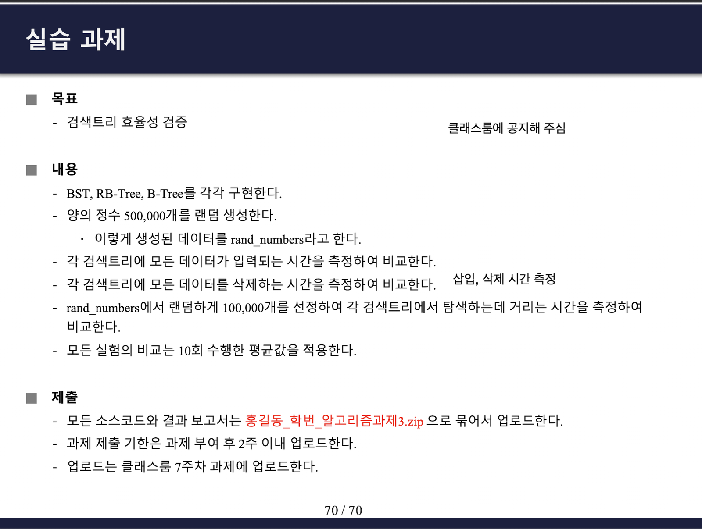

## 학습 목표

- 레코드, 필드, 검색키와 검색 트리의 개념
- 이진 검색 트리(BST)의 검색, 삽입, 삭제(세 가지 경우)와 최악의 경우 $$O(n)$$
- 레드-블랙 트리의 네 가지 성질과 삽입/삭제 뒤 균형을 되찾는 방법
- B-트리가 디스크 환경에 유리한 이유와 분할, 재분배, 병합
- KD 트리의 구조와 최근접 이웃 검색
- 과제 3: 세 검색 트리를 구현하고 50만 개 데이터로 성능 비교

---

## 1. 검색 트리 기본

| 용어 | 뜻 |
| --- | --- |
| 레코드 | 한 개체에 대해 모은 정보를 저장하는 단위 (표의 행) |
| 필드 | 레코드 안의 각 정보 (표의 열) |
| 검색키 | 다른 레코드와 겹치지 않게 각 레코드를 대표하는 필드 |

- **검색 트리**: 노드가 규칙에 맞게 키를 가지고 있어, 원하는 레코드의 위치를 빠르게 찾도록 만든 트리. 검색 시간은 **트리의 높이**에 비례함
- 높이가 $$h$$인 **포화** 이진 트리의 노드 수는 $$2^{h+1} - 1$$ (루트의 깊이를 0으로 셀 때)

---

## 2. 이진 검색 트리 (BST)

모든 노드에서 **왼쪽 서브트리의 키 < 노드의 키 < 오른쪽 서브트리의 키**.

### 검색과 삽입

- **검색**: 루트부터 찾는 키가 작으면 왼쪽, 크면 오른쪽으로 내려감
- **삽입**: 먼저 검색을 해서 **실패**해야 함 (키는 중복될 수 없으므로 성공하면 삽입 불가). 검색이 실패한 자리(빈 자식 위치)에 새 노드를 붙임
- 평균 $$O(\log n)$$, 키가 정렬된 순서로 들어와 **한쪽으로 치우치면** 높이가 $$n$$이 되어 $$O(n)$$

### 삭제의 세 가지 경우

| 경우 | 처리 |
| --- | --- |
| 1. 삭제할 노드가 리프 | 그냥 삭제 |
| 2. 자식이 하나 | 그 자식을 삭제할 노드 자리로 올림 |
| 3. 자식이 둘 | 오른쪽 서브트리의 최솟값(**직후 원소**)을 찾아 키를 옮겨 오고, 직후 원소 노드를 대신 삭제 (직후 원소는 왼쪽 자식이 없으므로 경우 1이나 2가 됨) |

---

## 3. 레드-블랙 트리

BST가 치우쳐서 $$O(n)$$이 되는 문제를 해결하려고, 노드에 레드/블랙 색을 칠해 균형을 유지하는 BST. 검색, 삽입, 삭제가 **어떤 경우에도 $$O(\log n)$$**.

> **(중요!!)** 레드-블랙 트리의 성질 (매번 출제)
> 1. 루트는 블랙
> 2. 모든 리프(NIL)는 블랙
> 3. 레드 노드의 자식은 모두 블랙 (레드가 연속으로 올 수 없음)
> 4. 루트에서 임의의 리프까지 가는 경로의 블랙 노드 수는 모두 같음
{: .prompt-warning }

성질 3, 4 때문에 가장 긴 경로(레드와 블랙이 번갈아)도 가장 짧은 경로(블랙만)의 2배를 넘지 못해서, 높이가 $$2\log_2(n+1)$$ 이하로 유지됨.

### 삽입

- BST처럼 실패한 검색 자리에 넣고, 새 노드는 **항상 레드**로 칠함 (블랙으로 넣으면 그 경로만 블랙 수가 늘어 성질 4가 깨지므로)
- 부모가 블랙이면 끝. **부모가 레드일 때만** 성질 3이 깨지고, **부모의 형제(s)의 색**에 따라 처리

| 경우 | 상황 | 처리 |
| --- | --- | --- |
| 1 | s가 레드 | 부모와 s를 블랙, 조부모를 레드로 바꿈. 조부모에서 같은 검사를 반복 (위로 전파될 수 있음) |
| 2-1 | s가 블랙, x가 부모의 오른쪽 자식 | 부모를 중심으로 왼쪽 회전 → 2-2 모양이 됨 |
| 2-2 | s가 블랙, x가 부모의 왼쪽 자식 | 조부모를 중심으로 오른쪽 회전하고 부모와 조부모의 색을 교환 → 끝 |

(부모가 조부모의 오른쪽 자식이면 좌우를 바꿔서 적용)

### 삭제

- 삭제되는 노드 m이 레드면 문제없음. m이 블랙이어도 유일한 자식 x가 레드면 x를 블랙으로 칠하면 끝
- **m과 x가 모두 블랙일 때만** 그 경로의 블랙 수가 하나 부족해져서 성질 4가 깨짐. 부모 p, 형제 s, 형제의 자식 l, r의 색으로 경우를 나눔

| 경우 | 상황 | 처리 |
| --- | --- | --- |
| 1-1 | p 레드, s의 자식 둘 다 블랙 | p와 s의 색 교환 → 끝 |
| \*-2 | s 블랙, s의 오른쪽 자식 r 레드 | p 중심 왼쪽 회전, p와 s의 색 교환, r을 블랙 → 끝 |
| \*-3 | s 블랙, l 레드, r 블랙 | s 중심 오른쪽 회전, l과 s의 색 교환 → \*-2 모양 |
| 2-1 | p 블랙, s 블랙, s의 자식 둘 다 블랙 | s를 레드로 → p 쪽 전체가 블랙 하나 부족해지므로 p에서 다시 검사 |
| 2-4 | p 블랙, s 레드 | p 중심 왼쪽 회전, p와 s의 색 교환 → p가 레드인 경우 1로 바뀜 |

(\*-2, \*-3은 p의 색과 상관없이 같은 방법이라 1-2와 2-2, 1-3과 2-3을 묶은 것)

---

## 4. B-트리

- 데이터가 커서 검색 트리를 메모리에 다 올릴 수 없으면 디스크에 둠. 디스크는 **블록(페이지)** 단위로 읽고, 한 번 읽는 비용이 메모리보다 훨씬 큼 → **트리 높이(디스크 접근 횟수)를 최소화**하는 것이 중요
- B-트리는 한 노드에 키를 여러 개 넣어 자식 수가 2보다 큰 **외부 다진 검색 트리**
- 노드에 키가 $$k$$개 있으면 자식은 $$k+1$$개 (키가 값의 범위를 $$k+1$$개 구간으로 나눔)
- 조건
  - 루트를 뺀 모든 노드는 최대 키 수의 **절반 이상**을 채움
  - **모든 리프는 같은 깊이**

### 삽입

- 리프에 넣었는데 **오버플로우**(키가 최대보다 많아짐)가 생기면
  - 형제에게 여유가 있으면 키를 넘김 (부모 키를 거쳐 재분배해서 BST 순서를 지킴)
  - 형제도 꽉 찼으면 **분할**: 가운데 키를 부모로 올리고 노드를 둘로 나눔. 부모가 넘치면 위로 반복하고, 루트가 분할되면 높이가 1 늘어남

### 삭제

- 리프의 키는 그냥 삭제. 리프가 아니면 직전(왼쪽 최대) 또는 직후(오른쪽 최소) 원소와 키를 바꾼 뒤 리프에서 삭제
- **언더플로우**(키가 최소보다 적어짐)가 생기면
  - 형제에게 여유가 있으면 부모 키를 거쳐 하나 빌려 옴 (재분배)
  - 형제도 여유가 없으면 부모의 키 하나를 내려받아 형제와 **병합**. 부모가 언더플로우되면 위로 반복

---

## 5. KD 트리

- **k차원 데이터**를 저장하고 검색하기 위해, 깊이마다 **기준 축을 번갈아 바꾸며 공간을 둘로 분할**하는 **이진 검색 트리의 일종**
- 2차원이면 루트는 x, 그 자식은 y, 그다음은 다시 x 기준으로 비교
- 삭제는 세 경우: 리프면 그냥 삭제, 오른쪽 서브트리가 있으면 그 안에서 **현재 축 기준 최솟값**으로 대체, 왼쪽만 있으면 왼쪽 서브트리에서 축 기준 최솟값을 찾아 대체하고 왼쪽 서브트리를 오른쪽으로 옮김
- 활용: 최근접 이웃 검색, 지도와 위치 기반 검색, 그래픽스와 충돌 탐지

```python
import random, math

class KDNode:
    def __init__(self, point, axis):
        self.point, self.axis, self.left, self.right = point, axis, None, None

def kd_insert(root, point, k=2):
    """깊이에 따라 x, y 축을 번갈아 비교하는 BST 삽입"""
    if root is None:
        return KDNode(point, 0)
    node = root
    while True:
        a = node.axis
        side = "left" if point[a] < node.point[a] else "right"
        child = getattr(node, side)
        if child is None:
            setattr(node, side, KDNode(point, (a + 1) % k)); return root
        node = child

def nearest(node, target, best=None, visited=None):
    if node is None:
        return best
    visited[0] += 1
    d = math.dist(node.point, target)
    if best is None or d < best[0]:
        best = (d, node.point)
    a = node.axis
    near, far = (node.left, node.right) if target[a] < node.point[a] else (node.right, node.left)
    best = nearest(near, target, best, visited)
    if abs(target[a] - node.point[a]) < best[0]:      # 분할선 너머에 더 가까운 점이 있을 수 있을 때만
        best = nearest(far, target, best, visited)
    return best

# 강의 예시처럼 작은 점 집합으로 트리 모양 확인
root = None
for p in [(50, 50), (10, 70), (80, 85), (25, 20), (40, 85), (70, 85), (10, 60)]:
    root = kd_insert(root, p)
def show(n, depth=0, tag="root"):
    if n:
        print("  " * depth + f"[{tag}] {n.point}  ({'x' if n.axis == 0 else 'y'} 기준)")
        show(n.left, depth + 1, "L"); show(n.right, depth + 1, "R")
show(root)

# 최근접 이웃: 브루트 포스와 비교
random.seed(0)
pts = [(random.random(), random.random()) for _ in range(50000)]
root = None
for p in pts: root = kd_insert(root, p)
total = 0
for _ in range(100):
    q = (random.random(), random.random())
    cnt = [0]
    d, p = nearest(root, q, visited=cnt)
    assert abs(d - min(math.dist(q, x) for x in pts)) < 1e-12
    total += cnt[0]
print(f"\n점 50,000개, 질의 100번: 브루트 포스와 결과 일치, 질의당 평균 방문 노드 {total / 100:.0f}개")
```

실행 결과

```text
[root] (50, 50)  (x 기준)
  [L] (10, 70)  (y 기준)
    [L] (25, 20)  (x 기준)
      [L] (10, 60)  (y 기준)
    [R] (40, 85)  (x 기준)
  [R] (80, 85)  (y 기준)
    [R] (70, 85)  (x 기준)

점 50,000개, 질의 100번: 브루트 포스와 결과 일치, 질의당 평균 방문 노드 31개
```

- (10, 70)은 루트(50, 50)와 **x**를 비교해 왼쪽, (25, 20)은 (10, 70)과 **y**를 비교해 왼쪽으로 감
- 최근접 이웃 검색은 분할선까지의 거리가 지금까지 찾은 최단 거리보다 멀면 반대쪽을 건너뜀. 5만 개 중 평균 31개 노드만 보고도 브루트 포스와 같은 답을 찾음

---

## 6. 과제 3: 검색 트리 효율성 검증



> BST, RB-Tree, B-Tree를 구현하고, 서로 다른 양의 정수 500,000개(`rand_numbers`)를 모두 삽입하는 시간, 모두 삭제하는 시간, 그중 100,000개를 검색하는 시간을 10회 평균으로 비교
{: .prompt-info }

> 과제 3은 보고서 틀만 만들고 코드와 결과를 채우지 못했던 과제라, 블로그에 정리하면서 새로 구현하고 실행함
{: .prompt-danger }

### 구현

- 50만 개를 다루면 재귀가 깊어질 수 있어서 모두 **반복문**으로 구현
- 레드-블랙 트리는 위 3절의 삽입/삭제 경우를 그대로 따름 (CLRS 방식, 모든 리프를 공용 블랙 NIL 노드 하나로 표현)
- B-트리는 최소 차수 $$t$$ 방식: 루트 외 노드의 키 수가 $$t-1$$ ~ $$2t-1$$. 삽입할 때는 내려가면서 꽉 찬 자식을 **미리 분할**하고, 삭제할 때는 내려가면서 키가 $$t-1$$개인 자식을 **미리 채움**(빌리거나 병합)해서 한 번 내려가는 것으로 끝냄
- `check()`로 레드-블랙 성질과 B-트리 성질을 검사

```python
"""HW3: BST, Red-Black Tree, B-Tree (삽입, 삭제, 검색). 재귀 깊이 문제를 피하려고 반복문으로 구현"""

# ---------------- BST ----------------
class BSTNode:
    __slots__ = ("key", "left", "right")
    def __init__(self, key):
        self.key, self.left, self.right = key, None, None

class BST:
    def __init__(self):
        self.root = None

    def search(self, key):
        x = self.root
        while x is not None and x.key != key:
            x = x.left if key < x.key else x.right
        return x

    def insert(self, key):                     # 실패하는 검색 위치에 삽입, 중복 키는 무시
        parent, x = None, self.root
        while x is not None:
            if key == x.key:
                return False
            parent, x = x, (x.left if key < x.key else x.right)
        node = BSTNode(key)
        if parent is None:
            self.root = node
        elif key < parent.key:
            parent.left = node
        else:
            parent.right = node
        return True

    def delete(self, key):
        parent, x = None, self.root
        while x is not None and x.key != key:
            parent, x = x, (x.left if key < x.key else x.right)
        if x is None:
            return False
        if x.left is not None and x.right is not None:   # Case 3: 자식 2개 → 직후 원소(오른쪽 최소)와 바꿈
            sp, s = x, x.right
            while s.left is not None:
                sp, s = s, s.left
            x.key = s.key
            parent, x = sp, s                            # 이제 s(자식 0~1개)를 지움
        child = x.left if x.left is not None else x.right  # Case 1, 2
        if parent is None:
            self.root = child
        elif parent.left is x:
            parent.left = child
        else:
            parent.right = child
        return True

    def height(self):
        h, stack = 0, [(self.root, 1)] if self.root else []
        while stack:
            n, d = stack.pop(); h = max(h, d)
            if n.left: stack.append((n.left, d + 1))
            if n.right: stack.append((n.right, d + 1))
        return h

# ---------------- Red-Black Tree (CLRS) ----------------
RED, BLACK = 0, 1

class RBNode:
    __slots__ = ("key", "color", "left", "right", "parent")
    def __init__(self, key, color, nil):
        self.key, self.color, self.left, self.right, self.parent = key, color, nil, nil, nil

class RBTree:
    def __init__(self):
        self.nil = RBNode(None, BLACK, None)          # 모든 리프(NIL)는 블랙인 공용 노드
        self.nil.left = self.nil.right = self.nil.parent = self.nil
        self.root = self.nil

    def search(self, key):
        x = self.root
        while x is not self.nil and x.key != key:
            x = x.left if key < x.key else x.right
        return None if x is self.nil else x

    def _rotate_left(self, x):
        y = x.right
        x.right = y.left
        if y.left is not self.nil: y.left.parent = x
        y.parent = x.parent
        if x.parent is self.nil: self.root = y
        elif x is x.parent.left: x.parent.left = y
        else: x.parent.right = y
        y.left, x.parent = x, y

    def _rotate_right(self, x):
        y = x.left
        x.left = y.right
        if y.right is not self.nil: y.right.parent = x
        y.parent = x.parent
        if x.parent is self.nil: self.root = y
        elif x is x.parent.right: x.parent.right = y
        else: x.parent.left = y
        y.right, x.parent = x, y

    def insert(self, key):
        y, x = self.nil, self.root
        while x is not self.nil:
            if key == x.key: return False
            y, x = x, (x.left if key < x.key else x.right)
        z = RBNode(key, RED, self.nil)                # 새 노드는 항상 레드
        z.parent = y
        if y is self.nil: self.root = z
        elif key < y.key: y.left = z
        else: y.right = z
        while z.parent.color == RED:                  # 부모가 레드일 때만 문제
            p, g = z.parent, z.parent.parent
            if p is g.left:
                s = g.right                           # 부모의 형제
                if s.color == RED:                    # Case 1: 색만 바꾸고 g에서 다시 검사
                    p.color = s.color = BLACK; g.color = RED; z = g
                else:
                    if z is p.right:                  # Case 2-1 → 왼쪽 회전으로 2-2 모양으로
                        z = p; self._rotate_left(z); p = z.parent
                    p.color, g.color = BLACK, RED     # Case 2-2: g 오른쪽 회전 + 색 교환
                    self._rotate_right(g)
            else:                                     # 좌우 대칭
                s = g.left
                if s.color == RED:
                    p.color = s.color = BLACK; g.color = RED; z = g
                else:
                    if z is p.left:
                        z = p; self._rotate_right(z); p = z.parent
                    p.color, g.color = BLACK, RED
                    self._rotate_left(g)
        self.root.color = BLACK
        return True

    def _transplant(self, u, v):
        if u.parent is self.nil: self.root = v
        elif u is u.parent.left: u.parent.left = v
        else: u.parent.right = v
        v.parent = u.parent

    def delete(self, key):
        z = self.search(key)
        if z is None: return False
        y, y_color = z, z.color
        if z.left is self.nil:
            x = z.right; self._transplant(z, z.right)
        elif z.right is self.nil:
            x = z.left; self._transplant(z, z.left)
        else:
            y = z.right
            while y.left is not self.nil: y = y.left       # 직후 원소
            y_color, x = y.color, y.right
            if y.parent is z:
                x.parent = y
            else:
                self._transplant(y, y.right); y.right = z.right; y.right.parent = y
            self._transplant(z, y); y.left = z.left; y.left.parent = y; y.color = z.color
        if y_color == BLACK:                               # 지운 노드가 블랙일 때만 복구
            self._delete_fixup(x)
        return True

    def _delete_fixup(self, x):
        while x is not self.root and x.color == BLACK:     # x가 레드면 블랙으로 칠하면 끝
            if x is x.parent.left:
                s = x.parent.right
                if s.color == RED:                         # 형제가 레드 → 회전해서 형제를 블랙으로
                    s.color, x.parent.color = BLACK, RED
                    self._rotate_left(x.parent); s = x.parent.right
                if s.left.color == BLACK and s.right.color == BLACK:   # 형제 자식이 모두 블랙
                    s.color = RED; x = x.parent
                else:
                    if s.right.color == BLACK:             # 형제 왼쪽 자식만 레드 → 오른쪽 회전
                        s.left.color, s.color = BLACK, RED
                        self._rotate_right(s); s = x.parent.right
                    s.color = x.parent.color               # 형제 오른쪽 자식이 레드 → 왼쪽 회전
                    x.parent.color = s.right.color = BLACK
                    self._rotate_left(x.parent); x = self.root
            else:
                s = x.parent.left
                if s.color == RED:
                    s.color, x.parent.color = BLACK, RED
                    self._rotate_right(x.parent); s = x.parent.left
                if s.right.color == BLACK and s.left.color == BLACK:
                    s.color = RED; x = x.parent
                else:
                    if s.left.color == BLACK:
                        s.right.color, s.color = BLACK, RED
                        self._rotate_left(s); s = x.parent.left
                    s.color = x.parent.color
                    x.parent.color = s.left.color = BLACK
                    self._rotate_right(x.parent); x = self.root
        x.color = BLACK

    def check(self):
        """레드-블랙 성질 검사: 루트 블랙, 레드의 자식 블랙, 모든 경로의 블랙 수 동일. 블랙 높이 반환"""
        assert self.root.color == BLACK
        def bh(n):
            if n is self.nil: return 1
            if n.color == RED:
                assert n.left.color == BLACK and n.right.color == BLACK, "red-red"
            l, r = bh(n.left), bh(n.right)
            assert l == r, "black height"
            return l + (n.color == BLACK)
        return bh(self.root)

    def height(self):
        h, stack = 0, [(self.root, 1)] if self.root is not self.nil else []
        while stack:
            n, d = stack.pop(); h = max(h, d)
            for c in (n.left, n.right):
                if c is not self.nil: stack.append((c, d + 1))
        return h

# ---------------- B-Tree (CLRS, 최소 차수 t) ----------------
from bisect import bisect_left

class BNode:
    __slots__ = ("keys", "children")
    def __init__(self):
        self.keys, self.children = [], []             # children이 비어 있으면 리프

class BTree:
    def __init__(self, t=16):
        self.t, self.root = t, BNode()               # 노드의 키 수: t-1 ~ 2t-1 (루트 제외)

    def search(self, key):
        x = self.root
        while True:
            i = bisect_left(x.keys, key)
            if i < len(x.keys) and x.keys[i] == key: return x
            if not x.children: return None
            x = x.children[i]

    def _split(self, parent, i):                     # 꽉 찬 자식을 둘로 나누고 가운데 키를 부모로 올림
        t, y = self.t, parent.children[i]
        z = BNode()
        mid = y.keys[t - 1]
        z.keys, y.keys = y.keys[t:], y.keys[:t - 1]
        if y.children:
            z.children, y.children = y.children[t:], y.children[:t]
        parent.keys.insert(i, mid)
        parent.children.insert(i + 1, z)

    def insert(self, key):
        if self.search(key) is not None: return False
        r = self.root
        if len(r.keys) == 2 * self.t - 1:            # 루트가 꽉 차면 먼저 분할 → 높이 1 증가
            s = BNode(); s.children = [r]; self.root = s; self._split(s, 0)
        x = self.root
        while x.children:                            # 내려가면서 꽉 찬 자식은 미리 분할
            i = bisect_left(x.keys, key)
            if len(x.children[i].keys) == 2 * self.t - 1:
                self._split(x, i)
                if key > x.keys[i]: i += 1
            x = x.children[i]
        x.keys.insert(bisect_left(x.keys, key), key)
        return True

    def delete(self, key):
        if self.search(key) is None: return False
        self._delete(self.root, key)
        if not self.root.keys and self.root.children:  # 루트가 비면 높이 1 감소
            self.root = self.root.children[0]
        return True

    def _delete(self, x, key):
        t = self.t
        while True:
            i = bisect_left(x.keys, key)
            if i < len(x.keys) and x.keys[i] == key:
                if not x.children:                       # 리프에서는 그냥 삭제
                    x.keys.pop(i); return
                y, z = x.children[i], x.children[i + 1]
                if len(y.keys) >= t:                     # 왼쪽 자식에 여유 → 직전 원소와 교체
                    pred = y
                    while pred.children: pred = pred.children[-1]
                    x.keys[i] = key = pred.keys[-1]; x = y; continue
                if len(z.keys) >= t:                     # 오른쪽 자식에 여유 → 직후 원소와 교체
                    succ = z
                    while succ.children: succ = succ.children[0]
                    x.keys[i] = key = succ.keys[0]; x = z; continue
                self._merge(x, i); x = y; continue       # 둘 다 t-1개 → 병합 후 내려감
            if not x.children: return
            c = x.children[i]
            if len(c.keys) == t - 1:                     # 내려가기 전에 자식이 최소 t개가 되게 함
                if i > 0 and len(x.children[i - 1].keys) >= t:          # 왼쪽 형제에게 빌림
                    l = x.children[i - 1]
                    c.keys.insert(0, x.keys[i - 1]); x.keys[i - 1] = l.keys.pop()
                    if l.children: c.children.insert(0, l.children.pop())
                elif i < len(x.keys) and len(x.children[i + 1].keys) >= t:  # 오른쪽 형제에게 빌림
                    r = x.children[i + 1]
                    c.keys.append(x.keys[i]); x.keys[i] = r.keys.pop(0)
                    if r.children: c.children.append(r.children.pop(0))
                else:                                    # 빌릴 수 없으면 부모 키를 내려 형제와 병합
                    if i < len(x.keys): self._merge(x, i)
                    else: self._merge(x, i - 1); c = x.children[i - 1]
                if not x.keys and x is self.root and x.children:
                    self.root = x.children[0]
            x = c

    def _merge(self, x, i):
        y, z = x.children[i], x.children.pop(i + 1)
        y.keys += [x.keys.pop(i)] + z.keys
        y.children += z.children

    def check(self):
        """B-트리 성질 검사: 키 개수 범위, 키 정렬, 모든 리프 같은 깊이"""
        depths = set()
        def go(n, d, lo, hi, is_root):
            if not is_root: assert self.t - 1 <= len(n.keys) <= 2 * self.t - 1
            assert all(lo < k < hi for k in n.keys) and n.keys == sorted(n.keys)
            if not n.children: depths.add(d); return
            assert len(n.children) == len(n.keys) + 1
            bounds = [lo] + n.keys + [hi]
            for j, ch in enumerate(n.children): go(ch, d + 1, bounds[j], bounds[j + 1], False)
        go(self.root, 1, float("-inf"), float("inf"), True)
        assert len(depths) <= 1
        return depths.pop() if depths else 0

def _btree_height(self):
    h, x = 1, self.root
    while x.children:
        x, h = x.children[0], h + 1
    return h
BTree.height = _btree_height
```

### 정확성 검사

```python
import random
from trees import BST, RBTree, BTree
random.seed(7)
keys = random.sample(range(1, 10**6), 20000)
for T in (BST, RBTree, lambda: BTree(t=3)):
    tr = T()
    for k in keys: tr.insert(k)
    gone = set(random.sample(keys, 10000))
    for k in gone: assert tr.delete(k)
    for k in keys: assert (tr.search(k) is not None) == (k not in gone)
    if hasattr(tr, "check"): tr.check()
    for k in keys:
        if k not in gone: tr.delete(k)
    assert all(tr.search(k) is None for k in keys)
    print(type(tr).__name__, "ok")
```

실행 결과

```text
BST ok
RBTree ok
BTree ok
```

추가로 3,000개 범위의 키를 무작위로 넣고 빼는 연산 30,000번을 하면서 1,000번마다 `check()`를 호출해 레드-블랙 트리와 B-트리($$t$$ = 2, 4)의 성질이 항상 유지되는 것도 확인함.

### 성능 측정

```python
import random, time, sys
from trees import BST, RBTree, BTree

N, Q, REPS = 500_000, 100_000, int(sys.argv[1]) if len(sys.argv) > 1 else 10

def run(make, rand_numbers, queries, delete_order):
    tree = make()
    t0 = time.perf_counter()
    for k in rand_numbers: tree.insert(k)
    t1 = time.perf_counter()
    found = sum(tree.search(k) is not None for k in queries)
    t2 = time.perf_counter()
    h = tree.height() if hasattr(tree, "height") else None
    for k in delete_order: tree.delete(k)
    t3 = time.perf_counter()
    assert found == len(queries)
    return (t1 - t0) * 1000, (t2 - t1) * 1000, (t3 - t2) * 1000, h

trees = {"BST": BST, "RB-Tree": RBTree, "B-Tree(t=16)": lambda: BTree(16)}
sums = {name: [0.0, 0.0, 0.0] for name in trees}
heights = {}
for rep in range(REPS):
    rng = random.Random(rep)
    rand_numbers = rng.sample(range(1, 10**9), N)          # 서로 다른 양의 정수 500,000개
    queries = rng.sample(rand_numbers, Q)                  # 그중 100,000개를 검색
    delete_order = rand_numbers[:]; rng.shuffle(delete_order)
    for name, make in trees.items():
        ins, sea, dele, h = run(make, rand_numbers, queries, delete_order)
        for i, v in enumerate((ins, sea, dele)): sums[name][i] += v
        heights.setdefault(name, h)

print(f"n = {N:,}, 검색 {Q:,}개, {REPS}회 평균 (ms)")
print(f"{'트리':<14}{'삽입':>10}{'검색':>10}{'삭제':>10}")
for name, s in sums.items():
    print(f"{name:<14}" + "".join(f"{v / REPS:>10.1f}" for v in s))
print("이진 트리 높이(첫 회):", {k: v for k, v in heights.items() if v})

# 정렬된 입력: BST가 한쪽으로 치우치는 최악의 경우 (n을 줄여서)
n2 = 5000
sorted_keys = list(range(1, n2 + 1))
print(f"\n정렬된 입력 n = {n2:,} (1부터 순서대로 삽입) 후 전체 검색")
for name, make in trees.items():
    tr = make()
    t0 = time.perf_counter()
    for k in sorted_keys: tr.insert(k)
    t1 = time.perf_counter()
    for k in sorted_keys: tr.search(k)
    t2 = time.perf_counter()
    h = tr.height() if hasattr(tr, "height") else "-"
    print(f"{name:<14} 삽입 {(t1 - t0) * 1000:>8.1f} ms, 검색 {(t2 - t1) * 1000:>8.1f} ms, 높이 {h}")
```

실행 결과

```text
n = 500,000, 검색 100,000개, 10회 평균 (ms)
트리                    삽입        검색        삭제
BST               1655.0     304.0    1731.0
RB-Tree           1988.9     276.0    1972.7
B-Tree(t=16)      1400.0     187.5    1627.7
이진 트리 높이(첫 회): {'BST': 46, 'RB-Tree': 23, 'B-Tree(t=16)': 5}

정렬된 입력 n = 5,000 (1부터 순서대로 삽입) 후 전체 검색
BST            삽입    571.5 ms, 검색    655.8 ms, 높이 5000
RB-Tree        삽입     10.8 ms, 검색      4.7 ms, 높이 22
B-Tree(t=16)   삽입      4.8 ms, 검색      3.0 ms, 높이 3
```

- **무작위 입력**에서는 세 트리 모두 1.4~2초 안에 50만 개를 넣고 지움. BST도 높이가 46으로 $$\log_2 500000 \approx 19$$의 약 2.4배라 크게 나쁘지 않음 (무작위 BST의 평균 높이는 $$O(\log n)$$)
- 레드-블랙 트리는 높이가 23으로 BST의 절반이라 **검색은 더 빠르지만**, 삽입과 삭제는 색 변경과 회전 비용 때문에 BST보다 약간 느림
- B-트리($$t$$ = 16)는 높이가 5밖에 안 되고, 노드 안에서는 정렬된 리스트를 이진 검색(`bisect`)해서 세 연산 모두 가장 빠르거나 비슷함. 디스크라면 높이 5는 디스크 접근 5번이라는 뜻
- **정렬된 입력**에서는 차이가 극적: BST는 높이가 5,000(연결 리스트와 같음)이 되어 5,000개 검색에 656 ms가 걸리지만, 레드-블랙 트리는 높이 22로 4.7 ms. **약 140배** 차이가 나고, n이 커질수록 $$n$$ 대 $$\log n$$으로 벌어짐

---

### 강의 자료 및 정리 노트에서 정정한 부분 정리

| 위치 | 원래 | 정정 | 이유 |
| --- | --- | --- | --- |
| 트리 노드 수 | 완전 이진 트리 깊이가 h일 때 노드 수 $$2^{h+1} - 1$$ | **포화** 이진 트리일 때 $$2^{h+1} - 1$$. 완전 이진 트리는 $$2^h$$ ~ $$2^{h+1} - 1$$ | 완전 이진 트리는 마지막 층이 다 차지 않아도 됨 |
| RB 삽입 경우 1 | 조부모와 (p, s)의 색을 교환 | 색을 바꾼 뒤 조부모에서 다시 검사해야 함 | 조부모가 레드가 되면서 그 위에서 레드-레드가 생길 수 있음 |
| B-트리 | 디스크의 접근 단위는 디스트 | 디스크의 접근 단위는 블록(페이지) | 오타 |
| 과제 3 | 보고서 틀만 있고 n = 50,000으로 적혀 있음 | 문제대로 n = 500,000으로 구현하고 실행 | 과제 문제는 500,000개 |

---

## 최종 핵심 정리

1. 검색 트리의 검색 시간은 높이에 비례하고, BST는 평균 $$O(\log n)$$이지만 치우치면 $$O(n)$$
2. BST 삽입은 실패한 검색 자리에 하고, 자식이 둘인 노드의 삭제는 직후 원소로 바꿔서 자식 0~1개 문제로 만듦
3. 레드-블랙 트리 성질: 루트 블랙, 리프(NIL) 블랙, 레드의 자식은 블랙, 모든 경로의 블랙 수 동일
4. 새 노드는 레드로 넣고, 부모가 레드일 때 삼촌이 레드면 색 변경(위로 전파), 블랙이면 회전 + 색 교환
5. 삭제는 지운 노드와 대체 자식이 모두 블랙일 때만 복구가 필요하고, 형제와 형제 자식의 색으로 경우를 나눔
6. B-트리는 노드에 키를 여러 개 넣어 높이를 낮추는 디스크용 다진 트리이고, 오버플로우는 분할, 언더플로우는 재분배나 병합으로 해결
7. KD 트리는 축을 번갈아 비교하는 BST이고, 최근접 이웃 검색에서 대부분의 노드를 건너뜀
8. 50만 개 무작위 입력에서는 세 트리가 비슷하지만, 정렬된 입력에서는 BST가 높이 n이 되어 레드-블랙 트리보다 약 140배 느림

---

End.
