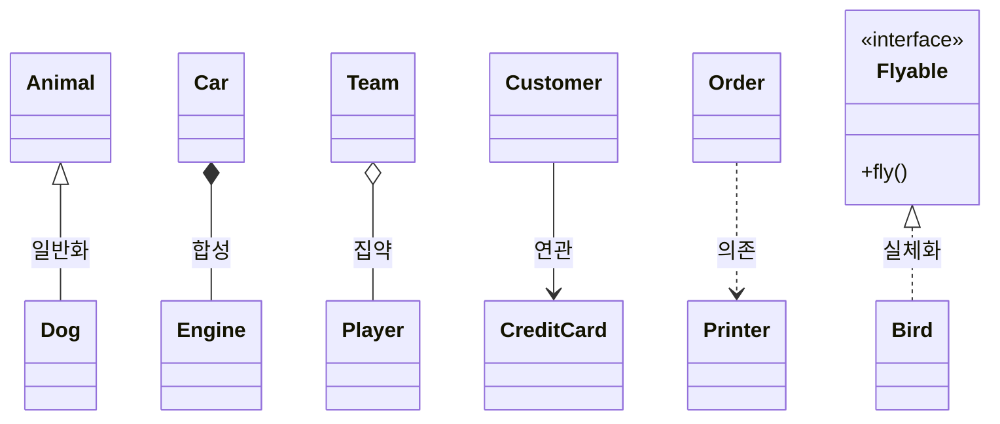

## 학습 목표

- UML의 뜻과 클래스 다이어그램 표기, 접근 제어자 기호
- 클래스 사이의 관계 여섯 가지와 표기법, 특히 집약과 합성의 차이
- 캡슐화의 정의와 private 필드에 접근할 때 생기는 컴파일 오류
- 일반화(상속)로 만든 스택의 문제와 위임으로 바꾸는 5단계
- 리스코프 치환 원칙(LSP)을 어기는 상속과 위임으로 고친 코드
- 수업 실습 코드를 직접 컴파일하고 실행해 결과 확인

---

## 1. UML과 클래스

- **UML (Unified Modeling Language)**: OMG(Object Management Group)가 표준화한 대표적인 모델링 언어. 시스템의 구조와 동작을 그림으로 표현해서 개발자 사이의 소통을 돕는 것이 목적이고, 프로그래밍 언어가 아님
- **클래스**: 동일한 속성과 동일한 행위를 가진 객체들의 집합. 객체를 만드는 설계도 (클래스 = 데이터 + 기능)
- 클래스 다이어그램은 **이름 / 속성 / 연산** 세 칸의 박스로 그림. 속성과 연산 칸은 생략할 수 있음

> **(중요!!)** 접근 제어자의 설명을 보고 이름과 UML 기호를 쓰는 문제가 나옴
{: .prompt-warning }

| 접근 제어자 | UML | 접근할 수 있는 곳 |
| --- | --- | --- |
| public | + | 어떤 클래스의 객체에서든 |
| private | - | 이 클래스의 객체만 |
| protected | # | 같은 패키지 또는 상속받은 자식 클래스 |
| package (default) | ~ | 같은 패키지에 있는 클래스의 객체만 |

### private 필드에 직접 접근하면 (실습 3/9)

첫 실습 코드는 `Student`의 private 필드를 다른 클래스(`App`)에서 바로 읽으려고 해서 **컴파일이 되지 않음**.

```java
class Student {
    private String name;
    private int age;

    public Student(String name, int age) {
        this.name = name;
        this.age = age;
    }
}

public class App {
    public static void main(String[] args) throws Exception {
        Student student = new Student("Alice", 20);
        System.out.println("Name: " + student.name + ", Age: " + student.age);
    }
}
```

컴파일 결과

```text
App.java:19: error: name has private access in Student
        System.out.println("Name: " + student.name + ", Age: " + student.age);
                                             ^
App.java:19: error: age has private access in Student
        System.out.println("Name: " + student.name + ", Age: " + student.age);
                                                                        ^
2 errors
```

private 필드는 getter를 통해서만 읽게 하는 것이 캡슐화. `public String getName() { return name; }`처럼 공개 메서드를 추가하고 `student.getName()`으로 바꾸면 컴파일됨.

---

## 2. 클래스 사이의 관계

| 관계 | 의미 | 표기 |
| --- | --- | --- |
| 연관 (Association) | 한 클래스가 다른 클래스의 기능을 계속 사용 (개념상 연결) | 실선 (방향이 있으면 화살표) |
| 일반화 (Generalization) | **is a kind of** 관계. 상속 | 실선 + 빈 삼각형 |
| 집약 (Aggregation) | 전체와 부분. 부분이 **독립적으로 존재**하고 다른 객체와 공유 가능 | 실선 + 빈 마름모 (전체 쪽) |
| 합성 (Composition) | 전체와 부분. 전체가 사라지면 **부분도 사라짐** (생명 주기 종속) | 실선 + 채워진 마름모 (전체 쪽) |
| 의존 (Dependency) | 메서드를 실행하는 **짧은 순간**만 다른 클래스를 사용 | 점선 + 화살표 |
| 실체화 (Realization) | 인터페이스(책임들의 집합)와 그것을 구현한 클래스 | 점선 + 빈 삼각형 |



- 자동차와 엔진(합성): 자동차가 폐차되면 그 엔진도 함께 사라진다고 보는 관계
- 팀과 선수(집약): 팀이 해체되어도 선수는 남고 다른 팀에 갈 수 있음

---

## 3. 캡슐화와 일반화, 위임

- **캡슐화**: 데이터와 그 데이터를 처리하는 메서드를 하나로 묶고, 외부에는 필요한 기능만 공개해서 내부 구현과 데이터를 숨기는 것 (**정보 은닉**). 데이터를 보호하고, 내부가 바뀌어도 외부에 영향이 적어 유지보수가 쉬우며, 결합도를 낮춤
- **일반화(상속)**: 부모의 속성과 메서드를 물려받아 재사용. 자식이 부모의 "한 종류"일 때만 써야 함
- **위임**: 다른 객체를 필드로 가지고, 그 객체의 메서드를 호출해서 일을 맡김. 어떤 클래스의 **일부 기능만** 쓰고 싶을 때 상속 대신 씀

### 상속으로 만든 스택의 문제

`ArrayList`를 상속해서 스택을 만들면, 스택에 있어서는 안 되는 `add(index, x)`, `remove(x)` 같은 메서드까지 모두 물려받아 **스택의 무결성(맨 위에서만 넣고 뺌)이 깨짐**. 스택은 ArrayList의 한 종류(is a kind of)가 아니기 때문.

### 일반화를 위임으로 바꾸는 5단계

> **(중요!!)** 단계와 코드 변화를 순서대로 설명할 수 있어야 함
{: .prompt-warning }

1. 자식 클래스에 부모 클래스 타입의 필드를 만들고 `this`로 초기화 (`private ArrayList<E> arList = this;`)
2. 자식 클래스의 메서드들이 부모 메서드를 직접 부르지 않고 이 필드를 통해 부르도록 바꿈 (`add(e)` → `arList.add(e)`)
3. 상속 관계(`extends ArrayList<E>`)를 없애고, 필드에 부모 클래스의 **새 객체**를 넣음 (`= new ArrayList<>()`)
4. 클라이언트가 쓰던 부모의 메서드(`isEmpty`, `size` 등)가 있으면 위임 메서드를 추가
5. 컴파일하고 잘 동작하는지 확인

수업 실습(3/16)의 결과 코드

```java
import java.util.ArrayList;

public class MyStack<E> {
    private ArrayList<E> arList = new ArrayList<>();   // 위임 필드

    public void push(E element) { arList.add(element); }
    public E pop() { return arList.remove(arList.size() - 1); }
    public boolean isEmpty() { return arList.isEmpty(); }
    public int size() { return arList.size(); }

    public static void main(String[] args) {
        MyStack<String> stack = new MyStack<>();
        stack.push("Hello");
        stack.push("World");
        System.out.println(stack.pop());     // World
        System.out.println(stack.size());    // 1
        System.out.println(stack.isEmpty()); // false
    }
}
```

실행 결과

```text
World
1
false
```

다음 날(3/17)에는 `Vector`에 위임하고 `peek`, 빈 스택 예외(`EmptyStackException`)까지 넣은 `MyVectorStack`을 만들었음. 실행 결과는 `[Hello, World]`, `World`, `World`, `[Hello]`.

### 상속 스택과 위임 스택 비교 (실행)

```java
import java.util.ArrayList;

// 일반화(상속)로 만든 스택: ArrayList의 모든 public 메서드가 그대로 노출됨
class InheritStack<E> extends ArrayList<E> {
    public void push(E e) { add(e); }
    public E pop() { return remove(size() - 1); }
}

// 위임으로 만든 스택: 필요한 기능만 공개하고 나머지는 ArrayList에게 맡김
class DelegateStack<E> {
    private final ArrayList<E> arList = new ArrayList<>();
    public void push(E e) { arList.add(e); }
    public E pop() { return arList.remove(arList.size() - 1); }
    public boolean isEmpty() { return arList.isEmpty(); }
    public int size() { return arList.size(); }
}

public class StackDemo {
    public static void main(String[] args) {
        InheritStack<String> s1 = new InheritStack<>();
        s1.push("A"); s1.push("B"); s1.push("C");
        s1.add(0, "X");          // 스택에 없어야 할 연산인데 호출 가능
        s1.remove("B");          // 중간 원소 삭제도 가능
        System.out.println("상속 스택: " + s1 + ", pop = " + s1.pop() + ", 남은 것 = " + s1);

        DelegateStack<String> s2 = new DelegateStack<>();
        s2.push("A"); s2.push("B"); s2.push("C");
        // s2.add(0, "X");       // 컴파일 오류: DelegateStack에는 add가 없음
        System.out.println("위임 스택: pop = " + s2.pop() + ", size = " + s2.size());
    }
}
```

실행 결과

```text
상속 스택: [X, A, C], pop = C, 남은 것 = [X, A]
위임 스택: pop = C, size = 2
```

- 상속 스택은 맨 앞에 `X`를 끼워 넣고 중간의 `B`를 지울 수 있었음 → 더 이상 스택이 아님
- 위임 스택은 `push`, `pop`, `isEmpty`, `size`만 공개하므로 그런 호출 자체가 **컴파일 단계에서** 막힘

---

## 4. 리스코프 치환 원칙 (LSP)

> **(중요!!)** 영어 지문을 보고 원칙의 이름을 **영어 전체 이름**으로 쓰는 문제: **Liskov Substitution Principle**
{: .prompt-warning }

- 부모 클래스의 객체를 쓰는 자리에 자식 클래스의 객체를 넣어도 프로그램이 **올바르게 동작**해야 함
- 자식은 부모의 계약(부모 메서드가 약속한 동작)을 깨면 안 됨. 재정의 자체가 금지는 아니지만, 가장 간단한 지키는 방법은 **재정의하지 않는 것**
- 피터 코드(Peter Coad)의 상속 규칙 중 "자식 클래스는 부모의 책임을 무시하거나 재정의하지 않고 확장만 해야 한다"와 연결됨

### 할인 가방 예제 (실습 3/24)

수업에서 `Bag.setPrice`를 자식이 재정의하면 LSP를 어긴다고 설명함. 그 상황을 코드로 만들고, 실습 코드처럼 위임으로 고친 버전과 비교함.

```java
class Bag {
    private double price;
    public void setPrice(double price) { this.price = price; }
    public double getPrice() { return price; }
}

// 상속 버전: setPrice를 재정의해서 할인된 값을 저장 → 부모의 계약(넣은 값이 그대로 나온다)을 깸
class DiscountedBagByInheritance extends Bag {
    private final double rate;
    DiscountedBagByInheritance(double rate) { this.rate = rate; }
    @Override
    public void setPrice(double price) { super.setPrice(price * (1 - rate)); }
}

// 실습 코드 방식: Bag을 상속하지 않고 포함(위임)
class DiscountedBag {
    private final Bag bag = new Bag();
    private double rate;
    public void setDiscounted(double rate) { this.rate = rate; }
    public void setOriginalPrice(double price) { bag.setPrice(price); }
    public double getOriginalPrice() { return bag.getPrice(); }
    public double getDiscountedPrice() { return bag.getPrice() * (1 - rate); }
}

public class LspDemo {
    // Bag을 쓰는 클라이언트: "가격을 넣으면 그 가격이 나온다"는 것을 믿고 동작
    static void checkPrice(Bag bag) {
        bag.setPrice(10000);
        System.out.println(bag.getClass().getSimpleName() + ": setPrice(10000) 후 getPrice() = " + bag.getPrice()
                + (bag.getPrice() == 10000 ? "  (계약 유지)" : "  (계약 위반 → LSP 위반)"));
    }

    public static void main(String[] args) {
        checkPrice(new Bag());
        checkPrice(new DiscountedBagByInheritance(0.2));   // 부모 자리에 자식을 넣었더니 결과가 달라짐

        DiscountedBag d = new DiscountedBag();
        d.setOriginalPrice(10000); d.setDiscounted(0.2);
        System.out.println("DiscountedBag(위임): 원가 " + d.getOriginalPrice() + ", 할인가 " + d.getDiscountedPrice());
    }
}
```

실행 결과

```text
Bag: setPrice(10000) 후 getPrice() = 10000.0  (계약 유지)
DiscountedBagByInheritance: setPrice(10000) 후 getPrice() = 8000.0  (계약 위반 → LSP 위반)
DiscountedBag(위임): 원가 10000.0, 할인가 8000.0
```

- `checkPrice`는 "넣은 가격이 그대로 나온다"고 믿고 쓰는 코드인데, 자식 객체를 넣었더니 8000이 나옴 → 부모를 대체할 수 없음
- 실습 코드(`DiscountedBag`)는 `Bag`을 상속하지 않고 **필드로 포함**해서 원가와 할인가를 따로 제공함. Bag의 계약은 그대로 지켜짐

---

### 강의 자료 및 정리 노트에서 정정한 부분 정리

| 위치 | 원래 | 정정 | 이유 |
| --- | --- | --- | --- |
| 실습 3/9 `App.java` | `student.name`, `student.age`를 직접 출력 | getter를 추가해서 접근 | private 필드라 컴파일 오류 2개 (실행 결과 참고) |
| 위임 5단계 예시 | `class MyStack<String> extends ArrayList<String>` | `class MyStack<E> extends ArrayList<E>` | 타입 매개변수 이름을 `String`으로 지으면 `java.lang.String`을 가려서 헷갈림 (컴파일은 됨) |
| LSP 정리 | 부모 클래스의 메소드를 자식 클래스에서 재정의하지 말라는 의미 | 재정의해도 되지만 부모의 계약(행위 일관성)을 유지해야 함. 재정의하지 않는 것이 가장 쉬운 방법 | 같은 노트 3장의 "재정의 가능, but 행위 일관성 유지"가 정확한 설명 |

---

## 최종 핵심 정리

1. UML은 OMG가 표준화한 모델링 언어이고, 클래스는 같은 속성과 행위를 가진 객체들의 집합
2. 접근 제어자 기호는 public `+`, private `-`, protected `#`, package `~`
3. 관계 표기: 일반화는 실선 + 빈 삼각형, 실체화는 점선 + 빈 삼각형, 의존은 점선 화살표, 집약은 빈 마름모, 합성은 채워진 마름모
4. 합성은 전체와 부분의 생명 주기가 같고(강한 관계), 집약은 부분이 독립적으로 존재함
5. 캡슐화는 데이터와 메서드를 묶고 내부를 숨기는 것이며, private 필드를 밖에서 읽으면 컴파일 오류
6. is a kind of 관계가 아닌데 상속하면(ArrayList → 스택) 불필요한 메서드가 노출되어 무결성이 깨짐
7. 일반화를 위임으로 바꾸는 5단계: this 필드 → 필드로 호출 → 상속 제거 후 새 객체 → 위임 메서드 추가 → 컴파일 확인
8. LSP(Liskov Substitution Principle): 자식은 부모 자리를 대신해도 올바르게 동작해야 하며, 계약을 깨는 재정의는 위임으로 피함

---

End.
