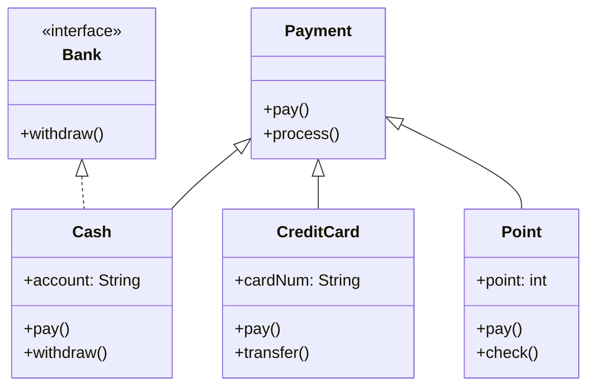
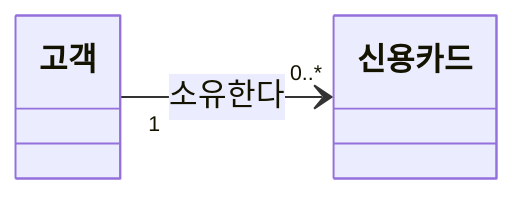
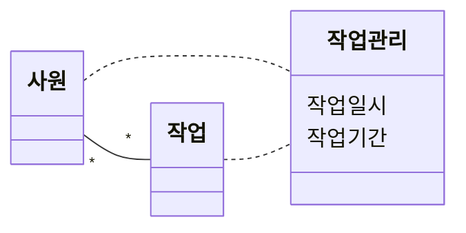
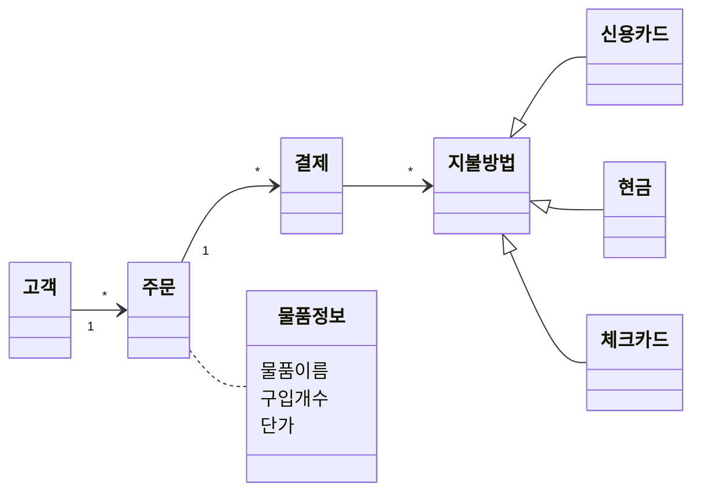

## 학습 목표

- 인터페이스와 추상 클래스의 차이와 쓰임
- 다형성(Polymorphism)의 정의와 오버로딩, 오버라이딩, 업캐스팅
- 자바에서 다중 상속을 흉내 내는 방법(클래스 하나 상속 + 인터페이스 여러 개 구현)
- 과제 1: UML 다이어그램의 종류와 클래스 다이어그램 해석
- 클래스 다이어그램을 코드로 옮기고 실행해서 생기는 문제 확인

---

## 1. 인터페이스와 추상 클래스

은행 계좌 네 종류(일반, 정기예금, CMA, 증권예탁)가 공통으로 입금, 출금, 이체, 잔액 확인을 한다는 상황을 두 방식으로 만들어 봄.

| 구분 | 인터페이스 | 추상 클래스 |
| --- | --- | --- |
| 키워드 | `interface`, 구현은 `implements` | `abstract class`, 상속은 `extends` |
| 담는 것 | 기능(책임)의 목록. 메서드 선언만 (Java 8부터 default 메서드 가능) | 공통 필드와 구현된 메서드 + 추상 메서드 |
| 개수 | 한 클래스가 **여러 개** 구현 가능 | 한 클래스는 **하나만** 상속 |
| 관계 | 실체화 (점선 + 빈 삼각형) | 일반화 (실선 + 빈 삼각형) |
| 언제 | "무엇을 할 수 있는가"를 약속할 때 | 공통 코드를 물려주면서 일부만 자식에게 맡길 때 |

### 인터페이스 버전

```java
public interface Account {
    public void deposit();          // 입금
    public int withdraw();          // 출금
    public boolean transfer();      // 이체
    public boolean checkBalance();  // 잔액 확인
}

class CommonAccount implements Account {
    public void deposit() { }
    public int withdraw() { return 0; }
    public boolean transfer() { return true; }
    public boolean checkBalance() { return true; }
}
// SavingsAccount(정기 납입금), CMAAccount(예치금), SecuritiesAccount(예치금, 증권계좌)도 같은 방식으로 구현
```

### 추상 클래스 버전

```java
abstract class Account {
    public void deposit() { }                   // 공통 구현
    public int withdraw() { return 0; }

    public abstract boolean transfer();         // 계좌마다 다른 부분만 추상 메서드로
    public abstract boolean checkBalance();
}

class CommonAccount extends Account {
    @Override public boolean transfer() { return true; }
    @Override public boolean checkBalance() { return true; }
}
```

두 버전 모두 `main`에서 네 계좌의 `transfer()`, `checkBalance()`를 호출하고, 실행 결과는 `true`가 네 번 출력됨. 실습은 구조를 만드는 것이 목적이라 메서드 몸체는 비워 두었음.

---

## 2. 다형성

> **(중요!!)** 정의를 영어로도 알아 둘 것. **Polymorphism**: 서로 다른 클래스의 객체가 **같은 메시지**를 받았을 때 **각자의 방식으로** 동작하는 능력
{: .prompt-warning }

- **오버로딩**: 같은 클래스 안에서 이름은 같고 매개변수가 다른 메서드를 여러 개 정의
- **오버라이딩**: 자식 클래스가 부모의 메서드를 같은 시그니처로 다시 정의
- **업캐스팅**: 자식 객체를 부모 타입 변수에 담음. 호출하는 쪽은 부모 타입만 알고, 실제로는 자식의 메서드가 실행됨(동적 바인딩)

실습 코드는 부모 `Account`에 `transfer`를 세 가지로 오버로딩하고, 네 자식 클래스가 그중 `transfer(금액, 계좌, 은행명)`을 오버라이딩함.

```java
class Account {
    public boolean transfer(int amount) { return true; }
    public boolean transfer(int amount, String otherAccount) { return true; }
    public boolean transfer(int amount, String otherAccount, String bankName) { return true; }
}

class CommonAccount extends Account {
    @Override
    public boolean transfer(int amount, String otherAccount, String bankName) { return true; }
}
// SavingsAccount, CMAAccount, SecuritiesTrustAccount도 같은 방식

public class Main {
    public static void main(String[] args) {
        Account account1 = new CommonAccount();            // 업캐스팅
        Account account2 = new SavingsAccount(100000);
        System.out.println(account1.transfer(10000, "111-222", "KB Bank"));
        System.out.println(account2.transfer(20000, "222-333", "Shinhan Bank"));
        // ...
    }
}
```

실행하면 `true`만 네 번 나와서 다형성이 **보이지 않음**. 자식마다 다르게 동작하도록 몸체를 채워서 다시 실행해 봄.

```java
import java.util.List;

abstract class Account {
    protected int balance;
    Account(int balance) { this.balance = balance; }
    // 같은 메시지 transfer(...)에 대해 계좌 종류마다 다르게 동작
    public abstract String transfer(int amount, String otherAccount, String bankName);
}

class CommonAccount extends Account {
    CommonAccount(int b) { super(b); }
    public String transfer(int amount, String to, String bank) {
        balance -= amount + 500;                       // 타행 수수료 500원
        return "일반계좌: " + bank + " " + to + "로 " + amount + "원 이체 (수수료 500), 잔액 " + balance;
    }
}

class SavingsAccount extends Account {
    SavingsAccount(int b) { super(b); }
    public String transfer(int amount, String to, String bank) {
        return "정기예금: 만기 전에는 이체 불가, 잔액 " + balance;
    }
}

class CMAAccount extends Account {
    CMAAccount(int b) { super(b); }
    public String transfer(int amount, String to, String bank) {
        balance -= amount;                             // 수수료 면제
        return "CMA: " + bank + " " + to + "로 " + amount + "원 이체 (수수료 면제), 잔액 " + balance;
    }
}

public class PolyDemo {
    public static void main(String[] args) {
        List<Account> accounts = List.of(new CommonAccount(100000), new SavingsAccount(100000), new CMAAccount(100000));
        for (Account a : accounts)                     // 호출하는 쪽 코드는 하나
            System.out.println(a.transfer(10000, "111-222", "KB"));
    }
}
```

실행 결과

```text
일반계좌: KB 111-222로 10000원 이체 (수수료 500), 잔액 89500
정기예금: 만기 전에는 이체 불가, 잔액 100000
CMA: KB 111-222로 10000원 이체 (수수료 면제), 잔액 90000
```

- `for` 문 안의 호출 코드 `a.transfer(...)`는 하나인데, 실제 객체에 따라 수수료, 이체 불가, 수수료 면제로 다르게 동작함
- 새 계좌 종류가 생겨도 호출하는 코드는 고칠 필요가 없음 → 다형성이 OCP의 바탕

---

## 3. 자바의 다중 상속

자바는 클래스를 **하나만** 상속할 수 있음 (두 부모에 같은 메서드가 있으면 어느 것을 쓸지 모호해지는 다이아몬드 문제 때문). 대신 **클래스 하나를 상속하고 인터페이스를 여러 개 구현**해서 다중 상속의 효과를 냄.



```java
interface Bank { void withdraw(); }

class Payment {
    public void pay() { System.out.println("Payment: pay()"); }
    public void process() { System.out.println("Payment: process()"); }
}

class Cash extends Payment implements Bank {        // 상속 + 구현
    String account;
    public Cash(String account) { this.account = account; }
    @Override public void pay() { System.out.println("Cash: pay()"); }
    @Override public void withdraw() { System.out.println("Cash: withdraw() from account " + account); }
}
// CreditCard(transfer), Point(check)는 Payment만 상속
```

실행 결과

```text
------------------
Cash: pay()
Payment: process()
Cash: withdraw() from account 123-456
------------------
CreditCard: pay()
Payment: process()
CreditCard: transfer() with card 1111-2222
------------------
Point: pay()
Payment: process()
Point: check() = 1000
------------------
```

- `pay()`는 세 클래스 모두 오버라이딩한 버전이 실행되고, `process()`는 부모의 것을 그대로 물려받음
- `Cash`만 `Bank` 인터페이스를 구현해서 `withdraw()`를 가짐

---

## 4. 과제 1: 1장 연습문제

> 교재 1장(객체지향 모델링) 연습문제. 문제 번호와 답만 적어 제출
{: .prompt-info }

### 객관식

| 번호 | 묻는 것 | 답 | 이유 |
| --- | --- | --- | --- |
| 1 | 모델링을 하는 이유가 **아닌** 것 | ④ | 모든 측면을 **하나의** 다이어그램으로 설명하지 않음. 관점마다 다른 다이어그램을 씀 |
| 2 | UML 설명 중 옳은 것 | ④ | UML은 개발 과정 전반에서 의사소통을 돕는 언어. 행위도 모델링할 수 있고(①), 간결하게 표현하며(②), 프로그래밍 언어가 아니라 모델링 언어(③) |
| 3 | 실행 시스템의 물리적인 구조를 표현하는 다이어그램 | ② 배치 다이어그램 | 하드웨어, 네트워크 등 물리적 배치 |
| 4 | UML 다이어그램이 **아닌** 것 | ③ 페트리네트 | 복합체 구조, 객체, 타이밍 다이어그램은 UML에 속함 |
| 5 | 성격이 다른 하나 | ④ 클래스 다이어그램 | 활동, 통신, 상태 머신은 **행위** 다이어그램, 클래스는 **구조** 다이어그램 |
| 6 | 올바른 UML 클래스 표현 | ② | 속성 부분은 생략 가능. 칸 순서는 이름 / 속성 / 연산이고(①), 연산을 생략할 때 구획선을 반드시 그릴 필요는 없으며(③), 이름은 생략할 수 없음(④) |
| 9 | 사람 → 자동차(소유한다) 다이어그램 설명으로 틀린 것 | ④ | 사람에서 자동차로 가는 **단방향** 연관이라 자동차 정보만으로는 소유자를 알 수 없음 |

### 7번: 클래스 다이어그램을 코드로

다이어그램의 `Account`(-id: Integer, -owner: String, -balance: Double, +deposit, +withdraw, #getBalance)를 그대로 옮긴 답안을 실행해 봄.

```java
class Account {                      // 17번 답안 그대로 (balance 초기값 없음)
    private Integer id;
    private String owner;
    private Double balance;

    public void deposit(Double amount) { balance += amount; }
    public void withdraw(Double amount) { balance -= amount; }
    protected Double getBalance() { return balance; }
}

class FixedAccount {                 // 생성자로 초기화한 버전
    private Integer id;
    private String owner;
    private Double balance;

    public FixedAccount(Integer id, String owner) {
        this.id = id;
        this.owner = owner;
        this.balance = 0.0;
    }
    public void deposit(Double amount) { balance += amount; }
    public void withdraw(Double amount) { balance -= amount; }
    protected Double getBalance() { return balance; }
}

public class AccountTest {
    public static void main(String[] args) {
        try {
            Account a = new Account();
            a.deposit(1000.0);
            System.out.println("Account 잔액: " + a.getBalance());
        } catch (NullPointerException e) {
            System.out.println("Account.deposit → NullPointerException (balance가 null)");
        }
        FixedAccount f = new FixedAccount(1, "홍길동");
        f.deposit(1000.0);
        f.withdraw(300.0);
        System.out.println("FixedAccount 잔액: " + f.getBalance());
    }
}
```

실행 결과

```text
Account.deposit → NullPointerException (balance가 null)
FixedAccount 잔액: 700.0
```

- 답안 코드는 다이어그램과 접근 제어자(-, +, #)는 정확히 맞지만, `balance`가 `Double`(객체 타입)이라 초기값이 `null`이고 `balance += amount`에서 **NullPointerException**이 남
- 생성자에서 `balance = 0.0`으로 초기화하면 정상 동작함. 정리 노트에도 "클래스는 반드시 생성자를 포함"하라는 강조가 있음

### 8, 10, 17번: 클래스 다이어그램 작성

손으로 그린 답을 Mermaid로 옮김.

8번: 고객은 여러 개의 신용카드를 가질 수 있고 없을 수도 있음. 신용카드에는 고객 정보가 없음 → 고객에서 카드로 가는 **단방향** 연관.



10번: 사원은 여러 작업을, 작업은 여러 사원이 수행하고, **작업 일시와 기간을 관리** → 다대다 연관에 **연관 클래스**를 붙임.



(Mermaid에는 연관 클래스 표기가 없어서 점선 두 개로 대신 표현함. UML에서는 연관선 가운데에 점선으로 연관 클래스를 붙임)

17번: 고객은 여러 주문을 하고, 주문 하나는 여러 지불 방법으로 결제할 수 있으며, 지불 방법은 신용카드, 현금, 체크카드. 각 주문에는 물품 정보(이름, 개수, 단가)가 있음. 답안은 결제 클래스를 따로 두고, 물품 정보를 주문에 붙은 연관 클래스로 표현함.



---

### 과제와 실습 코드에서 정정한 부분 정리

| 위치 | 원래 | 정정 | 이유 |
| --- | --- | --- | --- |
| interface 실습 | 인터페이스 선언 위에 `// 추상 클래스` 주석 | `// 인터페이스` | `interface`는 추상 클래스와 다른 개념 |
| 과제 1 7번 | `private Double balance;` (초기화 없음) | 생성자에서 `balance = 0.0` 초기화 | 실행하면 `deposit`에서 NullPointerException |
| 다형성 실습 | 모든 `transfer`가 `true`만 반환 | 자식마다 다른 동작을 넣은 예제를 추가 | 출력만으로는 다형성이 드러나지 않음 |

---

## 최종 핵심 정리

1. 인터페이스는 기능(책임)의 목록이고 여러 개 구현 가능, 추상 클래스는 공통 구현 + 추상 메서드이고 하나만 상속 가능
2. 실체화는 점선 + 빈 삼각형, 일반화는 실선 + 빈 삼각형으로 그림
3. 다형성: 같은 메시지에 객체마다 다르게 반응하는 능력이며, 업캐스팅과 오버라이딩(동적 바인딩)으로 구현됨
4. 오버로딩은 같은 이름에 매개변수가 다른 메서드, 오버라이딩은 자식이 부모 메서드를 다시 정의하는 것
5. 자바는 클래스 다중 상속을 막고(다이아몬드 문제), `extends` 하나 + `implements` 여럿으로 대신함
6. UML 다이어그램은 구조(클래스, 객체, 배치 등)와 행위(활동, 상태 머신, 순차, 통신 등)로 나뉘고, 페트리네트는 UML이 아님
7. 연관의 방향은 누가 누구를 아는지를 뜻하며, 단방향이면 반대쪽에서는 상대를 알 수 없음
8. 다이어그램을 코드로 옮길 때는 객체 타입 필드의 초기화(생성자)까지 챙겨야 실제로 동작함

---

End.
