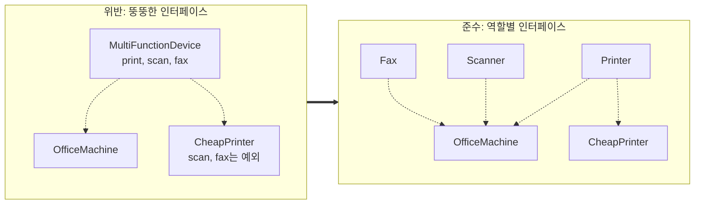
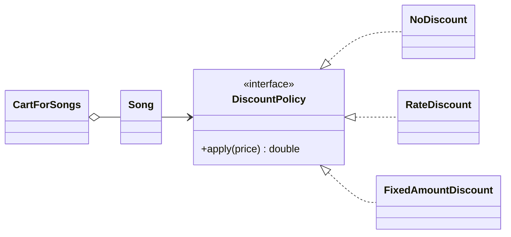
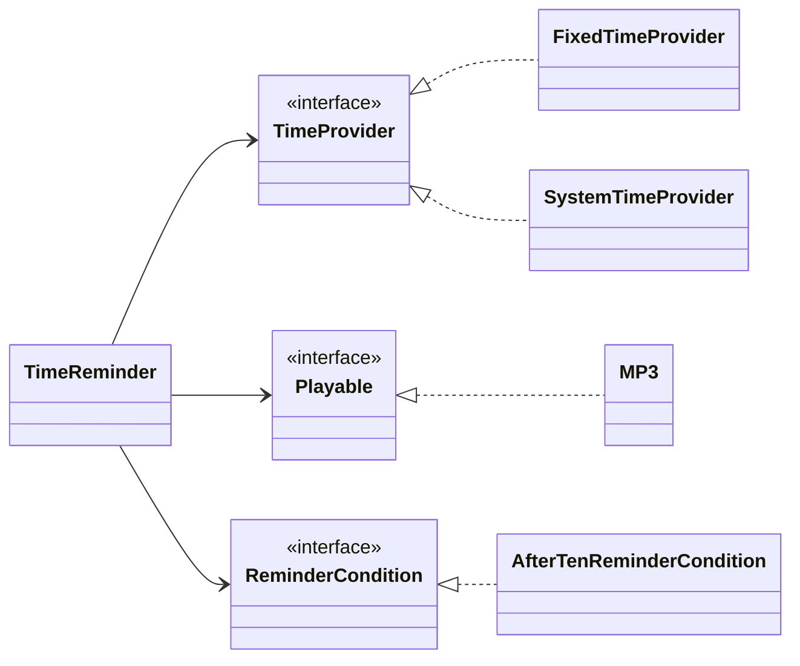

## 학습 목표

- SOLID 다섯 원칙의 이름(영어 전체 이름)과 뜻
- 문자열 조건문 대신 다형성으로 할인 정책을 표현하기 (과제 2, 4번)
- 상속이 아니라 합성(전략)으로 할인 정책과 회원 등급을 표현해야 하는 이유 (과제 2, 5번과 8번)
- 하나의 클래스에 섞인 책임을 나누고 계산 정책을 인터페이스로 분리하기 (과제 3)
- 테스트하기 어려운 의존성을 인터페이스로 바꾸는 DIP (과제 4)
- 리팩터링 전후 코드를 실제로 실행해서 결과가 같은지 확인
- 원칙별 예제 위치를 정리하고, 과제에 없던 ISP를 보충 예제로 확인

---

## 1. SOLID

> **(중요!!)** 다섯 원칙의 이름과 뜻을 쓰는 문제가 나옴
{: .prompt-warning }

| 약자 | 이름 | 뜻 |
| --- | --- | --- |
| S | Single Responsibility Principle (단일 책임) | 클래스는 하나의 책임만, 즉 **변경 이유가 하나**여야 함 |
| O | Open/Closed Principle (개방-폐쇄) | **확장에는 열려 있고 수정에는 닫혀** 있어야 함. 새 기능은 기존 코드 수정이 아니라 새 클래스 추가로 |
| L | Liskov Substitution Principle (리스코프 치환) | 자식은 부모를 대체할 수 있어야 함 ([01편](/posts/Design_Pattern_01/)) |
| I | Interface Segregation Principle (인터페이스 분리) | 클라이언트에 맞게 인터페이스를 작게 나눔. 쓰지 않는 메서드에 의존하지 않게 |
| D | Dependency Inversion Principle (의존 역전) | 구체적인 구현이 아니라 **추상화(인터페이스, 상위 개념)** 에 의존 |

- SRP의 반대 현상인 **산탄총 수술(shotgun surgery)**: 하나의 책임이 여러 클래스에 흩어져 있어서, 작은 변경 하나를 위해 여러 파일을 동시에 고쳐야 하는 것
- SRP를 지키다 보면 로깅, 보안, 트랜잭션처럼 여러 클래스에 공통으로 걸치는 **횡단 관심사**가 남는데, 이것은 AOP(Aspect Oriented Programming)로 분리함. AOP 용어 다섯 개는 조인포인트, 포인트컷, 어드바이스, 애스펙트, 위빙 (단답형 출제)

### 원칙별로 어디서 확인하나

| 원칙 | 핵심 질문 | 예제 위치 |
| --- | --- | --- |
| SRP | 이 클래스가 바뀌는 이유가 둘 이상인가? | 이 글의 과제 3 (급여 계산기), [06편](/posts/Design_Pattern_06/) 회의 1 |
| OCP | 새 종류를 추가할 때 기존 코드를 고치는가? | 이 글의 과제 2 (할인 정책), [07편](/posts/Design_Pattern_07/) 주간 전략 추가 실험 |
| LSP | 자식 객체를 부모 자리에 넣어도 기대대로 동작하는가? | [01편](/posts/Design_Pattern_01/) 할인 가방 예제 |
| ISP | 구현 클래스가 쓰지도 않는 메서드를 억지로 구현하는가? | 아래 (보충) 예제, [06편](/posts/Design_Pattern_06/) 대시보드 |
| DIP | 바꾸기 어려운 구체 클래스에 직접 의존하는가? | 이 글의 과제 4 (시간 알림) |

### (보충) ISP: 복합기 예제

과제에서 ISP를 직접 다루지 않아서 짧은 예제로 확인했음. 인쇄, 스캔, 팩스를 한 인터페이스에 모으면, 인쇄만 되는 저가 프린터도 스캔과 팩스를 "구현"해야 함.



```java
// 위반
interface MultiFunctionDevice { void print(String doc); void scan(String doc); void fax(String doc); }
class CheapPrinter implements MultiFunctionDevice {
    public void print(String d) { System.out.println("  저가 프린터 인쇄: " + d); }
    public void scan(String d)  { throw new UnsupportedOperationException("스캔 기능 없음"); }
    public void fax(String d)   { throw new UnsupportedOperationException("팩스 기능 없음"); }
}

// 준수
interface Printer { void print(String doc); }
interface Scanner { void scan(String doc); }
interface Fax     { void fax(String doc); }
class OfficeMachine implements Printer, Scanner, Fax { ... }
class CheapPrinter implements Printer { ... }          // 필요한 것만
static void sendAll(Fax[] fs) { for (Fax f : fs) f.fax("계약서.pdf"); }
```

실행 결과 (위반: 두 기기에 팩스를 보냄)

```text
  복합기 팩스: 계약서.pdf
  실행 중 예외: 팩스 기능 없음
```

실행 결과 (준수)

```text
  복합기 인쇄: 과제.docx
  저가 프린터 인쇄: 과제.docx
  복합기 팩스: 계약서.pdf
```

준수 버전에서 저가 프린터를 팩스 목록에 넣으려고 하면 **실행이 아니라 컴파일 단계에서** 막힘.

```text
IspBad.java:4: error: incompatible types: CheapPrinter cannot be converted to Fax
public class IspBad { public static void main(String[] a) { Fax[] fs = { new CheapPrinter() }; } }
                                                                         ^
```

- 위반 버전은 `UnsupportedOperationException`이 **실행해 봐야** 드러나고, 이는 LSP 위반이기도 함 (부모 타입 자리에서 기대대로 동작하지 않음)
- 인터페이스를 쪼개면 "팩스가 되는 기기만 받는다"는 조건을 **타입으로 표현**할 수 있음

---

## 2. 과제 2: 노래 장바구니 (2장 연습문제)

> 2장 연습문제 4, 5, 8번. 4번은 코드의 문제점을 찾고 개선, 5번과 8번은 설계의 문제점을 설명
{: .prompt-info }

### 4번: 원래 코드

```java
public class Song {
    private String mode;
    public void setMode(String mode) { this.mode = mode; }
    public double getPrice() { return 10.0; }
    public String getDiscountMode() { return this.mode; }
}

public class CartForSongs {
    ArrayList<Song> cart = new ArrayList<Song>();

    public double calculateTotalPrice() {
        double total = 0.0;
        Iterator<Song> itr = cart.iterator();
        while (itr.hasNext()) {
            Song s = itr.next();
            if (s.getDiscountMode().equals("OnSale"))
                total = total + (s.getPrice() - 0.1 * s.getPrice());
            else if (s.getDiscountMode().equals("TodayEvent"))
                total = total + (s.getPrice() - 0.3 * s.getPrice());
            else
                total = total + s.getPrice();
        }
        return total;
    }
    public void add(Song s) { cart.add(s); }
}
```

**문제점**

1. **문자열로 할인 방식 비교**: `"OnSale"`, `"TodayEvent"`를 문자열로 비교해서 오타나 대소문자 실수에 약함. `"onsale"`로 쓰면 아무 오류 없이 할인이 빠짐
2. **OCP 위반**: 할인 정책이 추가될 때마다 `if-else`를 고쳐야 함
3. **책임 집중**: 장바구니가 합계 계산(자기 일)에 더해 할인 정책까지 알고 있음
4. **다형성 미사용**: 노래가 스스로 가격을 정하지 않고 바깥에서 분기로 처리함

### 4번: 개선 코드

```java
abstract class Song {
    protected double price = 10.0;
    public abstract double getPrice();
}

class NonDiscountedSong extends Song {
    @Override public double getPrice() { return price; }
}

class OnSaleSong extends Song {
    @Override public double getPrice() { return price * 0.9; }
}

class TodayEventSong extends Song {
    @Override public double getPrice() { return price * 0.7; }
}

class CartForSongs {
    ArrayList<Song> cart = new ArrayList<Song>();

    public double calculateTotalPrice() {
        double total = 0.0;
        for (Song s : cart) total += s.getPrice();     // 분기 없이 각 노래에게 가격을 물어봄
        return total;
    }
    public void add(Song s) { cart.add(s); }
}
```

두 버전에 같은 노래 네 곡(할인 없음 2곡, 10% 할인 1곡, 30% 할인 1곡)을 넣고 실행함.

```text
원래 코드:
36.0
개선 코드(파일 분리):
36.0
Modified 폴더 전체 컴파일:
Result.java:9: error: duplicate class: NonDiscountedSong
Result.java:16: error: duplicate class: OnSaleSong
Result.java:30: error: duplicate class: CartForSongs
```

- 두 버전 모두 $$10 + 10 + 9 + 7 = 36$$으로 결과가 같음 → 동작은 그대로 두고 구조만 바꾼 리팩터링
- 제출 폴더(`Modified/src`)에는 클래스를 파일별로 나눈 버전과, 모든 클래스를 한 파일에 담은 `Result.java`가 같이 들어 있어서 **폴더 전체를 한 번에 컴파일하면 클래스 중복 오류**가 남. 둘 중 하나만 남겨야 함

### 5번: 할인을 노래의 종류로 만든 것의 문제

- 4번 개선 코드는 "할인 방식"을 `Song`의 **하위 클래스**로 표현함. 그런데 할인 중인 노래가 노래의 **한 종류(is a kind of)** 는 아님. 할인은 노래에 **적용되는 정책**
- 그래서 새 할인 방식마다 `Song` 하위 클래스가 늘어나고, 같은 노래의 할인이 바뀌면 객체를 새로 만들어야 하며, 할인 정책을 다른 상품에 재사용할 수도 없음
- 해결: 할인 정책을 별도 인터페이스로 빼고 `Song`이 그 객체를 **가지게(합성)** 함. 이것이 **전략(Strategy) 패턴**

### 8번: 회원 등급을 상속으로 만든 것의 문제

- VIP, Good, Ordinary를 회원의 하위 클래스로 만들면 "회원의 종류 = 등급"이 됨
- 등급은 시간이 지나면 바뀌는 **상태(값)** 라서, 상속으로 만들면 등급이 바뀔 때 객체 자체를 바꿔야 하고 등급이 생길 때마다 클래스가 늘어남 → 등급은 회원의 **속성**으로 가져야 함

### 5번과 8번을 반영한 코드 (실행)

```java
import java.util.ArrayList;
import java.util.List;

// 할인 방식을 노래의 종류(상속)가 아니라 교체 가능한 전략(합성)으로 분리
interface DiscountPolicy {
    double apply(double price);
}

class NoDiscount implements DiscountPolicy {
    public double apply(double price) { return price; }
}

class RateDiscount implements DiscountPolicy {            // 10%, 30% 할인을 클래스 하나로
    private final double rate;
    RateDiscount(double rate) { this.rate = rate; }
    public double apply(double price) { return price * (1 - rate); }
}

class FixedAmountDiscount implements DiscountPolicy {     // 새 정책 추가: 기존 코드 수정 없음 (OCP)
    private final double amount;
    FixedAmountDiscount(double amount) { this.amount = amount; }
    public double apply(double price) { return Math.max(0, price - amount); }
}

class Song {
    private final String title;
    private final double price = 10.0;
    private DiscountPolicy policy;
    Song(String title, DiscountPolicy policy) { this.title = title; this.policy = policy; }
    void setPolicy(DiscountPolicy policy) { this.policy = policy; }   // 실행 중에 할인 방식 변경
    double getPrice() { return policy.apply(price); }
    String getTitle() { return title; }
}

class CartForSongs {
    private final List<Song> cart = new ArrayList<>();
    void add(Song s) { cart.add(s); }
    double calculateTotalPrice() {
        double total = 0;
        for (Song s : cart) total += s.getPrice();       // 장바구니는 할인 방식을 몰라도 됨
        return total;
    }
}

// 8번: 회원 등급은 바뀔 수 있는 값이므로 상속이 아니라 속성으로
enum Grade { ORDINARY, GOOD, VIP }

class Member {
    private final String name;
    private Grade grade = Grade.ORDINARY;
    Member(String name) { this.name = name; }
    void upgrade(Grade g) { grade = g; }                  // 같은 객체가 그대로 등급만 바뀜
    public String toString() { return name + "(" + grade + ")"; }
}

public class StrategyCart {
    public static void main(String[] args) {
        Song s1 = new Song("Song A", new NoDiscount());
        Song s2 = new Song("Song B", new NoDiscount());
        Song s3 = new Song("Song C", new RateDiscount(0.1));
        Song s4 = new Song("Song D", new RateDiscount(0.3));
        CartForSongs c = new CartForSongs();
        c.add(s1); c.add(s2); c.add(s3); c.add(s4);
        System.out.println("합계: " + c.calculateTotalPrice());

        s1.setPolicy(new FixedAmountDiscount(2.0));       // Song A에 2달러 할인 이벤트 적용
        System.out.println("Song A에 정액 할인 적용 후 합계: " + c.calculateTotalPrice());

        Member m = new Member("kim");
        System.out.print("회원 " + m);
        m.upgrade(Grade.VIP);
        System.out.println(" → 등급 변경 후 " + m);
    }
}
```

실행 결과

```text
합계: 36.0
Song A에 정액 할인 적용 후 합계: 34.0
회원 kim(ORDINARY) → 등급 변경 후 kim(VIP)
```



- 할인 없음, 10%, 30% 할인으로 합계가 똑같이 36.0이 나옴
- 실행 중에 `Song A`의 할인 정책만 정액 할인으로 바꿨더니 합계가 34.0이 됨. 노래 객체는 그대로이고, 새 정책 `FixedAmountDiscount`를 추가하면서 기존 클래스는 하나도 고치지 않았음 (OCP)
- 10%와 30% 할인을 `RateDiscount` 하나로 표현해서 클래스 수도 줄어듦
- 회원 객체는 그대로 두고 등급만 ORDINARY에서 VIP로 바뀜

---

## 3. 과제 3: 급여 계산기 (3장 연습문제 10번)

> 정상 근무 시간과 잔업 시간으로 급여(시간당 10, 잔업 15)를 계산해 보여 주는 AWT/Swing 프로그램 `CalculatePayMachine`의 설계 문제를 진단하고 개선
{: .prompt-info }

### 문제점

- `CalculatePayMachine` 하나가 **화면 구성, 이벤트 처리, 입력 검증, 급여 계산, 결과 출력**을 모두 맡음 → 변경 이유가 여러 개라 **SRP 위반**
- 급여 계산식 `10 * x + 15 * y`가 이벤트 처리 코드 안에 박혀 있어서, 급여 정책이 바뀌면 화면 클래스를 고쳐야 함 → **OCP 위반**

### 개선: 데이터, 계산 정책, 서비스, 화면으로 분리

```java
class WorkRecord {                                   // 근무 시간 데이터
    private final int workHours;
    private final int overTimeHours;
    public WorkRecord(int workHours, int overTimeHours) {
        this.workHours = workHours;
        this.overTimeHours = overTimeHours;
    }
    public int getWorkHours() { return workHours; }
    public int getOverTimeHours() { return overTimeHours; }
}

interface PayCalculator {                            // 급여 계산 정책 (추상화)
    int calculatePay(WorkRecord record);
}

class DefaultPayCalculator implements PayCalculator {
    private static final int WORK_PAY_PER_HOUR = 10;
    private static final int OVERTIME_PAY_PER_HOUR = 15;
    @Override
    public int calculatePay(WorkRecord record) {
        return WORK_PAY_PER_HOUR * record.getWorkHours()
                + OVERTIME_PAY_PER_HOUR * record.getOverTimeHours();
    }
}

class PayrollService {                               // 계산 서비스: 정책을 주입받음
    private final PayCalculator payCalculator;
    public PayrollService(PayCalculator payCalculator) { this.payCalculator = payCalculator; }
    public int calculatePay(WorkRecord record) { return payCalculator.calculatePay(record); }
}

class CalculatePayMachine extends Frame implements ActionListener, DocumentListener {
    private final PayrollService payrollService;     // 화면은 입력과 출력만
    // ... 화면 구성과 입력 검증 코드 ...
    public void actionPerformed(ActionEvent e) {
        // ...
        if (e.getSource() == calcButton) {
            Integer workHours = parseInput(tfWorkingHours);
            if (workHours == null) return;
            Integer overTimeHours = parseInput(tfOvertimeHours);
            if (overTimeHours == null) return;
            WorkRecord record = new WorkRecord(workHours, overTimeHours);
            int payAmount = payrollService.calculatePay(record);   // 계산은 서비스에 위임
            tfResult.setText(String.valueOf(payAmount));
            resetButton.setEnabled(true);
        }
    }
    public static void main(String[] args) {
        PayCalculator calculator = new DefaultPayCalculator();
        new CalculatePayMachine(new PayrollService(calculator));
    }
}
```

### 화면 없이 계산만 시험 (실행)

계산이 화면에서 분리되었으니 GUI를 띄우지 않고도 시험할 수 있음. 개선 코드를 그대로 컴파일하고, 새 급여 정책 하나를 **추가만** 해서 실행함.

```java
// GUI(CalculatePayMachine) 없이 분리된 계산 클래스만 시험
class HolidayPayCalculator implements PayCalculator {     // 새 급여 정책: 기존 클래스 수정 없이 추가
    @Override
    public int calculatePay(WorkRecord record) {
        return 15 * record.getWorkHours() + 20 * record.getOverTimeHours();
    }
}

public class PayTest {
    public static void main(String[] args) {
        WorkRecord record = new WorkRecord(40, 5);
        PayrollService normal = new PayrollService(new DefaultPayCalculator());
        PayrollService holiday = new PayrollService(new HolidayPayCalculator());
        System.out.println("기본 정책  (10 x 40 + 15 x 5) = " + normal.calculatePay(record));
        System.out.println("휴일 정책  (15 x 40 + 20 x 5) = " + holiday.calculatePay(record));
    }
}
```

실행 결과

```text
기본 정책  (10 x 40 + 15 x 5) = 475
휴일 정책  (15 x 40 + 20 x 5) = 700
```

- 원래 구조였다면 휴일 정책을 넣기 위해 `actionPerformed` 안의 계산식을 고쳐야 했지만, 지금은 `PayCalculator` 구현 클래스 하나를 추가하고 주입만 바꾸면 됨
- 계산 로직을 버튼 클릭 없이 바로 시험할 수 있다는 것도 책임을 나눈 효과

---

## 4. 과제 4: 시간 알림 (DIP)

수업 실습(3/30)은 "밤 10시가 넘으면 음악을 재생"하는 `TimeReminder`. 원래 형태는 시스템 시계(`Calendar`)와 `MP3`를 클래스 안에서 직접 사용해서, 밤 10시가 되기 전에는 동작을 **시험할 방법이 없음**.

실습에서는 시간과 재생을 인터페이스(`TimeProvider`, `Playable`)로 바꾸고 생성자로 주입했고, 과제 4에서는 알림 조건까지 `ReminderCondition` 인터페이스로 분리함.

```java
public class TimeReminder {
    private TimeProvider timeProvider;
    private Playable player;
    private ReminderCondition reminderCondition;

    public TimeReminder(TimeProvider timeProvider, Playable player, ReminderCondition reminderCondition) {
        this.timeProvider = timeProvider;
        this.player = player;
        this.reminderCondition = reminderCondition;
    }

    public void reminder() {
        int hour = timeProvider.getHour();
        if (reminderCondition.shouldRemind(hour)) {
            player.playSong();
        }
    }
}

interface TimeProvider { int getHour(); }
class FixedTimeProvider implements TimeProvider {      // 테스트용: 원하는 시각을 고정
    private int hour;
    public FixedTimeProvider(int hour) { this.hour = hour; }
    public int getHour() { return hour; }
}
interface Playable { void playSong(); }
class MP3 implements Playable { public void playSong() { System.out.println("음악 재생"); } }
interface ReminderCondition { boolean shouldRemind(int hour); }
class AfterTenReminderCondition implements ReminderCondition {
    public boolean shouldRemind(int hour) { return hour >= 22; }
}
```



과제의 `main`은 16시, 22시, 23시로 실행해서 `음악 재생`이 두 번 출력됨. 시각이 함께 보이도록 출력용 플레이어를 붙이고, 조건을 하나 더 추가해서 실행함.

```java
// 과제 코드(TimeReminder.java)의 클래스를 그대로 쓰고, 출력만 보기 쉽게 바꾼 실행용 코드
class PrintPlayer implements Playable {                    // 테스트용 가짜 플레이어
    private final int hour;
    PrintPlayer(int hour) { this.hour = hour; }
    public void playSong() { System.out.println(hour + "시: 음악 재생"); }
}

class MorningReminderCondition implements ReminderCondition {   // 새 조건 추가 (기존 코드 수정 없음)
    public boolean shouldRemind(int hour) { return hour >= 6 && hour < 8; }
}

public class Hw4Run {
    static void run(String name, ReminderCondition cond) {
        System.out.println("[" + name + "]");
        for (int hour : new int[]{7, 16, 22, 23}) {
            TimeReminder r = new TimeReminder(new FixedTimeProvider(hour), new PrintPlayer(hour), cond);
            r.reminder();
        }
    }
    public static void main(String[] args) {
        run("22시 이후 알림", new AfterTenReminderCondition());
        run("아침 6~8시 알림", new MorningReminderCondition());
    }
}
```

실행 결과

```text
[22시 이후 알림]
22시: 음악 재생
23시: 음악 재생
[아침 6~8시 알림]
7시: 음악 재생
```

- `TimeReminder`는 구체 클래스(`Calendar`, `MP3`)가 아니라 인터페이스에만 의존함 → **DIP**
- 시각을 고정한 가짜 객체로 22시가 되기를 기다리지 않고 바로 시험할 수 있음
- 아침 알림 조건을 추가할 때 `TimeReminder`는 한 줄도 고치지 않았음 → **OCP**

---

### 과제 코드에서 정정한 부분 정리

| 위치 | 원래 | 정정 | 이유 |
| --- | --- | --- | --- |
| 과제 2 `Modified/src` | 파일별 클래스와 `Result.java`(모든 클래스)를 함께 둠 | 둘 중 하나만 남김 | 폴더 전체를 컴파일하면 `duplicate class` 오류 (실행 결과 참고) |
| 과제 2 파일 이름 | `NonDiscountSong.java` 안에 `NonDiscountedSong` 클래스 | 파일 이름을 `NonDiscountedSong.java`로 | public 클래스가 아니라 컴파일은 되지만, 파일과 클래스 이름이 다르면 찾기 어려움 |
| 과제 2 5번 | 문제점 설명만 있음 | 전략 패턴(합성)으로 바꾼 코드와 실행 결과 추가 | 설명한 해결책이 실제로 동작하는지 확인 |

---

## 최종 핵심 정리

1. SOLID: Single Responsibility, Open/Closed, Liskov Substitution, Interface Segregation, Dependency Inversion. 쓰지 않는 메서드를 억지로 구현하게 하는 큰 인터페이스는 역할별로 쪼갬 (ISP)
2. 문자열 조건문으로 종류를 나누는 코드는 오타에 약하고, 새 종류가 생길 때마다 수정해야 해서 OCP를 어김
3. 분기 대신 각 객체가 스스로 값을 정하게(다형성) 하면 호출하는 코드는 바뀌지 않음
4. 할인 정책이나 회원 등급처럼 바뀌는 것은 상속이 아니라 합성(전략)이나 속성으로 표현해야 함
5. 화면, 입력 검증, 계산이 한 클래스에 있으면 SRP 위반이고, 데이터, 정책 인터페이스, 서비스, 화면으로 나눔
6. 계산 정책을 인터페이스로 빼면 새 정책은 클래스 추가와 주입 변경만으로 적용됨 (OCP)
7. 시스템 시계처럼 통제할 수 없는 의존성을 인터페이스로 바꾸고 주입하면(DIP) 언제든 시험할 수 있음
8. 리팩터링 뒤에는 같은 입력으로 실행해서 결과가 그대로인지(36.0) 확인해야 함

---

End.
