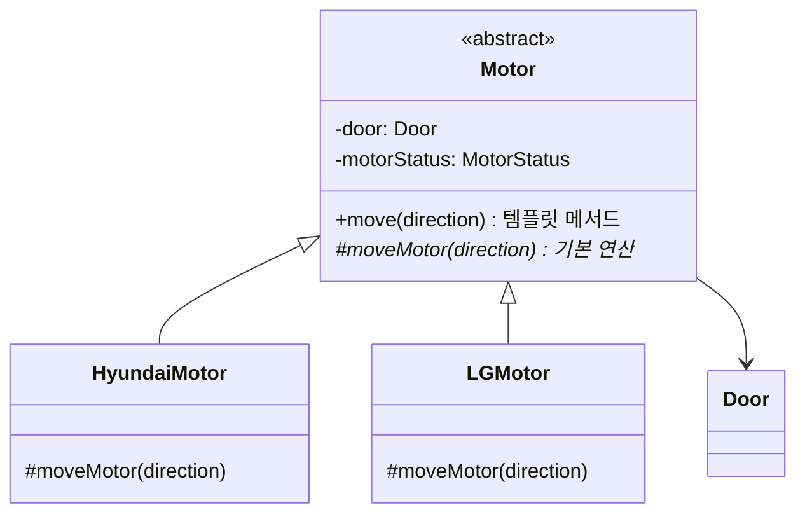

## 학습 목표

- 디자인 패턴의 정의와 구조(컨텍스트, 문제, 해결)
- 중복 코드가 생기는 상황과 템플릿 메서드 패턴으로 해결하는 방법
- 템플릿 메서드와 기본 연산(primitive operation)의 역할
- 템플릿 메서드를 `final`로 막아야 하는 이유를 컴파일 오류로 확인
- 싱글톤 패턴의 세 구성 요소와 각 요소가 없을 때의 문제
- 과제 코드를 실행하고, 문이 열린 상태와 이동 중인 상태까지 시험

---

## 1. 디자인 패턴이란

- **소프트웨어 설계에서 특정 맥락에서 반복되는 문제에 대한, 검증된 재사용 가능한 해결책**. "바퀴를 다시 발명하지 마라"
- 패턴은 세 부분으로 기술함

| 요소 | 내용 |
| --- | --- |
| 컨텍스트 (Context) | 문제가 발생하는 상황. 어떤 조건이나 배경에서 이 패턴이 필요한지 |
| 문제 (Problem) | 해결해야 할 설계 이슈, 구체적인 어려움 |
| 해결 (Solution) | 문제를 푸는 구조와 동작 방식. 여러 상황에 적용할 수 있는 **추상적인 템플릿** |

---

## 2. 템플릿 메서드 패턴

### 상황: 여러 회사의 모터를 지원하자

엘리베이터 제어 시스템에서 `HyundaiMotor`는 이렇게 이동함.

1. 이미 이동 중이면 아무것도 하지 않음
2. 문이 열려 있으면 먼저 문을 닫음
3. 모터를 주어진 방향으로 구동
4. 모터 상태를 이동 중으로 바꿈

LG 모터를 지원하려고 `LGMotor`를 만들면, `move` 메서드는 **3단계(모터 구동)만 다르고 나머지가 똑같음**. 회사가 늘어날 때마다 같은 코드가 복사됨.

### 해결

- 공통 흐름(`move`)을 상위 추상 클래스 `Motor`에 한 번만 구현 → **템플릿 메서드**
- 회사마다 다른 단계(`moveMotor`)는 추상 메서드로 두고 하위 클래스가 구현 → **기본 연산(primitive operation)**



### 과제 코드

```java
abstract class Motor {
    private Door door;
    private MotorStatus motorStatus;

    public Motor(Door door) {
        this.door = door;
        motorStatus = MotorStatus.STOPPED;
    }
    public MotorStatus getMotorStatus() { return motorStatus; }
    private void setMotorStatus(MotorStatus motorStatus) { this.motorStatus = motorStatus; }

    // Template Method
    public void move(Direction direction) {
        MotorStatus motorStatus = getMotorStatus();
        if (motorStatus == MotorStatus.MOVING) return;          // 이미 움직이면 종료

        DoorStatus doorStatus = door.getDoorStatus();
        if (doorStatus == DoorStatus.OPENED) door.close();       // 문이 열려 있으면 닫기

        moveMotor(direction);                                    // 실제 구동은 하위 클래스가
        setMotorStatus(MotorStatus.MOVING);
    }

    // Primitive Operation
    protected abstract void moveMotor(Direction direction);
}

class HyundaiMotor extends Motor {
    public HyundaiMotor(Door door) { super(door); }
    @Override
    protected void moveMotor(Direction direction) { System.out.println("Hyundai Motor moves " + direction); }
}

class LGMotor extends Motor {
    public LGMotor(Door door) { super(door); }
    @Override
    protected void moveMotor(Direction direction) { System.out.println("LG Motor moves " + direction); }
}

public class App {
    public static void main(String[] args) {
        Door door = new Door();
        new HyundaiMotor(door).move(Direction.UP);
        new LGMotor(door).move(Direction.DOWN);
    }
}
```

실행 결과

```text
Hyundai Motor moves UP
LG Motor moves DOWN
```

- 두 모터의 이동 순서와 상태 관리는 `Motor` 한 곳에만 있고, 하위 클래스는 한 줄씩만 다름
- 새 회사(예: 삼성 모터)를 추가할 때 `moveMotor`만 구현하면 됨 → 중복 제거와 OCP

### 템플릿 메서드의 분기 시험과 `final`

과제의 `main`은 문이 닫힌 정지 상태에서만 실행해서 1, 2단계의 분기를 시험하지 못함. 문을 열어 두고, 이동 중에 다시 호출하는 경우까지 넣고, 템플릿 메서드에 `final`을 붙여 실행함.

```java
enum DoorStatus { CLOSED, OPENED }
enum MotorStatus { MOVING, STOPPED }
enum Direction { UP, DOWN }

class Door {
    private DoorStatus status = DoorStatus.CLOSED;
    DoorStatus getDoorStatus() { return status; }
    void open()  { status = DoorStatus.OPENED; System.out.println("  Door Opened"); }
    void close() { status = DoorStatus.CLOSED; System.out.println("  Door Closed"); }
}

abstract class Motor {
    private final Door door;
    private MotorStatus motorStatus = MotorStatus.STOPPED;
    Motor(Door door) { this.door = door; }
    MotorStatus getMotorStatus() { return motorStatus; }
    void stop() { motorStatus = MotorStatus.STOPPED; System.out.println("  Motor stopped"); }

    // 템플릿 메서드: 공통 흐름은 상위 클래스가 고정 (final로 재정의 금지)
    public final void move(Direction direction) {
        if (motorStatus == MotorStatus.MOVING) {          // 1. 이미 움직이면 무시
            System.out.println("  (이미 이동 중이라 무시)");
            return;
        }
        if (door.getDoorStatus() == DoorStatus.OPENED)     // 2. 문이 열려 있으면 닫기
            door.close();
        moveMotor(direction);                               // 3. 제조사마다 다른 부분만 하위 클래스에 맡김
        motorStatus = MotorStatus.MOVING;                   // 4. 상태 변경
    }
    protected abstract void moveMotor(Direction direction); // 기본 연산(primitive operation)
}

class HyundaiMotor extends Motor {
    HyundaiMotor(Door d) { super(d); }
    protected void moveMotor(Direction d) { System.out.println("  Hyundai Motor moves " + d); }
}

class LGMotor extends Motor {
    LGMotor(Door d) { super(d); }
    protected void moveMotor(Direction d) { System.out.println("  LG Motor moves " + d); }
}

public class TemplateDemo {
    public static void main(String[] args) {
        Door door = new Door();
        Motor m = new HyundaiMotor(door);
        System.out.println("문이 열린 상태에서 move(UP)");
        door.open(); m.move(Direction.UP);
        System.out.println("이동 중에 다시 move(DOWN)");
        m.move(Direction.DOWN);
        m.stop();
        System.out.println("LG 모터로 교체 후 move(DOWN)");
        new LGMotor(door).move(Direction.DOWN);
    }
}
```

실행 결과

```text
문이 열린 상태에서 move(UP)
  Door Opened
  Door Closed
  Hyundai Motor moves UP
이동 중에 다시 move(DOWN)
  (이미 이동 중이라 무시)
  Motor stopped
LG 모터로 교체 후 move(DOWN)
  LG Motor moves DOWN
```

- 문이 열려 있으면 모터를 움직이기 전에 문을 먼저 닫음
- 이동 중에 다시 `move`를 부르면 무시됨
- 하위 클래스가 템플릿 메서드 자체를 재정의하면 정해 둔 순서(문 닫기 → 구동)가 깨질 수 있음. `final`을 붙이면 아래처럼 **컴파일 단계에서** 막힘

```java
abstract class M { public final void move() { step(); } protected abstract void step(); }
class X extends M { protected void step() {} public void move() { } }
```

```text
Bad.java:2: error: move() in X cannot override move() in M
class X extends M { protected void step() {} public void move() { } }
```

---

## 3. 싱글톤 패턴

> **(중요!!)** 싱글톤의 구성 요소 세 가지를 쓸 수 있어야 함
{: .prompt-warning }

- **정의**: 클래스의 인스턴스가 **하나만** 생성되도록 보장하고, 그 인스턴스에 전역적으로 접근할 수 있게 하는 생성 패턴
- **컨텍스트**: 시스템 전체에서 하나만 있어야 하고 여러 곳에서 함께 쓰는 객체 (프린터 관리자, 설정, 로그 등)
- **문제**: 객체가 여러 개 생기면 상태가 서로 달라지거나 자원이 낭비됨

| 구성 요소 | 역할 | 없으면 |
| --- | --- | --- |
| private 생성자 | 외부에서 `new` 금지 | 아무나 객체를 여러 개 만들 수 있음 |
| static 인스턴스 변수 | 유일한 객체를 클래스에 보관 | 만든 객체를 관리할 수 없음 |
| public static `getInstance()` | 유일한 접근 경로 (없으면 만들고, 있으면 그것을 반환) | 객체를 얻을 방법이 없음 |

```java
class Printer {
    private static Printer instance;                   // 유일한 객체를 보관하는 static 변수
    private int printed = 0;
    private Printer() { System.out.println("Printer 객체 생성"); }   // 외부에서 new 금지

    public static synchronized Printer getInstance() { // 유일한 접근 경로
        if (instance == null) instance = new Printer();
        return instance;
    }
    public void print(String who, String doc) {
        printed++;
        System.out.println(who + " 출력: " + doc + " (지금까지 " + printed + "건)");
    }
}

public class SingletonDemo {
    public static void main(String[] args) {
        Printer p1 = Printer.getInstance();
        Printer p2 = Printer.getInstance();
        p1.print("사용자1", "보고서.pdf");
        p2.print("사용자2", "과제.docx");
        System.out.println("p1 == p2 : " + (p1 == p2));
        // Printer p3 = new Printer();   // 컴파일 오류: Printer() has private access
    }
}
```

실행 결과

```text
Printer 객체 생성
사용자1 출력: 보고서.pdf (지금까지 1건)
사용자2 출력: 과제.docx (지금까지 2건)
p1 == p2 : true
```

- "Printer 객체 생성"이 한 번만 출력되고, 두 사용자가 같은 객체를 써서 출력 건수가 이어짐
- `getInstance()`에 `synchronized`를 붙인 것은 여러 스레드가 동시에 처음 호출할 때 객체가 두 개 생기는 것을 막기 위함

---

### 강의 자료 및 과제에서 정정한 부분 정리

| 위치 | 원래 | 정정 | 이유 |
| --- | --- | --- | --- |
| 과제 `Motor.move` | `public void move(...)` | `public final void move(...)` | 하위 클래스가 템플릿 메서드를 재정의하면 공통 흐름이 깨짐. `final`로 막는 것이 일반적 |
| 과제 `main` | 정지 상태, 문 닫힘에서만 실행 | 문이 열린 경우와 이동 중 재호출 경우 추가 | 템플릿 메서드의 분기가 실제로 동작하는지 확인 |
| 과제 폴더 구조 | `App.java`(모든 클래스)와 패키지 폴더의 `Motor.java` 등이 함께 있음 | 하나의 방식으로 정리 | 패키지 폴더 쪽에는 `Door`, enum 정의가 없어서 단독으로는 컴파일되지 않음 |

---

## 최종 핵심 정리

1. 디자인 패턴은 반복되는 설계 문제에 대한 검증된 재사용 가능한 해결책이고, 컨텍스트, 문제, 해결로 기술함
2. 템플릿 메서드 패턴은 알고리즘의 공통 흐름을 상위 클래스의 메서드 하나에 고정하고, 달라지는 단계만 하위 클래스가 구현하게 함
3. 공통 흐름을 담은 메서드가 템플릿 메서드, 하위 클래스가 구현하는 추상 메서드가 기본 연산
4. 엘리베이터 예제에서 `move`(정지 확인 → 문 닫기 → 구동 → 상태 변경)는 공통이고 `moveMotor`만 회사마다 다름
5. 템플릿 메서드는 `final`로 선언해 하위 클래스가 흐름을 바꾸지 못하게 하는 것이 안전함
6. 새 회사의 모터는 기본 연산 하나만 구현하면 되므로 중복이 사라지고 OCP를 만족함
7. 싱글톤은 private 생성자, static 인스턴스, `getInstance()`로 객체를 하나만 만들고 전역 접근점을 제공함
8. 멀티스레드 환경에서는 `getInstance()`를 동기화해야 객체가 두 개 생기지 않음

---

End.
