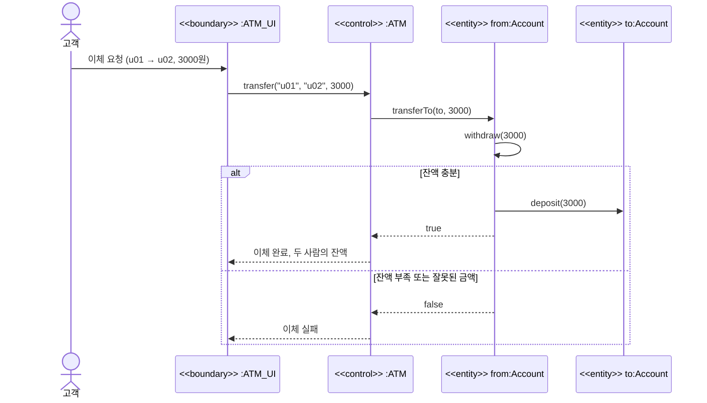
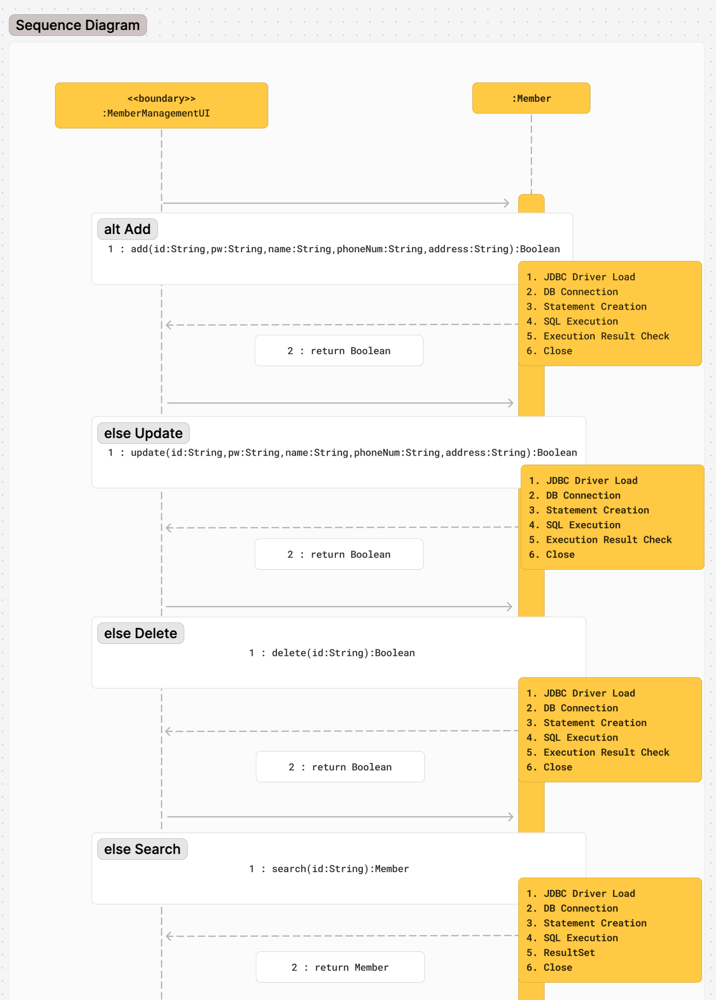
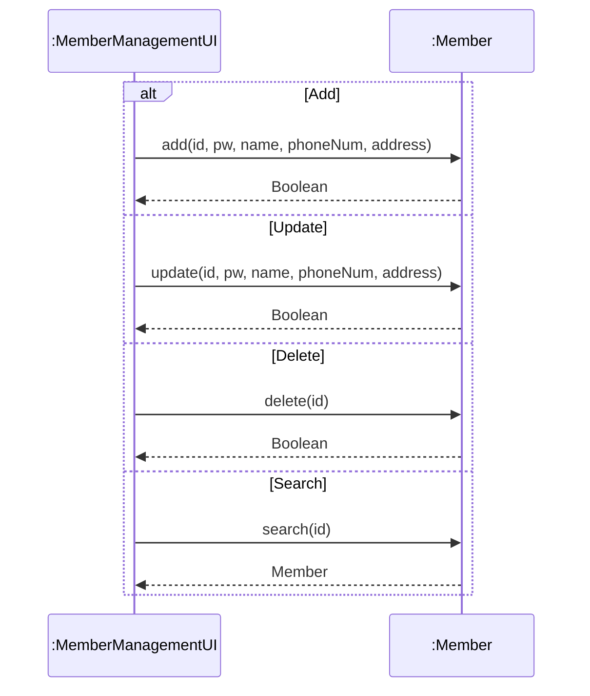

## 학습 목표

- 중간고사의 출제 방식(영어 + 한국어, 정의, UML 해석, 코드)과 반드시 외울 것
- 집합과 일반화의 {disjoint}, {complete}를 집합으로 표현하기
- 메시지의 구성과 "공용 함수만 메시지로 호출할 수 있다"는 특성
- 순차 다이어그램 표기와 객체 스테레오타입(boundary, control, entity)
- 과제 5: 온라인 쇼핑몰 회원 관리 순차도
- 복합 객체를 정의하는 세 방법과 합성/집약 구분, ATM 예제 코드
- disjoint/complete 네 가지 조합 예시, ATM 이체를 순차도와 스테레오타입으로 표현하고 실패 경로까지 실행

> 시험은 영어와 한국어를 섞어 약 10문제. 핵심 개념은 **영어 이름**으로 외워 둘 것 (UML, LSP, Polymorphism 등). 1~4장 내용은 [01](/posts/Design_Pattern_01/) ~ [04편](/posts/Design_Pattern_04/)에 있음
{: .prompt-info }

---

## 1. 반드시 외울 것 한눈에

| 주제 | 외울 내용 |
| --- | --- |
| UML | Unified Modeling Language, OMG가 표준화 |
| 클래스 | 동일한 속성과 행위를 가진 객체들의 집합 |
| 접근 제어자 | public `+`, private `-`, protected `#`, package `~` |
| 관계 | 연관, 일반화(is a kind of), 집약(빈 마름모), 합성(채워진 마름모), 의존(점선 화살표), 실체화(점선 + 빈 삼각형) |
| 캡슐화 | 데이터와 메서드를 묶고 내부를 숨김 (정의를 보고 용어 쓰기) |
| 위임 | 일반화를 위임으로 바꾸는 5단계 |
| 다형성 | Polymorphism, 같은 메시지에 객체마다 다르게 동작. 디자인 원칙 중 LSP와 관련 |
| SOLID | SRP, OCP, LSP, ISP, DIP. 영어 지문 → **Liskov Substitution Principle** |
| 싱글톤 | private 생성자, static 인스턴스, getInstance() |

---

## 2. 집합과 일반화

> **(중요!!)** 일반화 그림을 주고 집합(set theory)으로 표현하라는 문제
{: .prompt-warning }

부모 클래스 A와 자식 클래스 A1, A2, A3의 일반화 관계에 제약이 붙어 있을 때

- **{disjoint}**: 한 객체가 두 자식 클래스에 동시에 속할 수 없음 → 자식들끼리 교집합이 없음
- **{complete}**: 부모의 모든 객체는 반드시 어떤 자식 클래스에 속함 → 자식들의 합집합이 부모

집합으로 쓰면

- complete: A = A1 ∪ A2 ∪ A3
- disjoint: A1 ∩ A2 = ∅, A2 ∩ A3 = ∅, A1 ∩ A3 = ∅ (서로 배타적)

두 제약은 서로 독립이라 네 가지 조합이 나옴. 예시로 외우면 헷갈리지 않음.

| 제약 | 의미 | 예 |
| --- | --- | --- |
| {disjoint, complete} | 모든 객체가 정확히 하나의 자식에 속함 | 회원 = 일반회원 ∪ VIP회원 (둘 다일 수 없고, 둘 중 하나는 반드시) |
| {disjoint, incomplete} | 많아야 하나에 속하고, 어디에도 안 속할 수 있음 | 차량 ⊇ 승용차, 트럭 (오토바이는 어느 자식에도 없음) |
| {overlapping, complete} | 둘 이상에 속할 수 있고, 하나에는 반드시 속함 | 학교 구성원 = 학생 ∪ 직원 (조교는 학생이면서 직원) |
| {overlapping, incomplete} | 둘 이상에 속할 수 있고, 어디에도 안 속할 수 있음 | 사람 ⊇ 운동선수, 음악가 |

자바 클래스로 구현하면 객체 하나는 클래스 하나로만 만들어지므로 상속 구조는 기본적으로 disjoint임. overlapping을 표현하려면 역할(Role) 객체를 여러 개 가지게 하는 식으로 **합성**을 씀.

---

## 3. 메시지와 순차 다이어그램

### 메시지

- 구성: **수신 객체 + 오퍼레이션명 + 매개변수** → `수신객체.오퍼레이션명(매개변수1, ..., 매개변수n)`
- 예: 홍길동이 TV에게 보내는 메시지 `TV.상품검색('보르도')`
- 송신 객체는 수신 객체가 **외부에 공개한(public) 함수**에 대해서만 메시지를 보낼 수 있음. 따라서 메시지의 오퍼레이션은 수신 객체의 공용 함수
- 메시지가 아닌 것: 클래스 이름, 속성 이름, 인터페이스 이름, 객체 이름처럼 **동작(함수 호출)이 아닌 것**과, public으로 공개되지 않은 오퍼레이션

ATM 예제(5절)의 `atm.deposit("u01", 2000)`을 나눠 보면 수신 객체는 `atm`, 오퍼레이션은 `deposit`, 매개변수는 `"u01"`, `2000`. 반면 `Account`의 `balance` 필드는 private이라 `account.balance = 0`처럼 보낼 수 없고, 반드시 공개된 `deposit()`, `withdraw()`를 거쳐야 함. **메시지를 public 함수로 제한하는 것이 곧 캡슐화**이며, private 접근은 컴파일 오류가 남 ([01편](/posts/Design_Pattern_01/)의 3/9 실습).

### 순차 다이어그램 표기

| 표기 | 의미 |
| --- | --- |
| `객체명:클래스명` | 객체 이름은 생략할 수 있고, 생략할 때는 `:클래스명` |
| 생명선 (점선) | 위에서 아래로 흐르는 시간 |
| `loop` 프레임 | 반복 |
| `alt` 프레임 | 조건 (if / else) |
| `<<create>>` | 객체 생성 메시지 |
| `<<destroy>>`, `<<delete>>` | 객체 소멸 |

### 객체 스테레오타입

| 스테레오타입 | 역할 |
| --- | --- |
| boundary | 사용자나 외부 시스템과 맞닿는 경계 (화면, 입출력) |
| control | 유스케이스의 흐름과 로직을 제어 (중요) |
| entity | 시스템의 핵심 데이터와 상태를 저장, 관리 |

한 줄 암기: **boundary는 바깥과 안을 연결, control은 흐름 제어, entity는 데이터 보관**.

| 예제 | boundary | control | entity |
| --- | --- | --- | --- |
| ATM (5절) | `ATM_UI` (화면, 비어 있음) | `ATM` (등록, 입금, 출금, 이체 흐름) | `User`, `Account` |
| 쇼핑몰 회원 관리 (과제 5) | `MemberManagementUI` | (UI가 직접 호출, 별도 control 없음) | `Member` |
| 팀 프로젝트 ([06편](/posts/Design_Pattern_06/)) | `Main`의 메뉴와 입력 함수 | `Main`의 흐름 + `AdviceProvider` 분석 | `UserProfile`, `Expense`, `SpendingDate` |

### 표기를 한 번에: ATM 이체 순차도

ATM 코드의 `transfer`를 순차도로 그리면 `alt`(조건)과 스테레오타입이 모두 들어감.



- control(`ATM`)은 계산하지 않고 entity(`Account`)에게 **위임**하며, 이체할 때 `Account`끼리 메시지를 주고받음
- 화면(`ATM_UI`)이 비어 있어서 실제 코드에서는 `main`이 boundary 역할을 대신함

### 과제 5: 온라인 쇼핑몰 회원 관리 순차도

> 온라인 쇼핑몰 사용자 정보(ID, 암호, 성명, 전화번호, 주소)를 등록, 수정, 삭제, 조회할 수 있는 시스템의 순차도를 설계
{: .prompt-info }



- `<<boundary>>` 객체 `:MemberManagementUI`가 `:Member`에게 메시지를 보냄
- `alt` 프레임 하나에 Add, Update, Delete, Search 네 경우를 나눔
- 각 메시지는 `add(id, pw, name, phoneNum, address): Boolean`처럼 매개변수와 반환 타입까지 적고, `:Member` 쪽 메모에 JDBC 처리 순서(드라이버 로드 → 연결 → Statement 생성 → SQL 실행 → 결과 확인 → 닫기)를 적음

같은 구조를 Mermaid로 다시 그리면 아래와 같음.



---

## 4. 복합 객체

> **(중요!!)** "합성과 집약 중 더 강한 의존 관계를 가진 것은?" → **합성(composition)**
{: .prompt-warning }

- **복합 객체**: 다른 객체를 속성으로 포함하는 객체. 전체-부분 관계이며 합성 또는 집약으로 나뉨
- **합성**: 부분 객체의 생명 주기가 전체와 같음 (함께 생성되고 함께 소멸). 강한 포함
- **집약**: 부분 객체가 전체와 독립적으로 존재하고 다른 객체와 공유될 수 있음. 약한 포함

### 복합 객체를 정의하는 세 방법

| 방법 | 코드 위치 | 의존도 (강의 기준) |
| --- | --- | --- |
| 1. 선언 시점 | 필드로 부분 객체를 직접 선언 (`Payment payment;`) | 강함 (합성) |
| 2. 생성자 안 | 전체 객체를 만들 때 부분 객체도 함께 생성 | 강함 (합성) |
| 3. 메서드 안 | 부분 객체가 필요한 메서드 안에서만 잠깐 생성해 사용 | 약함 (집약) |

정리 노트의 2번 예시는 생성자 안에서 `Payment payment = new Payment();`처럼 **지역 변수**에 담고 있었음. 그대로 실행해 보면 부분 객체가 전체 객체에 남지 않음.

```java
class Payment { String info() { return "카드 결제"; } }
class Delivery { String info() { return "택배 배송"; } }

// 노트의 2번 방법을 그대로 옮긴 것: 생성자 안의 지역 변수에만 담음
class OrderLocal {
    Payment payment;
    Delivery delivery;
    OrderLocal() {
        Payment payment = new Payment();      // 필드가 아니라 지역 변수 → 생성자가 끝나면 사라짐
        Delivery delivery = new Delivery();
    }
}

// 생성자에서 필드에 대입: 전체 객체가 부분 객체를 직접 만들고 소유 → 합성
class OrderComposition {
    private final Payment payment;
    private final Delivery delivery;
    OrderComposition() {
        this.payment = new Payment();
        this.delivery = new Delivery();
    }
    String summary() { return payment.info() + ", " + delivery.info(); }
}

// 밖에서 만든 객체를 받아서 참조: 부분 객체가 독립적으로 존재하고 공유 가능 → 집약
class OrderAggregation {
    private final Payment payment;
    OrderAggregation(Payment payment) { this.payment = payment; }
    Payment getPayment() { return payment; }
}

public class CompositeDemo {
    public static void main(String[] args) {
        OrderLocal o1 = new OrderLocal();
        System.out.println("지역 변수 버전: payment = " + o1.payment + ", delivery = " + o1.delivery);
        System.out.println("합성 버전: " + new OrderComposition().summary());
        Payment shared = new Payment();
        OrderAggregation a = new OrderAggregation(shared), b = new OrderAggregation(shared);
        System.out.println("집약 버전: 두 주문이 같은 Payment를 공유 = " + (a.getPayment() == b.getPayment()));
    }
}
```

실행 결과

```text
지역 변수 버전: payment = null, delivery = null
합성 버전: 카드 결제, 택배 배송
집약 버전: 두 주문이 같은 Payment를 공유 = true
```

- 지역 변수 버전은 생성자가 끝나면 부분 객체가 사라져서 필드가 `null` → 복합 객체가 되지 않음. 생성자 안에서는 `this.payment = new Payment();`처럼 **필드에 대입**해야 함
- 집약은 보통 밖에서 만든 객체를 **받아서 참조**하는 형태로 구현함. 두 주문이 같은 `Payment` 객체를 공유하는 것을 확인함

---

## 5. ATM 예제 (코드 출제 가능)

수업에서 "매우 좋은 예제"라고 언급한 ATM 코드. 싱글톤, 합성, 위임이 함께 들어 있음.

```java
public class ATM {
    private static ATM instance;                 // Singleton
    private Map<String, User> users;             // ATM has Users

    private ATM() { users = new HashMap<>(); }
    public static ATM getInstance() {
        if (instance == null) instance = new ATM();
        return instance;
    }

    public void registerUser(String userId, String userName, String accountNumber, double initialBalance) {
        if (users.containsKey(userId)) { System.out.println("이미 존재하는 사용자입니다."); return; }
        Account account = new Account(accountNumber, initialBalance);
        users.put(userId, new User(userId, userName, account));
        System.out.println("사용자 등록 완료: " + userName);
    }

    public void deposit(String userId, double amount) {
        User user = users.get(userId);
        if (user == null) { System.out.println("사용자를 찾을 수 없습니다."); return; }
        user.getAccount().deposit(amount);       // Delegation: 실제 계좌 처리는 Account가
        System.out.println(user.getName() + " 입금 완료. 현재 잔액: " + user.getAccount().getBalance());
    }
    // withdraw, transfer도 같은 방식으로 Account에 위임

    public static void main(String[] args) {
        ATM atm = ATM.getInstance();
        atm.registerUser("u01", "Kim", "1001", 10000);
        atm.registerUser("u02", "Lee", "1002", 5000);
        atm.deposit("u01", 2000);
        atm.withdraw("u02", 1000);
        atm.transfer("u01", "u02", 3000);
    }
}
```

실행 결과

```text
사용자 등록 완료: Kim
사용자 등록 완료: Lee
Kim 입금 완료. 현재 잔액: 12000.0
Lee 출금 완료. 현재 잔액: 4000.0
이체 완료: Kim -> Lee
Kim 잔액: 9000.0
Lee 잔액: 7000.0
```

실패 경로(위 순차도의 `else`)도 실행해 확인했음.

```java
atm.registerUser("u01", "Park", "1003", 0);      // 같은 ID 다시 등록
atm.transfer("u02", "u01", 8000);                // Lee 잔액 5,000원인데 8,000원 이체
atm.withdraw("u01", -500);                       // 음수 출금
atm.deposit("u99", 1000);                        // 없는 사용자
ATM.getInstance() == atm                         // 싱글톤 확인
```

```text
사용자 등록 완료: Kim
사용자 등록 완료: Lee
이미 존재하는 사용자입니다.
이체 실패: 잔액 부족 또는 잘못된 금액
출금 실패: 잔액 부족 또는 잘못된 금액
사용자를 찾을 수 없습니다.
같은 ATM 객체? true
```

- 잘못된 요청을 entity(`Account`)가 `false`로 거절하고 control(`ATM`)이 메시지로 바꿔 보여 줌
- 실패 이유가 "잔액 부족 또는 잘못된 금액"으로 합쳐져 있어 사용자는 둘 중 무엇인지 알 수 없음. 이유를 enum이나 예외로 구분하는 것이 좋음
- `getInstance()`에는 동기화가 없음. 여러 스레드에서 처음 호출하면 ATM이 여러 개 생길 수 있음 ([04편](/posts/Design_Pattern_04/)의 실험)

| 예상 질문 | 답 |
| --- | --- |
| 이 코드에 쓰인 디자인 패턴은? | **싱글톤** (private 생성자, static instance, getInstance()) |
| ATM과 User의 관계는? | ATM이 User들을 `Map`으로 가지는 복합 객체. User 객체를 ATM의 `registerUser` 안에서 만들고 ATM만 관리하므로 합성에 가까움 |
| 위임 구조는? | ATM은 입금, 출금, 이체를 직접 계산하지 않고 `Account`의 `deposit`, `withdraw`, `transferTo`를 호출함 |
| 어떤 SOLID 원칙과 관련되나? | 계좌 계산은 Account, 사용자 정보는 User, 흐름 제어는 ATM으로 책임을 나눔 → **SRP**. ATM은 control, Account와 User는 entity 역할 |

---

### 정리 노트에서 정정한 부분 정리

| 위치 | 원래 | 정정 | 이유 |
| --- | --- | --- | --- |
| 복합 객체 2번 예시 | 생성자 안에서 `Payment payment = new Payment();` | `this.payment = new Payment();` | 지역 변수에 담으면 생성자가 끝날 때 사라져 필드가 `null` (실행 결과) |
| 6주차 질문 | 집단화와 집단화 중 강한 의존 관계 | 집단화(집약)와 **합성화** 중 강한 의존 관계 → 합성 | 오타 |
| 복합 객체 3번 방법 | 메서드 안에서 생성 = 집약 | 강의 분류는 그대로 두되, UML에서는 메서드 안에서 잠깐 쓰는 관계를 **의존**으로 그리는 경우가 많음 | 집약은 부분 객체를 필드로 계속 참조하는 관계 |
| 실습 4/13 `ATM_UI.java` | 내용 없는 파일 | (그대로) | 빈 파일이라 컴파일에는 문제없지만 UI는 구현되지 않았음 |

---

## 최종 핵심 정리

1. 중간고사는 영어 + 한국어 혼합이라 UML, Polymorphism, Liskov Substitution Principle 같은 영어 이름을 외워야 함
2. {complete}는 자식들의 합집합이 부모, {disjoint}는 자식들끼리 교집합이 없음
3. 메시지는 수신 객체 + 오퍼레이션명 + 매개변수이고, 수신 객체의 public 함수만 호출할 수 있음
4. 순차도에서 생명선은 점선(위→아래 시간), 반복은 `loop`, 조건은 `alt`, 생성과 소멸은 `<<create>>`, `<<destroy>>`
5. 스테레오타입: boundary는 외부와의 경계, control은 흐름 제어, entity는 데이터 보관
6. 합성은 전체와 부분의 생명 주기가 같은 강한 관계, 집약은 부분이 독립적이고 공유 가능한 약한 관계
7. 복합 객체는 선언 시점, 생성자, 메서드 안에서 정의할 수 있고, 생성자에서는 반드시 필드에 대입해야 함
8. ATM 예제는 싱글톤(ATM), 합성(ATM has Users), 위임(Account에 계좌 처리)을 함께 보여 줌

---

End.
