## 한눈에 보기

| 항목 | 내용 |
| --- | --- |
| 주제 | 대학생을 위한 소비 조언 시스템 (Smart Spending Advisor) |
| 한 줄 요약 | "지금 이 소비를 해도 되는가?"를 잔액과 예산으로 판단해 주는 프로그램 |
| 입력 → 출력 | 잔액, 한 달 예산, 오늘 쓴 돈 또는 목표 금액 → 하루 권장 예산, 초과 여부, 목표까지 저축 기간 |
| 적용 패턴 | **Strategy**(분석 방식 교체), **Factory**(전략 객체 생성 분리) |
| 적용 원칙 | SRP, OCP, LSP, ISP, DIP |
| 팀 구성과 내 역할 | 5인 팀. PPT·다이어그램, 발표, 코드, 테스트·피드백으로 역할을 나눴고 나는 **중간, 최종 발표** 담당 |
| 결과물 | 중간 발표(모델링) → 웹 서버 버전 → 최종 버전(패키지 분리 + Factory + CLI + 대시보드) |

> 이 글은 발표 자료, 발표 대본, 분석 보고서, 세 버전의 소스 코드를 바탕으로 정리했음. 실행 결과와 영상은 각 버전의 소스를 그대로 컴파일해 다시 실행한 것 (OpenJDK 21). 객체지향 개념은 [01편](/posts/Design_Pattern_01/) ~ [05편](/posts/Design_Pattern_05/), Strategy와 Factory 패턴 자체의 설명은 [07편](/posts/Design_Pattern_07/)에 있음
{: .prompt-info }

### 프로젝트 흐름

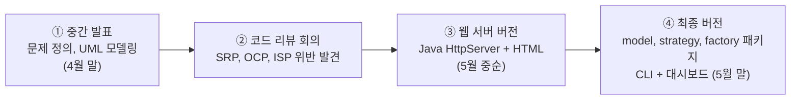

---

## 1. 문제 정의

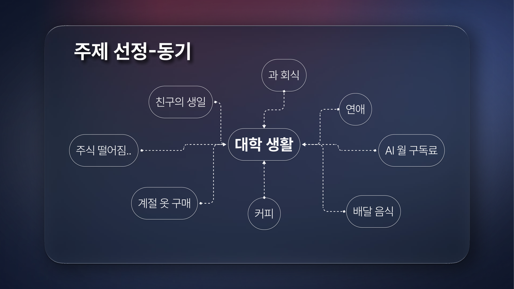
_중간 발표: 대학생이 돈을 쓰게 되는 상황들_

- 대학생은 용돈, 아르바이트처럼 **제한된 수입**으로 생활하지만 회식, 생일, 연애, 커피, 구독료, 배달 음식 등 지출 요인은 많음
- 모바일 간편결제와 온라인 쇼핑으로 결제가 쉬워지면서 **얼마를 썼는지 인지하기 어려워짐**
- 체계적인 자산 관리 경험이 부족해 충동 소비, 저축 부족이 반복됨

그래서 단순한 가계부가 아니라 **"지금 이 소비를 해도 되는가?"를 조언해 주는 시스템**을 목표로 정했음.

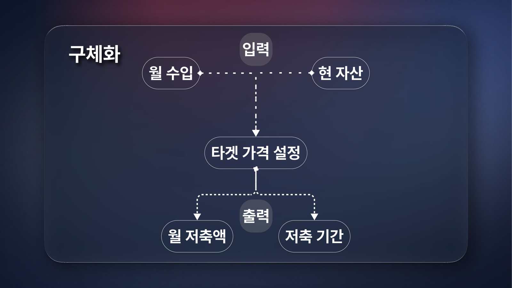
_중간 발표: 입력(월 수입, 현 자산, 목표 가격)과 출력(월 저축액, 저축 기간)_

---

## 2. 중간 발표: 초기 모델링

처음에는 기능이 아니라 **객체와 그 역할**부터 정했음.

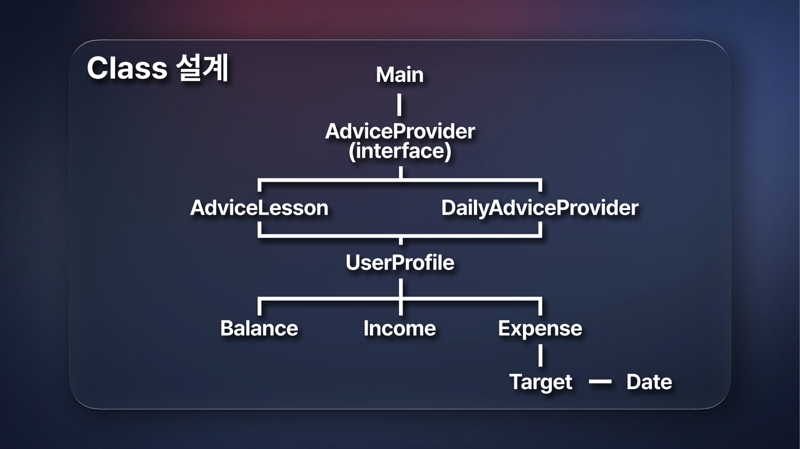
_초기 클래스 구성: Main 아래 AdviceProvider 인터페이스와 두 구현, 사용자 정보와 지출 정보_

| 클래스 | 역할 |
| --- | --- |
| `Main` | 시작점. 객체를 만들고 흐름을 연결 |
| `AdviceProvider` (인터페이스) | "소비 조언을 제공한다"는 공통 역할 |
| `AdviceLesson` | 목표 소비 분석 (목표 금액까지 몇 개월 저축해야 하는가) |
| `DailyAdviceProvider` | 일일 소비 분석 (오늘 쓴 돈이 하루 예산을 넘었는가) |
| `UserProfile` | 사용자의 잔액과 한 달 예산 |
| `Expense` / `SpendingDate` | 지출 한 건 / 그 날짜 |

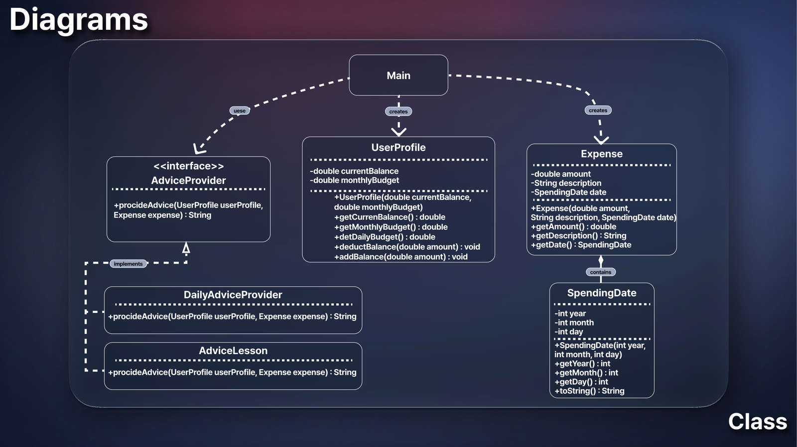
_중간 발표 클래스 다이어그램_

관계를 정리하면 다음과 같음.

- `Main ⇢ AdviceProvider`: 구체 클래스가 아니라 **인터페이스에 의존** (DIP)
- `AdviceLesson`, `DailyAdviceProvider ⇢ AdviceProvider`: 인터페이스 구현 (실체화)
- `Expense ◆— SpendingDate`: 지출이 날짜를 **포함** (합성)
- `Main ⇢ UserProfile, Expense`: 실행에 필요한 객체를 생성

### 순차 다이어그램

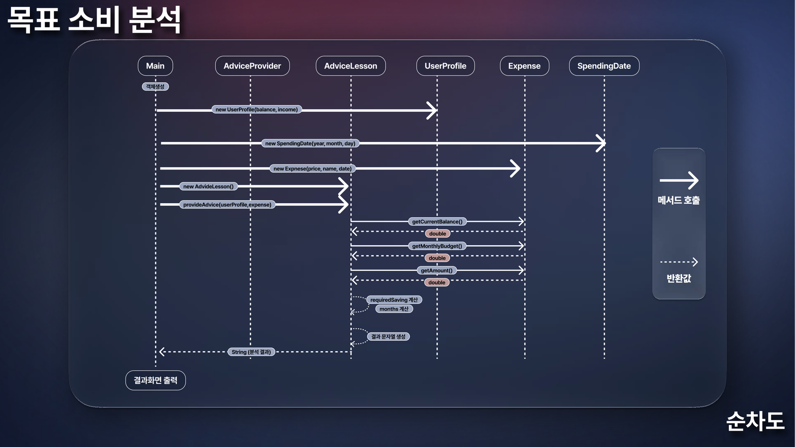
_목표 소비 분석 순차도_

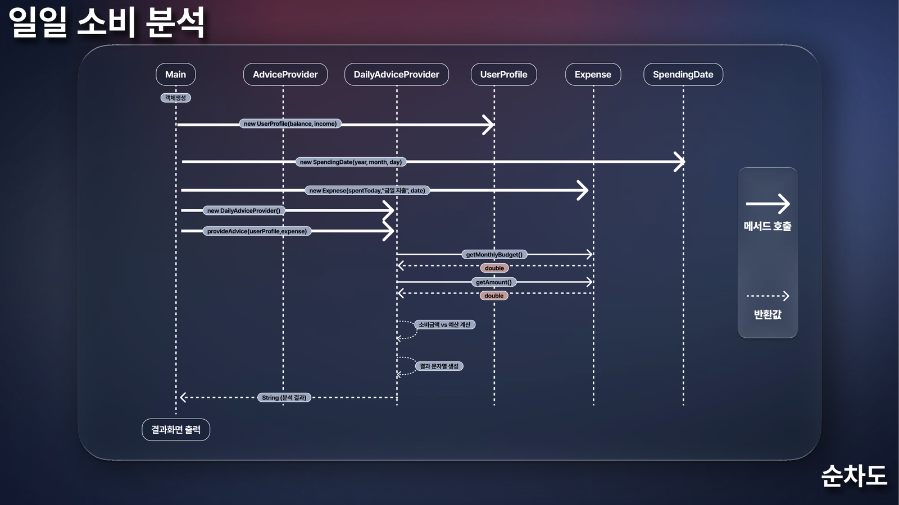
_일일 소비 분석 순차도_

두 순차도는 모양이 같고 **가운데 분석 객체만 다름**. Main 입장에서는 `AdviceProvider` 자리에 무엇이 오든 `provideAdvice()`만 호출하면 됨. 이것이 뒤에서 Strategy 패턴으로 이어지는 핵심 아이디어.

---

## 3. 코드 리뷰 회의: SOLID 위반 고치기

중간 발표 직후의 첫 코드는 **"일단 돌아가게"** 만든 프로토타입이었음. 동작은 했지만 팀 코드 리뷰에서 구조 문제가 나왔고, 회의를 세 번 하며 하나씩 고쳤음 (최종 발표의 스토리텔링 흐름).

### 회의 1: Main에 모든 일이 몰려 있다 → SRP

| 항목 | 내용 |
| --- | --- |
| 문제 | 입력, 계산, 조언 생성, 출력이 전부 Main 안에 있음 |
| 위반 원칙 | **SRP**: 클래스는 하나의 책임(변경 이유)만 가져야 함 |
| 해결 | 데이터를 역할별 클래스로 분리 |

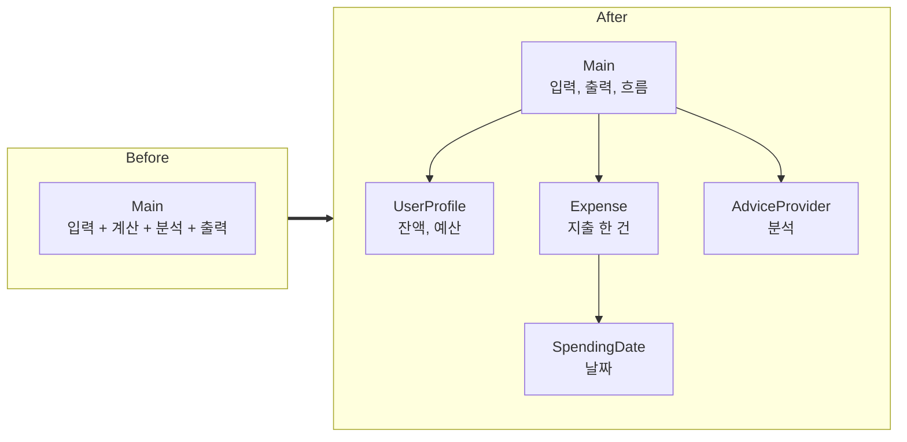

### 회의 2: 분석 기능을 추가할 때마다 Main을 고쳐야 한다 → OCP

| 항목 | 내용 |
| --- | --- |
| 문제 | 일일 소비 분석을 추가하려 하자 Main과 기존 분석 로직을 함께 수정해야 했음 |
| 위반 원칙 | **OCP**: 확장에는 열려 있고 수정에는 닫혀 있어야 함 |
| 해결 | `AdviceProvider` 인터페이스를 두고 분석 방식을 구현 클래스로 분리 |

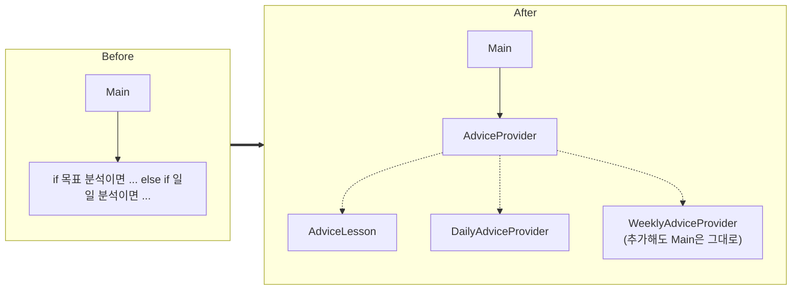

### 회의 3: 성격이 다른 분석이 한곳에 섞여 있다 → ISP

| 항목 | 내용 |
| --- | --- |
| 문제 | 목표 소비 분석과 일일 소비 분석이 한 덩어리에 섞여 있음 |
| 위반 원칙 | **ISP**: 클라이언트가 쓰지 않는 기능에 의존하면 안 됨 |
| 해결 | 분석마다 독립된 객체로 나누고, 인터페이스는 `provideAdvice()` 하나만 가지도록 작게 유지 |

세 회의의 결과로 나온 구조가 바로 **Strategy 패턴**: 알고리즘(분석 방식)을 객체로 캡슐화하고, 같은 인터페이스로 바꿔 끼움.

| Before (프로토타입) | After (회의 후) |
| --- | --- |
| Main에 책임 집중 | 역할별 클래스로 분리 |
| 기능 추가 시 기존 코드 수정 | 구현 클래스만 추가 |
| 분석 방식이 서로 엉킴 | 분석마다 독립 객체 |
| 높은 결합도 | 인터페이스를 통한 낮은 결합도 |

---

## 4. 웹 서버 버전

회의 결과를 반영해 처음 완성한 버전. 콘솔이 아니라 **HTML 화면 + Java 백엔드** 구조였음.

| 구성 | 내용 |
| --- | --- |
| 서버 | Java 내장 `com.sun.net.httpserver.HttpServer` (포트 8080) |
| API | `POST /api/advice`(목표 소비), `POST /api/daily`(일일 소비), `GET /`(화면), `GET /sound.mp3`(효과음) |
| 화면 | 잔액, 예산을 만원, 천원 단위로 입력하는 폼 → 결과를 모달로 표시 |
| 추가 클래스 | `AmountFormatter`: 금액을 원, 천원, 만원, 십만원, 백만원으로 함께 표시 (모델링에 없던 클래스) |

<video controls muted playsinline preload="metadata" style="width:100%;border-radius:8px" src="/assets/video/design_pattern/dp06_v1_web.mp4"></video>
_웹 서버 버전 실행 영상: 잔액 50만원, 예산 80만원 → 오늘 4만원 사용 → 노트북 300만원 목표_

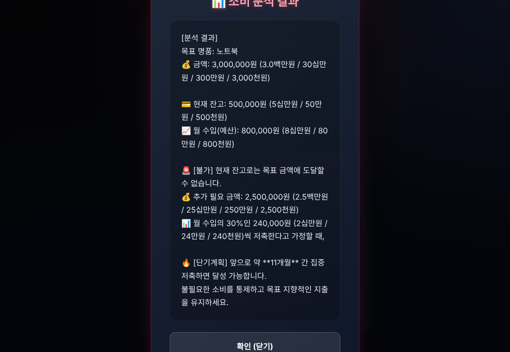
_목표 소비 분석 결과 모달_

```text
$ curl -i http://localhost:8080/
HTTP/1.1 404 Not Found
Content-length: 43

404 Not Found: index.html 가 없습니다.


$ curl -X POST /api/advice -d 'balance=500000&income=800000&price=3000000&name=노트북'
목표 명품: 노트북
💰 금액: 3,000,000원 (3.0백만원 / 30십만원 / 300만원 / 3,000천원)

💳 현재 잔고: 500,000원 (5십만원 / 50만원 / 500천원)
📈 월 수입(예산): 800,000원 (8십만원 / 80만원 / 800천원)

🚨 [불가] 현재 잔고로는 목표 금액에 도달할 수 없습니다.
💰 추가 필요 금액: 2,500,000원 (2.5백만원 / 25십만원 / 250만원 / 2,500천원)
📊 월 수입의 30%인 240,000원 (2십만원 / 24만원 / 240천원)씩 저축한다고 가정할 때,

🔥 [단기계획] 앞으로 약 **11개월** 간 집중 저축하면 달성 가능합니다.
불필요한 소비를 통제하고 목표 지향적인 지출을 유지하세요.

$ curl -X POST /api/advice -d 'balance=2000000&income=800000&price=1500000&name=태블릿'
목표 명품: 태블릿
💰 금액: 1,500,000원 (1.5백만원 / 15십만원 / 150만원 / 1,500천원)

💳 현재 잔고: 2,000,000원 (2.0백만원 / 20십만원 / 200만원 / 2,000천원)
📈 월 수입(예산): 800,000원 (8십만원 / 80만원 / 800천원)

🎉 [가능] 현재 잔고가 충분합니다. 목표 금액을 초과하여 구매가 가능합니다.
💡 조언: 구매 후 잔여 예산 점검을 권장합니다.

$ curl -X POST /api/daily -d 'balance=500000&income=800000&spentToday=0'
📊 하루 권장 예산: 26,666원 (2만원 / 26천원)
💸 오늘 쓴 돈: 0원

🌟 [우수] 오늘은 지출이 없습니다! 완벽한 절제력입니다.

$ curl -X POST /api/daily -d 'balance=500000&income=800000&spentToday=15000'
📊 하루 권장 예산: 26,666원 (2만원 / 26천원)
💸 오늘 쓴 돈: 15,000원 (1만원 / 15천원)

👍 [양호] 권장 예산 내에서 합리적으로 소비했습니다.

$ curl -X POST /api/daily -d 'balance=500000&income=800000&spentToday=22000'
📊 하루 권장 예산: 26,666원 (2만원 / 26천원)
💸 오늘 쓴 돈: 22,000원 (2만원 / 22천원)

⚠️ [주의] 하루 예산의 80% 이상을 사용했습니다. 추가 지출에 주의하세요.

$ curl -X POST /api/daily -d 'balance=500000&income=800000&spentToday=40000'
📊 하루 권장 예산: 26,666원 (2만원 / 26천원)
💸 오늘 쓴 돈: 40,000원 (4만원 / 40천원)

🚨 [위험] 하루 권장 예산을 초과했습니다! 지출 통제가 강하게 필요합니다.

$ curl -X POST /api/advice -d 'price=abc'
HTTP/1.1 400 Bad Request
Content-length: 74

데이터 파싱 중 오류가 발생했습니다: For input string: "abc"
```

- 계산과 구간 판정(하루 예산 26,666원 기준 15,000원 양호, 22,000원 주의, 40,000원 위험)은 정확하고, 숫자가 아닌 입력은 400으로 처리함
- 노트북: 추가 필요 2,500,000원 ÷ 월 240,000원(수입의 30%) = 10.4 → **11개월**

이 버전에서 발견된 문제가 최종 버전의 개선점이 되었음.

| 문제 | 원인 |
| --- | --- |
| `Main`이 여전히 `new AdviceLesson()`을 직접 생성 | 생성 책임이 Main에 남아 있어 DIP가 반쪽 |
| 하루 예산이 `26,666.667 원`, 결과에서는 `26,666원` | 화면은 소수점 그대로, 서버는 `(long)` 버림 |
| `15,000원 (1만원 ...)`, `240,000원 (2십만원 ...)` | `AmountFormatter`의 `(long)` 버림 |
| 결과에 `**11개월**`이 그대로 보임 | `text/plain` 응답에 마크다운 기호를 넣음 |
| 제출 소스만으로는 `GET /`가 404 | `index.html`이 `src`에만 있고 클래스 경로에는 없음 |
| Main 하나에 서버 설정, 핸들러 4개, 폼 파싱이 모두 있음 | 회의 1에서 고친 SRP 문제가 서버 코드에서 다시 생김 |

---

## 5. 최종 버전

### 무엇이 바뀌었나

| 구분 | 웹 서버 버전 | 최종 버전 |
| --- | --- | --- |
| 패키지 | `spendingadvice` 하나 | **`model`, `strategy`, `factory`** + `Main` |
| 전략 생성 | `new AdviceLesson()` | **`AdviceProviderFactory.getProvider("LESSON")`** |
| 실행 | HTTP 서버 | 메뉴형 CLI + 독립 실행 HTML 대시보드 |
| 일일 판정 | 우수, 양호, 주의, 위험 4단계 | 초과, 준수 2단계 + 처방 3가지 |
| 목표 분석 | 수입의 30% 저축 가정 | 예산 100% 저축 + 절반 저축 비교 |
| 금액 표시 | 단위 변환(버림) | `%,.0f` 반올림 |
| 부가 기능 | – | 지출 후 잔액 차감, 용돈 추가, 예산 변경, 잘못된 입력 재질문 |

### 클래스 다이어그램

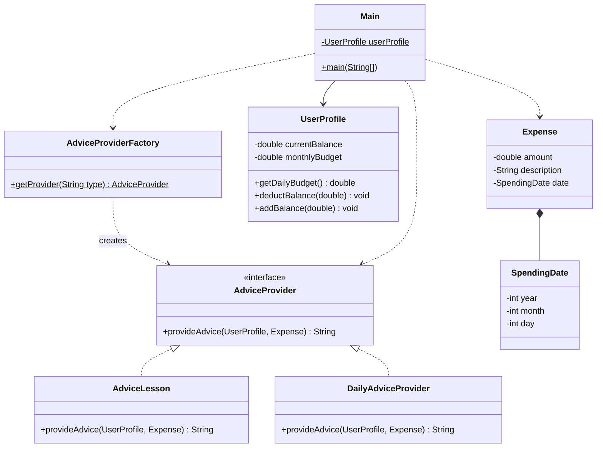

| 패턴, 원칙 | 적용 위치 | 이 프로젝트에서의 의미 |
| --- | --- | --- |
| **Strategy** | `AdviceProvider` + 두 구현 | 분석 방식(알고리즘)을 객체로 만들어 바꿔 끼움 |
| **Factory** | `AdviceProviderFactory` | "어떤 분석 객체를 만들지"를 Main 대신 결정 |
| SRP | `model` 패키지 | 금융 상태, 지출, 날짜의 변경 이유를 분리 |
| OCP | 새 Provider 추가 | 분석 방식이 늘어도 분석 호출 코드는 그대로 |
| LSP | `AdviceProvider` 타입 | 두 구현 모두 같은 자리에 넣어도 Main이 똑같이 동작 |
| ISP | 메서드 하나짜리 인터페이스, 대시보드의 ISP 시각화 | 쓰지 않는 메서드를 강요하지 않음 |
| DIP | Main의 import | Main은 `AdviceProvider`와 팩토리만 알고 구현 클래스 이름을 모름 |

### 일일 소비 분석 흐름

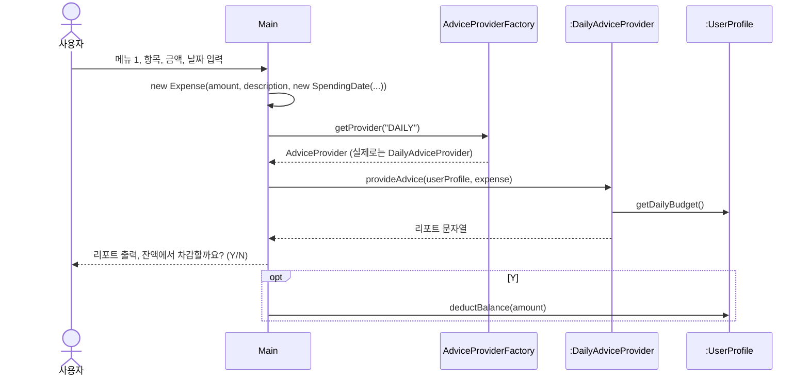

### 핵심 코드

```java
// strategy/AdviceProvider.java : 전략 인터페이스
public interface AdviceProvider {
    String provideAdvice(UserProfile userProfile, Expense expense);
}

// factory/AdviceProviderFactory.java : 전략 생성 담당
public class AdviceProviderFactory {
    public static AdviceProvider getProvider(String type) {
        if (type == null) throw new IllegalArgumentException("분석 타입은 null일 수 없습니다.");
        switch (type.toUpperCase()) {
            case "DAILY":  return new DailyAdviceProvider();
            case "LESSON": return new AdviceLesson();
            default: throw new IllegalArgumentException("알 수 없는 분석 타입입니다: " + type);
        }
    }
}

// Main.java : 구체 클래스 이름 없이 전략을 받아 실행
AdviceProvider provider = AdviceProviderFactory.getProvider("DAILY");
System.out.println(provider.provideAdvice(userProfile, expense));
```

<details markdown="1">
<summary><b>두 전략 클래스 전체 코드 보기</b></summary>

```java
public class DailyAdviceProvider implements AdviceProvider {
    @Override
    public String provideAdvice(UserProfile userProfile, Expense expense) {
        double monthlyBudget = userProfile.getMonthlyBudget();
        double dailyBudget = userProfile.getDailyBudget();      // monthlyBudget / 30.0
        double spentToday = expense.getAmount();
        StringBuilder sb = new StringBuilder();
        sb.append(String.format(" ▸ 오늘 소비 항목 : %s\n", expense.getDescription()));
        sb.append(String.format(" ▸ 오늘 소비 금액 : %,.0f 원\n", spentToday));
        sb.append(String.format(" ▸ 하루 권장 예산 : %,.0f 원 (월 %,.0f원 기준)\n", dailyBudget, monthlyBudget));
        if (spentToday > dailyBudget) {
            sb.append(" 🚨 [경고: 예산 초과!] 🚨\n");
            sb.append(String.format(" 오늘 지출이 하루 권장 예산 대비 %,.0f 원 초과되었습니다!\n", spentToday - dailyBudget));
            // 처방전: 학식 이용, 간편결제 장벽 높이기, '내일은 무지출!'
        } else {
            sb.append(" 🎉 [우수: 예산 준수!] 🎉\n");
            sb.append(String.format(" 아주 현명한 소비입니다! 권장 예산 대비 %,.0f 원을 아끼셨습니다.\n", dailyBudget - spentToday));
            // 습관 강화 팁: 아낀 돈 바로 저축, 스스로 칭찬, 복리 효과
        }
        return sb.toString();
    }
}
```

```java
public class AdviceLesson implements AdviceProvider {
    @Override
    public String provideAdvice(UserProfile userProfile, Expense expense) {
        double currentBalance = userProfile.getCurrentBalance();
        double monthlyBudget = userProfile.getMonthlyBudget();
        double targetAmount = expense.getAmount();
        StringBuilder sb = new StringBuilder();
        if (currentBalance >= targetAmount) {
            sb.append(" 🎉 [즉시 구매 가능!] 🎉\n");
            sb.append(String.format(" 구매 후 예상 잔액: %,.0f 원\n", currentBalance - targetAmount));
        } else {
            double requiredSaving = targetAmount - currentBalance;
            sb.append(String.format(" ⚠️ [자금 부족] 구매를 위해 %,.0f 원이 더 필요합니다.\n", requiredSaving));
            if (monthlyBudget <= 0) {
                sb.append(" ❌ 가용 예산(월 저축액)이 0원으로 설정되어 있어 저축 소요 기간을 계산할 수 없습니다.\n");
            } else {
                int months = (int) Math.ceil(requiredSaving / monthlyBudget);             // 예산 100% 저축
                int halfMonths = (int) Math.ceil(requiredSaving / (monthlyBudget / 2.0)); // 절반 저축
                sb.append(String.format("    ➡ 최소 %d개월 동안 저축해야 구매가 가능합니다.\n", months));
                sb.append(String.format(" 1. 절반 저축 시 (월 %,.0f원 저축): 약 %d개월 소요\n", monthlyBudget / 2.0, halfMonths));
            }
        }
        return sb.toString();
    }
}
```

</details>

<details markdown="1">
<summary><b>Main의 일일 분석 메서드와 안전한 입력 함수 보기</b></summary>

```java
private static void runDailyConsumptionAnalysis() {
    String description = readStringInput(" ▸ 오늘 소비한 항목을 입력하세요 (예: 배달음식, 카페커피): ");
    double amount = readDoubleInput(" ▸ 소비한 금액을 입력하세요 (원): ");
    int year = readIntInput("   - 년도 (예: 2026): ");
    int month = readIntInput("   - 월 (예: 5): ");
    int day = readIntInput("   - 일 (예: 29): ");

    Expense expense = new Expense(amount, description, new SpendingDate(year, month, day));
    AdviceProvider provider = AdviceProviderFactory.getProvider("DAILY");
    System.out.println(provider.provideAdvice(userProfile, expense));

    System.out.print(" (Y/N): ");
    if (scanner.next().equalsIgnoreCase("y")) {
        userProfile.deductBalance(amount);
    }
}

private static int readIntInput(String prompt) {
    while (true) {
        System.out.print(prompt);
        try {
            return Integer.parseInt(scanner.next());
        } catch (NumberFormatException e) {
            System.out.println("❌ 올바른 정수 숫자를 입력하세요.");   // 숫자가 아니면 다시 질문
        }
    }
}
```

</details>

---

## 6. 실행

### 실제 개발 환경

| 항목 | 내용 |
| --- | --- |
| OS, 편집기 | Windows + VS Code (Java Extension Pack의 Run/Debug) |
| 실행 | `bin` 폴더에 컴파일된 클래스로 `Main` 실행 |
| 대시보드 | `index.html`을 브라우저로 바로 열어 사용 (계산은 페이지 안의 JavaScript) |


_VS Code에서 작성한 Main의 메뉴 루프_


_Windows 터미널 실행 화면. 이모지가 `?`로 깨짐_

Windows 콘솔의 기본 코드 페이지(CP949)는 이모지를 표현하지 못해 `🎓`가 `?`로 나옴. `chcp 65001`로 UTF-8로 바꾸거나 Windows Terminal을 쓰고, Java 18 이상이면 `-Dstdout.encoding=UTF-8`도 주는 것이 안전함.

### 최종 버전 CLI

```bash
javac -encoding UTF-8 -d out -sourcepath src src/Main.java
java -Dstdout.encoding=UTF-8 -cp out Main
```

<video controls muted playsinline preload="metadata" style="width:100%;border-radius:8px" src="/assets/video/design_pattern/dp06_cli.mp4"></video>
_잔액 500,000원, 예산 800,000원 → 배달음식 40,000원(초과) → 카페커피 5,000원(준수) → 맥북 목표 → 프로필 확인 → 종료 (녹화 환경에 이모지 글꼴이 없어 이모지 자리는 비어 보임)_

| 시나리오 | 결과 | 검산 |
| --- | --- | --- |
| 하루 권장 예산 | 26,667원 | 800,000 ÷ 30 = 26,666.67 → 반올림 |
| 배달음식 40,000원 | 예산 초과, 13,333원 초과 | 40,000 − 26,667 |
| 차감 후 잔액 | 460,000원 | 500,000 − 40,000 |
| 카페커피 5,000원 | 예산 준수, 21,667원 절약 | 26,667 − 5,000 |
| 맥북 2,000,000원 | 1,540,000원 부족, 최소 2개월, 절반 저축 시 4개월 | 1,540,000 ÷ 800,000 = 1.93, ÷ 400,000 = 3.85 |
| 예산 0원으로 변경 후 목표 분석 | "저축 소요 기간을 계산할 수 없습니다" | 0으로 나누지 않음 |
| 메뉴에 `abc` 입력 | "올바른 정수 숫자를 입력하세요" 후 재질문 | |

<details markdown="1">
<summary><b>CLI 전체 출력 보기</b></summary>

```text
==================================================
   🎓 대학생을 위한 스마트 소비 및 자본 관리 시스템 🎓
        - SMART COLLEGE STUDENT FINANCE SYSTEM -    
==================================================
 아르바이트, 용돈 등 제한된 수입 속에서 현명하고
 주도적인 자산 관리 능력을 갖출 수 있도록 돕습니다.
==================================================

[초기 금융 프로필 설정]
 ▸ 현재 계좌 잔액을 입력하세요 (원):  ▸ 한 달 예산(가용 용돈/소득)을 입력하세요 (원): 
✅ 프로필 등록이 완료되었습니다!

┌──────────────────────────────────────────────┐
│             💳 현재 내 금융 프로필             │
├──────────────────────────────────────────────┤
│  • 현재 계좌 잔액 :            500,000 원     │
│  • 한 달 권장 예산 :            800,000 원     │
│  • 하루 권장 지출 :             26,667 원     │
└──────────────────────────────────────────────┘

┌────────────────── [메 뉴 판] ──────────────────┐
│  1. 📅 일일 소비 분석 (Daily Consumption)      │
│  2. 🎯 목표 소비 분석 (Target Consumption)     │
│  3. 💳 현재 내 금융 프로필 확인                │
│  4. ⚙️ 잔액 및 예산 수정                        │
│  5. 🚪 프로그램 종료                           │
└────────────────────────────────────────────────┘
선택 (1-5): 
[1. 일일 소비 분석 - 오늘 쓴 돈 점검]
 ▸ 오늘 소비한 항목을 입력하세요 (예: 배달음식, 카페커피):  ▸ 소비한 금액을 입력하세요 (원):  ▸ 소비 날짜를 입력합니다 (오늘 기준):
   - 년도 (예: 2026):    - 월 (예: 5):    - 일 (예: 29): 
==================================================
   📅 [일일 소비 분석 리포트 - Daily Consumption]    
==================================================
 ▸ 오늘 소비 항목 : 배달음식
 ▸ 오늘 소비 금액 : 40,000 원
 ▸ 하루 권장 예산 : 26,667 원 (월 800,000원 기준)
--------------------------------------------------
 🚨 [경고: 예산 초과!] 🚨
 오늘 지출이 하루 권장 예산 대비 13,333 원 초과되었습니다!

 [지출 구조 개선 처방전 💊]
 1. 배달 음식 대신 학식이나 가성비 식단을 이용해 식비를 방어해 보세요.
 2. 모바일 간편결제의 편리함이 충동 소비를 만듭니다. 결제 확인 단계에 비밀번호 6자리 대신 복잡한 생체 인증을 꺼두고 직접 입력해 보세요.
 3. '내일은 무지출!'을 선언하여 오늘 초과된 금액을 이번 주 내에 복구해 보세요.
==================================================

💡 해당 지출을 현재 계좌 잔액에서 차감하시겠습니까?
 (Y/N):  계좌 잔액에서 40,000원이 차감되었습니다. (현재 잔액: 460,000원)

┌────────────────── [메 뉴 판] ──────────────────┐
│  1. 📅 일일 소비 분석 (Daily Consumption)      │
│  2. 🎯 목표 소비 분석 (Target Consumption)     │
│  3. 💳 현재 내 금융 프로필 확인                │
│  4. ⚙️ 잔액 및 예산 수정                        │
│  5. 🚪 프로그램 종료                           │
└────────────────────────────────────────────────┘
선택 (1-5): 
[1. 일일 소비 분석 - 오늘 쓴 돈 점검]
 ▸ 오늘 소비한 항목을 입력하세요 (예: 배달음식, 카페커피):  ▸ 소비한 금액을 입력하세요 (원):  ▸ 소비 날짜를 입력합니다 (오늘 기준):
   - 년도 (예: 2026):    - 월 (예: 5):    - 일 (예: 29): 
==================================================
   📅 [일일 소비 분석 리포트 - Daily Consumption]    
==================================================
 ▸ 오늘 소비 항목 : 카페커피
 ▸ 오늘 소비 금액 : 5,000 원
 ▸ 하루 권장 예산 : 26,667 원 (월 800,000원 기준)
--------------------------------------------------
 🎉 [우수: 예산 준수!] 🎉
 아주 현명한 소비입니다! 권장 예산 대비 21,667 원을 아끼셨습니다.

 [긍정적 소비 습관 강화 👍]
 1. 아낀 21,667 원을 바로 별도의 '저축 통장(비상금)'으로 바로 송금해 보세요.
 2. 커피나 간식 소비를 줄여 오늘의 예산을 아낀 스스로에게 칭찬 한마디를 건네보세요.
 3. 이러한 습관이 1년 쌓이면 복리로 큰 자산 관리 능력이 됩니다!
==================================================

💡 해당 지출을 현재 계좌 잔액에서 차감하시겠습니까?
 (Y/N): 
┌────────────────── [메 뉴 판] ──────────────────┐
│  1. 📅 일일 소비 분석 (Daily Consumption)      │
│  2. 🎯 목표 소비 분석 (Target Consumption)     │
│  3. 💳 현재 내 금융 프로필 확인                │
│  4. ⚙️ 잔액 및 예산 수정                        │
│  5. 🚪 프로그램 종료                           │
└────────────────────────────────────────────────┘
선택 (1-5): 
[2. 목표 소비 분석 - 위시 리스트 저축 계획]
 ▸ 구매하고 싶은 목표 항목을 입력하세요 (예: 맥북, 아이패드, 여행비):  ▸ 해당 항목의 가격을 입력하세요 (원):  ▸ 구매 희망 시점의 날짜 또는 예상 등록 날짜:
   - 년도 (예: 2026):    - 월 (예: 12):    - 일 (예: 25): 
==================================================
   🎯 [목표 소비 분석 리포트 - Target Consumption]   
==================================================
 ▸ 목표 소비 항목 : 맥북
 ▸ 목표 항목 가격 : 2,000,000 원
 ▸ 현재 자산 잔액 : 460,000 원
 ▸ 한 달 가용 예산 : 800,000 원
--------------------------------------------------
 ⚠️ [자금 부족] 구매를 위해 1,540,000 원이 더 필요합니다.
 📅 [달성 로드맵] 매달 월 예산인 800,000 원을 100% 전부 저축할 경우:
    ➡ 최소 2개월 동안 저축해야 구매가 가능합니다.

 [대학생을 위한 꿀팁 💡]
 1. 절반 저축 시 (월 400,000원 저축): 약 4개월 소요
 2. 모바일 간편결제 등록을 해제하고 무통장 입금 등을 사용해 소비 장벽을 높여보세요!
 3. 매주 '무지출 챌린지'를 1회 도입하여 불필요한 카페/커피 지출을 저축으로 전환해 보세요.
==================================================

┌────────────────── [메 뉴 판] ──────────────────┐
│  1. 📅 일일 소비 분석 (Daily Consumption)      │
│  2. 🎯 목표 소비 분석 (Target Consumption)     │
│  3. 💳 현재 내 금융 프로필 확인                │
│  4. ⚙️ 잔액 및 예산 수정                        │
│  5. 🚪 프로그램 종료                           │
└────────────────────────────────────────────────┘
선택 (1-5): 
[4. 금융 프로필 수정]
 1. 계좌 잔액 추가 (+소득/용돈)
 2. 한 달 예산 변경
 선택 (1-2):  ▸ 새로운 한 달 예산을 입력하세요 (원):  한 달 예산이 변경되었습니다! (하루 권장: 0원)

┌────────────────── [메 뉴 판] ──────────────────┐
│  1. 📅 일일 소비 분석 (Daily Consumption)      │
│  2. 🎯 목표 소비 분석 (Target Consumption)     │
│  3. 💳 현재 내 금융 프로필 확인                │
│  4. ⚙️ 잔액 및 예산 수정                        │
│  5. 🚪 프로그램 종료                           │
└────────────────────────────────────────────────┘
선택 (1-5): 
[2. 목표 소비 분석 - 위시 리스트 저축 계획]
 ▸ 구매하고 싶은 목표 항목을 입력하세요 (예: 맥북, 아이패드, 여행비):  ▸ 해당 항목의 가격을 입력하세요 (원):  ▸ 구매 희망 시점의 날짜 또는 예상 등록 날짜:
   - 년도 (예: 2026):    - 월 (예: 12):    - 일 (예: 25): 
==================================================
   🎯 [목표 소비 분석 리포트 - Target Consumption]   
==================================================
 ▸ 목표 소비 항목 : 아이패드
 ▸ 목표 항목 가격 : 900,000 원
 ▸ 현재 자산 잔액 : 460,000 원
 ▸ 한 달 가용 예산 : 0 원
--------------------------------------------------
 ⚠️ [자금 부족] 구매를 위해 440,000 원이 더 필요합니다.
 ❌ 가용 예산(월 저축액)이 0원으로 설정되어 있어 저축 소요 기간을 계산할 수 없습니다.
    용돈 계획을 수립하거나 아르바이트 등을 통해 저축 예산을 마련해 보세요!
==================================================

┌────────────────── [메 뉴 판] ──────────────────┐
│  1. 📅 일일 소비 분석 (Daily Consumption)      │
│  2. 🎯 목표 소비 분석 (Target Consumption)     │
│  3. 💳 현재 내 금융 프로필 확인                │
│  4. ⚙️ 잔액 및 예산 수정                        │
│  5. 🚪 프로그램 종료                           │
└────────────────────────────────────────────────┘
선택 (1-5): 
┌──────────────────────────────────────────────┐
│             💳 현재 내 금융 프로필             │
├──────────────────────────────────────────────┤
│  • 현재 계좌 잔액 :            460,000 원     │
│  • 한 달 권장 예산 :                  0 원     │
│  • 하루 권장 지출 :                  0 원     │
└──────────────────────────────────────────────┘

┌────────────────── [메 뉴 판] ──────────────────┐
│  1. 📅 일일 소비 분석 (Daily Consumption)      │
│  2. 🎯 목표 소비 분석 (Target Consumption)     │
│  3. 💳 현재 내 금융 프로필 확인                │
│  4. ⚙️ 잔액 및 예산 수정                        │
│  5. 🚪 프로그램 종료                           │
└────────────────────────────────────────────────┘
선택 (1-5): ❌ 올바른 정수 숫자를 입력하세요.
선택 (1-5): 
👋 시스템을 종료합니다. 오늘 하루도 스마트한 소비 습관을 실천해 보세요!
```

</details>

### 최종 버전 대시보드

<video controls muted playsinline preload="metadata" style="width:100%;border-radius:8px" src="/assets/video/design_pattern/dp06_web.mp4"></video>
_프로필 설정 → 일일 소비 진단 → 잔액 차감 → 목표 저축 시뮬레이터 → ISP 위반/준수 구조 비교_


_금융 대시보드와 일일 소비 진단_


_ISP 시각화: 하나의 큰 인터페이스(위반)와 BalanceManager, DailyBudgetTracker 등으로 나눈 구조(준수) 비교_

대시보드의 계산 결과는 CLI와 같음. 다만 초과 금액이 `약 13,333.333원`처럼 소수점까지 표시됨.

---

## 7. 설계 평가

### 잘한 점

- 중간 발표 때부터 **인터페이스 중심으로 모델링**했기 때문에, 구현 단계에서 분석 방식을 추가하거나 바꿔도 구조가 흔들리지 않았음
- 코드 리뷰 → 위반 원칙 찾기 → 고치기를 회의 단위로 반복해 **SOLID를 실제 문제 해결 도구로** 썼음
- 최종 버전에서 Factory를 더해 Main이 구현 클래스를 import하지 않게 되었고, 패키지로 역할이 눈에 보이게 나뉨
- 입력 오류를 다시 묻고, 예산 0원도 처리하는 등 실행 안정성을 챙김

### 아쉬운 점과 개선 방향

| 아쉬운 점 | 근거 | 개선 |
| --- | --- | --- |
| 음수 금액, 없는 날짜 허용 | 예산 −30,000원, 지출 −5,000원, 2026년 13월 45일을 넣으면 "4,000원을 아꼈다"는 조언이 나옴 | 입력 함수와 `SpendingDate` 생성자에서 검증 |
| 팩토리가 문자열 switch | 새 전략을 추가하면 팩토리의 switch는 수정해야 함 (OCP가 팩토리 안에서는 깨짐) | `Map<String, Supplier<AdviceProvider>>` 등록 방식 ([07편](/posts/Design_Pattern_07/)) |
| 날짜를 받지만 분석에 쓰지 않음 | `SpendingDate`는 출력에도 계산에도 사용되지 않음 | 주간, 월간 분석에서 활용하거나 입력 생략 |
| 100% 저축 가정 | 예산 전부를 저축하면 생활비가 0원 | 저축률을 입력받거나 고정 지출을 뺀 금액으로 계산 |
| 예산 변경 시 객체 재생성 | `userProfile = new UserProfile(잔액, 새 예산)` | `setMonthlyBudget()` 추가 |
| 기준값 하드코딩 | 30일, 30%, 80% 같은 기준이 클래스 안에 상수로 박혀 있음 (분석 보고서의 한계 항목) | 설정 객체로 분리 |
| 대시보드와 Java 로직이 따로 있음 | 같은 계산을 JavaScript로 한 번 더 구현 | 웹 서버 버전처럼 API로 연결하면 로직이 한 곳에 모임 |

---

## 8. 에세이 요약: AI 활용의 책임

<details markdown="1">
<summary><b>펼쳐 보기</b></summary>

| 구분 | 핵심 |
| --- | --- |
| 사회적 책임 | AI가 사회 전체에 미치는 영향을 책임지는 것. 허위정보, 차별, 디지털 격차를 키우면 생산성이 올라도 책임을 다하지 못한 것. 기술 독점은 정보 불평등과 양극화로 이어지므로 **접근성**을 높여야 함 |
| 도덕적 책임 | AI는 인간의 존엄성에 영향을 주고 법은 최소한의 기준일 뿐임. 해를 끼치지 않고, 약자를 보호하고, 결과를 외면하지 않을 책임. 편리함보다 **올바름**이 먼저 |
| 윤리적 책임 | 공정성, 책임성, 안전성, 존중. 결과물의 편향을 점검하는 것은 사람의 몫이며, 저작권 문제의 핵심은 **책임 주체가 불분명**하다는 점 |

</details>

---

### 자료와 코드에서 정정한 부분 정리

| 위치 | 원래 | 정정 | 이유 |
| --- | --- | --- | --- |
| 중간 발표 클래스 다이어그램 | `procideAdvice`, `getCurrenBalance`, `detDailyBudget`, `uese` | `provideAdvice`, `getCurrentBalance`, `getDailyBudget`, `uses` | 오타 |
| 중간 발표 순차도 | `new Expnese(...)`, `new AdvideLesson()` | `new Expense(...)`, `new AdviceLesson()` | 오타 |
| 분석 보고서 5.3 | 최종 구현은 HTML + Java 백엔드 | 최종 제출본은 CLI + 독립 HTML 대시보드, 웹 서버는 그 전 버전 | 소스 확인 |
| 분석 보고서 ISP | `AdviceProvider`가 메서드 하나라서 ISP 준수 | 메서드가 하나뿐이면 ISP는 문제가 될 일이 없음. ISP의 핵심은 대시보드가 보여 주듯 **큰 인터페이스를 쪼개는 것** | 원칙의 의미 |
| 웹 서버 버전 Factory | `AdviceProviderFactory`를 함께 제출 | 그 버전의 Main은 팩토리를 쓰지 않았고, `strategy` 패키지를 import해 컴파일되지 않음 | 소스 확인 |
| 웹 서버 버전 `AmountFormatter` | `15000 → 1.5만원` (테스트 주석) | 실제 `1만원` | `(long)` 버림 |
| Windows 실행 | 이모지가 `?`로 출력 | `chcp 65001`, `-Dstdout.encoding=UTF-8` | 콘솔 코드 페이지 |

---

## 최종 핵심 정리

1. 프로젝트는 잔액과 예산으로 "지금 이 소비를 해도 되는가?"를 판단해 주는 대학생 소비 조언 시스템
2. 중간 발표에서 인터페이스 중심으로 모델링했고, 두 순차도의 차이가 분석 객체 하나뿐이라는 점이 Strategy 패턴의 출발점
3. 코드 리뷰 회의에서 Main 집중(SRP), 기능 추가 시 수정(OCP), 분석 혼재(ISP) 문제를 찾아 역할 분리와 인터페이스로 해결함
4. 웹 서버 버전은 동작은 정확했지만 생성 책임이 Main에 남고, 금액 표시가 버림이었고, 서버 코드가 Main에 몰려 있었음
5. 최종 버전은 `model`, `strategy`, `factory` 패키지와 `AdviceProviderFactory`로 Main이 구현 클래스를 모르게 만들었음
6. 실행 결과(26,667원, 13,333원 초과, 맥북 2개월/4개월)는 CLI와 대시보드에서 모두 검산과 일치함
7. 음수와 잘못된 날짜 검증, 문자열 switch 팩토리, 쓰이지 않는 날짜, 100% 저축 가정은 남은 개선점
8. 이 프로젝트에서 디자인 패턴은 처음부터 정답처럼 넣은 것이 아니라, 코드 리뷰에서 찾은 문제를 해결하다가 도달한 구조였음

---

End.
