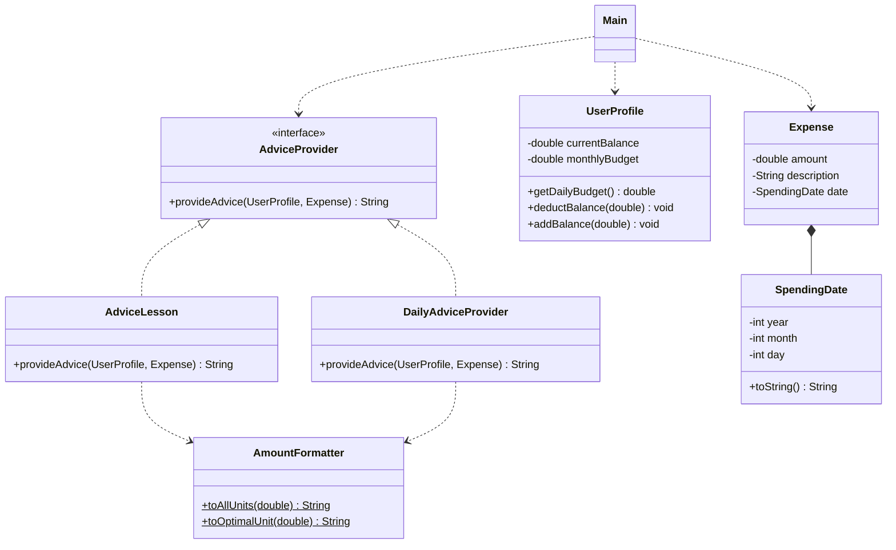
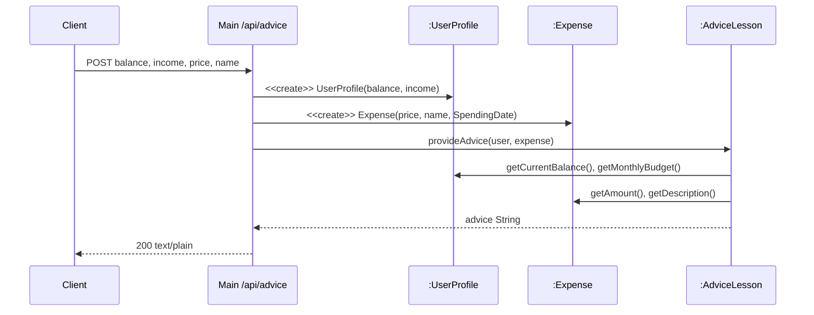

## 학습 목표

- 팀 프로젝트(대학생 소비 조언 시스템)의 문제 정의와 입력, 출력 구조
- Strategy 패턴과 SOLID(SRP, OCP, DIP)가 실제 클래스에 어떻게 대응되는지
- 설계 문서(Factory 패턴 포함)와 실제 코드의 차이를 실행으로 확인
- Java 내장 `HttpServer`로 만든 API를 직접 호출해 보고 동작 검증
- 에세이: AI 활용의 사회적, 도덕적, 윤리적 책임

---

## 1. 프로젝트 개요

| 항목 | 내용 |
| --- | --- |
| 주제 | 대학생을 위한 소비 조언 시스템 (스마트 소비 어드바이저) |
| 문제 | 수입은 제한적인데 회식, 생일, 연애, 구독, 배달 등 지출 요인은 많고, 간편결제 때문에 지출을 인지하기 어려움 |
| 입력 | 월 수입, 현재 잔고(자산), 목표 금액 또는 오늘 쓴 돈 |
| 출력 | 목표 달성까지 필요한 금액과 저축 기간, 하루 예산 대비 소비 판정 |
| 역할 분담 | PPT 및 다이어그램, 발표, 코드 구현, 테스트 및 피드백 (나는 중간 발표 담당) |

---

## 2. 클래스 설계

### 클래스 다이어그램 (실제 코드 기준)



### 설계 원칙 대응

| 원칙, 패턴 | 적용 위치 | 설명 |
| --- | --- | --- |
| Strategy | `AdviceProvider` + `AdviceLesson`, `DailyAdviceProvider` | 소비 분석 알고리즘을 인터페이스 하나로 묶고 구현을 교체 |
| SRP | `Expense`와 `SpendingDate` 분리 | 지출 데이터와 날짜 처리의 변경 이유를 나눔 |
| OCP | 새 Provider 추가 | 주간 리포트, 카테고리 분석 같은 전략을 기존 코드 수정 없이 추가 |
| DIP | `AdviceProvider lesson = new AdviceLesson();` | 변수 타입은 인터페이스. 단, 생성은 여전히 구체 클래스 (아래 정정 참고) |
| 다형성 | `provideAdvice` 호출 | 같은 메시지에 두 전략이 다른 결과를 반환 |
| 합성 | `Expense *-- SpendingDate` | 지출 객체가 날짜 객체를 필드로 포함 |

### 목표 소비 분석 순차도



일일 소비 분석(`/api/daily`)도 구조가 같고 `:AdviceLesson` 자리에 `:DailyAdviceProvider`가 들어감. Main 입장에서는 같은 `AdviceProvider` 자리라서 **구현만 바꿔 끼우는 구조**, 이것이 Strategy 패턴의 핵심.

---

## 3. 분석 로직

### 목표 소비 분석 (`AdviceLesson`)

- 추가 필요 금액 = 목표 금액 − 현재 잔고 (음수면 0, 0이면 바로 구매 가능)
- 월 수입의 30%를 저축한다고 가정하고, 필요한 개월 수를 올림으로 계산
- 식으로 쓰면 $$months = \lceil (price - balance) / (0.3 \times income) \rceil$$
- 12개월 미만이면 단기계획, 12개월 이상이면 장기계획, 360개월 이상이면 비현실적

### 일일 소비 분석 (`DailyAdviceProvider`)

- 하루 권장 예산 = 월 예산 / 30
- 오늘 쓴 돈이 0이면 우수, 하루 예산의 80% 미만이면 양호, 80% 이상 100% 미만이면 주의, 그 이상이면 위험

---

## 4. 실행 결과

서버(`spendingadvice.Main`)를 띄우고 `curl`로 세 엔드포인트를 호출했음.

```text
$ curl -i http://localhost:8080/
HTTP/1.1 404 Not Found
Content-length: 43

404 Not Found: index.html 가 없습니다.


$ curl -X POST /api/advice -d 'balance=500000&income=800000&price=3000000&name=노트북'
목표 명품: 노트북
💰 금액: 3,000,000원 (3.0백만원 / 30십만원 / 300만원 / 3,000천원)

💳 현재 잔고: 500,000원 (5십만원 / 50만원 / 500천원)
📈 월 수입(예산): 800,000원 (8십만원 / 80만원 / 800천원)

🚨 [불가] 현재 잔고로는 목표 금액에 도달할 수 없습니다.
💰 추가 필요 금액: 2,500,000원 (2.5백만원 / 25십만원 / 250만원 / 2,500천원)
📊 월 수입의 30%인 240,000원 (2십만원 / 24만원 / 240천원)씩 저축한다고 가정할 때,

🔥 [단기계획] 앞으로 약 **11개월** 간 집중 저축하면 달성 가능합니다.
불필요한 소비를 통제하고 목표 지향적인 지출을 유지하세요.

$ curl -X POST /api/advice -d 'balance=2000000&income=800000&price=1500000&name=태블릿'
목표 명품: 태블릿
💰 금액: 1,500,000원 (1.5백만원 / 15십만원 / 150만원 / 1,500천원)

💳 현재 잔고: 2,000,000원 (2.0백만원 / 20십만원 / 200만원 / 2,000천원)
📈 월 수입(예산): 800,000원 (8십만원 / 80만원 / 800천원)

🎉 [가능] 현재 잔고가 충분합니다. 목표 금액을 초과하여 구매가 가능합니다.
💡 조언: 구매 후 잔여 예산 점검을 권장합니다.

$ curl -X POST /api/daily -d 'balance=500000&income=800000&spentToday=0'
📊 하루 권장 예산: 26,666원 (2만원 / 26천원)
💸 오늘 쓴 돈: 0원

🌟 [우수] 오늘은 지출이 없습니다! 완벽한 절제력입니다.

$ curl -X POST /api/daily -d 'balance=500000&income=800000&spentToday=15000'
📊 하루 권장 예산: 26,666원 (2만원 / 26천원)
💸 오늘 쓴 돈: 15,000원 (1만원 / 15천원)

👍 [양호] 권장 예산 내에서 합리적으로 소비했습니다.

$ curl -X POST /api/daily -d 'balance=500000&income=800000&spentToday=22000'
📊 하루 권장 예산: 26,666원 (2만원 / 26천원)
💸 오늘 쓴 돈: 22,000원 (2만원 / 22천원)

⚠️ [주의] 하루 예산의 80% 이상을 사용했습니다. 추가 지출에 주의하세요.

$ curl -X POST /api/daily -d 'balance=500000&income=800000&spentToday=40000'
📊 하루 권장 예산: 26,666원 (2만원 / 26천원)
💸 오늘 쓴 돈: 40,000원 (4만원 / 40천원)

🚨 [위험] 하루 권장 예산을 초과했습니다! 지출 통제가 강하게 필요합니다.

$ curl -X POST /api/advice -d 'price=abc'
HTTP/1.1 400 Bad Request
Content-length: 74

데이터 파싱 중 오류가 발생했습니다: For input string: "abc"
```

- 노트북: 추가 필요 2,500,000원 / 월 240,000원 = 10.4 → 올림해서 **11개월** (단기계획), 계산이 맞음
- 하루 예산 800,000 / 30 = 26,666.67원 → 15,000원 양호, 22,000원은 82.5%라 주의, 40,000원 위험으로 구간 판정이 정확함
- 숫자가 아닌 값을 보내면 `400 Bad Request`와 파싱 오류 메시지를 반환함
- `GET /`는 `index.html`이 소스에 포함되지 않아 404 (프런트 파일은 제출본에 없었음)

### Factory를 연결해 본 버전

설계 문서에는 `AdviceProviderFactory`가 있었지만 실제 `Main`은 `new AdviceLesson()`, `new DailyAdviceProvider()`를 직접 생성하고 있었음. 팩토리 파일도 `strategy` 패키지를 import하는데 실제 클래스는 `spendingadvice` 패키지에 있어서 그대로는 컴파일되지 않음. 같은 패키지로 옮겨 연결해 보았음.

```java
package spendingadvice;

// 팩토리를 같은 패키지로 옮겨서 Main 쪽 생성 코드를 대신하게 한 버전
class AdviceProviderFactory {
    static AdviceProvider getProvider(String type) {
        switch (type.toUpperCase()) {
            case "DAILY":  return new DailyAdviceProvider();
            case "LESSON": return new AdviceLesson();
            default: throw new IllegalArgumentException("알 수 없는 분석 타입입니다: " + type);
        }
    }
}

public class FactoryDemo {
    public static void main(String[] args) {
        UserProfile user = new UserProfile(500000, 800000);
        Expense today = new Expense(22000, "데일리 소비", new SpendingDate(2026, 4, 10));

        // 클라이언트는 문자열과 인터페이스만 알면 됨 (구체 클래스 이름이 사라짐)
        AdviceProvider p = AdviceProviderFactory.getProvider("daily");
        System.out.println("선택된 전략: " + p.getClass().getSimpleName());
        System.out.println(p.provideAdvice(user, today));

        try {
            AdviceProviderFactory.getProvider("weekly");
        } catch (IllegalArgumentException e) {
            System.out.println("예외: " + e.getMessage());
        }

        // 반올림 비교: (long) 캐스팅은 버림
        double daily = user.getDailyBudget();
        System.out.println("버림  : " + String.format("%,d원", (long) daily));
        System.out.println("반올림: " + String.format("%,d원", Math.round(daily)));
    }
}
```

실행 결과

```text
선택된 전략: DailyAdviceProvider
📊 하루 권장 예산: 26,666원 (2만원 / 26천원)
💸 오늘 쓴 돈: 22,000원 (2만원 / 22천원)

⚠️ [주의] 하루 예산의 80% 이상을 사용했습니다. 추가 지출에 주의하세요.

예외: 알 수 없는 분석 타입입니다: weekly
버림  : 26,666원
반올림: 26,667원
```

- 클라이언트 코드에서 구체 클래스 이름이 사라지고 `"daily"` 같은 타입 문자열과 인터페이스만 남음 → 생성까지 추상화되어 DIP에 더 가까워짐
- 알 수 없는 타입은 `IllegalArgumentException`으로 막음

### `AmountFormatterTest` 결과 일부

```text
--- 전체 단위 표시 테스트 ---
500원
1,500원 (1천원)
15,000원 (1만원 / 15천원)
150,000원 (1십만원 / 15만원 / 150천원)
1,500,000원 (1.5백만원 / 15십만원 / 150만원 / 1,500천원)
5,000,000원 (5.0백만원 / 50십만원 / 500만원 / 5,000천원)
100,000,000원 (100.0백만원 / 1,000십만원 / 10,000만원 / 100,000천원)
```

테스트 코드 주석에는 `15000 → 1.5만원`으로 적혀 있었지만 실제 출력은 `1만원`. 만원, 십만원 단위 변환이 `(long)` 캐스팅이라 소수점이 **버려짐**.

---

## 5. 에세이 요약: AI 활용의 책임

### 사회적 책임

- AI가 사회 전체에 미치는 영향을 책임지는 것. 일자리 변화 같은 표면적 변화보다 **공공의 이익**을 우선해야 함
- 허위정보, 차별, 디지털 격차를 키우면 생산성이 올라도 사회적 책임을 다하지 못한 것
- 한 기업의 기술 독점은 정보 불평등과 부의 양극화로 이어질 수 있으므로 기술 접근성을 높여야 함

### 도덕적 책임

- 필요한 이유 두 가지: AI가 인간의 삶과 존엄성에 영향을 주고, 법은 최소한의 기준일 뿐임
- 딥페이크, 평가, 의료, 감시, 추천 광고처럼 존엄성이 훼손되는 사례는 많지만 법은 사후 대처 위주
- 남에게 해를 끼치지 않을 책임, 약자를 보호할 책임, 결과를 외면하지 않을 책임 → 편리함보다 **올바름**이 먼저이고, 사용자의 자기 책임 의식을 높이는 제도가 필요

### 윤리적 책임

- 핵심 키워드: 공정성, 책임성, 안전성, 존중
- AI가 도구를 넘어 에이전트로 쓰이는 지금, 결과물의 편향과 공정성을 점검하는 것은 사람의 몫
- 개발 분야의 저작권 문제의 핵심은 **책임 주체가 불분명**하다는 점이며, 이를 정할 법과 제도가 아직 부족함

---

### 정리 노트, 코드에서 정정한 부분 정리

| 위치 | 원래 | 정정 | 이유 |
| --- | --- | --- | --- |
| 구현 계획서 | Factory 패턴 적용 | 실제 `Main`은 구체 클래스를 직접 생성 | 팩토리가 연결되지 않았고, `strategy` 패키지 import라 현재 구조에서 컴파일 불가 |
| 발표 대본 | Main은 인터페이스에만 의존(DIP) | 변수 타입만 인터페이스, 생성은 구체 클래스에 의존 | Factory나 생성자 주입이 있어야 완전한 DIP |
| `AmountFormatter` | `15000 → 1.5만원` (테스트 주석) | 실제 `1만원`, `240,000 → 2십만원` | `(long)` 캐스팅으로 버림. 반올림하거나 소수 한 자리 표시가 필요 |
| `getDailyBudget()` 표시 | 26,666원 | 26,667원 (반올림) | 26,666.67의 표시가 버림으로 처리됨 |
| `AdviceLesson` 출력 | `**11개월**` | `11개월` | `text/plain` 응답이라 마크다운 굵게 표시가 그대로 보임 |
| 웹 서버 | `GET /`에서 화면 표시 | 404 | `index.html`, 효과음 파일이 소스에 없음 |
| 순차도 대본 | Main이 날짜 객체 생성 | 날짜는 `2026-04-10`으로 고정 | `new SpendingDate(2026, 4, 10)`이 하드코딩되어 있어 실제 날짜가 반영되지 않음 |

---

## 최종 핵심 정리

1. 팀 프로젝트는 월 수입, 잔고, 목표 금액을 입력받아 저축 기간과 하루 소비 판정을 돌려주는 대학생 소비 조언 시스템
2. `AdviceProvider` 인터페이스와 두 구현체가 Strategy 패턴이며, Main 입장에서는 구현만 바꿔 끼우는 구조
3. `Expense`와 `SpendingDate` 분리는 SRP, 새 Provider 추가는 OCP, 인터페이스 타입 사용은 DIP와 연결됨
4. 목표 분석은 월 수입의 30% 저축을 가정한 올림 계산이고, 일일 분석은 하루 예산의 80%와 100%를 경계로 판정함
5. API를 직접 호출해 보니 계산과 구간 판정은 정확했고, 잘못된 입력은 400으로 처리됨
6. 설계 문서의 Factory 패턴은 실제 코드에 연결되지 않았고, 연결하면 클라이언트에서 구체 클래스 이름이 사라짐
7. `AmountFormatter`는 버림 때문에 단위 표시가 실제 금액보다 작게 나오므로 반올림이 필요함
8. 에세이 결론: AI는 공익(사회적), 올바름과 존엄성(도덕적), 공정성과 책임 주체 명확화(윤리적)를 함께 고려해야 함

---

End.
