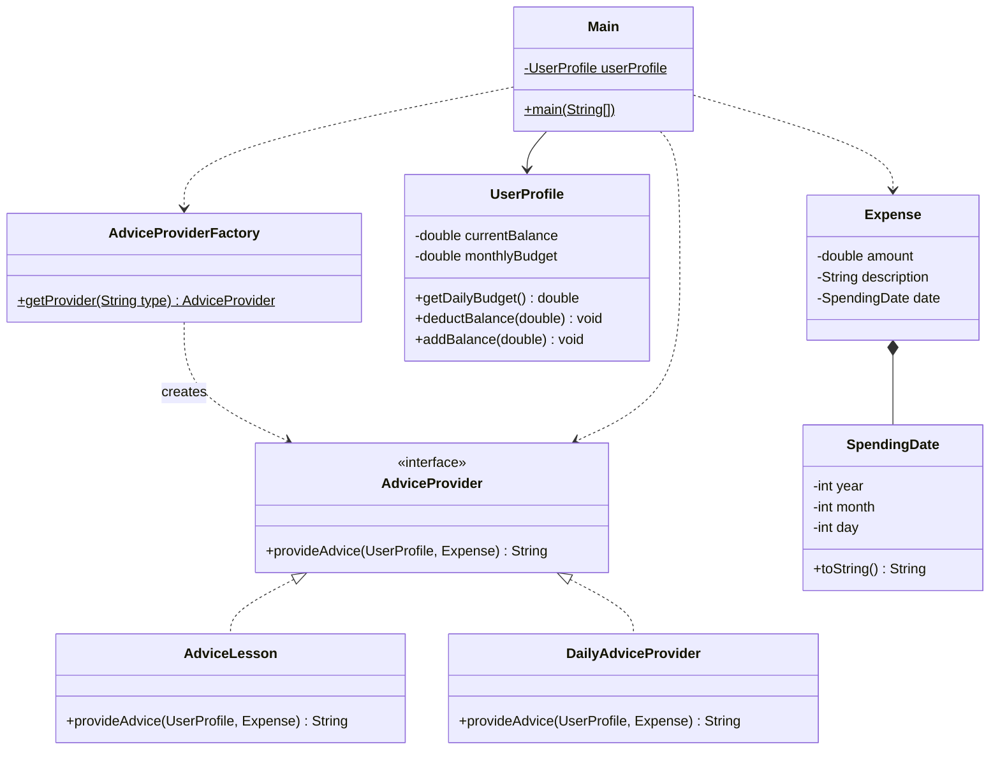
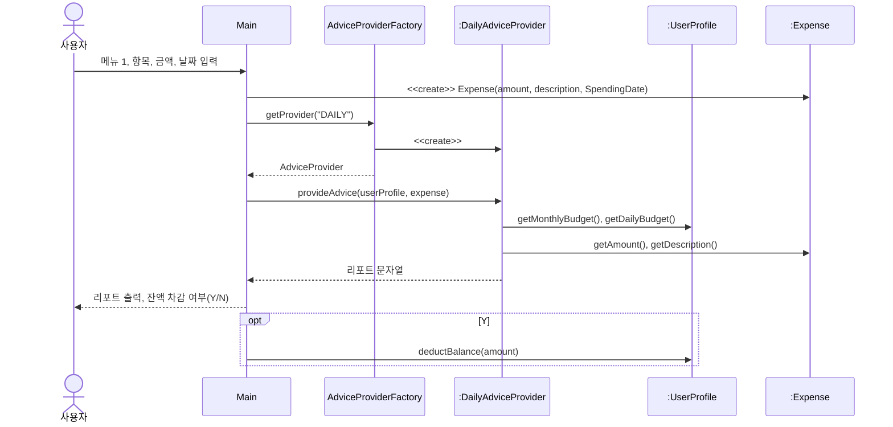
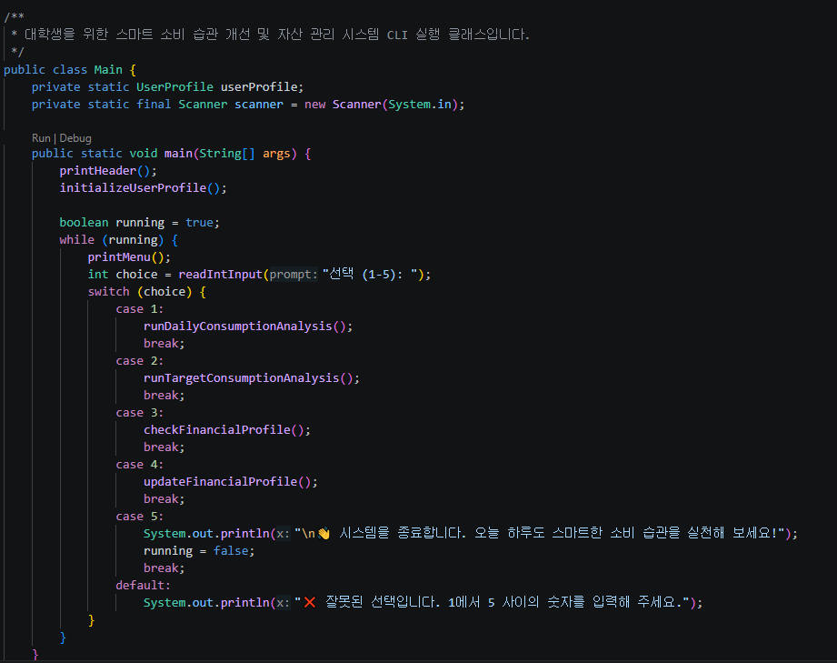
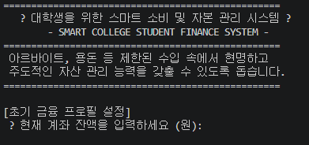
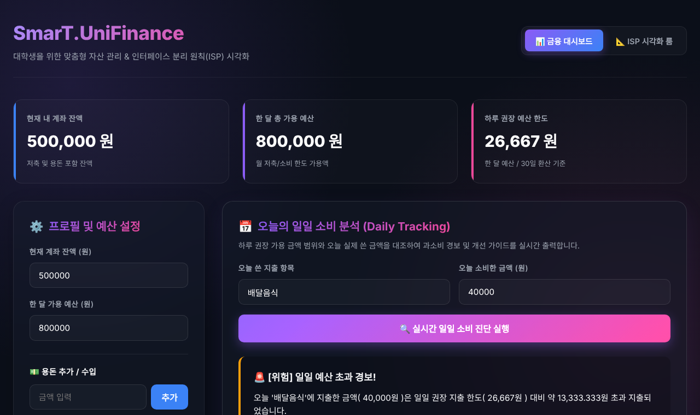
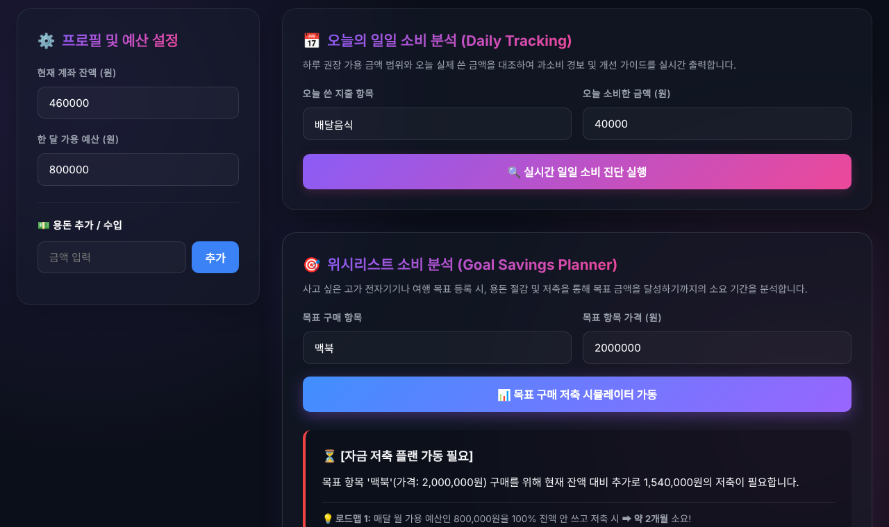
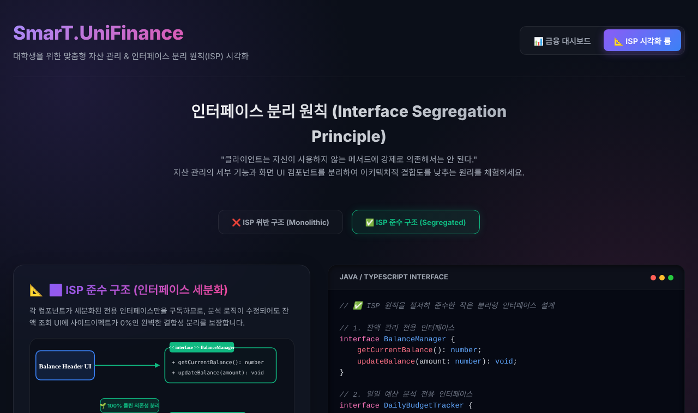

## 학습 목표

- 팀 프로젝트(대학생 소비 조언 시스템)의 문제 정의와 입력, 출력 구조
- Strategy 패턴과 Factory 패턴, SOLID(SRP, OCP, DIP, ISP)가 실제 클래스에 어떻게 대응되는지
- 1차 버전(웹 서버)과 최종 버전(패키지 분리 + CLI + 대시보드)의 차이
- 최종 버전의 핵심 코드와 실제 실행 환경, 실행 영상
- 에세이: AI 활용의 사회적, 도덕적, 윤리적 책임

---

## 1. 프로젝트 개요

| 항목 | 내용 |
| --- | --- |
| 주제 | 대학생을 위한 소비 조언 시스템 (SmarT.UniFinance) |
| 문제 | 수입은 제한적인데 회식, 생일, 연애, 구독, 배달 등 지출 요인은 많고, 간편결제 때문에 지출을 인지하기 어려움 |
| 입력 | 현재 잔액, 한 달 예산, 오늘 쓴 돈 또는 목표 항목 가격 |
| 출력 | 하루 예산 대비 소비 판정과 처방, 목표 달성까지 필요한 금액과 저축 기간 |
| 역할 분담 | PPT 및 다이어그램, 발표, 코드 구현, 테스트 및 피드백 (나는 중간 발표 담당) |
| 핵심 패턴 | **Strategy**(분석 알고리즘 교체), **Factory**(전략 객체 생성 위임) |

### 두 개의 버전

| 구분 | 1차 버전 (중간 발표) | 최종 버전 (디자인패턴프로젝트2) |
| --- | --- | --- |
| 패키지 | `spendingadvice` 하나 | `model`, `strategy`, `factory` + 기본 패키지 `Main` |
| 실행 방식 | Java 내장 `HttpServer` 웹 API (`/api/advice`, `/api/daily`) | 메뉴형 CLI (`Scanner`) + 독립 실행 HTML 대시보드(`index.html`) |
| 전략 생성 | `Main`이 `new AdviceLesson()`을 직접 호출 | `AdviceProviderFactory.getProvider("DAILY")` |
| 목표 분석 가정 | 월 수입의 30% 저축 | 월 예산 100% 저축 + 절반 저축 비교 |
| 일일 판정 | 우수, 양호, 주의(80%), 위험 4단계 | 초과, 준수 2단계 + 처방 3가지 |
| 금액 표시 | `AmountFormatter`(천원, 만원, 십만원 단위, 버림) | `%,.0f` 반올림 표시 |

이 글은 **최종 버전**을 중심으로 정리하고, 1차 버전은 실행 결과와 바뀐 점만 남겼음.

---

## 2. 클래스 설계

### 클래스 다이어그램 (최종 버전)



### 설계 원칙과 패턴 대응

| 원칙, 패턴 | 적용 위치 | 설명 |
| --- | --- | --- |
| Strategy | `AdviceProvider` + `AdviceLesson`, `DailyAdviceProvider` | 소비 분석 알고리즘을 인터페이스 하나로 묶고 구현을 교체 |
| Factory (Simple Factory) | `AdviceProviderFactory.getProvider(type)` | 어떤 전략 객체를 만들지 결정하는 책임을 Main에서 분리 |
| SRP | `model` 패키지: `UserProfile`, `Expense`, `SpendingDate` | 금융 상태, 지출 데이터, 날짜의 변경 이유를 나눔 |
| OCP | 새 Provider 추가 | 주간 리포트 같은 전략을 추가할 때 Main의 분석 코드는 그대로 |
| DIP | Main의 변수 타입과 반환 타입이 `AdviceProvider` | Main은 구체 전략 클래스 이름을 모름 (import도 없음) |
| ISP | 대시보드의 ISP 시각화 | 잔액 조회 UI가 분석 메서드까지 의존하지 않도록 인터페이스를 쪼개는 원리를 화면으로 설명 |
| 합성 | `Expense *-- SpendingDate` | 지출 객체가 날짜 객체를 필드로 포함 |

### 일일 소비 분석 순차도



목표 소비 분석(메뉴 2)은 `getProvider("LESSON")`으로 `AdviceLesson`을 받는다는 것만 다름. Main 입장에서는 같은 `AdviceProvider` 자리라서 **구현만 바꿔 끼우는 구조**, 이것이 Strategy 패턴의 핵심.

---

## 3. 핵심 코드 (최종 버전)

### 전략 인터페이스와 팩토리

```java
package strategy;

public interface AdviceProvider {
    // 사용자 프로필과 소비 데이터를 받아 분석 리포트 문자열을 반환
    String provideAdvice(UserProfile userProfile, Expense expense);
}
```

```java
package factory;

public class AdviceProviderFactory {
    public static AdviceProvider getProvider(String type) {
        if (type == null) {
            throw new IllegalArgumentException("분석 타입은 null일 수 없습니다.");
        }
        switch (type.toUpperCase()) {
            case "DAILY":
                return new DailyAdviceProvider();
            case "LESSON":
                return new AdviceLesson();
            default:
                throw new IllegalArgumentException("알 수 없는 분석 타입입니다: " + type);
        }
    }
}
```

### 일일 소비 분석 전략

```java
public class DailyAdviceProvider implements AdviceProvider {
    @Override
    public String provideAdvice(UserProfile userProfile, Expense expense) {
        double monthlyBudget = userProfile.getMonthlyBudget();
        double dailyBudget = userProfile.getDailyBudget();      // monthlyBudget / 30.0
        double spentToday = expense.getAmount();
        StringBuilder sb = new StringBuilder();
        // ... 헤더, 항목, 금액, 하루 권장 예산 출력 ...
        if (spentToday > dailyBudget) {
            double excess = spentToday - dailyBudget;
            sb.append(" 🚨 [경고: 예산 초과!] 🚨\n");
            sb.append(String.format(" 오늘 지출이 하루 권장 예산 대비 %,.0f 원 초과되었습니다!\n", excess));
            // 처방전 3가지: 학식 이용, 간편결제 장벽 높이기, '내일은 무지출!'
        } else {
            double savings = dailyBudget - spentToday;
            sb.append(" 🎉 [우수: 예산 준수!] 🎉\n");
            sb.append(String.format(" 아주 현명한 소비입니다! 권장 예산 대비 %,.0f 원을 아끼셨습니다.\n", savings));
            // 습관 강화 팁 3가지
        }
        return sb.toString();
    }
}
```

### 목표 소비 분석 전략

```java
public class AdviceLesson implements AdviceProvider {
    @Override
    public String provideAdvice(UserProfile userProfile, Expense expense) {
        double currentBalance = userProfile.getCurrentBalance();
        double monthlyBudget = userProfile.getMonthlyBudget();
        double targetAmount = expense.getAmount();
        StringBuilder sb = new StringBuilder();
        if (currentBalance >= targetAmount) {
            sb.append(" 🎉 [즉시 구매 가능!] 🎉\n");
            sb.append(String.format(" 구매 후 예상 잔액: %,.0f 원\n", currentBalance - targetAmount));
        } else {
            double requiredSaving = targetAmount - currentBalance;
            if (monthlyBudget <= 0) {
                sb.append(" ❌ 가용 예산(월 저축액)이 0원으로 설정되어 있어 저축 소요 기간을 계산할 수 없습니다.\n");
            } else {
                int ceilMonths = (int) Math.ceil(requiredSaving / monthlyBudget);       // 예산 100% 저축
                int halfMonths = (int) Math.ceil(requiredSaving / (monthlyBudget / 2.0)); // 절반 저축
                sb.append(String.format("    ➡ 최소 %d개월 동안 저축해야 구매가 가능합니다.\n", ceilMonths));
                sb.append(String.format(" 1. 절반 저축 시 (월 %,.0f원 저축): 약 %d개월 소요\n", monthlyBudget / 2.0, halfMonths));
            }
        }
        return sb.toString();
    }
}
```

### Main: 팩토리로 전략을 받아 실행

```java
private static void runDailyConsumptionAnalysis() {
    String description = readStringInput(" ▸ 오늘 소비한 항목을 입력하세요 (예: 배달음식, 카페커피): ");
    double amount = readDoubleInput(" ▸ 소비한 금액을 입력하세요 (원): ");
    int year = readIntInput("   - 년도 (예: 2026): ");
    int month = readIntInput("   - 월 (예: 5): ");
    int day = readIntInput("   - 일 (예: 29): ");

    Expense expense = new Expense(amount, description, new SpendingDate(year, month, day));

    // 팩토리 패턴을 이용하여 "DAILY" 전략 객체 획득 → Main은 구체 클래스를 모름
    AdviceProvider provider = AdviceProviderFactory.getProvider("DAILY");
    System.out.println(provider.provideAdvice(userProfile, expense));

    System.out.print(" (Y/N): ");
    if (scanner.next().equalsIgnoreCase("y")) {
        userProfile.deductBalance(amount);
    }
}

// 숫자가 아닌 입력은 다시 묻는 안전한 입력 함수
private static int readIntInput(String prompt) {
    while (true) {
        System.out.print(prompt);
        try {
            return Integer.parseInt(scanner.next());
        } catch (NumberFormatException e) {
            System.out.println("❌ 올바른 정수 숫자를 입력하세요.");
        }
    }
}
```

`Main`은 `strategy.AdviceProvider`와 `factory.AdviceProviderFactory`만 import하고 `AdviceLesson`, `DailyAdviceProvider`는 전혀 언급하지 않음. 1차 버전보다 DIP에 가까워진 부분.

---

## 4. 실제 실행 환경과 실행 결과

### 팀에서 개발, 실행한 환경

| 항목 | 내용 |
| --- | --- |
| OS / 편집기 | Windows + VS Code (Java Extension Pack의 Run/Debug) |
| 실행 | `bin` 폴더에 컴파일된 클래스로 `Main` 실행 (프로젝트 압축 파일에 `bin`, `src`, `index.html`, 구현 계획서 포함) |
| 대시보드 | `index.html`을 브라우저로 바로 열어 사용 (서버 불필요, 계산은 페이지 안의 JavaScript) |


_VS Code에서 작성한 Main (메뉴 루프)_


_Windows 터미널에서 실행한 모습. 이모지가 `?`로 깨져 보임_

Windows 콘솔의 기본 코드 페이지(CP949)는 이모지를 표현하지 못해 `🎓`가 `?`로 출력됨. `chcp 65001`로 UTF-8로 바꾸거나 Windows Terminal을 쓰면 해결되고, Java 18 이상에서는 `-Dstdout.encoding=UTF-8`도 함께 주는 것이 안전함.

### 다시 실행해 본 환경 (CLI)

압축 파일의 소스를 그대로 OpenJDK 21(Linux)에서 컴파일해 실행하고, 실제 터미널(pty)에서 입력한 과정을 녹화했음.

```bash
javac -encoding UTF-8 -d out -sourcepath src src/Main.java
java -Dstdout.encoding=UTF-8 -cp out Main
```

<video controls muted playsinline preload="metadata" style="width:100%;border-radius:8px" src="/assets/video/design_pattern/dp06_cli.mp4"></video>
_CLI 실행 영상: 잔액 500,000원, 예산 800,000원 → 배달음식 40,000원(초과) → 카페커피 5,000원(준수) → 맥북 목표 분석 → 프로필 확인 → 종료 (녹화 화면에는 이모지 글꼴이 없어 이모지 자리가 비어 보임)_

같은 입력에 예산 0원 변경, 잘못된 메뉴 입력까지 더한 전체 출력 중 주요 부분:

```text
==================================================
   📅 [일일 소비 분석 리포트 - Daily Consumption]    
==================================================
 ▸ 오늘 소비 항목 : 배달음식
 ▸ 오늘 소비 금액 : 40,000 원
 ▸ 하루 권장 예산 : 26,667 원 (월 800,000원 기준)
--------------------------------------------------
 🚨 [경고: 예산 초과!] 🚨
 오늘 지출이 하루 권장 예산 대비 13,333 원 초과되었습니다!

 [지출 구조 개선 처방전 💊]
 1. 배달 음식 대신 학식이나 가성비 식단을 이용해 식비를 방어해 보세요.
 2. 모바일 간편결제의 편리함이 충동 소비를 만듭니다. 결제 확인 단계에 비밀번호 6자리 대신 복잡한 생체 인증을 꺼두고 직접 입력해 보세요.
 3. '내일은 무지출!'을 선언하여 오늘 초과된 금액을 이번 주 내에 복구해 보세요.
==================================================

==================================================
   📅 [일일 소비 분석 리포트 - Daily Consumption]    
==================================================
 ▸ 오늘 소비 항목 : 카페커피
 ▸ 오늘 소비 금액 : 5,000 원
 ▸ 하루 권장 예산 : 26,667 원 (월 800,000원 기준)
--------------------------------------------------
 🎉 [우수: 예산 준수!] 🎉
 아주 현명한 소비입니다! 권장 예산 대비 21,667 원을 아끼셨습니다.

 [긍정적 소비 습관 강화 👍]
 1. 아낀 21,667 원을 바로 별도의 '저축 통장(비상금)'으로 바로 송금해 보세요.
 2. 커피나 간식 소비를 줄여 오늘의 예산을 아낀 스스로에게 칭찬 한마디를 건네보세요.
 3. 이러한 습관이 1년 쌓이면 복리로 큰 자산 관리 능력이 됩니다!
==================================================

==================================================
   🎯 [목표 소비 분석 리포트 - Target Consumption]   
==================================================
 ▸ 목표 소비 항목 : 맥북
 ▸ 목표 항목 가격 : 2,000,000 원
 ▸ 현재 자산 잔액 : 460,000 원
 ▸ 한 달 가용 예산 : 800,000 원
--------------------------------------------------
 ⚠️ [자금 부족] 구매를 위해 1,540,000 원이 더 필요합니다.
 📅 [달성 로드맵] 매달 월 예산인 800,000 원을 100% 전부 저축할 경우:
    ➡ 최소 2개월 동안 저축해야 구매가 가능합니다.

 [대학생을 위한 꿀팁 💡]
 1. 절반 저축 시 (월 400,000원 저축): 약 4개월 소요
 2. 모바일 간편결제 등록을 해제하고 무통장 입금 등을 사용해 소비 장벽을 높여보세요!
 3. 매주 '무지출 챌린지'를 1회 도입하여 불필요한 카페/커피 지출을 저축으로 전환해 보세요.
==================================================

==================================================
   🎯 [목표 소비 분석 리포트 - Target Consumption]   
==================================================
 ▸ 목표 소비 항목 : 아이패드
 ▸ 목표 항목 가격 : 900,000 원
 ▸ 현재 자산 잔액 : 460,000 원
 ▸ 한 달 가용 예산 : 0 원
--------------------------------------------------
 ⚠️ [자금 부족] 구매를 위해 440,000 원이 더 필요합니다.
 ❌ 가용 예산(월 저축액)이 0원으로 설정되어 있어 저축 소요 기간을 계산할 수 없습니다.
    용돈 계획을 수립하거나 아르바이트 등을 통해 저축 예산을 마련해 보세요!
==================================================

│  • 하루 권장 지출 :             26,667 원     │
💡 해당 지출을 현재 계좌 잔액에서 차감하시겠습니까?
 (Y/N):  계좌 잔액에서 40,000원이 차감되었습니다. (현재 잔액: 460,000원)
 선택 (1-2):  ▸ 새로운 한 달 예산을 입력하세요 (원):  한 달 예산이 변경되었습니다! (하루 권장: 0원)
│  • 하루 권장 지출 :                  0 원     │
선택 (1-5): ❌ 올바른 정수 숫자를 입력하세요.
👋 시스템을 종료합니다. 오늘 하루도 스마트한 소비 습관을 실천해 보세요!
```

- 하루 권장 예산 800,000 / 30 = 26,666.67원이 **26,667원**으로 반올림되어 표시됨 (1차 버전은 26,666원으로 버림)
- 40,000 − 26,667 = 13,333원 초과, 26,667 − 5,000 = 21,667원 절약으로 계산이 맞음
- 맥북: (2,000,000 − 460,000) / 800,000 = 1.93 → 2개월, 절반이면 3.85 → 4개월
- 예산을 0으로 바꾸면 0으로 나누지 않고 안내 메시지를 출력하며, `abc` 같은 입력은 다시 물어봄

### 다시 실행해 본 환경 (웹 대시보드)

`index.html`을 Chromium으로 열어 같은 시나리오를 입력하고, ISP 시각화 탭까지 녹화했음.

<video controls muted playsinline preload="metadata" style="width:100%;border-radius:8px" src="/assets/video/design_pattern/dp06_web.mp4"></video>
_대시보드 실행 영상: 프로필 설정 → 일일 소비 진단 → 잔액 차감 → 목표 저축 시뮬레이터 → ISP 위반/준수 구조 비교_


_금융 대시보드와 일일 소비 진단_


_목표 저축 시뮬레이터 (맥북 2,000,000원)_


_ISP 시각화 룸: 하나의 큰 인터페이스(위반)와 잘게 나눈 BalanceManager, DailyBudgetTracker 등(준수) 비교_

```text
[대시보드] 현재 잔액 500,000 원 / 한 달 예산 800,000 원 / 하루 권장 26,667 원
[일일 진단] 🚨 [위험] 일일 예산 초과 경보! 오늘 '배달음식'에 지출한 금액( 40,000원 )은
            일일 권장 지출 한도( 26,667원 ) 대비 약 13,333.333원 초과 지출되었습니다.
[알림창]   잔고에서 40,000원이 무사히 차감되었습니다.  → 잔액 460,000 원
[목표]     맥북(2,000,000원) 추가로 1,540,000원 필요. 100% 저축 시 약 2개월, 절반 저축 시 약 4개월
```

CLI와 대시보드의 계산 결과가 같음. 단, 대시보드의 초과 금액은 `13,333.333원`처럼 소수점이 그대로 보여서 반올림 처리가 필요함.

### 경계값 확인

```text
│  • 하루 권장 지출 :             -1,000 원     │
 ▸ 오늘 소비 금액 : -5,000 원
 ▸ 하루 권장 예산 : -1,000 원 (월 -30,000원 기준)
 아주 현명한 소비입니다! 권장 예산 대비 4,000 원을 아끼셨습니다.
```

음수 예산(-30,000원)과 음수 지출(-5,000원), 존재하지 않는 날짜(2026년 13월 45일)도 그대로 받아들여 "4,000원을 아꼈다"는 잘못된 조언이 나옴. 입력 함수나 `SpendingDate` 생성자에서 검증이 필요함.

---

## 5. 1차 버전 (웹 서버) 실행 결과

1차 버전은 `HttpServer`로 `/api/advice`(목표), `/api/daily`(일일) API를 열고 프런트에서 호출하는 구조였음. 서버를 띄우고 `curl`로 호출한 결과:

```text
$ curl -i http://localhost:8080/
HTTP/1.1 404 Not Found
Content-length: 43

404 Not Found: index.html 가 없습니다.


$ curl -X POST /api/advice -d 'balance=500000&income=800000&price=3000000&name=노트북'
목표 명품: 노트북
💰 금액: 3,000,000원 (3.0백만원 / 30십만원 / 300만원 / 3,000천원)

💳 현재 잔고: 500,000원 (5십만원 / 50만원 / 500천원)
📈 월 수입(예산): 800,000원 (8십만원 / 80만원 / 800천원)

🚨 [불가] 현재 잔고로는 목표 금액에 도달할 수 없습니다.
💰 추가 필요 금액: 2,500,000원 (2.5백만원 / 25십만원 / 250만원 / 2,500천원)
📊 월 수입의 30%인 240,000원 (2십만원 / 24만원 / 240천원)씩 저축한다고 가정할 때,

🔥 [단기계획] 앞으로 약 **11개월** 간 집중 저축하면 달성 가능합니다.
불필요한 소비를 통제하고 목표 지향적인 지출을 유지하세요.

$ curl -X POST /api/advice -d 'balance=2000000&income=800000&price=1500000&name=태블릿'
목표 명품: 태블릿
💰 금액: 1,500,000원 (1.5백만원 / 15십만원 / 150만원 / 1,500천원)

💳 현재 잔고: 2,000,000원 (2.0백만원 / 20십만원 / 200만원 / 2,000천원)
📈 월 수입(예산): 800,000원 (8십만원 / 80만원 / 800천원)

🎉 [가능] 현재 잔고가 충분합니다. 목표 금액을 초과하여 구매가 가능합니다.
💡 조언: 구매 후 잔여 예산 점검을 권장합니다.

$ curl -X POST /api/daily -d 'balance=500000&income=800000&spentToday=0'
📊 하루 권장 예산: 26,666원 (2만원 / 26천원)
💸 오늘 쓴 돈: 0원

🌟 [우수] 오늘은 지출이 없습니다! 완벽한 절제력입니다.

$ curl -X POST /api/daily -d 'balance=500000&income=800000&spentToday=15000'
📊 하루 권장 예산: 26,666원 (2만원 / 26천원)
💸 오늘 쓴 돈: 15,000원 (1만원 / 15천원)

👍 [양호] 권장 예산 내에서 합리적으로 소비했습니다.

$ curl -X POST /api/daily -d 'balance=500000&income=800000&spentToday=22000'
📊 하루 권장 예산: 26,666원 (2만원 / 26천원)
💸 오늘 쓴 돈: 22,000원 (2만원 / 22천원)

⚠️ [주의] 하루 예산의 80% 이상을 사용했습니다. 추가 지출에 주의하세요.

$ curl -X POST /api/daily -d 'balance=500000&income=800000&spentToday=40000'
📊 하루 권장 예산: 26,666원 (2만원 / 26천원)
💸 오늘 쓴 돈: 40,000원 (4만원 / 40천원)

🚨 [위험] 하루 권장 예산을 초과했습니다! 지출 통제가 강하게 필요합니다.

$ curl -X POST /api/advice -d 'price=abc'
HTTP/1.1 400 Bad Request
Content-length: 74

데이터 파싱 중 오류가 발생했습니다: For input string: "abc"
```

- 계산과 구간 판정(26,666원 기준 15,000 양호, 22,000 주의, 40,000 위험)은 정확했고, 잘못된 입력은 400으로 처리함
- 다만 제출 소스에 `index.html`이 없어 `GET /`는 404, `AmountFormatter`는 `(long)` 버림이라 `15,000원 → 1만원`, `240,000원 → 2십만원`처럼 단위 표시가 실제보다 작았음
- 최종 버전에서는 서버 대신 CLI + 독립 HTML로 바꾸고, 팩토리를 연결하고, 패키지를 역할별로 나누면서 이 문제들이 정리됨

---

## 6. 에세이 요약: AI 활용의 책임

### 사회적 책임

- AI가 사회 전체에 미치는 영향을 책임지는 것. 일자리 변화 같은 표면적 변화보다 **공공의 이익**을 우선해야 함
- 허위정보, 차별, 디지털 격차를 키우면 생산성이 올라도 사회적 책임을 다하지 못한 것
- 한 기업의 기술 독점은 정보 불평등과 부의 양극화로 이어질 수 있으므로 기술 접근성을 높여야 함

### 도덕적 책임

- 필요한 이유 두 가지: AI가 인간의 삶과 존엄성에 영향을 주고, 법은 최소한의 기준일 뿐임
- 딥페이크, 평가, 의료, 감시, 추천 광고처럼 존엄성이 훼손되는 사례는 많지만 법은 사후 대처 위주
- 남에게 해를 끼치지 않을 책임, 약자를 보호할 책임, 결과를 외면하지 않을 책임 → 편리함보다 **올바름**이 먼저이고, 사용자의 자기 책임 의식을 높이는 제도가 필요

### 윤리적 책임

- 핵심 키워드: 공정성, 책임성, 안전성, 존중
- AI가 도구를 넘어 에이전트로 쓰이는 지금, 결과물의 편향과 공정성을 점검하는 것은 사람의 몫
- 개발 분야의 저작권 문제의 핵심은 **책임 주체가 불분명**하다는 점이며, 이를 정할 법과 제도가 아직 부족함

---

### 코드, 발표 자료에서 정정한 부분 정리

| 위치 | 원래 | 정정 | 이유 |
| --- | --- | --- | --- |
| 1차 버전 `Main` | 전략 객체를 `new AdviceLesson()`으로 직접 생성 | 최종 버전처럼 `AdviceProviderFactory.getProvider(...)` 사용 | 1차 버전의 Factory 파일은 `strategy` 패키지를 import해 그 구조에서는 컴파일되지 않았음 |
| 1차 버전 `AmountFormatter` | `15000 → 1.5만원` (테스트 주석) | 실제 `1만원` | `(long)` 캐스팅 버림 |
| 1차 버전 `AdviceLesson` | `**11개월**` | `11개월` | `text/plain` 응답이라 마크다운 기호가 그대로 보임 |
| 최종 `index.html` | `약 13,333.333원 초과` | `13,333원` | 소수점 반올림 누락 |
| 최종 `AdviceLesson` | 월 예산 100%를 저축한다고 가정 | 생활비를 뺀 저축 가능액으로 계산하는 것이 현실적 | 예산을 다 저축하면 생활비가 0원 |
| 최종 입력 처리 | 음수 금액, 13월 45일 허용 | 0 이상, 유효한 날짜만 허용 | 경계값 실행에서 잘못된 조언 확인 |
| 최종 예산 변경 | `userProfile = new UserProfile(잔액, 새 예산)` | `setMonthlyBudget()` 같은 메서드 추가 | 값 하나 바꾸려고 객체를 새로 만들고 있음 |
| Windows 실행 | 이모지가 `?`로 출력 | `chcp 65001` 또는 Windows Terminal, `-Dstdout.encoding=UTF-8` | 콘솔 코드 페이지가 CP949 |

---

## 최종 핵심 정리

1. 팀 프로젝트는 잔액과 한 달 예산을 바탕으로 하루 소비를 진단하고 목표 구매까지의 저축 기간을 알려 주는 대학생 소비 조언 시스템
2. `AdviceProvider` 인터페이스와 두 구현체가 Strategy 패턴이고, Main은 구현만 바꿔 끼우는 구조
3. 최종 버전은 `AdviceProviderFactory`가 전략 생성을 맡아 Main이 구체 클래스 이름을 모르게 되어 DIP에 가까워짐
4. `model`, `strategy`, `factory` 패키지로 나눈 것은 SRP, 새 전략을 추가할 수 있는 구조는 OCP, 대시보드의 ISP 시각화는 인터페이스 분리 원칙을 설명함
5. 실제 실행에서 계산(26,667원, 13,333원 초과, 맥북 2개월/4개월)은 CLI와 대시보드 모두 정확했음
6. Windows 콘솔에서는 이모지가 `?`로 깨지므로 UTF-8 코드 페이지와 출력 인코딩 설정이 필요함
7. 음수 금액, 잘못된 날짜 검증과 대시보드의 소수점 표시, 100% 저축 가정은 보완할 부분
8. 에세이 결론: AI는 공익(사회적), 올바름과 존엄성(도덕적), 공정성과 책임 주체 명확화(윤리적)를 함께 고려해야 함

---

End.
