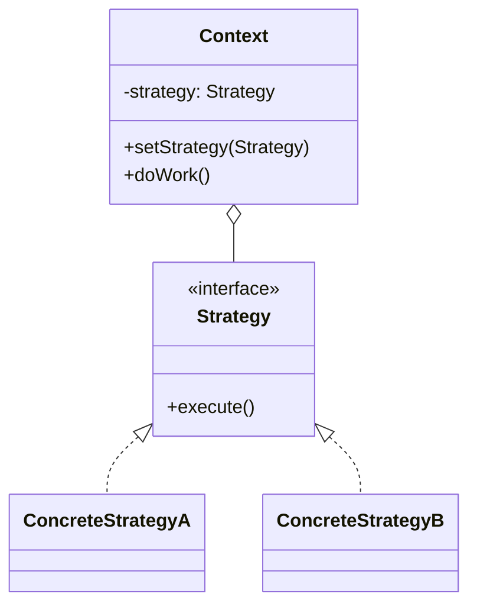
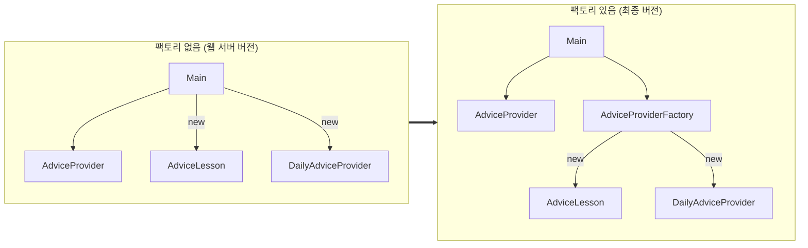

## 학습 목표

- Strategy 패턴의 구조(Context, Strategy, ConcreteStrategy)와 언제 쓰는지
- 팀 프로젝트 코드에 새 전략을 추가해 보고 실제로 어떤 파일이 바뀌는지 확인
- Factory가 해결하는 문제(생성 책임)와 switch 팩토리가 OCP를 깨는 지점
- 등록형 팩토리로 개선하고 실행해 확인
- Simple Factory, Factory Method, Abstract Factory의 차이

> 수업에서 직접 다룬 패턴은 템플릿 메서드와 싱글톤([04편](/posts/Design_Pattern_04/))이고, 이 글은 팀 프로젝트([06편](/posts/Design_Pattern_06/))에서 쓴 두 패턴을 이해하기 위한 **보충 정리**임. 예제는 팀 프로젝트 최종 버전의 소스에 클래스를 추가해 실행한 것
{: .prompt-info }

---

## 1. Strategy 패턴

### 정의

**알고리즘군을 정의하고 각각을 캡슐화해서 서로 바꿔 쓸 수 있게 만드는 패턴**. 알고리즘을 사용하는 쪽(Context)과 알고리즘(Strategy)을 분리해서, 사용하는 코드를 고치지 않고 알고리즘만 교체함.

| 요소 | 내용 |
| --- | --- |
| 컨텍스트 | 같은 일을 하는 방법이 여러 가지이고, 상황에 따라 다른 방법을 써야 함 |
| 문제 | `if (방식 == A) ... else if (방식 == B) ...`가 쌓이면, 방식을 추가할 때마다 사용하는 코드를 고쳐야 함 (OCP 위반) |
| 해결 | 방법마다 같은 인터페이스를 구현한 클래스를 만들고, 사용하는 쪽은 인터페이스에만 의존 |

### 구조



| 참여자 | 팀 프로젝트에서 |
| --- | --- |
| Strategy (인터페이스) | `AdviceProvider` (`provideAdvice()`) |
| ConcreteStrategy | `AdviceLesson`(목표 소비), `DailyAdviceProvider`(일일 소비) |
| Context (사용하는 쪽) | `Main` (전략을 받아 `provideAdvice()`만 호출) |

### 장단점

| 장점 | 단점 |
| --- | --- |
| 새 알고리즘 추가 시 사용하는 코드 수정 없음 (OCP) | 클래스 수가 늘어남 |
| 조건문이 사라지고 알고리즘마다 따로 테스트 가능 | 사용하는 쪽이 "어떤 전략을 고를지"는 알아야 함 → **Factory**가 이 부분을 맡음 |
| 실행 중에 전략 교체 가능 | 모든 전략이 같은 인터페이스를 써야 해서, 필요한 데이터가 다르면 인터페이스가 어색해짐 |

템플릿 메서드와의 차이(상속 대 합성)는 [04편](/posts/Design_Pattern_04/)에서 같은 엘리베이터 문제로 비교했음.

---

## 2. 실험: 팀 프로젝트에 주간 분석 전략 추가하기

발표에서 "WeeklyAdviceProvider를 추가해도 기존 코드를 수정하지 않는다"고 했던 부분을 실제로 해 봤음.

```java
package strategy;

public class WeeklyAdviceProvider implements AdviceProvider {
    @Override
    public String provideAdvice(UserProfile userProfile, Expense expense) {
        double weeklyBudget = userProfile.getDailyBudget() * 7;     // 주간 예산 = 하루 예산 × 7
        double spent = expense.getAmount();
        double rate = spent / weeklyBudget * 100;
        return String.format(" [주간 분석] %s: %,.0f원 / 주간 예산 %,.0f원 (%.0f%%) → %s",
                expense.getDescription(), spent, weeklyBudget, rate,
                rate > 100 ? "초과! 다음 주 예산에서 줄이세요" : "주간 예산 안에서 소비했습니다");
    }
}
```

### 실제로 바뀐 파일

| 파일 | 변경 | 이유 |
| --- | --- | --- |
| `strategy/WeeklyAdviceProvider.java` | **새로 추가** | 새 전략 |
| `strategy/AdviceProvider.java`, `AdviceLesson.java`, `DailyAdviceProvider.java` | 변경 없음 | Strategy 패턴의 효과 |
| `model/*` | 변경 없음 | 데이터 클래스는 분석 방식과 무관 |
| `factory/AdviceProviderFactory.java` | **수정 필요** | switch에 `case "WEEKLY"` 추가 |
| `Main.java` | **수정 필요** | 메뉴에 "주간 분석" 항목 추가 |

전략 클래스 쪽은 OCP가 지켜졌지만, **팩토리와 메뉴는 고쳐야 했음**. "기존 코드를 전혀 수정하지 않는다"는 발표 내용은 분석 로직에 한해서만 맞음.

### 인터페이스의 한계도 드러남

주간 분석은 원래 지출 **여러 건**이 필요한데, `provideAdvice(UserProfile, Expense)`는 지출 **한 건**만 받음. 그래서 "이번 주 지출 합계"를 하나의 `Expense`로 만들어 넘기는 우회 방법을 썼음. 처음 인터페이스를 설계할 때 앞으로 생길 전략이 무엇을 필요로 할지(예: `List<Expense>`)까지 생각해야 한다는 점을 보여 줌.

---

## 3. Factory 패턴

### 해결하는 문제

Strategy를 쓰면 Main은 `AdviceProvider` 타입으로 전략을 **사용**하지만, 누군가는 `new DailyAdviceProvider()`로 **생성**해야 함. 생성 코드가 Main에 있으면 Main이 구체 클래스 이름을 알아야 하므로 DIP가 반쪽이 됨.



- 생성 책임을 팩토리 한 곳으로 모으면 Main은 **인터페이스와 팩토리만** 알게 됨
- 구체 클래스를 바꾸거나 추가할 때 고칠 곳이 팩토리 하나로 줄어듦

### switch 팩토리의 한계

```java
public static AdviceProvider getProvider(String type) {
    switch (type.toUpperCase()) {
        case "DAILY":  return new DailyAdviceProvider();
        case "LESSON": return new AdviceLesson();
        default: throw new IllegalArgumentException("알 수 없는 분석 타입입니다: " + type);
    }
}
```

전략이 추가될 때마다 이 switch를 고쳐야 하므로 **OCP가 팩토리 안에서 깨짐**. 문제를 Main에서 팩토리로 옮긴 것일 뿐 완전히 없앤 것은 아님.

### 개선: 등록형 팩토리

생성 방법을 `Map`에 **등록**해 두고 꺼내 쓰면, 팩토리 클래스 자체는 고칠 필요가 없어짐.

```java
public class AdviceProviderRegistry {
    private final Map<String, Supplier<AdviceProvider>> creators = new LinkedHashMap<>();

    public void register(String type, Supplier<AdviceProvider> creator) {
        creators.put(type.toUpperCase(), creator);
    }

    public AdviceProvider get(String type) {
        Supplier<AdviceProvider> creator = creators.get(type.toUpperCase());
        if (creator == null) throw new IllegalArgumentException("알 수 없는 분석 타입입니다: " + type);
        return creator.get();
    }
}
```

```java
AdviceProviderRegistry registry = new AdviceProviderRegistry();
registry.register("DAILY", DailyAdviceProvider::new);
registry.register("LESSON", AdviceLesson::new);
registry.register("WEEKLY", WeeklyAdviceProvider::new);      // 새 전략은 이 한 줄로 연결

AdviceProvider p = registry.get("WEEKLY");
System.out.println(p.provideAdvice(user, new Expense(210000, "이번 주 지출 합계", date)));

// 인터페이스 메서드가 하나뿐이라 람다로 즉석 전략도 만들 수 있음
registry.register("STRICT", () -> (u, e) -> ...);
```

실행 결과 (잔액 500,000원, 한 달 예산 800,000원)

```text
== 1. 기존 팩토리(switch)로 WEEKLY 요청
 예외: 알 수 없는 분석 타입입니다: WEEKLY  → switch에 case를 추가(팩토리 수정)해야 함
== 2. 등록형 팩토리: 전략을 등록만 하면 됨
 등록된 전략: DAILY
 등록된 전략: LESSON
 등록된 전략: WEEKLY
== 3. 같은 코드로 전략만 바꿔 실행
 [주간 분석] 이번 주 지출 합계: 210,000원 / 주간 예산 186,667원 (112%) → 초과! 다음 주 예산에서 줄이세요
 [주간 분석] 다음 주 지출 합계: 150,000원 / 주간 예산 186,667원 (80%) → 주간 예산 안에서 소비했습니다
== 4. 전략도 결국 객체: 람다로 즉석 전략
 [엄격 모드] 15,000원 지출 → 하루 예산의 절반(13,333원) 초과
```

- 기존 switch 팩토리는 `WEEKLY`를 모르기 때문에 예외가 남
- 등록형은 `register` 한 줄로 연결되고, 팩토리 클래스는 수정하지 않음
- 주간 예산 = 26,666.67 × 7 = 186,667원. 210,000원은 112%로 초과, 150,000원은 80%로 이내
- `AdviceProvider`가 메서드 하나짜리 인터페이스라서 람다로 "엄격 모드" 같은 전략을 바로 만들 수 있음 (하루 예산의 절반 13,333원 기준)

등록하는 코드(설정 부분)는 어딘가에 남아야 하므로 변경이 **0이 되는 것은 아니지만**, 생성 규칙이 한 곳에 모이고 팩토리와 사용하는 코드는 그대로라는 점이 다름. 스프링 같은 프레임워크는 이 등록을 애너테이션과 컨테이너가 자동으로 해 줌.

### Factory 계열 비교

| 이름 | 방법 | 예 |
| --- | --- | --- |
| **Simple Factory** | 정적 메서드 하나가 조건에 따라 객체를 만들어 반환 (GoF 23개 패턴에는 없는 관용구) | 팀 프로젝트의 `AdviceProviderFactory.getProvider(type)` |
| **Factory Method** | 상위 클래스가 생성 메서드를 추상으로 두고, **하위 클래스가 어떤 객체를 만들지 결정** (템플릿 메서드와 같은 구조를 생성에 적용) | `abstract AdviceProvider createProvider()`를 분석 화면 클래스마다 구현 |
| **Abstract Factory** | 관련된 객체 **여러 개(제품군)**를 한 번에 만드는 인터페이스 | 학생용 팩토리는 학생용 분석 + 학생용 화면, 직장인용은 직장인용 분석 + 화면 |

---

### 발표 자료에서 정정한 부분 정리

| 위치 | 원래 | 정정 | 이유 |
| --- | --- | --- | --- |
| 최종 발표 대본 OCP | WeeklyAdviceProvider를 추가해도 기존 코드 수정 없이 확장 가능 | 전략 클래스와 모델은 그대로지만, switch 팩토리와 Main 메뉴는 수정 필요 | 실제로 추가해 본 결과 |
| 구현 계획서 | Factory 도입으로 DIP 준수 | Main 쪽 DIP는 개선되지만 팩토리 내부의 switch는 OCP 위반 | 등록형 팩토리로 보완 가능 |
| `AdviceProvider` 설계 | 지출 한 건을 받는 메서드 | 주간, 카테고리 분석까지 생각하면 여러 지출을 받는 형태가 필요 | 주간 전략 구현에서 우회가 필요했음 |

---

## 최종 핵심 정리

1. Strategy 패턴은 알고리즘을 같은 인터페이스를 구현한 객체로 캡슐화해, 사용하는 코드를 고치지 않고 교체하게 함
2. 팀 프로젝트에서 Strategy는 `AdviceProvider`, ConcreteStrategy는 `AdviceLesson`과 `DailyAdviceProvider`, Context는 `Main`
3. 주간 분석 전략을 추가하자 전략과 모델 클래스는 그대로였지만 switch 팩토리와 메뉴는 수정해야 했음
4. 지출 한 건만 받는 인터페이스 때문에 주간 분석은 합계를 넘기는 우회가 필요했고, 인터페이스는 미래의 전략까지 고려해 설계해야 함
5. Factory는 "어떤 구체 객체를 만들지"라는 생성 책임을 한 곳에 모아 사용하는 쪽이 구체 클래스를 모르게 함
6. switch 기반 Simple Factory는 전략이 늘 때마다 수정해야 해서 OCP가 팩토리 안에서 깨짐
7. `Map<String, Supplier>` 등록형 팩토리는 팩토리 수정 없이 한 줄 등록으로 새 전략을 연결하고, 람다 전략도 가능함
8. Simple Factory는 조건에 따른 생성, Factory Method는 하위 클래스가 생성 결정, Abstract Factory는 관련 객체 묶음 생성

---

End.
