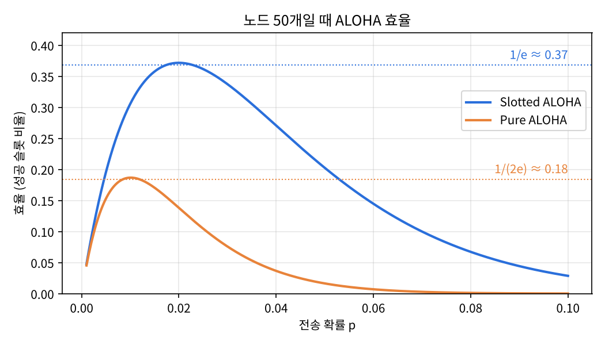
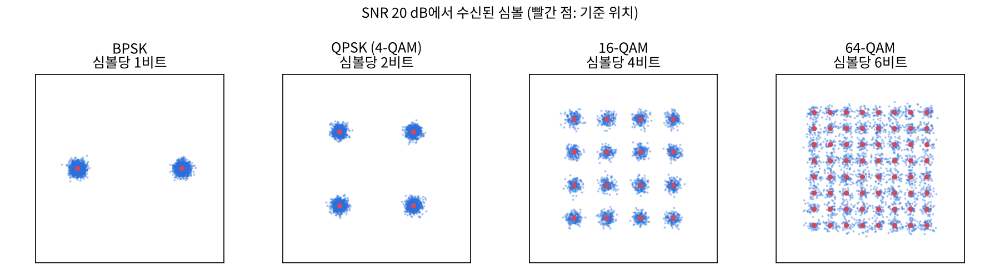
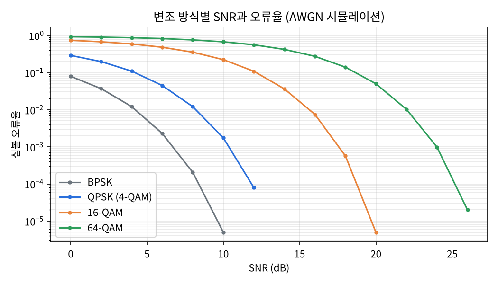

## 학습 목표

- 링크 계층의 역할과 오류 검출 방법(패리티, 체크섬, CRC)
- CRC 나머지를 직접 계산하고 오류 검출 확인
- 다중 접속 프로토콜 ALOHA, CSMA, CSMA/CD의 동작과 효율
- 무선 네트워크의 구성 요소, SNR, 다중 경로와 MIMO
- 변조(ASK, BPSK, QPSK, QAM)와 적응형 변조
- 5G RAN과 자원 블록(RB), RAN 스케줄링 정책, 무선 네트워크 연결과 이동성

> 시험 범위에서 강조된 것: **CRC 계산, ALOHA, CSMA/CD**, 변조 종류, 5G RAN 구성 요소, 연결 방식(비콘과 프로빙)
{: .prompt-warning }

---

## 1. 링크 계층

- 네트워크 계층이 **다른 네트워크 사이**의 전달을 맡는다면, 링크 계층은 **같은 링크(같은 네트워크) 안에서 인접한 노드 사이**의 전달을 맡음
- 서비스: 프레이밍, 링크 접근(MAC 주소로 송수신 노드 식별), 인접 노드 사이의 신뢰성 있는 전달, 오류 검출과 정정

### 오류 검출과 정정 (EDC)

| 방법 | 할 수 있는 것 |
| --- | --- |
| 단일 패리티 비트 | 홀수 개의 비트 오류 검출 (짝수 개가 뒤집히면 못 찾음) |
| 2차원 패리티 | 행과 열 패리티로 **단일 비트 오류를 찾아서 정정**까지 가능 |
| 인터넷 체크섬 | 오류 검출만 (전송 계층에서 사용) |
| CRC | 강력한 오류 검출, 특히 **버스트 오류**. 이더넷, WiFi에서 사용. 정정은 못함 |

---

## 2. CRC (Cyclic Redundancy Check)

- **D**: 보낼 데이터 비트 ($$d$$비트)
- **G**: 송신자와 수신자가 미리 정한 **생성기**($$r + 1$$비트, 문제에서 주어짐)
- **R**: 송신자가 계산해서 D 뒤에 붙이는 CRC 비트 ($$r$$비트)

### 동작

1. 송신자는 D 뒤에 0을 $$r$$개 붙임
2. 그 비트열을 G로 **모듈로 2 나눗셈**(뺄셈 대신 XOR, 자리올림 없음)
3. 나머지가 R. D와 R을 이어 붙여 전송
4. 수신자는 받은 $$d + r$$비트를 같은 G로 나눔. **나머지가 0이면 정상, 0이 아니면 오류**

식으로 쓰면 R은 $$D \cdot 2^r$$을 G로 나눈 나머지이고, 전송 비트열 $$D \cdot 2^r \oplus R$$은 G로 나누어떨어짐.

### CRC 계산 (실행)

```python
def mod2_div(bits, gen):
    """비트 문자열 bits를 생성기 gen으로 XOR(모듈로 2) 나눗셈한 나머지"""
    r = len(gen) - 1
    rem = list(bits)
    for i in range(len(bits) - r):
        if rem[i] == "1":                       # 맨 앞 비트가 1일 때만 G를 XOR
            for j, g in enumerate(gen):
                rem[i + j] = str(int(rem[i + j]) ^ int(g))
    return "".join(rem[-r:])

def crc_send(D, G):
    R = mod2_div(D + "0" * (len(G) - 1), G)    # D 뒤에 r개의 0을 붙여 나눔
    return R, D + R

def crc_check(frame, G):
    return mod2_div(frame, G)                    # 나머지가 0이면 오류 없음

for D, G in [("101110", "1001"), ("101110", "1101")]:
    R, frame = crc_send(D, G)
    print(f"D={D}, G={G} -> R={R}, 전송 프레임 {frame}, 수신 측 나머지 {crc_check(frame, G)}")

# 오류 검출: 한 비트, 연속 두 비트(버스트)를 뒤집어 보기
D, G = "101110", "1001"
_, frame = crc_send(D, G)
flip = lambda s, i: s[:i] + ("1" if s[i] == "0" else "0") + s[i + 1:]
one = flip(frame, 2)
burst = flip(flip(frame, 4), 5)
print(f"1비트 오류  {one}: 나머지 {crc_check(one, G)}")
print(f"2비트 버스트 {burst}: 나머지 {crc_check(burst, G)}")
```

실행 결과

```text
D=101110, G=1001 -> R=011, 전송 프레임 101110011, 수신 측 나머지 000
D=101110, G=1101 -> R=000, 전송 프레임 101110000, 수신 측 나머지 000
1비트 오류  100110011: 나머지 001
2비트 버스트 101101011: 나머지 011
```

- 교재 예제 D = 101110, G = 1001이면 R = **011**, 전송 프레임은 101110011
- D = 101110, G = 1101이면 101110000이 이미 1101로 나누어떨어져서 R = **000**
- 비트가 뒤집히면 나머지가 0이 아니게 되어 오류가 검출됨. $$r$$비트 CRC는 길이가 $$r$$ 이하인 버스트 오류를 모두 검출함

---

## 3. 다중 접속 프로토콜

- **브로드캐스트 링크**: 여러 노드가 하나의 공유 매체를 씀 → 두 노드가 동시에 보내면 **충돌**
- 다중 접속 프로토콜은 누가 언제 보낼지를 정하는 **분산 알고리즘**. 따로 조정용 채널이 없어서 조정 메시지도 같은 채널로 보내야 함

### Slotted ALOHA

가정: 모든 프레임은 같은 크기, 시간은 프레임 하나 전송 시간 크기의 **슬롯**으로 나뉨, 노드는 슬롯 시작에만 전송, 노드들은 시간이 동기화됨, 충돌이 나면 모든 노드가 알 수 있음

- 새 프레임이 생기면 다음 슬롯에서 바로 전송
- 충돌이 없으면 성공. 충돌하면 **이후 슬롯마다 확률 p로 재전송**해서 성공할 때까지 반복
- 확률 p를 쓰는 이유: 충돌한 노드들이 다음 슬롯에 또 동시에 재전송하면 영원히 충돌하므로, 무작위성으로 서로 다른 슬롯에 흩어지게 하려는 것

| 장점 | 단점 |
| --- | --- |
| 활성 노드가 하나면 채널 전체 속도로 계속 전송 | 충돌로 슬롯 낭비 |
| 슬롯만 동기화하면 되는 분산 방식 | 아무도 안 보내는 빈 슬롯 |
| 단순함 | 충돌을 프레임 전송 시간보다 빨리 알 수 있어도 끝까지 보냄, 시간 동기화 필요 |

**효율**: 노드가 많고 모두 보낼 프레임이 많을 때, 장기적으로 성공한 슬롯의 비율

- N개 노드가 각각 확률 p로 보낼 때 한 슬롯이 성공할 확률은 $$Np(1-p)^{N-1}$$
- $$p = 1/N$$에서 최대이고, $$N \to \infty$$이면 $$1/e \approx 0.37$$
- **순수 ALOHA**(슬롯 없이 프레임이 생기면 바로 전송)는 앞뒤 구간과 모두 겹칠 수 있어 $$Np(1-p)^{2(N-1)}$$이고 최대 $$1/(2e) \approx 0.18$$

```python
import numpy as np
import matplotlib
matplotlib.use("Agg")
import matplotlib.pyplot as plt
plt.rcParams["font.family"] = "Noto Sans CJK KR"

def slotted(N, p):          # 한 슬롯에서 정확히 한 노드만 전송할 확률
    return N * p * (1 - p) ** (N - 1)

def pure(N, p):             # 순수 ALOHA: 앞뒤 슬롯 구간까지 다른 노드가 조용해야 함
    return N * p * (1 - p) ** (2 * (N - 1))

for N in [2, 5, 10, 50, 1000]:
    p_s, p_p = 1 / N, 1 / (2 * N - 1)           # 각각 효율을 최대로 만드는 p
    print(f"N={N:>4}: slotted 최대 효율 {slotted(N, p_s):.4f} (p=1/N), pure 최대 효율 {pure(N, p_p):.4f}")
print(f"N -> inf : slotted 1/e = {1/np.e:.4f}, pure 1/(2e) = {1/(2*np.e):.4f}")

# 그래프: N=50일 때 p에 따른 효율
N = 50
p = np.linspace(0.001, 0.1, 400)
fig, ax = plt.subplots(figsize=(7, 4), dpi=150)
ax.plot(p, slotted(N, p), label="Slotted ALOHA", color="#2a6fdb", linewidth=2)
ax.plot(p, pure(N, p), label="Pure ALOHA", color="#e8833a", linewidth=2)
ax.axhline(1 / np.e, color="#2a6fdb", linestyle=":", linewidth=1)
ax.axhline(1 / (2 * np.e), color="#e8833a", linestyle=":", linewidth=1)
ax.text(0.1, 1 / np.e + 0.01, "1/e ≈ 0.37", ha="right", color="#2a6fdb")
ax.text(0.1, 1 / (2 * np.e) + 0.01, "1/(2e) ≈ 0.18", ha="right", color="#e8833a")
ax.set_xlabel("전송 확률 p")
ax.set_ylabel("효율 (성공 슬롯 비율)")
ax.set_title(f"노드 {N}개일 때 ALOHA 효율")
ax.legend(loc="upper right", bbox_to_anchor=(1, 0.8))
ax.set_ylim(0, 0.42)
ax.grid(alpha=0.3)
fig.tight_layout()
fig.savefig("fig/aloha.png")
```

실행 결과

```text
N=   2: slotted 최대 효율 0.5000 (p=1/N), pure 최대 효율 0.2963
N=   5: slotted 최대 효율 0.4096 (p=1/N), pure 최대 효율 0.2165
N=  10: slotted 최대 효율 0.3874 (p=1/N), pure 최대 효율 0.1989
N=  50: slotted 최대 효율 0.3716 (p=1/N), pure 최대 효율 0.1867
N=1000: slotted 최대 효율 0.3681 (p=1/N), pure 최대 효율 0.1841
N -> inf : slotted 1/e = 0.3679, pure 1/(2e) = 0.1839
```



- 노드 수가 늘어날수록 최대 효율이 $$1/e$$(37%)와 $$1/(2e)$$(18%)로 내려감
- p가 너무 작으면 빈 슬롯이, 너무 크면 충돌이 많아짐

### CSMA

- **Carrier Sense**: 보내기 전에 채널을 **먼저 들어 봄**. 비어 있으면 프레임 전체를 보내고, 사용 중이면 미룸 (대화 중에 남이 말하고 있으면 기다리는 것)
- ALOHA보다 충돌이 줄지만 **전파 지연** 때문에 충돌이 여전히 생김: A가 막 보내기 시작한 신호가 B에 도착하기 전에 B도 채널이 비었다고 판단하고 보낼 수 있음
- 충돌이 나도 프레임 전체를 끝까지 보내므로 그 시간이 통째로 낭비됨. 노드 사이의 거리와 전파 지연이 클수록 충돌 확률이 커짐

### CSMA/CD

CSMA에 **충돌 감지(Collision Detection)** 를 더한 방식. 이더넷에서 사용.

1. 채널이 비어 있으면 전송 시작 (사용 중이면 빌 때까지 기다림)
2. 전송하면서 충돌을 감시
3. 충돌을 감지하면 **즉시 전송 중단**
4. **잼(jam) 신호**를 보내 다른 노드도 충돌을 알게 함
5. **이진 지수 백오프**: m번째 충돌 뒤에는 $$\lbrace 0, 1, \ldots, 2^m - 1 \rbrace$$ 중 무작위 K를 골라 $$K \times 512$$비트 시간만큼 기다림
6. 1단계로 돌아가 재전송

- 충돌한 프레임을 끝까지 보내지 않으므로 채널 낭비가 줄어듦
- 유선에서는 보내는 신호와 받는 신호의 세기를 비교해 충돌을 쉽게 감지하지만, 무선에서는 자기 신호가 너무 강해 다른 신호를 듣기 어려워 충돌 감지가 어려움 (WiFi는 충돌 회피 CSMA/CA를 씀)

> 한 줄 암기: CSMA/CD는 "충돌을 감지하면 전송을 즉시 멈추고, 무작위로 기다렸다가 다시 보내는 이더넷의 다중 접속 방식"
{: .prompt-tip }

---

## 4. 무선 네트워크 기초

### 구성 요소

| 구성 요소 | 역할 |
| --- | --- |
| 무선 호스트 | 노트북, 스마트폰, IoT 장치. 응용을 실행 |
| 기지국 | 유선 네트워크에 연결되어 무선 호스트와 유선 네트워크 사이에서 패킷을 중계 (셀 타워, WiFi AP) |
| 무선 링크 | 호스트와 기지국을 연결. 다중 접속 프로토콜(랜덤 접근, FDMA, TDMA, CDMA, 폴링)로 공유 |
| 무선 장치 라디오 | 실제로 전파를 보내고 받는 부분 |

### 전파와 신호

- **파장** $$\lambda$$: 한 주기 동안 파동이 진행하는 거리
- **주파수**: 초당 반복 횟수. 식으로 쓰면 $$f = c / \lambda$$
- 그 밖에 진행 방향, 시간에 따라 바뀌는 진폭, 전력 스펙트럼 밀도(주파수별 전력)
- 잡음의 원인: 같은 대역의 다른 송신기(WiFi, 블루투스, 전자레인지 등)의 **간섭**, 수신기 내부의 **열잡음과 전자 잡음**

### SNR (신호 대 잡음비)

- 받은 신호 전력과 잡음 전력의 비. 채널 품질의 기본 척도이고 **클수록 좋음**
- dB로는 $$10 \log_{10}(S/N)$$이라서 0 dB는 신호와 잡음 전력이 같다는 뜻

### 무선 채널의 손상

- **경로 손실(path loss)**: 거리가 멀어질수록 신호가 약해짐
- **다중 경로 전파와 페이딩**: 전파가 벽, 땅 등에 반사되어 여러 경로로 조금씩 다른 시간에 도착하고, 서로 더해지거나 상쇄되어 세기가 출렁임
- **코히어런스 시간**: 채널 상태가 거의 일정하게 유지되는 시간. 주파수와 수신기 이동 속도에 반비례하고, 최대 전송 속도에 영향을 줌

### 다중 안테나 (MIMO)

| 방식 | 내용 |
| --- | --- |
| 공간 다이버시티 (단일 사용자) | 같은 신호를 여러 경로로 보냄. 모든 경로가 동시에 나빠질 가능성이 낮아 **신뢰성**이 높아지고, 여러 안테나로 더 많은 신호를 모아 **범위**가 넓어짐 |
| 공간 다중화 (단일 사용자) | **서로 다른** 데이터 스트림 여러 개를 동시에 병렬로 보냄 → 속도 증가 |
| 다중 사용자 MIMO | 지향성 안테나의 **빔포밍**으로 서로 떨어진 여러 사용자에게 동시에 전송 |

무선 주파수 대역은 **면허 대역**(이동통신사), **공유 대역**, **비면허 대역**(WiFi)으로 나뉨.

---

## 5. 물리 계층: 코딩과 변조

1. **코딩**: 오류 검출/정정(EDC) 비트를 추가. EDC는 모든 계층에서 함
2. **셔플링**: 비트를 섞어서 보내면, 순간적인 잡음 버스트로 연속된 비트가 망가져도 원래 비트를 복구할 수 있음
3. **디지털 변조**: 채널 상태에 맞춰 안정적으로 보낼 수 있는 비트 수가 가장 많은 방식을 고름
4. **펄스 성형**: 전송 대역폭을 채널 대역폭에 맞춤
5. **RF 변조**: 할당된 반송파 주파수로 전자기파를 보냄

### 변조의 종류

> **(중요!!)** 진폭, 주파수, 위상 중 무엇을 바꾸는지 구분하기
{: .prompt-warning }

- 디지털 비트를 아날로그 반송파의 **진폭, 주파수, 위상** 중 하나 이상을 바꿔서 실어 보내는 것
- **ASK**(진폭 편이): 진폭으로 비트 표현 (예: 크면 1, 작으면 0)
- **BPSK**(이진 위상 편이): 위상으로 비트 표현 (0°면 0, 180°면 1). 심볼당 1비트
- **QPSK**: 위상 4개(45°, 135°, 225°, 315°)로 심볼당 2비트. 같은 대역에서 BPSK의 두 배 속도
- **QAM**(직교 진폭 변조): 진폭과 위상을 함께 바꿔 M개의 점을 만들고 심볼당 $$\log_2 M$$비트를 보냄
  - 4-QAM = QPSK (2비트), 16-QAM (4비트), 64-QAM (6비트, WiFi에서 사용)

### 변조 방식별 오류율 (실행)

같은 평균 전력에서 점을 더 촘촘히 놓으면 한 심볼에 많은 비트를 싣지만, 잡음에 더 쉽게 다른 점으로 잘못 읽힘. AWGN 채널을 흉내 내 SNR별 심볼 오류율을 측정함.

```python
import numpy as np
import matplotlib
matplotlib.use("Agg")
import matplotlib.pyplot as plt
plt.rcParams["font.family"] = "Noto Sans CJK KR"
rng = np.random.default_rng(0)

def constellation(M):
    """M-QAM 성상도 (평균 전력 1로 정규화). M=2는 BPSK"""
    if M == 2:
        pts = np.array([-1, 1], dtype=complex)
    else:
        k = int(np.sqrt(M))
        lv = np.arange(-(k - 1), k, 2)
        pts = (lv[:, None] + 1j * lv[None, :]).ravel()
    return pts / np.sqrt(np.mean(np.abs(pts) ** 2))

def symbol_error_rate(M, snr_db, n=200_000):
    pts = constellation(M)
    tx = rng.integers(0, M, n)
    noise_power = 10 ** (-snr_db / 10)                      # 신호 전력 1 기준
    noise = np.sqrt(noise_power / 2) * (rng.standard_normal(n) + 1j * rng.standard_normal(n))
    rx = pts[tx] + noise
    detected = np.argmin(np.abs(rx[:, None] - pts[None, :]), axis=1)   # 가장 가까운 점으로 판정
    return np.mean(detected != tx)

orders = {2: "BPSK", 4: "QPSK (4-QAM)", 16: "16-QAM", 64: "64-QAM"}
snrs = np.arange(0, 31, 2)
print("SNR(dB) " + " ".join(f"{n:>13}" for n in orders.values()))
ser = {M: [symbol_error_rate(M, s) for s in snrs] for M in orders}
for i, s in enumerate(snrs):
    if s % 6 == 0:
        print(f"{s:>7} " + " ".join(f"{ser[M][i]:>13.4f}" for M in orders))

# 같은 SNR(20 dB)에서 수신된 점들
fig, axes = plt.subplots(1, 4, figsize=(12, 3.3), dpi=150)
for ax, (M, name) in zip(axes, orders.items()):
    pts = constellation(M)
    tx = rng.integers(0, M, 3000)
    rx = pts[tx] + np.sqrt(10 ** (-20 / 10) / 2) * (rng.standard_normal(3000) + 1j * rng.standard_normal(3000))
    ax.scatter(rx.real, rx.imag, s=1, alpha=0.3, color="#2a6fdb")
    ax.scatter(pts.real, pts.imag, s=12, color="#d1495b")
    ax.set_title(f"{name}\n심볼당 {int(np.log2(M))}비트")
    ax.set_aspect("equal"); ax.set_xlim(-1.8, 1.8); ax.set_ylim(-1.8, 1.8)
    ax.set_xticks([]); ax.set_yticks([])
fig.suptitle("SNR 20 dB에서 수신된 심볼 (빨간 점: 기준 위치)", y=0.98)
fig.tight_layout(rect=(0, 0, 1, 0.92))
fig.savefig("fig/constellation.png")

fig, ax = plt.subplots(figsize=(7, 4), dpi=150)
for (M, name), c in zip(orders.items(), ["#6c757d", "#2a6fdb", "#e8833a", "#2e9e5b"]):
    y = np.array(ser[M]); m = y > 0
    ax.semilogy(snrs[m], y[m], marker="o", markersize=3, label=name, color=c)
ax.set_xlabel("SNR (dB)"); ax.set_ylabel("심볼 오류율")
ax.set_title("변조 방식별 SNR과 오류율 (AWGN 시뮬레이션)")
ax.grid(alpha=0.3, which="both"); ax.legend()
fig.tight_layout()
fig.savefig("fig/ser.png")
```

실행 결과

```text
SNR(dB)          BPSK  QPSK (4-QAM)        16-QAM        64-QAM
      0        0.0792        0.2899        0.7404        0.9236
      6        0.0023        0.0448        0.4812        0.8246
     12        0.0000        0.0001        0.1087        0.5608
     18        0.0000        0.0000        0.0006        0.1400
     24        0.0000        0.0000        0.0000        0.0010
     30        0.0000        0.0000        0.0000        0.0000
```





- 같은 SNR 20 dB에서 BPSK와 QPSK의 점들은 뚜렷이 떨어져 있지만, 64-QAM은 이웃한 점들 사이가 좁아 잡음 구름이 서로 닿음
- 오류율 $$10^{-3}$$ 근처를 얻으려면 대략 BPSK 6~8 dB, QPSK 10 dB, 16-QAM 18 dB, 64-QAM 24 dB가 필요함 (위 시뮬레이션 기준)
- **적응형 변조**: SNR이 높으면 64-QAM처럼 빠른 방식을, 낮으면 QPSK처럼 느리지만 튼튼한 방식을 고름. 이 그래프가 그 이유

---

## 6. 5G 네트워크

### RAN과 코어

- **RAN(Radio Access Network)**: 장치를 기지국에 연결하는 에지 네트워크. 장치와 더 큰 네트워크 사이의 첫 홉으로 링크 계층 서비스를 제공하며, 지리적 범위가 제한적이고 WiFi LAN과 비슷한 역할

> **(중요!!)** 5G RAN의 구성 요소: 여러 **UE**(장치), 무선 채널(**NR**, New Radio), 기지국 **gNodeB**
{: .prompt-warning }

- **5G 코어**: RAN과 인터넷 사이에 있는 링크, 라우터, 서버. 장치와 기지국에 서비스를 제공
- **UPF(User Plane Function)**: 코어의 사용자 평면 구성 요소. UE와 인터넷 사이의 트래픽을 중계, 포워딩하고 정책 적용, 합법적 감청, 사용량 측정, QoS를 담당
- 5G도 SDN처럼 **제어 평면과 사용자 평면을 분리**함. RAN의 제어 평면은 **RRC**, 사용자 평면은 **SDAP**. 예전에는 기지국 하나에 모두 구현했지만 O-RAN은 여러 물리 장치로 나눠 구현함

### 자원 블록 (RB)

- 채널(carrier)은 여러 **서브캐리어**(subchannel)로 나뉨 (OFDMA)
- **자원 요소(RE)**: 서브캐리어 하나 × 시간 미니슬롯 하나에 실린 OFDMA 심볼 하나
- **자원 블록(RB)**: 인접한 (시간, 주파수) 자원 요소들의 묶음. **RB는 사용자에게 할당하는 최소 단위**이고, RB 안의 심볼은 모두 같은 출발지와 목적지를 가짐
- **논리 채널**: 비슷한 종류의 데이터를 나르는 RB의 집합. 물리 채널에 대응되며, 여러 논리 채널이 같은 물리 채널을 쓸 수 있음
- **MAC 계층**이 스케줄링, 즉 어떤 RB를 누구에게 줄지 결정함
  - 다운링크 스케줄러: 기지국 → 장치로 어떤 프레임을 어떤 RB에 보낼지
  - 업링크 스케줄러: 어떤 장치가 어떤 RB로 기지국에 보낼지
- **QCI(QoS Class Indicator)**: 장치에 제공할 QoS 수준. 스케줄러는 모든 UE가 QoS 요구를 만족하도록 스펙트럼을 나눔

### RAN 스케줄링 정책

| 정책 | 규칙 | 채널 인식 | 공정성 |
| --- | --- | --- | --- |
| 우선순위 | 가장 높은 우선순위 큐부터 | - | - |
| 라운드 로빈 | UE 큐를 차례로 돌며 RB 할당 | X | 순서는 공정하지만 채널 품질이 달라 처리량은 불공정 |
| 최대 처리량 | RB마다 채널 품질이 가장 좋은 UE에게 할당 | O | 처리량 면에서 불공정 (좋은 채널만 계속 받음) |
| 블라인드 균등 처리량 | 지금까지 평균 속도가 **가장 낮은** UE에게 할당 | 일부 | 처리량이 공정 |
| 비례 공정 | (지금 받을 수 있는 속도 / 지금까지 평균 속도)가 가장 큰 UE에게 할당 | O | 높은 속도와 공정성의 균형 |

### 무선 네트워크 연결과 이동성

> **(중요!!)** 장치가 에지 네트워크에 연결하는 두 방식
{: .prompt-warning }

- **비콘(beaconing)**: 기지국/AP가 주기적으로 "나 여기 있어"라고 보내는 비콘을 장치가 **듣고** 연결 (수동적)
- **프로빙(probing)**: 장치가 먼저 "주변에 AP 있나요?"라고 프로브를 **보내고** 응답을 기다림 (능동적)
- **WiFi의 이동성**: ESS(Extended Service Set)는 같은 3계층 서브넷에 있는 여러 BSS로 이루어지고, 모든 BSS가 같은 SSID를 씀. 같은 ESS 안에서 AP를 옮기면 IP 주소는 그대로이고, 빠른 재인증이나 AP가 새 AP를 추천하는 방식으로 끊김을 줄임

---

### 정리 노트에서 정정한 부분 정리

| 위치 | 원래 | 정정 | 이유 |
| --- | --- | --- | --- |
| CRC 예제 | D = 101110, G = 1101 → R = 101, 전송 데이터 101110101 | R = 000, 전송 데이터 101110000 | 101110000은 1101로 나누어떨어짐(코드로 확인). R = 101로 보내면 수신 측 나머지가 101이 되어 오류로 판정됨 |
| 비례 공정 스케줄링 | 현시점에서 가장 높은 데이터 속도를 가진 UE에게 할당 | 지금 속도를 평균 속도로 나눈 값이 가장 큰 UE에게 할당 | 순간 속도만 보면 최대 처리량 스케줄링과 같아짐 |
| 무선 채널 손상 | 경로 손실 = 페이딩 | 경로 손실은 거리에 따른 감쇠, 페이딩은 다중 경로로 인한 세기 변동 | 서로 다른 현상 |
| 단일 패리티 | 단일 비트의 오류만 확인 가능 | 홀수 개의 비트 오류를 검출 | 비트 3개가 뒤집혀도 검출됨 |
| ALOHA 시험 핵심 | ALOHA 충돌 시 "각 후속 슬롯에서 확률 p로 재전송" | 이것은 slotted ALOHA의 규칙. 순수 ALOHA는 슬롯 없이 프레임 전송 시간 뒤에 확률 p로 재전송 | 두 방식 구분 |

---

## 최종 핵심 정리

1. 링크 계층은 같은 링크 안의 인접 노드 사이 전달을 맡고, 오류 검출에는 패리티, 체크섬, CRC를 씀
2. CRC는 D 뒤에 0을 r개 붙여 G로 XOR 나눗셈한 나머지 R을 붙여 보내고, 수신 측 나머지가 0이 아니면 오류
3. Slotted ALOHA는 충돌 뒤 슬롯마다 확률 p로 재전송하고, 최대 효율은 $$1/e \approx 37\%$$ (순수 ALOHA는 $$18\%$$)
4. CSMA는 보내기 전에 채널을 듣지만 전파 지연 때문에 충돌이 생기고, CSMA/CD는 충돌을 감지하면 즉시 멈추고 이진 지수 백오프 뒤 재전송함 (이더넷)
5. SNR이 클수록 채널 품질이 좋고, 무선 채널은 경로 손실, 다중 경로 페이딩, 간섭에 시달림
6. 변조는 진폭(ASK), 위상(BPSK, QPSK), 진폭과 위상(QAM)을 바꿔 비트를 싣고, M-QAM은 심볼당 $$\log_2 M$$비트
7. 촘촘한 변조일수록 같은 SNR에서 오류가 많으므로 SNR에 따라 변조를 바꾸는 적응형 변조를 씀
8. 5G RAN은 UE, NR, gNodeB로 이루어지고, RB가 할당의 최소 단위이며, 장치는 비콘 또는 프로빙으로 네트워크를 찾음

---

End.
