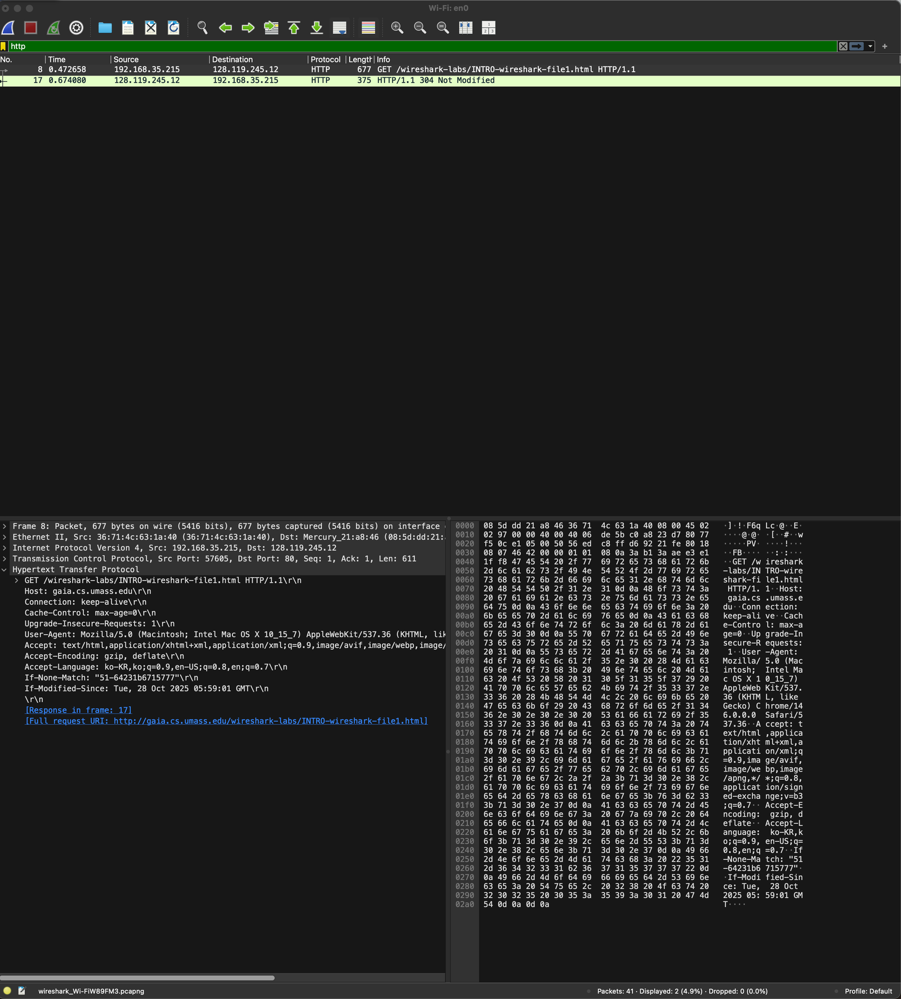
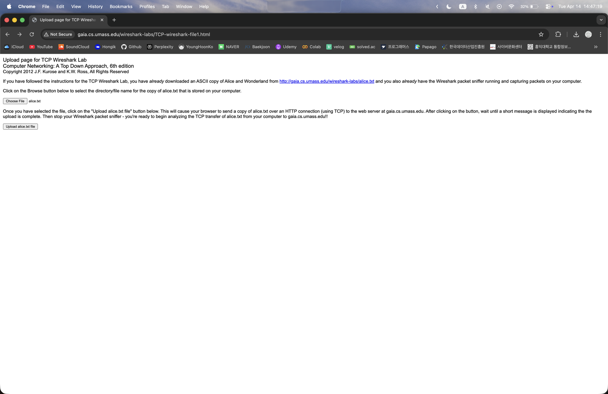
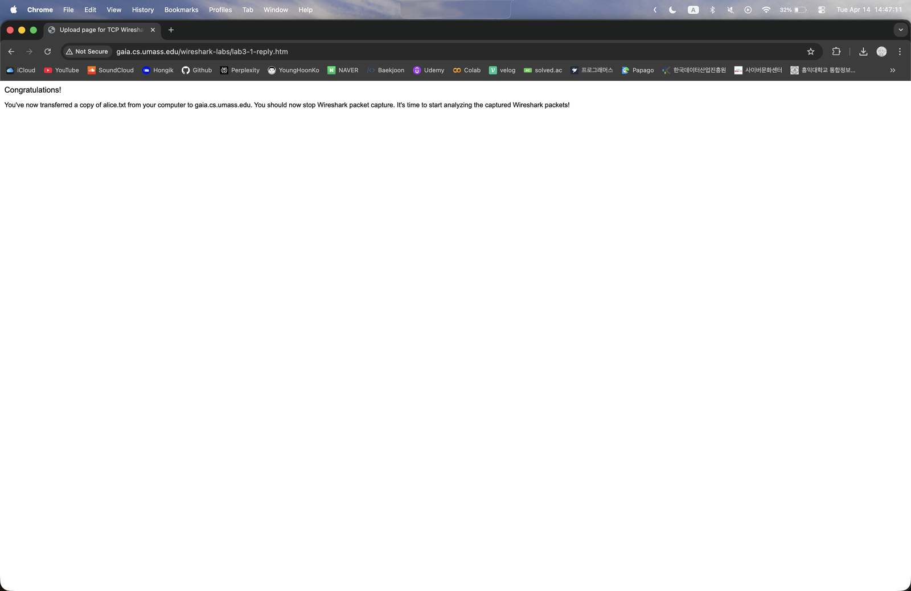
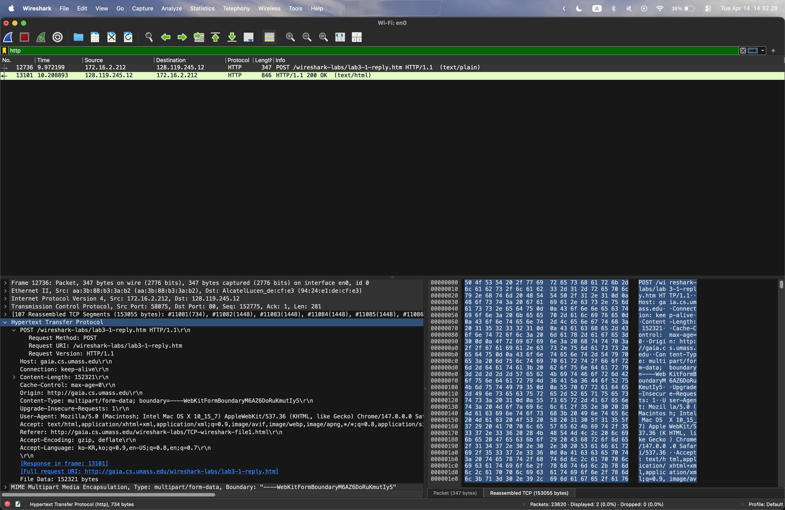
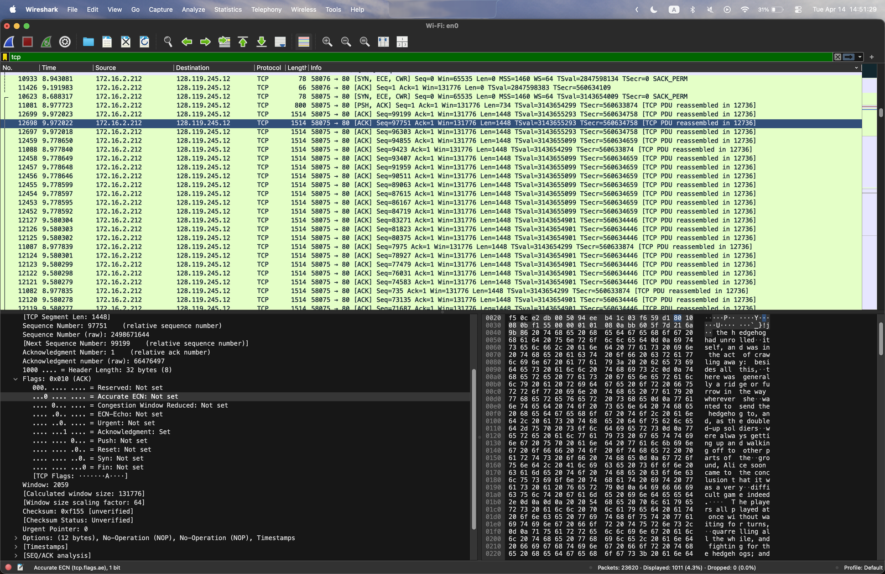
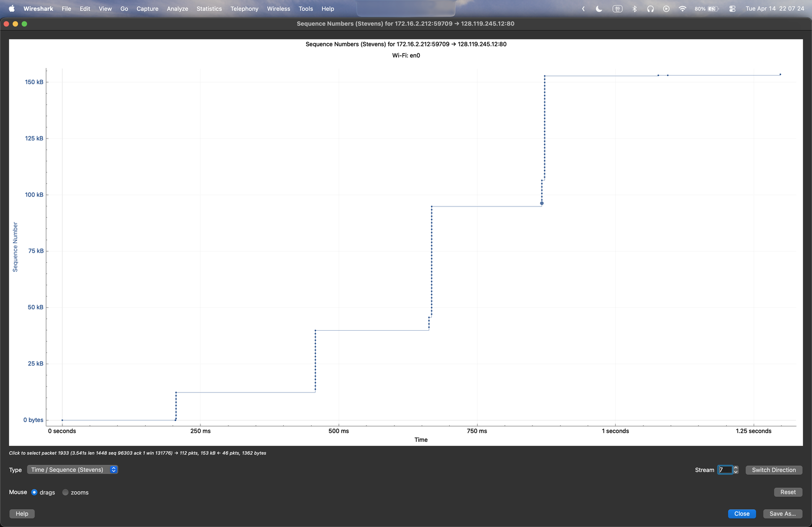

## 학습 목표

- Wireshark의 기본 화면(패킷 목록, 헤더 상세, 바이트 창)과 표시 필터 사용법 복습
- 조건부 GET(`If-Modified-Since`)과 `304 Not Modified` 응답 확인
- 대용량 파일(alice.txt)을 HTTP POST로 올리며 TCP 세그먼트 캡처
- 송신자/수신자의 IP 주소와 포트 번호 찾기
- SYN 세그먼트의 옵션(MSS, Window Scale, SACK)과 실제 세그먼트 크기의 관계 이해
- Stevens 그래프(시간-순서 번호)로 슬로 스타트와 RTT 단위 전송 확인

> 실습 3의 과제 파일에는 스크린샷만 있고 답이 비어 있었음. 아래 답은 스크린샷에 보이는 값으로 채운 것
{: .prompt-info }

---

## 1. Wireshark 시작하기 (실습 1)

- 필터 `http`로 HTTP 메시지만 표시. 요청 1개(8번)와 응답 1개(17번)가 보임
- 요청: `GET /wireshark-labs/INTRO-wireshark-file1.html HTTP/1.1`
- 같은 페이지를 이미 받은 적이 있어서 요청에 `If-Modified-Since`와 `If-None-Match` 헤더가 들어감
- 서버는 파일이 바뀌지 않았으므로 본문 없이 `HTTP/1.1 304 Not Modified`로 응답 → 브라우저는 캐시에 있는 사본을 사용

> 조건부 GET은 캐시의 사본이 최신인지 서버에 확인하는 방법. 바뀌지 않았으면 304와 함께 **본문이 없는** 응답이 와서 전송량이 줄어듦
{: .prompt-tip }

---

## 2. 대용량 TCP 전송 캡처하기

1. 브라우저로 `gaia.cs.umass.edu/wireshark-labs/TCP-wireshark-file1.html`에 접속
2. 미리 내려받은 alice.txt(약 150KB)를 선택하고 Wireshark 캡처 시작
3. `Upload alice.txt file` 버튼을 누르면 HTTP POST로 파일이 서버에 전송됨
4. "Congratulations!" 화면이 나오면 캡처 중지

---

## 3. 캡처한 트레이스 살펴보기

- 필터 `http`로 보면 `POST /wireshark-labs/lab3-1-reply.htm`(12736번)과 `HTTP/1.1 200 OK`(13101번) 두 개만 남음
- POST 하나가 **107개의 TCP 세그먼트(153,055 bytes)** 로 나뉘어 전송되었고, Wireshark가 이를 다시 합쳐서(`Reassembled TCP Segments`) 하나의 HTTP 메시지로 보여 줌
- `Content-Length: 152321`은 HTTP 본문(alice.txt를 담은 multipart 데이터)의 길이이고, 153,055 bytes에는 HTTP 헤더도 포함됨

### 문제 1

> alice.txt 파일을 gaia.cs.umass.edu로 전송하는 클라이언트 컴퓨터(송신자)가 사용하는 IP 주소와 TCP 포트 번호는 무엇인가?
{: .prompt-info }

- IP 주소: **172.16.2.212**
- TCP 포트: **58075**
- POST 메시지를 선택하고 `Internet Protocol Version 4`, `Transmission Control Protocol` 줄에서 확인 (`Src: 172.16.2.212`, `Src Port: 58075`)

### 문제 2

> gaia.cs.umass.edu의 IP 주소는 무엇인가? 이 연결에서 TCP 세그먼트를 송수신하는 포트 번호는 무엇인가?
{: .prompt-info }

- IP 주소: **128.119.245.12**
- 포트 번호: **80** (HTTP 서버의 기본 포트)

---

## 4. TCP 기본 사항

필터를 `tcp`로 바꾸면 HTTP 아래에 있던 TCP 세그먼트가 모두 보임.

### 연결 설정 (3-way handshake)

- 클라이언트가 처음 보내는 세그먼트는 `[SYN, ECE, CWR] Seq=0`
- SYN에 들어 있는 옵션
  - `MSS=1460`: 이 연결에서 받을 수 있는 세그먼트의 최대 데이터 크기. 이더넷 MTU 1500에서 IP 헤더 20, TCP 헤더 20을 뺀 값
  - `WS=64`: Window Scale. 헤더의 윈도 필드(16비트)에 64를 곱해 실제 수신 윈도를 표현
  - `SACK_PERM`: 선택적 확인 응답(SACK)을 쓸 수 있음
- Wireshark의 `Seq=0`은 **상대 순서 번호**. 실제 순서 번호(raw)는 무작위로 정해진 큰 수(스크린샷의 `2498671644` 등)

### 데이터 세그먼트

- 데이터 세그먼트는 대부분 `Len=1448`
- MSS는 1460인데 1448만 실리는 이유: 모든 세그먼트에 **타임스탬프 옵션(12 bytes)** 이 붙어서 TCP 헤더가 32 bytes가 되기 때문 (스크린샷의 `Header Length: 32 bytes`)
- 상세 창의 `Window: 2059`, `Window size scaling factor: 64`, `Calculated window size: 131776`은 $$2059 \times 64 = 131776$$ 관계

> 세그먼트 크기 = MSS − TCP 옵션 크기. 1460 − 12 = 1448
{: .prompt-tip }

---

## 5. Stevens 그래프로 본 TCP 혼잡 제어

`Statistics > TCP Stream Graphs > Time Sequence (Stevens)`로 그린 그래프. (이 그래프는 같은 실습을 다시 한 업로드라 포트가 59709)

- 가로축은 시간, 세로축은 순서 번호(보낸 바이트). 점 하나가 세그먼트 하나
- 점이 **세로로 몰려 있는 구간**은 송신자가 윈도만큼 연달아 보낸 묶음이고, 묶음 사이의 **수평 구간**은 ACK를 기다리는 시간(약 1 RTT, 여기서는 약 200 ms)
- 묶음의 높이(한 RTT에 보낸 양)가 약 12 kB → 27 kB → 55 kB 정도로 거의 두 배씩 커짐 → **슬로 스타트**
- 파일이 약 150 kB로 작아서 혼잡 회피(선형 증가) 단계가 나타나기 전에 전송이 끝남

---

## 최종 핵심 정리

1. Wireshark는 패킷 목록, 헤더 상세, 바이트 창으로 구성되고, `http`, `tcp` 같은 표시 필터로 원하는 패킷만 볼 수 있음
2. 조건부 GET에서 객체가 바뀌지 않았으면 서버는 본문 없는 `304 Not Modified`로 응답함
3. 큰 HTTP POST 하나는 여러 TCP 세그먼트로 나뉘어 전송되고, Wireshark가 재조립해서 보여 줌 (이번 실습은 107개, 153,055 bytes)
4. 송신자는 172.16.2.212:58075, 서버는 128.119.245.12:80
5. SYN 세그먼트에서 MSS(1460), Window Scale(64), SACK 허용 여부를 협상함
6. 타임스탬프 옵션 12 bytes 때문에 실제 데이터는 세그먼트당 1448 bytes
7. 수신 윈도 = 윈도 필드 × 스케일 팩터 (2059 × 64 = 131,776)
8. Stevens 그래프에서 RTT마다 보내는 양이 두 배씩 늘어나는 슬로 스타트를 확인할 수 있음

---

End.
