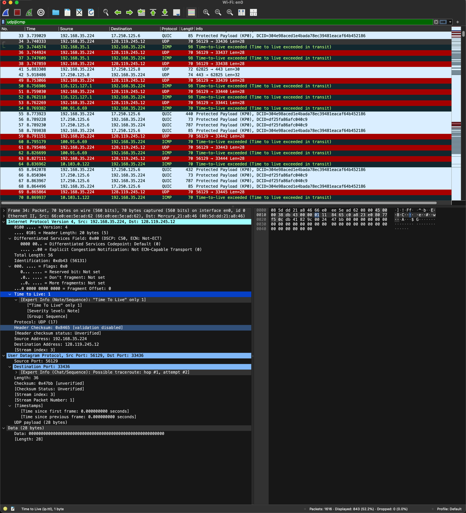
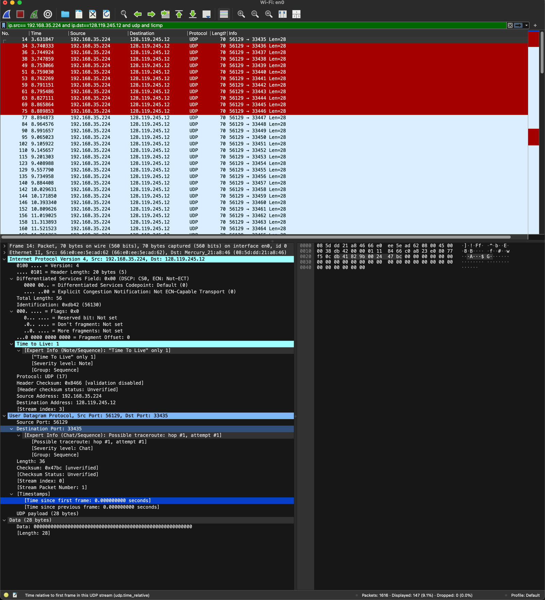
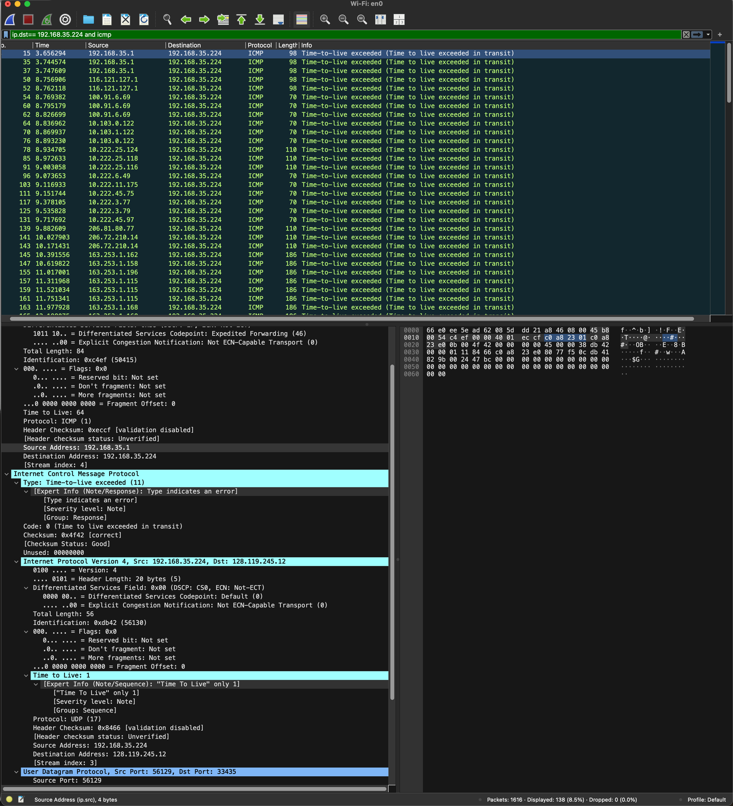

## 학습 목표

- traceroute가 TTL을 1씩 늘려 가며 경로상의 라우터를 찾아내는 원리 이해
- IPv4 헤더의 주요 필드(Version, Header Length, Total Length, Identification, Flags, Fragment Offset, TTL, Protocol, Checksum) 읽기
- 페이로드 길이를 Total Length와 Header Length로 계산하기
- 단편화 여부를 Flags와 Fragment Offset으로 판단하기
- 프로브마다 바뀌는 필드와 바뀌지 않는 필드 구분하기
- 라우터가 보낸 ICMP Time Exceeded 메시지의 특징 이해

---

## traceroute와 TTL

- IP 데이터그램의 TTL은 라우터를 지날 때마다 1씩 줄고, **0이 되면 라우터가 데이터그램을 버리고 송신자에게 ICMP Time Exceeded(Type 11)를 보냄**
- traceroute는 TTL = 1, 2, 3, ... 인 프로브를 차례로 보내서, ICMP를 돌려보낸 라우터의 주소로 경로를 알아냄
- macOS와 Linux의 traceroute는 **UDP** 프로브를, Windows의 `tracert`는 **ICMP Echo** 프로브를 보냄. 그래서 문제 3과 10의 답이 운영체제마다 다름
- 이 실습은 macOS에서 `traceroute gaia.cs.umass.edu`를 실행하며 캡처함 (사용자 컴퓨터 192.168.35.224 → 128.119.245.12)

---

## Part 1: 기본 IPv4

필터 `udp||icmp`로 traceroute 패킷만 표시. 빨간 줄은 라우터가 보낸 ICMP `Time-to-live exceeded`.

### 문제 1~6: 첫 번째 UDP 프로브

| 문제 | 질문 | 답 | 근거 |
| --- | --- | --- | --- |
| 1 | 내 컴퓨터의 IP 주소 | 192.168.35.224 | `Source Address` |
| 2 | TTL 값 | 1 | 첫 프로브이므로 첫 번째 라우터에서 0이 됨 |
| 3 | 상위 계층 프로토콜 | UDP (17) | macOS traceroute는 UDP 프로브 사용 |
| 4 | IP 헤더 크기 | 20 bytes | `0101 = Header Length: 20 bytes (5)` (5 × 4 bytes) |
| 5 | 페이로드 크기 | 36 bytes | Total Length 56 − 헤더 20 |
| 6 | 단편화 여부 | 단편화되지 않음 | More fragments = 0, Fragment Offset = 0 |

- 문제 5의 계산을 식으로 쓰면 $$56 - 20 = 36$$ bytes이고, 이 36 bytes는 UDP 헤더 8 bytes와 UDP 데이터 28 bytes(`Data (28 bytes)`)로 이루어짐
- 문제 6: 단편화된 데이터그램은 마지막 조각이 아니면 More fragments = 1이고, 첫 조각이 아니면 Fragment Offset이 0이 아님. 둘 다 0이므로 **조각나지 않은 하나의 데이터그램**

---

## 프로브마다 바뀌는 필드

필터 `ip.src==192.168.35.224 and ip.dst==128.119.245.12 and udp and !icmp`로 내 컴퓨터가 보낸 UDP 프로브만 표시.

### 문제 7: 항상 바뀌는 필드

> 이 UDP 세그먼트 시퀀스에서 IP 데이터그램의 어떤 필드가 데이터그램마다 항상 바뀌는가? 그 이유는?
{: .prompt-info }

- **Identification**: 데이터그램마다 붙는 번호이므로 매번 달라짐 (예: 0xdb42 → 0xdb43)
- **Header Checksum**: 헤더 값(Identification, TTL)이 바뀌면 다시 계산되므로 함께 바뀜
- **TTL**: traceroute가 홉 수를 늘려 가며 보내므로 바뀜. 단, macOS traceroute는 **같은 TTL로 프로브를 3개씩** 보내므로(`hop #1, attempt #1`, `attempt #2`...) TTL은 3개마다 1씩 증가

### 문제 8: 일정한 필드

> 어떤 필드들이 일정하게 유지되는가? 그 이유는?
{: .prompt-info }

- Version(4), Header Length(20), Differentiated Services, Total Length(56), Flags, Fragment Offset, Protocol(UDP 17), Source/Destination Address
- 같은 출발지에서 같은 목적지로, **같은 크기**의 UDP 프로브를 보내기 때문. 작은 패킷이라 단편화도 일어나지 않음

### 문제 9: Identification의 패턴

- 내 컴퓨터가 보낸 프로브의 Identification은 **1씩 순차적으로 증가**함 (56130, 56131, ...)

---

## 라우터가 보낸 ICMP 메시지

필터 `ip.dst==192.168.35.224 and icmp`로 내 컴퓨터가 받은 ICMP만 표시.

### 문제 10: 상위 계층 프로토콜

- **ICMP (1)**. 라우터는 TTL이 0이 된 데이터그램을 버리고 `Type: 11 (Time-to-live exceeded)`, `Code: 0` ICMP 메시지를 보냄
- ICMP 메시지 안에는 **버려진 원래 데이터그램의 IP 헤더와 UDP 헤더 일부**가 들어 있음 (스크린샷 아래쪽의 두 번째 `Internet Protocol` 줄). 송신자는 이걸 보고 어떤 프로브에 대한 응답인지 알 수 있음

### 문제 11: ICMP의 Identification

- 문제 9와 **같은 패턴이 아님**
- 내 컴퓨터의 프로브는 한 호스트가 연속으로 만들어서 번호가 1씩 늘어나지만, ICMP 메시지는 **여러 라우터가 각자** 만들어 보내므로 번호에 공통 규칙이 없음

### 문제 12: ICMP의 TTL

- **서로 다름**
- 라우터마다 초기 TTL(64, 255 등)이 다를 수 있고, 각 라우터에서 내 컴퓨터까지 오는 홉 수도 다르기 때문
- 예: 첫 번째 라우터(192.168.35.1)가 보낸 ICMP는 TTL 64로 도착 (바로 옆이라 거의 줄지 않음)

---

### 과제 노트에서 정정한 부분 정리

| 위치 | 원래 | 정정 | 이유 |
| --- | --- | --- | --- |
| 문제 7 | TTL은 probe마다 값을 증가 | TTL은 같은 값으로 3개씩 보낸 뒤 1 증가 | macOS traceroute는 홉마다 프로브 3개를 보냄 (스크린샷의 `attempt #1`, `#2`) |
| 문제 1~5 | 답을 별도 캡처 이미지에만 적어 둠 | 표로 값을 직접 정리 | 원본 캡처 이미지가 과제 폴더 밖에 있어서 글에 넣을 수 없었음 |

---

## 최종 핵심 정리

1. traceroute는 TTL을 1부터 늘려 가며 프로브를 보내고, TTL이 0이 된 라우터가 보내는 ICMP Time Exceeded로 경로를 알아냄
2. macOS/Linux traceroute는 UDP(17), Windows tracert는 ICMP Echo 프로브를 사용함
3. IPv4 헤더 길이는 Header Length 값 × 4 bytes이고, 옵션이 없으면 20 bytes
4. 페이로드 = Total Length − Header Length (56 − 20 = 36 bytes = UDP 헤더 8 + 데이터 28)
5. More fragments = 0이고 Fragment Offset = 0이면 단편화되지 않은 데이터그램
6. 프로브마다 Identification과 Header Checksum이 바뀌고, TTL은 홉이 바뀔 때마다 증가함
7. 라우터가 보낸 ICMP 메시지에는 버려진 원래 데이터그램의 헤더가 들어 있음
8. ICMP 메시지는 여러 라우터가 각자 만들므로 Identification과 TTL에 일정한 패턴이 없음

---

End.
