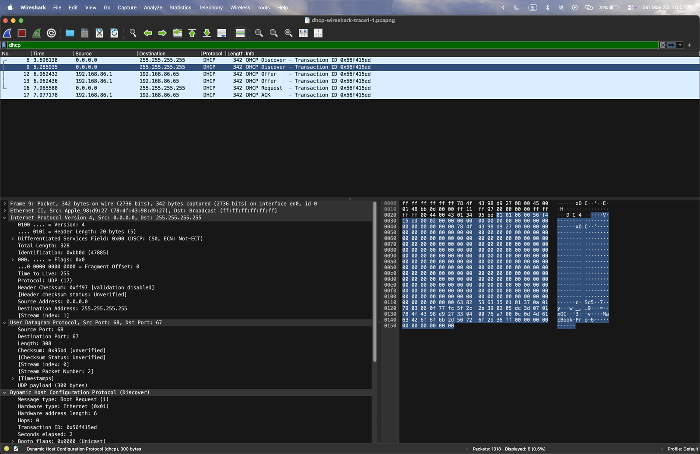

## 학습 목표

- DHCP가 IP 주소를 받는 4단계(Discover → Offer → Request → ACK) 이해
- 주소가 없는 클라이언트가 쓰는 0.0.0.0과 255.255.255.255의 의미
- DHCP가 UDP 67(서버), 68(클라이언트) 포트를 쓰는 이유
- transaction ID로 같은 트랜잭션의 메시지를 묶는 방법
- Parameter Request List와 서버가 돌려주는 옵션(서브넷 마스크, 라우터, DNS, 임대 시간) 읽기
- 트레이스 파일을 코드로 다시 읽어 Wireshark에서 본 값 검증하기

---

## DHCP 동작 요약

| 단계 | 방향 | 출발지 IP → 목적지 IP | 하는 일 |
| --- | --- | --- | --- |
| Discover | 클라이언트 → 서버 | 0.0.0.0 → 255.255.255.255 | "DHCP 서버 있나요?" (브로드캐스트) |
| Offer | 서버 → 클라이언트 | 192.168.86.1 → 192.168.86.65 | 사용할 주소와 설정을 제안 |
| Request | 클라이언트 → 서버 | 0.0.0.0 → 255.255.255.255 | 제안받은 주소를 쓰겠다고 요청 |
| ACK | 서버 → 클라이언트 | 192.168.86.1 → 192.168.86.65 | 최종 승인, 임대 시작 |

- 모든 메시지는 **UDP** 위에서 동작 (클라이언트 포트 68, 서버 포트 67)
- 클라이언트는 아직 주소가 없고 서버 주소도 모르므로 TCP 연결을 맺을 수 없음 → 연결 없이 브로드캐스트할 수 있는 UDP를 사용

---

## 트레이스 화면

강의에서 제공한 `dhcp-wireshark-trace1-1.pcapng`를 열고 필터 `dhcp`를 적용한 화면.




- Discover와 Offer가 두 번씩 보임 (5, 9번 / 12, 13번). 첫 Discover에 대한 응답을 기다리는 동안 클라이언트가 Discover를 다시 보냈고, 서버가 두 Discover에 각각 Offer를 보낸 것으로 보임
- 두 번째 Discover의 `Seconds elapsed`가 2로 늘어난 것이 재전송이라는 단서

---

## 코드로 트레이스 다시 읽기

Wireshark에서 본 값이 맞는지 확인하려고, 같은 pcapng 파일을 Python의 `scapy`로 읽어 DHCP 메시지만 출력함.

```python
import sys
from scapy.all import rdpcap, BOOTP, DHCP, IP, UDP
from scapy.layers.dhcp import DHCPTypes

pkts = rdpcap(sys.argv[1])
for i, p in enumerate(pkts, 1):
    if DHCP not in p:
        continue
    opts = {o[0]: o[1:] for o in p[DHCP].options if isinstance(o, tuple)}
    mtype = DHCPTypes.get(opts["message-type"][0])
    print(f"#{i:<4} {mtype:<9} {p[IP].src:>15} -> {p[IP].dst:<15} "
          f"udp {p[UDP].sport}->{p[UDP].dport}  xid=0x{p[BOOTP].xid:08x}  yiaddr={p[BOOTP].yiaddr}")
    if "param_req_list" in opts:
        print("      param_req_list:", list(opts["param_req_list"][0]))
    for k in ("subnet_mask", "router", "name_server", "lease_time", "requested_addr", "server_id"):
        if k in opts:
            print(f"      {k}: {opts[k][0]}")
```

실행 결과

```text
#5    discover          0.0.0.0 -> 255.255.255.255 udp 68->67  xid=0x56f415ed  yiaddr=0.0.0.0
      param_req_list: [1, 121, 3, 6, 15, 119, 252, 95, 44, 46]
      lease_time: 7776000
#9    discover          0.0.0.0 -> 255.255.255.255 udp 68->67  xid=0x56f415ed  yiaddr=0.0.0.0
      param_req_list: [1, 121, 3, 6, 15, 119, 252, 95, 44, 46]
      lease_time: 7776000
#12   offer        192.168.86.1 -> 192.168.86.65   udp 67->68  xid=0x56f415ed  yiaddr=192.168.86.65
      subnet_mask: 255.255.255.0
      router: 192.168.86.1
      name_server: 192.168.86.1
      lease_time: 86400
      server_id: 192.168.86.1
#13   offer        192.168.86.1 -> 192.168.86.65   udp 67->68  xid=0x56f415ed  yiaddr=192.168.86.65
      subnet_mask: 255.255.255.0
      router: 192.168.86.1
      name_server: 192.168.86.1
      lease_time: 86400
      server_id: 192.168.86.1
#16   request           0.0.0.0 -> 255.255.255.255 udp 68->67  xid=0x56f415ed  yiaddr=0.0.0.0
      param_req_list: [1, 121, 3, 6, 15, 119, 252, 95, 44, 46]
      requested_addr: 192.168.86.65
      server_id: 192.168.86.1
#17   ack          192.168.86.1 -> 192.168.86.65   udp 67->68  xid=0x56f415ed  yiaddr=192.168.86.65
      subnet_mask: 255.255.255.0
      router: 192.168.86.1
      name_server: 192.168.86.1
      lease_time: 86400
      server_id: 192.168.86.1
```

Parameter Request List의 번호는 DHCP 옵션 번호.

| 번호 | 옵션 | 번호 | 옵션 |
| --- | --- | --- | --- |
| 1 | Subnet Mask | 119 | Domain Search |
| 121 | Classless Static Route | 252 | Proxy 자동 설정(WPAD) |
| 3 | Router | 95 | LDAP |
| 6 | Domain Name Server | 44 | NetBIOS Name Server |
| 15 | Domain Name | 46 | NetBIOS Node Type |

---

## 문제와 답

### DHCP Discover

| 문제 | 답 |
| --- | --- |
| 1. 전송 프로토콜 | **UDP** |
| 2. 출발지 IP | **0.0.0.0**. 클라이언트가 아직 IP 주소를 받지 못해서 "이 호스트"를 뜻하는 0.0.0.0을 씀 |
| 3. 목적지 IP | **255.255.255.255**. DHCP 서버 주소를 모르므로 같은 서브넷 전체에 브로드캐스트 |
| 4. transaction ID | **0x56f415ed** |
| 5. IP 주소 외에 요청한 정보 | Subnet Mask, Router(기본 게이트웨이), Domain Name Server, Domain Name, Classless Static Route 등 (Parameter Request List, 옵션 55). 그 밖에 임대 시간으로 7,776,000초(90일)를 **제안**함 |

### DHCP Offer

| 문제 | 답 |
| --- | --- |
| 6. Discover에 대한 응답인 근거 | transaction ID가 **0x56f415ed**로 같음 |
| 7. 출발지 IP | **192.168.86.1**. DHCP 서버(이 네트워크에서는 공유기)의 실제 주소 |
| 8. 목적지 IP | **192.168.86.65**. 교재 그림처럼 브로드캐스트가 아니라 **클라이언트에게 줄 주소로 유니캐스트**함. 클라이언트가 Discover의 Bootp flags를 `Unicast`(0x0000)로 보내서, 서버가 아직 주소가 설정되지 않은 클라이언트에게도 유니캐스트로 응답한 것 (RFC 2131) |
| 9. 서버가 제공한 정보 | 제안 주소(Your IP) 192.168.86.65, Subnet Mask 255.255.255.0, Router 192.168.86.1, DNS 192.168.86.1, Lease Time 86,400초(1일) |

### DHCP Request

| 문제 | 답 |
| --- | --- |
| 10. UDP 포트 | 출발지 **68**, 목적지 **67** |
| 11. 출발지 IP | **0.0.0.0**. ACK를 받기 전까지는 제안받은 주소를 아직 쓸 수 없음 |
| 12. 목적지 IP | **255.255.255.255**. 브로드캐스트로 보내야 Offer를 보냈던 **다른 DHCP 서버들도** 자기 제안이 선택되지 않았음을 알 수 있음 |
| 13. transaction ID | **0x56f415ed**, Discover와 Offer와 같음 |
| 14. Parameter Request List 차이 | Discover와 **완전히 같음** (1, 121, 3, 6, 15, 119, 252, 95, 44, 46). 대신 Request에는 Requested IP Address(192.168.86.65)와 Server Identifier(192.168.86.1)가 추가되어 어떤 서버의 어떤 제안을 받아들이는지 밝힘 |

### DHCP ACK

| 문제 | 답 |
| --- | --- |
| 15. 출발지 IP | **192.168.86.1** (DHCP 서버) |
| 16. 목적지 IP | **192.168.86.65** (Offer와 마찬가지로 유니캐스트) |
| 17. 할당된 주소가 담긴 필드 | **Your (client) IP address** |
| 18. 임대 시간 | **86,400초 = 1일** |
| 19. 첫 번째 홉 라우터 | **192.168.86.1** (Option 3, Router). 클라이언트의 기본 게이트웨이 |

---

### 과제 노트에서 정정한 부분 정리

| 위치 | 원래 | 정정 | 이유 |
| --- | --- | --- | --- |
| 문제 5 | 요청 정보에 Broadcast Address 포함 | Broadcast Address(옵션 28)는 목록에 없음. 대신 Classless Static Route(121), Domain Search(119) 등이 있음 | 트레이스의 Parameter Request List는 1, 121, 3, 6, 15, 119, 252, 95, 44, 46 |
| 문제 14 | "거의 동일" | 완전히 동일하고, Request에는 Requested IP Address와 Server Identifier가 추가됨 | scapy로 두 목록을 비교한 결과 |
| 문제 12 | 요청한 주소를 네트워크 전체에 알림 | 여러 서버 중 하나를 골랐다는 사실을 모든 서버에 알림 | Request 브로드캐스트의 목적은 선택되지 않은 서버가 제안한 주소를 회수하게 하는 것 |

---

## 최종 핵심 정리

1. DHCP는 Discover → Offer → Request → ACK 4단계로 IP 주소와 네트워크 설정을 받음
2. 클라이언트는 주소가 없으므로 출발지 0.0.0.0, 목적지 255.255.255.255로 브로드캐스트함
3. DHCP는 UDP를 쓰고, 서버는 67번, 클라이언트는 68번 포트를 사용함
4. 같은 트랜잭션의 메시지는 같은 transaction ID(이번 트레이스는 0x56f415ed)를 가짐
5. 클라이언트는 Parameter Request List(옵션 55)로 원하는 설정을 요청함
6. 서버는 Your IP address, 서브넷 마스크, 라우터, DNS, 임대 시간(86,400초)을 돌려줌
7. Offer와 ACK는 브로드캐스트가 아니라 할당할 주소로 유니캐스트될 수도 있음 (Bootp flags에 따라 결정)
8. Request를 브로드캐스트하는 이유는 선택되지 않은 다른 DHCP 서버도 결과를 알게 하려는 것

---

End.
