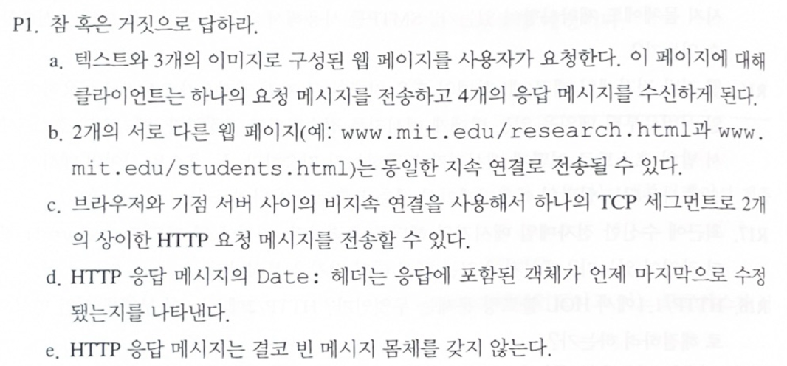
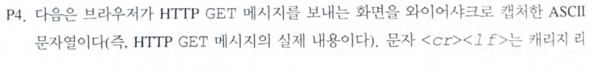
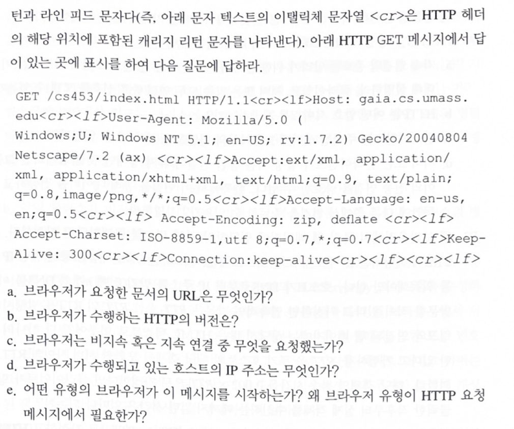
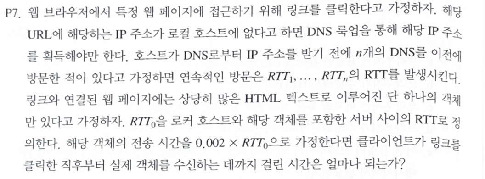
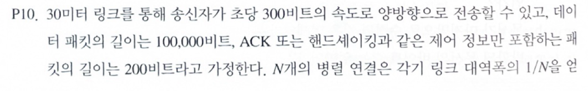
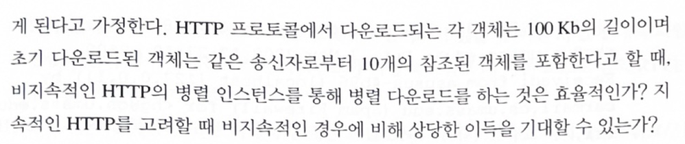
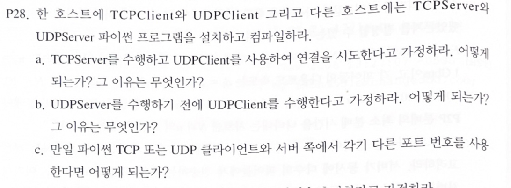

## 학습 목표

- HTTP 요청/응답, 지속 연결과 비지속 연결의 차이 정리
- HTTP GET 메시지의 각 헤더가 뜻하는 것 읽기
- DNS 조회, TCP 연결 설정, 객체 요청에 드는 RTT 계산
- 병렬 비지속 HTTP와 지속 HTTP의 전송 시간 비교
- Python 소켓으로 TCP/UDP 대문자 변환 서버를 실행하고 P28 상황을 재현

---

## P1. HTTP 참/거짓



| 문항 | 답 | 이유 |
| --- | --- | --- |
| a | **False** | HTML 파일과 이미지는 각각 별도의 객체이므로 요청도 따로 보냄 |
| b | **True** | 같은 서버의 객체는 지속 연결이면 하나의 TCP 연결로 받을 수 있음 |
| c | **False** | 비지속 연결에서는 TCP 연결 하나가 요청/응답 하나만 처리함 |
| d | **False** | `Date`는 응답을 **만든** 시각이고, 객체가 수정된 시각은 `Last-Modified` |
| e | **False** | `HEAD` 요청에 대한 응답, `304 Not Modified` 등은 본문이 없음 |

---

## P4. HTTP GET 메시지 해석





| 문항 | 답 | 근거 |
| --- | --- | --- |
| a. 요청한 URL | `http://gaia.cs.umass.edu/cs453/index.html` | 요청 줄의 경로 + `Host` 헤더 |
| b. HTTP 버전 | HTTP/1.1 | 요청 줄 끝 |
| c. 연결 방식 | 지속 연결 | `Connection: keep-alive` |
| d. 호스트의 IP 주소 | 알 수 없음 | HTTP 메시지에는 IP 주소가 없음. IP 주소는 이 메시지를 실은 IP 데이터그램 헤더에 있음 |
| e. 브라우저 종류 | Netscape 7.2 (Mozilla 계열) | `User-Agent` 헤더 |

e의 두 번째 질문(왜 브라우저 종류가 필요한가): 서버가 브라우저마다 **다른 버전의 객체**(같은 URL이라도 브라우저에 맞춘 페이지)를 보내 줄 수 있기 때문.

---

## P7. DNS 조회를 포함한 응답 시간



- DNS 서버 $$n$$개를 차례로 방문: $$RTT_1 + \cdots + RTT_n$$
- 서버와 TCP 연결 설정: $$RTT_0$$
- HTTP 요청을 보내고 응답의 첫 비트를 받기까지: $$RTT_0$$
- 객체 전송 시간: $$0.002 RTT_0$$

따라서 전체 시간은 $$RTT_1 + \cdots + RTT_n + 2RTT_0 + 0.002RTT_0$$

> 수업에서는 TCP 연결과 요청/응답 RTT를 빼고 $$RTT_1 + \cdots + RTT_n + 0.002RTT_0$$를 답으로 함. 이는 DNS 조회와 전송 시간만 따진 경우이고, HTTP 객체를 받으려면 TCP 연결(1 RTT)과 요청/응답(1 RTT)이 필요하므로 교재 기준으로는 $$2RTT_0$$를 포함하는 것이 맞음
{: .prompt-warning }

---

## P10. 병렬 비지속 HTTP vs 지속 HTTP





조건: 30 m 링크, 전송 속도 300 bps, 객체 100,000 bits, 제어 패킷(SYN, ACK, 요청 등) 200 bits, 참조 객체 10개, 병렬 연결 $$N$$개는 대역폭을 $$1/N$$씩 나눠 가짐. 링크가 30 m라 전파 지연(약 0.1 μs)은 무시함.

### 계산

먼저 기준 객체(HTML)를 받는 시간. TCP 연결 설정(제어 패킷 3개), 요청, 객체 전송을 더함.

- 기준 객체: $$3 \times \frac{200}{300} + \frac{200}{300} + \frac{100000}{300} \approx 2 + 0.67 + 333.33 \approx 336$$초

**병렬 비지속 HTTP**: 참조 객체 10개를 10개 연결로 동시에 받으면 연결마다 대역폭이 $$300 / 10 = 30$$ bps

- 참조 객체 10개: $$3 \times \frac{200}{30} + \frac{200}{30} + \frac{100000}{30} \approx 20 + 6.67 + 3333.33 \approx 3360$$초
- 합계: 약 **3,696초**

**지속 HTTP**: 연결 설정 없이 요청과 전송만 10번 (전체 대역폭 300 bps 사용)

- 참조 객체 10개: $$10 \times \left( \frac{200}{300} + \frac{100000}{300} \right) \approx 10 \times 334 = 3340$$초
- 합계: 약 **3,676초**

### 답

- 병렬 비지속 HTTP도 꽤 효율적임. 10개 연결이 병목 링크를 나눠 쓰므로, 링크가 계속 꽉 차 있다는 점은 지속 HTTP와 같음
- 지속 HTTP가 약 20초 빠르지만, 전체 수천 초에 비하면 **큰 이득은 아님**
- 객체가 커서 전송 시간이 대부분을 차지하고, 두 방식의 차이는 **연결 설정 오버헤드**에서만 생기기 때문

---

## P28. TCP/UDP 소켓 실험



교재 2.7절의 대문자 변환 서버를 Python으로 작성하고, 한 컴퓨터(127.0.0.1)에서 직접 실행해 보았음.

### TCP 서버와 클라이언트

```python
# TCPServer.py
from socket import *

serverPort = 12000
serverSocket = socket(AF_INET, SOCK_STREAM)   # TCP 소켓
serverSocket.bind(('', serverPort))
serverSocket.listen(1)                        # 연결 요청 대기
print("서버 실행 중...")

while True:
    connectionSocket, addr = serverSocket.accept()   # 클라이언트마다 새 소켓
    print(f"연결됨: {addr}")
    sentence = connectionSocket.recv(1024).decode()
    connectionSocket.send(sentence.upper().encode())
    connectionSocket.close()
```

```python
# TCPClient.py
from socket import *

serverName = '127.0.0.1'
serverPort = 12000
clientSocket = socket(AF_INET, SOCK_STREAM)
clientSocket.connect((serverName, serverPort))   # 3-way handshake
sentence = input("소문자 문장 입력: ")
clientSocket.send(sentence.encode())
modifiedSentence = clientSocket.recv(1024)
print("서버 응답:", modifiedSentence.decode())
clientSocket.close()
```

실행 결과 (클라이언트에 `hello internet engineering` 입력)

```text
[클라이언트]
소문자 문장 입력: 서버 응답: HELLO INTERNET ENGINEERING

[서버]
서버 실행 중...
연결됨: ('127.0.0.1', 59164)
```

- 서버 출력의 59164는 운영체제가 클라이언트 소켓에 자동으로 붙인 포트 번호

### UDP 서버와 클라이언트

```python
# UDPServer.py
from socket import *

serverPort = 12000
serverSocket = socket(AF_INET, SOCK_DGRAM)   # UDP 소켓, listen/accept 없음
serverSocket.bind(('', serverPort))
print("UDP 서버 실행 중...")

while True:
    message, clientAddress = serverSocket.recvfrom(1024)
    print("받음:", message.decode())
    serverSocket.sendto(message.decode().upper().encode(), clientAddress)
```

```python
# UDPClient.py
from socket import *

serverName = '127.0.0.1'
serverPort = 12000
clientSocket = socket(AF_INET, SOCK_DGRAM)
msg = input("메시지 입력: ")
clientSocket.sendto(msg.encode(), (serverName, serverPort))   # 연결 없이 바로 전송
response, _ = clientSocket.recvfrom(1024)
print("서버 응답:", response.decode())
clientSocket.close()
```

실행 결과 (클라이언트에 `udp is connectionless` 입력)

```text
[클라이언트]
메시지 입력: 서버 응답: UDP IS CONNECTIONLESS

[서버]
UDP 서버 실행 중...
받음: udp is connectionless
```

### P28 상황 재현

`timeout 5`로 클라이언트를 5초까지만 기다리게 해서 실행함. 종료 코드 124는 5초 동안 끝나지 않아 강제로 종료되었다는 뜻.

```bash
# a. TCPServer만 실행 중일 때 UDPClient 실행
python3 TCPServer.py &
echo "test" | timeout 5 python3 UDPClient.py; echo "exit=$?"

# b. UDPServer 없이 UDPClient 실행
echo "test" | timeout 5 python3 UDPClient.py; echo "exit=$?"

# c-1. UDP 서버는 12000, 클라이언트는 12001로 전송
# c-2. UDP 서버만 12000에 있고, TCP 클라이언트가 12001로 연결
```

실행 결과

```text
a   exit=124                              (UDP 클라이언트가 응답을 기다리며 멈춤)
b   exit=124                              (전송은 되지만 응답이 오지 않아 멈춤)
c-1 exit=124                              (다른 포트로 보낸 데이터그램은 서버가 받지 못함)
c-2 ConnectionRefusedError: [Errno 111] Connection refused
```

| 문항 | 답 | 이유 |
| --- | --- | --- |
| a | 통신이 되지 않고 UDP 클라이언트가 응답을 기다리며 멈춤 | UDP 데이터그램은 같은 포트 번호라도 **UDP 소켓**으로만 전달됨. TCP 서버 소켓은 이를 받지 않음 |
| b | 클라이언트는 데이터를 보내지만 응답을 받지 못하고 멈춤 | UDP는 연결 설정이 없어서 서버가 없어도 `sendto()`는 성공함. 받을 프로세스가 없으니 데이터그램은 버려지고, `recvfrom()`은 계속 기다림 |
| c | 통신할 수 없음 | 소켓은 포트 번호로 식별됨. TCP는 연결 요청이 거절되고(`Connection refused`), UDP는 데이터그램이 다른 포트로 가서 서버에 전달되지 않음 |

> 서버를 끈 직후 바로 다시 실행하면 `OSError: [Errno 98] Address already in use`가 날 수 있음. 서버가 먼저 연결을 닫으면 그 소켓이 TIME_WAIT 상태로 잠시 남기 때문. 실습할 때는 `serverSocket.setsockopt(SOL_SOCKET, SO_REUSEADDR, 1)`을 `bind()` 전에 넣으면 됨
{: .prompt-danger }

---

### 과제 노트에서 정정한 부분 정리

| 위치 | 원래 | 정정 | 이유 |
| --- | --- | --- | --- |
| P4 d | IP 주소는 DNS 조회로만 알 수 있음 | HTTP 메시지에는 없지만, 이 메시지를 실은 IP 데이터그램의 출발지 주소로 알 수 있음 | 문제는 HTTP 메시지만 보고 답하라는 뜻 |
| P4 e | 브라우저 종류만 답함 | 브라우저 종류가 필요한 이유(브라우저별로 다른 객체 제공)를 추가 | 문항에 질문이 두 개 있음 |
| P7 | 수업 정답 $$RTT_1 + \cdots + RTT_n + 0.002RTT_0$$ | $$2RTT_0$$를 더한 식이 교재 기준 답 | 객체를 받으려면 TCP 연결과 요청/응답에 각각 1 RTT가 필요 |
| P28 a | TCP 클라이언트와 UDP 서버도 통신 불가로 함께 설명 | 문제는 TCPServer + UDPClient 조합 | 실행해 보면 UDP 클라이언트가 응답 없이 멈춤 |

---

## 최종 핵심 정리

1. 웹 페이지의 HTML과 이미지는 각각 별도 객체이고, 비지속 연결은 객체마다 TCP 연결을 새로 맺음
2. `Date`는 응답 생성 시각, `Last-Modified`는 객체 수정 시각이며, `HEAD`와 `304` 응답에는 본문이 없음
3. 요청한 URL은 요청 줄의 경로와 `Host` 헤더를 합친 것이고, `Connection: keep-alive`는 지속 연결 요청
4. DNS 조회 후 객체를 받는 시간은 $$RTT_1 + \cdots + RTT_n + 2RTT_0 + $$ 전송 시간
5. 병목 링크가 꽉 차 있으면 병렬 연결 수와 상관없이 총 전송률은 같고, 지속 HTTP의 이득은 연결 설정 시간만큼
6. TCP 서버는 `listen()`과 `accept()`로 클라이언트마다 새 소켓을 만들고, UDP 서버는 연결 없이 `recvfrom()`으로 받음
7. UDP는 받는 쪽이 없어도 전송이 성공하므로, 애플리케이션이 타임아웃을 직접 처리해야 함
8. 프로토콜(TCP/UDP)이나 포트 번호가 다르면 같은 컴퓨터 안이라도 서로 통신할 수 없음

---

End.
