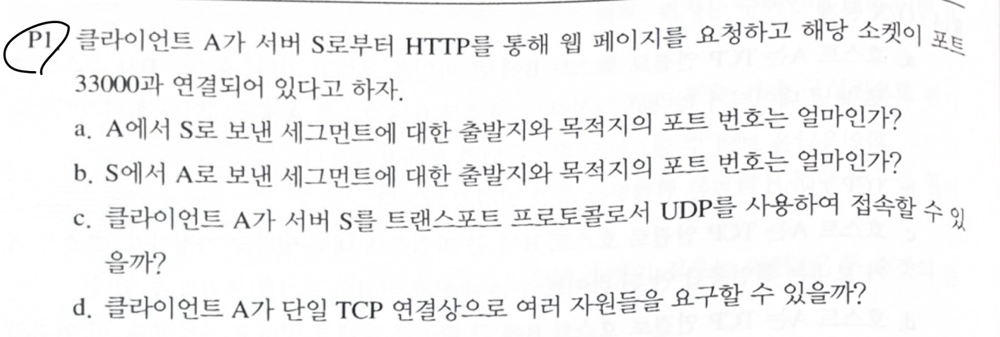
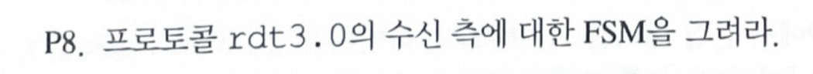
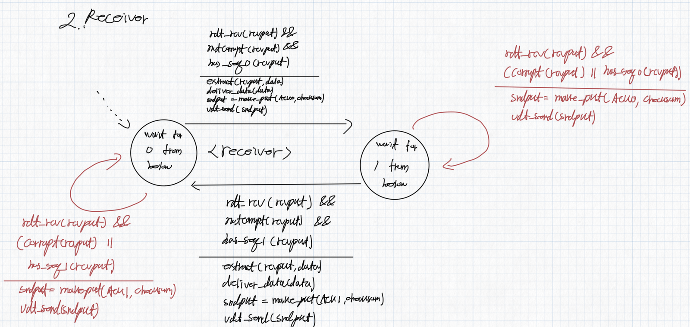
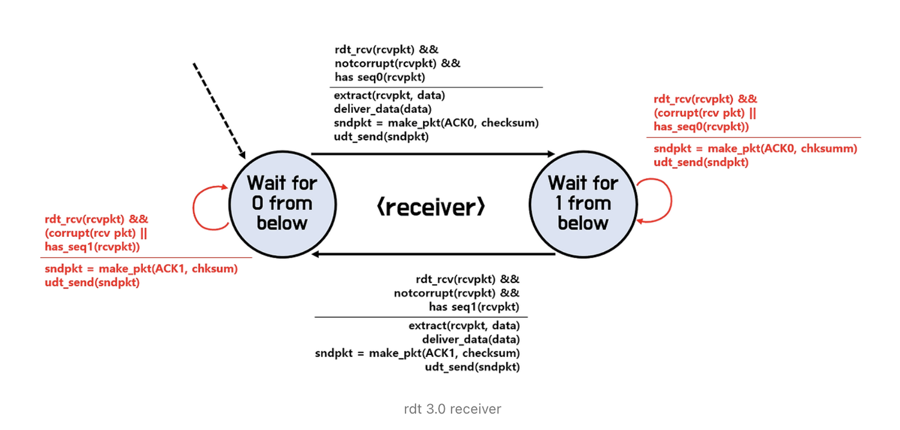
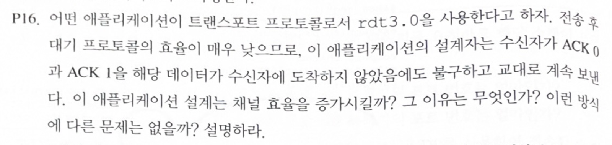
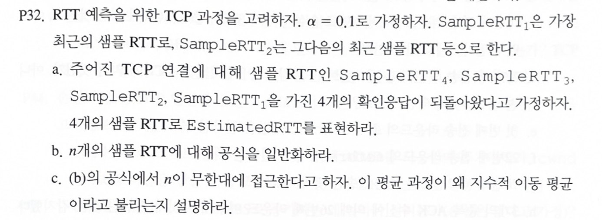
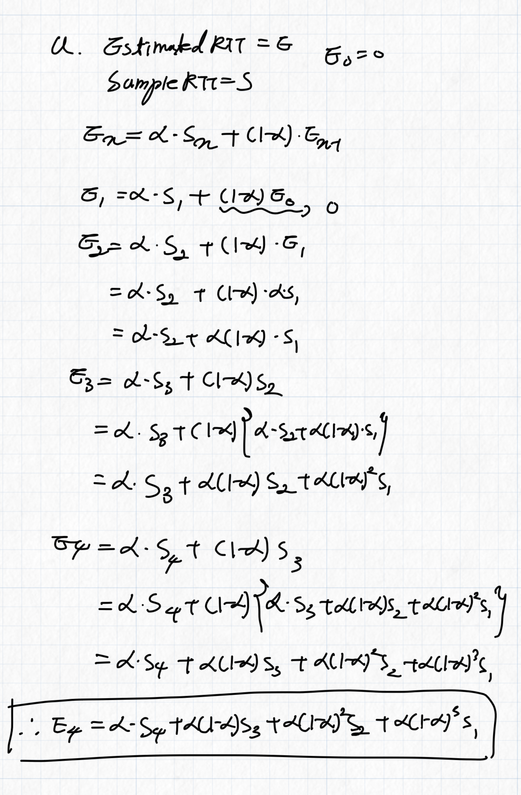
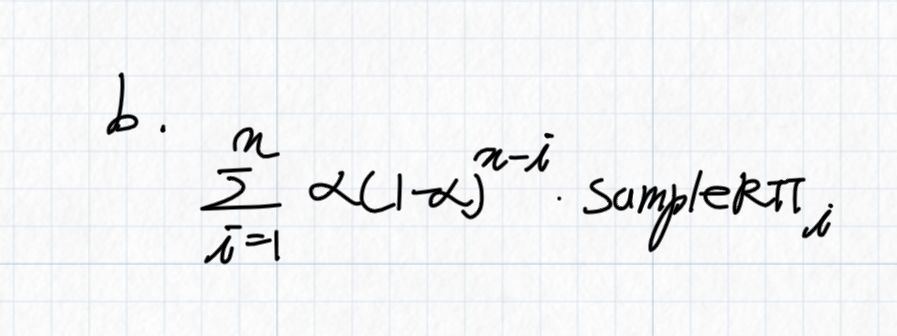
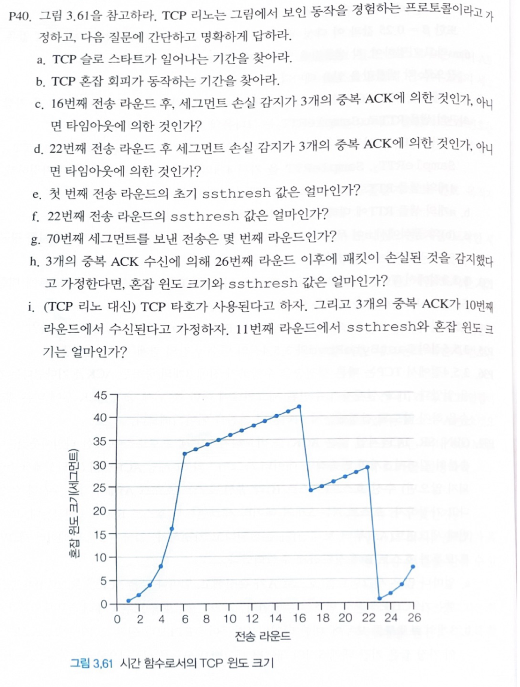
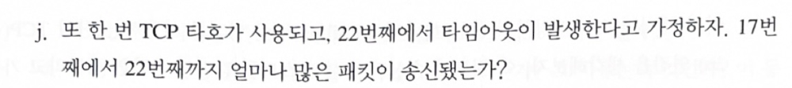

## 학습 목표

- 클라이언트와 서버 사이 세그먼트의 출발지/목적지 포트 번호 정하기
- rdt3.0 수신 측 FSM 그리기 (순서 번호 0, 1과 중복 패킷 처리)
- ACK의 의미를 깨뜨리면 신뢰적 전송이 무너지는 이유 설명
- EstimatedRTT가 지수 이동 평균(EWMA)인 이유를 식으로 보이기
- 혼잡 윈도 그래프에서 슬로 스타트, 혼잡 회피, 3 중복 ACK, 타임아웃 구간 찾기
- TCP Reno와 Tahoe의 차이를 계산 문제로 확인

---

## P1. 포트 번호



HTTP 서버는 기본적으로 80번 포트를 쓰므로 A(클라이언트)는 33000, S(서버)는 80.

| 문항 | 답 |
| --- | --- |
| a. A → S | 출발지 포트 33000, 목적지 포트 80 |
| b. S → A | 출발지 포트 80, 목적지 포트 33000 (a와 반대) |
| c. UDP로 접속 | 불가능. 이 서버의 HTTP(HTTP/1.1, HTTP/2)는 TCP 위에서 동작하므로 UDP 데이터그램은 TCP 80번 소켓에 전달되지 않음. 단, HTTP/3는 UDP 위의 QUIC을 사용함 |
| d. 한 TCP 연결로 여러 자원 요청 | 가능. 지속 연결(persistent HTTP)을 쓰면 하나의 TCP 연결로 여러 객체를 요청할 수 있음 |

---

## P8. rdt3.0 수신 측 FSM







- 위는 손으로 그린 답, 아래는 강의 자료의 정답. 두 그림이 같음
- rdt3.0의 수신 측은 **rdt2.2의 수신 측과 똑같음**. 타이머와 재전송은 송신 측에만 추가되고, 수신 측은 중복 패킷만 잘 처리하면 되기 때문
- 상태는 두 개: `Wait for 0 from below`, `Wait for 1 from below`
- 기다리던 순서 번호의 패킷이 손상 없이 오면: 데이터를 꺼내 위로 전달하고, 그 번호의 ACK를 보내고, 다음 상태로 이동
- 손상된 패킷이나 **이미 받은 번호(중복)** 가 오면: 데이터는 버리고, **마지막으로 제대로 받은 패킷의 ACK**를 다시 보냄 (NAK 대신 중복 ACK)

```text
[Wait for 0]
  rdt_rcv(rcvpkt) && notcorrupt(rcvpkt) && has_seq0(rcvpkt)
    / extract, deliver_data, sndpkt = make_pkt(ACK0, checksum), udt_send   → Wait for 1
  rdt_rcv(rcvpkt) && (corrupt(rcvpkt) || has_seq1(rcvpkt))
    / sndpkt = make_pkt(ACK1, checksum), udt_send                          → Wait for 0

[Wait for 1]
  rdt_rcv(rcvpkt) && notcorrupt(rcvpkt) && has_seq1(rcvpkt)
    / extract, deliver_data, sndpkt = make_pkt(ACK1, checksum), udt_send   → Wait for 0
  rdt_rcv(rcvpkt) && (corrupt(rcvpkt) || has_seq0(rcvpkt))
    / sndpkt = make_pkt(ACK0, checksum), udt_send                          → Wait for 1
```

---

## P16. ACK를 데이터와 상관없이 번갈아 보낸다면



> **답**: 겉보기 채널 이용률은 올라갈 수 있지만, ACK의 의미가 깨져서 손실 복구와 순서 보장이 불가능해지므로 올바른 설계가 아님
{: .prompt-warning }

- 송신자는 ACK가 계속 오니까 기다리지 않고 다음 패킷을 보냄 → 링크가 쉬지 않아 이용률이 올라가는 것처럼 보임
- 하지만 ACK는 "이 패킷을 제대로 받았다"는 뜻이어야 함. 데이터 도착과 상관없이 ACK를 보내면 송신자는 **손실된 패킷도 받은 것으로 착각**하고 재전송하지 않음
- 결과적으로 데이터 손실을 복구할 수 없고, 순서도 보장되지 않아 rdt의 목적(신뢰적 전송)이 사라짐
- 전송 후 대기 방식의 낮은 효율은 ACK를 속이는 것이 아니라 **파이프라이닝**(GBN, SR)으로 해결해야 함

---

## P32. EstimatedRTT와 지수 이동 평균



TCP는 새 샘플이 올 때마다 아래 식으로 RTT 추정치를 갱신함.

식으로 쓰면 $$\text{EstimatedRTT} \leftarrow \alpha \cdot \text{SampleRTT} + (1 - \alpha) \cdot \text{EstimatedRTT}$$

문제에서 $$\text{SampleRTT}_1$$이 **가장 최근** 샘플이므로, 시간 순서로는 $$S_4 \to S_3 \to S_2 \to S_1$$ 순으로 도착함 ($$S_i = \text{SampleRTT}_i$$).

### a. 샘플 4개

손풀이(아래 그림)는 처음 추정치를 0으로 두고 식을 차례로 대입함.



문제의 번호 규칙(1이 가장 최근)에 맞추면, 가장 최근 샘플에 가장 큰 가중치 $$\alpha$$가 붙음.

정리하면 $$E = \alpha S_1 + \alpha(1-\alpha) S_2 + \alpha(1-\alpha)^2 S_3 + \alpha(1-\alpha)^3 S_4$$

교재 해답처럼 첫 추정치를 첫 샘플 $$S_4$$로 두면 마지막 항만 $$(1-\alpha)^3 S_4$$로 바뀜.

### b. 샘플 n개로 일반화



첫 추정치를 0으로 두면 $$E = \alpha \sum_{j=1}^{n} (1-\alpha)^{j-1} S_j$$ ($$S_1$$이 가장 최근)

### c. 왜 지수 이동 평균인가

- $$j$$번째로 오래된 샘플의 가중치는 $$\alpha(1-\alpha)^{j-1}$$이라서, 샘플이 오래될수록 가중치가 **지수적으로** 줄어듦
- $$\alpha = 0.1$$이면 가중치가 0.1, 0.09, 0.081, ... 이고, $$n \to \infty$$일 때 가중치의 합은 $$\alpha \cdot \frac{1}{1 - (1-\alpha)} = 1$$이 되어 진짜 평균이 됨
- 새 샘플이 들어오면 전체가 한 칸씩 밀리며 평균을 다시 내므로 "이동" 평균

---

## P40. TCP 혼잡 윈도 그래프





그래프에서 읽은 값: 1~6라운드는 1, 2, 4, 8, 16, 32로 두 배씩 증가, 6~16라운드는 32에서 42까지 1씩 증가, 17라운드에 24로 떨어진 뒤 22라운드 29까지 1씩 증가, 23라운드에 1로 떨어진 뒤 다시 두 배씩 증가.

| 문항 | 답 | 근거 |
| --- | --- | --- |
| a. 슬로 스타트 구간 | 1~6, 23~26라운드 | 윈도가 라운드마다 두 배 |
| b. 혼잡 회피 구간 | 6~16, 17~22라운드 | 윈도가 라운드마다 1씩 증가 |
| c. 16라운드 뒤 손실 감지 | **3개의 중복 ACK** | 윈도가 1이 아니라 절반 근처(24)로 떨어짐 → Reno의 빠른 회복 |
| d. 22라운드 뒤 손실 감지 | **타임아웃** | 윈도가 1로 떨어짐 |
| e. 첫 라운드의 ssthresh | **32** | 32에 도달한 뒤 선형 증가로 바뀜 |
| f. 22라운드의 ssthresh | **21** | 16라운드 윈도 42의 절반. 17라운드 윈도 24 = 21 + 3 |
| g. 70번째 세그먼트를 보낸 라운드 | **7** | 누적 1, 3, 7, 15, 31, 63이고 7라운드에 33개를 보내 누적 96 |
| h. 26라운드 뒤 3 중복 ACK | 윈도 **7**, ssthresh **4** | 26라운드 윈도 8의 절반이 4, 윈도는 4 + 3 = 7 |
| i. Tahoe, 10라운드에 3 중복 ACK → 11라운드 | ssthresh **18**, 윈도 **1** | 10라운드 윈도 36의 절반. Tahoe는 3 중복 ACK에도 윈도를 1로 줄임 |
| j. Tahoe, 22라운드에 타임아웃 → 17~22라운드 전송량 | **52개** | 아래 계산 |

### j 계산

"또 한 번 Tahoe가 사용된다"는 것은 16라운드 뒤의 3 중복 ACK도 Tahoe로 처리한다는 뜻. 그러면 17라운드에 윈도가 1로 떨어지고 ssthresh는 21이 됨.

- 17~21라운드는 슬로 스타트: 1, 2, 4, 8, 16
- 22라운드는 32가 되기 전에 ssthresh 21에 걸려서 21
- 합계 $$1 + 2 + 4 + 8 + 16 + 21 = 52$$

---

### 과제 노트에서 정정한 부분 정리

| 위치 | 원래 | 정정 | 이유 |
| --- | --- | --- | --- |
| P32 a | $$E_4 = \alpha S_4 + \alpha(1-\alpha) S_3 + \cdots + \alpha(1-\alpha)^3 S_1$$ | $$\alpha S_1 + \alpha(1-\alpha) S_2 + \cdots + \alpha(1-\alpha)^3 S_4$$ | 문제는 $$S_1$$을 가장 최근 샘플로 정의함. 식의 모양은 같고 번호만 반대 |
| P32 a 풀이 중간 | $$E_3 = \alpha S_3 + (1-\alpha) S_2$$ | $$E_3 = \alpha S_3 + (1-\alpha) E_2$$ | 점화식에는 이전 **추정치**가 들어감 (다음 줄은 올바르게 대입함) |
| P40 j | 24 + 25 + ... + 29 = 159 | 1 + 2 + 4 + 8 + 16 + 21 = 52 | 159는 그래프(Reno)의 값. Tahoe라면 16라운드 뒤 윈도가 1로 떨어짐 |
| P40 f | 수업에서는 22 MSS로 설명 | 21 MSS | ssthresh는 손실 시 윈도 42의 절반이고, 그래프의 24는 21 + 3 |

---

## 최종 핵심 정리

1. 서버 → 클라이언트 세그먼트의 포트 번호는 클라이언트 → 서버 세그먼트의 출발지/목적지를 뒤바꾼 것
2. rdt3.0 수신 측은 rdt2.2와 같고, 손상되거나 중복된 패킷에는 마지막으로 제대로 받은 패킷의 ACK를 다시 보냄
3. ACK를 실제 수신과 무관하게 보내면 이용률은 높아 보여도 손실 복구가 불가능해짐. 효율은 파이프라이닝으로 높임
4. EstimatedRTT는 오래된 샘플일수록 가중치가 $$(1-\alpha)$$배씩 줄어드는 지수 이동 평균
5. 혼잡 윈도가 두 배씩 늘면 슬로 스타트, 1씩 늘면 혼잡 회피
6. Reno는 3 중복 ACK에서 ssthresh = cwnd/2, cwnd = ssthresh + 3으로 빠른 회복을 하고, 타임아웃에서는 cwnd = 1
7. Tahoe는 3 중복 ACK와 타임아웃 모두 cwnd를 1로 줄이고 ssthresh를 절반으로 함
8. 슬로 스타트 중 윈도가 ssthresh에 도달하면 더 두 배로 늘지 않고 혼잡 회피로 넘어감 (P40 j의 22라운드가 21)

---

End.
