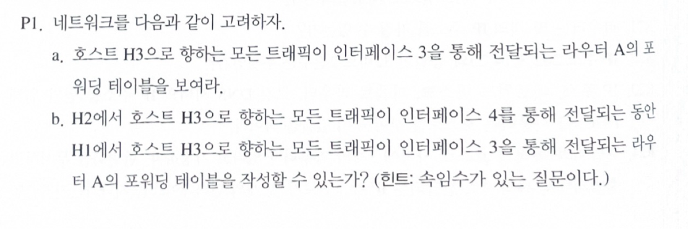
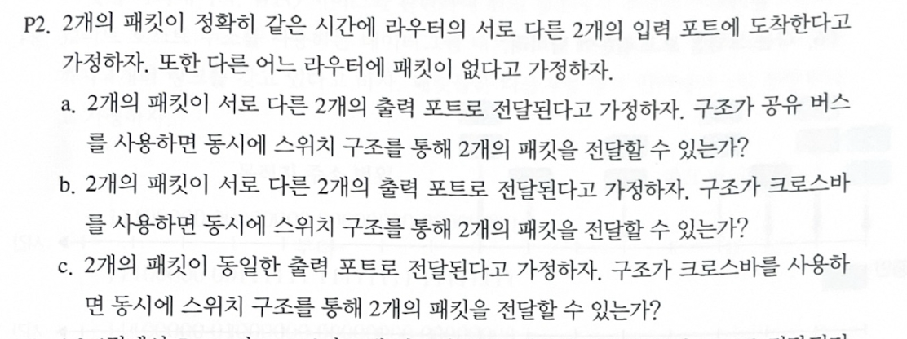
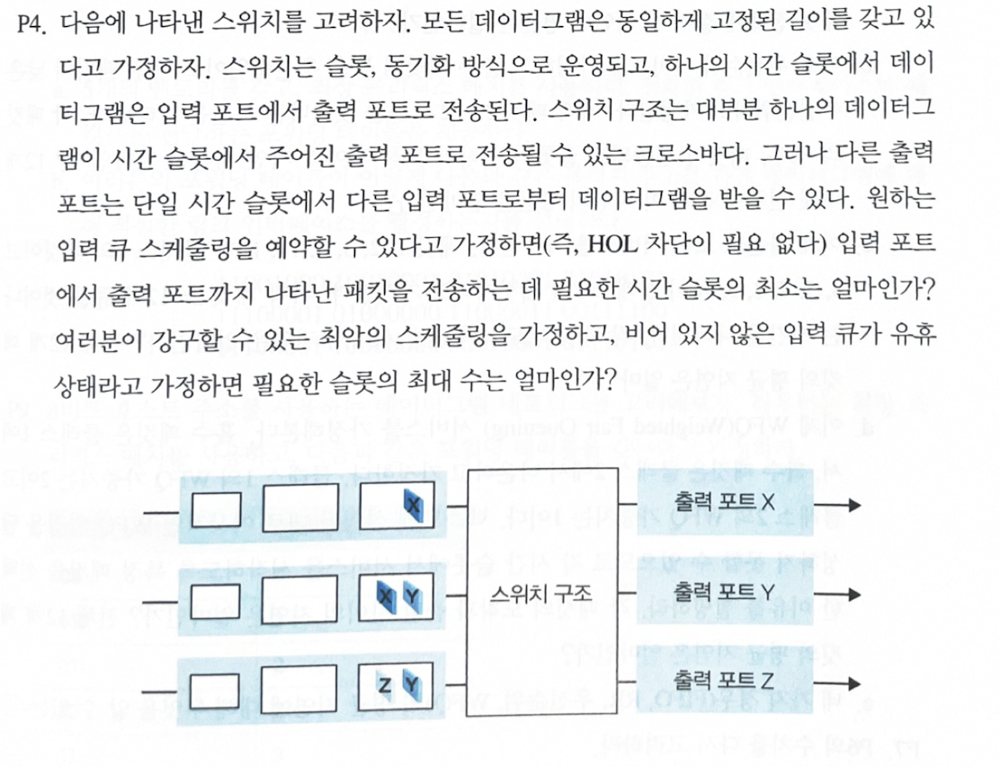
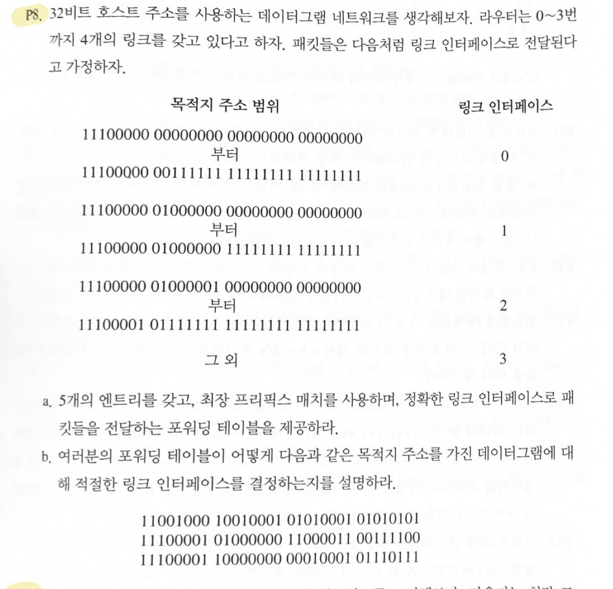
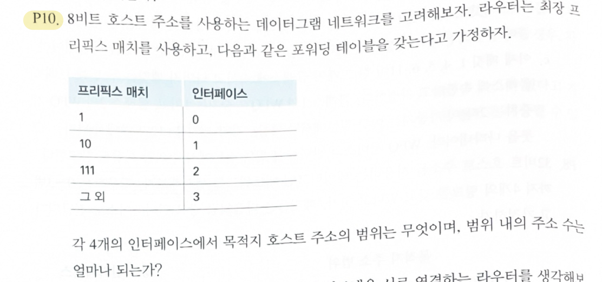

## 학습 목표

- 목적지 기반 포워딩 테이블과 일반화된 포워딩의 차이
- 공유 버스와 크로스바 스위치 구조가 동시에 처리할 수 있는 패킷 수
- 입력 큐와 출력 포트 충돌을 고려한 시간 슬롯 계산
- 주소 범위를 최장 프리픽스 매치(LPM) 테이블로 바꾸기
- 프리픽스 테이블이 각 인터페이스에 보내는 주소 범위와 개수 세기
- Python으로 LPM 테이블이 문제의 주소 범위와 정확히 일치하는지 검증

---

## P1. 포워딩 테이블



**a.** H3로 가는 트래픽은 A → B → D → H3 경로를 쓰므로 라우터 A의 출력 인터페이스는 3.

| 목적지 | 출력 인터페이스 |
| --- | --- |
| H3 | 3 |

**b.** 목적지 기반 포워딩으로는 **불가능**

| 출발지 | 목적지 | 원하는 A의 출력 |
| --- | --- | --- |
| H1 | H3 | 3 |
| H2 | H3 | 4 |

- 일반 포워딩 테이블은 **목적지 주소만** 보고 출력 인터페이스를 고름
- H1과 H2의 패킷은 목적지가 둘 다 H3이므로 같은 인터페이스로 나갈 수밖에 없음
- 힌트의 "속임수"는 여기에 있음: 4.4절의 **일반화된 포워딩**(OpenFlow처럼 출발지 주소까지 매치)을 쓰면 출발지에 따라 3과 4로 나눌 수 있음

---

## P2. 스위치 구조



| 문항 | 답 | 이유 |
| --- | --- | --- |
| a. 공유 버스, 서로 다른 출력 포트 | **불가능** | 버스는 한 번에 하나의 패킷만 지나갈 수 있음 |
| b. 크로스바, 서로 다른 출력 포트 | **가능** | 입력과 출력이 모두 다르면 크로스바의 서로 다른 교차점을 동시에 연결할 수 있음 |
| c. 크로스바, 같은 출력 포트 | **불가능** | 출력 포트 하나는 한 슬롯에 하나의 패킷만 받을 수 있음 |

---

## P4. 입력 큐 스케줄링



각 입력 큐의 패킷(목적지 출력 포트)

| 입력 큐 | 패킷 |
| --- | --- |
| 1 | X |
| 2 | X, Y |
| 3 | Z, Y |

### 최소 슬롯 수: 2

- 출력 포트 X와 Y로 가는 패킷이 각각 2개라서, 어떻게 해도 2슬롯보다 빨리 끝낼 수 없음 (하한 2)
- HOL 차단이 없어 큐 안의 순서를 자유롭게 고를 수 있다고 하면 2슬롯에 끝나는 스케줄이 있음

| 슬롯 | 전송 |
| --- | --- |
| 1 | 입력1 → X, 입력2 → Y, 입력3 → Z |
| 2 | 입력2 → X, 입력3 → Y |

### 최대 슬롯 수: 3

"비어 있지 않은 입력 큐는 쉬지 않는다"는 조건에서 가장 나쁜 스케줄

| 슬롯 | 전송 |
| --- | --- |
| 1 | 입력2 → X, 입력3 → Z |
| 2 | 입력1 → X, 입력2 → Y |
| 3 | 입력3 → Y |

- 첫 슬롯에 X 하나만 보낼 수 있으므로 X 쪽 두 패킷 중 하나는 반드시 2슬롯째로 밀리고, Y도 마찬가지라 3슬롯이 최대
- 일부러 한 슬롯에 하나씩만 보내면 5슬롯도 가능하지만, 큐가 쉬지 않는다는 조건에 맞지 않음

> 교재 해답은 최소와 최대 모두 3슬롯으로 봄. 큐를 FIFO로 보고(그림에서 스위치 쪽에 가까운 패킷부터 나감) 순서를 바꾸지 않으면, 입력2와 입력3의 맨 앞이 둘 다 Y라서 첫 슬롯에 두 개만 보낼 수 있기 때문. 위의 2슬롯은 큐 안의 순서를 바꿀 수 있다고 해석한 답
{: .prompt-warning }

---

## P8. 주소 범위를 LPM 테이블로



### a. 5개 엔트리 포워딩 테이블

| 프리픽스 | 인터페이스 | 담당하는 범위 |
| --- | --- | --- |
| 11100000 00 | 0 | 11100000 00xxxxxx ... |
| 11100000 01000000 | 1 | 11100000 01000000 ... |
| 11100000 | 2 | 11100000으로 시작하는 나머지 전부 (00과 01000000은 더 긴 프리픽스가 가져감) |
| 11100001 0 | 2 | 11100001 0xxxxxxx ... |
| 그 외 | 3 | |

- 인터페이스 2의 범위는 `11100000 01000001 ...`부터 `11100001 01111111 ...`까지라서, 그 사이에 있는 `11100000 1xxxxxxx ...`도 인터페이스 2로 가야 함
- 그래서 세 번째 엔트리를 `11100000 01`이 아니라 `11100000`(8비트)으로 두고, 더 긴 프리픽스(0과 1번 엔트리)가 예외를 처리하게 함

### b. 주소 세 개 처리

| 목적지 주소 | 매치 | 인터페이스 |
| --- | --- | --- |
| 11001000 10010001 01010001 01010101 | 매치되는 프리픽스 없음 | **3** |
| 11100001 01000000 11000011 00111100 | `11100001 0` | **2** |
| 11100001 10000000 00010001 01110111 | `11100001 1`이라 매치 없음 | **3** |

---

## P10. 프리픽스별 주소 개수



| 인터페이스 | 매치되는 주소 | 범위 | 개수 |
| --- | --- | --- | --- |
| 0 | `1`로 시작하지만 `10`도 `111`도 아님 → `110xxxxx` | 11000000 ~ 11011111 | 32 |
| 1 | `10xxxxxx` | 10000000 ~ 10111111 | 64 |
| 2 | `111xxxxx` | 11100000 ~ 11111111 | 32 |
| 3 | `1`로 시작하지 않는 주소 → `0xxxxxxx` | 00000000 ~ 01111111 | 128 |

- 프리픽스 `1`은 `10`과 `111`보다 짧아서, 그 둘이 가져가고 **남은 것만** 인터페이스 0으로 감
- 합계 32 + 64 + 32 + 128 = 256 = 8비트 주소 전체

---

## Python으로 검증

P8과 P10을 코드로 확인함. P8은 문제의 범위 정의(`by_range`)와 LPM 테이블의 결과를 무작위 주소 10만 개와 경계 근처 주소로 비교함.

```python
import random

def lpm(table, addr_bits):
    """최장 프리픽스 매치: 매치되는 프리픽스 중 가장 긴 것, 없으면 default"""
    best = None
    for prefix, iface in table:
        if prefix != "default" and addr_bits.startswith(prefix):
            if best is None or len(prefix) > len(best[0]):
                best = (prefix, iface)
    return best[1] if best else dict(table)["default"]

# P8: 문제에 주어진 범위 정의
def by_range(a):
    x = int(a, 2)
    r = lambda s: int(s.replace(" ", ""), 2)
    if r("11100000 00000000 00000000 00000000") <= x <= r("11100000 00111111 11111111 11111111"): return 0
    if r("11100000 01000000 00000000 00000000") <= x <= r("11100000 01000000 11111111 11111111"): return 1
    if r("11100000 01000001 00000000 00000000") <= x <= r("11100001 01111111 11111111 11111111"): return 2
    return 3

p8_note = [("1110000000", 0), ("1110000001000000", 1), ("1110000001", 2), ("111000010", 2), ("default", 3)]  # 과제 노트
p8      = [("1110000000", 0), ("1110000001000000", 1), ("11100000", 2), ("111000010", 2), ("default", 3)]    # 정정

random.seed(0)
tests = [format(random.getrandbits(32), "032b") for _ in range(100000)]
tests += [format(random.getrandbits(16) | (pre << 16), "032b")       # 경계 근처 집중
          for pre in range(0b1110000000000000, 0b1110000110000000) for _ in range(3)]
for name, t in [("과제 노트", p8_note), ("정정", p8)]:
    bad = [a for a in tests if lpm(t, a) != by_range(a)]
    print(f"[{name}] {len(tests)}개 주소 중 불일치 {len(bad)}개", f"예: {bad[0][:8]} {bad[0][8:16]} ..." if bad else "")

for a in ["11001000 10010001 01010001 01010101",
          "11100001 01000000 11000011 00111100",
          "11100001 10000000 00010001 01110111"]:
    print(a, "-> interface", lpm(p8, a.replace(" ", "")))

# P10: 8비트 주소 256개를 모두 분류
p10 = [("1", 0), ("10", 1), ("111", 2), ("default", 3)]
count = {}
for x in range(256):
    i = lpm(p10, format(x, "08b"))
    count.setdefault(i, []).append(x)
for i in sorted(count):
    xs = count[i]
    print(f"interface {i}: {format(min(xs), '08b')} ~ {format(max(xs), '08b')}, {len(xs)}개")
```

실행 결과

```text
[과제 노트] 101152개 주소 중 불일치 573개 예: 11100000 10101110 ...
[정정] 101152개 주소 중 불일치 0개 
11001000 10010001 01010001 01010101 -> interface 3
11100001 01000000 11000011 00111100 -> interface 2
11100001 10000000 00010001 01110111 -> interface 3
interface 0: 11000000 ~ 11011111, 32개
interface 1: 10000000 ~ 10111111, 64개
interface 2: 11100000 ~ 11111111, 32개
interface 3: 00000000 ~ 01111111, 128개
```

- 과제 노트의 테이블은 `11100000 1xxxxxxx ...` 주소를 인터페이스 3으로 보내서 573개가 틀림. 정정한 테이블은 모두 일치
- b의 세 주소는 두 테이블 모두 결과가 같아서, 과제의 b 답(3, 2, 3)은 맞음
- P10의 범위와 개수는 과제 답과 같음

---

### 과제 노트에서 정정한 부분 정리

| 위치 | 원래 | 정정 | 이유 |
| --- | --- | --- | --- |
| P8 a | 세 번째 엔트리 `11100000 01` → 2 | `11100000` → 2 | `11100000 1xxxxxxx`도 인터페이스 2의 범위에 들어감. 원래 테이블은 이를 3으로 보냄 (코드로 확인) |
| P1 b | 불가능 | 목적지 기반 포워딩으로는 불가능, 일반화된 포워딩으로는 가능 | 힌트의 "속임수"는 출발지까지 매치하는 방법을 가리킴 |
| P4 최소 | 2슬롯 | 2슬롯(큐 순서를 바꿀 수 있을 때), 교재 해답은 3슬롯 | 큐를 FIFO로 보느냐에 따라 답이 달라짐 |

---

## 최종 핵심 정리

1. 목적지 기반 포워딩은 목적지 주소만 보므로, 같은 목적지의 패킷을 출발지에 따라 다른 인터페이스로 보낼 수 없음
2. 출발지 등 여러 헤더 필드로 매치하는 일반화된 포워딩(OpenFlow)은 이를 할 수 있음
3. 공유 버스는 한 번에 한 패킷만, 크로스바는 입력과 출력이 겹치지 않으면 여러 패킷을 동시에 전달함
4. 한 출력 포트는 한 슬롯에 한 패킷만 받으므로, 같은 출력으로 가는 패킷 수가 슬롯 수의 하한
5. 최장 프리픽스 매치에서는 매치되는 프리픽스 중 가장 긴 것이 이기므로, 짧은 프리픽스로 넓게 잡고 긴 프리픽스로 예외를 두는 테이블을 만들 수 있음
6. 주소 범위를 테이블로 바꿀 때는 범위의 시작과 끝 사이에 낀 주소(`11100000 1...`)를 빠뜨리지 않았는지 확인해야 함
7. 프리픽스 `1`, `10`, `111`이 있으면 `1`은 나머지 `110xxxxx` 32개만 담당함
8. 손으로 만든 포워딩 테이블은 범위 정의와 비교하는 짧은 코드로 쉽게 검증할 수 있음

---

End.
