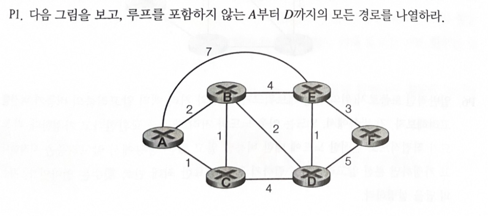
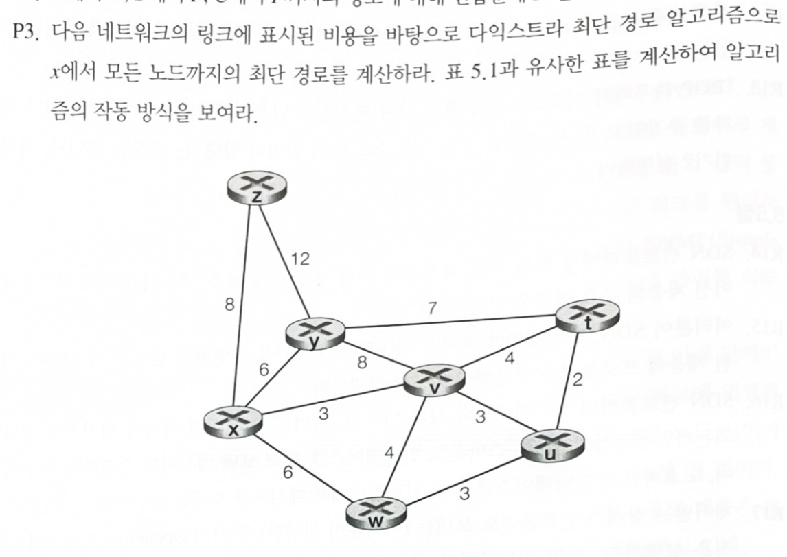
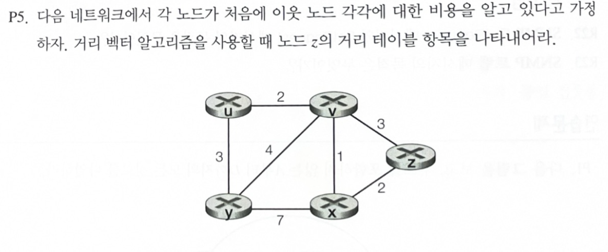
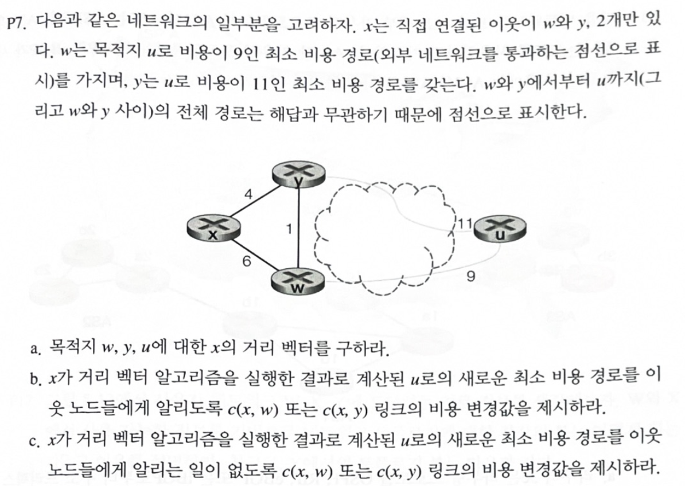
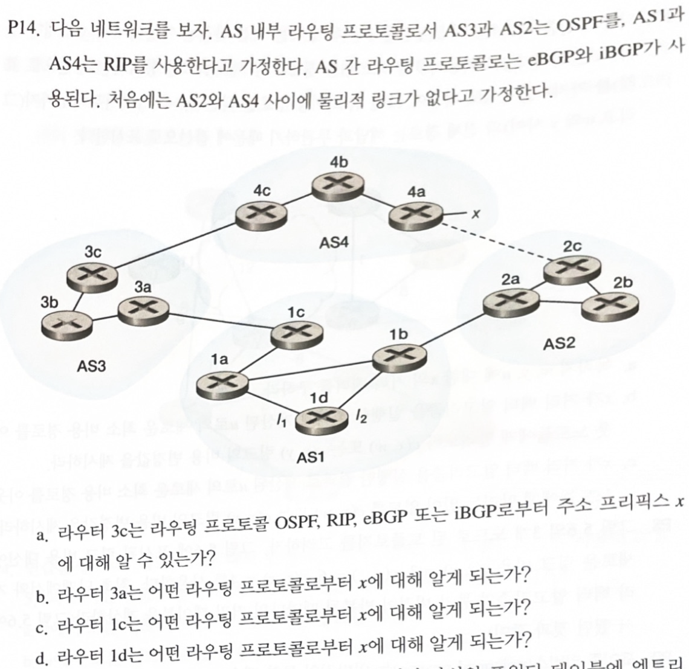

## 학습 목표

- 그래프에서 루프 없는 경로를 빠짐없이 나열하기
- 다익스트라(링크 상태) 알고리즘을 표 5.1 형식으로 한 단계씩 진행하기
- 벨만-포드 방정식으로 거리 벡터 테이블 채우기
- 링크 비용이 바뀔 때 거리 벡터 갱신을 이웃에게 알리는 조건 이해
- eBGP와 iBGP가 AS 사이와 AS 내부에서 경로 정보를 전달하는 방식
- 손으로 푼 표를 코드로 다시 계산해 검증하기

---

## P1. A에서 D까지 루프 없는 경로



첫 번째로 지나는 노드(B, C, E)로 나누어 세면 빠뜨리지 않음.

| 첫 홉 | 경로 |
| --- | --- |
| B | A-B-D, A-B-C-D, A-B-E-D, A-B-E-F-D |
| C | A-C-D, A-C-B-D, A-C-B-E-D, A-C-B-E-F-D |
| E | A-E-D, A-E-F-D, A-E-B-D, A-E-B-C-D |

총 **12개** (아래 코드의 깊이 우선 탐색 결과와 같음)

---

## P3. 다익스트라 알고리즘



| 단계 | N' | D(v),p(v) | D(w),p(w) | D(y),p(y) | D(u),p(u) | D(t),p(t) | D(z),p(z) |
| --- | --- | --- | --- | --- | --- | --- | --- |
| 0 | x | **3,x** | 6,x | 6,x | ∞ | ∞ | 8,x |
| 1 | xv | | 6,x | **6,x** | 6,v | 7,v | 8,x |
| 2 | xvy | | **6,x** | | 6,v | 7,v | 8,x |
| 3 | xvyw | | | | **6,v** | 7,v | 8,x |
| 4 | xvywu | | | | | **7,v** | 8,x |
| 5 | xvywut | | | | | | **8,x** |
| 6 | xvywutz | | | | | | |

- 1단계에서 v를 추가하면 t(3 + 4 = 7)와 u(3 + 3 = 6)가 처음으로 유한한 값이 됨. w는 v를 거치면 3 + 4 = 7이라 기존 6이 유지됨
- 2~4단계에서 y, w, u가 모두 비용 6이라 동점. 어느 것을 먼저 고르든 최종 결과는 같음

| 목적지 | 최단 경로 | 비용 |
| --- | --- | --- |
| v | x→v | 3 |
| w | x→w | 6 |
| y | x→y | 6 |
| u | x→v→u | 6 |
| t | x→v→t | 7 |
| z | x→z | 8 |

---

## P5. z의 거리 테이블



z의 이웃은 v(비용 3)와 x(비용 2). 거리 벡터가 수렴한 뒤 z는 벨만-포드 방정식으로 각 목적지의 비용을 계산함.

식으로 쓰면 $$D_z(y) = \min \lbrace c(z,v) + D_v(y),\ c(z,x) + D_x(y) \rbrace$$

이웃의 거리 벡터는 $$D_v$$가 u 2, x 1, y 4이고, $$D_x$$가 u 3(x→v→u), v 1, y 5(x→v→y)

| 목적지 | v 경유 | x 경유 | 최소 비용 | 다음 홉 |
| --- | --- | --- | --- | --- |
| u | 3 + 2 = 5 | 2 + 3 = 5 | 5 | v 또는 x |
| v | 3 + 0 = 3 | 2 + 1 = 3 | 3 | v 또는 x |
| x | 3 + 1 = 4 | 2 + 0 = 2 | 2 | x |
| y | 3 + 4 = 7 | 2 + 5 = 7 | 7 | v 또는 x |

> 처음(이웃 비용만 알 때) z의 거리 벡터는 u ∞, v 3, x 2, y ∞이고, 이웃의 벡터를 한 번 받으면 위 표처럼 바뀜
{: .prompt-tip }

---

## P7. 거리 벡터와 링크 비용 변화



x의 이웃은 w(비용 6)와 y(비용 4)이고, $$D_w(u) = 9$$, $$D_y(u) = 11$$, $$c(w,y) = 1$$

### a. x의 거리 벡터

| 목적지 | 계산 | 비용 | 경로 |
| --- | --- | --- | --- |
| w | min(6, 4 + 1) | 5 | x→y→w |
| y | min(4, 6 + 1) | 4 | x→y |
| u | min(6 + 9, 4 + 11) | 15 | x→w→u 또는 x→y→u |

### b. 새 최소 비용을 알리게 되는 변화

- $$c(x,w)$$를 6보다 작게, 예를 들어 5로 바꾸면 $$D_x(u) = \min(5 + 9, 4 + 11) = 14$$
- 15에서 14로 바뀌었으므로 x는 새 거리 벡터를 이웃에게 보냄 ($$c(x,y)$$를 4보다 작게 해도 마찬가지)

### c. 알리지 않게 되는 변화

- $$c(x,w)$$를 6보다 크게, 예를 들어 7로 바꾸면 $$D_x(u) = \min(7 + 9, 4 + 11) = 15$$
- y를 거치는 경로가 여전히 15라서 u까지의 최소 비용이 그대로이므로 알리지 않음

---

## P14. eBGP와 iBGP



x는 AS4의 라우터 4a에 붙어 있고, AS4와 AS1은 RIP, AS3과 AS2는 OSPF를 씀.

| 문항 | 답 | 이유 |
| --- | --- | --- |
| a. 3c | **eBGP** | 3c는 AS4의 4c와 직접 연결된 게이트웨이 라우터이므로 AS 사이 프로토콜(eBGP)로 x를 배움 |
| b. 3a | **iBGP** | 같은 AS3 안의 3c가 iBGP로 전달함 |
| c. 1c | **eBGP** | AS3의 3a와 연결된 AS1의 게이트웨이 라우터이므로 eBGP로 배움 |
| d. 1d | **iBGP** | AS1 내부의 1c가 iBGP로 전달함. 1c까지 가는 내부 경로와 비용(인터페이스 $$I_1$$, $$I_2$$ 중 선택)은 RIP으로 정함 |

- OSPF와 RIP은 AS **내부**의 경로를 계산하는 프로토콜이라 다른 AS의 프리픽스(x)를 직접 알려 주지 않음
- 프리픽스 도달 정보는 항상 BGP(AS 사이는 eBGP, AS 안에서는 iBGP)로 전달됨

---

## Python으로 검증

P1의 경로 나열, P3의 다익스트라, P5의 거리 벡터 수렴, P7의 계산을 코드로 다시 함.

```python
import heapq

def dijkstra(graph, src):
    """교재 표 5.1처럼 단계마다 N'과 D(v), p(v)를 출력"""
    dist = {v: float("inf") for v in graph}
    prev = {v: None for v in graph}
    dist[src] = 0
    done, pq, step = [], [(0, src)], 0
    while pq:
        d, u = heapq.heappop(pq)
        if u in done:
            continue
        done.append(u)
        for v, w in graph[u].items():
            if d + w < dist[v]:
                dist[v], prev[v] = d + w, u
                heapq.heappush(pq, (dist[v], v))
        row = "  ".join(f"{v}:{dist[v]},{prev[v]}" if dist[v] < float("inf") else f"{v}:inf"
                        for v in graph if v not in done)
        print(f"step {step}  N'={''.join(done):<8} {row}")
        step += 1
    return dist, prev

def path(prev, v):
    out = [v]
    while prev[out[-1]]:
        out.append(prev[out[-1]])
    return "->".join(reversed(out))

def undirected(edges):
    g = {}
    for a, b, w in edges:
        g.setdefault(a, {})[b] = w
        g.setdefault(b, {})[a] = w
    return g

print("== P3: x에서 다익스트라")
g3 = undirected([("x","y",6),("x","v",3),("x","w",6),("x","z",8),("y","z",12),("y","v",8),
                 ("y","t",7),("v","t",4),("v","u",3),("v","w",4),("w","u",3),("t","u",2)])
dist, prev = dijkstra(g3, "x")
for v in sorted(dist):
    print(f"  {v}: cost {dist[v]}, path {path(prev, v)}")

print("\n== P5: z의 거리 테이블 (거리 벡터 알고리즘이 수렴한 뒤)")
g5 = undirected([("u","v",2),("u","y",3),("v","y",4),("v","x",1),("v","z",3),("x","y",7),("x","z",2)])
# 벨만-포드 방정식을 바뀌는 값이 없을 때까지 반복 (모든 노드가 동시에 갱신)
D = {a: {b: (0 if a == b else g5[a].get(b, float("inf"))) for b in g5} for a in g5}
rounds = 0
while True:
    new = {a: {b: min([0] if a == b else [g5[a][n] + D[n][b] for n in g5[a]]) for b in g5} for a in g5}
    rounds += 1
    if new == D:
        break
    D = new
print(f"  {rounds - 1}번 갱신 후 수렴 ({rounds}번째에는 바뀌는 값 없음)")
print("  dest  via v  via x  min")
for b in sorted(g5):
    if b == "z":
        continue
    vv, vx = g5["z"]["v"] + D["v"][b], g5["z"]["x"] + D["x"][b]
    print(f"  {b:<5} {vv:<6} {vx:<6} {min(vv, vx)}")

print("\n== P7: x의 거리 벡터 (D_w(u)=9, D_y(u)=11, c(w,y)=1)")
def dx_u(cxw, cxy=4, Dw_u=9, Dy_u=11):
    return min(cxw + Dw_u, cxy + Dy_u)
print("  D_x(w) =", min(6, 4 + 1), " D_x(y) =", min(4, 6 + 1), " D_x(u) =", dx_u(6))
for c in (5, 7):
    print(f"  c(x,w)={c}: D_x(u) = {dx_u(c)}", "(변화 → 이웃에게 알림)" if dx_u(c) != dx_u(6) else "(변화 없음 → 알리지 않음)")

print("\n== P1: A에서 D까지 루프 없는 경로")
g1 = undirected([("A","B",2),("A","C",1),("A","E",7),("B","C",1),("B","E",4),("B","D",2),
                 ("C","D",4),("E","D",1),("E","F",3),("F","D",5)])
def simple_paths(g, cur, dst, seen):
    if cur == dst:
        yield seen
        return
    for n in sorted(g[cur]):
        if n not in seen:
            yield from simple_paths(g, n, dst, seen + [n])
ps = list(simple_paths(g1, "A", "D", ["A"]))
for p in ps:
    print("  " + "-".join(p))
print("  총", len(ps), "개")
```

실행 결과

```text
== P3: x에서 다익스트라
step 0  N'=x        y:6,x  v:3,x  w:6,x  z:8,x  t:inf  u:inf
step 1  N'=xv       y:6,x  w:6,x  z:8,x  t:7,v  u:6,v
step 2  N'=xvu      y:6,x  w:6,x  z:8,x  t:7,v
step 3  N'=xvuw     y:6,x  z:8,x  t:7,v
step 4  N'=xvuwy    z:8,x  t:7,v
step 5  N'=xvuwyt   z:8,x
step 6  N'=xvuwytz  
  t: cost 7, path x->v->t
  u: cost 6, path x->v->u
  v: cost 3, path x->v
  w: cost 6, path x->w
  x: cost 0, path x
  y: cost 6, path x->y
  z: cost 8, path x->z

== P5: z의 거리 테이블 (거리 벡터 알고리즘이 수렴한 뒤)
  1번 갱신 후 수렴 (2번째에는 바뀌는 값 없음)
  dest  via v  via x  min
  u     5      5      5
  v     3      3      3
  x     4      2      2
  y     7      7      7

== P7: x의 거리 벡터 (D_w(u)=9, D_y(u)=11, c(w,y)=1)
  D_x(w) = 5  D_x(y) = 4  D_x(u) = 15
  c(x,w)=5: D_x(u) = 14 (변화 → 이웃에게 알림)
  c(x,w)=7: D_x(u) = 15 (변화 없음 → 알리지 않음)

== P1: A에서 D까지 루프 없는 경로
  A-B-C-D
  A-B-D
  A-B-E-D
  A-B-E-F-D
  A-C-B-D
  A-C-B-E-D
  A-C-B-E-F-D
  A-C-D
  A-E-B-C-D
  A-E-B-D
  A-E-D
  A-E-F-D
  총 12 개
```

- P3: 동점(비용 6)인 u, w, y 중 코드는 힙에서 알파벳 순서로 u를 먼저 꺼내서 N'의 순서가 손풀이(xvyw...)와 다르지만, 각 노드의 최종 비용과 경로는 같음
- P5: 수렴한 뒤 z의 거리 테이블이 위 표와 같음 (y도 v 경유와 x 경유가 모두 7)
- P7: 비용이 바뀌면 알리고(c(x,w) = 5), 그대로면 알리지 않음(c(x,w) = 7)
- P1: 12개 경로가 손풀이 목록과 같음

---

### 과제 노트에서 정정한 부분 정리

| 위치 | 원래 | 정정 | 이유 |
| --- | --- | --- | --- |
| P5 (y 행) | x 경유 2 + 7 = 9, 다음 홉 v | x 경유 2 + 5 = 7, 다음 홉 v 또는 x | x에서 y까지의 최소 비용은 직접 링크 7이 아니라 x→v→y의 1 + 4 = 5 (최소 비용 7은 같음) |
| P7 (문제 조건) | (손대지 않음) | 주어진 값 그대로 사용 | 문제의 $$D_y(u) = 11$$은 y→w→u(1 + 9 = 10)보다 커서 엄밀히는 맞지 않지만, 문제에서 주어진 값이므로 그대로 계산함 |

---

## 최종 핵심 정리

1. 루프 없는 경로는 첫 홉별로 나눠 깊이 우선으로 세면 빠뜨리지 않음 (P1은 12개)
2. 다익스트라는 매 단계 N'에 없는 노드 중 비용이 가장 작은 노드를 추가하고, 그 이웃의 비용을 갱신함
3. 동점인 노드는 아무거나 먼저 골라도 최종 최단 비용은 같음
4. 거리 벡터는 벨만-포드 방정식 $$D_x(y) = \min_v \lbrace c(x,v) + D_v(y) \rbrace$$으로 이웃의 벡터를 이용해 계산함
5. 이웃의 거리 벡터에는 이웃의 **최소 비용**이 들어가므로, 직접 링크 비용과 혼동하지 않아야 함 (P5의 $$D_x(y) = 5$$)
6. 링크 비용이 바뀌어도 최소 비용이 그대로면 노드는 이웃에게 새 벡터를 보내지 않음
7. 게이트웨이 라우터는 다른 AS로부터 eBGP로, AS 내부 라우터는 iBGP로 프리픽스를 배움
8. OSPF와 RIP은 AS 내부 경로를 계산할 뿐이고, 다른 AS의 프리픽스 정보는 BGP가 전달함

---

End.
