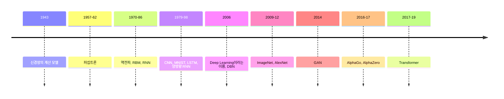
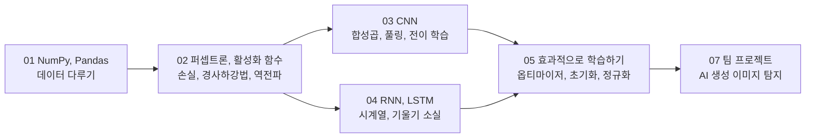

## 학습 목표

- 퍼셉트론에서 Transformer까지 딥러닝 아이디어가 나온 순서
- 2020년 기준 딥러닝의 주요 분야(자연어 처리, 강화학습, 자율주행)에서 무엇이 가능해졌는지
- 딥러닝의 한계로 지적된 점과 연구 방향
- 이 수업에서 배우는 내용(퍼셉트론, 역전파, CNN, RNN, LSTM, 전이 학습, 과적합)이 전체 흐름의 어디에 있는지

> 첫 강의 자료는 MIT 딥러닝 강의 시리즈의 "Deep Learning: State of the Art (2020)" 슬라이드임. 2020년 시점의 정리라서 그 이후의 대형 언어 모델 흐름은 들어 있지 않음. 이 글은 슬라이드 내용을 요약하고 수업 단원과 연결한 것
{: .prompt-info }

---

## 1. 딥러닝 아이디어의 흐름

| 시기 | 사건 | 이 수업에서 |
| --- | --- | --- |
| 1943 | Pitts와 McCulloch의 신경망 계산 모델 | 뉴런을 수식으로 본다는 출발점 |
| 1957, 1962 | Rosenblatt의 퍼셉트론 (단층, 다층) | [02편](/posts/Machine_Learning_02/) 퍼셉트론과 XOR |
| 1970 | Linnainmaa의 역전파와 자동 미분 | [02편](/posts/Machine_Learning_02/) 오차역전파, 계산 그래프 |
| 1979 | Fukushima의 합성곱 신경망 아이디어 | [03편](/posts/Machine_Learning_03/) CNN |
| 1982 | Hopfield 네트워크 (순환 신경망) | [04편](/posts/Machine_Learning_04/) RNN |
| 1997 | LSTM | [04편](/posts/Machine_Learning_04/) LSTM |
| 2009 ~ 2012 | ImageNet과 AlexNet | [03편](/posts/Machine_Learning_03/) ILSVRC와 대표 CNN 구조 |
| 2017 ~ 2019 | Transformer, BERT | 이 글의 3절 |

- 강의에서는 연도가 "발명의 정확한 기록이 아니라 큰 흐름을 보기 위한 것"이라고 강조함
- **2018 튜링상**은 딥러닝을 컴퓨팅의 핵심 요소로 만든 공로로 LeCun, Hinton, Bengio가 받음
- 역사 속 장면으로 체스(Deep Blue 대 Kasparov, 1997)와 바둑(AlphaGo 대 이세돌, 2016), 바퀴 달린 로봇(자율주행)과 두 발 로봇이 소개됨

---

## 2. 프레임워크

| 프레임워크 | 2020년의 변화 |
| --- | --- |
| TensorFlow 2.0 | 즉시 실행(eager execution) 기본, **Keras 통합**, API 정리, TensorFlow.js, Lite, Serving |
| PyTorch 1.3 | TorchScript(그래프 표현), 양자화, 모바일, TPU 지원 |

- 두 프레임워크가 서로의 장점을 받아들이며 **비슷해지는 중** (TF는 PyTorch처럼 즉시 실행을, PyTorch는 TF처럼 그래프와 배포를)
- 강화학습 라이브러리는 OpenAI Baselines를 정리한 Stable Baselines가 입문용으로 추천됨
- Python 2 지원이 2020년 1월 1일에 끝남
- 이 수업의 실습은 TensorFlow 2의 **Keras**를 사용함 ([02편](/posts/Machine_Learning_02/) MNIST부터)

---

## 3. 자연어 처리: Transformer의 시대

- **Transformer**(2017, "Attention is all you need"): RNN 없이 어텐션만으로 문장을 처리하는 구조. 순서대로 하나씩 계산하는 RNN과 달리 병렬 계산이 가능
- **BERT**(2018): Transformer로 양방향 문맥을 사전 학습한 모델. 문맥을 반영한 단어 표현, 문장 분류, 문장 쌍 유사도, 질의응답 등에 **미세 조정**으로 활용 (CNN의 전이 학습과 같은 발상)

| 모델 | 특징 |
| --- | --- |
| XLNet | BERT의 양방향성 + Transformer-XL의 순환 구조. 20개 과제에서 BERT보다 좋음 |
| RoBERTa | BERT의 학습 방법을 개선 |
| DistilBERT | 지식 증류로 BERT를 가볍게 |
| ALBERT | 층 사이 매개변수 공유로 크기를 줄이면서 성능 향상 |
| GPT-2 | 대규모 생성형 언어 모델 |
| Megatron-LM | 83억 개 매개변수, GPU 512개로 학습 (BERT의 24배) |

- 강의의 평가: "Transformer는 언어를 **모델링**하지만 **이해**하지는 못한다(아직은)"
- 사람은 합성된 글에 쉽게 설득되고, 기계로 합성 텍스트를 탐지하기는 어려움 → 이 문제의식은 [07편 팀 프로젝트](/posts/Machine_Learning_07/)의 AI 생성 이미지 탐지와 이어짐
- 앞으로의 과제: 상식 추론과 언어 모델의 결합, 수천 단어 이상의 긴 문맥, 열린 주제의 대화

---

## 4. 강화학습과 자기 대국 (Self-Play)

| 시스템 | 무엇을 했나 | 의미 |
| --- | --- | --- |
| OpenAI Five (Dota 2) | 2019년 세계 챔피언 팀을 이김 | 팀워크, 긴 시간 범위, 숨겨진 정보가 있는 복잡한 환경. 2018년의 패배와 차이는 주로 **8배 많은 학습 계산량** |
| DeepMind Capture the Flag (Quake III) | 에이전트가 규칙, 전략, 협동을 스스로 터득 | 다중 에이전트 협력 |
| AlphaStar (StarCraft II) | 2019년 그랜드마스터 등급 | 사람과 다른 독창적 전략 |
| Pluribus (6인 포커) | 프로 선수들을 이김 | 불완전 정보, 다중 플레이어 |
| OpenAI 로봇 손 (루빅스 큐브) | 시뮬레이션에서 배운 정책으로 실제 조작 | 점점 어려운 환경을 자동 생성하는 Domain Randomization |

- 공통점: 정답 데이터 없이 **스스로와 대결하며** 보상으로 학습함
- 이 수업은 지도학습(정답 레이블이 있는 분류, 회귀)을 다루며, 강화학습은 범위 밖

---

## 5. 딥러닝을 이해하려는 연구

| 연구 | 핵심 |
| --- | --- |
| **Lottery Ticket Hypothesis** (ICLR 2019 최우수 논문) | 큰 신경망 안에는 처음부터 따로 학습해도 같은 정확도를 내는 **작은 하위 신경망**이 있음. 학습 → 작은 가중치 제거(가지치기) → 남은 가중치를 처음 값으로 되돌려 다시 학습하는 과정으로 찾음 |
| Disentangled Representation (ICML 2019 최우수 논문) | 데이터의 요인(색, 모양 등)을 따로 분리해 표현하는 것은 가정 없이 비지도 학습만으로는 불가능하다는 증명 |
| **Deep Double Descent** | 모델 크기를 키우면 테스트 오차가 줄다가 늘고(과적합), **다시 줄어드는** 현상. "더 큰 모델, 더 많은 데이터가 오히려 해가 되는 구간"이 있음 |

Double Descent는 [05편](/posts/Machine_Learning_05/)에서 본 "모델이 복잡해지면 과적합"이라는 고전적 설명이 매우 큰 모델에서는 그대로 맞지 않을 수 있다는 점을 보여 줌.

---

## 6. 자율주행: 두 가지 접근

| 구분 | Tesla Autopilot | Waymo |
| --- | --- | --- |
| 단계 | Level 2 (운전자가 책임) | Level 4 (특정 구역에서 기계가 책임) |
| 센서 | 주로 **카메라 + 딥러닝** | 라이다, 정밀 지도, 정해진 구역 |
| 장점 | 해상도가 높고, 대량의 주행 데이터를 모아 학습 가능 | 거리 측정이 정확하고 신뢰성이 높음 |
| 데이터 | 실제 도로 주행 데이터를 계속 수집 | 실제 도로 2,000만 마일 + 시뮬레이션 100억 마일 |

- **Data Engine(Active Learning)**: 모델을 배포 → 실패한 경우(edge case)를 찾음 → 비슷한 데이터를 더 모음 → 레이블을 붙여 다시 학습 → 다시 배포. 모델보다 **데이터를 고치는 순환**이 핵심이라는 생각("Software 2.0")
- 열린 질문: 운전이라는 문제에 edge case가 얼마나 많은가, 데이터만으로 배울 수 있는가

---

## 7. 사회, 정책, 그리고 한계

- 정책: 미국 AI Initiative(2019), 정치 공약에서의 AI 논의, 추천 시스템의 윤리에 대한 의회 청문회
- 2019년은 "딥러닝에는 한계가 있다"는 말이 유행한 해. 핵심 비판은 **학습 기반 방법은 상식 추론을 못 한다**는 것
- 강의가 바라는 방향

| 분야 | 방향 |
| --- | --- |
| 연구 | 추론, 능동 학습과 평생 학습(lifelong learning), 다중 모달, 다중 과제 학습 |
| 응용 | 의료, 자율주행, 로봇 |
| 태도 | 과장과 반과장 모두 줄이고, 분야를 넘나드는 협력, 알고리즘 윤리 |

평생 학습은 [07편](/posts/Machine_Learning_07/)의 팀 프로젝트에서 만난 **Catastrophic Forgetting**(새 데이터를 배우며 이전 지식을 잊는 문제)을 해결하려는 연구 분야이기도 함.

---

## 8. 이 수업의 지도

---

## 최종 핵심 정리

1. 첫 강의는 MIT의 "Deep Learning: State of the Art (2020)"로, 딥러닝의 역사와 2020년까지의 성과, 한계를 훑음
2. 퍼셉트론(1957) → 역전파(1970 ~ 86) → CNN(1979 ~ 98) → LSTM(1997) → AlexNet(2012) → Transformer(2017) 순서로 아이디어가 쌓였고, 수업도 이 순서를 따라감
3. 2018 튜링상은 LeCun, Hinton, Bengio가 딥러닝의 공로로 받음
4. TensorFlow 2와 PyTorch는 서로 비슷해지는 중이고, 수업 실습은 TensorFlow 2의 Keras를 씀
5. 자연어 처리는 Transformer와 BERT 계열이 주도하지만, 언어를 이해하는 것은 아니며 합성 텍스트 탐지는 어려움
6. Dota 2, StarCraft II, 포커에서 강화학습 에이전트가 자기 대국으로 프로 수준에 도달함
7. Lottery Ticket(작은 하위 신경망)과 Double Descent(큰 모델에서 오차가 다시 줄어듦)는 딥러닝의 작동 원리에 대한 새로운 관찰
8. 자율주행은 카메라와 데이터 중심(Tesla)과 라이다와 지도 중심(Waymo)으로 나뉘며, 상식 추론과 평생 학습이 앞으로의 과제로 꼽힘

---

End.
