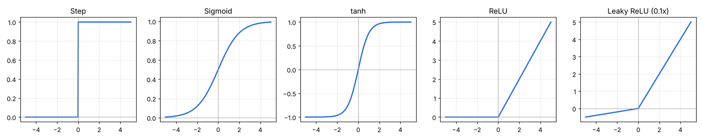
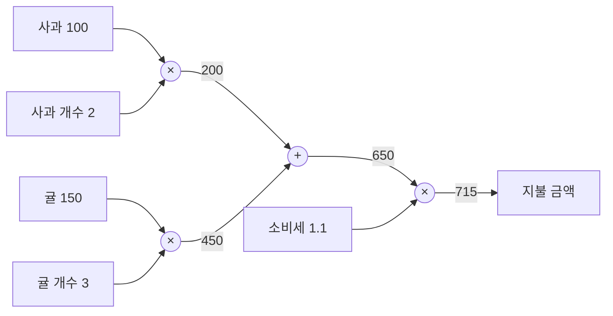
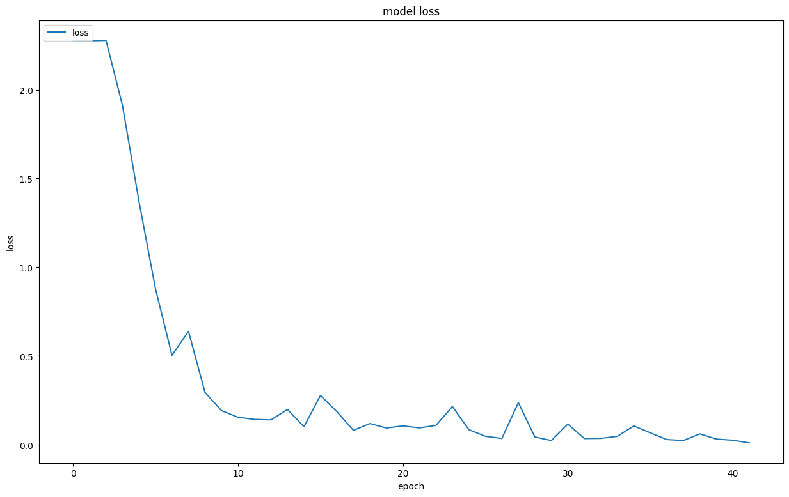
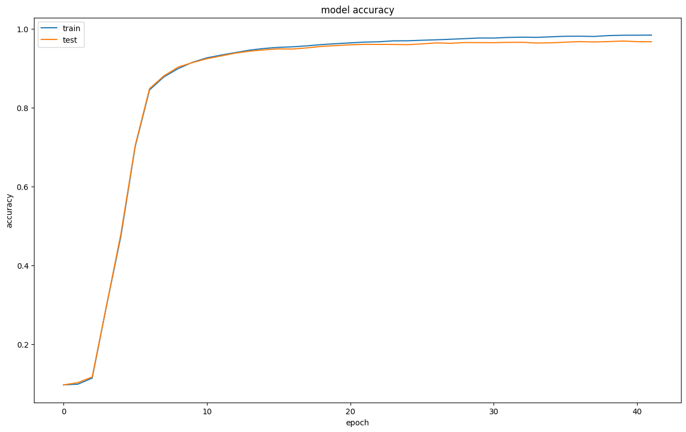

## 학습 목표

- 퍼셉트론의 정의와 단층 퍼셉트론의 한계(XOR), 다층 퍼셉트론
- 활성화 함수가 필요한 이유와 함수별 특징, softmax의 overflow 대책
- 신경망 학습의 의미, 손실 함수(MSE, CEE)와 미니 배치 CEE 코드
- 수치 미분의 두 가지 문제와 해결책, 편미분과 기울기, 경사하강법과 학습률
- 오차역전파: 계산 그래프, 국소적 계산, 연쇄법칙 (사과, 귤 예제를 계층 코드로 계산)
- 범용 게이트: NAND 하나로 NOT, AND, OR, XOR, XNOR 만들기
- MNIST를 직접 만든 3층 신경망과 Keras로 학습한 결과

> 별도 표시가 없는 코드는 numpy로 다시 실행한 결과. MNIST 학습 결과는 실습 노트북에서 실행한 출력
{: .prompt-info }

---

## 1. 퍼셉트론

- **퍼셉트론**: 뉴런이 입력 신호를 받아 일정 기준을 넘으면 신호를 내보내는 원리를 본뜬 인공 뉴런. 인공 신경망의 기초
- 단층 퍼셉트론: 신호의 총합이 0을 넘으면 1, 아니면 0. 식으로 쓰면 $$y = 1 \text{ if } w_1x_1 + w_2x_2 + b > 0 \text{ else } 0$$
- 가중치가 클수록 그 입력이 중요하다는 뜻이고, 편향은 얼마나 쉽게 활성화되는지를 조절함
- AND, OR, NAND는 **같은 구조**에서 가중치와 편향만 바꿔 구현함
- XOR은 직선 하나로 나눌 수 없어서(선형 분리 불가) 단층으로는 불가능 → 층을 쌓은 **다층 퍼셉트론**으로 해결
- NAND만으로(또는 NOR만으로) 모든 논리 게이트를 만들 수 있음 (범용 게이트)

```python
AND  = lambda a, b: perceptron(a, b, 0.5, 0.5, -0.7)
NAND = lambda a, b: perceptron(a, b, -0.5, -0.5, 0.7)
OR   = lambda a, b: perceptron(a, b, 0.5, 0.5, -0.2)
XOR  = lambda a, b: AND(NAND(a, b), OR(a, b))   # 2층
```

```text
(0, 0) AND 0 NAND 1 OR 0 XOR 0
(1, 0) AND 0 NAND 1 OR 1 XOR 1
(0, 1) AND 0 NAND 1 OR 1 XOR 1
(1, 1) AND 1 NAND 0 OR 1 XOR 0
```

### 범용 게이트: NAND 하나로 전부 만들기

**범용 게이트(Universal Gate)**는 그것 하나만으로 모든 논리 게이트를 만들 수 있는 게이트. NAND(NOT + AND)와 NOR(NOT + OR)가 있고, 실제 회로에서는 NAND가 가장 많이 쓰임. 퍼셉트론 NAND 하나만 정의하고 나머지를 조합해 확인했음.

```python
NAND = lambda a, b: int(-0.5 * a - 0.5 * b + 0.7 > 0)   # 퍼셉트론 하나
NOT  = lambda a: NAND(a, a)
AND  = lambda a, b: NOT(NAND(a, b))
OR   = lambda a, b: NAND(NOT(a), NOT(b))                 # 드모르간 법칙
XOR  = lambda a, b: AND(NAND(a, b), OR(a, b))
XNOR = lambda a, b: NOT(XOR(a, b))
```

```text
a b | NOT(a) AND OR XOR XNOR  (모두 NAND만으로 구성)
0 0 | 1       0    0   0    1
0 1 | 1       0    1   1    0
1 0 | 0       0    1   1    0
1 1 | 0       1    1   0    1
```

퍼셉트론 하나(NAND)를 층으로 쌓기만 하면 XOR, XNOR까지 표현됨 → **다층 퍼셉트론은 이론상 어떤 논리 회로도 표현할 수 있음** (컴퓨터도 결국 NAND의 조합).

---

## 2. 활성화 함수

**필요한 이유**: 선형 함수만 쌓으면 아무리 깊어도 하나의 선형 함수와 같음. 예를 들어 h(x) = 2x를 세 번 쌓아도 8x 한 층과 같음. 활성화 함수로 비선형성을 넣어야 층을 쌓는 의미가 생김.


_Leaky ReLU는 모양이 보이도록 기울기 0.1로 그렸음 (보통 0.01)_

| 함수 | 정의 | 특징 |
| --- | --- | --- |
| 계단(step) | 0 이하면 0, 크면 1 | x = 0에서 불연속(미분 불가), 나머지 기울기가 모두 0이라 학습 불가 |
| logistic sigmoid | 출력 0 ~ 1 | 확률 출력(이진 분류)에 사용. 미분 최대값이 0.25라 깊으면 기울기 소실 |
| tanh | 출력 -1 ~ 1 | 0 중심이라 sigmoid보다 학습이 안정적 |
| **ReLU** | 0 이하면 0, 크면 x | 기울기가 0 또는 1이라 계산이 빠르고 기울기 소실을 줄임. 음수 구간은 기울기 0 |
| Leaky ReLU | 0 이하면 0.01x, 크면 x | 음수 구간에도 작은 기울기를 남김 |
| softmax | 출력 총합이 1 | 다중 클래스 분류의 출력층 |

```text
step   : [0 0 0 1 1]
sigmoid: [0.119203 0.377541 0.5      0.622459 0.880797]
tanh   : [-0.964028 -0.462117  0.        0.462117  0.964028]
ReLU   : [0.  0.  0.  0.5 2. ]
Leaky  : [-0.02  -0.005  0.     0.5    2.   ]
sigmoid'(0) = 0.25 / 최대값이 0.25라 층이 깊으면 기울기가 작아짐
```

### softmax의 overflow

지수 함수를 쓰기 때문에 입력이 크면 `inf / inf = nan`이 됨. 각 원소에서 **최대값을 빼도 결과가 같으므로** 최대값을 빼고 계산함.

```python
def softmax(a):
    e = np.exp(a - np.max(a))   # [1000, 1000, 1002] - 1002 = [-2, -2, 0]
    return e / np.sum(e)
```

```text
naive : [nan nan nan]
stable: [0.106507 0.106507 0.786986] sum = 1.0
```

---

## 3. 신경망과 순전파

- 구조: **입력층 → 은닉층(여러 개 가능) → 출력층**
- 순전파: 입력이 층을 따라 순서대로 전달되며 최종 출력을 만드는 과정 (행렬곱 + 편향 + 활성화의 반복)
- 역전파: 순전파에서 생긴 오차를 줄이도록 출력층에서 입력층 방향으로 미분을 전달하며 가중치를 갱신하는 과정

```python
z1 = sigmoid(x @ W1 + b1)    # (2,) @ (2, 3) -> (3,)
z2 = sigmoid(z1 @ W2 + b2)   # (3,) @ (3, 2) -> (2,)
y  = sigmoid(z2 @ W3 + b3)   # (2,) @ (2, 2) -> (2,)
```

```text
z1: [0.574443 0.668188 0.75026 ] z2: [0.626249 0.771011] y: [0.578551 0.667362]
```

실습 노트북에서 계산한 값(`z1 = [0.5744 0.6682 0.7503]`, `y = [0.5786 0.6674]`)과 같음. 미리 학습된 가중치(784 → 50 → 100 → 10)로 MNIST 테스트 10,000장을 추론했을 때 정확도는 **93.52%**.

---

## 4. 손실 함수와 미니 배치

- **신경망 학습**: 데이터를 보고 손실 함수 값이 가장 작아지는 가중치와 편향을 자동으로 찾는 것. 손실 함수의 기울기(미분)를 이용해 매개변수를 조금씩 갱신함
- **훈련 데이터와 시험 데이터를 나누는 이유**: 처음 보는 데이터에 대한 범용 성능을 확인하기 위해. 모델이 복잡해질수록 훈련 오차는 계속 줄지만 시험 오차는 줄다가 과적합 구간부터 다시 커짐
- **손실 함수**: 예측값과 실제값의 차이(손실)를 수치로 나타낸 함수. 작을수록 학습이 잘 된 것
- 회귀는 **MSE**(오차 제곱의 평균), 분류는 **CEE**(교차 엔트로피, 자연로그). one-hot 정답이면 CEE는 정답 클래스 확률에만 의존하며, 식으로 쓰면 $$E = -\log y_{k}$$ (k는 정답 클래스)

```python
def cross_entropy_error(y, t):          # 미니 배치 대응 (출제 예고)
    if y.ndim == 1:
        t = t.reshape(1, t.size)
        y = y.reshape(1, y.size)
    batch_size = y.shape[0]
    return -np.sum(t * np.log(y + 1e-7)) / batch_size
```

```text
MSE  정답 확률 0.6: 0.0975 / 0.1: 0.5975
CEE  정답 확률 0.6: 0.5108 / 0.1: 2.3026 / -log(0.6) = 0.5108
batch CEE (2개 평균): 1.4067
label 버전: 1.4067
```

- 정답 확률이 0.6에서 0.1로 떨어지면 CEE가 0.51에서 2.30으로 크게 늘어남
- `1e-7`(delta)은 `log(0) = -inf`를 막기 위한 값. 정답이 레이블 숫자(one-hot이 아님)라면 `y[np.arange(batch_size), t]`로 정답 확률만 골라 계산함
- `*`는 원소별 곱, `np.dot`은 행렬곱. one-hot과의 원소별 곱 + 합은 결과적으로 정답 확률만 남김
- **미니 배치 학습**: 전체(배치) 대신 무작위로 뽑은 일부(미니 배치)로 기울기를 구해 갱신하는 것. 이를 반복하는 방법이 미니 배치 확률적 경사하강법(SGD)

---

## 5. 수치 미분, 편미분, 기울기

### 수치 미분의 두 가지 문제 (서술형)

| 문제 | 원인 | 해결 |
| --- | --- | --- |
| 반올림 오차 | h = 10e-50처럼 너무 작으면 x + h가 x와 같아져 결과가 0 | h = 1e-4 정도 사용 |
| 차분 오차 | 전진차분은 x와 x+h 사이의 기울기라 진짜 접선 기울기와 차이가 생김 | **중심차분** 사용 |

식으로 쓰면 중심차분은 $$f'(x) \approx \frac{f(x+h) - f(x-h)}{2h}$$

```python
def numerical_diff(f, x):
    h = 1e-4
    return (f(x + h) - f(x - h)) / (2 * h)   # 분자 전체를 괄호로 묶어야 함
```

```text
np.float32(1e-50) = 0.0
x + h == x ? True -> 전진차분 결과: 0.0
전진차분 h=1e-4: 0.20000099999917254
중심차분 h=1e-4: 0.1999999999990898 / 해석해 0.02x+0.1 = 0.2
괄호 틀린 식 (f(x+h) - f(x-h) / (2*h)): -3749.1499804999003
```

`f(x) = 0.01x² + 0.1x`의 x = 5에서 진짜 미분값은 0.2. 중심차분이 전진차분보다 정확하고, 괄호를 빠뜨리면 완전히 다른 값이 나옴.

### 편미분과 기울기

- **편미분**: 변수가 여러 개인 함수에서 목표 변수 하나만 남기고 나머지를 상수로 보고 미분하는 것
- **기울기(gradient)**: 모든 변수의 편미분을 벡터로 묶은 것. `numerical_gradient`는 변수마다 중심차분을 구함

```text
수치 기울기 (3, 4): [ 516.       1936.000001]
해석해: d/dx0 = 12x0^3 + 4x0x1^2 = 516 , d/dx1 = 4x0^2x1 + 28x1^3 = 1936
```

---

## 6. 경사하강법과 학습률

- 기울기가 양수면 왼쪽(감소 방향), 음수면 오른쪽으로 이동 → 식으로 쓰면 $$w \leftarrow w - \eta \frac{\partial L}{\partial w}$$
- 목적은 손실 함수가 **최소**가 되는 매개변수를 찾는 것
- **학습률**: 한 번 갱신할 때 기울기 방향으로 얼마나 이동할지 정하는 값 (하이퍼파라미터)

```text
lr=10: [-9.374161e+13  2.051099e+15]
lr=0.001: [-0.585389  0.354076]
lr=1e-08: [-2.999484  3.998065]
```

| 학습률 | 결과 |
| --- | --- |
| 10 (너무 큼) | 값이 10의 15제곱 수준으로 **발산** |
| 0.001 (적절) | 100번 만에 최소점 (0, 0) 쪽으로 이동 |
| 1e-8 (너무 작음) | 시작점 (-3, 4)에서 거의 움직이지 않음 |

---

## 7. 오차역전파

- **계산 그래프**: 계산 과정을 노드와 엣지로 표현한 그래프
- **국소적 계산**: 각 노드는 자기와 직접 연결된 입력, 출력만 보고 계산 → 전체가 복잡해도 문제가 단순해짐
- 역전파는 출력 쪽(오른쪽)에서 입력 쪽(왼쪽)으로 국소적 미분을 **연쇄법칙**으로 곱해 전달하는 과정
- 덧셈 노드는 미분을 그대로 전달, 곱셈 노드는 입력을 서로 바꿔 곱해 전달

### 계산 그래프 예제: 사과와 귤 (강의 문제)

> 문제 1: 1개에 100원인 사과를 2개 샀고 소비세 10%가 붙는다. 지불 금액은?
> 문제 2: 사과 2개(100원), 귤 3개(150원)를 샀고 소비세 10%가 붙는다. 지불 금액은?
{: .prompt-info }



곱셈 노드와 덧셈 노드를 계층(클래스)으로 만들어 순전파 후 역전파를 해 봤음.

```python
class MulLayer:
    def forward(self, x, y): self.x, self.y = x, y; return x * y
    def backward(self, d): return d * self.y, d * self.x       # 입력을 서로 바꿔 곱함
class AddLayer:
    def forward(self, x, y): return x + y
    def backward(self, d): return d, d                          # 그대로 흘려보냄
```

```text
순전파: 사과 200 + 귤 450 = 650 → 지불금액 715.0
역전파: d사과가격 2.2 d사과개수 110.0 d귤가격 3.3 d귤개수 165.0 d소비세 650
문제1: 지불금액 220.0 / dz/da = 2.2 dz/db = 110.0 dz/dc = 200
```

| 미분 | 값 | 의미 |
| --- | --- | --- |
| 지불 금액 / 사과 가격 | 2.2 | 사과 값이 1원 오르면 지불 금액은 2.2원 오름 (개수 2 × 세금 1.1) |
| 지불 금액 / 사과 개수 | 110 | 사과를 하나 더 사면 110원 더 냄 |
| 지불 금액 / 귤 가격 | 3.3 | 귤 개수 3 × 세금 1.1 |
| 지불 금액 / 소비세 | 650 | 세율이 1(100%)만큼 오르면 세전 금액 650원만큼 오름 |

신경망의 역전파도 이와 똑같이, 출력(손실)에서 시작해 각 노드의 국소적 미분을 곱해 가며 **모든 가중치의 기울기를 한 번의 역방향 계산으로** 구함. 수치 미분은 가중치마다 함수를 두 번씩 계산해야 해서 훨씬 느림.

- Sigmoid 계층의 역전파: 식으로 쓰면 $$\frac{\partial y}{\partial x} = y(1 - y)$$ 이라서 순전파 출력만 저장하면 됨
- Softmax-with-Loss(Softmax + CEE)의 역전파는 깔끔하게 **y − t**

```text
해석 y(1-y): [0.244458] / 수치: [0.244458]
softmax+CEE 역전파 (y - t): [ 0.018211  0.245192 -0.263403]
```

### MNIST 3층 신경망 (실습 노트북 결과)

`Affine → Sigmoid → Affine → Sigmoid → Affine → SoftmaxWithLoss` 구조(784-50-100-10)를 직접 구현하고 오차역전파로 학습. 배치 50, 학습률 0.1, 50,000번 반복 = 60,000 / 50 = 1,200번이 1 epoch이라 약 42 epoch.

```text
Epoch : 1 => train 정확도 : 9.75 % / test 정확도 : 9.74 % / loss : 2.2736
Epoch : 4 => train 정확도 : 29.79 % / test 정확도 : 29.85 % / loss : 1.9107
Epoch : 7 => train 정확도 : 84.57 % / test 정확도 : 84.9 % / loss : 0.5045
Epoch : 10 => train 정확도 : 91.58 % / test 정확도 : 91.5 % / loss : 0.193
Epoch : 20 => train 정확도 : 96.29 % / test 정확도 : 95.81 % / loss : 0.0949
Epoch : 30 => train 정확도 : 97.74 % / test 정확도 : 96.57 % / loss : 0.0244
Epoch : 42 => train 정확도 : 98.47 % / test 정확도 : 96.79 % / loss : 0.0114
```


_epoch마다 마지막 미니 배치의 loss (배치 하나의 값이라 들쭉날쭉함)_


_train과 test 정확도_

- 처음 3 epoch은 10% 근처(찍는 수준)에 머무름. 가중치를 0.01 × 표준정규분포로 작게 초기화했고 sigmoid라서 기울기가 작기 때문
- 후반에는 train 98.5%, test 96.8%로 약 1.7%p 차이가 생김 → 가벼운 과적합의 시작

### Keras로 같은 문제 (실습 노트북 결과)

`Flatten(28×28) → Dense(128, sigmoid) → Dense(10, softmax)`, optimizer adam, 10 epoch. 파라미터는 784×128 + 128 = 100,480과 128×10 + 10 = 1,290을 더해 101,770개.

```text
Epoch 1/10 - accuracy: 0.8969 - loss: 0.3984
Epoch 5/10 - accuracy: 0.9753 - loss: 0.0874
Epoch 10/10 - accuracy: 0.9904 - loss: 0.0364
loss값 :  0.07481884211301804
모델 정확도 :  97.74 %
```

Adam 덕분에 1 epoch만에 89.7%에 도달하고, 테스트 정확도도 직접 만든 SGD 모델(96.79%)보다 높음.

---

### 정리 노트에서 정정한 부분 정리

| 위치 | 원래 | 정정 | 이유 |
| --- | --- | --- | --- |
| 수치 미분 코드 | `(f(x+h) - f(x) / h)` | `(f(x + h) - f(x)) / h` | 괄호 위치. 실행하면 전혀 다른 값 |
| 중심차분 코드 | `(f(x+h) - f(x - h) / (2*h))` | `(f(x + h) - f(x - h)) / (2 * h)` | 괄호를 빠뜨리면 -3749.15가 나옴 (실행 결과) |
| 반올림 오차 설명 | 계산하면 0으로 출력 | x + h가 x와 같아져 분자가 0 | 10e-50은 1e-49이고, 5.0 + 1e-49 == 5.0이 True |
| 편미분 예제 | x0 편미분에서 `partial_diff(function_2, 3)` 호출 | `function_1` 호출 | x0 함수는 function_1. 바르게 하면 516, x1은 1936 |
| 경사하강법 | 손실 함수가 **최대**일 때 가중치를 찾음 | 손실 함수가 **최소**가 되는 가중치 | 오타 |
| 오차역전파 | 왼쪽에서 오른쪽으로 전달 | 오른쪽(출력)에서 왼쪽(입력)으로 전달 | 역전파의 방향 |
| 신경망 구조 | 입력층, 은닉층, 입력층 | 입력층, 은닉층, 출력층 | 오타 |
| 미니 배치 CEE | `np.log(y)` | `np.log(y + 1e-7)` | y에 0이 있으면 -inf가 됨 |
| 강의 자료 계산 그래프 (문제 1) | 최종 결과 z(= 200) | z = 100 × 2 × 1.1 = **220** | 200은 세금 적용 전 금액(a × b). 실행 결과도 220 |
| ReLU | 미분값이 항상 0과 1이라 빠름 | x > 0이면 1, x < 0이면 0 (x = 0은 보통 0으로 정함) | 정의를 명확하게 |

---

## 최종 핵심 정리

1. 퍼셉트론은 가중합이 기준을 넘으면 1을 내는 인공 뉴런이고, 단층은 선형이라 XOR이 불가능해 다층으로 해결함
2. 선형 함수를 쌓아도 선형이므로 활성화 함수로 비선형성을 넣어야 하며, 계단 함수는 미분 불가와 기울기 0 때문에 쓰지 않음
3. ReLU는 0 이하면 0, 크면 x이고, softmax는 출력 합이 1이며 overflow를 막으려고 최대값을 빼고 계산함
4. 신경망 학습은 손실 함수를 최소화하는 매개변수를 기울기로 찾는 과정이고, 회귀는 MSE, 분류는 CEE를 씀
5. 미니 배치 CEE는 배치 크기로 나눈 평균이며 `log(0)`을 막기 위해 아주 작은 delta를 더함
6. 수치 미분은 반올림 오차(h를 1e-4로)와 차분 오차(중심차분으로)를 해결해야 함
7. 학습률이 너무 크면 발산, 너무 작으면 거의 움직이지 않고, 적절하면 최소점으로 수렴함
8. 오차역전파는 계산 그래프의 국소적 미분을 출력에서 입력 방향으로 연쇄법칙으로 전달하며, Softmax-with-Loss의 역전파는 y − t

---

End.
