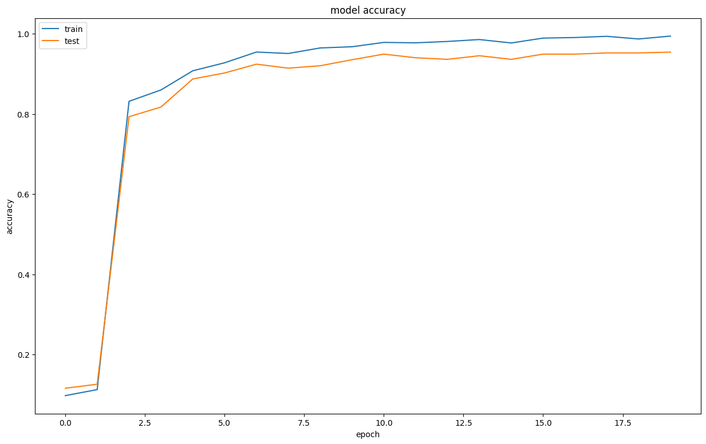
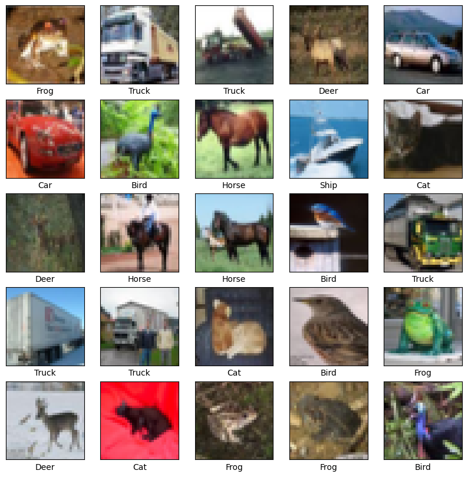
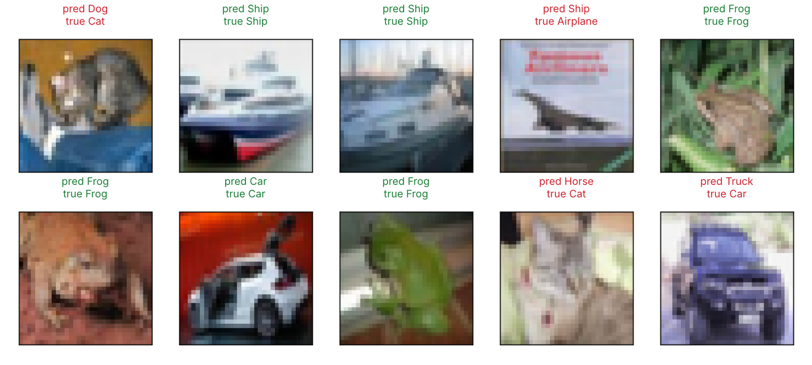

## 학습 목표

- CNN이 완전연결 신경망과 다른 점, 합성곱 연산과 출력 크기 공식
- 3차원 합성곱(채널), 필터 개수와 출력 채널, 풀링의 세 가지 특징
- im2col이 필요한 이유와 이를 이용한 Convolution, Pooling 계층
- numpy로 만든 CNN(MNIST)과 Keras CNN(CIFAR-10)의 학습 결과 해석
- AlexNet, VGG, GoogLeNet, ResNet의 핵심 아이디어와 층을 깊게 하는 이유
- 전이 학습: 동결(frozen)과 미세 조정(fine-tuning) 결과 비교

> numpy 코드는 실습 노트북의 im2col, Convolution, Pooling을 그대로 가져와 다시 실행함. TensorFlow 학습 결과(CIFAR-10, ResNet50)는 실습 노트북에서 실행한 출력
{: .prompt-info }

---

## 1. CNN이란

- **CNN(Convolutional Neural Network)**: 합성곱(convolution) 계층으로 이미지의 특징을 추출하는 신경망. 이미지, 영상 처리에 사용
- 완전연결(Dense) 신경망은 입력을 1차원으로 펼치기 때문에 **위, 아래, 옆 픽셀의 공간 정보가 사라짐**. CNN은 (채널, 높이, 너비) 형상을 유지한 채 계산함
- 흐름: 입력 → **Convolution → Activation(ReLU) → Pooling** 을 반복해 특징 맵(feature map)을 만들고, 마지막에 Flatten → Dense로 분류
- 앞쪽 층의 필터는 가장자리, 색 같은 단순한 특징을, 깊은 층일수록 더 복잡하고 추상적인 특징을 추출함

---

## 2. 합성곱 연산

행렬곱(행 × 열)과 달리 **필터를 겹친 위치끼리 곱한 뒤 모두 더함**.

```python
A = [[1, 2, 3, 0], [0, 1, 2, 3], [3, 0, 1, 2], [2, 3, 0, 1]]   # 4x4 입력
B = [[2, 0, 1], [0, 1, 2], [1, 0, 2]]                          # 3x3 필터
out[i][j] = np.sum(A[i:i+3, j:j+3] * B)
```

```text
[[15 16]
 [ 6 15]]
```

### 패딩, 스트라이드, 출력 크기

- **패딩**: 합성곱 전에 입력 주변을 특정 값(보통 0)으로 채우는 것. **출력 크기를 조정**하려고 사용 (`padding='same'`이면 입력과 출력 크기가 같음)
- **스트라이드**: 필터를 적용하는 위치의 간격(보폭). 커질수록 출력이 작아짐

식으로 쓰면 출력 높이는 $$OH = \frac{H + 2P - FH}{S} + 1$$ (너비도 같은 방식)

```text
H=4, F=3, P=0, S=1 -> OH=2
H=4, F=3, P=1, S=1 -> OH=4
H=7, F=3, P=0, S=2 -> OH=3
H=28, F=5, P=0, S=1 -> OH=24
H=32, F=3, P=1, S=1 -> OH=32
```

### 3차원 합성곱

- **입력 채널 수와 필터 채널 수가 같아야** 하고, 채널별로 합성곱한 결과를 모두 더해 출력 채널 **하나**를 만듦
- 필터를 FN개 쓰면 출력 채널도 FN개, 편향도 FN개. 필터의 형상은 (FN, C, FH, FW)

```text
loop:
 [[ 0. -1.]
 [ 9.  0.]]
Convolution(im2col):
 [[ 0. -1.]
 [ 9.  0.]]
```

노트북의 for문 결과와 im2col 기반 `Convolution` 계층의 결과가 같음.

---

## 3. 풀링

- 합성곱과 활성화 함수 뒤에 두어 **데이터의 크기(가로, 세로)를 줄임** → 매개변수와 연산량이 줄고 과적합 방지에 도움
- 최대 풀링(영역의 최댓값), 평균 풀링(영역의 평균)
- **특징 (중요)**
  1. **학습할 매개변수가 없음** (합성곱 계층과의 차이)
  2. **채널 수가 그대로 유지됨** (채널마다 독립적으로 계산)
  3. **입력의 작은 변화에 강함** (최댓값 위치가 조금 움직여도 결과가 같음)

```text
[[2. 3.]
 [4. 2.]]
3채널 입력 -> 출력 shape: (1, 3, 2, 2)
```

---

## 4. im2col과 계층 구현

- **im2col(image to column)**: 4차원 입력 (N, C, H, W)을 필터가 닿는 영역 단위로 펼쳐 **2차원 행렬**로 바꾸는 함수
- 장점: 합성곱을 **큰 행렬곱 한 번**으로 계산할 수 있어 빠름(BLAS 최적화 활용). 단점: 필터 영역이 겹치는 원소가 중복 저장되어 **메모리를 더 씀**
- 합성곱 절차: 입력을 im2col로 펼침 → 필터를 (FN, C×FH×FW)에서 전치해 펼침 → 행렬곱 + 편향 → 결과를 (N, FN, OH, OW)로 reshape

```python
def forward(self, x):
    FN, C, FH, FW = self.W.shape
    N, C, H, W = x.shape
    out_h = (H + 2 * self.pad - FH) // self.stride + 1
    out_w = (W + 2 * self.pad - FW) // self.stride + 1
    col = im2col(x, FH, FW, self.stride, self.pad)      # (N*OH*OW, C*FH*FW)
    col_W = self.W.reshape(FN, -1).T                    # (C*FH*FW, FN)
    out = np.dot(col, col_W) + self.b
    return out.reshape(N, out_h, out_w, -1).transpose(0, 3, 1, 2)
```

```text
(1,3,4,4) F3 -> (4, 27)
(10,3,7,7) F5 S1 -> (90, 75)
```

- (1, 3, 4, 4)에 3×3 필터 → 출력 위치 2×2 = 4행, 3×3×3 = 27열
- (10, 3, 7, 7)에 5×5 필터 → 10 × 3 × 3 = 90행, 75열

노트북의 `Convolution.backward`(설명 없이 넘어간 부분)가 맞는지 수치 미분으로 확인했음.

```text
dW 최대 오차: 1.66e-09
```

오차가 1e-9 수준이라 역전파 구현이 정확함.

---

## 5. numpy CNN으로 MNIST 학습 (실습 노트북 결과)

구조: `Conv(30개, 5×5) → ReLU → Pool(2×2, stride 2) → Affine(100) → ReLU → Affine(10) → SoftmaxWithLoss`

- 28 − 5 + 1 = 24 → 풀링 후 12, 따라서 Affine1 입력은 30 × 12 × 12 = 4,320
- 학습 데이터 5,000장, 테스트 1,000장, 배치 50, 학습률 0.1, 2,000번 반복 (100번이 1 epoch이므로 20 epoch)

```text
Epoch : 1 => train 정확도 : 9.76 % / test 정확도 : 11.6 % / loss : 2.2981
Epoch : 3 => train 정확도 : 83.14 % / test 정확도 : 79.3 % / loss : 0.4609
Epoch : 5 => train 정확도 : 90.74 % / test 정확도 : 88.7 % / loss : 0.1977
Epoch : 10 => train 정확도 : 96.74 % / test 정확도 : 93.5 % / loss : 0.0297
Epoch : 15 => train 정확도 : 97.68 % / test 정확도 : 93.6 % / loss : 0.0274
Epoch : 20 => train 정확도 : 99.4 % / test 정확도 : 95.4 % / loss : 0.0065
```


_numpy CNN의 train, test 정확도_

```text
CIFAR CNN: [896, 18496, 73856, 20490] total 113738
scratch CNN (conv, affine1, affine2): [780, 432100, 1010] total 433890
같은 입력을 Dense(30*24*24)로 연결하면: 13564800
```

- 데이터를 1/12만 썼는데도 test 95.4%에 도달. 합성곱 계층 매개변수는 **780개**뿐이며, 같은 출력을 Dense로 만들면 1,356만 개가 필요함 → **가중치 공유**의 효과
- train 99.4%와 test 95.4%의 차이(4%p)는 데이터가 적어 생긴 과적합

---

## 6. Keras CNN으로 CIFAR-10 (실습 노트북 결과)

CIFAR-10: 32×32 컬러(채널 3) 이미지 10개 클래스, 학습 50,000장, 테스트 10,000장.


_CIFAR-10 학습 데이터 일부_

- 정규화(÷255)와 **one-hot 인코딩**(`to_categorical`). one-hot은 해당 클래스 위치만 1, 나머지 0으로 표현하는 방식으로, 클래스 번호를 숫자 그대로 쓰면 생기는 의도치 않은 크기, 순서 관계(예: 1 + 2 = 3)를 막기 위해 사용
- 구조: `[Conv(32/64/128, 3×3, same, ReLU) → MaxPool(2×2)] × 3 → Flatten(2,048) → Dense(10, softmax)`, Adam(0.001), batch 16, 10 epoch

| 층 | 출력 | 매개변수 |
| --- | --- | --- |
| Conv2D 32 | (32, 32, 32) | 3×3×3×32 + 32 = 896 |
| Conv2D 64 | (16, 16, 64) | 3×3×32×64 + 64 = 18,496 |
| Conv2D 128 | (8, 8, 128) | 3×3×64×128 + 128 = 73,856 |
| Dense 10 | (10) | 2,048×10 + 10 = 20,490 |
| 합계 | | **113,738** |

```text
Epoch 1/10 - accuracy: 0.5297 - loss: 1.3259
Epoch 5/10 - accuracy: 0.7844 - loss: 0.6189
Epoch 10/10 - accuracy: 0.8700 - loss: 0.3712
test loss : 0.997825
test accuracy : 71.17 %
```


_테스트 이미지 10장 예측 (초록은 정답, 빨강은 오답)_

- train 87.0%와 test 71.2%의 차이가 약 16%p로 **과적합**이 뚜렷함. Dropout, 데이터 증강, 배치 정규화가 필요한 상황
- 10장 중 6장 정답. 고양이를 개나 말로, 비행기를 배로 착각함 (32×32에서 모양이나 배경이 비슷한 경우)

---

## 7. 대표 CNN 구조

| 모델 | 핵심 |
| --- | --- |
| LeNet | 합성곱과 서브샘플링을 반복하는 최초의 CNN 구조 (손글씨 숫자) |
| AlexNet | 합성곱과 풀링 반복 후 완전연결. **ReLU**, LRN(현재는 배치 정규화), **Dropout**, GPU 사용 |
| ZFNet | AlexNet을 시각화 기법으로 분석해 하이퍼파라미터를 조정한 개선판 |
| VGGNet | 16층(VGG16), 19층(VGG19). **3×3 작은 필터**를 2~4번 연속 쓰고 풀링으로 크기를 절반으로 줄이는 구조 반복 |
| GoogLeNet | **Inception 모듈**: 크기가 다른 필터와 풀링을 병렬로 적용해 결합. **1×1 합성곱**으로 채널 수를 줄여 매개변수와 연산량 감소 |
| ResNet | 깊어질수록 오히려 학습이 안 되는 문제를 **스킵 연결**로 해결. 출력이 F(x) + x라서 역전파 때 기울기가 그대로 전달됨 |
| SENet | SE block으로 채널별 중요도를 조절해 기존 네트워크 성능 향상 |

### 층을 깊게 하는 이유 (출제)

- 같은 넓이를 보더라도 작은 필터를 여러 층 쌓으면 **매개변수가 줄어듦**. 예를 들어 5×5 필터 하나는 25개, 3×3 두 층은 같은 5×5 영역을 보면서 18개
- 층 사이에 활성화 함수가 들어가 **비선형 표현력이 커짐**
- 각 층이 단순한 문제를 나눠 맡아 학습이 효율적이 됨 (앞층은 가장자리, 뒷층은 물체의 부분)

### 정확도 높이기

- **데이터 확장(augmentation)**: 회전, 이동, 자르기, 좌우 뒤집기, 밝기/대비 조절, 확대/축소로 학습 이미지를 인위적으로 늘림
- **전이 학습**: 큰 데이터셋(ImageNet)으로 학습된 모델의 가중치를 가져와 새 데이터에 재사용. **데이터가 적을 때 특히 유용**

---

## 8. 전이 학습: ResNet50 → CIFAR-10 (실습 노트북 결과)

ImageNet으로 학습한 ResNet50(`include_top=False`)에 분류기(Dense 10)를 붙여 세 가지로 실험했음.

| 실험 | 백본 | 분류기 앞단 | 검증 데이터 | 학습률 | 결과 (test) |
| --- | --- | --- | --- | --- | --- |
| A | 동결 | Flatten | **테스트셋** | Adam 기본(1e-3) | 63.53% (6 epoch에 조기 종료) |
| B | 동결 | GlobalAveragePooling | 학습셋의 10% | Adam 기본 | 61.42% (4 epoch에 조기 종료) |
| C | **전체 학습**(BN 동결) + 데이터 증강 | GlobalAveragePooling | 학습셋의 10% (stratify) | **1e-5** | **79.18%** (20 epoch) |

```text
[C] Epoch 1/20  - accuracy: 0.4974 - val_accuracy: 0.6600 - val_loss: 0.9683
[C] Epoch 10/20 - accuracy: 0.7876 - val_accuracy: 0.7628 - val_loss: 0.6876
[C] Epoch 20/20 - accuracy: 0.8436 - val_accuracy: 0.8110 - val_loss: 0.5956
Test loss: 0.6408846974372864
Test accuracy: 0.7918000221252441
```

- 동결(A, B)은 ImageNet 특징을 그대로 쓰기 때문에 32×32 CIFAR에 잘 맞지 않아 60%대에 머묾. 직접 만든 작은 CNN(71%)보다도 낮음
- **미세 조정(C)**: 백본 전체를 작은 학습률(1e-5)로 다시 학습하고, 증강(뒤집기, 회전, 확대, 이동)을 더하자 79%로 가장 높음. 학습률을 작게 하는 이유는 사전 학습된 가중치를 크게 망가뜨리지 않기 위해서
- train과 val 정확도 차이가 3%p 정도라 과적합도 작음 (증강 효과)
- C는 epoch당 약 5분이 걸릴 만큼 비용이 큼. 32×32 입력은 ResNet50의 마지막 특징 맵이 1×1이 되어서 해상도를 키우면 더 좋아질 여지가 있음

> 실험 A는 `validation_data=(x_test, y_test)`로 **테스트셋을 보고 조기 종료**했기 때문에 63.53%는 낙관적으로 편향된 값임(데이터 누수). B, C처럼 학습 데이터에서 검증셋을 떼어 내야 테스트 결과를 믿을 수 있음
{: .prompt-warning }

---

### 정리 노트에서 정정한 부분 정리

| 위치 | 원래 | 정정 | 이유 |
| --- | --- | --- | --- |
| VGGNet | 6층(VGG16) | **16층**(VGG16) | 이름의 숫자가 가중치 층 수 |
| 층을 깊게 하는 이유 | 필터의 크기를 작제하면 | 작은 필터를 여러 층 쌓으면 | 오타. 3×3 두 층 = 18개 대 5×5 하나 = 25개 |
| CNN 흐름 | Feature map → Convolution → Activation → Pooling | 입력 → Convolution → Activation → Pooling → 특징 맵 | 특징 맵은 결과물 |
| im2col | image ro column, 2차원으로 변형하면 영역이 겹쳐 메모리 소비 | image to column. 겹치는 원소가 중복 저장되어 메모리 사용이 늘지만 행렬곱 한 번으로 빠름 | 오타와 표현 정리 |
| 패딩 | 출려 크기를 조정 | **출력** 크기 조정 | 오타 |
| Convolution 계층 | `self.col_w = None` | `self.col_W = None` | 대소문자가 달라 실제로는 forward에서 새 속성이 생김 (동작에는 문제 없음) |
| 전이 학습 실험 A | 검증 데이터로 테스트셋 사용 | 학습셋에서 검증셋 분리 | 테스트셋으로 조기 종료하면 데이터 누수 |

---

## 최종 핵심 정리

1. CNN은 이미지의 공간 구조를 유지한 채 합성곱으로 특징을 뽑으며, Convolution → ReLU → Pooling을 반복함
2. 출력 크기는 (H + 2P − FH) / S + 1이고, 패딩은 출력 크기 조정, 스트라이드가 커지면 출력이 작아짐
3. 입력과 필터의 채널 수가 같아야 하며, 필터 개수가 곧 출력 채널 수와 편향 개수
4. 풀링은 학습 매개변수가 없고, 채널 수를 유지하며, 작은 변화에 강함
5. im2col은 4차원 입력을 2차원으로 펼쳐 합성곱을 행렬곱 한 번으로 계산하게 해 주며, 대신 메모리를 더 씀
6. 가중치 공유 덕분에 합성곱 계층은 매개변수가 매우 적고, numpy CNN은 MNIST 5,000장만으로 test 95.4%를 달성함
7. 작은 필터를 깊게 쌓으면 매개변수는 줄고 표현력은 커지며, ResNet은 스킵 연결(F(x) + x)로 깊은 망의 학습 문제를 해결함
8. 전이 학습은 동결보다 작은 학습률의 미세 조정 + 데이터 증강이 효과적이었고(79.18%), 검증셋은 반드시 학습 데이터에서 떼어 내야 함

---

End.
