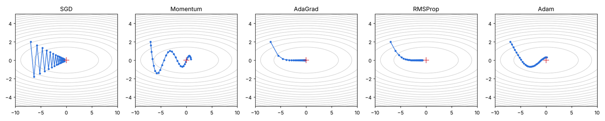
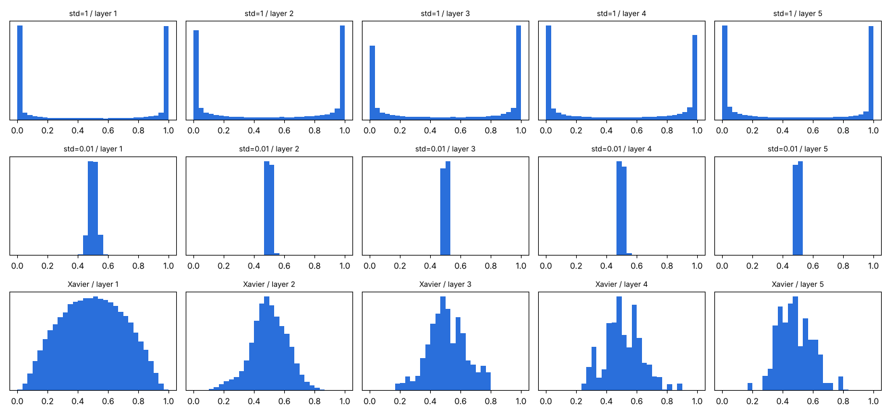

## 학습 목표

- 옵티마이저의 역할과 SGD의 단점, Momentum, AdaGrad, RMSProp, Adam의 아이디어
- 가중치 초기화가 중요한 이유와 Xavier, He 초기화 (출제)
- 데이터 정규화(Min-Max, Z-score)와 배치 정규화
- 과적합 방지: Dropout, 가중치 감소, 조기 종료
- Grid Search, Random Search로 하이퍼파라미터를 찾은 실습 결과와 그 한계

> 옵티마이저, 초기화, 정규화 예제는 numpy로 다시 실행한 결과. LSTM 하이퍼파라미터 탐색 결과는 실습 노트북(TensorFlow, scikeras)에서 실행한 출력
{: .prompt-info }

---

## 1. 매개변수 최적화 (Optimizer)

- 신경망 학습의 목적은 손실 함수를 최소화하는 가중치와 편향을 찾는 것
- **Optimizer**: 손실 함수를 최소화하는 매개변수를 찾는 최적화 알고리즘. GD, SGD, Momentum, AdaGrad, RMSProp, Adam 등

| 옵티마이저 | 아이디어 | 특징 |
| --- | --- | --- |
| SGD | 미니 배치 기울기 방향으로 학습률만큼 이동 | 단순하지만, 방향에 따라 기울기 크기가 다르면(비등방성) **지그재그**로 비효율적 |
| Momentum | 이전 이동 방향(속도 v)을 누적해 관성처럼 이동 | 지그재그가 줄고 한 방향으로 가속. 최소점을 지나쳤다 돌아오기도 함 |
| AdaGrad | 지금까지의 기울기 제곱을 누적해 **매개변수마다 학습률을 조정** | 많이 움직인 방향은 학습률이 작아짐. 오래 학습하면 누적값이 커져 갱신량이 0에 가까워짐 |
| RMSProp | AdaGrad의 누적을 **지수이동평균**으로 바꿔 과거 기울기를 점점 잊음 | 갱신량이 0이 되는 AdaGrad의 문제를 해결 |
| Adam | Momentum + RMSProp(AdaGrad 계열) | 1차, 2차 모멘트를 함께 쓰고, 초반 값이 0에 치우치는 것을 **편향 보정**함. 가장 널리 쓰임 |

식으로 쓰면 Momentum은 $$v \leftarrow \alpha v - \eta \frac{\partial L}{\partial W}, \; W \leftarrow W + v$$ 이고, AdaGrad는 $$h \leftarrow h + g \odot g, \; W \leftarrow W - \eta \frac{g}{\sqrt{h}}$$

함수 f(x, y) = x²/20 + y²(x 방향은 완만, y 방향은 가파름)에서 (-7, 2)부터 30번 갱신한 경로:



```text
SGD       30번 후 위치 [-0.3504  0.0848], f = 0.0133
Momentum  30번 후 위치 [0.8964 0.0881], f = 0.0479
AdaGrad   30번 후 위치 [-0.1202  0.    ], f = 0.0007
RMSProp   30번 후 위치 [-0.6974  0.    ], f = 0.0243
Adam      30번 후 위치 [0.136  0.3182], f = 0.1022
```

- SGD는 가파른 y 방향으로 크게 흔들리며 지그재그로 이동
- Momentum과 Adam은 관성 때문에 곡선을 그리며 최소점을 지나쳤다 돌아옴
- AdaGrad, RMSProp은 y 방향 학습률이 빨리 줄어 곧바로 x축에 붙은 뒤 이동
- 30번이라는 짧은 구간의 결과일 뿐이고 학습률도 각각 다르게 골랐기 때문에, **어느 옵티마이저가 항상 우월하다는 뜻은 아님**. 문제마다 적합한 방법이 다름

---

## 2. 가중치 초기화 (출제)

- 가중치를 **0이나 모두 같은 값**으로 두면 모든 뉴런이 똑같이 갱신되어 여러 개를 둔 의미가 없어짐 → 무작위로 초기화해야 함
- 너무 크면 sigmoid 출력이 0과 1에 몰려 **기울기 소실**, 너무 작으면 모두 0.5 근처에 몰려 **표현력 제한**(뉴런이 사실상 하나처럼 동작)
- **Xavier**: 앞 층 노드 수가 n이면 표준편차가 1/√n (입력, 출력을 모두 쓰면 √(2/(n_in + n_out))). sigmoid, tanh에 적합
- **He**: 표준편차 √(2/n_in). ReLU는 음수 쪽을 0으로 만들어 분산이 절반이 되므로 2배로 보정. ReLU에 적합

100개 노드, sigmoid 5층에서 각 층 활성값의 분포:



```text
std=1    층별 활성값 표준편차: [0.4586 0.4393 0.4329 0.4386 0.443 ]
std=0.01 층별 활성값 표준편차: [0.025  0.0135 0.0123 0.0122 0.0115]
Xavier   층별 활성값 표준편차: [0.2083 0.1206 0.126  0.1246 0.1094]
```

| 초기화 | 분포 | 문제 |
| --- | --- | --- |
| 표준편차 1 | 0과 1에 몰림 | sigmoid 미분이 0에 가까워 기울기 소실 |
| 표준편차 0.01 | 0.5에 몰림 | 기울기 소실은 없지만 표현력 제한 |
| Xavier | 넓게 퍼짐 | 층이 깊어져도 적당히 다양한 값 유지 |

---

## 3. 정규화

### 데이터 정규화

- 변수마다 범위가 크게 다르면(기압 약 1,000과 비습 약 3) 큰 변수에 모델이 치우침 → 범위를 비슷하게 맞춰 모든 변수가 의미 있게 쓰이도록 함
- **Min-Max**: (x − min) / (max − min) → 0 ~ 1. **이상치에 취약**
- **Z-score**: (x − 평균) / 표준편차 → 평균 0, 표준편차 1

```text
min-max: [0.     0.0101 0.0202 0.0303 1.    ]
z-score: [-0.5383 -0.5127 -0.487  -0.4614  1.9993]
```

이상치 1,000 하나 때문에 Min-Max에서는 나머지 네 값이 0 ~ 0.03에 몰려 차이가 거의 사라짐.

### 배치 정규화

- 학습할 때 **미니 배치 단위**로 각 층의 입력을 평균 0, 분산 1로 정규화한 뒤, 학습 가능한 γ(확대)와 β(이동)로 다시 조정
- 효과: 학습 속도 향상, 초기값 의존도 감소, 과적합 억제
- 보통 Affine(또는 Conv)과 활성화 함수 사이에 둠

```text
정규화 후 평균: [-0. -0.  0.] 분산: [1. 1. 1.]
gamma=2, beta=1 적용 후 평균: [1. 1. 1.] 표준편차: [2. 2. 2.]
```

- **배치**: 가중치를 한 번 갱신할 때 쓰는 샘플 묶음. 예를 들어 200개를 미니 배치 20개씩 나누면 1 epoch에 10번 갱신함

---

## 4. 과적합 방지

- **과적합**: 훈련 데이터에만 지나치게 맞춰져 새로운 데이터에서 성능이 떨어지는 것. 매개변수가 많고 데이터가 적을 때 잘 생김
- **가중치 감소(L2)**: 손실에 0.5 × λ × (가중치 제곱합)을 더해 큰 가중치에 벌점 → 기울기에 λW가 더해짐
- **Dropout**: 학습 때 뉴런을 무작위로 끊음(비율 p). 추론 때는 모두 쓰되 출력에 (1 − p)를 곱함 (Keras는 반대로 학습 때 1/(1 − p)로 키우는 방식)
- **조기 종료(Early Stopping)**: 검증 손실이 `patience` 번 연속 좋아지지 않으면 학습 중단
- 데이터 증강, 모델 단순화도 같은 목적

```text
mask: [0 0 1 1 1 0 1 0 0 0] 학습 시 출력: [0. 0. 1. 1. 1. 0. 1. 0. 0. 0.] 추론 시 출력(×0.7): [0.7 0.7 0.7 0.7 0.7 0.7 0.7 0.7 0.7 0.7]
L2 패널티 0.5*λ*sum(W^2) = 0.65 / 기울기에 더해지는 λW = [ 0.3 -0.2]
```

---

## 5. 하이퍼파라미터 탐색 실습 (실습 노트북 결과)

- **하이퍼파라미터**: 사람이 정하는 값(학습률, 배치 크기, epoch, 은닉 노드 수 등). 가중치처럼 학습되지 않음
- **Grid Search**: 후보의 모든 조합을 시험 (`GridSearchCV`)
- **Random Search**: 후보 중 무작위 조합을 일부만 시험 (`RandomizedSearchCV`). 조합이 많을 때 효율적
- scikeras의 `KerasRegressor`로 Keras 모델을 scikit-learn에 연결하고, `make_scorer(mean_squared_error, greater_is_better=False)`로 MSE가 작을수록 좋은 점수로 처리

[04편](/posts/Machine_Learning_04/)의 LSTM에 `Dropout(0.1)`을 추가하고 epochs ∈ {10, 20}, batch_size ∈ {16, 32}를 cv=2로 탐색했음.

| 데이터 | 탐색 | 최적 조합 | 이후 학습 | 테스트 RMSE | 04편(탐색 없음) |
| --- | --- | --- | --- | --- | --- |
| 서울 PM10 | Grid Search | batch 32, epoch 20 | 학습셋 절반(3,512개)으로 학습, 나머지 절반으로 검증 | **7.83** | 7.94 |
| Jena 기온 | Random Search | batch 32, epoch 10 | 학습셋 절반(20,903개)으로 학습, 7 epoch에 조기 종료 | **1.09** | 0.80 |

```text
[PM10] val_loss 220.47 → 35.26 (11 epoch) → 32.32 (17 epoch, 최저) → 35.19 (20 epoch)
[PM10] test RMSE : 7.83
[Jena] val_loss 4.15 → 1.64 (4 epoch, 최저) → 3.18 → 2.11 → 1.78 (7 epoch에서 종료)
[Jena] 온도 예측 :  6.96 / 정답 :  5.94
[Jena] 온도 예측 :  7.69 / 정답 :  6.93
[Jena] 온도 예측 :  8.58 / 정답 :  8.14
[Jena] test RMSE : 1.09
```

- PM10은 Dropout 덕분인지 학습 데이터를 절반만 쓰고도 약간 좋아졌음 (7.94 → 7.83, 차이가 작아 우연일 수 있음)
- Jena는 오히려 나빠졌음(0.80 → 1.09). 이번에는 예측이 정답보다 계속 **약 1℃ 높게** 나옴

### 결과가 나빠진 원인 (코드에서 확인한 것)

1. **검증셋으로 학습 데이터의 절반을 떼어 냄** (`test_size=0.5`, `shuffle=False`): 2016년 1 ~ 5월만 학습하고 5 ~ 10월로 검증 → 계절이 다른 데이터로 학습한 셈
2. `EarlyStopping`에 `restore_best_weights=True`가 없어 **가장 좋았던 4 epoch이 아니라 마지막 7 epoch의 가중치**로 테스트함
3. `patience=epoch*0.3`은 실수(3.0, 6.0)라서 동작은 하지만 정수로 주는 것이 명확함
4. 시계열인데 `cv=2`의 일반 KFold를 썼음 → 한 fold는 **뒤 절반으로 학습하고 앞 절반으로 평가**(미래로 과거를 예측)하게 됨. `TimeSeriesSplit`이 맞음
5. 탐색 대상이 epoch과 배치 크기뿐이라 모델 구조나 학습률 같은 더 중요한 하이퍼파라미터는 조정되지 않았고, 조합이 4개뿐이라 Random Search(n_iter=10)도 사실상 Grid Search와 같았음

---

### 정리 노트에서 정정한 부분 정리

| 위치 | 원래 | 정정 | 이유 |
| --- | --- | --- | --- |
| SGD 정의 | 전체 데이터 중 단 하나의 데이터로 1회 진행 | 원래 정의는 맞지만 실습과 Keras는 **미니 배치** SGD | 배치 크기 32 등을 사용 |
| 옵티마이저 | RMSEProp | RMSProp | 오타 |
| Adam | Momentum과 AdaGrad를 융합 | Momentum과 RMSProp(AdaGrad 계열, 지수이동평균) | 2차 모멘트가 지수이동평균 |
| 정규화 단원 | "배치 정규화" 제목 아래 배치, 미니 배치 정의 | 배치 정규화는 미니 배치 단위로 각 층 입력을 정규화하는 기법 | 제목과 내용이 다름 |
| 하이퍼파라미터 탐색 | 검증셋 `test_size=0.5` | 0.1 ~ 0.2 정도 | 학습 데이터가 절반으로 줄고 계절 분포가 달라짐 |
| EarlyStopping | `restore_best_weights` 없음 | `restore_best_weights=True` | 최저 검증 손실 시점의 가중치로 평가 |
| GridSearchCV | `cv=2` (KFold) | `cv=TimeSeriesSplit(n_splits=...)` | 시계열은 과거로 학습해 미래로 평가 |

---

## 최종 핵심 정리

1. 옵티마이저는 손실을 최소화하는 매개변수를 찾는 알고리즘이며, SGD는 방향마다 기울기 크기가 다르면 지그재그로 비효율적임
2. Momentum은 관성, AdaGrad는 매개변수별 학습률 감소, RMSProp은 지수이동평균, Adam은 둘을 합치고 편향 보정을 함
3. 가중치를 같은 값으로 두면 대칭이 깨지지 않고, 너무 크면 기울기 소실, 너무 작으면 표현력 제한이 생김
4. Xavier(1/√n)는 sigmoid, tanh에, He(√(2/n))는 ReLU에 맞는 초기화
5. Min-Max는 0 ~ 1로 맞추지만 이상치에 약하고, Z-score는 평균 0, 표준편차 1로 맞춤
6. 배치 정규화는 미니 배치마다 평균 0, 분산 1로 정규화한 뒤 γ, β로 조정해 학습을 빠르고 안정적으로 만듦
7. 과적합은 가중치 감소, Dropout, 조기 종료, 데이터 증강으로 줄임
8. 하이퍼파라미터 탐색은 Grid(전체)와 Random(일부) 방식이 있고, 시계열에서는 시간 순서를 지키는 검증과 최적 가중치 복원이 필요함

---

End.
