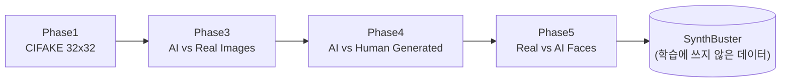
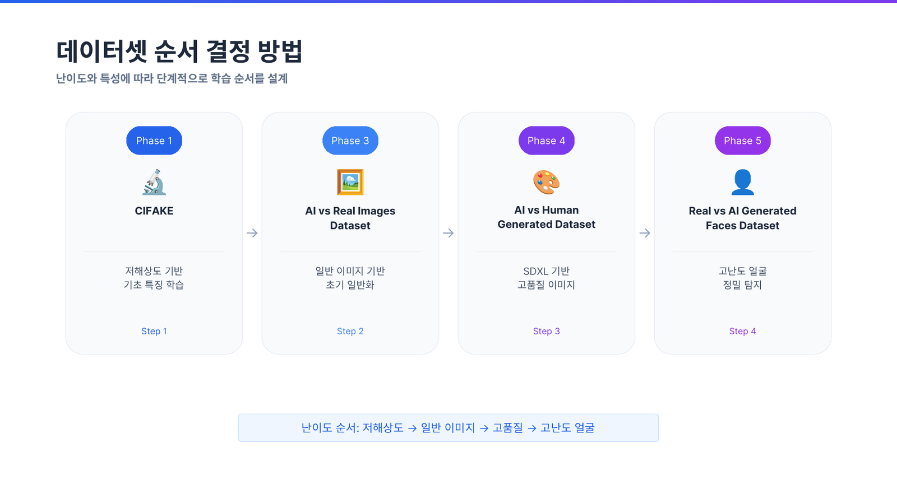
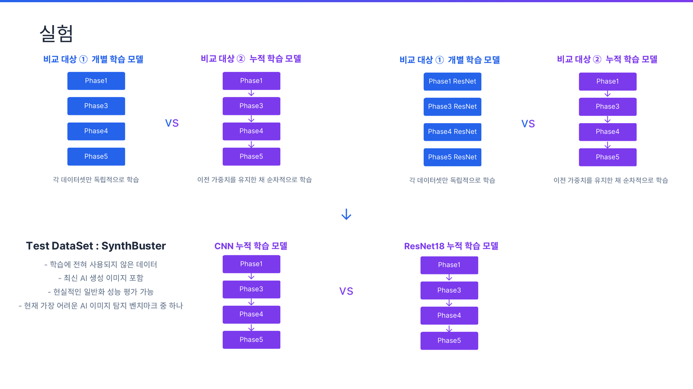
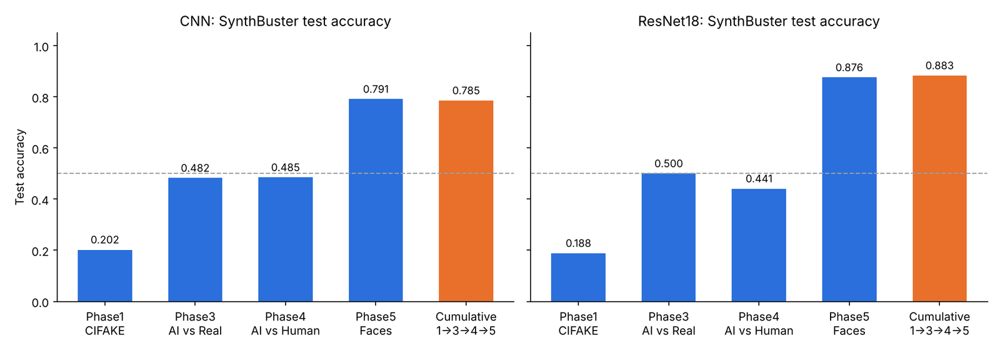
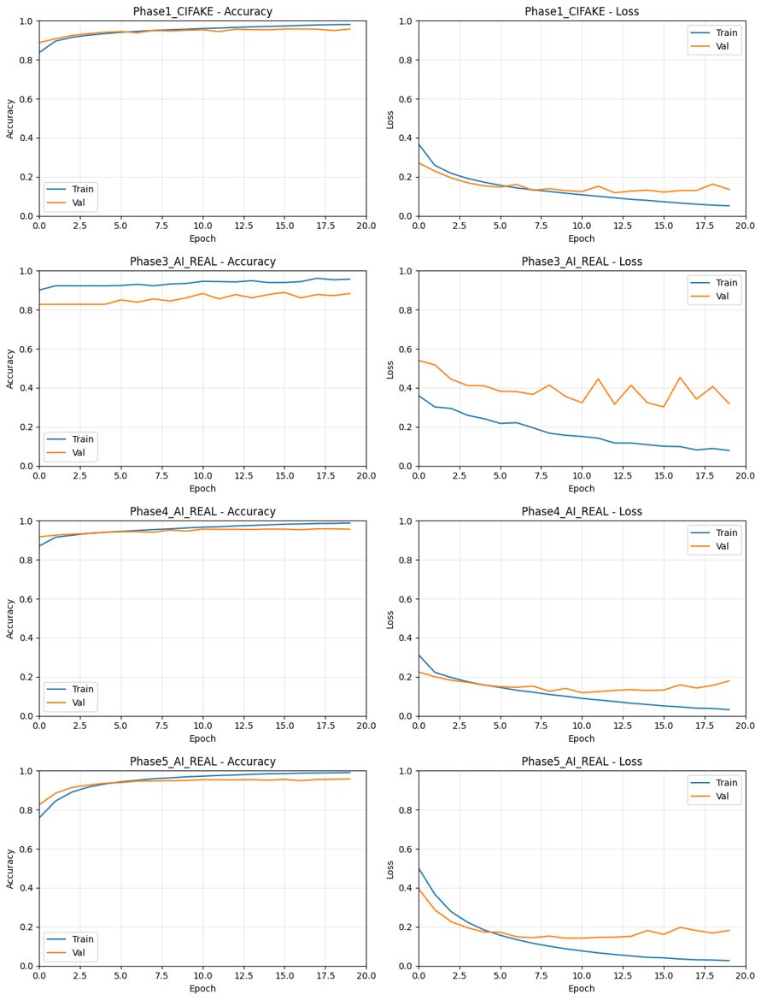
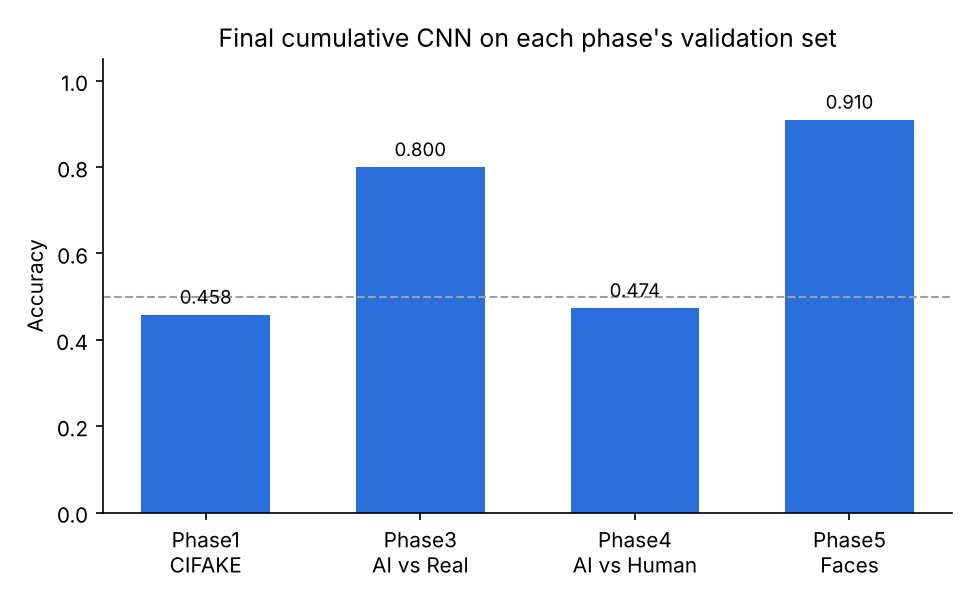

## 학습 목표

- 프로젝트의 문제 정의와 가설: **단계적(누적) 학습이 AI 생성 이미지 탐지의 일반화 성능을 높이는가?**
- 4개 학습 데이터셋과 테스트 데이터셋(SynthBuster)의 구성, 전처리 코드
- 직접 설계한 CNN과 ResNet18, 개별 학습과 누적 학습의 실험 설계
- 결과를 신뢰구간과 함께 해석하고, Catastrophic Forgetting과 실험의 한계를 정리
- 수업에서 배운 개념(CNN, 전이 학습, 과적합, 조기 종료, 데이터 증강)이 실제 프로젝트에서 어떻게 쓰였는지

> 2인 팀 프로젝트. 코드, 결과 CSV, 발표 자료는 GitHub 저장소 [Stepwise-Optimization-AI-Image-Detection](https://github.com/YoungHoonKo/Stepwise-Optimization-AI-Image-Detection)에 있음. 학습은 Google Colab(GPU, TensorFlow 2.20)에서 실행했고, 이 글의 수치는 모두 저장소 노트북에 저장된 출력에서 가져왔음. 신뢰구간, 매개변수 수, 클래스 비율은 그 수치로 다시 계산한 값
{: .prompt-info }

---

## 1. 문제 정의

### 배경

- Stable Diffusion, Midjourney, DALL·E 같은 생성 모델의 발전으로 실제 사진과 구분하기 어려운 이미지가 빠르게 늘어남
- 딥페이크, 허위 정보, 저작권 문제로 이어지기 때문에 **AI 생성 이미지 탐지**가 중요해짐

### 기존 접근의 한계 (제안서)

| 한계 | 내용 |
| --- | --- |
| 연산 비용 | 처음부터 224×224 이상 고해상도로 학습하면 GPU 자원과 시간이 많이 듦 |
| 과적합, 일반화 실패 | 특정 데이터셋, 특정 생성 모델의 미세한 픽셀 패턴에만 맞춰지면 다른 생성 모델이나 다른 화질의 이미지에서 성능이 급격히 떨어짐 |

### 아이디어와 가설

여러 데이터셋을 한 번에 섞는 대신 **쉬운 것에서 어려운 것 순서로 데이터셋을 바꿔 가며 이전 가중치를 이어서 학습**하면(커리큘럼 학습과 비슷한 발상), 각 단계의 특징이 쌓여 처음 보는 생성 모델의 이미지에도 잘 일반화될 것이라는 가설을 세웠음.



---

## 2. 데이터셋


_발표 자료: 난이도 순서로 정한 학습 순서_

| 단계 | 데이터셋 (Kaggle) | 원본 해상도 | 규모 | 역할 |
| --- | --- | --- | --- | --- |
| Phase 1 | CIFAKE (birdy654) | 32×32 | 120,000 (real 60,000 / fake 60,000) | 저해상도 기초 특징 학습. CIFAR-10 실제 이미지 + Stable Diffusion 1.4로 만든 이미지 |
| ~~Phase 2~~ | AI Generated Images vs Real Images (cashbowman) | 다양 | 975 | 성능 저하로 **제외** (검증 정확도 0.387) |
| Phase 3 | AI vs Real Images (rhythmghai) | 512×512 | 995 | 자연, 도시, 동물, 음식, 사람 5개 카테고리의 실제 사진 + SDXL 이미지 |
| Phase 4 | AI vs Human Generated (alessandrasala79) | 768×512 | 79,950 (train.csv) | 고품질 이미지, 약 10GB |
| Phase 5 | Real vs AI Generated Faces (philosopher0808) | 512×512 | 120,959 (real 70,000 / ai 50,959) | 얼굴. real은 FFHQ, ai는 Stable Diffusion, SFHQ, FaceSwap, thispersondoesnotexist |
| **Test** | SynthBuster (AI 9,000) + Real Image Dataset (Real 9,000) | 다양 | 18,000 | 학습에 쓰지 않은 데이터로 일반화 평가. AI는 DALL·E 2/3, Midjourney v5, SD 1.4/2/XL, GLIDE 등 |

제안서 단계에서는 Unbiased Tiny GenImage(약 40,000장, 8개 이상 생성 모델)로 마지막 검증을 하려 했지만, 최종 실험에서는 더 최신 생성 모델이 포함된 SynthBuster를 테스트셋으로 바꿨음.

---

## 3. 전처리

데이터셋마다 폴더 구조가 달라서 모두 `train/ai`, `train/real`, `val/ai`, `val/real` 구조로 통일하고, 8:2로 나눈 뒤 **128×128**로 리사이즈해 학습했음. 라벨은 폴더 이름의 알파벳 순서라서 `ai = 0`, `real = 1`.

```python
def split_and_move(src, dst, label, split_ratio=0.8):
    images = []
    for root, _, files in os.walk(src):                  # 하위 폴더까지 모든 이미지 수집
        for f in files:
            if f.lower().endswith((".jpg", ".jpeg", ".png", ".webp")):
                images.append(os.path.join(root, f))
    random.seed(42)
    random.shuffle(images)

    split_idx = int(len(images) * split_ratio)
    train_imgs, val_imgs = images[:split_idx], images[split_idx:]

    def copy_imgs(img_list, split_type):
        for img_path in img_list:
            filename = os.path.basename(img_path)        # ← 파일 이름만 사용
            dst_path = os.path.join(dst, split_type, label, filename)
            shutil.copy(img_path, dst_path)

    copy_imgs(train_imgs, "train")
    copy_imgs(val_imgs, "val")

def convert_dataset(base_dir, ai_paths, real_paths, out_dir):
    make_dirs(out_dir)                                   # train|val × real|ai 폴더 생성
    for p in ai_paths:
        split_and_move(p, out_dir, "ai")
    for p in real_paths:
        split_and_move(p, out_dir, "real")
```

Phase4는 이미지 목록이 CSV(`file_name`, `label`)로 주어져서 같은 방식의 CSV 버전 함수를 따로 만들었고, Phase5는 `ffhq`(real)와 `fake/` 아래 7개 폴더(ai)를 모아 같은 비율로 나눴음.

### 전처리 후 실제 개수

| 데이터셋 | 나눈 개수 (출력) | 폴더에 남은 개수 | 차이 |
| --- | --- | --- | --- |
| Phase1 real | train 48,000 / val 12,000 | train **41,637** / val **11,618** | 6,745장 사라짐 |
| Phase1 ai | train 48,000 / val 12,000 | train 48,000 / val 12,000 | 없음 |
| Phase3 ai | train 200 / val 50 | train **50** / val **31** | 169장 사라짐 |
| Phase3 real | train 596 / val 149 | train 596 / val 149 | 없음 |
| Phase4 | train 31,980 / val 7,995 (클래스별) | 동일 | 없음 |
| Phase5 | real 70,000, ai 50,959 → 8:2 | real 56,000 / 14,000, ai 40,767 / 10,192 | 없음 |

> `os.path.basename()`으로 **파일 이름만** 써서 복사했기 때문에, 서로 다른 폴더에 같은 이름의 파일이 있으면 나중 파일이 앞 파일을 **덮어씀**. CIFAKE는 `train/REAL`과 `test/REAL`의 파일 이름이 겹치고, Phase3는 5개 카테고리 폴더의 AI 이미지 이름이 겹쳐서 데이터가 사라졌음. 상대 경로를 파일 이름에 포함시키거나(`city_001.jpg`) 해시로 이름을 바꾸면 막을 수 있음
{: .prompt-warning }

그 결과 Phase3 학습 폴더는 real 596장, ai 50장으로 **real이 92.3%**인 심한 불균형 데이터가 되었음.

---

## 4. 모델

### 직접 설계한 CNN

수업에서 배운 `Conv → ReLU → MaxPool` 반복 구조에 Dropout을 더한 모델.

```python
def build_model(img_size=128):
    return tf.keras.Sequential([
        tf.keras.layers.Rescaling(1./255, input_shape=(img_size, img_size, 3)),   # 정규화를 모델 안에서
        tf.keras.layers.Conv2D(32, 3, activation='relu'),
        tf.keras.layers.MaxPooling2D(),
        tf.keras.layers.Conv2D(64, 3, activation='relu'),
        tf.keras.layers.MaxPooling2D(),
        tf.keras.layers.Conv2D(128, 3, activation='relu'),
        tf.keras.layers.MaxPooling2D(),
        tf.keras.layers.Flatten(),
        tf.keras.layers.Dense(128, activation='relu'),
        tf.keras.layers.Dropout(0.5),                                            # 과적합 방지
        tf.keras.layers.Dense(2, activation='softmax')
    ])
```

```text
Conv2D(32) params=896 -> pool out 63x63x32
Conv2D(64) params=18,496 -> pool out 30x30x64
Conv2D(128) params=73,856 -> pool out 14x14x128
Flatten=25,088, Dense128=3,211,392, Dense2=258, total=3,304,898 (Dense 비중 97.2%)
```

- 패딩 없는 3×3 합성곱이라 128 → 126 → 63 → 61 → 30 → 28 → 14로 줄어듦
- 전체 330만 개 매개변수 중 **97.2%가 Flatten 뒤 Dense(128) 하나**에 몰려 있음. 합성곱 층은 9만 개 남짓. [03편](/posts/Machine_Learning_03/)에서 본 것처럼 GlobalAveragePooling을 쓰면 이 부분을 크게 줄일 수 있음
- 초기 실험(CIFAKE 32×32 단독)에서는 기본 CNN 93.59%, 개선 CNN 94.38%의 테스트 정확도를 얻었음

### ResNet18

- 18층 잔차 신경망. **스킵 연결(F(x) + x)**로 깊어도 기울기가 잘 전달됨
- 입력 224×224, CNN과 같은 Phase 순서로 개별 학습과 누적 학습을 진행 (저장소에는 학습된 모델의 평가 코드와 결과만 포함)

---

## 5. 실험 설계와 학습


_발표 자료: 실험 설계 (개별 학습 대 누적 학습, CNN 대 ResNet18)_

| 실험 | 방법 |
| --- | --- |
| ① 개별 학습 | Phase1, 3, 4, 5 각각 **처음부터** 학습 (데이터셋마다 모델 하나, 총 4개) |
| ② 누적 학습 | Phase1 → 3 → 4 → 5 순서로 **이전 단계의 가중치를 불러와 이어서** 학습 |
| 평가 | 모든 모델을 같은 SynthBuster 테스트셋(18,000장)으로 평가 |

### 누적 학습 코드

```python
# Phase1: 처음부터 학습
model = build_model(128)
model.compile(optimizer=tf.keras.optimizers.Adam(1e-3),
              loss='sparse_categorical_crossentropy', metrics=['accuracy'])
early_stop = tf.keras.callbacks.EarlyStopping(monitor='val_loss', patience=3,
                                              restore_best_weights=True)
model.fit(train_ds, validation_data=val_ds, epochs=20, callbacks=[early_stop])
model.save("/content/drive/MyDrive/phase1.keras")

# Phase3 이후: 이전 단계 모델을 불러와 작은 학습률로 미세 조정
model = tf.keras.models.load_model("/content/drive/MyDrive/phase1.keras")
model.compile(optimizer=tf.keras.optimizers.RMSprop(1e-4),
              loss='sparse_categorical_crossentropy', metrics=['accuracy'])
model.fit(train_ds, validation_data=val_ds, epochs=20, callbacks=[early_stop])
model.save("/content/drive/MyDrive/phase3.keras")      # 다음 단계(Phase4)의 출발점
```

데이터는 `image_dataset_from_directory(train 폴더, validation_split=0.2, seed=123, image_size=(128, 128))`로 불러왔음. 이전 단계에서 배운 특징을 크게 망가뜨리지 않도록 Phase3부터는 학습률을 1e-4로 낮췄음 ([03편](/posts/Machine_Learning_03/)의 미세 조정과 같은 이유).

### 누적 학습 단계별 결과

| 단계 | 시작 가중치 | 옵티마이저 | train acc | val acc | train loss | val loss | 사용 |
| --- | --- | --- | --- | --- | --- | --- | --- |
| Phase1 CIFAKE | 처음부터 | Adam(1e-3) | 0.9597 | 0.9338 | 0.1038 | 0.2350 | O |
| Phase2 | Phase1 | Adam(1e-4) | 0.5089 | 0.3871 | 0.8622 | 1.0523 | X (성능 저하) |
| Phase3 AI vs Real | Phase1 | RMSprop(1e-4) | 0.9265 | 0.9070 | 0.3239 | 0.3006 | O |
| Phase4 AI vs Human | Phase3 | Adam(1e-4) | 0.9724 | 0.9457 | 0.0748 | 0.1668 | O |
| Phase5 Faces | Phase4 | Adam(1e-4) | 0.9227 | 0.8866 | 0.1950 | 0.3140 | O |

- 각 단계는 마지막 epoch 값. Phase4만 데이터가 커서(약 51,000장) 조기 종료 없이 20 epoch을 돌렸음
- Phase2는 검증 정확도가 0.39로 **찍는 것(0.5)보다 낮아서** 제외. 데이터 증강(뒤집기, 회전, 확대, 대비)을 더한 버전도 0.40에 그쳤음
- Phase3에서도 증강 버전(val 0.930)과 비증강 버전(val 0.884)을 비교했는데, 최종적으로 비증강 버전을 다음 단계에 사용했음

---

## 6. 평가 데이터 준비

```python
def load_test_data(real_dir, fake_dir, image_size=(128, 128), batch_size=32):
    real_paths = list(Path(real_dir).glob("*.jpg")) + list(Path(real_dir).glob("*.png")) + \
                 list(Path(real_dir).glob("*.jpeg"))
    fake_paths = [p for ext in ("jpg", "png", "jpeg", "webp")
                  for p in Path(fake_dir).glob(f"**/*.{ext}")]
    all_paths = [str(p) for p in fake_paths + real_paths]
    all_labels = [0] * len(fake_paths) + [1] * len(real_paths)      # ai = 0, real = 1 (학습과 동일)

    def preprocess(path, label):
        img = tf.io.read_file(path)
        img = tf.image.decode_image(img, channels=3, expand_animations=False)
        img = tf.image.resize(img, image_size)
        return tf.cast(img, tf.float32), label                       # /255는 모델의 Rescaling이 담당

    ds = tf.data.Dataset.from_tensor_slices((all_paths, all_labels))
    return ds.map(preprocess, num_parallel_calls=tf.data.AUTOTUNE).batch(batch_size).prefetch(tf.data.AUTOTUNE)
```

```text
Real: 9000장, Fake: 9000장
누적 학습 모델 → test_acc: 0.7854 / test_loss: 1.1971 / f1: 0.7561
```

- 학습 때 라벨 순서(ai = 0)와 테스트 라벨 순서를 반드시 맞춰야 함. 반대로 넣으면 정확도가 1 − acc로 뒤집혀 보임
- 모델 안에 `Rescaling(1/255)`이 있으므로 테스트 전처리에서 다시 255로 나누면 안 됨 (이중 정규화)
- 처음에는 각 Phase의 val 폴더를 합친 데이터(ai 30,218 / real 33,744)로도 평가했는데, 학습에 쓴 데이터와 같은 출처라서 일반화 평가로는 쓰지 않았음 (그 결과 0.6394)

---

## 7. 결과


_SynthBuster 정확도 (점선은 찍기 수준 0.5)_

| 모델 | 학습 | Phase1 | Phase3 | Phase4 | Phase5 | 누적 (1→3→4→5) |
| --- | --- | --- | --- | --- | --- | --- |
| CNN | 개별 | 0.202 | 0.482 | 0.485 | **0.791** | **0.785** |
| ResNet18 | 개별 | 0.188 | 0.500 | 0.441 | **0.876** | **0.883** |

ResNet18의 test loss는 Phase1 11.89, Phase3 1.17, Phase4 4.21, Phase5 0.33, 누적 0.33.

### 신뢰구간으로 다시 보기

테스트셋이 18,000장이므로 정확도의 95% 신뢰구간(정규 근사)을 계산해 보면:

```text
CNN Phase5: 0.7910 ± 0.0059 (95% CI 0.785~0.797)
CNN 누적: 0.7854 ± 0.0060 (95% CI 0.779~0.791)
ResNet Phase5: 0.8756 ± 0.0048 (95% CI 0.871~0.880)
ResNet 누적: 0.8832 ± 0.0047 (95% CI 0.879~0.888)
```

| 비교 | 차이 | 판단 |
| --- | --- | --- |
| CNN 누적 대 CNN Phase5 개별 | −0.6%p | 구간이 겹침 → **차이가 있다고 말하기 어려움** |
| ResNet18 누적 대 ResNet18 Phase5 개별 | +0.8%p | 구간이 거의 맞닿음, 시드 한 번의 결과라 **우연일 수 있음** |
| ResNet18 누적 대 CNN 누적 | +9.8%p | 구간이 멀리 떨어짐 → **분명한 차이** |
| 누적 대 Phase1, 3, 4 개별 | +30 ~ +58%p | 분명한 차이 |

이 신뢰구간은 테스트 샘플링 불확실성만 반영함. 학습 시드, 데이터 분할에 따른 변동은 포함되지 않으므로 실제 불확실성은 더 큼.

### 해석

1. 누적 학습 모델은 Phase1, 3, 4 개별 모델보다 훨씬 좋았지만, **마지막 단계인 Phase5 개별 모델과는 거의 같았음**. 일반화 성능의 대부분은 Phase5(얼굴) 데이터에서 온 것으로 보임
2. 따라서 "단계적 학습이 일반화를 높인다"는 가설은 이 실험으로는 **지지되지 않음**. 정확히는 "같은 성능을 내면서 앞 단계 데이터 학습은 크게 도움이 되지 않았다"에 가까움
3. 같은 누적 학습에서 ResNet18이 CNN보다 약 9.8%p 높았음. 더 깊고 스킵 연결이 있는 사전 설계 구조가 유리했음
4. Phase1(CIFAKE) 개별 모델은 0.19 ~ 0.20으로 **찍기(0.5)보다 훨씬 낮음**. 무작위로 틀린 것이 아니라 예측이 체계적으로 뒤집혀 있다는 뜻 → 32×32에서 배운 "AI다움"의 신호가 SynthBuster에서는 반대로 작동했음

### 개별 모델 학습 곡선


_CNN 개별 학습 4개의 train, val 곡선 (20 epoch)_

- 네 데이터셋 모두 **자기 검증 데이터에서는** 0.89 ~ 0.96으로 잘 맞힘 (Phase1 0.958, Phase3 0.889, Phase4 0.958, Phase5 0.958)
- 그런데 SynthBuster에서는 Phase5만 0.79이고 나머지는 0.5 이하 → **분포 안(in-distribution) 성능과 분포 밖(out-of-distribution) 성능이 크게 다름**. 일반화를 보려면 반드시 다른 출처의 테스트셋이 필요하다는 것을 보여 줌
- Phase3는 val loss가 들쭉날쭉하고, 정확도가 0.83에서 시작하는데 이는 검증셋의 real 비율(약 0.83)과 같음 → 처음에는 전부 real로 예측하고 있었다는 뜻
- Phase4, 5는 10 epoch 이후 val loss가 다시 오름 → 과적합 시작 (개별 학습에는 조기 종료를 쓰지 않았음)

---

## 8. Catastrophic Forgetting

누적 학습이 끝난 CNN(Phase5까지 학습)으로 각 단계의 검증 데이터를 다시 평가했음.



| Phase1 | Phase3 | Phase4 | Phase5 |
| --- | --- | --- | --- |
| 0.458 | 0.800 | 0.474 | 0.910 |

- 마지막에 배운 Phase5는 잘 맞히지만 Phase1과 Phase4는 찍기 수준 아래로 떨어졌음 → 새 데이터를 학습하면서 이전 지식을 잃어버리는 **Catastrophic Forgetting(파괴적 망각)**
- Phase4는 바로 직전 단계였는데도 0.946 → 0.474로 떨어짐. 얼굴 데이터(Phase5)의 특징이 일반 이미지 판별에 쓰이던 가중치를 덮어씀
- Phase3의 0.800은 검증셋이 real 82.8%라서 **전부 real이라고 해도 0.83이 나오는 수준**. 잘 기억한다고 보기 어려움
- 이것이 "누적 모델 ≈ Phase5 개별 모델"이라는 결과와 연결됨: 마지막 단계 이전의 지식이 거의 남지 않았기 때문

해결 방향:

| 방법 | 아이디어 |
| --- | --- |
| Replay (Rehearsal) | 이전 단계 데이터 일부를 저장해 두고 새 단계 학습 때 섞어서 함께 학습 |
| EWC (Elastic Weight Consolidation) | 이전 과제에 중요했던 가중치가 크게 바뀌지 않도록 손실에 벌점 추가 |
| 층 동결 | 앞쪽 합성곱 층은 고정하고 뒤쪽만 학습 ([03편](/posts/Machine_Learning_03/)의 전이 학습 동결과 같은 원리) |
| 합동 학습 (Joint training) | 모든 데이터셋을 섞어서 한 번에 학습해 비교 기준으로 삼기 |

---

## 9. 실험의 한계

### 테스트셋의 출처, 해상도 차이 (가장 중요)

- AI 이미지(SynthBuster)와 Real 이미지가 **서로 다른 데이터셋**에서 왔음
- 사용한 SynthBuster는 `synthbuster-32`라는 이름의 데이터셋으로, 내려받은 압축 파일이 9.04MB에 9,000장이라 **한 장에 약 1KB**임. Real Image Dataset은 893MB에 9,000장이라 **한 장에 약 99KB**
- 즉 AI 이미지는 32×32 수준의 작은 이미지를 128로 키운 흐릿한 이미지이고, real은 고해상도 사진일 가능성이 큼. 모델이 "생성 여부"가 아니라 **"흐릿함, 해상도, 압축 방식의 차이"**로 맞혔을 수 있음
- Phase1 개별 모델이 0.2로 체계적으로 뒤집힌 것도 이 차이로 설명할 수 있음. CIFAKE에서 저해상도 특징과 클래스의 관계를 배운 모델이, 해상도가 클래스와 완전히 엮인 테스트셋에서 반대로 예측한 것

### 그 밖의 한계

| 한계 | 내용 | 개선 |
| --- | --- | --- |
| 데이터 손실과 불균형 | 파일 이름 덮어쓰기로 CIFAKE real 6,745장, Phase3 ai 169장 손실. Phase3은 real 92.3% | 경로 포함 파일명, 클래스 가중치 또는 오버샘플링 |
| 단일 실행 | 시드 하나의 결과라 누적과 개별의 1%p 이내 차이는 판단 불가 | 시드 3 ~ 5회 반복, 평균과 표준편차 |
| 검증 방식 차이 | 누적 모델은 train 폴더 안에서 `validation_split=0.2`, 개별 모델은 별도 val 폴더 | 같은 검증셋 사용 |
| 하이퍼파라미터 불일치 | 단계마다 옵티마이저(Adam, RMSprop), 증강, 조기 종료 여부가 다름 | 조건을 통일하고 하나씩 바꿔 비교 |
| 지표 | 정확도와 F1(누적 CNN 0.756)만 보고 | 혼동 행렬, AUC, 생성 모델별 정확도 |
| 증강 실험의 이중 정규화 | Phase2, 3 증강 버전에서 `x / 255.0`을 한 뒤 모델의 `Rescaling(1/255)`이 한 번 더 나눔 | 증강 함수에서 255로 나누지 않기 |

---

## 10. 프로젝트에서 배운 점

| 수업 개념 | 프로젝트에서 확인한 것 |
| --- | --- |
| CNN 구조 ([03편](/posts/Machine_Learning_03/)) | 합성곱 층보다 Flatten 뒤 Dense에 매개변수가 몰림. 구조 설계가 매개변수 수를 좌우함 |
| 층을 깊게 하는 이유, ResNet | 같은 조건에서 ResNet18이 직접 만든 CNN보다 9.8%p 높음 |
| 전이 학습, 미세 조정 | 이전 가중치를 작은 학습률(1e-4)로 이어 학습. 하지만 순차 학습은 망각을 동반함 |
| 과적합, 조기 종료 ([05편](/posts/Machine_Learning_05/)) | 자기 검증셋 0.96이어도 다른 출처에서는 0.2 ~ 0.5. `restore_best_weights=True`로 최적 가중치 복원 |
| 데이터 전처리 ([01편](/posts/Machine_Learning_01/)) | 파일 복사 한 줄의 실수가 수천 장의 데이터 손실과 클래스 불균형으로 이어짐 |
| 테스트와 검증의 분리 | 같은 출처의 val을 합친 평가(0.64)와 다른 출처 평가(0.79)는 의미가 다름 |

발표에서는 "데이터셋보다 **학습 전략**이 더 중요하다"고 결론을 냈지만, 다시 정리해 보면 이 실험에서 성능을 결정한 것은 **마지막 단계의 데이터와 모델 구조**였고, 학습 순서(전략)의 효과는 확인되지 않았음. 그리고 테스트셋이 정말 "AI인지 아닌지"를 묻고 있는지 확인하는 것이 모델보다 먼저였음.

---

### 발표 자료, 노트에서 정정한 부분 정리

| 위치 | 원래 | 정정 | 이유 |
| --- | --- | --- | --- |
| 발표 대본 7장 | 저희가 설계한 CNN 기반 누적 학습 모델이 ResNet18보다 우수한 일반화 성능 | **ResNet18(0.883)이 CNN(0.785)보다 9.8%p 높음** | 수치와 결론이 반대 |
| 발표 대본 5, 6장 | 단계적 학습 모델이 대부분의 개별 모델보다 높은 일반화 성능 | Phase5 개별 모델과는 신뢰구간이 겹쳐 차이가 없음 | 비교 대상은 가장 강한 개별 모델이어야 함 |
| 발표 대본 8장 | Catastrophic Forgetting, 즉 장기 의존성 문제 | 서로 다른 개념. 장기 의존성은 RNN에서 먼 시각의 정보가 전달되지 않는 문제([04편](/posts/Machine_Learning_04/)), 파괴적 망각은 순차 학습에서 이전 과제를 잊는 문제 | 용어 혼동 |
| 전처리 개수 출력 | "중복 제거" 후 개수 | 중복 제거가 아니라 **같은 이름 파일 덮어쓰기**로 인한 손실 | CIFAKE real 6,745장, Phase3 ai 169장 |
| 저장소 README | Phase3 데이터 손실만 언급 | Phase1(CIFAKE real)도 손실 | 노트북 출력 41,637 / 11,618 |
| 증강 함수 | `x = x / 255.0` 후 모델에 입력 | 나누지 않고 입력 | 모델 첫 층이 `Rescaling(1/255)` |
| 테스트셋 설명 | 고해상도 최신 생성형 AI 이미지 | 사용한 것은 `synthbuster-32`(한 장 약 1KB)로 저해상도 버전 | 파일 크기로 확인 |

---

## 최종 핵심 정리

1. 프로젝트는 CIFAKE → 일반 이미지 → 고품질 이미지 → 얼굴 순서로 가중치를 이어 학습하면 AI 생성 이미지 탐지의 일반화가 좋아지는지 검증한 실험
2. 모든 데이터셋을 `train/val × ai/real` 구조와 128×128로 통일했고, 라벨은 ai = 0, real = 1
3. 직접 설계한 CNN은 매개변수 330만 개 중 97%가 Dense 한 층에 있고, ResNet18은 스킵 연결을 가진 18층 구조
4. SynthBuster 정확도는 누적 CNN 0.785, 누적 ResNet18 0.883으로 ResNet18이 9.8%p 높았음
5. 누적 모델은 Phase5 개별 모델(0.791, 0.876)과 신뢰구간이 겹쳐, 단계적 학습의 효과는 확인되지 않았음
6. 누적 학습 후 Phase1, 4 검증 정확도가 0.46, 0.47로 떨어진 Catastrophic Forgetting이 나타났고, Replay나 EWC로 완화할 수 있음
7. 테스트셋의 AI와 Real 이미지는 출처와 해상도가 달라(약 1KB 대 99KB) 모델이 해상도 차이를 학습했을 가능성이 큼
8. 파일 이름 덮어쓰기로 인한 데이터 손실, 단일 시드, 서로 다른 검증 방식은 다음 실험에서 먼저 고쳐야 할 부분

---

End.
