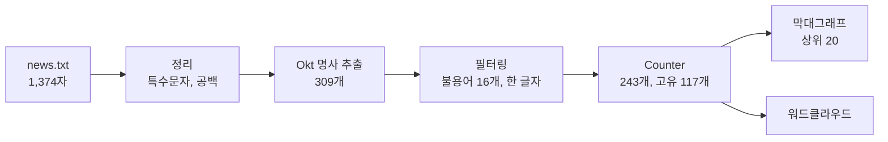
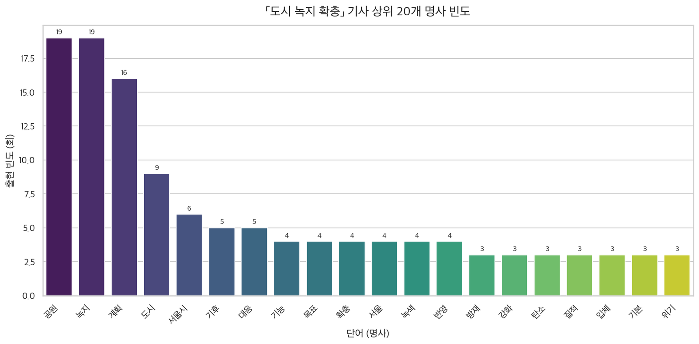

## 학습 목표

- 한국어 텍스트 마이닝 파이프라인(정리 → 형태소 분석 → 불용어 제거 → 빈도 → 시각화)을 처음부터 끝까지 구현하기
- 불용어를 "분석 목적"을 기준으로 정하는 방법
- 한글 폰트, KoNLPy의 JVM처럼 환경에서 생기는 문제를 재현 가능하게 처리하기
- 형태소 분석기의 한계(복합명사 분절)와 빈도 분석의 한계(동점, 짧은 문서)를 결과로 확인하고 개선하기

> [08편 텍스트 데이터 분석](/posts/Data-Science_08/)에서 배운 내용을 실제 기사에 적용한 과제. 코드는 제출한 노트북 그대로이고, 실행 결과는 제출본(macOS)과 이 글을 쓰며 다시 실행한 결과(Linux)가 **완전히 같았음**
{: .prompt-info }

---

## 한눈에 보기

| 항목 | 내용 |
| --- | --- |
| 데이터 | 뉴시스 기사 1건, 「2040 서울시 공원녹지기본계획」 조건부 가결 (1,374자) |
| 도구 | KoNLPy `Okt`(명사 추출), `collections.Counter`, pandas, seaborn, wordcloud |
| 결과 | 명사 309개 → 불용어, 한 글자 제거 후 243개(고유 117개) → 상위 20개 시각화 |
| 상위 단어 | 공원(19), 녹지(19), 계획(16), 도시(9), 서울시(6) |
| 개선 | 복합명사 병합으로 "공원녹지"(10회), "기본계획"(3회) 복원, 서울과 서울시 통합 |



---

## 1. 실행 환경

| 항목 | 제출본 | 재실행 |
| --- | --- | --- |
| OS | macOS (Apple Silicon) | Linux |
| Python | 3.12.4 | 3.13 |
| KoNLPy | 0.6.0 (Java 11, Homebrew OpenJDK) | 0.6.0 (OpenJDK 21) |
| matplotlib / seaborn / pandas / wordcloud | 3.8.4 / 0.13.2 / 2.3.3 / 1.9.6 | 3.11.2 / 0.13.2 / 3.0.5 / 1.9.6 |

KoNLPy의 형태소 분석기는 Java로 만들어져 있어서 **JDK가 필요**하고, Python에서는 JPype로 JVM을 띄워 호출함. 버전 정보를 첫 셀에서 출력해 두었기 때문에 결과가 달라졌을 때 원인을 좁힐 수 있음.

```python
print(f"Python     : {sys.version.split()[0]} ({platform.system()})")
for module in (konlpy, matplotlib, sns, pd, wordcloud):
    print(f"{module.__name__:<11}: {module.__version__}")
```

---

## 2. 불용어 설계

불용어를 먼저 정하지 않고, **형태소 분석 결과를 한 번 본 뒤** 분석 목적(도시 녹지 정책의 핵심 내용)과 관계없는 단어를 골랐음.

```python
STOPWORDS = {
    # 기사 메타 정보(언론사, 바이라인, 발언자 이름·직함)
    "뉴시스", "기자", "관계자", ...,          # 기자, 국장 이름 2개 포함
    # 문법적 기능만 하는 말
    "위해", "위한", "대해", "통해", "이번", "지난", "아울러", "이밖에", "뿐만",
    # Okt의 복합어 분절 잔여물: 녹지율 → 녹지 + 지율, 흡수량 → 흡수 + 수량
    "지율", "수량",
}
MIN_LEN = 2   # 한 글자 명사(시, 등, 수 ...)는 의미가 약해 제외
TOP_N = 20
```

| 분류 | 예 | 제거 이유 |
| --- | --- | --- |
| 메타 정보 | 뉴시스, 기자, 사람 이름 | 기사 내용이 아니라 기사 형식에서 나옴 |
| 기능어 | 위해, 통해, 이번 | Okt가 명사로 분류하지만 내용이 없음 |
| 분절 잔여물 | 지율, 수량 | 녹지율, 흡수량을 Okt가 잘못 쪼갠 조각 |

마지막 분류가 이 과제에서 가장 중요했던 발견. 사전에 정해진 불용어 목록만 썼다면 "지율", "수량" 같은 단어가 상위권에 남았을 것.

---

## 3. 전처리와 형태소 분석

```python
DATA_PATH = Path("news.txt")
raw_text = DATA_PATH.read_text(encoding="utf-8")

def normalize(text: str) -> str:
    """한글, 숫자, 공백만 남기고 연속 공백을 하나로 줄인다."""
    text = re.sub(r"[^가-힣0-9\s]", " ", text)  # ▲ · ' " % ( ) 등 특수문자 제거
    text = re.sub(r"\s+", " ", text)            # 줄바꿈, 중복 공백 정리
    return text.strip()

clean_text = normalize(raw_text)

okt = Okt()
nouns = okt.nouns(clean_text)

tokens = [w for w in nouns if len(w) >= MIN_LEN and w not in STOPWORDS]
freqs = Counter(tokens)
freq_df = pd.DataFrame(freqs.most_common(TOP_N), columns=["word", "count"])
freq_df.index = range(1, len(freq_df) + 1)
```

실행 결과 (기사 본문 출력은 생략)

```text
원문 길이: 1,374자
정리 후 길이: 1,285자
추출된 명사 수: 309 (고유 154개)
필터링 후 토큰 수: 243 (고유 117개)
   word  count
1    공원     19
2    녹지     19
3    계획     16
4    도시      9
5   서울시      6
6    기후      5
7    대응      5
8    기능      4
9    목표      4
10   확충      4
11   서울      4
12   녹색      4
13   반영      4
14   방재      3
15   강화      3
16   탄소      3
17   질적      3
18   입체      3
19   기본      3
20   위기      3
```

- 정규식 `[^가-힣0-9\s]`는 영문도 지움. 이 기사에서는 단위 `tCO2eq` 정도라 영향이 없지만, 영어 약어가 많은 기사라면 `a-zA-Z`를 남겨야 함
- `31.2%`가 `31 2`로 바뀌는 것처럼 숫자 표현이 깨지지만, 명사만 세므로 결과에는 영향 없음

---

## 4. 시각화

### 한글 폰트를 OS와 무관하게

같은 노트북을 Windows, macOS, Colab에서 모두 실행할 수 있도록 **후보 경로를 순서대로 찾는** 방식으로 폰트를 정했음.

```python
FONT_CANDIDATES = [
    Path("C:/Windows/Fonts/malgun.ttf"),                              # Windows
    Path("/System/Library/Fonts/AppleSDGothicNeo.ttc"),               # macOS
    Path("/System/Library/Fonts/Supplemental/AppleGothic.ttf"),       # macOS (구버전)
    Path("/usr/share/fonts/truetype/nanum/NanumGothic.ttf"),          # Linux / Colab (fonts-nanum)
    Path("/usr/share/fonts/opentype/noto/NotoSansCJK-Regular.ttc"),   # Linux (fonts-noto-cjk)
]
font_path = next((p for p in FONT_CANDIDATES if p.exists()), None)
if font_path is None:
    raise FileNotFoundError("한글 폰트를 찾지 못했습니다. FONT_CANDIDATES에 폰트 경로를 추가하세요.")

font_manager.fontManager.addfont(str(font_path))   # 폰트 캐시에 없어도 확실히 등록
font_name = font_manager.FontProperties(fname=str(font_path)).get_name()
sns.set_theme(style="whitegrid", font=font_name)
plt.rcParams["axes.unicode_minus"] = False          # 마이너스 기호 깨짐 방지
```

```text
사용 폰트: Apple SD Gothic Neo | /System/Library/Fonts/AppleSDGothicNeo.ttc      (제출본, macOS)
사용 폰트: Noto Sans CJK JP | /usr/share/fonts/opentype/noto/NotoSansCJK-Regular.ttc   (재실행, Linux)
```

- `sns.set_theme(font=...)`는 rcParams를 다시 쓰기 때문에, **seaborn 테마를 먼저 설정하고 나서** `unicode_minus`를 꺼야 함 (순서를 바꾸면 마이너스가 다시 깨짐)
- 워드클라우드는 matplotlib 폰트 설정을 쓰지 않으므로 `WordCloud(font_path=...)`에 경로를 따로 넘김

### 상위 20개 막대그래프

```python
fig, ax = plt.subplots(figsize=(12, 6))
sns.barplot(data=freq_df, x="word", y="count", hue="word",
            palette="viridis", legend=False, ax=ax)          # seaborn 0.14부터 palette만 쓰면 경고
for i, c in enumerate(freq_df["count"]):
    ax.text(i, c + 0.2, str(c), ha="center", va="bottom", fontsize=9)
ax.set_title(f"「도시 녹지 확충」 기사 상위 {TOP_N}개 명사 빈도", fontsize=15, pad=12)
ax.tick_params(axis="x", rotation=45)
fig.savefig("week09_bar_top20.png", dpi=150, bbox_inches="tight")   # show() 전에 저장
```


_상위 20개 명사 빈도_

### 워드클라우드

```python
wc = WordCloud(
    font_path=str(font_path), background_color="white",
    width=1000, height=500, colormap="viridis",
    random_state=42,                    # 재실행해도 같은 배치
).generate_from_frequencies(freqs)      # 막대그래프와 같은 freqs 사용
```


_같은 빈도로 만든 워드클라우드_

`generate(text)` 대신 `generate_from_frequencies(freqs)`를 써서 **막대그래프와 워드클라우드가 같은 숫자에서 나오게** 했음. `generate(text)`를 쓰면 wordcloud가 자체 규칙으로 단어를 다시 나누기 때문에 두 그림이 서로 다른 데이터를 보여 주게 됨.

---

## 5. 결과 해석

| 묶음 | 단어 | 의미 |
| --- | --- | --- |
| 주제 | 공원(19), 녹지(19), 계획(16) | 기사 제목인 「공원녹지기본계획」과 정확히 일치 |
| 목적 | 기후, 대응, 방재, 탄소, 위기 | 정책의 목적은 기후 위기 대응 |
| 방향 | 확충, 질적, 입체, 녹색 | "양적 확충이 아닌 질적 제고", 입체공원 |
| 주체 | 서울시(6), 서울(4) | 같은 대상이 두 단어로 나뉨 |

기사 한 건의 핵심을 상위 몇 단어만으로 꽤 정확하게 요약할 수 있었음. 반면 "공원"과 "녹지"가 각 19회로 같은 이유는 대부분 **한 단어("공원녹지")가 쪼개진 것**이라서, 빈도만 보면 두 개념이 따로 중요한 것처럼 보이는 착시가 생김.

---

## 6. 트러블슈팅

### JVM 크래시 로그 (`hs_err_pid*.log`)

제출 폴더에 150KB짜리 `hs_err_pid93795.log`가 생겨 있었음.

```text
# A fatal error has been detected by the Java Runtime Environment:
#  SIGSEGV (0xb) at pc=0x0000000104b0d9b4, pid=93795, tid=38659
# JRE version: OpenJDK Runtime Environment Homebrew (11.0.28)
# Problematic frame:
# C  [python3.12+0xe99b4]  PyObject_RichCompareBool+0x48
Current thread: JavaThread "SIGTERM handler" daemon
```

- 충돌한 스레드가 **"SIGTERM handler"**이고, 문제 지점이 Java가 아니라 **Python 인터프리터 내부**임 → 분석 중이 아니라 **커널을 종료(재시작)할 때** JPype가 띄운 JVM과 Python이 정리되는 순서가 꼬여 생긴 크래시
- 노트북의 결과와 그림에는 영향이 없었고, 같은 코드를 다시 실행해도 결과가 같았음
- 제출물에 섞이지 않도록 `.gitignore`나 제출 전 확인 목록에 `hs_err_pid*.log`를 넣는 것이 좋음

### Okt의 첫 호출이 느림

`Okt()`를 처음 만들 때 JVM이 시작되므로 첫 셀만 수 초가 걸림. 이후 호출은 빠르므로 객체를 한 번만 만들어 재사용함.

---

## 7. 개선 1: 동점 처리

상위 20개를 자를 때 20위의 빈도가 3회였는데, 같은 3회인 단어가 몇 개인지 확인했음.

```python
top20 = base.most_common(20)
cut = top20[-1][1]
same = [w for w, c in base.items() if c == cut]
```

```text
20위 빈도 = 3회, 같은 빈도 단어 10개: ['방재', '강화', '탄소', '질적', '입체', '기본', '위기', '정원', '제시', '녹화']
```

3회인 단어가 **10개**인데 그중 7개만 상위 20에 들어갔고, "정원", "제시", "녹화"는 빠졌음. `Counter.most_common`은 동점이면 **처음 등장한 순서**대로 자르므로, 기사의 문장 순서가 순위를 정한 셈. 짧은 문서에서는 이런 동점이 많으므로

- 그래프 제목에 "동점 포함 시 23개"처럼 밝히거나
- 상위 N개 대신 "3회 이상" 같은 **빈도 기준**으로 자르는 것이 정직함

## 8. 개선 2: 복합명사 복원

Okt가 붙어 있는 명사를 얼마나 쪼갰는지 보려고, **연속으로 나온 두 명사 쌍**을 셌음.

```python
pos = okt.pos(clean)                     # 문장 순서를 유지한 (형태소, 품사)
pairs = Counter()
for (w1, t1), (w2, t2) in zip(pos, pos[1:]):
    if t1 == "Noun" and t2 == "Noun" and len(w1) >= 2 and len(w2) >= 2:
        pairs[(w1, w2)] += 1
```

```text
공원+녹지: 10
녹지+기능: 3
서울시+공원: 3
기본+계획: 3
기후+위기: 3
기능+강화: 2
양적+확충: 2
입체+공원: 2
```

"공원+녹지"가 10번 연속으로 나왔음. 이 결과를 근거로 자주 붙어 다니는 쌍을 복합명사로 합치고, "서울"을 "서울시"로 통일했음.

```python
COMPOUNDS = {("공원", "녹지"): "공원녹지", ("기본", "계획"): "기본계획", ("탄소", "흡수"): "탄소흡수"}
SYNONYM = {"서울": "서울시"}

merged, i = [], 0
nouns_seq = [w for w, t in pos if t == "Noun"]
while i < len(nouns_seq):
    w = nouns_seq[i]
    nxt = nouns_seq[i + 1] if i + 1 < len(nouns_seq) else None
    if nxt and (w, nxt) in COMPOUNDS:
        merged.append(COMPOUNDS[(w, nxt)]); i += 2; continue
    merged.append(SYNONYM.get(w, w)); i += 1
after = Counter(w for w in merged if len(w) >= 2 and w not in STOP)
```

```text
개선 전 상위 10: [('공원', 19), ('녹지', 19), ('계획', 16), ('도시', 9), ('서울시', 6), ('기후', 5), ('대응', 5), ('기능', 4), ('목표', 4), ('확충', 4)]
개선 후 상위 10: [('계획', 13), ('공원녹지', 10), ('서울시', 10), ('공원', 9), ('녹지', 9), ('도시', 9), ('기후', 5), ('대응', 5), ('기능', 4), ('목표', 4)]
```

| 단어 | 개선 전 | 개선 후 | 변화 |
| --- | --- | --- | --- |
| 공원 / 녹지 | 19 / 19 | 9 / 9 | 10번은 "공원녹지"라는 한 단어였음 |
| 공원녹지 | – | **10** | 기사의 실제 핵심 용어가 2위로 등장 |
| 서울시 | 6 | **10** | 서울(4) 통합 |
| 계획 | 16 | 13 | 3번은 "기본계획" |

개선 후 순위가 기사 내용("서울시"가 "공원녹지" "기본계획"을 세움)을 더 정확하게 반영함. 다만 합칠 쌍은 사람이 고른 것이라 기사마다 다시 정해야 하므로, 규모가 커지면 Komoran, Mecab처럼 **사용자 사전**을 지원하는 분석기에 "공원녹지", "녹지율"을 등록하는 방법이 낫다고 봄. 그러면 "지율", "수량" 같은 분절 잔여물을 불용어로 막을 필요도 없어짐.

---

## 9. 느낀 점

- **불용어는 목록이 아니라 분석 결과를 보고 정하는 것**이었음. 결과를 한 번 보기 전에는 "지율", "수량"이 나올 거라고 예상하지 못했고, 형태소 분석기의 실수가 불용어 설계에 직접 영향을 줌
- 빈도표는 객관적으로 보이지만 **동점 자르기, 복합명사 분절, 동의어** 같은 작은 선택이 순위를 바꿈. 시각화 전에 숫자를 한 번 의심해 보는 습관이 필요함
- 같은 freqs로 두 그림을 만들고, 폰트를 자동으로 찾고, 버전을 출력하는 작은 장치 덕분에 **다른 OS에서도 결과가 그대로 재현**되었음
- 한 기사, 1,400자 분량에서는 하위 순위가 1 ~ 2회 차이로 쉽게 바뀜. 같은 주제의 기사 여러 건을 모으면 TF-IDF로 "이 기사에만 특징적인 단어"까지 볼 수 있을 것

## 10. 다음에 해 볼 것

| 개선 사항 | 기대 효과 |
| --- | --- |
| 사용자 사전을 지원하는 분석기(Komoran, Mecab) | 복합명사를 처음부터 한 단어로 추출 |
| 동점 포함 기준 또는 빈도 기준 자르기 | 문장 순서에 따라 순위가 정해지는 문제 해결 |
| 같은 주제 기사 여러 건 + TF-IDF | 문서 간 비교, 특징 단어 추출 |
| 감성 사전 적용 | 정책에 대한 기사의 논조 분석 ([08편](/posts/Data-Science_08/)의 감성 분석) |
| 노이즈 파일 제외 규칙 | `hs_err_pid*.log` 같은 부산물이 제출물에 섞이지 않게 |

---

## 최종 핵심 정리

1. 과제는 뉴스 기사 1건을 정리 → Okt 명사 추출 → 불용어, 한 글자 제거 → Counter → 막대그래프와 워드클라우드로 분석한 것
2. 명사 309개가 필터링 후 243개(고유 117개)가 되었고 상위 단어는 공원, 녹지(19), 계획(16)
3. 불용어는 메타 정보, 기능어, 그리고 형태소 분석기의 분절 잔여물(지율, 수량)로 나눠 분석 결과를 보고 정했음
4. 한글 폰트는 OS별 후보 경로를 찾고, 워드클라우드는 막대그래프와 같은 freqs로 만들어 두 그림의 근거를 일치시켰음
5. 커널 종료 때 생긴 JVM 크래시 로그는 JPype 정리 순서 문제로, 분석 결과에는 영향이 없었음
6. 20위 경계에 3회짜리 동점 단어가 10개 있어, 상위 N개 자르기는 문장 순서에 따라 순위가 정해지는 한계가 있음
7. 연속 명사 쌍을 세어 "공원+녹지"(10회)를 찾고 복합명사로 합치자 "공원녹지", "서울시"가 10회로 올라와 기사 내용을 더 정확히 반영함
8. 규모가 커지면 사용자 사전을 지원하는 분석기와 여러 문서의 TF-IDF가 다음 단계

---

End.
