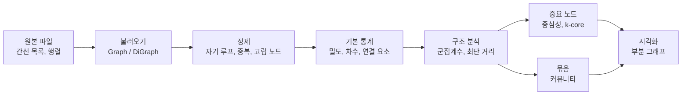
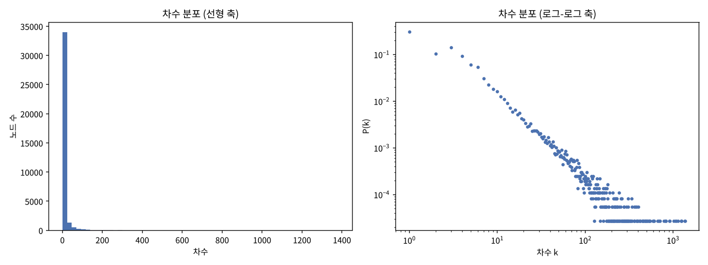
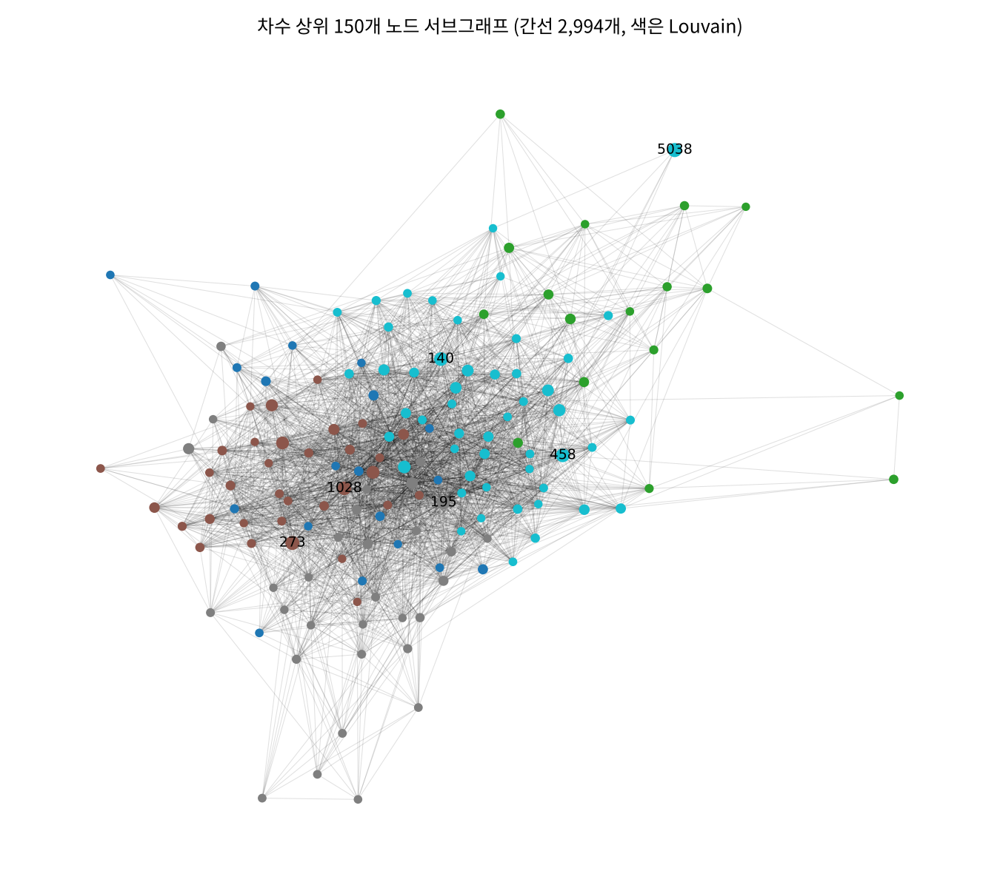

## 학습 목표

- 네트워크 데이터의 구성 요소(노드, 간선, 방향, 가중치) 이해
- 간선 목록, 인접 행렬, 희소 행렬 등 저장 형식과 그 차이
- NetworkX로 그래프를 불러오고 방향, 무방향을 알맞게 선택하기
- 네트워크 기본 통계: 밀도, 차수 분포, 연결 요소, 군집계수, 최단 거리
- 중심성, k-core, 커뮤니티로 "중요한 노드"와 "묶음" 찾기
- 큰 그래프를 다룰 때의 계산 비용과 시각화 요령

> 수업 실습(`network.py`, Enron 이메일 네트워크) 코드를 출발점으로, 같은 데이터에 처리 단계를 이어 붙여 실제로 실행한 결과로 정리했음. 이 방법들을 Facebook 친구 네트워크에 적용한 과제는 [11편](/posts/Data-Science_11/)
{: .prompt-info }

---

## 네트워크 데이터란?

표 형태 데이터는 행 하나가 독립된 관측치이지만, 네트워크 데이터는 **관측치 사이의 관계 자체**가 데이터임.

| 요소 | 의미 | Enron 이메일 예 |
| --- | --- | --- |
| 노드(node, vertex) | 개체 | 이메일 주소 |
| 간선(edge, link) | 관계 | 한 번 이상 메일을 보냄 |
| 방향(directed) | 관계에 순서가 있음 | 보낸 사람 → 받는 사람 |
| 가중치(weight) | 관계의 강도 | 보낸 메일 수 (이 데이터에는 없음) |

| 분야 | 노드 | 간선 |
| --- | --- | --- |
| SNS | 사용자 | 친구, 팔로우 |
| 웹 | 페이지 | 하이퍼링크 |
| 교통 | 역, 공항 | 노선 |
| 논문 | 논문 | 인용 |
| 이메일 | 주소 | 메일 송수신 |



---

## 저장 형식

### 간선 목록, 인접 행렬, 인접 리스트

| 형식 | 모양 | 메모리 | 특징 |
| --- | --- | --- | --- |
| 간선 목록(edge list) | `source target [weight]` 한 줄에 간선 하나 | $$O(E)$$ | 가장 흔한 배포 형식, pandas로 바로 읽힘 |
| 인접 행렬(adjacency matrix) | $$n \times n$$ 행렬, 간선이 있으면 1 | $$O(n^2)$$ | 행렬 연산에 편하지만 큰 그래프는 불가능 |
| 인접 리스트(adjacency list) | 노드마다 이웃 목록 | $$O(n + E)$$ | NetworkX 내부 구조 |
| 희소 행렬(CSR) | 0이 아닌 값과 위치만 저장 | $$O(n + E)$$ | 행렬 연산과 메모리를 모두 잡음 |

인접 행렬 $$A$$에서 $$A_{ij} = 1$$이면 $$i \to j$$ 간선이 있음. 무방향 그래프는 $$A = A^T$$(대칭).

Enron 그래프(노드 36,692개)로 비교하면 차이가 극적임.

```python
A = nx.to_scipy_sparse_array(G, format="csr")
dense_gb = G.number_of_nodes() ** 2 * 8 / 1e9                    # float64 밀집 행렬
sparse_mb = (A.data.nbytes + A.indices.nbytes + A.indptr.nbytes) / 1e6
```

```text
밀집 행렬이면 10.8 GB, CSR 희소 행렬은 6.2 MB
```

밀도가 0.03%밖에 안 되므로 행렬의 99.97%가 0. 실제 네트워크는 거의 다 이렇게 **희소(sparse)**하기 때문에 희소 형식으로 다룸.

### Matrix Market(.mtx)

수업 실습 파일 `email-Enron.mtx`는 희소 행렬 표준 형식인 Matrix Market으로 되어 있음.

```text
%%MatrixMarket matrix coordinate pattern symmetric
% name: SNAP/email-Enron
% kind: directed graph
...
36692 36692 183831        ← 행 수, 열 수, 저장된 항목 수
2 1                       ← (행, 열) 1-based 좌표
3 2
```

| 헤더 항목 | 의미 |
| --- | --- |
| `coordinate` | 0이 아닌 칸의 좌표만 나열 |
| `pattern` | 값 없이 위치만 있음(가중치 없음) |
| `symmetric` | 아래 삼각만 저장, 읽을 때 대칭으로 펼침 |

```python
from scipy.io import mminfo
print(mminfo("email-Enron.mtx"))
```

```text
(36692, 36692, 183831, 'coordinate', 'pattern', 'symmetric')
```

파일에는 183,831개만 저장되어 있지만 `symmetric`이라 읽으면 두 배가 됨. 이 점이 다음 절의 방향 그래프 결과로 이어짐.

---

## 실습 코드: 그래프 불러오기

```python
import networkx as nx
from scipy.io import mmread

def print_graph_info(graph, info: str = "Graph"):
    """그래프의 기본 정보를 출력하는 유틸리티 함수"""
    print(f"\n---- {info} ----")
    print(f"Graph Type: {graph.__class__.__name__}")
    print(f"Number of nodes: {graph.number_of_nodes():,}")
    print(f"Number of edges: {graph.number_of_edges():,}")

# Matrix Market 형식(.mtx) 파일을 희소 행렬로 읽어 CSR로 변환
matrix = mmread("email-Enron.mtx", spmatrix=False).tocsr()

# 방향 그래프로 변환 (무방향이 필요하면 nx.Graph())
G: nx.DiGraph = nx.from_scipy_sparse_array(matrix, create_using=nx.DiGraph())

print_graph_info(G, "Original Graph")
```

```text
---- Original Graph ----
Graph Type: DiGraph
Number of nodes: 36,692
Number of edges: 367,662
```

| 코드 | 의미 |
| --- | --- |
| `mmread(..., spmatrix=False)` | 예전 `spmatrix` 대신 새 `sparray`(COO)로 반환 |
| `.tocsr()` | 행 단위 접근이 빠른 CSR로 변환. 그래프 변환과 행렬 연산에 유리 |
| `from_scipy_sparse_array` | 0이 아닌 칸마다 간선 하나 생성, 노드 번호는 0부터 |
| `create_using=nx.DiGraph()` | 그래프 종류 지정. 생략하면 `nx.Graph()`(무방향) |

### 방향 그래프인가, 무방향 그래프인가

간선 수 367,662는 파일에 저장된 183,831의 정확히 두 배. 정말 모든 간선이 양방향인지 확인해 봄.

```python
print("대칭 행렬인가:", (matrix != matrix.T).nnz == 0)
print("대각 성분(자기 루프) 수:", int(matrix.diagonal().sum()))
print("reciprocity:", round(nx.reciprocity(D), 4))   # 상호 연결된 간선 비율

G = nx.from_scipy_sparse_array(matrix)               # 무방향
print(f"nodes {G.number_of_nodes():,}, edges {G.number_of_edges():,}")
```

```text
대칭 행렬인가: True
대각 성분(자기 루프) 수: 0
reciprocity: 1.0
nodes 36,692, edges 183,831
```

- 헤더에는 `kind: directed graph`라고 되어 있지만 행렬이 완전 대칭이라 **모든 간선이 양방향**(reciprocity 1.0)
- 즉 이 파일로는 "누가 누구에게 보냈는지" 방향 정보를 구분할 수 없음. DiGraph로 만들면 간선이 두 번씩 세어질 뿐이고 out-degree와 in-degree가 항상 같음
- 그래서 이후 분석은 **무방향 그래프(간선 183,831개)**로 진행

> 그래프 종류는 데이터의 의미와 실제 값을 함께 보고 정해야 함. 팔로우, 인용, 송금처럼 방향이 의미 있는 관계는 DiGraph, 친구처럼 대칭인 관계는 Graph
{: .prompt-tip }

---

## 정제

| 확인 항목 | 함수 | Enron |
| --- | --- | --- |
| 자기 루프 | `nx.number_of_selfloops(G)` | 0 |
| 고립 노드 | `nx.number_of_isolates(G)` | 0 |
| 중복 간선 | Graph는 자동으로 하나로 합침 (`MultiGraph`는 유지) | – |
| 노드 ID | 행렬에서 오면 0부터 연속 정수, 간선 목록에서 오면 문자열일 수 있음 | 0 ~ 36,691 |

간선 목록 파일을 pandas로 읽을 때는 [11편](/posts/Data-Science_11/)처럼 결측치, 중복 행, `source == target`을 먼저 세어 보는 것이 안전함. 반대로 그래프를 표로 내보낼 때는 `nx.to_pandas_edgelist(G)`.

```text
 source  target  weight
      0       1     1.0
      1       2     1.0
      1       3     1.0
edge list 행 수: 183,831
```

---

## 기본 통계

### 밀도와 차수

$$\text{density} = \frac{E}{n(n-1)/2}, \quad \bar{k} = \frac{2E}{n}$$

```python
print("density:", f"{nx.density(G):.6f}")
deg = np.array([d for _, d in G.degree()])
print(f"평균 차수 {deg.mean():.2f}, 중앙값 {np.median(deg):.0f}, 최대 {deg.max()}, 차수 1인 노드 {np.mean(deg==1):.1%}")
```

```text
density: 0.000273
평균 차수 10.02, 중앙값 3, 최대 1383, 차수 1인 노드 30.6%
```

평균 10, 중앙값 3, 최대 1,383. 평균이 중앙값보다 훨씬 큰 것은 **소수의 노드가 엄청나게 많은 간선을 가진** 오른쪽 꼬리가 긴 분포라는 신호.

### 차수 분포


_왼쪽은 선형 축, 오른쪽은 로그-로그 축_

- 선형 축에서는 거의 모든 노드가 왼쪽 첫 칸에 몰려 아무것도 보이지 않음
- 로그-로그 축에서는 점들이 대체로 **직선**에 가까움. $$P(k) \propto k^{-\gamma}$$ 꼴(멱법칙, power law)의 특징으로, 이런 네트워크를 **척도 없는(scale-free) 네트워크**라고 부름
- 오른쪽 끝의 수평 띠는 노드가 하나씩만 있는 큰 차수들. 꼬리를 정확히 보려면 누적 분포나 로그 구간을 씀

> 차수 분포처럼 범위가 몇 자릿수에 걸친 데이터는 로그 축으로 봐야 모양이 보임. 평균 차수 하나로 네트워크를 요약하면 허브의 존재를 놓침
{: .prompt-tip }

### 연결 요소

```python
comps = sorted(nx.connected_components(G), key=len, reverse=True)
H = G.subgraph(comps[0]).copy()     # 최대 연결 요소(LCC)
```

```text
연결 요소 수: 1065
크기 상위 5: [33696, 20, 16, 14, 13]
최대 연결 요소: nodes 33,696 (91.8%), edges 180,811 (98.4%)
```

- 연결 요소는 서로 경로로 이어진 노드 묶음. 1,065개가 있지만 **하나의 거대 요소(giant component)**가 노드의 92%, 간선의 98%를 차지하고 나머지는 20개 이하의 작은 섬
- 최단 거리, Betweenness처럼 "경로"를 쓰는 지표는 끊어진 요소 사이에서 정의되지 않으므로 보통 **LCC만 떼어서** 계산
- `subgraph()`는 원본을 참조하는 뷰라서 수정하려면 `.copy()`
- 방향 그래프에서는 약한 연결 요소(`weakly_connected_components`, 방향 무시)와 강한 연결 요소(`strongly_connected_components`, 방향대로 서로 도달 가능)를 구분

---

## 구조 분석

### 군집계수와 transitivity

노드 $$v$$의 지역 군집계수는 이웃끼리 실제로 연결된 비율.

$$C(v) = \frac{T(v)}{k_v(k_v-1)/2}$$

$$T(v)$$는 $$v$$를 포함한 삼각형 수. 전체를 요약하는 방법은 두 가지.

| 지표 | 계산 | Enron |
| --- | --- | --- |
| 평균 군집계수 | 노드별 $$C(v)$$의 평균 | **0.497** |
| transitivity | 전체 삼각형 × 3 / 전체 연결된 세 쌍(경로 길이 2) | **0.0853** |

```text
평균 군집계수: 0.497
transitivity: 0.0853
triangles: 727,044 (9.5s)
```

두 값이 6배나 차이 나는 이유는 **가중 방식**이 다르기 때문.

- 평균 군집계수는 노드마다 같은 가중치. 차수 2 ~ 3인 노드가 많고, 이런 노드는 이웃 두셋만 서로 알면 1.0이 되므로 평균이 높아짐
- transitivity는 세 쌍 단위로 세므로 **차수가 큰 허브의 영향이 큼**. 허브의 이웃 수백 명은 서로 모르는 경우가 대부분이라 값이 낮아짐

세 값(0.4970, 727,044, 0.08531)은 `.mtx` 헤더에 적힌 SNAP 공식 통계와 정확히 같았음.

### 최단 거리와 지름

```python
lens = []
for s in rng.choice(list(H), 200, replace=False):          # 출발 노드 200개 표본
    lens.extend(nx.single_source_shortest_path_length(H, s).values())
print("diameter 근사:", nx.approximation.diameter(H, seed=SEED))
```

```text
표본 200개 출발 노드 평균 최단 거리 4.07, 90% 분위 5.0, 최대 11
diameter 근사(양방향 BFS 하한): 13
```

- 33,696개 주소 중 아무 두 주소도 평균 **4단계** 만에 닿음. 노드 수에 비해 거리가 매우 짧은 성질을 **좁은 세상(small world)**이라고 함
- 모든 쌍의 최단 거리는 $$O(n \cdot E)$$라 표본으로 추정. 지름도 `approximation.diameter`로 근사(실제 지름은 이 값 이상). SNAP 헤더의 12와 다른 것은 계산 방식(표본 기반 근사)의 차이로 보임
- 높은 군집계수 + 짧은 평균 거리 = 좁은 세상 네트워크의 전형

---

## 중요한 노드 찾기

### 중심성 4종

| 지표 | 식 | 의미 | 비용 |
| --- | --- | --- | --- |
| Degree | $$k_v / (n-1)$$ | 연결이 많음 | $$O(n)$$ |
| PageRank | $$PR(v) = (1-\alpha)/n + \alpha \sum_{u \in N(v)} PR(u)/k_u$$ | 무작위 이동이 자주 도착 | 반복 × $$O(E)$$ |
| Eigenvector | $$x_v \propto \sum_{u \in N(v)} x_u$$ | 중요한 이웃과 연결 | 반복 × $$O(E)$$ |
| Betweenness | $$\sum_{s \ne v \ne t} \sigma_{st}(v)/\sigma_{st}$$ | 최단 경로의 중개자 | $$O(nE)$$ → 표본 근사 |

```python
dc = nx.degree_centrality(G)
pr = nx.pagerank(G)                                         # alpha=0.85
bc = nx.betweenness_centrality(H, k=500, seed=SEED)        # 500개 표본으로 근사
ev = nx.eigenvector_centrality(G, max_iter=1000)
cent = pd.DataFrame({"degree": dc, "pagerank": pr,
                     "betweenness": pd.Series(bc), "eigenvector": ev}).fillna(0)
```

| 순위 | Degree | PageRank | Betweenness | Eigenvector |
| --- | --- | --- | --- | --- |
| 1 | 5038 (0.0377) | 5038 (0.0114) | 5038 (0.0818) | 136 (0.1496) |
| 2 | 273 (0.0373) | 273 (0.0032) | 140 (0.0730) | 195 (0.1271) |
| 3 | 458 (0.0344) | 140 (0.0030) | 273 (0.0541) | 76 (0.1265) |
| 4 | 140 (0.0339) | 458 (0.0030) | 566 (0.0460) | 370 (0.1213) |
| 5 | 1028 (0.0339) | 588 (0.0029) | 1139 (0.0448) | 1028 (0.1124) |

```text
             degree  pagerank  betweenness  eigenvector
degree        1.000     0.720        0.738        0.534
pagerank      0.720     1.000        0.628        0.054
betweenness   0.738     0.628        1.000        0.543
eigenvector   0.534     0.054        0.543        1.000
```

- 노드 5038은 Degree, PageRank, Betweenness에서 모두 1위. 그런데 PageRank 점수(0.0114)가 2위의 **3.5배**인 반면 Degree는 거의 같음 → 5038의 이웃 1,383개 중 **85.8%가 5038하고만 연락한 주소**(차수 1)라서, 이들이 PageRank를 전부 5038에 몰아주는 구조(273, 458, 140은 이 비율이 8 ~ 11%). 외부 주소는 Enron 주소와의 통신만 관측되므로 이런 노드가 많이 생김
- Eigenvector는 다른 노드(136, 195, 76 ...)를 가리키고 PageRank와 순위 상관이 0.05에 불과. 서로 촘촘하게 연결된 핵심 그룹에 점수가 몰리는 성질 때문(11편의 Facebook 데이터에서도 같은 현상)
- **하나의 중심성만 보고 "가장 중요한 노드"라고 결론 내리면 안 되고**, 질문(연결 수인가, 중개인가, 핵심 그룹 소속인가)에 맞는 지표를 골라야 함

### k-core

k-core는 "차수가 k 미만인 노드를 더 이상 없을 때까지 반복해서 지우고 남는 부분". 중심성이 노드 하나의 점수라면 k-core는 **서로가 서로를 받쳐 주는 촘촘한 핵심부**를 찾음.

```python
core = nx.core_number(G)            # 각 노드가 속하는 최대 k
```

```text
최대 k: 43 k-core 크기: 275
k=5: 11,648 nodes
k=10: 4,513 nodes
k=20: 2,276 nodes
k=40: 456 nodes
```

36,692개 중 275개 주소가 "서로 최소 43명과 연결된" 핵심부를 이룸. k를 올리며 크기를 보면 네트워크가 바깥 껍질에서 안쪽 핵심으로 어떻게 층을 이루는지 알 수 있고, 큰 그래프를 시각화할 때 **보여 줄 부분을 고르는 기준**으로도 씀.

---

## 묶음 찾기: 커뮤니티

커뮤니티는 내부 연결은 많고 외부 연결은 적은 노드 묶음. 품질은 모듈러리티로 잼.

$$Q = \frac{1}{2m}\sum_{ij}\left(A_{ij} - \frac{k_i k_j}{2m}\right)\delta(c_i, c_j)$$

$$k_i k_j / 2m$$은 차수를 유지한 채 무작위로 연결했을 때 기대되는 간선 수. 즉 "같은 커뮤니티 안의 간선이 우연보다 얼마나 많은가". Louvain은 노드를 이웃 커뮤니티로 옮겨 보며 $$Q$$를 키우고, 커뮤니티를 노드 하나로 합쳐 같은 과정을 반복하는 탐욕적 알고리즘.

```python
comm = nx.community.louvain_communities(H, seed=SEED)       # NetworkX 내장 (3.0+)
q = nx.community.modularity(H, comm)
```

```text
communities 159, modularity 0.6121, 상위 크기 [3661, 3627, 3101, 2789, 2660, 2457, 2034, 2005] (4.5s)
크기 10 이하 커뮤니티 수: 91
```

- 모듈러리티 0.61로 커뮤니티 구조가 뚜렷함(0.3 이상이면 구조가 있다고 봄)
- 큰 커뮤니티 8개가 2천 ~ 3천 개씩이고, 159개 중 91개는 10개 이하의 작은 묶음
- 별도 패키지 `python-louvain`(`import community`)도 같은 알고리즘. 11편 과제에서는 이 패키지를 썼음
- 시드와 resolution에 따라 결과가 달라질 수 있으므로 함께 기록

---

## 시각화

노드 3만 개를 그대로 그리면 검은 덩어리가 되고 레이아웃 계산도 오래 걸림. **보여 줄 부분을 먼저 고르는** 것이 핵심.

| 방법 | 예 |
| --- | --- |
| 중요 노드만 | 차수 상위 N개, k-core |
| 한 노드 주변만 | `nx.ego_graph(G, v, radius=1)` |
| 요약 그래프 | 커뮤니티를 노드 하나로 합침 |
| 인터랙티브 | pyvis(브라우저에서 확대, 드래그) |

```python
top = cent["degree"].nlargest(150).index
S = G.subgraph(top)
part = {n: i for i, c in enumerate(nx.community.louvain_communities(S, seed=SEED)) for n in c}
pos = nx.spring_layout(S, seed=SEED, k=0.35)                  # 시드 고정 → 매번 같은 배치
nx.draw_networkx_edges(S, pos, alpha=0.12, width=0.5)
nx.draw_networkx_nodes(S, pos, node_size=[10 + 1500 * dc[n] for n in S],
                       node_color=[part[n] for n in S], cmap="tab10")
```


_차수 상위 150개 노드. 크기는 차수, 색은 Louvain 커뮤니티_

- 간선은 투명도를 낮춰야 구조가 보임(150개 노드에 간선 2,994개)
- 노드 크기는 지표, 색은 커뮤니티처럼 **한 그림에 정보 두 개까지**가 읽기 좋음
- 5038은 차수 1위지만 그림 가장자리에 있음. 상위 150개 안에서의 연결은 5개뿐(다른 허브는 중앙값 40개)이고 나머지는 차수 1짜리 주소이기 때문으로, 앞의 PageRank 해석과 일치

---

## 큰 그래프를 다룰 때

| 작업 | 비용 | Enron 실측 | 요령 |
| --- | --- | --- | --- |
| 불러오기, 차수 | $$O(n + E)$$ | 수 초 | 희소 행렬 그대로 사용 |
| 삼각형, 군집계수 | 차수 제곱에 비례 | 9.5초 | 허브가 많으면 느려짐 |
| 모든 쌍 최단 거리 | $$O(nE)$$ | 약 1.5시간 (BFS 200번에 31초로 추정) | 출발 노드 표본 |
| Betweenness | $$O(nE)$$ | 표본 500개로 수십 초 | `k=` 표본 근사 |
| PageRank, Eigenvector | 반복 × $$O(E)$$ | 수 초 | `tol`, `max_iter` 조정 |
| Louvain | 거의 $$O(E)$$ | 4.5초 | 시드 고정 |
| 그림 | 레이아웃이 병목 | – | 부분 그래프 |

표본으로 근사할 때는 시드를 고정하고 표본 크기를 함께 적어야 재현할 수 있음.

---

## Enron과 Facebook 비교

| 항목 | Enron 이메일 (10편) | Facebook 친구 ([11편](/posts/Data-Science_11/)) |
| --- | --- | --- |
| 노드 / 간선 | 36,692 / 183,831 | 4,039 / 88,234 |
| 평균 차수 | 10.0 | 43.7 |
| 밀도 | 0.00027 | 0.0108 |
| 연결 | 1,065개 요소, LCC 91.8% | 하나로 연결 |
| 평균 군집계수 | 0.497 | 0.606 |
| Louvain 모듈러리티 | 0.612 | 0.835 |
| 데이터 수집 방식이 남긴 흔적 | 외부 주소는 Enron과의 통신만 관측 | 10명의 ego 친구 목록을 합침 |

두 데이터 모두 **수집 방식이 중심성 결과에 그대로 드러난다**는 공통점이 있음. 네트워크는 관측된 관계만 담고 있으므로, 결과를 해석하기 전에 "어떻게 모은 데이터인가"를 먼저 확인해야 함.

---

## 최종 핵심 정리

1. 네트워크 데이터는 노드와 간선으로 관계 자체를 다루며, 방향과 가중치 여부를 데이터의 의미에 맞게 정해야 함
2. 실제 네트워크는 매우 희소해서(Enron 밀도 0.03%) 밀집 행렬 10.8 GB 대신 CSR 희소 행렬 6.2 MB로 다룸
3. 실습 파일은 Matrix Market `symmetric` 형식이라 DiGraph로 읽으면 간선 367,662개가 되지만, reciprocity 1.0이므로 무방향 간선 183,831개로 분석하는 것이 맞음
4. 차수는 평균 10, 중앙값 3, 최대 1,383인 꼬리가 긴 분포로, 로그-로그 축에서 직선에 가까운 척도 없는 네트워크
5. 1,065개 연결 요소 중 거대 요소가 노드 92%를 차지하고, 경로 기반 지표는 이 LCC에서 계산함
6. 평균 군집계수 0.497과 transitivity 0.085는 가중 방식이 달라 차이가 나며, 평균 최단 거리 약 4의 좁은 세상 구조
7. 중심성은 지표마다 다른 노드를 가리키고(PageRank–Eigenvector 상관 0.05), k-core와 커뮤니티(Q = 0.61)로 핵심부와 묶음을 찾음
8. 큰 그래프는 표본 근사, 시드 고정, 부분 그래프 시각화로 다루고, 해석 전에 데이터 수집 방식을 확인해야 함

---

End.
