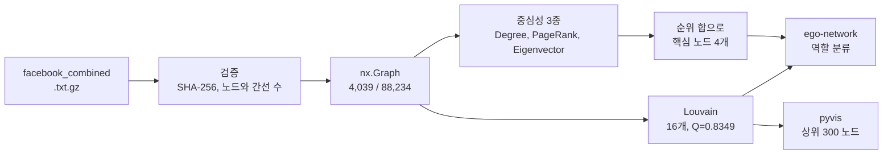
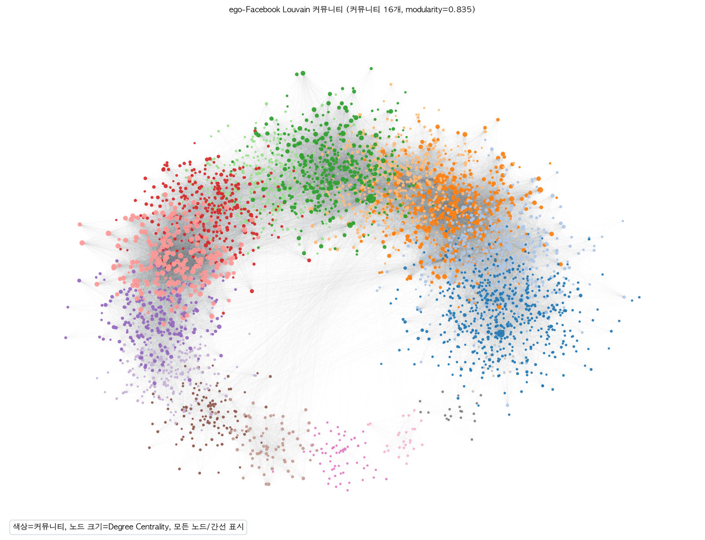
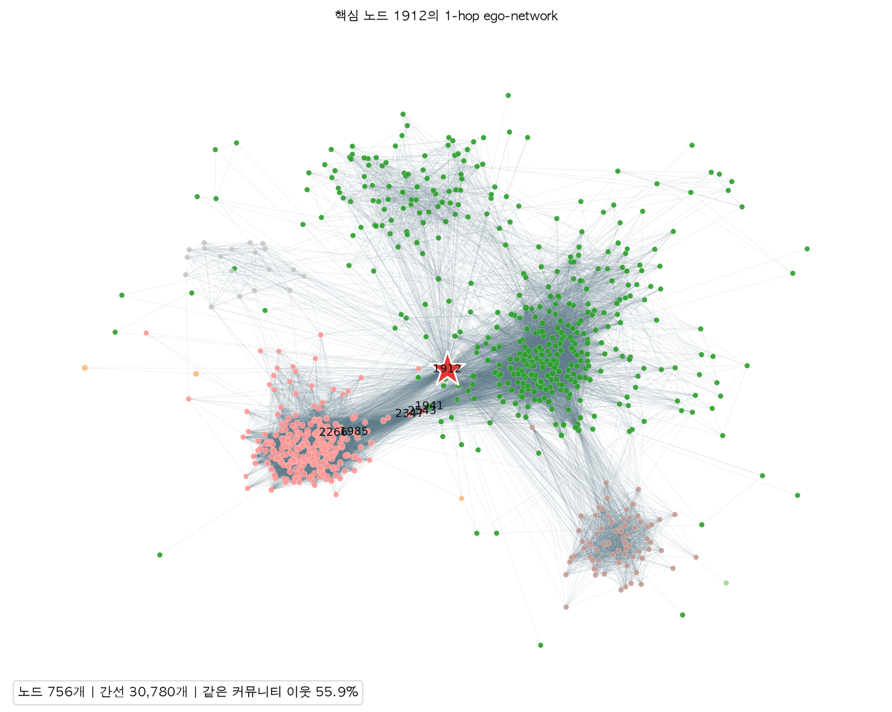
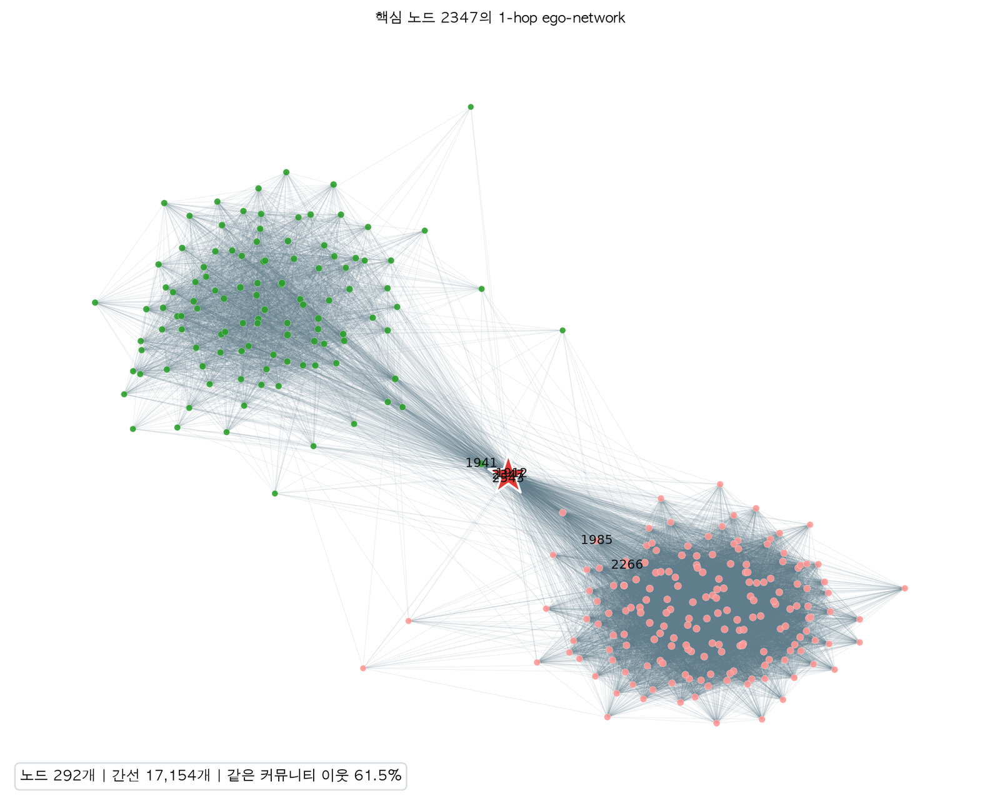
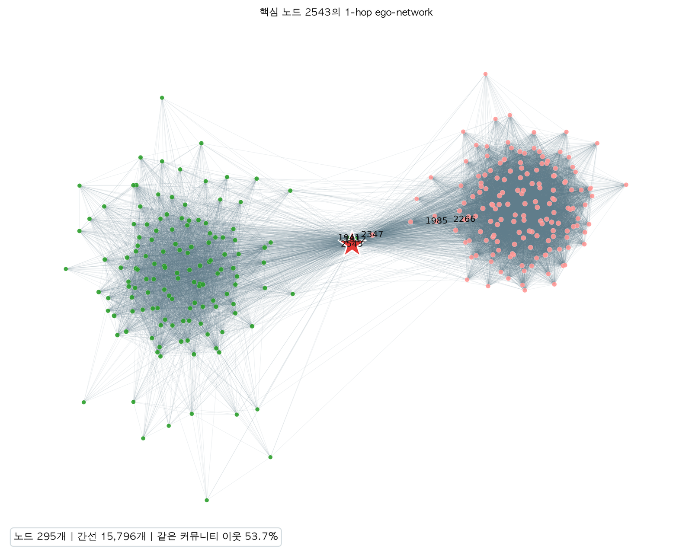
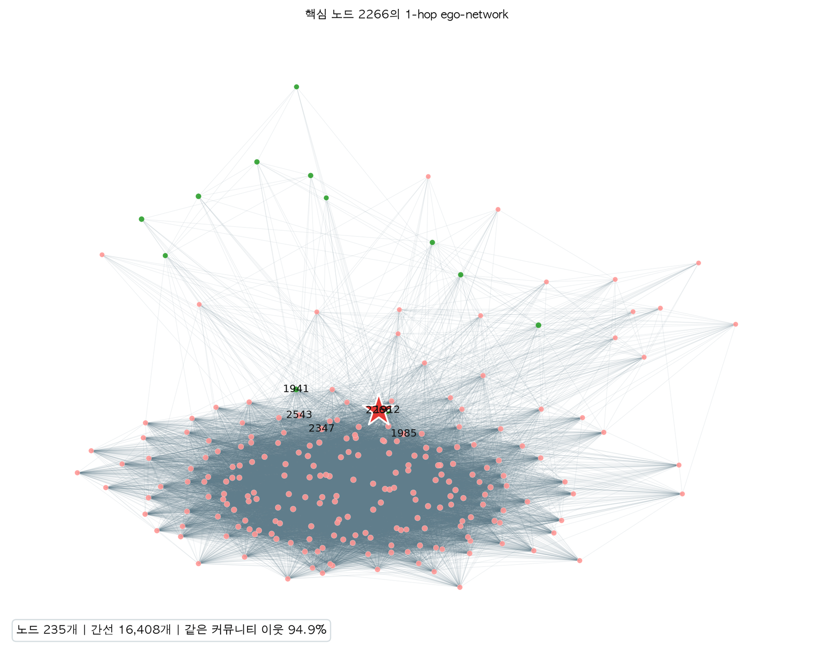

## 학습 목표

- 간선 목록 파일을 검증하고 무방향 그래프로 만들기
- Degree, PageRank, Eigenvector 중심성이 각각 무엇을 "중요하다"고 보는지 비교하기
- Louvain으로 커뮤니티를 찾고 모듈러리티로 평가하기
- 핵심 노드의 1-hop ego-network로 국소 구조 해석하기
- 노트북 분석을 재현 가능한 CLI 스크립트로 정리하기

> [10편 네트워크 데이터 처리](/posts/Data-Science_10/)에서 정리한 방법을 Facebook 친구 네트워크에 적용한 과제. 결과는 제출본(macOS)과 이 글을 쓰며 다시 실행한 결과(Linux)가 **소수점까지 같았음**. 8절은 제출 후 결과를 다시 보며 추가로 실험한 내용
{: .prompt-info }

---

## 한눈에 보기

| 항목 | 내용 |
| --- | --- |
| 데이터 | Stanford SNAP `facebook_combined.txt.gz`, 10명의 ego-network를 합친 익명화된 친구 관계 |
| 그래프 | 무방향, 무가중치, 노드 4,039개, 간선 88,234개, 연결 그래프 |
| 도구 | networkx 3.7, python-louvain 0.16, matplotlib, pandas, pyvis |
| 중심성 1위 | Degree **107**, PageRank **3437**, Eigenvector **1912** (셋이 모두 다름) |
| 커뮤니티 | Louvain 16개, 모듈러리티 **0.8349** |
| 핵심 노드 | 1912, 2347, 2543, 2266 (세 순위 합이 가장 작은 4개) |
| 추가 실험 | PageRank 상위권은 데이터 수집 방식의 흔적, Eigenvector는 밀집 코어에 쏠림, 다리 역할은 Betweenness가 더 정확 |



---

## 1. 실행 환경과 재현성

| 항목 | 제출본 | 재실행 |
| --- | --- | --- |
| OS | macOS (arm64) | Linux (x86_64) |
| Python | 3.15 | 3.13 |
| networkx / python-louvain | 3.7 / 0.16 | 3.7 / 0.16 |
| pandas / matplotlib | 3.1.1 / 3.11.2 | 3.0.5 / 3.11.2 |
| 데이터 SHA-256 | `125e84db…ad035d7` | `125e84db…ad035d7` (동일) |
| 시드 | 42 | 42 |

과제 제출물은 노트북(분석 설명)과 `week10_homework.py`(CLI)를 함께 만들었음. 스크립트는 실행할 때마다 `run_info.txt`에 버전, 데이터 해시, 시드, 결과 요약을 남김.

```text
Python: 3.13.18
networkx: 3.7
python-louvain: 0.16
data_file: data/facebook_combined.txt.gz
data_sha256: 125e84db872eeba443d270c70315c256b0af43a502fcfe51f50621166ad035d7
nodes: 4039
edges: 88234
communities: 16
modularity: 0.834894
graph_type: undirected, unweighted by default
random_seed: 42
```

> 다시 실행하는 환경에서는 SNAP 사이트 접속이 막혀 있어서, 같은 파일을 공개 GitHub 저장소에서 받은 뒤 **SHA-256이 제출본과 같은지 확인하고** 사용했음. 해시를 기록해 둔 덕분에 출처가 달라도 같은 데이터임을 증명할 수 있었음
{: .prompt-tip }

---

## 2. 데이터 검증

```python
edges = pd.read_csv(DATA_PATH, sep=r"\s+", comment="#",
                    names=["source", "target"],
                    dtype={"source": "int64", "target": "int64"})
print("원본 행 수:", f"{len(edges):,}")
print("결측치 수:", int(edges.isna().sum().sum()))
print("중복 간선 행 수:", int(edges.duplicated().sum()))
print("자기 루프 행 수:", int((edges["source"] == edges["target"]).sum()))
```

```text
원본 행 수: 88,234
결측치 수: 0
중복 간선 행 수: 0
자기 루프 행 수: 0
```

```python
G = nx.from_pandas_edgelist(edges, source="source", target="target", create_using=nx.Graph)
G.remove_edges_from(nx.selfloop_edges(G))
avg_degree = 2 * G.number_of_edges() / G.number_of_nodes()
```

```text
nodes                 4039
edges                88234
density            0.01082
average_degree    43.691013
average_clustering 0.605547
connected            True
```

- 평균 차수는 무방향 그래프에서 간선 하나가 두 노드의 차수를 하나씩 올리므로 $$\bar{k} = 2\lvert E \rvert / \lvert V \rvert = 43.69$$
- 밀도는 1%로 희소하지만 **평균 군집계수는 0.61**로 매우 높음. 친구의 친구가 서로 친구인 경우가 많다는 뜻으로, 커뮤니티가 뚜렷하게 나올 것을 예상할 수 있음
- 스크립트에서는 같은 검증을 `assert` 대신 예외로 넣어, 파일이 바뀌면 바로 멈추게 했음

```python
if edge_file.name == "facebook_combined.txt.gz":
    if graph.number_of_nodes() != 4039 or graph.number_of_edges() != 88234:
        raise ValueError("SNAP ego-Facebook 공식 노드/간선 수와 일치하지 않습니다.")
```

---

## 3. 스크립트 구조

노트북에서 확인한 분석을 함수 단위로 나누고, `argparse`로 옵션을 받게 했음.

| 함수 | 역할 |
| --- | --- |
| `ensure_edge_file`, `sha256` | 파일이 없으면 SNAP에서 받고, 해시 계산 |
| `read_edges` | `.gz`와 일반 텍스트, 공백/탭/CSV 구분자, 주석과 자기 루프 처리 |
| `build_undirected_graph` | 무방향 그래프 생성, `--weighted`이면 중복 간선 가중치 합산 |
| `compute_centralities`, `centrality_frame` | 중심성 3종과 지표별 순위, 순위 합 |
| `detect_communities` | Louvain, 모듈러리티, 커뮤니티별 요약 |
| `select_hubs`, `save_ego_outputs` | 핵심 노드 선정, ego-network 그림과 역할 분류 |
| `maybe_make_pyvis` | pyvis가 설치되어 있을 때만 인터랙티브 HTML 생성 |
| `write_run_info` | 재현 정보 기록 |

```bash
python week10_homework.py --pyvis                          # 기본: data/facebook_combined.txt.gz
python week10_homework.py --edge-file other.csv --delimiter csv --weighted true --ego 6
```

```python
def read_edges(edge_file, delimiter="space", weighted=False):
    """Yield (source, target, weight) tuples from a text or gzip file."""
    separators = {"space": None, "tab": "\t", "csv": ","}
    separator = separators[delimiter]
    open_fn = gzip.open if edge_file.suffix == ".gz" else open

    with open_fn(edge_file, "rt", encoding="utf-8", errors="ignore") as stream:
        for line in stream:
            stripped = line.strip()
            if not stripped or stripped.startswith(("#", "%")):
                continue
            parts = stripped.split(separator)
            if len(parts) < 2:
                continue
            source, target = parts[0], parts[1]
            if source == target:          # 자기 루프 제거
                continue
            weight = 1.0
            if weighted and len(parts) >= 3:
                try:
                    weight = float(parts[2])
                except ValueError:
                    weight = 1.0
            yield source, target, weight
```

제너레이터로 만들어서 큰 파일도 한 줄씩 읽어 바로 그래프에 넣을 수 있음. 실행 시간은 `--pyvis` 포함 약 33초였음.

```text
Graph built: |V|=4,039, |E|=88,234, undirected=True, weighted=False
Degree top node: 107
PageRank top node: 3437
Eigenvector top node: 1912
Communities: 16, modularity=0.8349
Selected hubs (composite): ['1912', '2347', '2543', '2266']
```

---

## 4. 중심성 비교

```python
def compute_centralities(graph):
    return {
        "degree": nx.degree_centrality(graph),
        "pagerank": nx.pagerank(graph, alpha=0.85, weight="weight", tol=1e-10),
        "eigenvector": nx.eigenvector_centrality(graph, max_iter=2000, tol=1e-8, weight="weight"),
    }
```

| 지표 | 계산 | "중요하다"의 의미 |
| --- | --- | --- |
| Degree | $$C_D(v) = \deg(v) / (n-1)$$ | 친구가 많음 |
| PageRank | $$PR(v) = (1-\alpha)/n + \alpha \sum_{u \to v} PR(u)/\deg(u)$$ | 무작위로 걷는 사람이 자주 들르는 곳. 친구가 적은 사람의 지지를 크게 받음 |
| Eigenvector | $$x_v = \lambda^{-1} \sum_{u \in N(v)} x_u$$ | 중요한 사람들과 연결됨 |

Eigenvector는 거듭제곱법으로 수렴시키는 방식이라 수렴하지 못하면 `PowerIterationFailedConvergence`가 남. 이 그래프는 기본값(`max_iter=100`)으로도 수렴하지만, 다른 간선 파일을 넣을 때를 대비해 반복 횟수를 2000으로 넉넉하게 두었음.

### 상위 10개 노드

| 순위 | Degree | PageRank | Eigenvector |
| --- | --- | --- | --- |
| 1 | 107 (0.2588) | 3437 (0.00757) | 1912 (0.0954) |
| 2 | 1684 (0.1961) | 107 (0.00689) | 2266 (0.0870) |
| 3 | 1912 (0.1870) | 1684 (0.00631) | 2206 (0.0861) |
| 4 | 3437 (0.1355) | 0 (0.00622) | 2233 (0.0852) |
| 5 | 0 (0.0859) | 1912 (0.00382) | 2464 (0.0843) |
| 6 | 2543 (0.0728) | 348 (0.00232) | 2142 (0.0842) |
| 7 | 2347 (0.0721) | 686 (0.00222) | 2218 (0.0842) |
| 8 | 1888 (0.0629) | 3980 (0.00216) | 2078 (0.0841) |
| 9 | 1800 (0.0607) | 414 (0.00178) | 2123 (0.0837) |
| 10 | 1663 (0.0582) | 483 (0.00129) | 1993 (0.0835) |

- Degree와 PageRank의 상위권은 거의 겹침(107, 1684, 3437, 0, 1912)
- Eigenvector 상위권은 **1912를 빼면 전혀 다른 노드들**이고 점수도 0.083 ~ 0.095로 촘촘함
- 노드 3437은 PageRank 1위인데 Eigenvector 점수는 $$7.7 \times 10^{-8}$$(2,557위)

전체 노드에 대한 순위 상관(Spearman)도 같은 이야기를 함.

| 쌍 | Spearman |
| --- | --- |
| Degree – PageRank | 0.846 |
| Degree – Eigenvector | 0.527 |
| PageRank – Eigenvector | 0.212 |

세 지표가 서로 다른 노드를 가리키는 이유는 8절의 추가 실험에서 확인함.

---

## 5. Louvain 커뮤니티

```python
partition = community_louvain.best_partition(
    graph, weight="weight", resolution=1.0,
    random_state=seed, randomize=False,
)
modularity = community_louvain.modularity(partition, graph, weight="weight")
```

모듈러리티는 "커뮤니티 안쪽 간선 비율이, 차수를 유지한 무작위 그래프에서 기대되는 비율보다 얼마나 큰가"를 잼.

$$Q = \frac{1}{2m}\sum_{ij}\left(A_{ij} - \frac{k_i k_j}{2m}\right)\delta(c_i, c_j)$$

0.3 이상이면 커뮤니티 구조가 있다고 보는데 **0.8349**는 매우 높은 값. 군집계수 0.61과 같은 방향의 결과.


_Louvain 커뮤니티 16개. 색은 커뮤니티, 크기는 Degree_

시각화는 노드 4천 개를 spring layout으로 한 번에 그리면 느리고 덩어리 하나로 뭉치므로, `community_layout`에서 **커뮤니티 중심을 원 위에 먼저 놓고** 각 노드를 그 주변에 정규분포로 흩뿌렸음(퍼짐 정도는 커뮤니티 크기의 제곱근에 비례, 시드 고정).

| ID | 노드 | 내부 밀도 | 대표 허브(차수) |
| --- | --- | --- | --- |
| 9 | 548 | 0.0357 | 3437 (547) |
| 4 | 535 | 0.0608 | 1684 (792) |
| 8 | 447 | 0.1682 | 107 (1045) |
| 1 | 431 | 0.0654 | 483 (231) |
| 3 | 423 | 0.1280 | 1912 (755) |
| 0 | 350 | 0.0466 | 0 (347) |
| 5 | 324 | 0.1205 | 917 (130) |
| 11 | 237 | **0.5915** | 2543 (294) |
| 15 | 226 | 0.2203 | 2839 (137) |
| 14 | 206 | 0.0939 | 686 (170) |
| 6, 10, 13, 12, 2, 7 | 116, 73, 60, 25, 19, 19 | 0.12 ~ 0.87 | 1687, 1972, 3980, 583, 3318, 1988 |

큰 커뮤니티(9, 4, 0)는 내부 밀도가 낮고 허브 하나의 차수가 커뮤니티 크기와 거의 같음(3437은 547, 커뮤니티 크기 548). 반대로 커뮤니티 11은 237명 중 59%가 서로 연결된 **밀집 코어**. 이 차이가 8절의 핵심.

---

## 6. 핵심 노드 ego-network

### 선정

세 지표의 순위를 더해 가장 작은 4개를 골랐음. 하나의 지표에만 강한 노드보다 **모든 지표에서 고르게 높은 노드**를 고르려는 의도.

```python
for metric in centralities:
    frame[f"rank_{metric}"] = frame[metric].rank(ascending=False, method="min").astype(int)
frame["rank_sum"] = frame[["rank_degree", "rank_pagerank", "rank_eigenvector"]].sum(axis=1)

hubs = frame.sort_values(["rank_sum", "rank_degree", "rank_pagerank"]).head(4).index
```

| 노드 | Degree 순위 | PageRank 순위 | Eigenvector 순위 | 순위 합 |
| --- | --- | --- | --- | --- |
| **1912** | 3 | 5 | 1 | **9** |
| **2347** | 7 | 57 | 37 | **101** |
| **2543** | 6 | 39 | 91 | **136** |
| **2266** | 11 | 241 | 2 | **254** |
| 107 | 1 | 2 | 757 | 760 |
| 1684 | 2 | 3 | 1,152 | 1,157 |
| 3437 | 4 | 1 | 2,557 | 2,562 |

Degree 1위 107과 PageRank 1위 3437은 Eigenvector 순위가 낮아 빠졌음.

### 역할 분류

```python
ego = nx.ego_graph(graph, center, radius=1, undirected=True)
neighbors = set(graph.neighbors(center))
same_share = sum(partition[n] == partition[center] for n in neighbors) / len(neighbors)

if same_share >= 0.80:   role = "local hub concentrated in one community"
elif same_share >= 0.60: role = "hub centered on a primary community"
else:                    role = "possible boundary hub connecting communities"
```

| 노드 | 차수 | ego 노드 / 간선 | ego 밀도 | 같은 커뮤니티 이웃 | 이웃 커뮤니티 수 | 분류 |
| --- | --- | --- | --- | --- | --- | --- |
| 1912 | 755 | 756 / 30,780 | 0.108 | 55.9% | 6 | 경계형 허브 가능성 |
| 2347 | 291 | 292 / 17,154 | 0.404 | 61.5% | 2 | 주 커뮤니티 중심 허브 |
| 2543 | 294 | 295 / 15,796 | 0.364 | 53.7% | 2 | 경계형 허브 가능성 |
| 2266 | 234 | 235 / 16,408 | 0.597 | 94.9% | 2 | 지역 허브 |

<div class="row g-2">
  <div class="col-6"></div>
  <div class="col-6"></div>
  <div class="col-6"></div>
  <div class="col-6"></div>
</div>
_ego-network: 1912, 2347 (위), 2543, 2266 (아래). 빨간 별이 중심 노드_

1912는 이웃이 6개 커뮤니티에 퍼져 있고 ego 밀도가 0.108로 낮아 여러 그룹을 잇는 모양. 2266은 이웃 95%가 같은 커뮤니티이고 이웃끼리도 60%가 연결된 촘촘한 덩어리 안의 노드.

### 인터랙티브 그래프

차수 상위 300개 노드만 pyvis로 그렸음(전체 4천 개는 브라우저가 감당하기 어려움). 노드에 마우스를 올리면 차수, 커뮤니티, PageRank가 보이고 드래그, 확대가 됨.

<iframe src="/assets/img/data/hw3/facebook_core_interactive.html" title="ego-Facebook 상위 300 노드" loading="lazy" style="width:100%;height:600px;border:1px solid #ddd;border-radius:8px"></iframe>
_[새 창에서 열기](/assets/img/data/hw3/facebook_core_interactive.html)_

```python
selected = [n for n, _ in sorted(graph.degree, key=lambda x: x[1], reverse=True)[:300]]
network = Network(height="800px", width="100%", cdn_resources="in_line")   # 오프라인에서도 열림
for node in graph.subgraph(selected):
    network.add_node(node, label=str(node),
                     color=to_hex(palette(partition[node] % 20)),
                     size=8 + 40 * degree_centrality[node],
                     title=f"node={node}<br>degree={graph.degree(node)}<br>community={partition[node]}")
network.force_atlas_2based(gravity=-60, central_gravity=0.015, spring_length=110, spring_strength=0.05)
```

`cdn_resources="in_line"`으로 vis.js를 HTML 안에 넣어서 파일 하나만으로 열리게 했음(대신 1.7MB).

---

## 7. 트러블슈팅

| 문제 | 원인 | 해결 |
| --- | --- | --- |
| `import community` 실패 | PyPI 패키지 이름은 `python-louvain`, import 이름은 `community` (`community`라는 다른 패키지와 혼동) | `python -m pip install python-louvain`, 실패하면 설치 명령을 알려 주고 종료 |
| 서버에서 그림 저장 시 오류 | 디스플레이 없는 환경에서 GUI 백엔드 사용 | 스크립트 맨 위 `matplotlib.use("Agg")` |
| Eigenvector 수렴 실패 대비 | 그래프에 따라 기본 반복 100회로 부족할 수 있음 | `max_iter=2000`, `tol=1e-8` |
| pyvis 미설치 환경 | 선택 기능 | `ImportError`면 경고만 출력하고 HTML 생략 |
| 데이터 출처가 바뀜 | SNAP 접속 불가 | SHA-256과 노드, 간선 수로 같은 파일임을 확인 |

---

## 8. 결과 다시 보기 (추가 실험)

제출 후 "왜 세 중심성의 1위가 모두 다를까?", "1912와 2543이 정말 경계형일까?"가 궁금해 추가로 확인했음.

### 8-1. PageRank 상위권은 데이터를 모은 방식의 흔적

ego-Facebook은 **10명의 사용자(ego)를 정해 그들의 친구 목록을 모은 뒤 합친** 데이터. 그래서 ego 노드는 자기 커뮤니티의 거의 모든 사람과 연결되어 있을 것이라 예상하고, PageRank 상위 10개가 자기 커뮤니티에서 몇 %와 직접 연결되는지 셌음.

```python
for n in a["pagerank"].nlargest(10).index:
    comm = [v for v in G if part[v] == part[n] and v != n]
    cover = sum(G.has_edge(n, v) for v in comm) / len(comm)
```

| 노드 | 차수 | 커뮤니티 (크기) | 같은 커뮤니티 노드와 연결된 비율 |
| --- | --- | --- | --- |
| 3437 | 547 | 9 (548) | **99.6%** |
| 107 | 1,045 | 8 (447) | **100%** |
| 1684 | 792 | 4 (535) | **99.8%** |
| 0 | 347 | 0 (350) | **98.0%** |
| 1912 | 755 | 3 (423) | **100%** |
| 3980 | 59 | 13 (60) | **100%** |
| 686 | 170 | 14 (206) | 82.9% |
| 348, 414, 483 | 229, 159, 231 | 1 (431) | 52.8%, 30.7%, 36.0% |

상위 노드 대부분이 자기 커뮤니티 전원과 연결된 **별 모양의 중심**이었음. 즉 이 노드들은 "사회적으로 영향력 있는 사람"이라기보다 **데이터를 모을 때 기준이 된 ego일 가능성이 높음**(SNAP 원본의 ego 10명은 0, 107, 348, 414, 686, 698, 1684, 1912, 3437, 3980이고, 상위 10개 중 9개가 여기에 해당). 커뮤니티 1은 ego 348과 414의 친구 목록이 하나로 합쳐진 것으로 보이며, 483은 ego가 아니지만 348, 414와 모두 친구이고 이웃이 커뮤니티 1(155명)과 5(74명)에 걸쳐 있어 차수가 커진 노드.

또 이 별 모양 커뮤니티에서는 주변 노드가 ego 하나에만 연결된 경우가 많아, PageRank 식에서 **차수가 작은 이웃이 많이 밀어 주는** ego의 점수가 커짐. 3437(차수 547)이 107(차수 1,045)보다 PageRank가 높은 이유.

### 8-2. Eigenvector는 밀집 코어에 쏠림

```text
Eigenvector 상위 10개의 커뮤니티: [3, 11] / 4개 허브: {'1912': 3, '2347': 11, '2543': 11, '2266': 11}
```

Eigenvector 상위 10개가 모두 커뮤니티 3과 11 안에 있었음. 커뮤니티 11은 내부 밀도 0.59인 밀집 코어인데, Eigenvector는 "중요한 이웃의 합"을 반복해서 곱하므로 **서로 촘촘하게 연결된 덩어리 하나에 점수가 몰리는(localization)** 성질이 있음. 다른 커뮤니티의 ego인 3437의 점수가 $$10^{-8}$$ 수준인 이유.

결과적으로 **순위 합 방식은 Eigenvector 순위가 낮은 다른 커뮤니티의 ego를 모두 탈락시키고**, 핵심 노드 4개 중 3개를 같은 커뮤니티 11에서 골랐음. "세 지표에서 고르게 높은 노드"가 아니라 "밀집 코어에 있는 노드"를 고른 셈.

### 8-3. 다리 역할은 Betweenness로

"여러 커뮤니티를 잇는 노드"를 직접 재는 지표는 최단 경로가 얼마나 그 노드를 지나는지 보는 **Betweenness**. 정확히 계산하면 $$O(\lvert V \rvert \lvert E \rvert)$$로 오래 걸려 1,000개 노드를 표본으로 근사했음.

```python
bc = nx.betweenness_centrality(G, k=1000, seed=42)
```

| 노드 | Betweenness | 이웃이 속한 커뮤니티 수 |
| --- | --- | --- |
| 107 | 0.4851 | 8 |
| 1684 | 0.3448 | 6 |
| 3437 | 0.2267 | 3 |
| 1912 | 0.2231 | 6 |
| 0 | 0.1520 | 4 |
| 1085 | 0.1470 | 4 |
| 698 | 0.1124 | 2 |
| 567 | 0.0921 | 2 |
| 58 | 0.0840 | 4 |
| 428 | 0.0621 | 5 |

- 1912는 Betweenness 4위로 **경계형 허브라는 해석이 맞음**
- 2347, 2543, 2266은 상위 10에 없음. 특히 2543이 "경계형"으로 분류된 것은 다른 그룹을 잇기 때문이 아니라, **Louvain이 밀집 코어를 커뮤니티 3과 11로 나눈 경계에 걸쳐 있기 때문**(이웃 커뮤니티 수 2)
- 107은 이웃이 8개 커뮤니티에 걸쳐 있고 Betweenness가 압도적인 진짜 다리. 제출본의 순위 합 방식에서는 Eigenvector 때문에 빠졌던 노드

### 8-4. Louvain은 시드에는 안정, resolution에는 민감

```python
for s in range(10):
    p = community_louvain.best_partition(G, random_state=s)
    ari = adjusted_rand_score([base[v] for v in nodes], [p[v] for v in nodes])
```

```text
 seed  communities  modularity  ARI vs seed42
    0           16      0.8349          1.000
    1           16      0.8342          0.974
    4           15      0.8348          0.984
    8           15      0.8348          0.990
  ...  (10개 시드 모두 15 ~ 16개, 0.8342 ~ 0.8350, ARI 0.974 이상)

resolution 0.5: communities 95, modularity 0.8110
resolution 1.0: communities 16, modularity 0.8349
resolution 2.0: communities 21, modularity 0.8312
```

- 시드를 바꿔도 분할이 거의 같아(ARI ≥ 0.974) **결과를 믿을 수 있음**
- resolution을 바꾸면 커뮤니티 수가 크게 바뀜. 모듈러리티가 가장 높은 1.0이 이 데이터에서는 합리적인 선택이지만, "커뮤니티가 16개"라는 숫자는 데이터의 성질이 아니라 **설정값의 결과**라는 점을 함께 밝혀야 함

---

## 9. 느낀 점

- **세 중심성이 서로 다른 1위를 낸 것이 이번 과제에서 가장 큰 배움**이었음. 처음에는 계산이 틀렸나 의심했는데, 각 지표가 "중요함"을 다르게 정의한다는 걸 결과로 확인하고 나서야 수식이 이해됨
- 데이터를 모은 방식이 분석 결과에 그대로 남는다는 것. 10명의 ego를 중심으로 모은 데이터라서 그 10명이 중심성 상위권을 차지했음. 데이터 설명서를 먼저 읽었다면 해석을 더 빨리 할 수 있었을 것
- 익명 데이터라 "이 사람은 실제로 어떤 역할"이라고 말할 수 없으니, 보고서에서도 **구조로만 해석하고 한계를 명시**하려고 신경 썼음
- 노트북 분석을 CLI 스크립트로 옮기면서 해시, 노드 수 검증, 버전 기록을 넣었는데, 다른 환경에서 다시 실행할 때 그 장치들이 그대로 재현 근거가 되어 줌
- 순위 합처럼 직관적으로 공정해 보이는 방법이 실제로는 한 지표(Eigenvector)의 편향을 그대로 물려받을 수 있다는 점을 추가 실험으로 알게 됨

## 10. 개선 사항

| 개선 사항 | 이유 | 방법 |
| --- | --- | --- |
| 핵심 노드 선정 방식 | 순위 합이 Eigenvector의 코어 쏠림을 그대로 반영 | 지표별 상위 노드를 따로 보고하거나, 백분위 평균, Betweenness를 함께 사용 |
| 경계형 판정 | 같은 커뮤니티 이웃 비율만으로는 "코어가 둘로 나뉜 것"과 "다리"를 구분 못 함 | Betweenness, participation coefficient, 이웃 커뮤니티 엔트로피 함께 보기 |
| 역할 기준값 | 80% / 60%는 임의로 정한 값 | 전체 노드 분포를 보고 정하거나 근거를 밝힘 |
| ego 노드 표시 | 중심성 상위권이 수집 기준 ego임을 구분해야 해석이 정확 | SNAP의 ego 목록을 불러와 표와 그림에 표시 |
| 커뮤니티 수 | resolution에 따라 16 ~ 95개 | resolution 여러 값의 결과를 함께 보고, Leiden 알고리즘과 비교 |
| 시각화 규모 | pyvis 300 노드, 1.7MB | 커뮤니티를 노드 하나로 줄인 요약 그래프 추가 |

---

## 최종 핵심 정리

1. SNAP ego-Facebook(노드 4,039개, 간선 88,234개)을 해시와 노드, 간선 수로 검증한 뒤 무방향 그래프로 분석했음
2. 밀도는 1%지만 군집계수 0.61, Louvain 모듈러리티 0.8349로 커뮤니티 구조가 매우 뚜렷함
3. Degree, PageRank, Eigenvector의 1위가 107, 3437, 1912로 모두 달랐고 PageRank–Eigenvector 순위 상관은 0.21에 불과함
4. 분석은 함수로 나눈 CLI 스크립트로 정리해 실행 정보(버전, 해시, 시드)를 매번 기록했고, 다른 OS에서도 결과가 같았음
5. 순위 합으로 고른 핵심 노드 1912, 2347, 2543, 2266의 ego-network를 같은 커뮤니티 이웃 비율로 지역형, 주 커뮤니티형, 경계형으로 분류했음
6. 추가 실험 결과 PageRank 상위권은 자기 커뮤니티 전원과 연결된 수집 기준 ego였고, Eigenvector는 밀집 코어(커뮤니티 3, 11)에 쏠렸음
7. Betweenness로 보면 1912는 실제 다리였지만 2543의 경계형 판정은 Louvain이 코어를 둘로 나눈 결과였고, 진짜 다리 107은 순위 합 방식에서 빠졌음
8. Louvain은 시드에는 안정적(ARI ≥ 0.974)이지만 resolution에 민감하므로, 지표와 설정값의 한계를 함께 보고해야 함

---

End.
