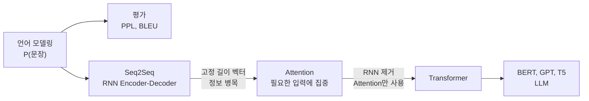
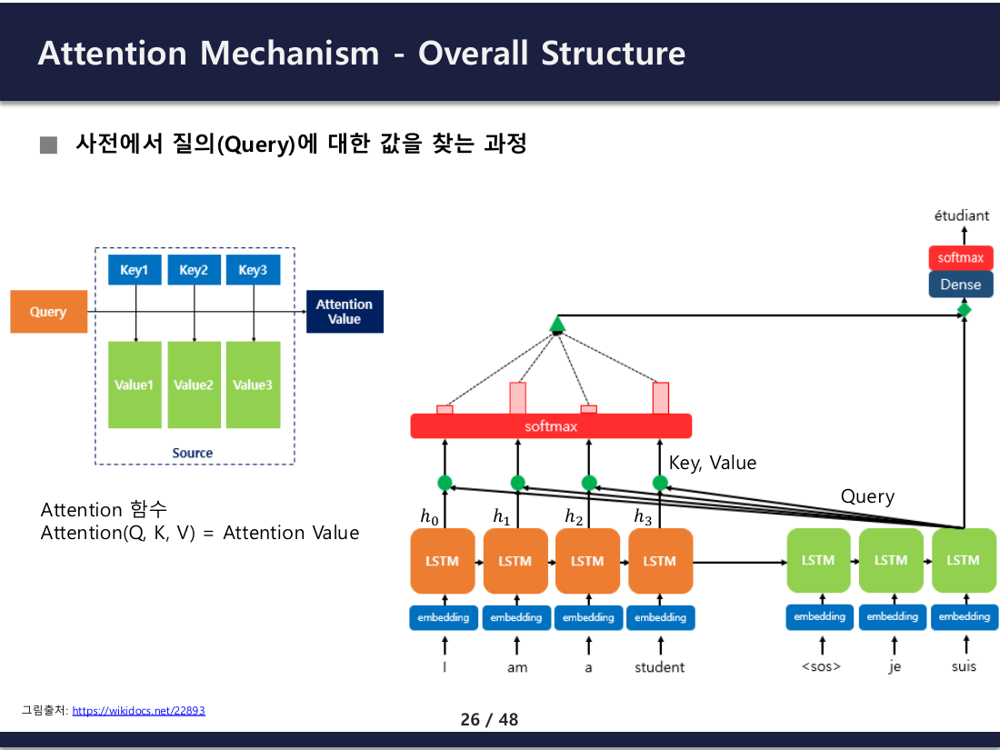
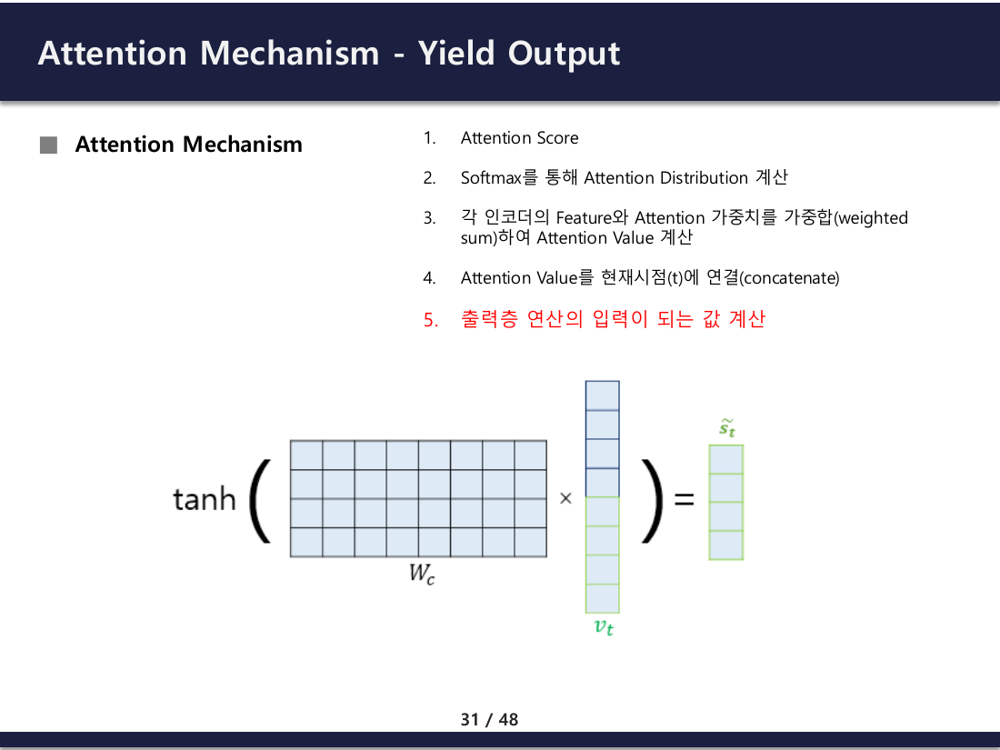
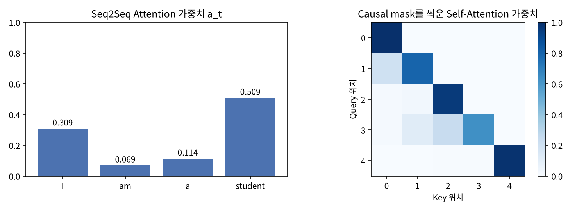
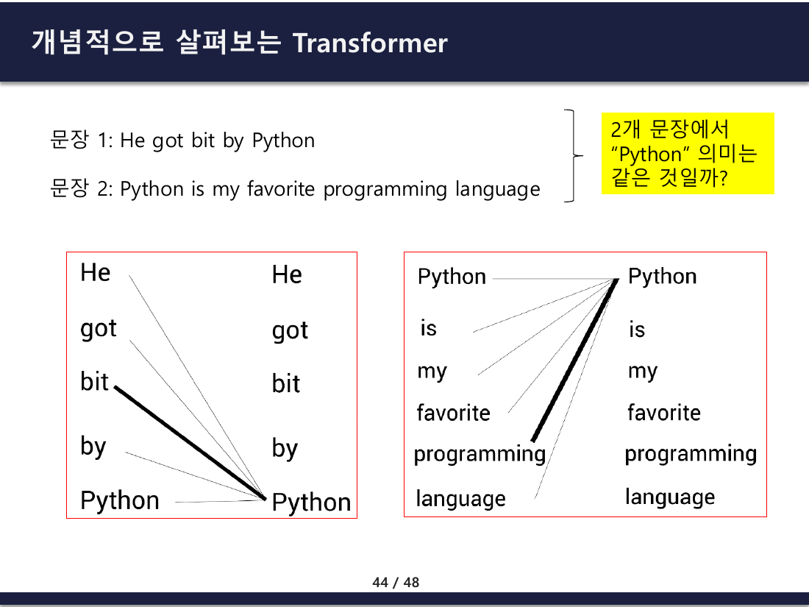
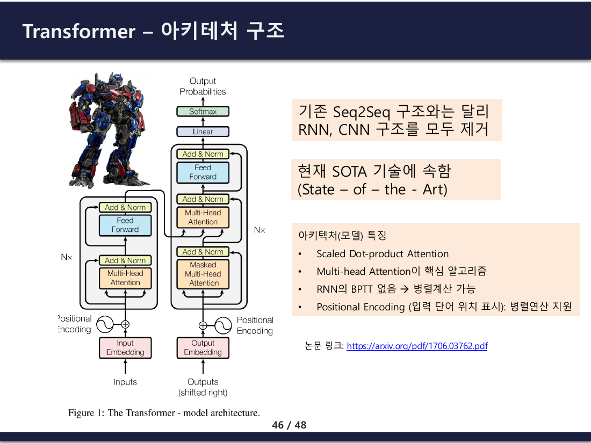
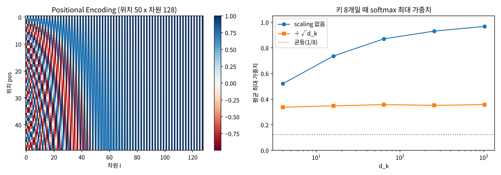

## 1. 강의의 학습 목표

- 언어 모델링의 목표와 Chain Rule로 문장 확률을 분해하는 방법
- 언어 모델 평가 지표 PPL(Perplexity)과 기계번역 평가 지표 BLEU의 계산과 한계
- Seq2Seq의 정보 병목 문제와 Attention이 등장한 이유
- Query, Key, Value와 Attention 계산 5단계
- Transformer의 핵심 기술: Scaled Dot-product Attention, Multi-head Attention, Positional Encoding
- Encoder 계열(BERT), Decoder 계열(GPT), Encoder-Decoder 계열(T5) 모델의 구분

> 수식과 예제는 강의 자료를 따르고, 강의의 계산 과정은 PyTorch로 직접 실행해 숫자로 확인했음. 강의에 없는 내용은 "(보충)"으로 표시. 앞 강의 [06편 RNN in NLP](/posts/Artificial-Intelligence%28AI%29_6/)의 Seq2Seq, BPTT, 기울기 소실과 이어짐
{: .prompt-info }



---

## 2. 언어 모델링 (Language Modeling)

### 목표

언어 모델은 **문장의 출현 확률**을 예측하는 모델. 같은 말로 하면 **이전 단어들이 주어질 때 다음 단어를 예측**하는 모델.

> 나는 지금 버스를 타고 학교에 ___

사람은 '간다'가 '먹는다'보다 훨씬 자연스럽다는 것을 앎. 머릿속에 단어 사이의 확률 모델이 학습되어 있기 때문이고, 딥러닝은 대량의 문장으로 이 분포를 흉내 내는 파라미터 $$\theta$$를 찾음.

| 적용 분야 | 언어 모델의 역할 |
| --- | --- |
| 음성 인식 | 음향 모델과 결합해 더 그럴듯한 글자열 선택 |
| 기계 번역 | 번역 모델과 결합해 더 자연스러운 문장 선택 |
| OCR | 인식한 이미지에서 더 그럴듯한 글자 출력 |
| 기타 | 뉴스 생성, 요약, 챗봇, 자동완성 |

### 학습 목표: 최대 우도 추정

문장 $$N$$개의 데이터셋 $$D = \{x^{(i)}\}_{i=1}^{N}$$, 각 문장 $$x_{1:n} = x_1, x_2, \dots, x_n$$에 대해

$$\hat{\theta} = \underset{\theta \in \Theta}{\operatorname{argmax}} \sum_{i=1}^{N} \log P(x_{1:n}^{(i)}; \theta)$$

즉 **데이터셋 문장들의 로그 확률 합이 가장 커지는** 파라미터를 찾음.

### Chain Rule로 문장 확률 분해

결합 확률은 조건부 확률의 곱으로 풀 수 있음(Chain Rule).

$$P(A, B, C, D) = P(D \mid A, B, C)\, P(C \mid A, B)\, P(B \mid A)\, P(A)$$

이것을 문장에 그대로 적용하면

$$P(x_{1:n}) = \prod_{i=1}^{n} P(x_i \mid x_{<i}), \quad \log P(x_{1:n}) = \sum_{i=1}^{n} \log P(x_i \mid x_{<i})$$

예: "나는 학교에 갑니다"

$$P(\text{BOS}, \text{나는}, \text{학교에}, \text{갑니다}, \text{EOS}) = P(\text{EOS} \mid \cdots \text{갑니다}) \times P(\text{갑니다} \mid \cdots \text{학교에}) \times P(\text{학교에} \mid \text{BOS}, \text{나는}) \times P(\text{나는} \mid \text{BOS}) \times P(\text{BOS})$$

- 문장 전체의 확률을 직접 세는 것은 불가능하지만(같은 문장이 거의 반복되지 않음), **"앞 단어들이 주어졌을 때 다음 단어"**의 확률은 신경망으로 학습할 수 있음
- 그래서 학습 목표는 $$\sum_{i}\sum_{j} \log P(x_j^{(i)} \mid x_{<j}^{(i)}; \theta)$$를 최대화하는 것이고, 이는 **다음 단어 분류의 교차 엔트로피 손실을 최소화**하는 것과 같음 (보충)
- 추론할 때는 $$\hat{x}_t = \operatorname{argmax}_{x_t} \log P(x_t \mid x_{<t}; \theta)$$로 가장 확률이 높은 단어를 하나씩 이어 붙임
- 로그를 쓰는 이유: 0 ~ 1 사이 확률을 수십 번 곱하면 컴퓨터가 0으로 처리(언더플로)하므로 곱셈을 덧셈으로 바꿈

---

## 3. 언어 모델의 평가

### PPL (Perplexity)

| 평가 방법 | 특징 |
| --- | --- |
| 정성 평가 | 사람이 직접 확인. 가장 정확하지만 비용과 시간이 큼 |
| 정량 평가 | 지표로 자동 계산. 사람보다 덜 정확하지만 빠르고 쌈 |

PPL은 테스트 문장의 확률을 **길이로 정규화(기하평균)**한 뒤 역수를 취한 값.

$$\text{PPL}(x_1, \dots, x_n; \theta) = P(x_1, \dots, x_n; \theta)^{-\frac{1}{n}} = \sqrt[n]{\prod_{i=1}^{n} \frac{1}{P(x_i \mid x_{<i}; \theta)}}$$

- 확률은 높을수록 좋으므로, 역수인 **PPL은 낮을수록 좋음**
- 직관: 모델이 매 시점 **평균 몇 개의 단어 중에서 헷갈리고 있는가**(perplexity = 당혹감)

각 시점 확률이 0.2, 0.1, 0.5, 0.8인 4단어 문장으로 계산해 봄.

```python
p = np.array([0.20, 0.10, 0.50, 0.80])     # P(나는|BOS), P(학교에|...), P(갑니다|...), P(EOS|...)
print("문장 확률 P =", p.prod())
print("PPL (기하평균) =", p.prod() ** (-1 / len(p)))
print("exp(평균 NLL)  =", math.exp(-np.log(p).mean()))
V = 10000
print("모든 단어를 1/V로 찍는 모델의 PPL =", (1 / V) ** (-1))
```

```text
문장 확률 P = 0.008
PPL (기하평균) = 3.3437
exp(평균 NLL) = 3.3437
모든 단어를 1/V로 찍는 모델의 PPL = 10000.0
```

- PPL 3.34는 "매 시점 약 3.3개 후보 사이에서 고민하는 수준"이라는 뜻
- $$\text{PPL} = \exp(\text{평균 교차 엔트로피})$$로 두 식이 같음. 그래서 학습 중 손실(loss)을 보면 PPL을 바로 알 수 있음 (보충)
- 아무것도 모르고 어휘 $$V$$개 중 균등하게 찍으면 PPL은 정확히 $$V$$. 좋은 모델일수록 1에 가까워짐

### PPL의 한계: 순서 변화에 취약

| | 문장 |
| --- | --- |
| 원문 | I love to go to school . |
| 정답 | 나는 학교에 가는 것을 좋아한다 . |
| 번역1 | 학교에 가는 것을 좋아한다 나는 . |
| 번역2 | 나는 오락실에 가는 것을 싫어한다 . |

- 사람이 보면 번역1이 의미를 제대로 옮긴 번역이지만, **PPL로는 번역2가 더 좋게(낮게) 나옴**
- PPL은 **각 시점마다 정답 단어에 얼마나 높은 확률을 줬는지**만 채점하기 때문. 번역2는 "나는", "가는", "것을", "."이 정답과 **같은 자리**에 있어 많은 시점에서 정답과 맞고, 번역1은 단어는 다 맞지만 자리가 한 칸씩 밀려 대부분 시점에서 틀린 것으로 처리됨
- 그래서 챗봇, 번역처럼 **다양한 표현이 정답일 수 있는 생성 모델** 평가에는 PPL만으로 부족함

### BLEU (Bi-Lingual Evaluation Understudy)

정답 문장과 생성 문장 사이에 **겹치는 n-gram의 정밀도**를 n = 1 ~ N에 대해 구해 기하평균한 값. **높을수록 좋음**.

$$\text{BLEU} = BP \times \exp\left(\sum_{n=1}^{N} w_n \log p_n\right) = BP \times \prod_{n=1}^{N} p_n^{w_n}, \quad w_n = \frac{1}{N}$$

$$BP = \begin{cases} 1 & c \ge r \\ e^{1 - r/c} & 0 < c < r \end{cases}$$

| 기호 | 의미 |
| --- | --- |
| $$p_n$$ | n-gram 정밀도 $$TP / (TP + FP)$$ = 생성 문장의 n-gram 중 정답에도 있는 비율 (**중복 횟수 제한**) |
| $$c$$, $$r$$ | 생성 번역의 길이, 정답 번역의 길이 |
| $$BP$$ | Brevity Penalty. 생성 문장이 정답보다 **짧으면** 벌점 |

| 지표 | 무엇을 | 어떻게 평균 | 좋은 방향 |
| --- | --- | --- | --- |
| PPL | 문장 확률의 역수 | 기하평균 | 낮을수록 |
| BLEU | n-gram 정밀도 | 가중 기하평균 | 높을수록 |

### BLEU 예제: 강의의 2-gram 계산 재현

```python
def ngrams(t, n): return Counter(tuple(t[i:i + n]) for i in range(len(t) - n + 1))

def prec(c, r, n):
    cc, rc = ngrams(c, n), ngrams(r, n)
    hit = sum(min(v, rc[g]) for g, v in cc.items())   # 정답에 있는 횟수까지만 인정 (clipping)
    return hit, sum(cc.values())

ref = "나는 학교에 가는 것을 좋아한다 .".split()
c1  = "학교에 가는 것을 좋아한다 나는 .".split()
c2  = "나는 오락실에 가는 것을 싫어한다 .".split()
for name, c in [("번역1", c1), ("번역2", c2)]:
    wb = prec(["BOS"] + c + ["EOS"], ["BOS"] + ref + ["EOS"], 2)
    nb = prec(c, ref, 2)
    print(f"{name}: 2-gram (BOS,EOS 포함) {wb[0]}/{wb[1]}, (미포함) {nb[0]}/{nb[1]}")
```

```text
번역1: 2-gram (BOS,EOS 포함) 4/7, (미포함) 3/5
번역2: 2-gram (BOS,EOS 포함) 3/7, (미포함) 1/5
```

- 강의 표의 Hit 합계(4/7, 3/7)는 BOS, EOS를 포함한 계산이고, 강의 자료의 결론 $$p_2 = 3/5$$, $$1/5$$는 **일반적인 BLEU처럼 BOS, EOS를 뺀** 계산. 두 숫자가 모두 맞음
- 어느 쪽이든 **BLEU는 번역1을 더 좋게** 평가함. "학교에 가는", "가는 것을", "것을 좋아한다"처럼 의미 덩어리가 그대로 남아 있기 때문으로, PPL과 판정이 뒤집힘

n을 4까지 늘린 표준 BLEU-4와 BP, clipping도 확인함.

```text
번역1 BLEU-2 = 0.7746  precisions ['6/6', '3/5']
번역1 BLEU-4 = 0.5623  precisions ['6/6', '3/5', '2/4', '1/3']
번역2 BLEU-2 = 0.3651  precisions ['4/6', '1/5']
번역2 BLEU-4 = 0.0000  precisions ['4/6', '1/5', '0/4', '0/3']
짧은 번역 '나는 학교에': p1=2/2, p2=1/1, BP=0.1353, BLEU-2=0.1353
clipping: '나는 나는 나는 나는' unigram 1/4 (clipping 없으면 4/4)
```

- **BP의 역할**: "나는 학교에" 두 단어만 내놓으면 정밀도는 100%지만, 정답(6단어)보다 짧아 $$BP = e^{1 - 6/2} = 0.135$$로 크게 깎임. 정밀도만 쓰면 확실한 단어 몇 개만 내놓는 꼼수가 통하기 때문
- **clipping의 역할**: "나는 나는 나는 나는"은 clipping 없이 세면 1-gram 정밀도 100%. 정답에 "나는"이 한 번뿐이므로 1번까지만 인정해 1/4
- **0 문제**: 번역2는 4-gram이 하나도 안 맞아 BLEU-4가 0. 짧은 문장 하나로 BLEU를 내면 이렇게 0이 되기 쉬워, 실제로는 **말뭉치 전체로 합산**하거나 smoothing을 씀 (보충)

---

## 4. Seq2Seq와 정보 병목

### Sequence to Sequence (2014)

Sutskever 등의 Seq2Seq(NeurIPS 2014)는 **다층 LSTM Encoder–Decoder**로 영어 → 프랑스어 번역에서 통계적 번역 시스템보다 높은 BLEU를 달성함. Attention은 쓰지 않았음.

$$p(y_1, \dots, y_{T'} \mid x_1, \dots, x_T) = \prod_{t=1}^{T'} p(y_t \mid v, y_1, \dots, y_{t-1})$$

- Encoder가 입력 문장 전체를 읽고 **마지막 은닉 상태 하나** $$v$$로 요약
- Decoder는 $$v$$와 이전에 생성한 단어로 다음 단어를 예측 (2절의 언어 모델에 조건 $$v$$가 붙은 것)

### 문제: 고정 길이 벡터

| 문제 | 설명 |
| --- | --- |
| 정보 병목 | 문장이 5단어든 50단어든 **같은 크기의 벡터 하나**에 담아야 함 |
| 앞부분 손실 | 마지막 은닉 상태에는 최근 단어 정보가 강하게 남고 앞 단어는 흐려짐 |
| 긴 역전파 경로 | 출력의 오차가 입력 앞쪽까지 BPTT로 멀리 전달되어야 해서 기울기 소실 |

강의의 아이디어: **"학습한 모든 결과를 Decoder의 모든 블록에 전달하자"** → Encoder의 은닉 상태 $$h_1, \dots, h_T$$를 모두 모아 두고, Decoder가 단어를 만들 때마다 **지금 필요한 입력에 집중(Attention)**해서 꺼내 씀.

---

## 5. Attention 신경망

### 아이디어: 필요한 정보에 집중하기

여러 사람이 동시에 말해도 친구의 말에만 귀를 기울일 수 있는 것처럼, 출력 시점마다 **관련 있는 입력에 더 큰 가중치**를 주어 정보를 가중합함.

Bahdanau, Cho, Bengio(arXiv 1409.0473)가 제안한 첫 신경망 Attention은 번역할 단어마다 Encoder 상태별 가중치를 학습해 문맥 벡터를 만듦.

$$c_i = \sum_{j=1}^{T_x} \alpha_{ij} h_j, \quad \alpha_{ij} = \frac{\exp(e_{ij})}{\sum_{k=1}^{T_x} \exp(e_{ik})}, \quad e_{ij} = a(s_{i-1}, h_j)$$

- 학습된 가중치 $$\alpha_{ij}$$를 그림으로 그리면 영어와 프랑스어 단어 사이의 **정렬(alignment)**이 대각선 모양으로 나타남. 번역과 단어 정렬을 함께 학습한 것
- 지금은 언어(번역, 요약, LLM)뿐 아니라 음성(Whisper), 비전(ViT), 멀티모달(CLIP), 생성 모델(Diffusion Transformer), 생명과학(AlphaFold 3)까지 Attention이 핵심 부품

### Query, Key, Value: 파이썬 딕셔너리 비유

| 용어 | 딕셔너리에서 | Attention에서 |
| --- | --- | --- |
| Query | 찾고 싶은 것 | 지금 시점에서 필요한 정보를 묻는 벡터 |
| Key | 값을 찾기 위한 이름표 | 각 입력이 "나는 이런 정보"라고 내세우는 벡터 |
| Value | 저장된 데이터 | 실제로 꺼내 쓸 정보 |

차이는 **정확히 일치하는 키 하나를 찾는 것이 아니라, 모든 키와의 유사도를 구해 그 비율대로 Value를 섞는 것**("부드러운 검색").

$$\text{Attention}(Q, K, V) = \text{Attention Value}$$


_강의 자료: 질의(Query)에 대해 값을 찾는 과정_

### Attention 5단계 (Seq2Seq, dot-product)

Encoder 은닉 상태 $$h_1, \dots, h_N$$, Decoder의 현재 시점 은닉 상태 $$s_t$$일 때

| 단계 | 계산 | 의미 |
| --- | --- | --- |
| ① Attention Score | $$e^t = [s_t^T h_1, \dots, s_t^T h_N]$$ | Query와 각 Key의 유사도(내적) |
| ② Softmax | $$\alpha^t = \text{softmax}(e^t)$$ | 합이 1인 Attention 분포(가중치) |
| ③ 가중합 | $$a_t = \sum_{i=1}^{N} \alpha_i^t h_i$$ | Attention Value(문맥 벡터) |
| ④ 연결 | $$v_t = [a_t ; s_t]$$ | 문맥과 현재 상태를 이어 붙임 |
| ⑤ 출력 | $$\tilde{s}_t = \tanh(W_c v_t + b_c)$$ | 출력층(softmax)의 입력 |

Seq2Seq에서는 **Encoder 은닉 상태가 Key이자 Value**(`attention[h_i] = h_i`)이고, **Decoder 은닉 상태가 Query**.


_강의 자료: ⑤ 출력층 연산의 입력 계산_

### 직접 계산해 보기

"I am a student"를 읽은 Encoder 상태 4개(3차원)와 Decoder 상태 하나로 다섯 단계를 그대로 계산함.

```python
H = torch.tensor([[1.0, 0.0, 1.0],    # h1  'I'
                  [0.0, 1.0, 0.0],    # h2  'am'
                  [1.0, 1.0, 0.0],    # h3  'a'
                  [0.0, 0.0, 2.0]])   # h4  'student'
s_t = torch.tensor([0.5, 0.0, 1.0])   # Decoder 은닉 상태 (Query)

e = H @ s_t                           # ① score: 각 h_i와 내적
a = F.softmax(e, dim=0)               # ② softmax
ctx = a @ H                           # ③ 가중합
v = torch.cat([ctx, s_t])             # ④ concat
W_c = torch.randn(3, 6) * 0.5
s_tilde = torch.tanh(W_c @ v)         # ⑤ 출력층 입력
```

```text
score e_t   = tensor([1.5000, 0.0000, 0.5000, 2.0000])
weight a_t  = tensor([0.3087, 0.0689, 0.1136, 0.5089]) sum 1.0
context a_t = tensor([0.4222, 0.1824, 1.3265])
concat [a;s] = tensor([0.4222, 0.1824, 1.3265, 0.5000, 0.0000, 1.0000])
s_tilde = tanh(W_c [a;s]) = tensor([ 0.6971,  0.7834, -0.1924])
```


_왼쪽: 위 계산의 Attention 가중치 / 오른쪽: 8절의 causal mask를 씌운 Self-Attention 가중치_

- Query와 방향이 가장 비슷한 'student'(점수 2.0)가 가중치 0.51로 가장 큼. 점수 차이가 0.5만 나도 softmax를 거치면 가중치 차이가 커짐
- 문맥 벡터는 **입력 길이와 상관없이 항상 3차원**이지만, 시점마다 새로 계산되므로 고정 벡터 하나에 모든 걸 담던 병목이 사라짐
- 출력 단어를 만들 때마다 모든 입력으로 **직접 연결된 지름길**이 생겨, 역전파가 RNN을 따라 멀리 돌아가지 않아도 됨

---

## 6. 기계 번역의 발전과 Transformer의 등장

기계 번역의 목표는 원문 $$x$$에 대해 가장 그럴듯한 번역 $$y$$를 찾는 것.

$$\hat{y} = \underset{y \in \mathcal{Y}}{\operatorname{argmax}}\, P_{x \to y}(y \mid x)$$

| 시기 | 방식 |
| --- | --- |
| 1950년대 ~ | 규칙 기반(RBMT) |
| 1980년대 ~ | 예제 기반(EBMT) |
| 1990년대 ~ | 통계 기반(SMT, 구 단위 번역) |
| 2014 ~ | **신경망 번역(NMT)**: Seq2Seq, Attention |
| 2016 | 구글 GNMT: Seq2Seq + Attention + 강화학습, 사람 평가 점수(0 ~ 6)에서 기존 구 단위 번역보다 크게 향상 |
| 2017. 5 | 페이스북 Fully Convolutional Seq2Seq: RNN 대신 CNN |
| 2017. 6 | 구글 **Transformer** ("Attention Is All You Need"): RNN, CNN 없이 Attention만 |

### 같은 단어, 다른 의미

> 문장 1: He got bit by Python
> 문장 2: Python is my favorite programming language


_강의 자료: 문장 안의 다른 단어를 보고 "Python"의 의미가 정해짐_

문장 1의 Python은 "bit(물렸다)"와 연결되어 뱀, 문장 2의 Python은 "programming language"와 연결되어 프로그래밍 언어. Word2Vec처럼 단어마다 벡터가 하나로 고정된 방식([05편](/posts/Artificial-Intelligence%28AI%29_5/))으로는 구분할 수 없고, **같은 문장 안의 다른 단어들을 Attention으로 참고(Self-Attention)**해야 문맥에 맞는 표현을 만들 수 있음.

---

## 7. Transformer 아키텍처


_강의 자료: Transformer 구조 (왼쪽 Encoder, 오른쪽 Decoder)_

| 특징 | 설명 |
| --- | --- |
| RNN, CNN 제거 | Seq2Seq의 Encoder–Decoder 틀은 유지하고, 안의 순환 구조를 Attention으로 대체 |
| Scaled Dot-product Attention | 모든 Attention의 기본 연산 |
| Multi-head Attention | 핵심 알고리즘. 여러 Attention을 동시에 계산해 종합 |
| 병렬 계산 | 시점을 하나씩 따라가는 BPTT가 없어 문장 전체를 한 번에 계산 |
| Positional Encoding | 순서 정보가 없어진 대신 입력에 위치 정보를 더함 |

Seq2Seq + Attention과 비교하면

| | Seq2Seq + Attention | Transformer |
| --- | --- | --- |
| Query | Decoder 은닉 상태 | 각 단어 자신(Self-Attention), 또는 Decoder 단어 |
| Key, Value | Encoder 은닉 상태(같은 값) | 각 단어 벡터에 서로 다른 행렬 $$W^K$$, $$W^V$$를 곱해 만듦 |
| Attention 종류 | Encoder–Decoder 사이 하나 | Encoder Self, Decoder Masked Self, Encoder–Decoder Cross 세 가지 |

---

## 8. Scaled Dot-product Attention

$$\text{Attention}(Q, K, V) = \text{softmax}\left(\frac{QK^T}{\sqrt{d_k}}\right)V$$

5절의 ①②③을 **행렬 곱 한 번**으로 모든 단어에 대해 동시에 계산한 것. $$QK^T$$의 $$(i, j)$$ 성분이 "단어 $$i$$가 단어 $$j$$를 얼마나 참고할지"의 점수.

### 왜 $$\sqrt{d_k}$$로 나누는가 (보충)

$$q$$, $$k$$의 각 성분이 평균 0, 분산 1인 독립 변수라면 $$q \cdot k = \sum_{i=1}^{d_k} q_i k_i$$의 분산은 $$d_k$$. 차원이 커질수록 점수가 커지고, softmax가 한 키에 거의 모든 가중치를 몰아줌(포화). 그러면 기울기가 거의 0이 되어 학습이 안 됨.

```text
d_k=   4: q·k 분산     4.11 (이론 4), /sqrt(d_k) 분산 1.028
d_k=  64: q·k 분산    64.15 (이론 64), /sqrt(d_k) 분산 1.002
d_k= 512: q·k 분산   503.42 (이론 512), /sqrt(d_k) 분산 0.983
d_k=    4: 키 8개 softmax 최대 가중치 평균  scaling 없음 0.520 / 있음 0.337
d_k=   64: 키 8개 softmax 최대 가중치 평균  scaling 없음 0.870 / 있음 0.357
d_k= 1024: 키 8개 softmax 최대 가중치 평균  scaling 없음 0.968 / 있음 0.357
```

- 나누지 않으면 $$d_k = 1024$$에서 키 8개 중 하나가 평균 97%를 가져가 사실상 **하나만 고르는(hard) 선택**이 됨
- $$\sqrt{d_k}$$로 나누면 차원과 상관없이 분산이 1로 유지되어 가중치 분포가 일정함

### 구현과 Causal Mask

```python
def attention(Q, K, V, mask=None):
    scores = Q @ K.transpose(-2, -1) / math.sqrt(Q.size(-1))
    if mask is not None:
        scores = scores.masked_fill(mask == 0, float("-inf"))   # 볼 수 없는 위치는 -inf
    w = F.softmax(scores, dim=-1)                               # exp(-inf) = 0
    return w @ V, w

X = torch.randn(1, 5, 8)                     # 배치 1, 단어 5개, 8차원
out, w = attention(X, X, X)                  # Self-Attention: Q = K = V = X
causal = torch.tril(torch.ones(5, 5))        # 아래 삼각 행렬
_, wc = attention(X, X, X, causal)
print((out - F.scaled_dot_product_attention(X, X, X)).abs().max())
```

```text
out (1, 5, 8) weights (1, 5, 5) 행 합 tensor([[1., 1., 1., 1., 1.]])
causal mask 가중치
 tensor([[1.0000, 0.0000, 0.0000, 0.0000, 0.0000],
        [0.2027, 0.7973, 0.0000, 0.0000, 0.0000],
        [0.0143, 0.0281, 0.9577, 0.0000, 0.0000],
        [0.0153, 0.1170, 0.2363, 0.6314, 0.0000],
        [0.0002, 0.0038, 0.0065, 0.0049, 0.9845]])
직접 구현과 F.scaled_dot_product_attention 차이: 2.384185791015625e-07
```

- Decoder는 다음 단어를 예측해야 하므로 **미래 단어를 미리 보면 안 됨**. 대각선 위를 $$-\infty$$로 막으면 softmax 후 0이 되어, 위치 $$i$$는 $$1 \sim i$$까지만 참고함 (Masked Multi-head Attention)
- 학습 때는 정답 문장 전체를 한 번에 넣고 mask로만 미래를 가려, RNN처럼 한 단어씩 돌지 않고도 모든 위치를 **병렬로** 학습함
- 직접 짠 함수와 PyTorch 내장 함수의 차이는 $$2 \times 10^{-7}$$(부동소수점 오차)로 같은 연산
- 여기서는 $$W^Q, W^K, W^V$$ 없이 $$Q = K = V = X$$로 넣어서 자기 자신과의 내적이 가장 커 대각선 가중치가 큼. 실제 모델은 학습된 행렬로 Q, K, V를 따로 만들어 다른 단어도 참고함

---

## 9. Multi-head Attention

강의의 설명: 좋은 검색 결과를 얻으려면 **좋은 질의(Query)**를 만들어야 하고, Attention 학습은 좋은 Query를 만드는 방법을 배우는 것. 질의를 **여러 방식으로 동시에** 던지면 더 좋은 결과를 얻을 수 있음 → Attention을 여러 개(head) 만들어 종합.

$$\text{MultiHead}(Q, K, V) = \text{Concat}(\text{head}_1, \dots, \text{head}_h)W^O, \quad \text{head}_i = \text{Attention}(QW_i^Q, KW_i^K, VW_i^V)$$

```python
mha = nn.MultiheadAttention(embed_dim=512, num_heads=8, batch_first=True)
x = torch.randn(2, 10, 512)                       # 배치 2, 단어 10개, 512차원
y, aw = mha(x, x, x, average_attn_weights=False)
print("파라미터 수", sum(p.numel() for p in mha.parameters()))
```

```text
입력 (2, 10, 512) 출력 (2, 10, 512) 헤드별 가중치 (2, 8, 10, 10)
파라미터 수 1050624 = 4 x (512x512 + 512) = 1050624
헤드당 차원 d_k = 64
```

- 512차원을 8개 헤드로 나눠 **헤드마다 64차원**에서 따로 Attention을 계산하고 다시 이어 붙임. 헤드마다 10 × 10 가중치 행렬이 따로 나옴
- 파라미터는 $$W^Q, W^K, W^V, W^O$$ 네 개(각 512 × 512 + 편향)뿐이라 **헤드 수를 늘려도 파라미터 수는 같음**. 같은 계산량을 여러 관점으로 나눠 쓰는 것
- 한 헤드는 주어–동사 관계, 다른 헤드는 바로 앞 단어처럼 서로 다른 관계를 보도록 학습되는 경향이 있음 (보충)
- 입력과 출력 크기가 같아서 같은 블록을 $$N$$번(논문은 6번) 쌓을 수 있음

---

## 10. Positional Encoding

Attention은 단어들을 **집합**처럼 다룸. 순서를 바꿔 넣으면 출력도 같은 방식으로 자리만 바뀔 뿐 값은 같음.

```python
perm = torch.tensor([4, 3, 2, 1, 0])           # 순서 뒤집기
o1, _ = attention(X, X, X)
o2, _ = attention(X[:, perm], X[:, perm], X[:, perm])
print(torch.allclose(o1[:, perm], o2, atol=1e-6))
```

```text
True
```

"개가 사람을 물었다"와 "사람이 개를 물었다"를 구분하려면 위치 정보가 따로 필요함. Transformer는 단어 임베딩에 위치마다 다른 벡터를 **더해서** 넣음.

$$PE_{(pos, 2i)} = \sin\left(\frac{pos}{10000^{2i/d}}\right), \quad PE_{(pos, 2i+1)} = \cos\left(\frac{pos}{10000^{2i/d}}\right)$$

```python
def pos_enc(L, d):
    pe = torch.zeros(L, d)
    pos = torch.arange(L).unsqueeze(1).float()
    div = torch.exp(torch.arange(0, d, 2).float() * (-math.log(10000.0) / d))
    pe[:, 0::2] = torch.sin(pos * div)          # 짝수 차원
    pe[:, 1::2] = torch.cos(pos * div)          # 홀수 차원
    return pe
```

```text
PE shape (50, 128) 값 범위 -1.0 1.0
pos 10과의 내적: pos 9 62.09, 11 62.09, 20 42.82, 40 36.24
pos 0,1 내적 62.0937  pos 20,21 내적 62.0937 (거리만 같으면 같음)
```


_왼쪽: Positional Encoding / 오른쪽: 8절의 scaling 실험_

- 왼쪽 그림의 앞쪽 차원은 빠르게, 뒤쪽 차원은 느리게 진동함. 시계의 초침, 분침, 시침처럼 여러 주기를 섞어 **위치마다 고유한 무늬**를 만듦
- 값이 $$-1 \sim 1$$로 제한되어 문장이 길어져도 커지지 않음
- 두 위치 벡터의 내적은 **위치 차이에만** 의존함(0과 1, 20과 21의 내적이 같음). 가까운 위치일수록 내적이 큼. 그래서 모델이 "몇 칸 떨어졌는가"라는 상대 위치를 배우기 쉬움 (보충)
- 강의 표현대로 Positional Encoding이 있어야 순서를 잃지 않으면서 **병렬 연산**을 할 수 있음

---

## 11. Transformer의 진화

| 계열 | 구조 | 대표 모델 | 잘하는 일 |
| --- | --- | --- | --- |
| Encoder 모델 | Encoder만, 양방향 | BERT, RoBERTa, ALBERT, ELECTRA, BERTSUM, VideoBERT | 문장 이해: 분류, 개체명 인식, 검색 |
| Decoder 모델 | Decoder만, causal mask | GPT, GPT-2, GPT-3, GPT-4, LaMDA | 생성: 대화, 글쓰기, 코드 |
| Encoder-Decoder | 원래 Transformer | BART, T5 | 번역, 요약 |
| 비전 | Encoder를 이미지 패치에 | ViT | 이미지 분류 |

- [06편](/posts/Artificial-Intelligence%28AI%29_6/)의 **양방향 vs. 자기회귀** 구분이 그대로 이어짐. BERT는 문장 전체를 보고 빈칸을 맞히는 양방향 Encoder, GPT는 앞만 보고 다음 단어를 맞히는 자기회귀 Decoder
- 강의 마지막 슬라이드의 진화 계통도처럼 이후 LLM 대부분이 Decoder 계열로 모였음
- 강의 자료의 응용 예 "Google BARD"는 2024년 Gemini로 이름이 바뀜 (보충)

### 강의 자료에서 정정한 부분 정리

| 위치 | 강의 자료 | 정정 | 이유 |
| --- | --- | --- | --- |
| 7쪽 | $$\log P(x_{1:n}) = \sum_{i=1}^{n} \log P(x_{1:n})$$ | $$\sum_{i=1}^{n} \log P(x_i \mid x_{<i})$$ | 바로 위 줄의 곱 $$\prod P(x_i \mid x_{<i})$$에 로그를 취한 것 |
| 11쪽 | $$\prod P(x_1 \mid x_{<i})$$ | $$\prod P(x_i \mid x_{<i})$$ | 첨자 오타 |
| 15쪽 | 표의 Hit 합계 4/7, 3/7과 $$p = 3/5$$, $$1/5$$ | 둘 다 맞음 | 앞은 BOS, EOS 포함, 뒤는 미포함 (3절에서 재현) |
| 20쪽 | Vanilla Attention: NeurIPS, 2014 | arXiv 2014, **ICLR 2015** 발표 | Bahdanau 등의 논문은 ICLR 2015에 실림. NeurIPS 2014는 18쪽 Seq2Seq(Sutskever 등) |
| 여러 쪽 | Seqence, Seq2Sec, Attenton, 아키테처, LamDA | Sequence, Seq2Seq, Attention, 아키텍처, LaMDA | 오타 |

---

## 12. 느낀 점

- **"Attention Is All You Need"라는 제목이 과장이 아니라는 것**을 계산해 보고 알았음. 5단계로 나눠 배운 Seq2Seq Attention의 ①②③이 Transformer에서는 $$\text{softmax}(QK^T/\sqrt{d_k})V$$ 한 줄의 행렬 곱이 되었고, 같은 식으로 문장 전체를 한 번에 처리함
- RNN 강의에서 배운 기울기 소실, BPTT의 순차 계산, 양방향과 자기회귀의 구분이 이번 강의에서 하나씩 해결되는 흐름이라, 앞 강의를 왜 배웠는지가 이제야 연결됨
- 평가 지표도 모델만큼 중요하다는 것. 같은 번역 두 개를 PPL은 번역2, BLEU는 번역1이 낫다고 판정했고, BLEU도 BP와 clipping이 없으면 쉽게 속일 수 있었음. 숫자 하나로 모델을 평가할 때 그 숫자가 무엇을 재는지 먼저 확인해야 함
- $$\sqrt{d_k}$$처럼 수식에 아무렇지 않게 붙은 상수도 직접 분산을 재 보니 이유가 분명했음(1024차원에서 scaling이 없으면 softmax가 97%를 한 곳에 몰아줌)
- "병렬 계산이 가능하다"가 "항상 빠르다"는 뜻은 아니라는 점도 확인함. 2코어 CPU에서 길이 512 문장을 처리해 보니 `nn.RNN`이 45 ms, Self-Attention이 346 ms였음. Attention은 계산량이 문장 길이의 제곱 $$O(n^2)$$로 늘고, 병렬성의 이점은 GPU와 학습 단계에서 크게 나타남

## 13. 개선 사항과 더 공부할 것

| 항목 | 내용 |
| --- | --- |
| 실제 학습해 보기 | 이번에는 연산 단위로만 확인함. 작은 번역 데이터로 Seq2Seq, Seq2Seq + Attention, Transformer를 같은 조건에서 학습시켜 BLEU와 학습 시간을 비교해 보기 |
| Attention 시각화 | 학습된 번역 모델의 Attention 가중치를 그려, 강의 21쪽처럼 단어 정렬이 대각선으로 나오는지 확인 |
| 사전학습 모델 | Hugging Face의 BERT로 "Python" 두 문장의 문맥 벡터를 뽑아 코사인 유사도를 비교하면 6절의 예를 숫자로 확인할 수 있음 |
| 다른 평가 지표 | BLEU가 단어 일치만 보는 한계를 보완하는 METEOR, BERTScore, 그리고 사람 평가와의 관계 |
| 긴 문장 문제 | $$O(n^2)$$ 계산량을 줄이는 방법(Sparse Attention, FlashAttention)과 상대 위치 인코딩(RoPE) |
| 시험 대비 | 5단계 Attention 계산은 작은 숫자로 손 계산하는 문제가 나올 수 있으므로, 5절의 예처럼 내적 → softmax → 가중합 순서를 손으로 연습 |

---

## 14. 최종 핵심 정리

1. 언어 모델은 Chain Rule로 문장 확률을 $$\prod P(x_i \mid x_{<i})$$로 분해해 다음 단어를 예측하며, 학습은 로그 우도 최대화(교차 엔트로피 최소화)
2. **PPL**은 문장 확률 역수의 기하평균으로 **낮을수록** 좋고, 시점별 정답만 채점해 어순 변화에 취약함
3. **BLEU**는 clipping한 n-gram 정밀도의 기하평균에 짧은 출력 벌점(BP)을 곱한 값으로 **높을수록** 좋으며, 강의 예에서 PPL과 반대로 번역1을 더 좋게 평가함
4. Seq2Seq는 입력 전체를 고정 길이 벡터 하나로 압축해 **정보 병목**과 긴 역전파 경로 문제가 있었음
5. **Attention**은 Query와 Key의 유사도(Score) → Softmax → Value 가중합 → 연결 → 출력의 5단계로, 출력 시점마다 필요한 입력에 집중함
6. **Transformer**는 RNN, CNN을 없애고 $$\text{softmax}(QK^T/\sqrt{d_k})V$$만으로 문장 전체를 병렬 처리하며, $$\sqrt{d_k}$$는 softmax 포화를 막고 causal mask는 미래 단어를 가림
7. **Multi-head Attention**은 차원을 나눠 여러 관점의 Attention을 동시에 계산하고, **Positional Encoding**은 순서를 모르는 Attention에 위치 정보를 더함
8. Encoder 계열(BERT)은 이해, Decoder 계열(GPT)은 생성, Encoder-Decoder(T5, BART)는 번역과 요약에 쓰이며 현재 LLM의 기반이 됨

---

End.
