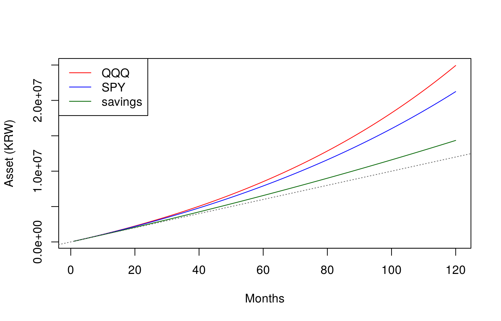
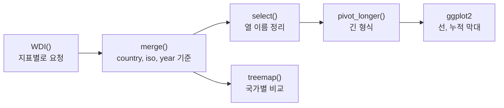
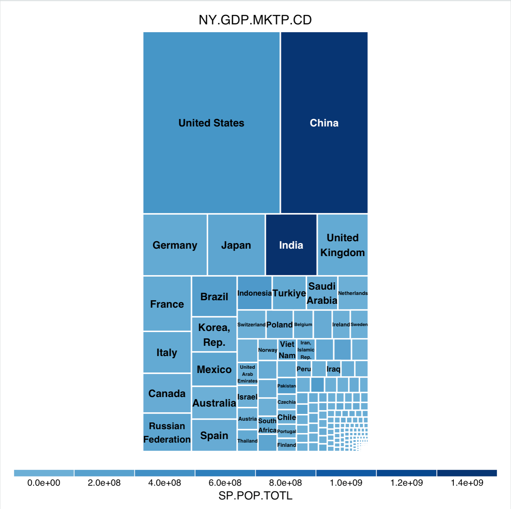
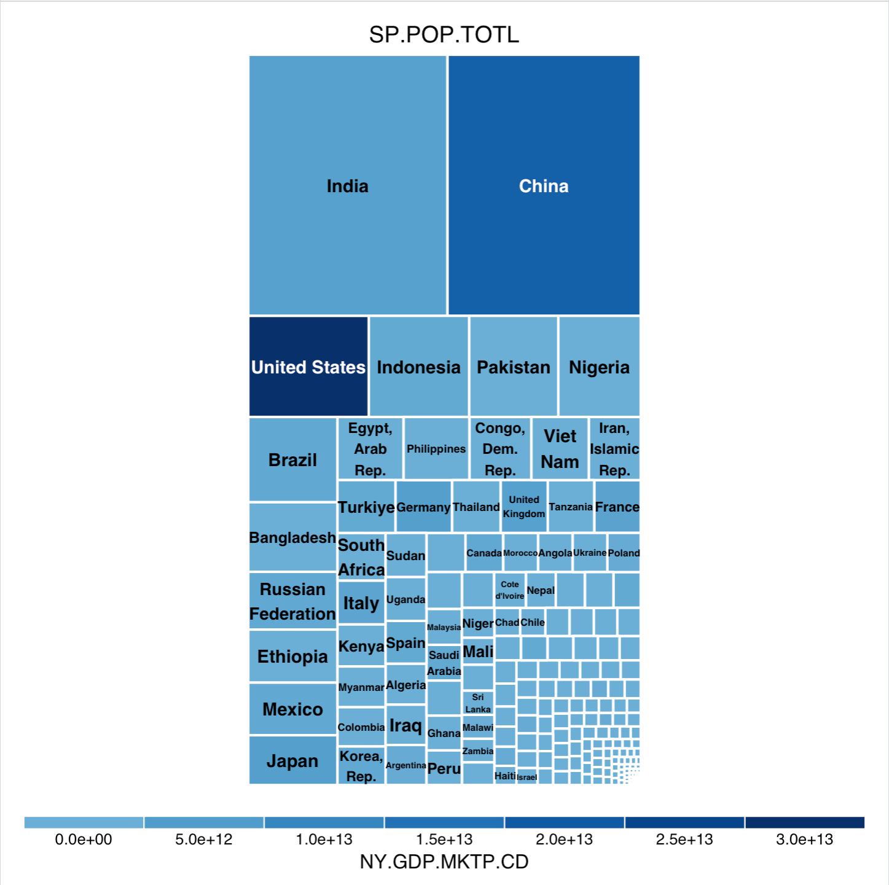
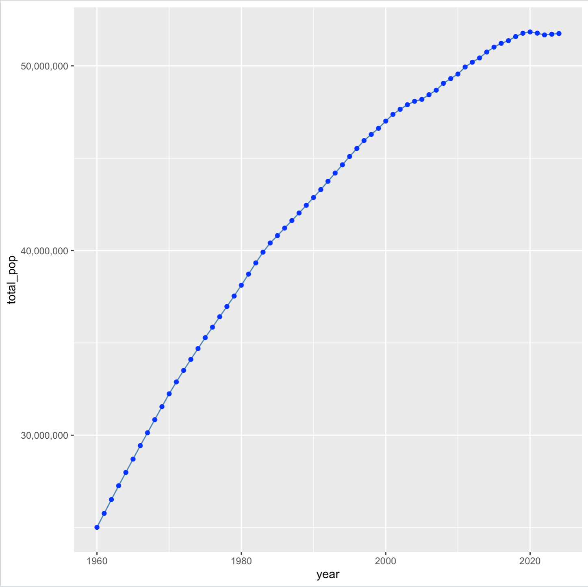
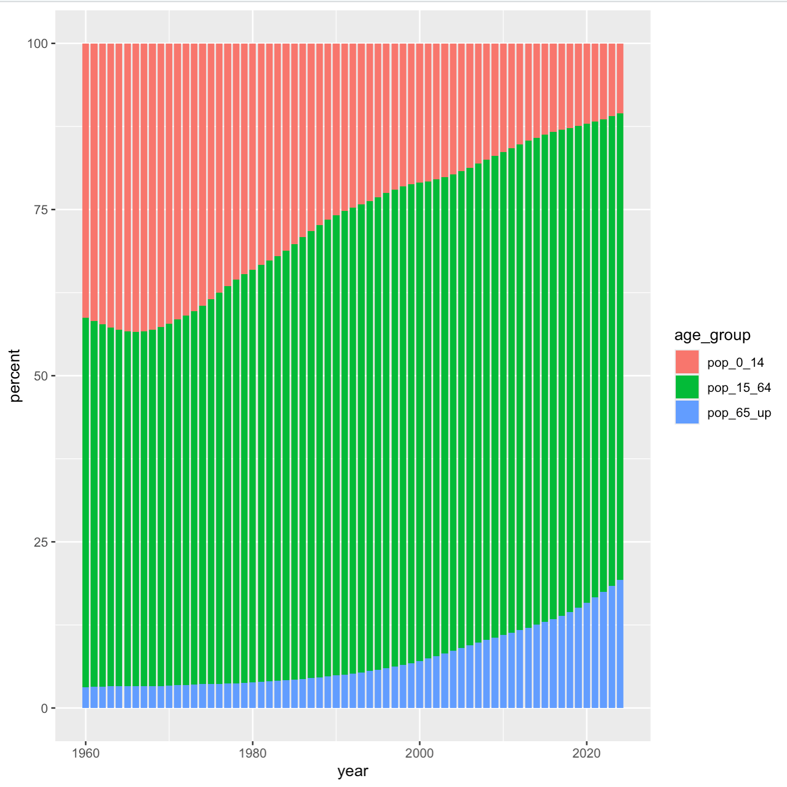
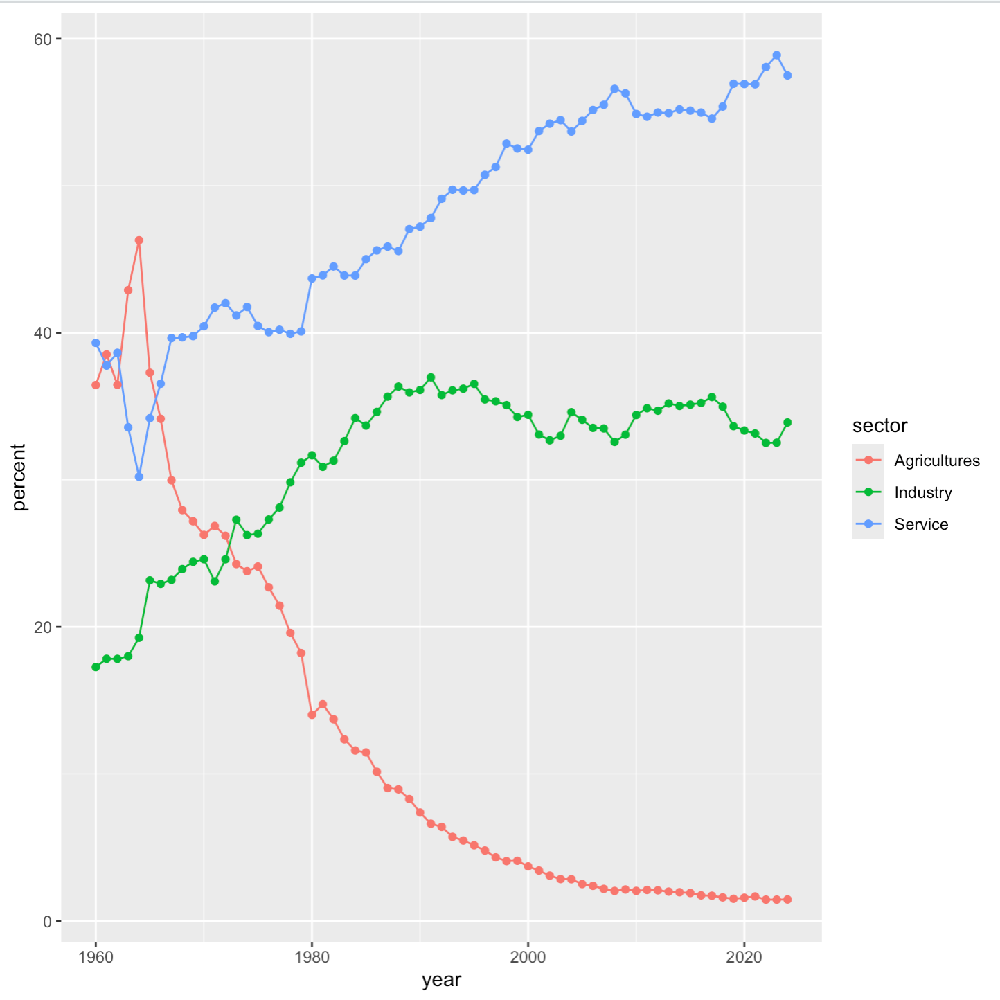
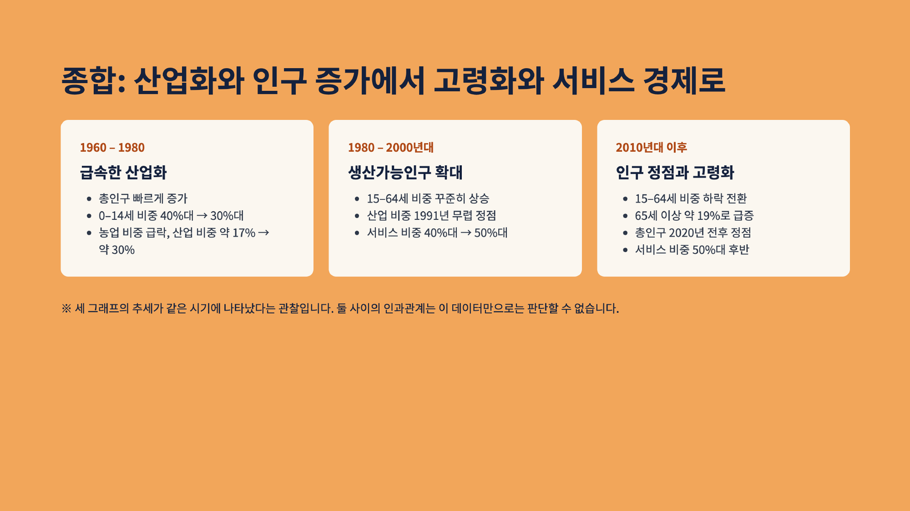
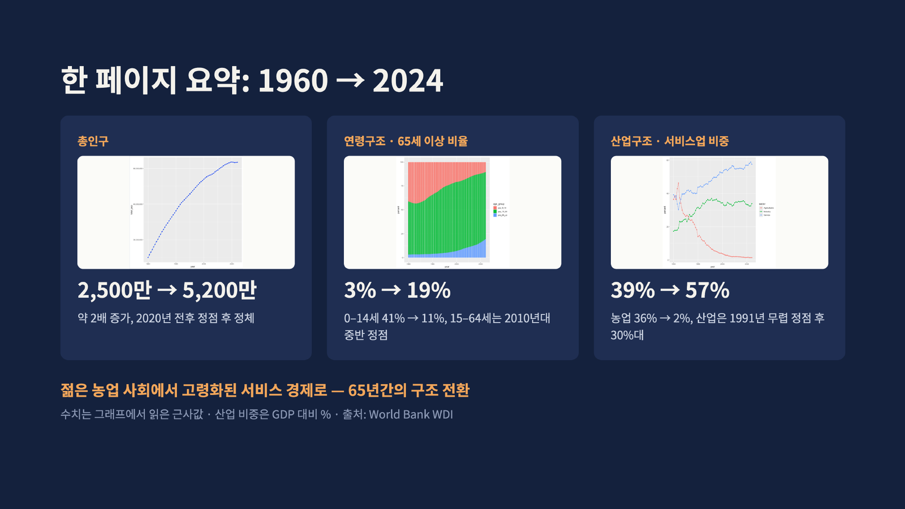
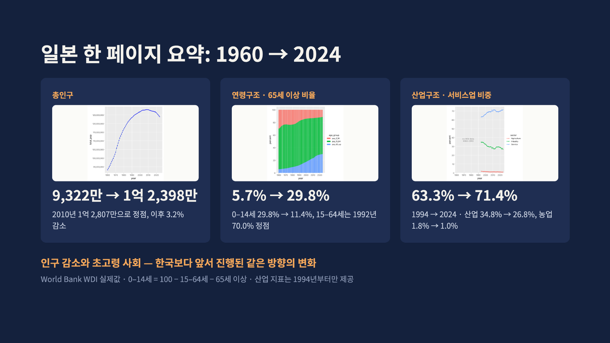

## 학습 목표

- `outer()`로 두 벡터의 모든 조합에 함수를 적용하고, 적립식 복리 계산을 for loop 없이 끝내기
- `WDI` 패키지로 World Bank 세계개발지표(World Development Indicators)를 R로 바로 받기
- 국가별 GDP와 인구를 트리맵으로 비교하기
- 지표별로 받은 데이터를 `merge()`로 합치고 `pivot_longer()`로 긴 형식으로 바꿔 ggplot2로 그리기
- 1960 ~ 2024년 대한민국의 인구, 연령, 산업 구조 변화를 숫자로 읽고 일본과 비교하기

> 실행 화면은 11주차 실습 제출본. 이 글을 쓴 환경에서는 World Bank 서버에 R로 접속할 수 없어 WDI 코드를 다시 돌리지 못했고, 대신 본문의 숫자는 World Bank API(2026년 7월 갱신본)에서 직접 확인한 값으로 적었음. `outer()`와 복리 부분은 다시 실행한 결과
{: .prompt-info }

---

## outer(): 모든 조합에 함수 적용

`outer(X, Y, FUN)`은 X의 원소 $$i$$와 Y의 원소 $$j$$의 **모든 쌍**에 `FUN`을 적용해 $$\text{length}(X) \times \text{length}(Y)$$ 행렬을 만듦. `FUN`을 생략하면 곱셈.

```r
outer(1:9, 1:9)          # 구구단표
outer(1:9, 1:9, '+')     # 덧셈표
outer(1:3, c(10, 20))
```

실행 결과 (앞의 두 개는 위 3행만)

```text
     [,1] [,2] [,3] [,4] [,5] [,6] [,7] [,8] [,9]
[1,]    1    2    3    4    5    6    7    8    9
[2,]    2    4    6    8   10   12   14   16   18
[3,]    3    6    9   12   15   18   21   24   27

     [,1] [,2] [,3] [,4] [,5] [,6] [,7] [,8] [,9]
[1,]    2    3    4    5    6    7    8    9   10
[2,]    3    4    5    6    7    8    9   10   11
[3,]    4    5    6    7    8    9   10   11   12

     [,1] [,2]
[1,]   10   20
[2,]   20   40
[3,]   30   60
```

### 함수를 넣으면: 2변수 함수의 값 표

```r
f <- function(x, y) exp(-x^2 + 3*y)
f(1, 2)
exp(-1^2 + 3*2)
outer(1:3, 1:4, f)       # 행 = x, 열 = y
```

```text
[1] 148.4132
[1] 148.4132
         [,1]      [,2]   [,3]     [,4]
[1,] 7.389000 148.40000 2981.0 59870.00
[2,] 0.367900   7.38900  148.4  2981.00
[3,] 0.002479   0.04979    1.0    20.09
```

- $$f(1, 2) = e^{-1 + 6} = e^5 \approx 148.41$$이고, 표의 1행 2열 값과 같음
- `-1^2`는 $$(-1)^2 = 1$$이 아니라 $$-(1^2) = -1$$. R에서 `^`가 단항 마이너스보다 먼저 계산되기 때문 (여기서는 `x = 1`이라 결과가 같음)
- [1편](/posts/Big-Data_01/)의 3차원 그래프에서 `outer()`로 격자 위의 함숫값을 만든 것과 같은 원리
- 주의: `outer()`는 함수에 **벡터를 통째로** 넘김. 그래서 `FUN`은 벡터를 받아 같은 길이의 벡터를 돌려주는(벡터화된) 함수여야 하고, `if`를 쓰면 오류가 나므로 `ifelse()`를 씀

---

## 적립식 복리를 outer()로

[8편](/posts/Big-Data_08/)에서 `sapply()`로 계산한 적립식 복리를 `outer()` 한 줄로 바꿈. **개월 수 120개 × 상품 3개**의 모든 조합을 한 번에 계산함.

$$V_n = M(1 + r_m)\frac{(1 + r_m)^n - 1}{r_m}, \quad r_m = (1 + r)^{1/12} - 1$$

```r
M <- 100000                  # 매달 초에 10만 원
Years <- 10
N_months <- Years * 12
months <- 1:N_months

r <- c(QQQ = 0.14, SPY = 0.11, savings = 0.035)   # 가정한 연 수익률
r_m <- (1 + r)^(1/12) - 1                          # 월 수익률

fv_monthly <- function(M, n, rm) {                 # 월초 적립식 복리
  a <- M * (1 + rm)
  r <- 1 + rm
  ifelse(rm == 0, M * n, a * (r^n - 1) / (r - 1))
}

fv_monthly(M = 100000, n = 120, rm = 0.035/12)     # 연 3.5%를 12로 나눈 월이율

m_asset <- outer(months, r_m, function(n, rm) fv_monthly(M, n, rm))
dim(m_asset)
head(m_asset, 3)
tail(m_asset, 1)

matplot(months, m_asset, type = "l", lty = 1,
        col = c("red", "blue", "darkgreen"),
        xlab = "Months", ylab = "Asset (KRW)")
legend("topleft", legend = names(r), col = c("red", "blue", "darkgreen"), lty = 1)
```

실행 결과

```text
[1] 14385086
[1] 120   3
        QQQ    SPY savings
[1,] 101098 100873  100287
[2,] 203306 202628  200862
[3,] 306636 305271  301726
            QQQ      SPY savings
[120,] 24929232 21242975 14343158
```


_점선은 넣은 원금(10만 원 × 개월 수)_

| 상품 (가정 연 수익률) | 10년 뒤 | 원금 1,200만 원 대비 |
| --- | --- | --- |
| QQQ (14%) | 약 2,493만 원 | 2.08배 |
| SPY (11%) | 약 2,124만 원 | 1.77배 |
| 예금 (3.5%) | 약 1,434만 원 | 1.20배 |

- `outer()`의 결과는 행이 개월, 열이 상품인 행렬이라 `matplot()`에 그대로 넣으면 열마다 선 하나가 그려짐
- 같은 연 3.5%라도 `0.035/12`(단순히 12로 나눔)로 계산하면 14,385,086원, `(1 + 0.035)^(1/12) - 1`(12번 복리하면 정확히 3.5%)로 계산하면 14,343,158원. 앞의 방식은 실제 연이율이 $$(1 + 0.035/12)^{12} - 1 \approx 3.56\%$$가 되어 조금 더 크게 나옴. 예금 상품이 말하는 "연 3.5%"가 어느 쪽인지에 따라 달라짐
- 수익률은 **비교를 위한 가정**이며 앞으로의 수익을 보장하지 않음. 처음 몇 년은 세 선이 거의 붙어 있다가 뒤로 갈수록 벌어지는 것이 복리의 특징

---

## World Bank WDI 데이터

World Bank의 세계개발지표(WDI)는 200여 개 나라의 경제, 인구, 사회 지표 1,000여 개를 연도별로 모은 공개 데이터. R의 `WDI` 패키지는 지표 코드만 알면 API로 바로 내려받음.

```r
install.packages(c("WDI", "tidyverse", "treemap"))
library(WDI)
WDI(country = "KR", indicator = "SP.POP.TOTL", start = 1960, end = 2024)
```

| 인자 | 의미 |
| --- | --- |
| `country` | 국가 코드. ISO 2자리(`"KR"`)나 3자리(`"KOR"`) 모두 가능, 생략하면 모든 나라 |
| `indicator` | 지표 코드. `c(이름 = "코드")`로 주면 열 이름까지 지정 |
| `start`, `end` | 연도 범위 |
| `extra = TRUE` | 지역(region), 소득 수준, 수도, 위경도 같은 국가 정보 열 추가 |

이번 실습에서 쓴 지표

| 주제 | 지표 코드 | 의미 |
| --- | --- | --- |
| 경제 | `NY.GDP.MKTP.CD` | GDP (현재 미국 달러) |
| 인구 | `SP.POP.TOTL` | 총인구 (명) |
| 인구 | `SP.POP.0014.TO.ZS` | 0 ~ 14세 인구 비율 (%) |
| 인구 | `SP.POP.1564.TO.ZS` | 15 ~ 64세 인구 비율 (%) |
| 인구 | `SP.POP.65UP.TO.ZS` | 65세 이상 인구 비율 (%) |
| 산업 | `NV.AGR.TOTL.ZS` | 농림어업 부가가치 (GDP 대비 %) |
| 산업 | `NV.IND.TOTL.ZS` | 산업(건설 포함) 부가가치 (GDP 대비 %) |
| 산업 | `NV.SRV.TOTL.ZS` | 서비스업 부가가치 (GDP 대비 %) |



---

## 1번: 세계 GDP와 인구 트리맵

```r
library(WDI); library(tidyverse); library(treemap); library(RColorBrewer)

gdp <- WDI(indicator = "NY.GDP.MKTP.CD", start = 2024, end = 2024, extra = T)
pop <- WDI(indicator = "SP.POP.TOTL",    start = 2024, end = 2024, extra = T)
names(gdp)
head(gdp)          # "World", "East Asia & Pacific" 같은 지역 묶음이 country에 섞여 있음

data_countries <- merge(gdp, pop,
                        by = intersect(names(gdp), names(pop)),   # 두 표에 공통인 열 모두
                        all = TRUE)

data_countries %>%
  filter(iso3c == "KOR") %>%
  select(country, iso3c, NY.GDP.MKTP.CD, SP.POP.TOTL)
```

- `extra = T`로 받으면 국가 행과 함께 **"World", "High income" 같은 지역 묶음(Aggregates)**도 같은 `country` 열에 들어옴. 이것을 그대로 그리면 "World"가 트리맵 전체를 차지하므로 걸러야 함
- `intersect(names(gdp), names(pop))`는 두 표에 모두 있는 열 이름(국가 코드, 연도, 지역 등)을 모두 키로 씀. 지표 열만 서로 다르므로 행이 정확히 짝지어짐
- 한국 행은 `grepl("Korea", country)`로 찾으면 "Korea, Rep."(한국)과 "Korea, Dem. People's Rep."(북한)이 함께 걸리므로, **국가 코드 `iso3c == "KOR"`**로 찾는 것이 안전

```r
countries <- data_countries %>%
  filter(region != "Aggregates") %>%          # 지역 묶음 제거
  filter(!is.na(NY.GDP.MKTP.CD)) %>%
  filter(!is.na(SP.POP.TOTL))

treemap(countries, index = "country",
        vSize = "NY.GDP.MKTP.CD",              # 넓이 = GDP
        vColor = "SP.POP.TOTL",                # 색 = 인구
        type = "value", border.col = "white",
        palette = brewer.pal(9, "Blues"))

treemap(countries, index = "country",
        vSize = "SP.POP.TOTL",                 # 넓이 = 인구
        vColor = "NY.GDP.MKTP.CD",             # 색 = GDP
        type = "value", border.col = "white",
        palette = brewer.pal(9, "Blues"))
```

<div class="row g-2">
  <div class="col-6"></div>
  <div class="col-6"></div>
</div>
_왼쪽: 넓이 = GDP, 색 = 인구 / 오른쪽: 넓이 = 인구, 색 = GDP (2024년)_

| 나라 | GDP (2024, 조 달러) | 인구 |
| --- | --- | --- |
| 미국 | 29.30 | 약 3.4억 |
| 중국 | 18.73 | 약 14억 |
| 일본 | 4.19 | 약 1.24억 |
| 인도 | 3.76 | 약 14.5억 |
| 한국 | 1.88 | 약 5,175만 |

- 같은 데이터인데 **넓이를 무엇으로 주느냐에 따라 세계 지도가 완전히 달라짐**. GDP로 보면 미국과 중국 두 나라가 세계의 40% 넘게 차지하고, 인구로 보면 인도와 중국이 가장 큼
- 왼쪽 그림에서 인도는 넓이는 작지만 색이 가장 진함(인구가 많음), 오른쪽 그림에서 미국은 넓이는 작지만 색이 가장 진함(GDP가 큼). 두 변수를 넓이와 색에 나눠 실은 덕분에 **1인당 GDP의 차이**가 드러남
- 트리맵의 원리와 `vSize`, `vColor`는 [8편](/posts/Big-Data_08/) 참고

---

## 2번: 대한민국 총인구

```r
pop_total <- WDI(indicator = "SP.POP.TOTL",       country = "KR", start = 1960, end = 2024)
pop_0_14  <- WDI(indicator = "SP.POP.0014.TO.ZS", country = "KR", start = 1960, end = 2024)
pop_15_64 <- WDI(indicator = "SP.POP.1564.TO.ZS", country = "KR", start = 1960, end = 2024)
pop_65_up <- WDI(indicator = "SP.POP.65UP.TO.ZS", country = "KR", start = 1960, end = 2024)

key <- c("country", "iso2c", "iso3c", "year")
kr_population <- merge(pop_total, pop_0_14, by = key)
kr_population <- merge(kr_population, pop_15_64, by = key)
kr_population <- merge(kr_population, pop_65_up, by = key)

kr_population <- kr_population %>%
  select(year,
         total_pop = SP.POP.TOTL,             # select 안에서 이름 바꾸기
         pop_0_14  = SP.POP.0014.TO.ZS,
         pop_15_64 = SP.POP.1564.TO.ZS,
         pop_65_up = SP.POP.65UP.TO.ZS)

ggplot(kr_population, aes(x = year, y = total_pop)) +
  geom_line(colour = "steelblue") +
  geom_point(colour = "blue") +
  scale_y_continuous(labels = scales::comma)  # 5e+07 대신 50,000,000
```



| 연도 | 총인구 | 비고 |
| --- | --- | --- |
| 1960 | 25,012,374 | 시작 |
| 1984 | 40,405,956 | 4천만 돌파 |
| 2012 | 50,199,853 | 5천만 돌파 |
| 2020 | **51,836,239** | 정점 |
| 2024 | 51,751,065 | 정점 대비 약 8.5만 명 감소 |

- 60년 동안 약 **2.07배**. 1960 ~ 80년대는 해마다 40 ~ 75만 명씩 늘었지만 2000년대 이후 증가 폭이 크게 줄어 그래프 기울기가 완만해짐
- 2020년 정점 이후 2021 ~ 2022년 2년 연속 감소했다가 2023 ~ 2024년에는 소폭 반등. "정점 이후 정체"로 보는 것이 정확함

---

## 3번: 연령대별 인구 비율

```r
data_long <- kr_population %>%
  pivot_longer(cols = c("pop_0_14", "pop_15_64", "pop_65_up"),
               names_to = "age_group",
               values_to = "percent")

ggplot(data_long, aes(x = year, y = percent, fill = age_group)) +
  geom_bar(stat = "identity", width = 0.8)    # geom_col(width = 0.8)과 같음
```



`pivot_longer()`는 연령대 세 열을 `age_group`(어느 연령대인가)과 `percent`(값) 두 열로 바꿈. 연도 65개 × 연령대 3개 = 195행이 되고, `fill = age_group` 하나로 세 집단을 쌓아 그릴 수 있음.

| 연령대 | 1960 | 정점 | 2024 |
| --- | --- | --- | --- |
| 0 ~ 14세 | 41.3% | 43.5% (1966) | **10.6%** |
| 15 ~ 64세 | 55.6% | 73.3% (2015 ~ 2016) | 70.2% |
| 65세 이상 | 3.1% | – | **19.3%** |

- 유소년 비율은 1966년 정점 이후 60년 가까이 줄곧 감소해 4분의 1 수준이 됨
- 생산가능인구(15 ~ 64세)는 2016년 무렵 73.3%로 정점을 찍고 하락 전환
- 65세 이상은 2000년 7.1%(고령화 사회 기준 7%), 2018년 14.5%(고령 사회 기준 14%)를 넘었고 2024년 19.3%로 초고령 사회 기준인 20%에 거의 닿음. 7%에서 14%까지 **18년**밖에 걸리지 않음
- 세 비율의 합은 해마다 100%라서 누적 막대의 높이가 모두 같음. 그래서 이 그래프는 인구 "수"가 아니라 **구성비의 변화**만 보여 줌

---

## 4번: 대한민국 산업구조

```r
agr <- WDI(country = "KOR", indicator = "NV.AGR.TOTL.ZS", start = 1960, end = 2024)
ind <- WDI(country = "KOR", indicator = "NV.IND.TOTL.ZS", start = 1960, end = 2024)
srv <- WDI(country = "KOR", indicator = "NV.SRV.TOTL.ZS", start = 1960, end = 2024)

kr_industry <- merge(agr, ind, by = c("country", "iso2c", "iso3c", "year"))
kr_industry <- merge(kr_industry, srv, by = c("country", "iso2c", "iso3c", "year"))

colnames(kr_industry) <- c("country", "iso2c", "iso3c", "year",
                           "Agricultures", "Industry", "Service")

kr_industry %>%
  pivot_longer(cols = c("Agricultures", "Industry", "Service"),
               names_to = "sector", values_to = "percent") %>%
  ggplot(aes(x = year, y = percent, colour = sector)) +
  geom_line() +
  geom_point()
```



| 부문 (GDP 대비 %) | 1960 | 주요 시점 | 2024 |
| --- | --- | --- | --- |
| 농림어업 | 36.4 | 1964년 46.3 (최고), 1980년 14.0 | **1.5** |
| 산업 (제조, 건설 포함) | 17.3 | 1991년 37.0 (정점) | 33.9 |
| 서비스 | 39.3 | 1980년 43.7, 2000년 52.5 | **57.5** |

- 농업은 1960 ~ 80년 사이에 급락하고 이후에도 꾸준히 줄어 2024년 1.5%
- 산업은 1960 ~ 80년대 중화학공업화로 두 배 넘게 커져 1991년 정점을 찍은 뒤 30%대 중반을 유지. 제조업 강국의 모습이 그대로 남아 있음
- 서비스업은 1980년대부터 꾸준히 늘어 절반을 넘음
- 1960년대 초 값이 크게 출렁이는 것(농업 1964년 46.3%)은 당시 통계의 변동이 큰 탓으로, 추세를 볼 때는 한 해 값보다 흐름을 봐야 함
- 세 부문을 더해도 **100%가 안 됨**(2024년 92.9%, 1960년 93.0%). 이 지표들은 기본가격 기준 부가가치라서 GDP와의 차이인 **순생산물세**(상품에 붙는 세금에서 보조금을 뺀 것)가 빠져 있기 때문 (보충)

---

## 종합: 같은 시기에 일어난 세 가지 변화


_정리 슬라이드: 1960 ~ 2024년을 세 시기로 나눈 요약_

| 시기 | 인구 | 연령구조 | 산업구조 |
| --- | --- | --- | --- |
| 1960 ~ 1980 | 2,500만 → 3,800만, 빠르게 증가 | 유소년 40%대 → 30%대 | 농업 급락, 산업 17% → 32% |
| 1980 ~ 2000년대 | 증가 둔화 | 생산가능인구 비중 상승 | 산업 1991년 정점, 서비스 40%대 → 50%대 |
| 2010년대 이후 | 2020년 정점 | 생산가능인구 하락, 65세 이상 급증 | 서비스 50%대 후반 |



> 세 그래프의 변화가 **같은 시기에** 일어났다는 것은 관찰이고, 산업화가 저출산을 일으켰다거나 그 반대라는 **인과관계는 이 데이터만으로 판단할 수 없음**. 소득, 교육, 도시화, 정책처럼 여기 없는 변수가 함께 움직였기 때문
{: .prompt-warning }

---

## 일본과 비교

실습 과제는 같은 코드를 일본(`country = "JP"`)으로 바꿔 그리는 것. 산업 데이터는 지표 세 개를 **WDI 한 번 호출로** 받도록 고쳤음.

```r
jp_industry <- WDI(
  country = "JP",
  indicator = c(Agriculture = "NV.AGR.TOTL.ZS",   # 이름 = 코드 → 열 이름이 바로 지정됨
                Industry    = "NV.IND.TOTL.ZS",
                Services    = "NV.SRV.TOTL.ZS"),
  start = 1960, end = 2024)

jp_industry_long <- jp_industry %>%
  select(year, Agriculture, Industry, Services) %>%
  pivot_longer(cols = c(Agriculture, Industry, Services),
               names_to = "sector", values_to = "percent") %>%
  filter(!is.na(percent)) %>%                    # 값이 없는 연도 제거
  arrange(sector, year)

jp_industry_long %>%                             # 지표별로 실제 데이터가 있는 기간 확인
  group_by(sector) %>%
  summarise(start_year = min(year), end_year = max(year), n = n(), .groups = "drop")
```

연령대 라벨도 `recode()`로 읽기 쉽게 바꿈.

```r
data_long <- jp_population %>%
  pivot_longer(cols = c("pop_0_14", "pop_15_64", "pop_65_up"),
               names_to = "age_group", values_to = "percent") %>%
  mutate(age_group = recode(age_group,
                            pop_0_14 = "Ages 0-14",
                            pop_15_64 = "Ages 15-64",
                            pop_65_up = "Ages 65+"))
```



| 항목 | 한국 | 일본 |
| --- | --- | --- |
| 총인구 1960 → 2024 | 2,501만 → 5,175만 | 9,322만 → 1억 2,398만 |
| 인구 정점 | 2020년 | 2010년 (1억 2,807만), 이후 3.2% 감소 |
| 65세 이상 2024 | 19.3% | 29.8% |
| 0 ~ 14세 2024 | 10.6% | 11.4% |
| 15 ~ 64세 정점 → 2024 | 2015 ~ 2016년 73.3% → 70.2% | 1992년 70.0% → 58.8% |
| 서비스업 비중 | 39% → 57% (1960 → 2024) | 63.3% → 71.4% (1994 → 2024) |

- 일본은 인구 정점, 생산가능인구 정점, 고령화가 한국보다 **약 10 ~ 25년 앞서** 같은 방향으로 진행됨
- 다만 유소년 비율은 이미 한국(10.6%)이 일본(11.4%)보다 낮아, 한국의 고령화 속도가 더 빠를 수 있음을 보여 줌
- 일본의 산업 지표는 WDI에 **1994년부터만** 있음. 그래서 `filter(!is.na(percent))`와 기간 확인 코드가 필요했고, 1960년부터 있는 한국과 기간이 달라 직접 비교할 때 주의해야 함

---

## 코드 개선점

| 지금 코드 | 개선 | 이유 |
| --- | --- | --- |
| 지표마다 `WDI()` 호출 후 `merge()` 세 번 | `WDI(indicator = c(이름 = "코드", ...))` 한 번 | 일본 산업 코드처럼 한 번에 받으면 병합이 필요 없고 열 이름도 바로 정해짐 |
| `colnames(x) <- c(...)` 위치로 덮어쓰기 | `rename(Agriculture = NV.AGR.TOTL.ZS)` | 열 순서가 바뀌어도 이름이 엉키지 않음 |
| `"KR"`과 `"KOR"`을 섞어 씀 | 하나로 통일 | 둘 다 동작하지만 읽는 사람이 헷갈림 |
| 라벨 `"Agricultures"` | `"Agriculture"` | 오타 수준이지만 그래프 범례에 그대로 나옴 |
| 같은 코드를 나라만 바꿔 복사 | 국가 코드를 인자로 받는 함수 | 한국, 일본, 다른 나라를 한 줄로 비교 |

```r
get_structure <- function(code) {
  WDI(country = code, start = 1960, end = 2024,
      indicator = c(total_pop = "SP.POP.TOTL",
                    pop_0_14  = "SP.POP.0014.TO.ZS",
                    pop_15_64 = "SP.POP.1564.TO.ZS",
                    pop_65_up = "SP.POP.65UP.TO.ZS",
                    Agriculture = "NV.AGR.TOTL.ZS",
                    Industry    = "NV.IND.TOTL.ZS",
                    Services    = "NV.SRV.TOTL.ZS"))
}
both <- get_structure(c("KR", "JP"))     # 두 나라를 한 표로

ggplot(both, aes(year, pop_65_up, colour = country)) + geom_line()
```

- 여러 나라를 한 번에 받으면 `country` 열로 구분되므로 `colour = country`만으로 두 나라를 한 그래프에 비교할 수 있음
- WDI 값은 World Bank가 갱신할 때 최근 연도를 중심으로 바뀔 수 있으므로, 결과에 **받은 날짜**를 함께 적는 것이 좋음

---

## 최종 핵심 정리

1. `outer(X, Y, FUN)`은 두 벡터의 모든 조합에 함수를 적용해 행렬을 만들며, `FUN`은 벡터화된 함수여야 함(`if` 대신 `ifelse`)
2. 적립식 복리를 `outer(months, r_m, ...)` 한 줄로 계산하면 10년 뒤 QQQ(14% 가정) 약 2,493만 원, SPY(11%) 약 2,124만 원, 예금(3.5%) 약 1,434만 원으로 원금 1,200만 원 대비 차이가 뒤로 갈수록 벌어짐
3. `WDI()`는 지표 코드로 World Bank 데이터를 받으며, `extra = TRUE`의 지역 묶음은 `region != "Aggregates"`로 걸러야 함
4. 트리맵에서 넓이와 색에 GDP와 인구를 바꿔 실으면 같은 데이터로 경제 규모와 인구 규모, 그리고 1인당 GDP 차이를 함께 볼 수 있음
5. 지표별 데이터는 `merge(by = c("country", "iso2c", "iso3c", "year"))`로 합치고 `pivot_longer()`로 긴 형식을 만들어 `fill`이나 `colour` 하나로 그룹을 나눠 그림
6. 한국 총인구는 1960년 2,501만에서 2020년 5,184만으로 정점을 찍었고, 65세 이상은 3.1%에서 19.3%로, 0 ~ 14세는 41.3%에서 10.6%로 바뀜
7. 산업구조는 농업 36.4% → 1.5%, 산업은 1991년 37.0% 정점 후 30%대, 서비스 39.3% → 57.5%이며, 세 부문의 합이 100%가 아닌 것은 순생산물세가 빠졌기 때문
8. 일본은 같은 변화를 10 ~ 25년 먼저 겪었고(2010년 인구 정점, 65세 이상 29.8%), 같은 시기의 변화는 관찰일 뿐 인과관계는 이 데이터만으로 알 수 없음

---

End.
