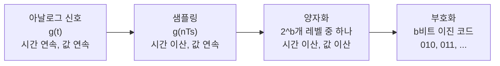
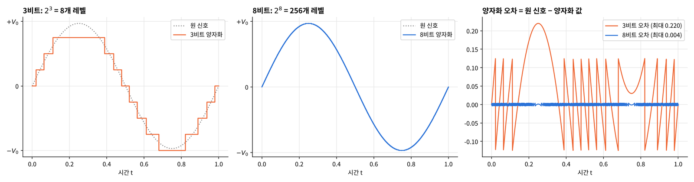
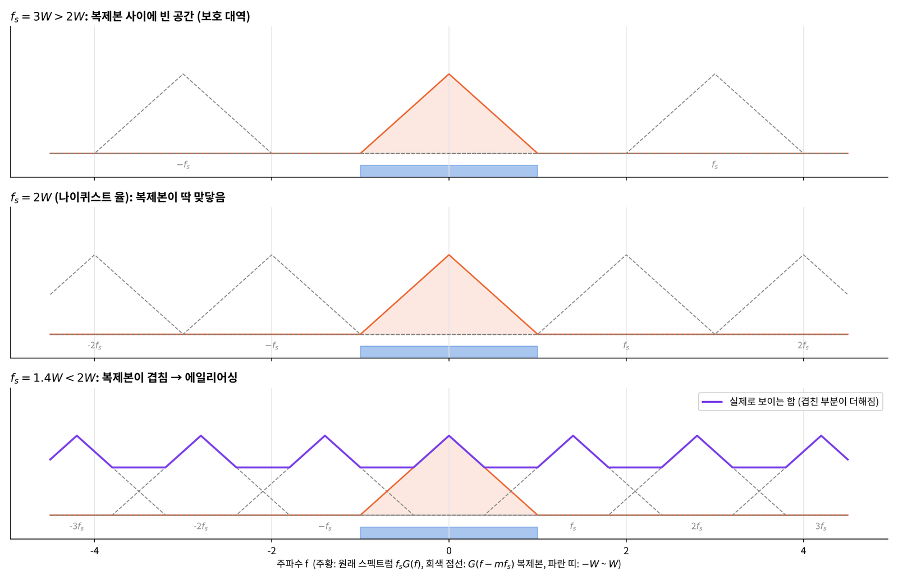
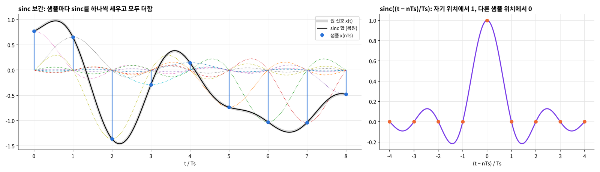
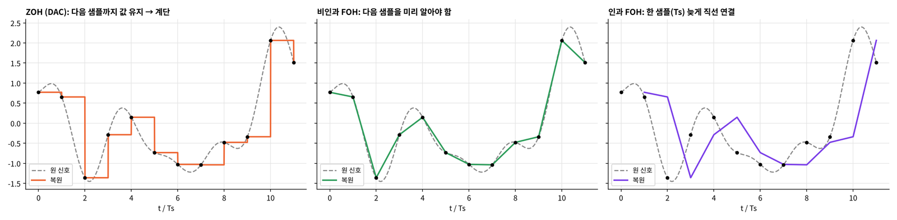
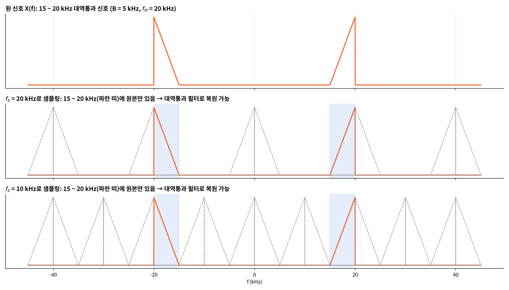
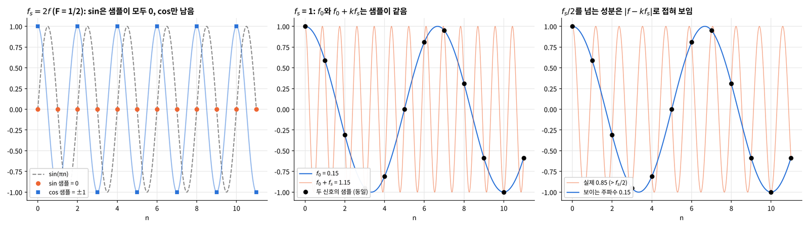
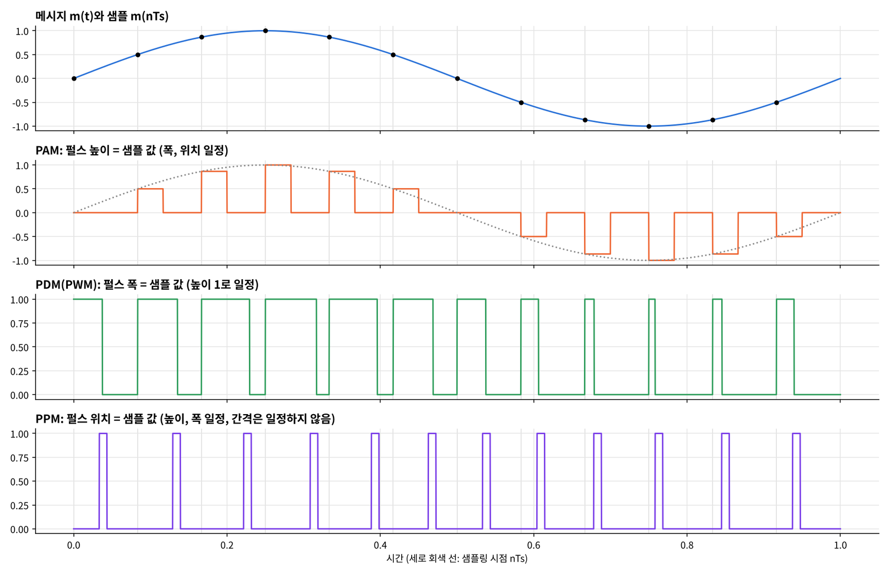
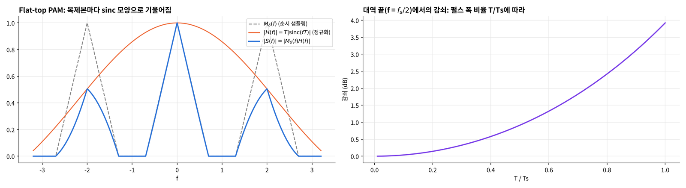
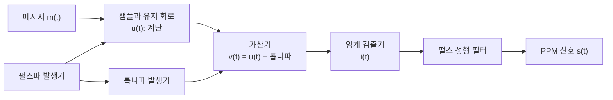

## 학습 목표

- 디지털 전송의 장점과 아날로그 → 디지털 변환 과정(샘플링 → 양자화 → 부호화) 이해
- S/H, ADC, DAC의 역할과 비트 수, 양자화 레벨의 관계 이해
- 샘플링된 신호의 스펙트럼 $$G_\delta(f) = f_s\sum_m G(f - mf_s)$$를 그래프로 해석
- 샘플링 이론과 나이퀴스트 율 $$f_s = 2W$$의 의미, sinc 보간 공식 유도
- 에일리어싱의 원인과 줄이는 방법(안티 에일리어싱 필터, 오버샘플링)
- 실제 보간(ZOH, FOH)과 인과성, 대역통과 신호 샘플링
- 정현파를 나이퀴스트 율로 샘플링하면 생기는 문제
- PAM, PDM, PPM의 차이

> 이번 장의 흐름을 한 줄로: **연속 신호를 일정 간격으로 찍으면(샘플링) 주파수 영역에서는 스펙트럼이 $$f_s$$ 간격으로 복제된다. 복제본이 겹치지 않으면(= $$f_s \ge 2W$$) 저역 통과 필터 하나로 원래 신호를 완벽히 되살릴 수 있다.**
{: .prompt-info }

---

## 1. 왜 디지털인가

아날로그 신호를 그대로 보내지 않고 디지털로 바꿔 보내는 이유

| 장점 | 의미 |
| --- | --- |
| 잡음에 강함 | 0과 1만 구분하면 되므로 잡음이 조금 섞여도 원래 비트를 다시 만들 수 있음 (재생 리피터) |
| 통합 전송 | 영상, 음성, 데이터를 모두 비트열로 바꿔 같은 방법으로 전송 |
| 소스와 무관 | 전송 방법이 정보의 종류(음성인지 영상인지)와 거의 무관 |
| 회로 | 반복이 쉽고, 온도 같은 물리적 영향에 덜 민감, 하드웨어 설계가 쉬움 |
| 효율 | 압축으로 정보량을 줄이고, 전송 매체를 더 효율적으로 사용 |
| 신뢰성 | 에러 정정 부호, 채널 보상 기술, 암호화를 적용할 수 있음 |
| 표준화 | 표준 기술을 만들기 쉬움 |

아날로그 → 디지털 변환은 3단계



> 필기: 샘플링은 **연속(아날로그 통신) → 이산(디지털 통신)**으로 가는 첫 단계. 이번 장의 대부분은 첫 번째 상자인 **샘플링**이 정보를 잃지 않으려면 얼마나 빨리 찍어야 하는가에 대한 이야기
{: .prompt-tip }

---

## 2. 샘플링의 정의

임의의 신호 $$g(t)$$를 $$T_s$$초마다 한 번씩 찍어 얻은 값들의 수열 $$\{g(nT_s)\}$$

- **샘플링 주기** $$T_s$$ [초]와 **샘플링 율** $$f_s = \frac{1}{T_s}$$ [Hz]는 역수 관계
- **순시 샘플링(instantaneous sampling)**: 폭이 0인 순간에 값을 찍는 이상적인 샘플링. 수식으로는 각 샘플 시점에 임펄스를 세운 것

$$
g_\delta(t) = \sum_{n = -\infty}^{\infty} g(nT_s)\,\delta(t - nT_s) = g(t)\sum_{n = -\infty}^{\infty}\delta(t - nT_s)
$$

- 오른쪽 식이 핵심: 순시 샘플링은 **원 신호에 임펄스 열(빗살)을 곱한 것**. 임펄스의 체 거르기 성질 $$g(t)\delta(t - nT_s) = g(nT_s)\delta(t - nT_s)$$ 때문에 두 식이 같음

### 샘플링 율에 따른 차이

| 샘플링 율 | $$T_s$$ | 결과 |
| --- | --- | --- |
| 높음 ($$f_s \uparrow$$) | 짧음 ($$T_s \downarrow$$) | 샘플이 촘촘해 원본과 거의 비슷함 |
| 중간 | 중간 | 점선(원본)을 대략 따라감 |
| 낮음 ($$f_s \downarrow$$) | 김 ($$T_s \uparrow$$) | 샘플 사이 간격이 길어 빠른 변화를 놓치고, 샘플만 보면 다른(더 느린) 신호처럼 보임 |

> 샘플링 이론의 근본 질문: **샘플만 가지고 원래 신호를 다시 만들 수 있으려면 얼마나 빨리 샘플링해야 하는가?** 답은 5절의 $$f_s \ge 2W$$
{: .prompt-info }

---

## 3. 샘플링 장치: S/H, ADC, DAC

### Sample-and-Hold (S/H)

- 클럭 $$c(t)$$의 **개구 시간(aperture time)** 동안은 출력이 입력을 그대로 따라가고(sample)
- 개구 시간이 끝나면 **그 값을 다음 개구 시간까지 유지(hold)**
- 결과는 계단 모양. ADC가 숫자로 바꾸는 동안 입력 값이 변하지 않게 붙잡아 두는 역할

### ADC (Analog-to-Digital Converter)

- 입력 전압을 **코드(이진수)**로 바꾸는 장치
- 출력 방식
  - **직렬(Serial) ADC**: 비트를 한 줄로 하나씩 순서대로 내보냄
  - **병렬(Parallel) ADC**: 4비트면 4개의 선으로 **한 샘플의 비트를 동시에** 내보냄 (그림의 세로 빨간 칸이 한 샘플 = 4비트 binary digit). 선은 많이 필요하지만 빠름

### 입력-출력 관계와 양자화

3비트 ADC는 입력 범위 $$-V_0$$ ~ $$+V_0$$ (예: −5 V ~ +5 V)를 $$2^3 = 8$$개 레벨로 나눔

| 코드 | 100 | 101 | 110 | 111 | 000 | 001 | 010 | 011 |
| --- | --- | --- | --- | --- | --- | --- | --- | --- |
| 10진(2의 보수) | −4 | −3 | −2 | −1 | 0 | 1 | 2 | 3 |

- 코드는 **2의 보수**: 맨 앞 비트가 1이면 음수. 그래서 100이 가장 작은 값, 011이 가장 큰 값
- 음수 쪽이 4개, 양수 쪽이 3개라 **위쪽 끝은 한 칸 모자람** → 사인파의 꼭대기가 잘림(아래 그림 3비트의 평평한 윗부분)
- 비트 수 $$b$$가 늘면 레벨은 $$2^b$$개로 기하급수적으로 늘고 계단이 촘촘해짐: 3비트 8개, 8비트 256개


_3비트와 8비트 양자화, 그리고 양자화 오차_

- 양자화 오차는 계단 높이 $$\Delta = \frac{2V_0}{2^b}$$의 절반 이내 (위에서는 3비트 0.125, 8비트 0.004)
- 비트를 하나 늘리면 $$\Delta$$가 절반 → 오차 전력은 $$\frac{1}{4}$$ → **신호 대 양자화 잡음비(SQNR)가 약 6 dB씩 좋아짐** (사인파 기준 $$\mathrm{SQNR} \approx 6.02b + 1.76$$ dB, 8비트에서 약 49.9 dB이고 직접 계산해도 49.8 dB)

### DAC (Digital-to-Analog Converter)

- 코드를 다시 전압으로 바꾸는 장치. ADC의 반대 방향
- 3비트면 8개의 전압 레벨 중 하나를 출력. 출력은 다음 코드가 올 때까지 유지되므로 계단 모양 → 8절의 **ZOH**가 바로 DAC의 수학적 모델

---

## 4. 샘플링된 신호의 스펙트럼

> 필기: **이 식을 그래프로 해석해 보기 (중요)**. 샘플링 이론, 에일리어싱, 대역통과 샘플링이 모두 이 식 하나에서 나옴
{: .prompt-warning }

$$
G_\delta(f) = f_s\sum_{m = -\infty}^{\infty} G(f - mf_s) = \sum_{n = -\infty}^{\infty} g(nT_s)\exp(-j2\pi nT_sf)
$$

### 왼쪽 식: 스펙트럼이 $$f_s$$ 간격으로 복제된다

1. 시간 영역에서 순시 샘플링은 곱셈: $$g_\delta(t) = g(t)\cdot\sum_n \delta(t - nT_s)$$
2. 임펄스 열의 푸리에 변환은 주파수 영역의 임펄스 열: $$\sum_n \delta(t - nT_s) \rightleftharpoons f_s\sum_m \delta(f - mf_s)$$
3. 시간 영역의 곱은 주파수 영역의 컨볼루션이고, 임펄스와 컨볼루션하면 그 위치로 이동

$$
G_\delta(f) = G(f) * f_s\sum_m \delta(f - mf_s) = f_s\sum_m G(f - mf_s)
$$

즉 **원래 스펙트럼 $$G(f)$$가 $$0, \pm f_s, \pm 2f_s, \dots$$마다 복사되어 놓이고 높이는 $$f_s$$배**가 됨

### 오른쪽 식: 각 임펄스를 하나씩 변환

$$\delta(t - nT_s) \rightleftharpoons e^{-j2\pi nT_sf}$$ (시간 이동 성질)이므로 $$g_\delta(t)$$를 항마다 변환하면 바로 나옴. 이 식은 $$f$$에 대해 주기가 $$f_s$$인 함수(지수 $$e^{-j2\pi nT_sf}$$가 모두 $$\frac{1}{T_s}$$ 주기)라는 점에서 왼쪽 식의 "주기적 복제"와 같은 이야기를 함

> **시간 영역에서 샘플링(이산화) ⟺ 주파수 영역에서 주기화(복제)**. 2장 푸리에 변환의 쌍대성이 여기서 다시 나타남
{: .prompt-tip }

---

## 5. 샘플링 이론 (Sampling Theorem)

### 가정

- (a) 유한한 에너지를 가진 $$g(t)$$가 **완전한 대역제한(strictly band-limited)** 신호: $$W$$보다 큰 주파수 성분이 없음

$$
G(f) = 0, \qquad \lvert f \rvert > W
$$

- (b) 샘플링 간격을 **최대 간격** $$T_s = \frac{1}{2W}$$, 즉 $$f_s = \frac{1}{T_s} = 2W$$로 둠

### 그래프로 보기


_샘플링 율에 따른 스펙트럼 복제본의 배치_

- 원래 스펙트럼은 $$-W$$ ~ $$W$$에 있고, 복제본은 $$\pm f_s$$를 중심으로 $$\pm W$$만큼 퍼짐
- 원본의 오른쪽 끝은 $$W$$, 첫 복제본의 왼쪽 끝은 $$f_s - W$$ → **겹치지 않을 조건은 $$W \le f_s - W$$, 즉 $$f_s \ge 2W$$**
- 겹치지 않으면 $$-W$$ ~ $$W$$만 통과시키는 **저역 통과 필터(LPF)**로 가운데 원본 하나만 꺼낼 수 있음

### 수식으로 보기

$$m = 0$$ 항을 따로 떼어 쓰면

$$
G_\delta(f) = f_sG(f) + f_s\sum_{m \ne 0} G(f - mf_s)
$$

$$f_s = 2W$$이면 $$-W < f < W$$에서 둘째 항(복제본들)은 **정확히 0** (겹치지 않으므로). 따라서

$$
G_\delta(f) = f_sG(f) = 2W\,G(f), \qquad -W < f < W
$$

$$
G(f) = \frac{1}{2W}G_\delta(f) = \frac{1}{2W}\sum_{n = -\infty}^{\infty} g\!\left(\frac{n}{2W}\right)\exp\!\left(-\frac{j\pi nf}{W}\right), \qquad -W < f < W
$$

> 필기: 왼쪽 $$G(f)$$를 역푸리에 변환하면 $$g(t)$$. 그리고 오른쪽은 샘플 값 $$g(n/2W)$$만으로 이루어져 있음 → **샘플 수열 $$\{g(n/2W)\}$$가 $$g(t)$$의 모든 정보를 담고 있다**
{: .prompt-tip }

### sinc 보간 공식 유도

$$G(f)$$를 역변환하면 ($$G(f)$$는 $$-W$$ ~ $$W$$ 밖에서 0이므로 적분 구간이 $$\pm W$$)

$$
g(t) = \int_{-W}^{W} \frac{1}{2W}\sum_{n} g\!\left(\frac{n}{2W}\right) e^{-j\pi nf/W}\, e^{j2\pi ft}\, df
= \sum_{n} g\!\left(\frac{n}{2W}\right)\frac{1}{2W}\int_{-W}^{W} e^{j2\pi f\left(t - \frac{n}{2W}\right)}\, df
$$

(합과 적분의 순서를 바꾸고, $$e^{-j\pi nf/W} = e^{-j2\pi f \cdot \frac{n}{2W}}$$를 합침)

안쪽 적분은 $$\sin x = \frac{e^{jx} - e^{-jx}}{j2}$$를 쓰면

$$
\frac{1}{2W}\int_{-W}^{W} e^{j2\pi f\left(t - \frac{n}{2W}\right)}\, df
= \frac{1}{2W}\cdot\frac{e^{j2\pi W\left(t - \frac{n}{2W}\right)} - e^{-j2\pi W\left(t - \frac{n}{2W}\right)}}{j2\pi\left(t - \frac{n}{2W}\right)}
= \frac{e^{j\pi(2Wt - n)} - e^{-j\pi(2Wt - n)}}{j2\pi(2Wt - n)}
= \frac{\sin(\pi(2Wt - n))}{\pi(2Wt - n)} = \mathrm{sinc}(2Wt - n)
$$

따라서 **보간 공식(interpolation formula)**

$$
g(t) = \sum_{n = -\infty}^{\infty} g\!\left(\frac{n}{2W}\right)\mathrm{sinc}(2Wt - n)
$$

- $$\mathrm{sinc}(x) = \frac{\sin \pi x}{\pi x}$$는 **보간 함수(interpolation function)**: 샘플 값 사이를 채우는 함수
- $$\mathrm{sinc}(2Wt - n)$$은 $$t = \frac{n}{2W}$$ (자기 샘플 위치)에서 1, 다른 샘플 위치 $$t = \frac{k}{2W}$$ ($$k \ne n$$)에서는 0 → 복원된 신호가 **모든 샘플 점을 정확히 지나감**
- 샘플 사이의 값은 모든 sinc의 꼬리가 더해져서 만들어짐


_sinc 보간: 각 샘플이 세운 sinc(점선)의 합이 원 신호와 겹침_

### 샘플링 이론의 두 문장

1. $$W$$ Hz보다 낮은 주파수 성분만 가진 유한 에너지 대역제한 신호는 **$$\frac{1}{2W}$$초 간격의 순시 값**만으로 완전히 표현할 수 있다
2. 그런 신호는 **초당 $$2W$$개**로 샘플링된 값으로부터 원래 신호를 **완벽하게 복원**할 수 있다

### 나이퀴스트 율 (Nyquist rate)

| 용어 | 값 | 의미 |
| --- | --- | --- |
| 나이퀴스트 율 | $$2W$$ [샘플/초] | 대역폭 $$W$$인 신호를 복원할 수 있는 **최소 샘플링 율** |
| 나이퀴스트 간격 | $$\frac{1}{2W}$$ [초] | 나이퀴스트 율의 역수, **최대 샘플링 간격** |

> 주의: "나이퀴스트 율로 샘플링하면 항상 복원된다"는 **경계에 성분이 없을 때만** 맞음. 정확히 $$W$$에 정현파 성분이 있으면 $$f_s = 2W$$로는 복원이 안 됨(10절, 필기에 "중요" 표시). 실제로는 $$f_s > 2W$$로 잡아야 안전
{: .prompt-warning }

### 수치 확인: 샘플을 많이 쓸수록 복원 오차가 줄어듦

```python
import numpy as np

# 최고 주파수 0.43 Hz인 대역제한 신호를 fs = 1 Hz (> 2 x 0.43)로 샘플링
fr, am, ph = [0.08, 0.17, 0.31, 0.43], [1.0, 0.7, 0.5, 0.35], [0.3, 1.1, 2.0, 4.0]
x = lambda t: sum(a * np.cos(2 * np.pi * q * t + p) for a, q, p in zip(am, fr, ph))

t = np.linspace(-5, 5, 1001)
for N in [50, 500, 5000]:
    n = np.arange(-N, N + 1)                                  # 사용한 샘플 범위
    rec = (x(n)[None, :] * np.sinc(t[:, None] - n[None, :])).sum(axis=1)
    print(f"샘플 {2 * N + 1}개: 최대 오차 {np.max(np.abs(rec - x(t))):.2e}")
```

```text
샘플 101개: 최대 오차 1.95e-03
샘플 1001개: 최대 오차 5.01e-05
샘플 10001개: 최대 오차 4.58e-06
```

- 식대로라면 오차는 0이어야 하지만, 실제로는 무한히 많은 샘플을 더할 수 없어 꼬리가 잘림 → 샘플을 늘릴수록 오차가 줄어듦
- 이것이 8절 "sinc 보간은 이론적으로 완벽하지만 실제로는 불가능"의 이유

---

## 6. 에일리어싱 (Aliasing)

### 정의와 원인

- 샘플링된 신호의 스펙트럼에서 **고주파 성분이 마치 저주파 성분처럼 보이는 현상**
- 원인: **샘플링을 충분히 하지 못했기 때문** ($$f_s < 2W$$) → 복제본들이 서로 겹쳐서 더해짐 (5절 그림의 세 번째 줄)
- 겹친 부분은 원본과 복제본이 **더해져 버려서** 어느 것이 원래 성분이었는지 구분할 수 없음. 어떤 필터로도 되돌릴 수 없는 **정보 손실**

> 필기: 신호가 빨리 변하는데 샘플 간격이 넓으면, 샘플 점들만 이었을 때 느리게 변하는 다른 신호처럼 보임. **"이렇게 해서 에일리어싱이 발생함"**
{: .prompt-tip }

실생활 예: 영상에서 빠르게 도는 바퀴가 거꾸로 돌거나 멈춘 것처럼 보이는 것(초당 프레임 수가 회전 속도보다 부족해서 생기는 시간 영역의 에일리어싱)

### 에일리어싱을 줄이는 방법

1. **샘플링 전에** 저역 통과 **안티 에일리어싱 필터(Anti-Aliasing Filter)**로 필수적이지 않은 고주파 성분을 줄임
   - 필기: 고주파 정보는 어차피 잃지만, 걸러 내지 않으면 저주파 쪽으로 접혀 들어와 **필요한 저주파 정보까지 망가뜨림**. 일부를 미리 버려서 나머지를 지키는 것
2. 필터링된 신호를 **나이퀴스트 율보다 조금 더 높은 비율**로 샘플링 (오버샘플링, 필기: 더 촘촘하게 샘플링)
   - 복제본 사이에 빈 공간(보호 대역)이 생겨 **안 겹침**
   - 그 결과 복원용 필터(합성 필터, reconstruction filter)를 쉽게 설계할 수 있음: 통과 대역 $$W$$와 저지 대역 $$f_s - W$$ 사이의 틈에서 **천천히 떨어지는(사다리꼴) 현실적인 필터**를 써도 됨. $$f_s = 2W$$였다면 $$W$$에서 수직으로 떨어지는 이상적 필터가 필요하지만 그런 필터는 만들 수 없음

| 예시 | 신호 대역 | 샘플링 율 | 여유 |
| --- | --- | --- | --- |
| CD 오디오 | 가청 대역 약 20 kHz | 44.1 kHz | 2 × 20 = 40 kHz보다 약 10% 높게 잡아 필터 전이 대역 확보 |
| 전화 음성 | 약 3.4 kHz | 8 kHz | 2 × 3.4 = 6.8 kHz보다 높게 |

---

## 7. 시간제한 신호와 대역제한 신호

- 샘플링 이론은 **대역제한** 신호를 충분한 율($$f_s \ge 2W$$)로 샘플링하면 정확히 복원된다고 말함
- 하지만 동시에 **모든 시간($$-\infty$$ ~ $$\infty$$)에 걸쳐** 샘플링해야 한다고 말함. 유한한 시간 동안만 0이 아닌 **시간제한(timelimited)** 신호에도 이 요구는 그대로임

### 시간제한 신호는 대역제한일 수 없다

$$t_1$$ ~ $$t_2$$에서만 0이 아닌 신호 $$x(t)$$는 그 구간의 사각 창을 곱해도 그대로임 (필기: $$\Delta t = t_2 - t_1$$, $$t_0 = \frac{t_1 + t_2}{2}$$)

$$
x(t) = x(t)\,\mathrm{rect}\!\left(\frac{t - t_0}{\Delta t}\right)
$$

양변을 푸리에 변환하면 (곱 → 컨볼루션)

$$
X(f) = X(f) * \Delta t\,\mathrm{sinc}(\Delta t f)\, e^{-j2\pi ft_0}
$$

- $$\mathrm{sinc}(\Delta t f)$$는 주파수 축으로 끝없이 이어짐
- 무엇이든 이 sinc와 컨볼루션한 결과는 역시 주파수 축으로 끝없이 이어짐 → $$X(f)$$는 대역제한일 수 없음

> 필기: **시간이 유한하면 주파수는 무한히 퍼진다** (반대로 대역제한이면 시간적으로 무한히 이어짐). 현실의 신호는 모두 유한한 시간 동안만 존재하므로 **엄밀하게 대역제한인 신호는 없음** → 에일리어싱을 완전히 없앨 수는 없고, 안티 에일리어싱 필터로 "충분히 작게" 만드는 것이 목표
{: .prompt-tip }

---

## 8. 보간 (Interpolation)

### 이상적인 보간 = 이상적인 저역 통과 필터

원래 신호는 (이론적으로) **원본 스펙트럼은 통과시키고 복제본(alias)은 막는 LPF**로 되살릴 수 있음

$$
X(f) = \underbrace{T_s\,\mathrm{rect}\!\left(\frac{f}{2f_c}\right)}_{\text{ideal LPF}} \times \underbrace{X_\delta(f)}_{\text{sampled}}, \qquad X_\delta(f) = f_sX(f) * \delta_{f_s}(f)
$$

- $$f_c$$는 차단 주파수(cutoff), 통과 대역의 폭은 $$2f_c$$
- 높이 $$T_s$$는 샘플링 때 생긴 $$f_s$$배를 되돌리기 위한 것
- 조건: $$W \le f_c \le f_s - W$$ (원본은 통과, 첫 복제본은 차단)

역변환하면 (곱 → 컨볼루션, $$T_sf_s = 1$$)

$$
x(t) = 2\frac{f_c}{f_s}\,\mathrm{sinc}(2f_ct) * \sum_n x(nT_s)\delta(t - nT_s) = 2\frac{f_c}{f_s}\sum_{n = -\infty}^{\infty} x(nT_s)\,\mathrm{sinc}(2f_c(t - nT_s))
$$

$$f_c = \frac{f_s}{2}$$로 두면 5절과 같은 식

$$
x(t) = \sum_{n = -\infty}^{\infty} x(nT_s)\,\mathrm{sinc}\!\left(\frac{t - nT_s}{T_s}\right)
$$

### 실제 보간 (Practical Interpolation)

sinc 보간은 이론적으로 완벽하지만 **실제로는 불가능**

- sinc는 양쪽으로 무한히 이어지므로 **모든 시간의 샘플**이 필요하고
- $$t < 0$$에서도 0이 아니므로 **미래 샘플**이 필요한 비인과 시스템

그래서 현실에서는 타협한 보간을 씀

**영차 홀드 (ZOH, Zero-Order Hold)**: DAC가 하는 일. 가장 간단하게 구현할 수 있는 보간

$$
h(t) = \begin{cases} 1, & 0 < t < T_s \\ 0, & \text{otherwise} \end{cases} = \mathrm{rect}\!\left(\frac{t - T_s/2}{T_s}\right)
$$

- 폭이 샘플 간격 $$T_s$$인 사각 펄스. 중심이 $$\frac{T_s}{2}$$에 있음
- 필기: $$x_\delta(t) \to h(t) \to y(t)$$, 즉 $$y(t) = x_\delta(t) * h(t)$$. 임펄스 하나하나가 폭 $$T_s$$짜리 사각 펄스로 바뀌어 **다음 샘플까지 값을 유지**하는 계단이 됨
- 주파수로 보면 $$H(f) = T_s\,\mathrm{sinc}(fT_s)e^{-j\pi fT_s}$$: 이상적 LPF처럼 평평하지 않고 sinc 모양이라 복제본을 완전히 막지 못함 → 실제 DAC 뒤에는 계단을 매끄럽게 하는 **평활 필터**를 하나 더 둠

**일차 홀드 (FOH, First-Order Hold)**: 샘플 사이를 직선으로 잇는 방법

- 자연스럽지만 **실시간으로는 불가능**: 지금 구간의 직선을 그리려면 **다음 샘플 값을 미리 알아야** 함 → 비인과
- 복원을 **한 샘플 시간($$T_s$$)만큼 늦추면** 인과 시스템으로 만들 수 있음
- 필기: **인과(causal)로 구현하면 지연(delay)이 발생함**


_ZOH, 비인과 FOH, 인과 FOH (인과 FOH는 원 신호보다 한 샘플 늦음)_

| 방법 | 모양 | 인과 | 정확도 | 비고 |
| --- | --- | --- | --- | --- |
| sinc (이상적 LPF) | 매끄러움 | X | 완벽 (대역제한 + 무한 샘플이면) | 이론용 |
| ZOH | 계단 | O | 낮음 | DAC의 모델 |
| FOH (비인과) | 꺾은선 | X | 중간 | 다음 샘플이 필요 |
| FOH (인과) | 꺾은선, $$T_s$$ 지연 | O | 중간 | 지연을 허용하면 실시간 가능 |

---

## 9. 대역통과 신호의 샘플링

신호가 $$f_L$$ ~ $$f_H$$에만 있는 **대역통과 신호**라면, 최고 주파수의 2배보다 **낮은** 율로 샘플링해도 복원할 수 있음

예: 15 ~ 20 kHz에만 성분이 있는 신호 ($$f_L = 15$$, $$f_H = 20$$, 대역폭 $$B = 5$$ kHz)

- 저역 신호로 보면 최고 주파수가 20 kHz라 $$f_s \ge 40$$ kHz가 필요해 보임
- 하지만 0 ~ 15 kHz는 비어 있음. 복제본이 이 **빈 공간에 들어가기만 하면** 원본 대역(15 ~ 20 kHz)은 깨끗하게 남음


_15 ~ 20 kHz 대역통과 신호를 20 kHz, 10 kHz로 샘플링했을 때의 스펙트럼_

| $$f_s$$ | 결과 |
| --- | --- |
| 20 kHz | 복제본이 원본 사이 빈 공간에 들어감 → **대역통과 필터**로 원본 복원 가능 (최고 주파수의 2배보다 낮은데도) |
| 10 kHz | 필기: 율을 다시 **1/2로 줄였는데도** 복제본이 원본과 딱 맞닿기만 하고 겹치지 않음 → 이상적인 대역통과 필터로 **간신히(barely)** 복원 가능 (최고 주파수의 절반인데도) |

### 일반 조건

양의 원본 대역 $$[f_L, f_H]$$와 음의 원본 $$[-f_H, -f_L]$$을 $$k$$번째, $$k - 1$$번째로 옮긴 복제본 사이에 원본이 끼어 들어가야 함

- 아래쪽 이웃이 넘지 않을 조건: $$(k - 1)f_s - f_L \le f_L \;\Rightarrow\; (k - 1)f_s \le 2f_L$$
- 위쪽 이웃이 넘지 않을 조건: $$kf_s - f_H \ge f_H \;\Rightarrow\; kf_s \ge 2f_H$$

합치면 가능한 범위

$$
\frac{2f_H}{k} \le f_s \le \frac{2f_L}{k - 1}, \qquad k = 1, 2, \dots, \left\lfloor \frac{f_H}{B} \right\rfloor
$$

가장 큰 $$k$$를 쓰면 최소 샘플링 율

$$
f_{s,\min} = \frac{2f_H}{\lfloor f_H/B \rfloor}
$$

($$\lfloor \cdot \rfloor$$은 그 수를 넘지 않는 가장 큰 정수, $$B = f_H - f_L$$)

```python
import math

fL, fH = 15, 20          # kHz
B = fH - fL
for k in range(1, math.floor(fH / B) + 1):
    lo = 2 * fH / k
    hi = 2 * fL / (k - 1) if k > 1 else float("inf")
    print(f"k={k}: {lo:.2f} <= fs <= {hi:.2f} kHz")
print("fs,min =", 2 * fH / math.floor(fH / B), "kHz")
```

```text
k=1: 40.00 <= fs <= inf kHz
k=2: 20.00 <= fs <= 30.00 kHz
k=3: 13.33 <= fs <= 15.00 kHz
k=4: 10.00 <= fs <= 10.00 kHz
fs,min = 10.0 kHz
```

- $$k = 1$$은 평범한 저역 샘플링($$f_s \ge 2f_H$$)
- 20 kHz는 $$k = 2$$ 범위의 끝, 10 kHz는 $$k = 4$$에서 범위가 한 점뿐이라 **"간신히"** 복원되는 것과 일치
- 허용 범위가 띄엄띄엄 있다는 점에 주의: 예를 들어 16 ~ 19 kHz나 11 ~ 13 kHz는 **어느 범위에도 속하지 않아 에일리어싱**이 생김. 율을 높인다고 무조건 좋아지는 게 아님

> 하한 $$f_{s,\min}$$은 대역폭으로 정해짐: 신호가 아무리 높은 주파수에 있어도 대역폭 $$B$$만 작으면 약 $$2B$$ 근처로 샘플링할 수 있음. 무선 수신기에서 반송파 대역 신호를 직접 샘플링하는 **언더샘플링**의 원리
{: .prompt-info }

---

## 10. 정현파의 샘플링

### 나이퀴스트 율로 샘플링하면 생기는 문제

> 필기 (중요 표시): **"나이퀴스트 율로 샘플링하면 복원 가능하다"는 틀림. sin은 불가능.**
{: .prompt-warning }

이산 시간 표현 $$x[n] = x(nT_s)$$, 정규화 주파수 $$F = \frac{f}{f_s}$$ (필기는 $$F_s = 1$$로 놓고 계산)

| 신호 | $$F$$ | 나이퀴스트 율 $$2F$$ | 샘플링 율 | 결과 |
| --- | --- | --- | --- | --- |
| $$\cos(2\pi\cdot\frac{1}{4}n)$$ | 1/4 | 1/2 | 1 (나이퀴스트의 2배) | 샘플이 신호를 **유일하게 결정** |
| $$\cos(2\pi\cdot\frac{1}{2}n)$$ | 1/2 | 1 | 1 (정확히 나이퀴스트) | 샘플이 신호를 **유일하게 결정하지 못함** |
| $$\sin(2\pi\cdot\frac{1}{2}n)$$ | 1/2 | 1 | 1 (정확히 나이퀴스트) | **샘플이 모두 0** |

이유: $$F = \frac{1}{2}$$이면 $$2\pi\cdot\frac{1}{2}n = \pi n$$

- $$\cos(\pi n) = (-1)^n$$: $$+1, -1, +1, \dots$$로 살아남음
- $$\sin(\pi n) = 0$$: 정수 $$n$$마다 정확히 영점이라 **전부 사라짐**

그래서 같은 주파수의 다른 정현파 $$A\cos(\pi n) + B\sin(\pi n)$$은 $$B$$가 얼마든 샘플이 $$A(-1)^n$$으로 같음 → 샘플로는 $$B$$(즉 위상)를 알 수 없음. 같은 이유로 **어떤 신호에든 나이퀴스트 주파수($$f_s/2$$)의 사인파를 더해도 샘플은 변하지 않음**

> 필기: $$F_s$$와 나이퀴스트가 같은 값으로 샘플링하면 **sin은 0으로 전부 사라지고 cos은 살아남음**. 그래서 샘플링 이론의 조건은 엄밀히 $$f_s > 2W$$ (또는 정확히 $$W$$에 성분이 없을 것)
{: .prompt-tip }

### 서로 다른 정현파가 같은 샘플을 줄 수 있다

$$
x_1(t) = A\cos(2\pi f_0t + \theta), \qquad x_2(t) = A\cos(2\pi(f_0 + kf_s)t + \theta)
$$

율 $$f_s$$로 샘플링하면 **모든 정수 $$k$$에 대해 샘플이 같음**

$$
x_2(nT_s) = A\cos\!\left(2\pi f_0nT_s + 2\pi kf_s nT_s + \theta\right) = A\cos(2\pi f_0nT_s + \theta + 2\pi kn) = x_1(nT_s)
$$

($$f_sT_s = 1$$이라 추가된 위상 $$2\pi kn$$은 $$2\pi$$의 정수배)

- 주파수가 $$f_s$$만큼 차이 나는 정현파들은 샘플만으로는 구분 불가 → 4절에서 스펙트럼이 $$f_s$$마다 복제되는 것과 같은 이야기
- $$\cos$$은 짝함수라 $$-f_0 + kf_s$$도 같은 샘플 → $$\frac{f_s}{2}$$를 넘는 주파수 $$f$$는 $$\lvert f - kf_s \rvert$$ 중 0 ~ $$\frac{f_s}{2}$$ 범위의 값으로 **접혀서(folding)** 보임. 이것이 에일리어싱의 정체


_왼쪽: 나이퀴스트 율에서 sin 샘플이 모두 0. 가운데: 0.15와 1.15의 샘플이 같음. 오른쪽: 0.85가 0.15로 접혀 보임_

```python
import numpy as np

n = np.arange(10); fs = 1.0; f0 = 0.15
d = np.max(np.abs(np.cos(2*np.pi*f0*n) - np.cos(2*np.pi*(f0 + fs)*n)))
print(f"cos(f0) vs cos(f0 + fs) 샘플 최대 차: {d:.1e}")
print(f"sin(pi n)의 최대 크기: {np.max(np.abs(np.sin(np.pi * n))):.1e}")
print(f"0.85 Hz는 {abs(0.85 - round(0.85 / fs) * fs):.2f} Hz로 보임")
```

```text
cos(f0) vs cos(f0 + fs) 샘플 최대 차: 8.6e-15
sin(pi n)의 최대 크기: 1.1e-15
0.85 Hz는 0.15 Hz로 보임
```

(1e-15 수준은 부동소수점 반올림 오차로 사실상 0)

---

## 11. 대역제한 주기 신호

- 신호가 **대역제한**이면 샘플링 이론대로 제대로 샘플링할 수 있음
- 신호가 **주기적**이기도 하면 푸리에 변환은 **임펄스로만** 이루어짐 (기본 주파수의 정수배에만 성분)
- 대역제한이므로 0이 아닌 임펄스는 **유한 개** → 신호를 **유한한 숫자 집합(임펄스의 세기)**으로 정확히 표현할 수 있음
- 나이퀴스트 율보다 높고, **기본 주파수의 정수배인 율**로 **정확히 한 주기** 동안 샘플링하면 그 샘플 $$N_0$$개로 신호를 완전히 기술할 수 있음
- 계속 샘플링해도 같은 샘플이 매 주기 반복될 뿐 (필기: $$N_0$$개의 샘플이 복제되어 나타남)
- 결론: 신호를 완전히 기술하는 데 필요한 숫자의 개수가 **시간 영역과 주파수 영역 모두에서 유한**

| 영역 | 표현 | 필기 |
| --- | --- | --- |
| $$x(t)$$ | 연속 시간 주기 신호 (주기 $$T_0$$) | |
| $$x[n]$$ | 한 주기에 $$N_0$$개의 샘플 | 이산 시간 영역(Discrete Time domain) |
| $$x_\delta(t) = x(t)\cdot\delta_{T_s}(t)$$ | 같은 샘플을 연속 시간의 임펄스로 | 연속 시간 영역(Continuous Time domain) |
| CTFT $$X(f)$$ | 유한 개의 임펄스 | |
| DTFT $$X(F)$$, CTFT $$X_\delta(f)$$ | 위의 임펄스 묶음이 $$F = 1, 2, \dots$$ / $$f_s, 2f_s, \dots$$마다 반복 | 4절의 주기적 복제 |

> 컴퓨터가 신호를 다룰 수 있는 이유: 유한 개의 숫자만 저장할 수 있는데, 대역제한 주기 신호는 한 주기의 샘플 $$N_0$$개(시간)와 스펙트럼 계수 $$N_0$$개(주파수)로 완전히 표현됨. 이것이 **DFT(FFT)**가 다루는 대상
{: .prompt-info }

---

## 12. 펄스 변조: PAM, PDM, PPM

샘플을 실제로 전송하려면 폭이 0인 임펄스 대신 **폭이 있는 펄스**에 실어 보내야 함. 샘플 값을 펄스의 어떤 성질에 싣느냐에 따라 세 가지


_같은 메시지를 PAM, PDM, PPM으로 표현_

| 방식 | 샘플 값을 싣는 곳 | 일정한 것 | 특징 |
| --- | --- | --- | --- |
| **PAM** (Pulse-Amplitude) | 펄스의 **높이(진폭)** | 폭, 위치 | 가장 단순, 잡음이 진폭에 바로 더해짐 |
| **PDM / PWM** (Pulse-Duration / Width) | 펄스의 **폭** | 높이 (필기: 높이는 1로 일정) | 넓은 펄스에 **과다한 전력**이 필요 |
| **PPM** (Pulse-Position) | 펄스의 **위치** | 높이, 폭 (필기: 간격은 일정하지 않음) | 폭이 좁고 일정해 전력 효율이 좋음 |

### PAM (Pulse-Amplitude Modulation)

- 연속 메시지를 **규칙적인 간격의 펄스 진폭**으로 표현. 펄스 모양은 보통 사각형
- 과정
  1. $$T_s$$마다 메시지 $$m(t)$$를 순시 샘플링 ($$f_s = \frac{1}{T_s}$$)
  2. 각 샘플을 **일정한 폭 $$T$$** 동안 유지 (flat-top sampling)
- 필기: 메시지에 펄스 열을 **곱하는** 것처럼 보이지만, 펄스 윗면이 평평하게 샘플 값으로 고정된다는 점에서 단순 곱(자연 샘플링)과 다름

$$
s(t) = \sum_{n = -\infty}^{\infty} m(nT_s)\,h(t - nT_s)
$$

- $$T_s$$: 샘플링 주기, $$m(nT_s)$$: $$t = nT_s$$에서의 샘플 값
- $$h(t)$$: 단위 진폭과 폭 $$T$$를 갖는 표준 사각 펄스

$$
h(t) = \mathrm{rect}\!\left(\frac{t - T/2}{T}\right) = \begin{cases} 1, & 0 < t < T \\ \frac{1}{2}, & t = 0,\ t = T \\ 0, & \text{otherwise} \end{cases}
$$

**PAM = 순시 샘플링 신호와 사각 펄스의 컨볼루션**

$$
m_\delta(t) = \sum_n m(nT_s)\,\delta(t - nT_s), \qquad s(t) = m_\delta(t) * h(t)
$$

확인: 컨볼루션을 풀면

$$
m_\delta(t) * h(t) = \int m_\delta(\tau)h(t - \tau)\,d\tau = \sum_n m(nT_s)\int \delta(\tau - nT_s)h(t - \tau)\,d\tau = \sum_n m(nT_s)\,h(t - nT_s)
$$

(임펄스의 체 거르기 성질로 $$\tau = nT_s$$만 남음) → 위의 $$s(t)$$와 같음. 8절의 ZOH와 같은 구조이고, $$T = T_s$$이면 ZOH 그 자체

**주파수 영역**: 시간 영역의 컨볼루션 → 주파수 영역의 곱

$$
S(f) = M_\delta(f)H(f) = f_s\sum_{k = -\infty}^{\infty} M(f - kf_s)\,H(f), \qquad H(f) = T\,\mathrm{sinc}(fT)\,e^{-j\pi fT}
$$


_Flat-top PAM의 스펙트럼: 복제본 위에 sinc 모양의 H(f)가 곱해짐_

- 순시 샘플링의 복제본(회색)에 $$\lvert H(f) \rvert$$(주황)이 곱해져 **복제본마다 높이가 깎이고, 원본 대역 안에서도 높은 주파수 쪽이 조금 줄어듦** (파란색, 필기 그림의 모양)
- 이것을 **개구 효과(aperture effect)**라고 함. 펄스 폭 $$T$$가 넓을수록 sinc가 좁아져 왜곡이 커짐
- 대역 끝 $$f = \frac{f_s}{2}$$에서의 감쇠: $$T/T_s = 0.1$$이면 0.04 dB로 무시할 만하지만, $$T = T_s$$(ZOH)이면 약 3.9 dB
- 해결: 펄스 폭을 $$T_s$$보다 충분히 좁게 하거나, 수신 쪽에서 $$\frac{1}{H(f)}$$ 모양의 **등화기(equalizer)**로 보정

### PDM과 PPM

- **PDM (펄스 폭 변조)**: 샘플을 펄스 **폭**으로 표현. 높이가 1로 일정해서 폭이 넓은 펄스가 많으면 **전송에 과다한 전력이 필요**한 단점
- **PPM (펄스 위치 변조)**: 샘플을 펄스 **위치**로 표현. PDM에서 정보는 사실 펄스의 **뒤쪽 끝(edge)의 위치**에만 있으므로, 그 위치만 좁은 펄스로 표시하면 같은 정보를 훨씬 적은 전력으로 보낼 수 있음

### PPM 신호의 생성

$$
s(t) = \sum_{n = -\infty}^{\infty} g\!\left(t - nT_s - k_p\,m(nT_s)\right)
$$

- $$g(t)$$: 표준 펄스, $$k_p$$: 펄스 위치 변조기의 **감도 계수**
- $$n$$번째 펄스가 원래 자리 $$nT_s$$에서 **샘플 값에 비례하는 만큼($$k_pm(nT_s)$$) 밀려남**



1. 샘플과 유지 회로가 $$m(t)$$를 계단 신호 $$u(t)$$로 만듦
2. 톱니파를 더해 $$v(t)$$를 만들면 각 톱니의 기울어진 부분이 $$u(t)$$만큼 위아래로 이동
3. 임계 검출기가 $$v(t)$$가 기준값을 **가로지르는 순간**에 펄스 $$i(t)$$를 냄 (필기: **교차**)
   - **상향 교차**: 톱니파가 기준값을 **넘어서는** 순간 펄스 발생
   - **하향 교차**: 톱니파가 기준값보다 **작아지는** 순간 펄스 발생 (강의 그림의 예시)
4. $$u(t)$$가 클수록 톱니가 위로 올라가 교차 시점이 달라짐 → **샘플 값이 펄스의 시간 위치로 바뀜**
5. 펄스 성형 필터로 모양을 다듬어 전송

---

## 13. 디지털 펄스 변조의 장점

| 장점 | 내용 |
| --- | --- |
| 수행성 | 채널 잡음과 신호 왜곡의 영향을 **재생 리피터**로 제거 가능 (중간에서 비트를 다시 판정해 깨끗하게 재생) |
| 강인성 | 채널 잡음과 신호 왜곡에 강함 |
| 신뢰성 | 에러 제어 코딩으로 신뢰성 향상 |
| 보안성 | 강력한 암호화 알고리즘 사용 가능 |
| 효율성 | 대역폭과 SNR이 trade-off 관계: 대역폭을 더 쓰는 대신 필요한 SNR을 낮출 수 있어 아날로그보다 효율적 |
| 시스템 통합 | 컴퓨터 데이터와 디지털화된 아날로그 신호를 하나로 통합 |

---

### 강의 자료에서 정정한 부분 정리

| 위치 | 강의 자료 | 정정 | 이유 |
| --- | --- | --- | --- |
| 강의 자료 13쪽 | $$f_sG(f) + \sum_{m \ne 0} G(f - mf_s)$$ | $$f_sG(f) + f_s\sum_{m \ne 0} G(f - mf_s)$$ | 앞의 $$f_s$$가 모든 항에 곱해져야 함 |
| 강의 자료 13쪽 | "2번째 항이 0에 가까워짐" | $$-W < f < W$$에서 정확히 0 | $$f_s \ge 2W$$면 복제본이 그 구간과 겹치지 않음 |
| 강의 자료 16쪽 | $$\sum g(\frac{n}{2W})\mathrm{sinc}(2Wt - n)\,df$$ | $$df$$ 삭제 | 적분이 이미 끝나 $$\mathrm{sinc}$$가 됨 |
| 강의 자료 31쪽 | "greatest integer less than" | 넘지 않는 가장 큰 정수 (floor) | $$f_H/B$$가 정수일 때 그 값을 그대로 써야 함 (15 ~ 20 kHz 예에서 4) |
| 강의 자료 31쪽 | 부등식 $$<$$, $$>$$ | 경계 포함 $$\le$$, $$\ge$$ | 30쪽처럼 복제본이 딱 맞닿는 경우(10 kHz)도 "간신히" 복원 가능으로 다룸 |
| 강의 자료 31쪽 | "at at" | "at" | 오타 |
| 강의 자료 41쪽 | $$f_s\sum_{n = -\infty}^{\infty} M(f - kf_s)H(f)$$ | 합의 인덱스를 $$k$$로 | 합 안에서 쓰는 변수는 $$k$$ |

---

## 최종 핵심 정리

1. 아날로그 → 디지털은 **샘플링(시간 이산화) → 양자화(값 이산화) → 부호화**. $$b$$비트면 $$2^b$$개 레벨, 비트 하나당 SQNR 약 6 dB 향상
2. 순시 샘플링은 신호에 임펄스 열을 곱한 것: $$g_\delta(t) = \sum g(nT_s)\delta(t - nT_s)$$, $$f_s = 1/T_s$$
3. **시간 영역 샘플링 ⟺ 주파수 영역 복제**: $$G_\delta(f) = f_s\sum_m G(f - mf_s)$$. 원본 스펙트럼이 $$f_s$$마다 복사됨
4. 대역폭 $$W$$인 신호는 복제본이 겹치지 않는 $$f_s \ge 2W$$(**나이퀴스트 율**)로 샘플링하면 LPF로 완벽 복원: $$g(t) = \sum g(\frac{n}{2W})\mathrm{sinc}(2Wt - n)$$
5. $$f_s < 2W$$면 복제본이 겹쳐 **에일리어싱**: 고주파가 저주파로 접혀 보이며 되돌릴 수 없음 → 샘플링 **전** 안티 에일리어싱 필터 + 나이퀴스트보다 조금 높은 율
6. 시간제한 신호는 대역제한일 수 없어 에일리어싱을 완전히 없앨 수는 없음
7. sinc 보간은 무한한 샘플과 미래 샘플이 필요해 불가능 → 실제로는 **ZOH(DAC, 계단)**, **FOH(직선, 인과로 만들면 $$T_s$$ 지연)**
8. 대역통과 신호는 $$\frac{2f_H}{k} \le f_s \le \frac{2f_L}{k - 1}$$ 범위에서 최고 주파수의 2배보다 낮게 샘플링 가능, 최소 $$\frac{2f_H}{\lfloor f_H/B \rfloor}$$
9. **정현파를 정확히 나이퀴스트 율로 샘플링하면 sin 성분은 모두 0으로 사라짐** → 엄밀한 조건은 $$f_s > 2W$$. $$f_0$$와 $$f_0 + kf_s$$는 같은 샘플을 줌
10. 펄스 변조: **PAM(높이)**, **PDM(폭, 전력 많이 듦)**, **PPM(위치)**. Flat-top PAM은 $$S(f) = M_\delta(f)H(f)$$로 sinc 모양의 개구 효과가 생김

---

End.
