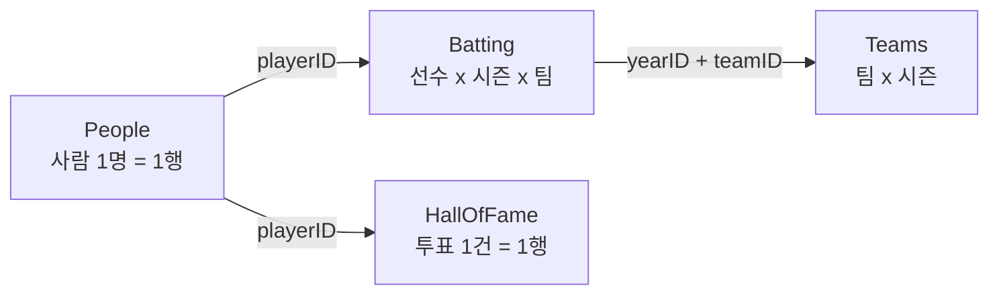
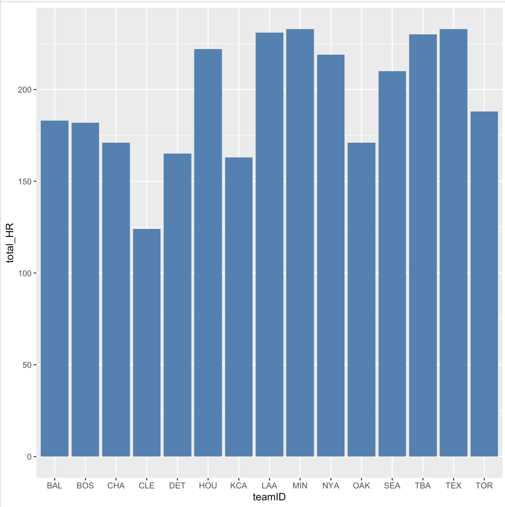
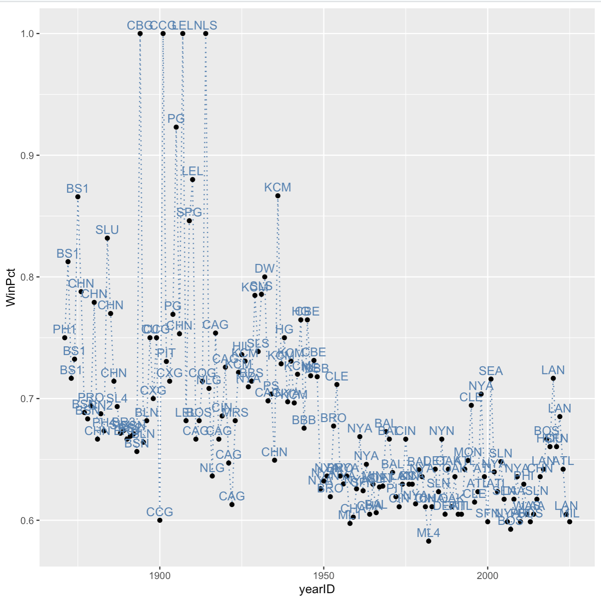
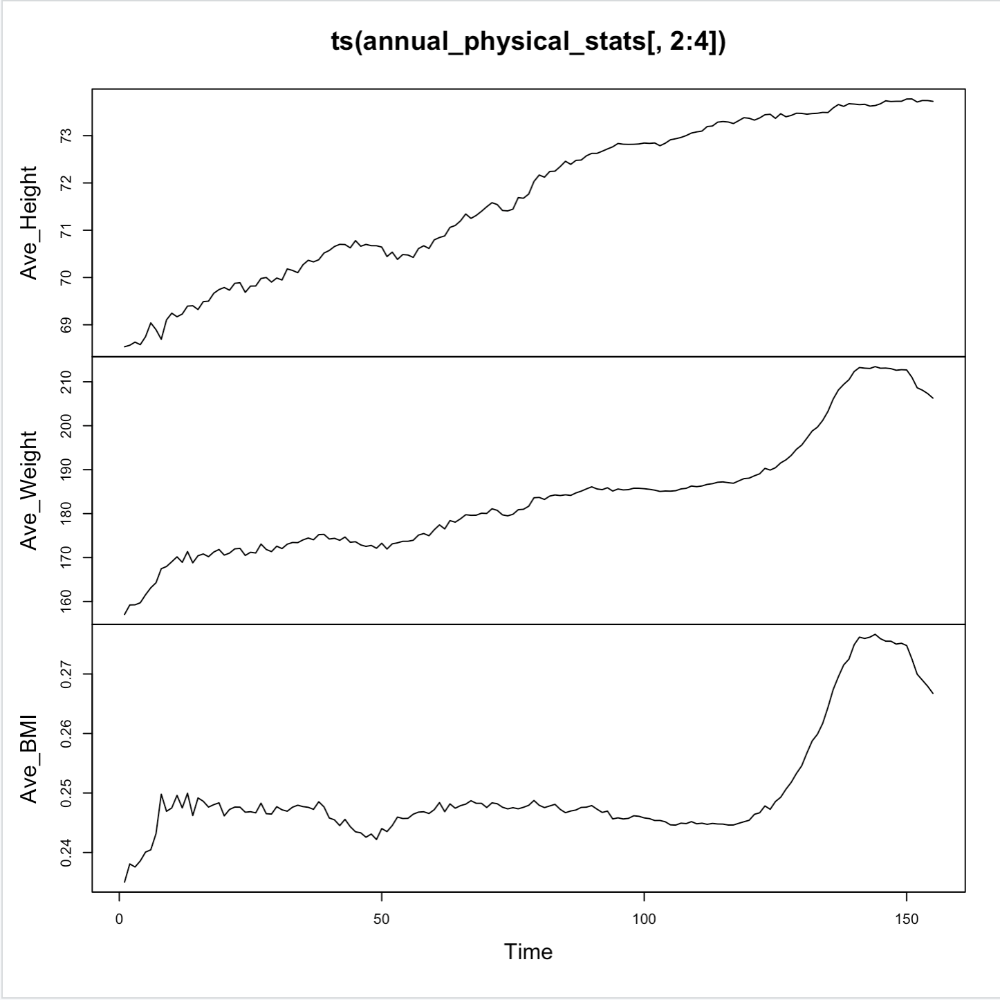
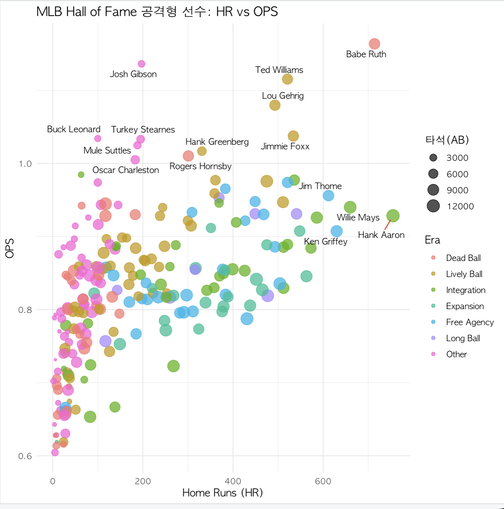
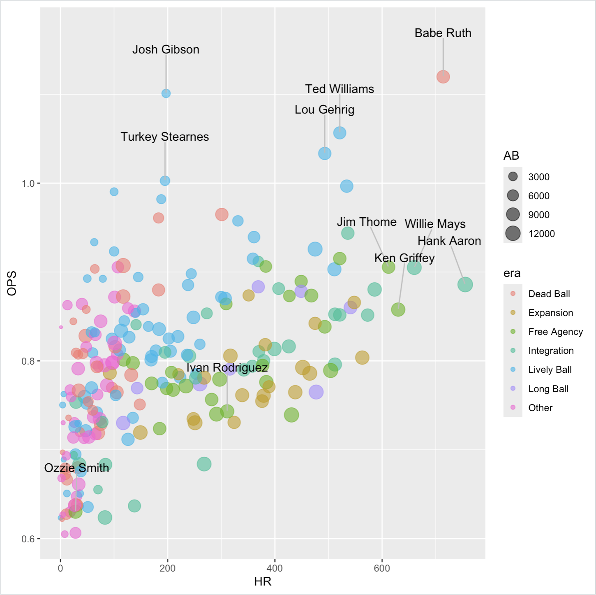

## 들어가며

12주차는 야구였다. 교수님이 수업 시작하면서 **기말고사는 이 Lahman 데이터 하나로만 본다**고 하셔서 평소보다 집중해서 들었다. 시험은 결과의 의미를 묻기보다 **코드를 짤 수 있는지**를 묻는다고 하셨고, 문제 형태도 오늘 실습과 비슷하되 더 짧을 거라고 하셨다. 그래서 이번 글은 수업에서 배운 것을 정리하는 동시에 기말 대비 노트 역할도 하도록 썼다.

이번 주에 배운 것을 한 줄로 줄이면 이렇다.

> **여러 테이블을 키(playerID, yearID, teamID)로 연결하고, `group_by()` → `summarise()` → `mutate()`로 원하는 단위의 숫자를 만든 다음 그림으로 확인한다.**
{: .prompt-info }

## 학습 목표

- Lahman 패키지의 4개 핵심 테이블(People, Batting, Teams, HallOfFame)과 연결 키 이해하기
- `group_by()` + `summarise()`로 연도별, 팀별, 선수별 요약 만들기 (`n()`, `n_distinct()`, `sum()`, `mean()`)
- `filter()`, `slice_max()`, `arrange()`, `select()`, `mutate()`를 이어 붙여 질문 하나를 코드 한 덩어리로 풀기
- `inner_join()`으로 테이블을 합치고, `case_when()`으로 시대(era)를 나누기
- 타격 지표(1루타, 장타율, 출루율, OPS)를 직접 계산하기
- AI가 짠 코드와 내 코드를 비교하면서 차이가 어디서 나오는지 보기

---

## 1. Lahman 데이터 구조

Lahman은 SABR(미국야구연구협회)에서 배포하는 MLB 기록 데이터베이스이고, R에서는 `install.packages("Lahman")` 한 번이면 데이터프레임으로 바로 쓸 수 있다. 처음 `str()`로 열어 봤을 때는 테이블이 너무 많아서 막막했는데, 수업에서 다룬 4개만 알면 실습은 다 풀린다.

| 테이블 | 한 행의 의미 | 주요 열 |
| --- | --- | --- |
| People (예전 이름 Master) | 사람 한 명 (선수, 코치, 감독) | playerID, nameFirst, nameLast, weight(파운드), height(인치), debut |
| Batting | 선수 한 명의 **한 시즌, 한 팀** 타격 기록 | playerID, yearID, stint, teamID, lgID, G, AB, H, X2B, X3B, HR, BB, HBP, SF |
| Teams | 팀 하나의 한 시즌 기록 | yearID, lgID, teamID, franchID, G, W, L, R, RA, WSWin |
| HallOfFame | 명예의 전당 **투표 한 건** | playerID, yearID, votedBy, ballots, needed, votes, inducted, category |



여기서 내가 제일 중요하다고 느낀 건 **"한 행이 무엇인가"**였다.

- Batting은 선수 한 명이 한 해에 한 팀에서 남긴 기록이 한 행이다. 시즌 중에 팀을 옮기면 같은 해에 행이 두 개 생기고, 그걸 구분하는 열이 **stint**(그 해의 몇 번째 팀인지)다.
- 그래서 Batting의 행 수를 세면 "경기 수"도 "선수 수"도 아니고 **선수-팀-시즌 기록의 개수**가 된다. 이걸 헷갈려서 실습 코드에 주석을 잘못 달았는데, 아래 7절에서 다시 다룬다.
- HallOfFame도 선수 한 명이 아니라 **투표 한 건**이 한 행이라, 여러 해 후보에 오른 선수는 행이 여러 개다. 헌액된 해에만 `inducted == "Y"`가 붙는다.

### factor와 고유값 세기

`teamID`, `lgID`는 Batting에서 factor로 들어 있어서 `levels()`로 가능한 값 목록을, `n_distinct()`로 실제로 등장하는 값의 개수를 볼 수 있다.

```r
str(Batting); str(People); str(HallOfFame); str(Teams)

levels(Batting$lgID)        # 가능한 리그 목록
n_distinct(Batting$lgID)    # 실제 등장한 리그 개수
n_distinct(Batting$teamID)  # 실제 등장한 팀 개수
```

`levels()`와 `n_distinct()`가 다를 수 있다는 것도 알아 두면 좋다. factor의 levels에는 데이터를 걸러 낸 뒤 더 이상 등장하지 않는 값도 남아 있을 수 있기 때문이다.

---

## 2. group_by()와 summarise()

이번 주 문법의 핵심은 이 두 함수다.

**`group_by()`**는 그 자체로는 데이터를 바꾸지 않는다. 출력해 보면 값은 그대로이고 맨 위에 `# Groups: yearID [154]` 같은 줄만 생긴다. 즉 **"이 열을 기준으로 묶어서 계산하라"는 메타데이터만 붙여 두는 것**이다. 실제 계산은 뒤에 오는 `summarise()`나 `mutate()`, `slice_max()`가 그룹마다 따로 한다.

**`summarise()`**는 그룹 하나를 한 행으로 줄인다. 기본 틀은 이렇다.

```r
mydata %>%
  group_by(group_var1, group_var2) %>%
  summarise(
    my_var1 = n(),                               # 그룹 안의 행 개수
    my_var2 = mean(기존_변수, na.rm = TRUE),
    my_var3 = sum(기존_변수, na.rm = TRUE),
    my_var4 = n_distinct(ID_변수),               # 고유값 개수
    .groups = "drop"
  )
```

자주 쓰는 요약 함수를 표로 정리했다.

| 구분 | 함수 | 의미 |
| --- | --- | --- |
| 중앙 경향 | `mean()`, `median()` | 평균, 중앙값 |
| 산포 | `sd()`, `min()`, `max()`, `range()` | 표준편차, 최솟값, 최댓값, 범위 |
| 개수 | `n()` | 그룹 안의 **행** 개수 |
| 개수 | `n_distinct(x)` | x의 **고유한 값** 개수 (팀 수, 선수 수) |
| 합계 | `sum()` | 합 |
| 위치 | `first()`, `last()`, `nth(x, n)` | 그룹 안의 첫 번째, 마지막, n번째 값 (`arrange()` 뒤에 의미가 있음) |
| 결측 | `sum(!is.na(x))` | NA가 아닌 값의 개수 |

처음엔 `n()`과 `n_distinct()`의 차이가 감이 안 왔는데, 연도와 리그별로 둘을 같이 찍어 보니 바로 이해됐다.

```r
Batting %>%
  group_by(yearID, lgID) %>%
  summarise(
    n_Teams   = n_distinct(teamID),    # 그 해 그 리그의 팀 수
    n_Players = n_distinct(playerID),  # 그 해 그 리그에서 뛴 선수 수
    .groups = "drop") %>%
  arrange(desc(yearID)) %>%
  print(n = Inf)
```

같은 선수가 한 해에 두 팀에서 뛰면 행은 2개지만 선수는 1명이다. 그래서 **사람이나 팀을 셀 때는 `n_distinct()`**, **기록 건수를 셀 때는 `n()`**을 쓴다.

`.groups = "drop"`은 요약이 끝난 뒤 그룹을 풀어 주는 옵션이다. 이걸 안 하면 결과에 그룹 정보가 일부 남아서, 뒤에 `mutate()`나 `slice_max()`를 이어 쓸 때 내가 의도하지 않은 단위로 계산될 수 있다.

---

## 3. 2023년 아메리칸 리그(AL) 팀별 홈런

첫 번째 실습. "2023년 AL에서 팀별로 홈런과 타수를 구하고 막대그래프로 그려라."

```r
# 2023년 AL 기록 요약
Batting %>%
  filter(yearID == 2023, lgID == "AL") %>%
  summarise(
    N = n(),                           # 선수-팀 기록 건수
    N_Players = n_distinct(playerID)   # 선수 수
  )

# 팀별 홈런(HR)과 타수(AB)
AL_team_stats_2023 <- Batting %>%
  filter(yearID == 2023, lgID == "AL") %>%
  group_by(teamID) %>%
  summarise(
    total_HR = sum(HR, na.rm = TRUE),
    total_AB = sum(AB, na.rm = TRUE),
    .groups = "drop"
  )

ggplot(AL_team_stats_2023, aes(x = teamID, y = total_HR)) +
  geom_col(fill = "steelblue")
```


_2023년 AL 15개 팀의 팀 홈런_

팀 기록을 Teams 테이블에서 바로 가져오지 않고 **선수 기록(Batting)을 팀별로 합쳐서** 만든다는 점이 포인트였다. 같은 숫자를 다른 테이블에서 다른 경로로 만들 수 있다는 걸 보여 주는 예제라고 생각한다.

그래프를 보면 미네소타(MIN)와 텍사스(TEX)가 230개 남짓으로 가장 높고, 클리블랜드(CLE)가 125개 정도로 가장 낮다. 나머지 팀은 대부분 160 ~ 230개 사이에 모여 있는데 CLE만 혼자 한참 아래에 있다.

---

## 4. 연도별 승률 1위 팀

두 번째 실습은 Teams 테이블을 썼다. 먼저 작은 문제부터.

```r
# 2024년 NL에서 가장 많이 이긴 상위 3팀
Teams %>%
  filter(yearID == 2024, lgID == "NL") %>%
  slice_max(order_by = W, n = 3) %>%
  select(yearID, teamID, G, W, L)
```

`slice_max(order_by, n)`은 "정렬해서 위에서 n개 자르기"를 한 번에 해 준다. `arrange(desc(W)) %>% head(3)`과 같지만 그룹별로도 동작한다는 게 장점이다. 그 장점이 바로 다음 코드에서 쓰인다.

```r
# 해마다 팀별 승률을 계산한 뒤, 해마다 1위 팀만 남기기
topl_teams <- Teams %>%
  select(yearID, lgID, teamID, G, W, L) %>%
  mutate(WinPct = W / G) %>%
  group_by(yearID) %>%
  slice_max(WinPct, n = 1, with_ties = FALSE)

ggplot(topl_teams, aes(x = yearID, y = WinPct, label = teamID)) +
  geom_line(colour = "steelblue", linetype = "dotted") +
  geom_point() +
  geom_text(vjust = -0.5, colour = "steelblue")
```


_연도별 승률 1위 팀 (내 실행 결과)_

- `group_by(yearID)` 다음의 `slice_max(n = 1)`은 **연도마다** 1등 한 팀만 남긴다
- `with_ties = FALSE`는 공동 1위가 있어도 한 팀만 남기라는 뜻이다. 이걸 빼면 어떤 해는 점이 2개 찍힌다

### 그래프에서 읽은 것

야구 초창기에는 1위 팀 승률이 0.8을 넘기도 했지만, 현대로 올수록 1위 팀도 0.6 ~ 0.7 사이에 모인다. **리그가 점점 평준화되었다**는 뜻으로 읽었다. 5절의 시대 구분과 연결해 보면, 리그 확장, 자유계약 제도, 드래프트 같은 제도가 생기면서 전력이 한 팀에 몰리기 어려워진 흐름과 맞아떨어진다. 다만 이건 그래프를 보고 세운 가설이고, 이 데이터만으로 원인을 증명할 수는 없다.

### 그런데 승률 1.0은 뭘까

내 그래프에는 강의 자료 그래프에 없던 **승률 1.0(전승)** 점이 1890 ~ 1910년대에 여러 개 찍혀 있다(CBG, CCG, LEL, NLS 등). 시즌 전체를 전승한 팀이 여러 개 있었다고 보기는 어렵다. 경기 수(G)가 매우 적은 기록이 섞여 있을 가능성이 크다고 생각한다. 강의 그래프에는 이런 점이 없는 걸 보면, 패키지 버전에 따라 포함된 리그나 팀이 달라졌을 수도 있다. 다음에 다시 돌릴 때는 아래처럼 확인해 볼 생각이다.

```r
topl_teams %>% filter(WinPct >= 0.9) %>% select(yearID, lgID, teamID, G, W, L)

# 경기 수가 너무 적은 기록은 빼고 다시 1위 팀 찾기
Teams %>%
  filter(G >= 100) %>%
  mutate(WinPct = W / G) %>%
  group_by(yearID) %>%
  slice_max(WinPct, n = 1, with_ties = FALSE)
```

결과가 이상해 보일 때 그래프를 고치기 전에 **원 데이터의 그 행을 직접 열어 보는 것**이 먼저라는 걸 이번에 배웠다.

---

## 5. 선수 체격 변화: 키, 몸무게, BMI

세 번째 실습. "선수들의 키, 몸무게, BMI가 해마다 어떻게 변했는지 그려라." 처음으로 **두 테이블을 합쳐야 하는** 문제였다. 키와 몸무게는 People에 있는데, "몇 년도에 뛰었는지"는 Batting에 있기 때문이다.

```r
# 1) 선수별 체격 (People): 키, 몸무게가 있는 선수만
physical_stats <- People %>%
  filter(!is.na(weight), !is.na(height)) %>%
  mutate(BMI = (0.453592 * weight) / ((0.254 * height)^2)) %>%   # 7절에서 수정
  select(playerID, height, weight, BMI)

# 2) 선수마다 뛰었던 해 (Batting): 한 해에 두 팀이면 중복이므로 distinct()
year_info <- Batting %>%
  select(playerID, yearID) %>%
  distinct()

# 3) 합친 뒤 연도별 평균
annual_physical_stats <- physical_stats %>%
  inner_join(year_info, by = "playerID") %>%
  group_by(yearID) %>%
  summarise(
    Ave_Height = mean(height, na.rm = TRUE),
    Ave_Weight = mean(weight, na.rm = TRUE),
    Ave_BMI    = mean(BMI, na.rm = TRUE),
    .groups = "drop"
  )

plot(ts(annual_physical_stats[, 2:4]), start = 1871, frequency = 1)   # 7절에서 수정
```


_연도별 평균 키(인치), 몸무게(파운드), BMI (제출 당시 그림, BMI 단위와 가로축은 7절에서 수정)_

### 여기서 배운 것

- `distinct()`를 넣는 이유: 한 선수가 한 해에 두 팀에서 뛰면 Batting에 그 해가 두 번 나온다. 그대로 합치면 그 선수의 키와 몸무게가 그 해 평균에 **두 번 들어간다**.
- `inner_join()`은 양쪽에 모두 있는 playerID만 남긴다. 키와 몸무게 기록이 없는 선수나 타격 기록이 없는 사람(감독 등)은 자연스럽게 빠진다.
- 여기서 평균은 "그 해에 뛴 선수 한 명당 한 표"다. 한 경기만 뛴 선수와 150경기를 뛴 선수가 똑같이 계산된다.

### 그래프에서 읽은 것

- **키**는 꾸준히 커지다가 최근에는 거의 평평하게 수렴한다 (약 68.5인치 → 73.8인치, 174 cm → 187 cm 정도)
- **몸무게**는 오랫동안 천천히 늘다가 1990 ~ 2010년대에 가파르게 늘었고, 최근 몇 년은 다시 조금 줄었다
- **BMI**는 100년 넘게 거의 일정하다가 같은 시기에 급하게 올라간다. 키는 거의 그대로인데 몸무게만 늘었기 때문이다

처음엔 주석에 "BMI가 갑자기 매우 뚱뚱해짐"이라고 적었는데, 다시 생각해 보니 표현이 틀렸다. BMI는 **근육과 지방을 구분하지 못한다**. 같은 시기가 5절 표의 롱볼(스테로이드) 시대, 그리고 웨이트 트레이닝이 본격화된 시기와 겹친다는 걸 생각하면, "선수들이 더 무거워졌다"까지만 말할 수 있고 "뚱뚱해졌다"고 단정할 수는 없다.

---

## 6. 명예의 전당 타자: HR vs OPS를 시대별로

마지막 실습이 이번 주의 하이라이트였고, 교수님 말씀으로는 **시험도 이런 식으로 나온다**. 질문은 "명예의 전당에 헌액된 선수들의 홈런(HR)과 OPS를 시대별로 그려라."

### 타격 지표

강의 자료의 공식을 그대로 옮겼다. Batting에는 1루타 열이 없어서 안타에서 장타를 빼서 직접 만들어야 한다.

| 지표 | 공식 | 의미 |
| --- | --- | --- |
| 1루타 X1B | $$H - X2B - X3B - HR$$ | 안타 중 장타가 아닌 것 |
| 장타율 SLG | $$\frac{X1B + 2 \cdot X2B + 3 \cdot X3B + 4 \cdot HR}{AB}$$ | 타수당 진루한 루의 수 (루타 / 타수) |
| 출루율 OBP | $$\frac{H + BB + HBP}{AB + BB + HBP + SF}$$ | 타석에서 살아 나간 비율 |
| OPS | $$OBP + SLG$$ | 출루와 장타를 합친 종합 공격력 |

### 시대(era) 구분

| 시대 | 기간 | 특징 |
| --- | --- | --- |
| Dead Ball | 1900 ~ 1919 | 공의 반발력이 낮아 번트와 도루 위주의 스몰볼 |
| Lively Ball | 1920 ~ 1941 | 코르크 심을 넣은 공, 베이브 루스와 함께 홈런이 폭발 |
| Integration | 1942 ~ 1960 | 재키 로빈슨(1947) 이후 흑인 선수 합류 |
| Expansion | 1961 ~ 1976 | 신생 팀 창단, 플레이오프와 디비전 제도 |
| Free Agency | 1977 ~ 1993 | 자유계약 제도 정착 |
| Long Ball | 1994 ~ | 홈런 급증, 스테로이드 논란, 세이버메트릭스 도입 |

### 6-1. AI(제미나이) 코드

수업에서는 같은 문제를 먼저 제미나이에게 프롬프트로 시켜 봤다. 요구사항을 1) 전처리, 2) 시대 구분, 3) 시각화, 4) 강조, 5) 라이브러리로 **번호를 붙여 구체적으로 적는 것**이 프롬프트의 핵심이었다.

```r
library(tidyverse); library(Lahman); library(ggrepel)

hof_players <- HallOfFame %>%
  filter(inducted == "Y") %>%
  distinct(playerID)

batting_summary <- Batting %>%
  group_by(playerID) %>%
  summarise(across(c(AB, H, X2B, X3B, HR, BB, HBP, SF), ~ sum(.x, na.rm = TRUE)),
            .groups = "drop") %>%
  mutate(
    OBP = (H + BB + HBP) / (AB + BB + HBP + SF),
    TB  = H + X2B + 2 * X3B + 3 * HR,        # 총루타
    SLG = TB / AB,
    OPS = OBP + SLG
  ) %>%
  inner_join(hof_players, by = "playerID") %>%
  filter(AB >= 500, OPS > 0.6)

hof_batters <- batting_summary %>%
  left_join(People %>% select(playerID, nameFirst, nameLast, debut), by = "playerID") %>%
  mutate(
    player_name = paste(nameFirst, nameLast),
    debut_year  = as.integer(substr(debut, 1, 4)),
    era = case_when(
      debut_year >= 1900 & debut_year <= 1919 ~ "Dead Ball",
      debut_year >= 1920 & debut_year <= 1941 ~ "Lively Ball",
      debut_year >= 1942 & debut_year <= 1960 ~ "Integration",
      debut_year >= 1961 & debut_year <= 1976 ~ "Expansion",
      debut_year >= 1977 & debut_year <= 1993 ~ "Free Agency",
      debut_year >= 1994 & debut_year <= 2005 ~ "Long Ball",
      TRUE ~ "Other"
    ),
    era = factor(era, levels = c("Dead Ball", "Lively Ball", "Integration",
                                 "Expansion", "Free Agency", "Long Ball", "Other"))
  )

ggplot(hof_batters, aes(x = HR, y = OPS)) +
  geom_point(aes(size = AB, color = era), alpha = 0.75) +
  geom_text_repel(data = hof_batters %>% filter(HR > 600 | OPS > 1.0),
                  aes(label = player_name), family = "AppleGothic",
                  segment.color = "red", max.overlaps = Inf) +
  scale_size_continuous(name = "타석(AB)", breaks = c(3000, 6000, 9000, 12000)) +
  labs(title = "MLB Hall of Fame 공격형 선수: HR vs OPS",
       x = "Home Runs (HR)", y = "OPS", color = "Era") +
  theme_minimal(base_family = "AppleGothic")
```

(실제 AI 코드는 `summarise()` 안에 `sum()`을 8줄로 나열했는데, 블로그에서는 `across()`로 줄여 적었다. 결과는 같다.)


_AI 코드 결과_

AI 코드에서 배운 점이 몇 가지 있다.

- **총루타 TB = H + X2B + 2·X3B + 3·HR**: 1루타를 따로 만들지 않고 안타에 장타의 추가 루만 더하는 방식. 1루타 공식을 대입해서 정리하면 강의 공식과 똑같다. 생각해 보면 이쪽이 실수할 여지가 적다
- `era`를 **factor로 순서를 지정**해서 범례가 시대 순서대로 나온다. 내 코드는 이걸 안 해서 알파벳 순서가 됐다
- `labs()`, `theme_minimal()`, `scale_size_continuous()`로 제목, 축 이름, 범례를 정리해서 그래프가 **바로 제출할 수 있는 상태**로 나온다
- macOS에서 한글이 깨지지 않게 `family = "AppleGothic"`을 지정했다

### 6-2. 내 코드

나는 강의 자료의 흐름(선수별 누적 → HOF와 결합 → 시대 구분 → 강조할 선수 지정)을 따라 직접 짰다.

```r
player_stat <- Batting %>%
  group_by(playerID) %>%
  summarise(
    G = sum(G, na.rm = T), AB = sum(AB, na.rm = T), H = sum(H, na.rm = T),
    X2B = sum(X2B, na.rm = T), X3B = sum(X3B, na.rm = T), HR = sum(HR, na.rm = T),
    BB = sum(BB, na.rm = T), HBP = sum(HBP, na.rm = T), SF = sum(SF, na.rm = T),
    debut_year = min(yearID, na.rm = T),
    final_year = max(yearID, na.rm = T),
    MidCareer  = round((min(yearID, na.rm = T) + max(yearID, na.rm = T)) / 2),
    .groups = 'drop'
  ) %>%
  mutate(
    SLG = ((H - X2B - X2B - HR) + 2*X2B + 3*X3B + 4*HR) / AB,   # 7절: 버그
    OBP = (H + BB + HBP) / (AB + BB + HBP + SF),
    OPS = SLG + OBP
  )

hof <- HallOfFame %>% filter(inducted == 'Y') %>% select(playerID)
player_info <- People %>% select(playerID, nameFirst, nameLast)

hof_stats <- player_stat %>%
  inner_join(hof, by = 'playerID') %>%
  inner_join(player_info, by = 'playerID') %>%
  filter(OPS > 0.6) %>%
  mutate(
    name = paste(nameFirst, nameLast),
    era = case_when(
      debut_year %in% 1900:1919 ~ 'Dead Ball',
      debut_year %in% 1920:1941 ~ 'Lively Ball',
      debut_year %in% 1942:1960 ~ 'Integration',
      debut_year %in% 1961:1976 ~ 'Expansion',
      debut_year %in% 1977:1993 ~ 'Free Agency',
      debut_year >= 1994 ~ 'Long Ball',
      TRUE ~ "Other"
    )
  )

highlight <- hof_stats %>%
  filter(
    OPS > 1 | HR > 600 |
    playerID %in% c("willite01", "ruthba01", "gehrilo01") |   # 대표 강타자
    playerID %in% c("smithoz01", "rodriiv01", "mayswi01")      # 수비로 유명한 선수
  )

ggplot(hof_stats, aes(x = HR, y = OPS)) +
  geom_point(aes(size = AB, colour = era), alpha = 0.6) +
  geom_text_repel(data = highlight, aes(label = name),
                  colour = 'black', nudge_y = 0.05, segment.colour = 'gray')
```


_내 코드 결과_

내 코드에서 의도한 부분도 있었다.

- 데뷔 연도를 People의 `debut` 문자열 대신 **Batting의 첫 기록 연도(`min(yearID)`)**로 잡았다. 강의 자료와 같은 방식이고, 문자열을 자를 필요가 없다
- AI 그래프에서는 Josh Gibson, Buck Leonard 같은 니그로리그 출신 선수들이 대부분 **Other**(분홍)로 빠졌다. People의 `debut` 값이 비어 있거나 다른 형식이라 `case_when()`의 어느 조건에도 걸리지 않은 것으로 보인다. 반면 내 그림에서 Josh Gibson은 Lively Ball(하늘색)로 분류됐다. **같은 "데뷔 연도"라도 어느 테이블에서 가져오느냐에 따라 분류가 달라진다**는 걸 직접 봤다
- `geom_text_repel()`의 `data =`에 강조할 선수만 따로 넘겨서, 전체 점은 다 그리고 라벨만 일부에 붙였다. 수치 조건(OPS > 1, HR > 600)뿐 아니라 내가 고른 선수(Ozzie Smith 같은 수비형 선수)도 함께 표시해서, **홈런과 OPS로는 명예의 전당을 다 설명할 수 없다**는 점이 그림에 드러나게 했다

### 그래프에서 읽은 것

- 오른쪽 위로 갈수록(홈런이 많을수록) OPS도 대체로 높다. 하지만 홈런이 200개 남짓인데 OPS가 1.0을 넘는 선수(Josh Gibson, Turkey Stearnes)도 있다. 이 선수들은 기록된 경기 수 자체가 적어 누적 홈런이 작게 나온 것이다. **누적 지표(HR)와 비율 지표(OPS)를 한 그림에 그릴 때는 경기 수의 차이를 같이 봐야 한다**
- 데드볼 시대(빨강)는 홈런이 거의 없는데 OPS는 0.8 안팎이다. 홈런 대신 단타와 출루로 점수를 냈던 시대 특징이 보인다
- 홈런 600개 이상은 Integration 이후 선수(Hank Aaron, Willie Mays, Ken Griffey, Jim Thome)에 몰려 있다
- 왼쪽 아래 Ozzie Smith처럼 홈런과 OPS가 모두 낮은데 헌액된 선수는 수비로 들어간 경우다

---

## 7. 다시 보니 보인 실수와 개선점

블로그를 쓰면서 제출한 코드를 다시 읽어 보니 고칠 게 꽤 있었다. 시험에서 같은 실수를 하면 안 되니까 제일 꼼꼼하게 정리했다.

### (1) 장타율 공식 오타: X3B 자리에 X2B

```r
SLG = ((H - X2B - X2B - HR) + 2*X2B + 3*X3B + 4*HR) / AB    # 내가 쓴 것
SLG = ((H - X2B - X3B - HR) + 2*X2B + 3*X3B + 4*HR) / AB    # 맞는 것
```

1루타를 만들 때 3루타를 빼야 하는데 2루타를 두 번 뺐다. 정리하면 내 SLG는 맞는 값보다 정확히 $$\frac{X3B - X2B}{AB}$$만큼 달라진다. 대부분의 타자는 2루타가 3루타보다 훨씬 많으니 **장타율과 OPS가 실제보다 작게** 나온다.

실제로 두 그래프를 비교하면 차이가 보인다. 베이브 루스는 AI 그래프에서 OPS 약 1.16인데, 내 그래프에서는 약 1.12다. 루스의 통산 기록(2루타 506, 3루타 136, 타수 8,399)을 넣어 보면 $$\frac{136 - 506}{8399} \approx -0.044$$로, 그래프에서 읽은 차이와 딱 맞는다. 테드 윌리엄스(2루타 525, 3루타 71, 타수 7,706)도 약 −0.059가 나오고, 실제로 그래프에서 1.12에서 1.06 정도로 내려가 있다.

**코드는 에러 없이 돌아가고 그래프도 그럴듯해서 눈으로는 절대 못 찾는 실수였다.** 앞으로는 지표를 만들면 유명한 선수 한 명의 값을 공식 기록과 비교해 보는 습관을 들이기로 했다. 그리고 AI처럼 총루타 공식을 쓰면 1루타를 따로 만들 필요가 없어서 이런 실수 자체가 생기지 않는다.

```r
mutate(
  TB  = H + X2B + 2 * X3B + 3 * HR,
  SLG = TB / AB,
  OBP = (H + BB + HBP) / (AB + BB + HBP + SF),
  OPS = OBP + SLG
)
```

### (2) BMI 단위 변환: 인치 → 미터는 0.0254

BMI는 $$\frac{\text{kg}}{\text{m}^2}$$인데, 1 inch = 2.54 cm = **0.0254 m**다. 나는 0.254를 곱했다. 분모가 제곱이라 BMI가 $$10^2 = 100$$배 작게 나왔고, 그래서 그래프의 BMI 축이 0.24 ~ 0.28이었다. 강의 자료 그래프는 약 24 ~ 28이다. 추세 모양은 같아서 결론은 그대로지만, 숫자를 보고 바로 이상하다고 느꼈어야 했다(BMI 0.25인 사람은 없다).

```r
mutate(BMI = (0.453592 * weight) / ((0.0254 * height)^2))   # lb → kg, inch → m
```

### (3) ts()의 시작 연도가 그래프에 안 들어감

```r
plot(ts(annual_physical_stats[, 2:4]), start = 1871, frequency = 1)    # 내가 쓴 것
```

괄호 위치 때문에 `start`와 `frequency`가 `ts()`가 아니라 `plot()`으로 넘어갔다. 그래서 가로축이 연도가 아니라 0 ~ 150의 순번으로 나왔다. 시작 연도도 숫자로 박지 말고 데이터에서 꺼내는 편이 안전하다.

```r
plot(ts(annual_physical_stats[, 2:4],
        start = min(annual_physical_stats$yearID), frequency = 1),
     main = "MLB 선수 연도별 체격 변화")
```

### (4) n()은 "게임 수"가 아니다

```r
N = n()   # 게임 수   ← 주석이 틀림
```

`n()`은 그룹 안의 **행 개수**고, Batting의 한 행은 선수-팀-시즌 기록이다. 2023년 AL로 거르고 `n()`을 하면 그 해 AL에서 나온 **선수 기록 건수**가 된다. 경기 수가 필요하면 Teams의 `G`를 써야 한다.

### (5) 명예의 전당에는 선수만 있는 게 아니다

HallOfFame에는 감독, 심판, 구단 관계자도 헌액된다. 강의 자료가 **`category`를 빨간색으로 강조**해 둔 이유가 이거였던 것 같다. 지금 코드에서는 타격 기록이 없는 사람은 `inner_join()`과 `OPS > 0.6`에서 걸러지지만, 질문이 "선수"라면 처음부터 명시하는 게 맞다. 투수도 타격 기록이 있어 섞일 수 있으니, AI처럼 타수 기준을 같이 두면 "타자"라는 의도가 분명해진다.

```r
hof <- HallOfFame %>%
  filter(inducted == "Y", category == "Player") %>%
  distinct(playerID)                  # 투표 1건 = 1행이므로 distinct가 안전

hof_stats <- player_stat %>%
  inner_join(hof, by = "playerID") %>%
  filter(AB >= 500, OPS > 0.6)        # 타자만
```

### (6) 그래프 마무리와 주석

- `era`를 `factor(levels = ...)`로 만들어 범례를 시대 순서로 정렬하기
- `labs()`로 제목과 축 이름 달기. 내 그래프는 축 이름이 변수명 그대로라 처음 보는 사람이 읽기 어렵다
- 내 코드 주석에 Ozzie Smith, Ivan Rodriguez, Willie Mays를 "핵심 투수, 수비수"라고 적었는데 세 명 모두 투수가 아니다(유격수, 포수, 중견수). 그리고 Willie Mays는 수비만큼 타격도 뛰어난 선수다. "수비로 유명한 선수"로 고쳤다

### 개선 사항 한눈에 보기

| 위치 | 문제 | 수정 | 영향 |
| --- | --- | --- | --- |
| SLG | 1루타 계산에서 X3B 대신 X2B를 뺌 | `H - X2B - X3B - HR` 또는 총루타 공식 | OPS가 $$\frac{X3B - X2B}{AB}$$만큼 작아짐 (루스 −0.044) |
| BMI | 인치 → 미터 0.254 | 0.0254 | 값이 100배 작음 (추세 모양은 같음) |
| ts() | `start`를 `plot()`에 넘김 | `ts(..., start = )` | 가로축이 연도가 아닌 순번 |
| 주석 | `n()` = 게임 수 | 기록(행) 건수 | 해석 오류 |
| HOF | 감독, 관계자 포함 가능 | `category == "Player"`, `AB >= 500` | 의도가 코드에 드러남 |
| 승률 1위 | 경기 수가 매우 적은 승률 1.0 기록 | `G` 확인, 최소 경기 수 필터 | 초창기 해석이 과장될 수 있음 |
| 그래프 | 범례 알파벳 순, 축 이름 없음 | factor 순서, `labs()` | 읽기 쉬움 |

---

## 8. 느낀 점과 다음에 해 보고 싶은 것

이번 주에 제일 크게 느낀 건 **"코드가 돌아가는 것"과 "코드가 맞는 것"은 다르다**는 점이다. 장타율 오타와 BMI 단위 실수 모두 에러 메시지 하나 없이 그럴듯한 그래프를 만들었다. 둘 다 블로그를 쓰면서 AI 결과와 강의 그래프를 나란히 놓고 보고 나서야 찾았다. 결과를 의심하는 가장 쉬운 방법은 **알려진 값 하나와 비교해 보는 것**(베이브 루스의 OPS, 사람의 BMI가 25 근처라는 상식)이라는 걸 배웠다.

AI 코드와 비교한 것도 좋은 경험이었다. AI 코드는 그래프 마무리(제목, 범례 순서, 폰트)가 훨씬 깔끔했고, 총루타 공식처럼 실수할 여지가 적은 방식을 골랐다. 반면 데뷔 연도를 People의 `debut`에서 가져오는 바람에 니그로리그 선수들이 Other로 빠지는 문제가 있었다. 요구사항은 정확히 지켰지만 **데이터의 특성까지 확인하지는 않은** 셈이다. AI에게 맡기더라도 결과를 해석하고 검증하는 건 결국 내 몫이라는 걸 다시 느꼈다. 수업에서 프롬프트를 번호 붙인 요구사항으로 쓴 것도 따라 해 볼 만한 습관이다.

dplyr 문법 자체는 이제 꽤 손에 익었다. 특히 `group_by()`가 "메타데이터만 붙인다"는 설명을 듣고 나니, 왜 `summarise()`와 `slice_max()`가 그룹마다 따로 동작하는지 이해가 됐다. 기말 대비로는 아래 패턴을 손으로 바로 쓸 수 있게 연습하려고 한다.

```r
# 기말 대비: 이 틀에서 filter 조건, group_by 기준, summarise 내용만 바꾸면 대부분 풀림
데이터 %>%
  filter(조건) %>%
  group_by(기준) %>%
  summarise(새변수 = 요약함수(변수, na.rm = TRUE), .groups = "drop") %>%
  mutate(비율 = A / B) %>%
  arrange(desc(비율)) %>%     # 또는 slice_max(비율, n = k)
  ggplot(aes(x, y)) + geom_col()
```

다음에 해 보고 싶은 것도 정리해 둔다.

1. **시대 보정 OPS**: 시대마다 리그 평균 OPS가 다르니, 각 선수의 OPS를 데뷔 시대의 리그 평균으로 나눠 비교하기 (실제 야구 통계의 OPS+와 비슷한 생각)
2. **누적 대신 비율로**: HR 대신 타수당 홈런(HR / AB)을 가로축에 놓으면 경기 수가 적은 니그로리그 선수와 MLB 선수를 더 공정하게 비교할 수 있을 것 같다
3. **체격과 홈런**: 5절의 연도별 평균 몸무게와 리그 전체의 타수당 홈런을 같은 시간축에 놓고, 롱볼 시대에 둘이 같이 움직였는지 보기 (같이 움직이더라도 인과관계는 아님)
4. **명예의 전당 예측**: 통산 기록으로 헌액 여부를 분류하는 간단한 로지스틱 회귀. 수비형 선수처럼 타격 기록으로 설명이 안 되는 사례가 어디서 틀리는지 보면 재미있을 것 같다

---

## 최종 핵심 정리

1. Lahman은 People(사람), Batting(선수 x 시즌 x 팀), Teams(팀 x 시즌), HallOfFame(투표 1건)로 이루어져 있고 playerID, yearID, teamID로 연결된다. **한 행이 무엇인지**부터 확인해야 한다
2. `group_by()`는 묶음 정보만 붙이고, 계산은 뒤의 `summarise()`, `mutate()`, `slice_max()`가 그룹마다 한다. `.groups = "drop"`으로 그룹을 풀어 준다
3. 사람이나 팀 수는 `n_distinct()`, 기록 건수는 `n()`. Batting에서 `n()`은 경기 수가 아니다
4. `slice_max(x, n = 1, with_ties = FALSE)`를 `group_by(yearID)` 뒤에 쓰면 연도별 1위를 한 줄로 뽑는다. 1위 팀 승률은 현대로 올수록 평준화되지만, 경기 수가 매우 적은 기록이 섞이면 초창기가 과장된다
5. People과 Batting을 `distinct()` 후 `inner_join()`해 연도별 체격을 구하면 키는 수렴하고, 몸무게와 BMI는 1990 ~ 2010년대에 급증한다. BMI는 근육과 지방을 구분하지 못한다
6. SLG는 1루타 $$H - X2B - X3B - HR$$를 거치거나, 총루타 $$TB = H + X2B + 2X3B + 3HR$$로 바로 계산한다. OPS = OBP + SLG
7. 시대 구분은 `case_when()`으로 만들고 `factor(levels = ...)`로 순서를 지정한다. 데뷔 연도를 어느 테이블에서 가져오느냐에 따라 분류가 달라진다
8. 내 코드의 SLG 오타(OPS가 루스 기준 약 0.044 작아짐), BMI 단위(100배), `ts()` 인자 위치 실수는 모두 **에러 없이 그럴듯한 결과**를 냈다. 알려진 값 하나와 비교하는 검증 습관이 필요하다

---

End.
