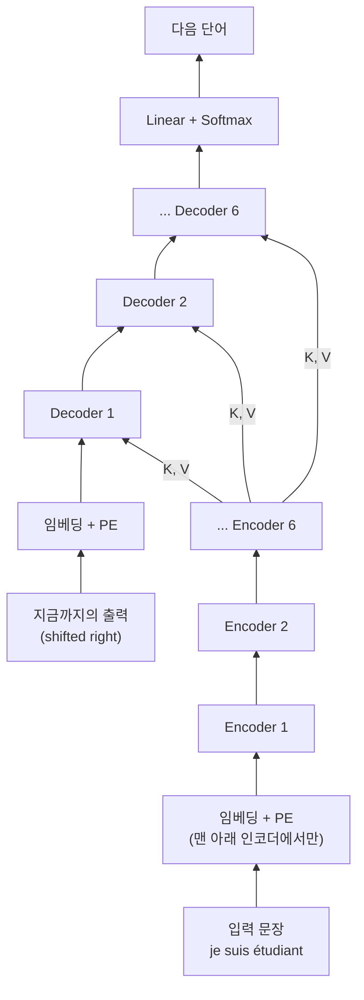
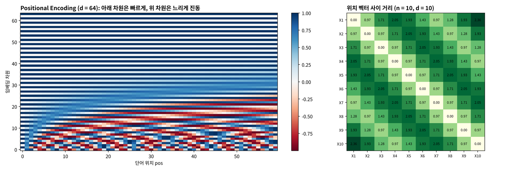
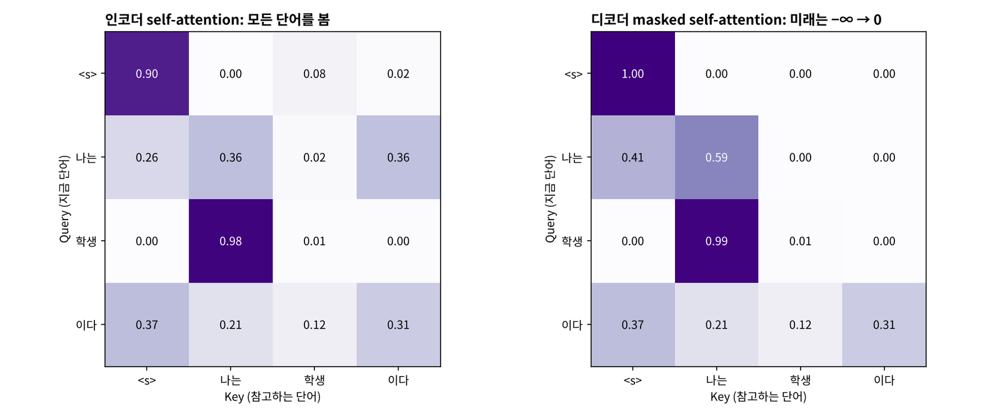
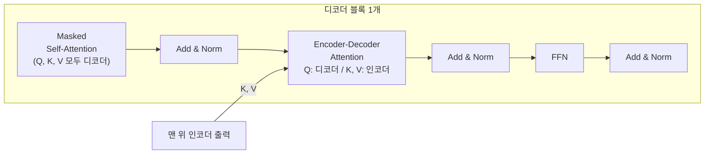
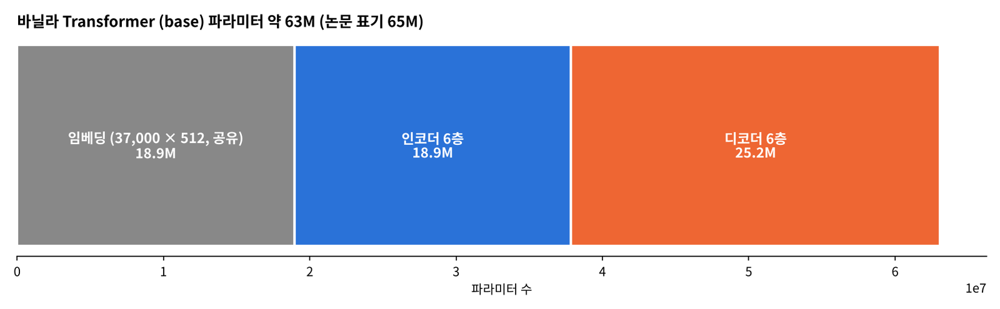

## 1. 강의의 학습 목표

- Transformer의 전체 구조(인코더 스택 + 디코더 스택)와 인코더, 디코더의 차이
- 입력 임베딩과 Positional Encoding이 하는 일
- Self-Attention의 6단계를 벡터 단위로, 그리고 행렬 단위로 계산하기
- Multi-head Attention이 여러 head의 결과를 합치는 방법
- Residual Connection(잔차 연결)과 Layer Normalization, Position-wise FFN의 역할
- 디코더의 Masked Self-Attention과 Encoder-Decoder Attention
- 최종 Linear + Softmax로 단어를 고르고, EOS가 나올 때까지 반복하는 생성 과정

> [07편 Attention and Transformer](/posts/Artificial-Intelligence%28AI%29_7/)가 "왜 Transformer인가"였다면, 이번 편은 "Transformer 안에서 텐서가 실제로 어떻게 흘러가는가"다. 강의는 그림 위주라서, 각 단계를 PyTorch로 직접 실행해 **텐서 모양과 숫자**로 확인했다. 강의에 없는 내용은 "(보충)"으로 표시.
{: .prompt-info }

---

## 2. 전체 구조

### 특징 (Vaswani et al., 2017, Google)

| 특징 | 의미 |
| --- | --- |
| RNN, CNN 구조 제거 | 기존 Seq2Seq와 달리 순환, 합성곱 없이 **Attention만** 사용 |
| Scaled Dot-product Attention, Multi-head Attention | 핵심 알고리즘 |
| BPTT 없음 | 시점별 순차 계산이 없으므로 **병렬 계산** 가능 → 학습 속도 향상 |
| Positional Encoding | 순서 정보를 따로 넣어 줌. 병렬 연산을 하면서도 위치를 알 수 있게 |

### 인코더 스택과 디코더 스택



- 바닐라 Transformer는 **인코더 6개, 디코더 6개**를 쌓음
- 모든 인코더는 **구조는 같지만 가중치는 독립적**이다. RNN처럼 시점마다 같은 가중치를 공유하지 않는다
- 인코더 블록 = **Self-Attention** + **Feed-Forward** 두 개의 서브 블록
- 디코더 블록 = 인코더와 같은 구조 + 그 사이에 **Encoder-Decoder Attention**이 하나 더 있음
- 인코더와 디코더의 Self-Attention 차이: 인코더는 **Unmasked**, 디코더는 **Masked**
- **맨 위 인코더의 출력이 모든 디코더 층**의 Encoder-Decoder Attention에 Key, Value로 들어간다

---

## 3. 입력 임베딩

- 각 단어(토큰)는 임베딩 알고리즘으로 **512차원 dense vector**가 됨
- 임베딩은 **맨 아래 인코더에서만** 한다. 그 위 인코더들은 바로 아래 인코더의 출력(역시 512차원)을 입력으로 받는다
- 그래서 모든 층의 입출력이 같은 크기($$d_{\mathrm{model}} = 512$$)를 유지하고, 이게 뒤에 나오는 잔차 연결(더하기)을 가능하게 한다

---

## 4. Positional Encoding

Transformer는 RNN 계열이 아니라서 단어 순서를 모른다. Attention은 단어들을 **집합**처럼 처리하기 때문에 "나는 학생이다"와 "학생이다 나는"을 구분하지 못한다. 그래서 임베딩 벡터에 **위치를 나타내는 벡터를 더한다**.

$$
PE_{(pos, 2i)} = \sin\left(\frac{pos}{10000^{2i/d_{\mathrm{model}}}}\right), \qquad PE_{(pos, 2i+1)} = \cos\left(\frac{pos}{10000^{2i/d_{\mathrm{model}}}}\right)
$$

- $$pos$$: 문장 안에서 단어의 위치, $$i$$: 차원 쌍의 번호 (0 ~ $$\frac{d}{2} - 1$$, 512차원이면 0 ~ 255)
- 짝수 차원은 sin, 홀수 차원은 cos
- $$i$$가 커질수록 분모의 지수가 커져서 **파장이 점점 길어지는** 사인, 코사인 곡선이 된다


_왼쪽: 위치별 PE 값. 오른쪽: 표준 식으로 계산한 위치 벡터 사이의 유클리드 거리_

### 강의가 말한 두 가지 성질을 직접 확인해 보기

1. **같은 위치의 단어는 같은 위치 벡터를 가진다**: 식에 단어가 아니라 $$pos$$만 들어가므로 당연히 성립
2. **단어 사이 거리가 멀수록 큰 값을 가진다**: 오른쪽 표를 보면 X1 기준으로 0, 0.97, 1.71, 2.05, 1.93, 1.43, **0.97**, ... 이다. 6칸 떨어진 X7이 1칸 떨어진 X2와 거리가 같다. **멀수록 커지는 건 가까운 범위에서만** 성립하고, sin, cos의 주기성 때문에 돌아온다

(보충) 대신 표준 PE에는 더 중요한 성질이 있다. 표의 대각선 방향 값이 모두 같듯이 **두 위치 벡터의 거리는 위치 차이에만 의존**한다(X1–X2 = X5–X6 = 0.97). 더 나아가 $$PE_{pos+k}$$는 $$PE_{pos}$$에 $$k$$에만 의존하는 회전 행렬을 곱한 것이라, 모델이 "몇 칸 떨어졌는지"라는 **상대 위치**를 쉽게 배울 수 있다.

(참고: 강의 16쪽의 거리 표(X1–X2 = 1.275 등)는 표준 식으로 n = 10, d = 10을 계산해서는 재현되지 않았다. 다른 설정으로 만든 표로 보인다. 그래도 X1–X6 = 3.508 > X1–X10 = 3.266으로 단조 증가하지 않는다는 점은 같다.)

강의의 PyTorch 코드(Harvard Annotated Transformer)는 분모를 로그 공간에서 계산한다. $$10000^{-2i/d} = \exp(-2i\cdot\frac{\ln 10000}{d})$$이므로 수치적으로 안정적이다.

```python
position = torch.arange(0, max_len).unsqueeze(1)                       # (max_len, 1)
div_term = torch.exp(torch.arange(0, d_model, 2) * -(math.log(10000.0) / d_model))
pe[:, 0::2] = torch.sin(position * div_term)                            # 짝수 차원
pe[:, 1::2] = torch.cos(position * div_term)                            # 홀수 차원
```

`register_buffer`로 저장해서 **학습되지 않는 상수**로 둔다.

---

## 5. Self-Attention

### 왜 필요한가

> The animal didn't cross the street because **it** was too tired

"it"이 animal인지 street인지는 사람에게는 쉽지만 컴퓨터에게는 어렵다. Self-Attention은 **문장 안의 각 단어가 다른 모든 단어와 얼마나 관련 있는지 계산**해서, "it"의 벡터에 "animal"의 정보를 많이 섞어 넣는다. 그 결과 문맥이 반영된 더 좋은 임베딩이 나온다. 강의 표현으로는 트랜스포머가 문장 자체를 **understanding**하는 핵심 기술.

### 6단계 (강의의 "Thinking Machines" 예)

**Step 1. Q, K, V 만들기**: 입력 벡터 $$x$$(512차원)에 학습되는 행렬 $$W^Q, W^K, W^V$$를 곱한다.

$$
q = xW^Q, \quad k = xW^K, \quad v = xW^V \qquad (512 \to 64)
$$

| 벡터 | 의미 (강의) |
| --- | --- |
| Query | 현재 단어가 다른 단어와의 관계를 **물어보는** 벡터 |
| Key | 각 단어의 의미를 **인덱싱**하는 벡터 (질문과 맞춰 볼 이름표) |
| Value | 각 단어가 실제로 **전달할 내용** |

- 세 행렬은 랜덤으로 시작해서 역전파로 학습된다
- Q, K, V는 64차원으로 임베딩(512)보다 작다. **반드시 작아야 하는 건 아니고**, 뒤에서 8개 head를 이어 붙이면 $$8 \times 64 = 512$$로 다시 맞춰지도록 한 계산상의 트릭

**Step 2. Score**: 현재 단어의 Query와 모든 단어의 Key를 내적 → "얼마나 관련 있는가"

$$
q_1\cdot k_1 = 112, \qquad q_1\cdot k_2 = 96
$$

**Step 3. $$\sqrt{d_k}$$로 나누기**: $$d_k = 64$$이므로 8로 나눔 → 14, 12. 이유는 학습 단계에서 **안정적인 기울기(stable gradients)** 유지

**Step 4. Softmax**: 확률 분포로 → 0.88, 0.12

**Step 5. Value에 곱하기**: 각 softmax 값을 해당 단어의 Value 벡터에 곱한다. 집중할 단어의 Value는 크게, 무시할 단어의 Value는 작게

**Step 6. 더하기**: $$z_1 = 0.88v_1 + 0.12v_2$$. **다른 단어와의 연관성을 모두 고려한 벡터**가 완성

### Step 3을 직접 확인

```python
s = torch.tensor([112., 96.])
torch.softmax(s / 8, 0)   # tensor([0.881, 0.119])
torch.softmax(s, 0)       # tensor([1.000000, 0.000000])  ← 나누지 않으면
```

나누지 않으면 softmax가 한 단어에 100%를 몰아준다. 이러면 softmax의 기울기가 거의 0이 되어(포화) 학습이 안 된다. 왜 하필 $$\sqrt{d_k}$$인지는 내적의 분산을 재 보면 보인다.

```python
for dk in [16, 64, 512]:
    q, k = torch.randn(10000, dk), torch.randn(10000, dk)
    d = (q * k).sum(1)
    print(dk, d.var(), (d / math.sqrt(dk)).var())
```

```text
dk=16:  var(q·k)=15.8,  var(q·k/√dk)=0.99
dk=64:  var(q·k)=63.5,  var(q·k/√dk)=0.99
dk=512: var(q·k)=499.0, var(q·k/√dk)=0.97
```

각 성분의 분산이 1이면 내적 $$q\cdot k = \sum_{j=1}^{d_k} q_jk_j$$의 분산은 $$d_k$$. 표준편차 $$\sqrt{d_k}$$로 나누면 차원과 상관없이 분산이 1로 맞춰진다. 강의 그림의 울퉁불퉁한 손실 곡면은 이렇게 스케일을 맞춰야 경사 하강이 안정적으로 내려간다는 뜻이다.

### 행렬로 한 번에

단어마다 따로 계산하지 않고 문장 전체를 행렬 $$X$$(단어 수 × 512)로 놓으면

$$
Q = XW^Q, \quad K = XW^K, \quad V = XW^V, \qquad Z = \mathrm{softmax}\left(\frac{QK^T}{\sqrt{d_k}}\right)V
$$

모든 단어의 6단계가 행렬 곱 몇 번으로 **동시에** 끝난다. 이게 "병렬 계산 가능"의 실제 의미다.

---

## 6. Multi-head Attention

- Attention을 하나만 하지 않고 **8개(head)를 동시에**, 각자 다른 $$W_i^Q, W_i^K, W_i^V$$로 한다
- 각 head가 서로 다른 관계를 볼 수 있다. 강의 그림에서 2개 head를 쓰면 "it"이 한 head에서는 "animal"에, 다른 head에서는 "tired"에 집중한다
- 8개 head의 출력 $$Z_0, \dots, Z_7$$(각 64차원)을 **이어 붙이고(concat)**, 추가 가중치 행렬 $$W^O$$를 곱해 원래 크기로 되돌린다

$$
\mathrm{MultiHead}(Q, K, V) = \mathrm{Concat}(\mathrm{head}_1, \dots, \mathrm{head}_8)W^O, \qquad \mathrm{head}_i = \mathrm{Attention}(XW_i^Q, XW_i^K, XW_i^V)
$$

### 텐서 모양 따라가기 (단어 3개, 바닐라 크기)

```python
d_model, h, n = 512, 8, 3
x = torch.randn(1, n, d_model)                                   # (1, 3, 512)
Q = Wq(x).view(1, n, h, 64).transpose(1, 2)                      # (1, 8, 3, 64)
A = torch.softmax(Q @ K.transpose(-1, -2) / 8, -1)               # (1, 8, 3, 3)
Z = A @ V                                                         # (1, 8, 3, 64)
Zc = Z.transpose(1, 2).reshape(1, n, 512)                        # (1, 3, 512) concat
out = Wo(Zc)                                                      # (1, 3, 512)
y = LayerNorm(512)(x + out)                                       # (1, 3, 512) Add & Norm
y2 = LayerNorm(512)(y + FFN(y))                                   # (1, 3, 512)
```

- 실제 구현은 head 8개를 따로 돌리지 않는다. 512차원 Q를 **64 × 8로 쪼개서** 한 번에 계산한다. "Q, K, V가 64차원"이라는 말이 이 쪼개기와 같은 뜻이다
- Attention 가중치는 head마다 (단어 수 × 단어 수) 행렬 하나씩
- 블록을 통과해도 **(1, 3, 512) 모양이 그대로** 유지된다. 그래서 같은 블록을 6번 쌓을 수 있다

---

## 7. Residual Connection과 Layer Normalization

- 각 서브 블록(Self-Attention, FFN) 뒤에 **Add & Norm**: 입력을 출력에 더하고(잔차 연결) 정규화
- 아이디어는 **ResNet**과 같다. 블록이 입력 전체를 새로 만드는 대신 **입력에 더할 변화량만** 배우게 해서 **기울기 소실을 보완**한다

$$
\mathrm{output} = \mathrm{LayerNorm}(x + \mathrm{Sublayer}(x))
$$

(보충) 잔차 연결이 실제로 얼마나 차이 나는지 30층짜리 작은 네트워크로 입력까지 돌아온 기울기 크기를 재 봤다.

```text
grad at input, 30 layers: no residual 1.35e-06, residual 1.13e+02
```

잔차 없이는 기울기가 $$10^{-6}$$으로 사라지고, 잔차가 있으면 그대로 살아 있다. $$y = x + F(x)$$를 미분하면 $$\frac{\partial y}{\partial x} = I + \frac{\partial F}{\partial x}$$라서 **항등 행렬 $$I$$를 통해 기울기가 지름길로** 내려가기 때문이다. 06편 RNN에서 본 기울기 소실 문제를 Transformer가 6층(대형 모델은 수십 층)을 쌓으면서도 피하는 방법이다.

---

## 8. Position-wise Feed-Forward Network

- Add & Norm 다음, 블록 출력 직전에 통과하는 전결합(FC) 계층

$$
\mathrm{FFN}(x) = \max(0, xW_1 + b_1)W_2 + b_2 \qquad (512 \to 2048 \to 512)
$$

- **같은 FFN을 각 단어(위치)에 따로** 적용한다 → "position-wise". 단어끼리 정보를 섞는 건 Attention의 일이고, FFN은 각 단어 벡터를 개별적으로 변환한다
- 인코더가 여러 개면 구조는 같지만 **층마다 다른 가중치**

---

## 9. 디코더: Masked Self-Attention

- 디코더의 Self-Attention은 **이전 단어하고만** Attention을 해야 한다. 생성할 때는 아직 나오지 않은 단어를 볼 수 없으니, 학습 때도 보면 안 된다(정답 커닝 방지)
- 방법은 간단하다. **아직 나오지 않은 단어의 score에 $$-\infty$$**를 넣으면 softmax에서 $$e^{-\infty} = 0$$이 되어 가중치가 0이 된다
- 강의 예: Thinking(14), Machines($$-\infty$$) → softmax 1, 0


_인코더는 모든 단어를 보고, 디코더는 대각선 위쪽(미래)이 모두 0_

- 그림처럼 마스크는 **위 삼각형**이다. 행 = 지금 단어, 열 = 참고하는 단어
- 순차적으로 할 필요 없이 **한 배치로 한 번에** 계산할 수 있다(강의 48쪽). 학습할 때는 정답 문장 전체를 넣고 마스크만 씌우면 모든 위치의 다음 단어 예측을 동시에 학습한다(teacher forcing). 생성할 때만 한 단어씩 순서대로 만든다

```python
mask = torch.triu(torch.ones(4, 4), 1).bool()          # 대각선 위 = True
scores = scores.masked_fill(mask, float("-inf"))
torch.softmax(scores, -1)
# [[1.  , 0.  , 0.  , 0.  ],
#  [0.13, 0.87, 0.  , 0.  ],
#  [0.43, 0.38, 0.19, 0.  ],
#  [0.85, 0.02, 0.12, 0.01]]
```

각 행의 합은 여전히 1이고, 미래 칸은 정확히 0이다.

---

## 10. 인코더와 디코더의 결합



- 인코더는 입력 단어를 임베딩하는 것부터 시작해 6층을 지난다
- **맨 위 인코더의 출력**이 Key, Value 행렬이 되어 모든 디코더 층으로 전달된다
- 디코더는 "지금까지 만든 번역"으로 **Query**를 만들고, 인코더의 Key, Value에 물어본다 → **Encoder-Decoder Attention**. 07편 Seq2Seq Attention에서 디코더가 인코더 은닉 상태에 집중하던 것과 같은 역할이다
- 이 과정을 **EOS(문장 끝) 심볼이 출력으로 선택될 때까지** 반복한다

## 11. 최종 Linear와 Softmax

- **Linear**: 디코더의 최종 출력 벡터를 **단어 사전(vocabulary) 크기**로 늘리는 단순 전결합 계층. 결과는 단어마다 점수 하나인 logits
- **Softmax**: logits를 확률 분포로. 확률이 가장 높은 단어를 고른다(보통 `argmax`로 인덱스를 얻음)
- 예: 사전이 37,000개면 512차원 벡터 → 37,000개 점수 → softmax → "am"(5번)의 확률이 가장 높으면 "am" 출력

(보충) 매번 argmax만 고르는 것을 **greedy decoding**이라 한다. 실제 번역기는 상위 몇 개 후보를 동시에 이어 가는 **beam search**를 쓰고, 챗봇은 확률에 따라 뽑는 **sampling**(temperature, top-p)을 써서 같은 질문에도 다른 답이 나온다.

---

## 12. 파라미터는 어디에 있나 (보충)

PyTorch의 `nn.Transformer`를 바닐라 설정(512, 8 head, FFN 2048, 6 + 6층)으로 만들어 세어 봤다.

```python
m = nn.Transformer(d_model=512, nhead=8, num_encoder_layers=6,
                   num_decoder_layers=6, dim_feedforward=2048)
sum(p.numel() for p in m.encoder.layers[0].parameters())   # 3,152,384
sum(p.numel() for p in m.decoder.layers[0].parameters())   # 4,204,032
```

| 부분 | 계산 | 개수 |
| --- | --- | --- |
| Multi-head Attention 1개 | $$4 \times 512 \times 512 + 4 \times 512$$ ($$W^Q, W^K, W^V, W^O$$ + 편향) | 1,050,624 |
| FFN 1개 | $$512 \times 2048 + 2048 + 2048 \times 512 + 512$$ | 2,099,712 |
| 인코더 층 | MHA 1 + FFN 1 + LayerNorm 2 | 3,152,384 |
| 디코더 층 | MHA 2 + FFN 1 + LayerNorm 3 | 4,204,032 |


_임베딩까지 더하면 약 63M. 논문의 base 모델 65M과 거의 같다_

- **FFN이 Attention보다 2배 많은** 파라미터를 가진다. Attention이 주인공처럼 보이지만 지식의 상당 부분은 FFN에 저장된다
- 흥미로운 점: **Attention 가중치 행렬 자체(단어 수 × 단어 수)는 파라미터가 아니다**. 입력마다 새로 계산되는 값이다. 학습되는 건 $$W^Q, W^K, W^V, W^O$$뿐

---

### 강의 자료에서 정정한 부분 정리

| 위치 | 강의 자료 | 정정 | 이유 |
| --- | --- | --- | --- |
| 16쪽 | 단어 사이의 거리가 멀**수로** 큰 값을 가질 것 | 멀수록. 단, 가까운 범위에서만 성립 | 오타. sin, cos의 주기성 때문에 거리가 다시 줄어듦 (4절 표) |
| 16쪽 | 거리 표 (X1–X2 = 1.275 ...) | 표준 식으로는 재현되지 않음 | 표준 PE는 거리가 위치 차이에만 의존 (X1–X2 = X5–X6) |
| 24쪽 | 학습 과정(Back-prop_ 과정 | Back-prop 과정 | 오타 |
| 55쪽 | 디코더 최종 출력 벡터(**64차원**) | **512차원** ($$d_{\mathrm{model}}$$) | 64는 head 하나의 Q, K, V 차원. 디코더 출력은 concat 후 $$W^O$$를 거친 512차원 |

---

## 13. 느낀 점

- 07편에서 Transformer를 "Attention만 쓰는 모델" 정도로 이해했는데, 블록을 하나씩 따라가 보니 **Attention은 단어끼리 정보를 섞는 부분일 뿐**이고 FFN, 잔차 연결, LayerNorm, 마스크가 다 같이 맞물려야 동작한다는 걸 알았다. 특히 파라미터를 세어 보고 FFN이 Attention보다 2배 크다는 데서 놀랐다
- 텐서 모양을 직접 찍어 본 게 가장 도움이 됐다. (1, 3, 512) → (1, 8, 3, 64) → (1, 8, 3, 3) → (1, 3, 512)로 흘러가는 걸 보니 "512 = 8 × 64"라는 설계가 왜 필요한지, 그리고 블록 입출력이 같은 모양이라 6층을 그대로 쌓을 수 있다는 게 한 번에 이해됐다
- $$\sqrt{d_k}$$와 잔차 연결처럼 수식에 작게 붙어 있는 장치들이 사실은 **학습이 되느냐 마느냐**를 결정한다. 나누기 하나 빠지면 softmax가 1.000으로 굳고, 잔차 하나 빠지면 기울기가 $$10^{-6}$$이 됐다
- 마스크가 "생성할 때 미래를 못 본다"는 제약을 지키면서도 학습은 한 번에 병렬로 하게 해 준다는 점이 영리하다고 느꼈다. RNN은 학습할 때도 한 단어씩 가야 했는데, Transformer는 학습은 병렬, 생성만 순차다
- 강의 자료의 작은 오류(64차원, 거리 표)를 직접 계산으로 확인하면서, 그림으로 배운 내용을 코드로 재현해 보는 습관이 이해도를 크게 높인다는 걸 다시 느꼈다

## 14. 개선 사항과 더 공부할 것

| 항목 | 내용 |
| --- | --- |
| 실제 학습 | 이번에도 연산과 모양만 확인했다. 작은 번역 데이터(예: Multi30k)로 6층 대신 2층 Transformer를 실제로 학습시켜 BLEU를 재 보기 |
| Attention 시각화 | 학습된 모델에서 "it"이 head마다 어느 단어에 집중하는지 그려서 강의 36쪽 그림을 직접 재현 |
| Pre-LN vs Post-LN | 원 논문은 Add 뒤에 Norm(Post-LN)인데, 최근 GPT 계열은 Norm을 먼저 하는 Pre-LN을 쓴다. 왜 깊은 모델에서 Pre-LN이 더 안정적인지 확인 |
| 위치 인코딩 | 고정 sin/cos 대신 학습형 위치 임베딩(BERT), 상대 위치(RoPE)와 비교. RoPE가 4절의 "회전" 성질을 직접 이용한다는 점 |
| 디코딩 전략 | greedy, beam search, top-p sampling을 같은 모델에 적용해 출력이 어떻게 달라지는지 비교 |
| 시험 대비 | Thinking Machines 예처럼 작은 숫자로 6단계(내적 → $$\sqrt{d_k}$$ → softmax → 가중합)를 손으로 계산하는 연습, 마스크 위치 그리기 |

---

## 15. 최종 핵심 정리

1. Transformer는 RNN, CNN 없이 Attention만 쓰며, 인코더 6층 + 디코더 6층. 층마다 구조는 같고 가중치는 독립. 디코더에는 Encoder-Decoder Attention이 추가됨
2. 임베딩(512차원)은 맨 아래에서만 하고, Positional Encoding을 더해 순서를 알려 줌. 짝수 차원 sin, 홀수 차원 cos, 위쪽 차원일수록 파장이 길다. 위치 벡터의 거리는 위치 차이에만 의존하고 가까운 범위에서만 멀수록 커짐
3. Self-Attention 6단계: Q, K, V 생성(512 → 64) → $$q\cdot k$$ → $$\div\sqrt{d_k}$$ (= 8) → softmax → Value에 곱 → 합. 행렬로는 $$\mathrm{softmax}(QK^T/\sqrt{d_k})V$$ 한 줄
4. $$\sqrt{d_k}$$로 나누는 이유: 내적의 분산이 $$d_k$$라서, 나누지 않으면 softmax가 포화(112, 96 → 1.000, 0.000)되어 기울기가 사라짐
5. Multi-head: 8개 head(각 64차원)를 concat해 512로 만들고 $$W^O$$를 곱함. 각 head가 다른 관계에 집중
6. Add & Norm(잔차 + LayerNorm)은 ResNet처럼 기울기의 지름길을 만들어 깊은 층에서도 학습 가능하게 함. FFN은 각 단어에 따로 적용되는 512 → 2048 → 512 전결합
7. 디코더의 Masked Self-Attention은 미래 단어 score에 $$-\infty$$ → softmax 0. 학습은 한 번에 병렬, 생성은 EOS가 나올 때까지 한 단어씩
8. Encoder-Decoder Attention은 Query는 디코더, Key와 Value는 맨 위 인코더 출력에서 가져옴
9. 최종 Linear(512 → 단어 사전 크기) + Softmax로 확률이 가장 높은 단어를 선택. 바닐라 base 모델의 파라미터는 약 63 ~ 65M이고, FFN이 Attention보다 2배 많다

---

End.
