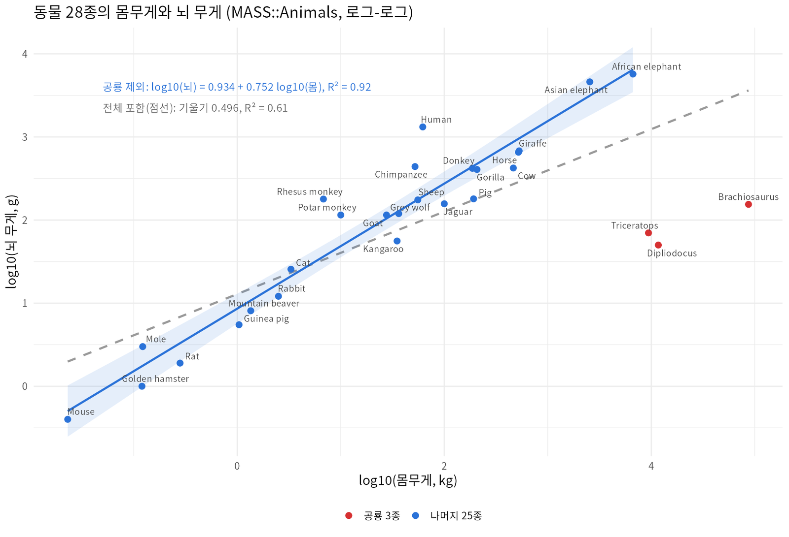
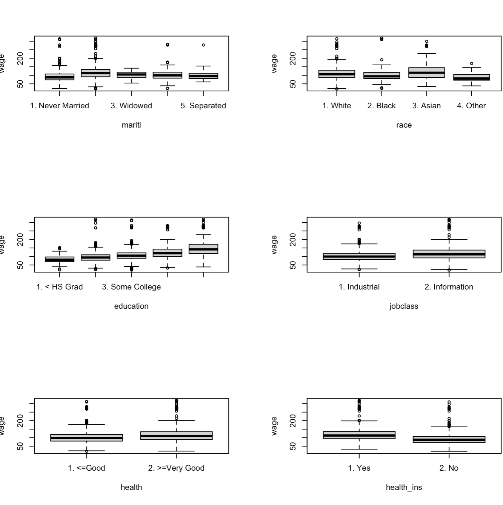
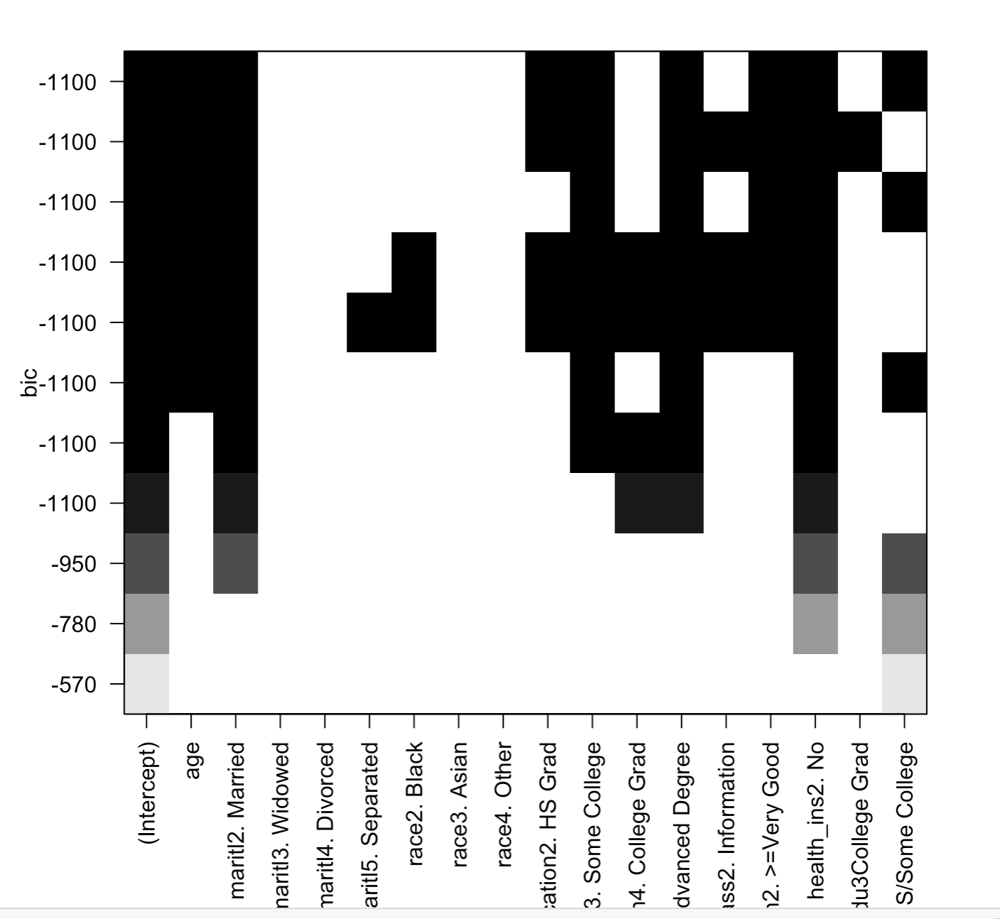
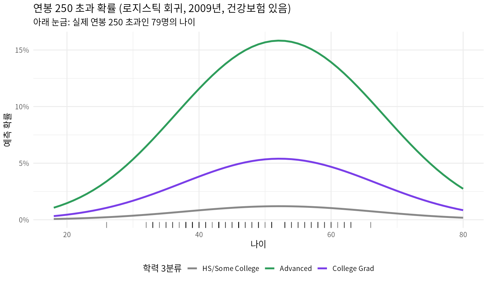
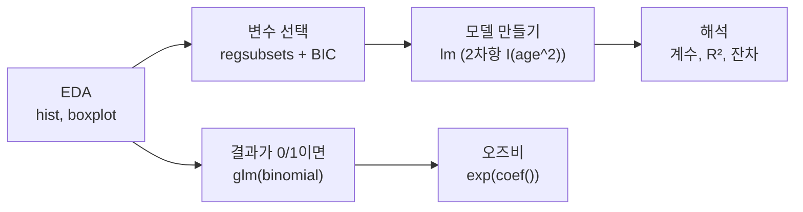

## 들어가며

13주차는 회귀를 다시 했다. 3주차에서 한 변수, 두 변수 회귀를 배웠다면, 이번에는 **변수가 많을 때 무엇을 넣고 뺄지(변수 선택)**, 그리고 **결과가 숫자가 아니라 예/아니오일 때(로지스틱 회귀)**로 넘어갔다. 데이터는 세 가지였다.

| 데이터 | 패키지 | 질문 |
| --- | --- | --- |
| Animals (28종) | MASS | 몸이 크면 뇌도 클까? 이상치는 어떻게 할까? |
| Wage (3,000명) | ISLR2 | 연봉에 영향을 주는 변수는 무엇일까? 고연봉일 확률은? |
| penguins (344마리) | R 4.5 기본 datasets | 펭귄 몸무게를 무엇으로 설명할까? |

> 제출할 때는 맥에서 돌렸고, 블로그를 쓰면서 같은 데이터를 다시 불러와 모든 코드를 직접 돌려 봤다. 이 환경에는 leaps 패키지 설치가 막혀서, `regsubsets()`와 같은 방식(모든 변수 조합을 다 시도하는 exhaustive search)으로 최적 부분집합을 찾는 함수를 직접 짜서 확인했다. 제출한 BIC 그림과 결과가 같았다.
{: .prompt-info }

## 학습 목표

- 로그 변환으로 크기 차이가 큰 데이터의 관계를 직선으로 보기
- 이상치가 회귀선과 $$R^2$$에 미치는 영향, 잔차로 "예상보다 큰/작은" 관측 찾기
- 범주형 변수가 많은 데이터의 EDA (상자그림 여러 개 한 번에)
- `regsubsets()`로 BIC 기준 최적 변수 조합 찾기
- 2차항 `I(age^2)`로 곡선 관계 넣기
- 로지스틱 회귀 `glm(family = binomial)`과 오즈비 `exp(coef())` 해석

---

## 1. 동물의 몸무게와 뇌 무게 (MASS::Animals)

```r
library(MASS); data(Animals)
str(Animals)               # 28 obs, body(kg), brain(g)
plot(Animals$body, Animals$brain)
boxplot(Animals$body)
```

처음에 그냥 `plot()`을 하면 점들이 왼쪽 아래 구석에 다 몰려 있고 오른쪽에 몇 개만 덩그러니 있다. 생쥐(0.023 kg)부터 브라키오사우루스(87,000 kg)까지 **크기가 6자리 넘게 차이**나기 때문이다. 그래서 양쪽 모두 `log10()`을 씌운다.

```r
exclude <- c("Dipliodocus", "Triceratops", "Brachiosaurus")   # 공룡 3종
data_no_dino <- Animals %>%
  filter(!rownames(Animals) %in% exclude) %>%
  mutate(x = log10(body), y = log10(brain))

Animals %>%
  mutate(x = log10(body), y = log10(brain)) %>%
  ggplot(aes(x, y)) +
  geom_point() +
  geom_text_repel(aes(label = rownames(Animals))) +
  geom_smooth(data = data_no_dino, formula = y ~ x, method = "lm") +   # 회귀선은 공룡 빼고
  stat_regline_equation(data = data_no_dino)

fit <- lm(y ~ x, data = data_no_dino)
10^(sort(fit$residuals))
```


_다시 그린 그림: 파란 선은 공룡 제외, 점선은 공룡 포함 회귀선_

### 여기서 배운 것

**점은 전부 그리고 회귀선만 공룡을 빼고 그리는 방법**이 인상적이었다. `geom_smooth(data = data_no_dino)`처럼 레이어마다 다른 데이터를 줄 수 있다. 공룡이 이상치라는 걸 숨기지 않으면서 회귀선이 휘둘리지 않게 할 수 있다.

| | 공룡 제외 (25종) | 공룡 포함 (28종) |
| --- | --- | --- |
| 회귀식 | $$\log_{10}(\text{brain}) = 0.934 + 0.752\log_{10}(\text{body})$$ | 기울기 0.496 |
| $$R^2$$ | **0.922** | 0.608 |

공룡 3종 때문에 기울기가 0.75에서 0.50으로 꺾이고, 설명력이 0.92에서 0.61로 떨어진다. 공룡은 몸은 거대한데 뇌가 작아서(브라키오사우루스: 몸 87,000 kg, 뇌 154.5 g) 오른쪽 아래로 동떨어져 있다. 공룡 제외 식으로 브라키오사우루스의 뇌를 예측하면 **약 44,600 g**이 나오는데 실제는 154.5 g이다. 300배 차이다.

### 로그-로그 회귀의 의미

$$
\log_{10}(\text{brain}) = 0.934 + 0.752\log_{10}(\text{body}) \;\Longleftrightarrow\; \text{brain} = 10^{0.934}\times\text{body}^{0.752} \approx 8.6\times\text{body}^{0.75}
$$

로그-로그에서의 직선은 원래 단위에서 **거듭제곱 관계**다. 기울기 0.75는 "몸무게가 10배가 되면 뇌는 $$10^{0.75} \approx 5.6$$배"라는 뜻이다. 뇌가 몸에 정비례(기울기 1)하지 않고 덜 빠르게 커진다. 생물학에서 말하는 **상대 성장(allometry)**이고, 0.75라는 값은 대사율과 몸무게 관계(클라이버 법칙)에서도 나오는 숫자라 신기했다.

### 잔차로 "머리 좋은 동물" 찾기

`10^(sort(fit$residuals))`의 의미: 잔차가 로그 단위이므로 10을 거듭제곱하면 **실제 뇌 무게 / 예측 뇌 무게** 비율이 된다.

| 예상보다 뇌가 작은 동물 | 비율 | 예상보다 뇌가 큰 동물 | 비율 |
| --- | --- | --- | --- |
| Pig | 0.40 | Chimpanzee | 2.62 |
| Kangaroo | 0.45 | Rhesus monkey | 4.93 |
| Cow | 0.49 | **Human** | **6.89** |

사람은 같은 몸무게 동물보다 뇌가 **약 6.9배** 크다. 그다음이 원숭이와 침팬지. 회귀선 자체보다 **회귀선에서 얼마나 벗어났는지(잔차)**가 더 흥미로운 정보가 될 수 있다는 걸 배웠다.

---

## 2. Wage 데이터: EDA

ISLR2의 Wage는 미국 중부 대서양 지역 남성 3,000명의 연봉(천 달러) 데이터다. 수업에서 교수님이 **EDA(Exploratory Data Analysis, 탐색적 데이터 분석)**부터 하라고 하셨다.

```r
hist(Wage$wage)

par(mfrow = c(3, 2))                       # 3행 2열로 그래프 6개
boxplot(wage ~ maritl,     data = Wage)    # 결혼 여부
boxplot(wage ~ race,       data = Wage)    # 인종
boxplot(wage ~ education,  data = Wage)    # 학력
boxplot(wage ~ jobclass,   data = Wage)    # 직종
boxplot(wage ~ health,     data = Wage)    # 건강 상태
boxplot(wage ~ health_ins, data = Wage)    # 건강보험 유무
par(mfrow = c(1, 1))                       # 화면 분할 원래대로
```


_제출한 그림: 범주형 변수 6개에 따른 연봉 분포_

`par(mfrow = c(3, 2))`로 화면을 나눠 한 번에 비교하는 게 편했다. 끝나고 `c(1, 1)`로 되돌려 놓지 않으면 다음 그림도 작게 나뉘어 그려진다.

### 그림에서 읽은 것

- **학력**이 가장 뚜렷하다. 중앙값이 81 → 94 → 105 → 119 → 142로 단계마다 올라간다
- **결혼**한 사람이 미혼보다 높다
- **건강보험**이 있는 사람(중앙값 112.6)이 없는 사람(88.0)보다 높다
- 인종, 직종, 건강 상태는 차이가 상대적으로 작다
- 연봉 분포는 오른쪽 꼬리가 길다. 평균 111.7, 중앙값 104.9이고, **250 이상인 사람이 79명** 따로 떨어진 무리를 이룬다 (상자그림 위쪽의 점들)

다만 상자그림은 변수 하나씩만 본 것이다. 예를 들어 "결혼한 사람이 연봉이 높다"는 건 결혼한 사람이 나이가 많아서일 수도 있다. 여러 변수를 함께 넣어 봐야 하고, 그게 다음 절이다.

나이도 같이 봤다. 나이와 연봉에 직선과 2차 곡선을 각각 맞춰 보면 2차 곡선이 더 잘 맞는다. 젊을 때 오르다가 50대 즈음 정점을 찍고 내려온다.

```r
ggplot(Wage, aes(x = age, y = wage)) +
  geom_point() +
  geom_smooth(method = "lm", formula = y ~ x, colour = "blue") +
  geom_smooth(method = "lm", formula = y ~ poly(x, 2), colour = "red")
```

---

## 3. 변수 선택: regsubsets와 BIC

변수가 많으면 "무엇을 넣을까"가 문제다. 다 넣으면 과적합되고, 너무 적게 넣으면 설명을 못 한다. `leaps::regsubsets()`는 변수 개수마다 **가장 RSS가 작은 조합**을 찾아 준다.

```r
library(leaps)
fit <- regsubsets(wage ~ . - year - region - logwage, data = Wage, nvmax = 11)
plot(fit, scale = "bic")          # smallest BIC
fit_sum <- summary(fit)
which.min(fit_sum$bic)
coef(fit, which.min(fit_sum$bic))
```

- `wage ~ . - year - region - logwage`: 나머지 변수 전부, 단 year, region, logwage는 빼고. **logwage는 wage에 로그를 씌운 것이라 넣으면 답을 알려 주는 셈**(데이터 누수)이고, region은 값이 하나뿐이다
- `nvmax = 11`: 변수를 최대 11개까지
- **BIC**: $$\mathrm{BIC} = n\ln\left(\frac{\mathrm{RSS}}{n}\right) + k\ln n$$. 앞 항은 잘 맞을수록 작아지고, 뒤 항은 변수 $$k$$가 많을수록 커지는 **벌점**이다. 작을수록 좋다


_제출한 BIC 그림: 위쪽 줄일수록 BIC가 작은(좋은) 모델, 검은 칸이 포함된 변수_

### 그림 읽는 법

각 행이 모델 하나, 검은 칸이 그 모델에 들어간 변수다. **맨 위 행이 BIC가 가장 작은 모델**이다. 나이, 결혼(Married), 학력 단계들, 건강, 건강보험이 계속 검은색으로 남는다. 반대로 인종, 직종은 거의 흰색이라 연봉 설명에 별로 필요 없다는 뜻이다. 2절 상자그림에서 본 것과 맞는다.

다시 계산해 보니 BIC 최솟값은 변수 8개일 때였고, 선택된 변수는 age, maritl(Married), education(HS Grad, Some College, College Grad, Advanced Degree), health, health_ins였다. 그런데 이 그림에는 이상한 점이 하나 있다. 그건 7절에서 정리했다.

### 최종 다중회귀

선택된 변수에 나이 2차항을 더해 모델을 만들었다.

```r
final <- lm(wage ~ age + I(age^2) + maritl + education + health + health_ins, data = Wage)
summary(final)
```

| 변수 | 계수 | 해석 |
| --- | --- | --- |
| age | +2.66 | |
| I(age^2) | −0.0267 | 나이 효과가 점점 줄다가 꺾임. 정점은 $$\frac{2.66}{2 \times 0.0267} \approx 50$$세 |
| Married | +13.7 | 미혼 대비 (다른 조건이 같을 때) |
| HS Grad / Some College / College Grad / Advanced | +8.0 / +18.6 / +31.9 / +55.0 | 고졸 미만 대비 |
| health ≥ Very Good | +6.4 | |
| 건강보험 없음 | −16.8 | |

$$R^2 = 0.343$$(수정 $$R^2$$ 0.340). 2차항을 뺀 모델과 F 검정으로 비교하면 $$p = 3.2 \times 10^{-11}$$이라 **2차항은 확실히 필요**하다.

`I(age^2)`에서 `I()`를 쓰는 이유: 공식 안에서 `^`는 "상호작용 차수"라는 특별한 뜻이라, 진짜 제곱을 하려면 `I()`로 감싸서 "그냥 계산하라"고 알려 줘야 한다.

---

## 4. 로지스틱 회귀: 연봉 250 초과일 확률

이번엔 "연봉이 얼마인가"가 아니라 **"연봉이 250을 넘는가 (예/아니오)"**를 예측한다. 결과가 0/1이면 선형회귀는 0보다 작거나 1보다 큰 값을 낼 수 있어서 **로지스틱 회귀**를 쓴다.

$$
P(Y = 1) = \frac{1}{1 + e^{-(\beta_0 + \beta_1x_1 + \cdots)}}, \qquad \ln\frac{P}{1 - P} = \beta_0 + \beta_1x_1 + \cdots
$$

왼쪽이 확률, 오른쪽의 $$\frac{P}{1 - P}$$가 **오즈(odds)**다. 계수 $$\beta$$는 로그 오즈의 변화라서 `exp(coef())`를 하면 **오즈비**가 된다.

먼저 학력 5단계를 3단계로 묶었다. 250 초과인 사람이 79명뿐이라 범주를 잘게 나누면 범주마다 사례가 너무 적어진다.

```r
Wage$edu3 <- factor(
  ifelse(Wage$education %in% c("1. < HS Grad", "2. HS Grad", "3. Some College"), "HS/Some College",
  ifelse(Wage$education == "4. College Grad", "College Grad",
  ifelse(Wage$education == "5. Advanced Degree", "Advanced", NA))))

fit_glm <- glm(I(wage > 250) ~ I(year - 2026) + age + I(age^2) + edu3 + health_ins,
               data = Wage, family = binomial)
summary(fit_glm)
exp(coef(fit_glm))      # 오즈비
```

| 학력 3분류 | 250 이하 | 250 초과 | 비율 |
| --- | --- | --- | --- |
| HS/Some College | 1,877 | 12 | 0.6% |
| College Grad | 663 | 22 | 3.2% |
| Advanced | 381 | 45 | 10.6% |

### 오즈비 해석

| 변수 | 오즈비 | 해석 |
| --- | --- | --- |
| age, I(age^2) | 1.29, 0.9976 | 나이가 들수록 확률이 오르다가 약 51세에서 꺾임 |
| edu3 College Grad | 0.30 | 기준 범주(Advanced) 대비 오즈가 0.30배 |
| edu3 HS/Some College | 0.065 | Advanced 대비 0.065배 |
| 건강보험 없음 | 0.58 | 있는 사람 대비 0.58배 (p = 0.11로 유의하지 않음) |
| I(year − 2026) | 1.02 | p = 0.73, 연도 효과 없음 |


_다시 그린 그림: 학력별, 나이별 연봉 250 초과 예측 확률_

석박사(Advanced)는 50대 초반에 확률이 약 16%까지 오르지만, 고졸 이하는 어느 나이에서도 1% 남짓이다. 실제 250 초과인 사람들의 나이(아래 눈금)도 30 ~ 65세에 몰려 있다.

---

## 5. 펭귄 몸무게 다중회귀

같은 방법을 펭귄에 적용했다. 종(species), 섬(island), 부리 길이, 깊이(bill_len, bill_dep), 날개 길이(flipper_len), 성별(sex), 연도(year)로 몸무게(body_mass, g)를 설명한다.

```r
fit <- regsubsets(body_mass ~ ., data = penguins, nvmax = 13)
plot(fit, scale = "bic")
fit_sum <- summary(fit)
which.min(fit_sum$bic)
coef(fit, which.min(fit_sum$bic))

final <- lm(body_mass ~ species + bill_len + bill_dep + flipper_len + sex, data = penguins)
summary(final)
```

결측을 뺀 333마리로 다시 돌린 결과:

| 변수 | 계수 | p값 |
| --- | --- | --- |
| Chinstrap (Adelie 대비) | −251 | 0.002 |
| **Gentoo** (Adelie 대비) | **+1,015** | < 0.001 |
| bill_len | +18.2 | 0.011 |
| bill_dep | +67.2 | < 0.001 |
| flipper_len | +16.0 | < 0.001 |
| **수컷** (암컷 대비) | **+390** | < 0.001 |

수정 $$R^2$$ = **0.873**. 같은 종, 같은 성별이면 날개가 1 mm 길 때 약 16 g 더 무겁고, 수컷이 암컷보다 약 390 g 무겁다. 젠투펭귄은 아델리보다 1 kg 넘게 무겁다. 몸무게의 87%를 설명하니 Wage(34%)보다 훨씬 잘 맞는다. 사람의 연봉보다 펭귄의 몸무게가 훨씬 "물리적으로" 정해져 있기 때문일 것이다.

BIC 기준 최적은 사실 **4개**(Gentoo 여부, bill_dep, flipper_len, sex)였고 수정 $$R^2$$ = 0.870이었다. 최종 모델은 변수 2개를 더 넣고 0.003을 얻은 셈이다. 섬(island)과 연도(year)는 어느 모델에도 들어가지 않았다. 섬은 종과 거의 겹치는 정보라서 그렇다(젠투는 Biscoe 섬에만 산다).

---

## 6. 여기서 배운 것 정리



- **로그 변환**은 크기 차이가 큰 데이터를 다루는 가장 기본적인 무기다. 로그-로그 직선은 거듭제곱 관계다
- **이상치**는 회귀선을 크게 흔든다. 지우는 게 아니라, 그림에는 남기고 모델에서만 빼는 방법이 있다
- **잔차**는 오차가 아니라 정보가 될 수 있다 (사람의 뇌는 예상보다 6.9배)
- **BIC**는 "잘 맞는 정도"와 "변수 개수"를 저울질한다. 그림에서 맨 위 행을 보면 된다
- **로지스틱 회귀**의 계수는 `exp()`를 해야 해석할 수 있고, 해석은 항상 **기준 범주 대비**다

---

## 7. 다시 보니 보인 실수와 개선점

### (1) lm()에 쉼표가 들어가 있다

제출한 코드를 그대로 다시 돌리니 에러가 났다.

```r
final <- lm(wage ~ age + I(age^2), maritl + education + health + health_ins, data = Wage)
# Warning: '+' not meaningful for factors  (3번)
# Error: 0 (non-NA) cases
```

`I(age^2)` 뒤의 **쉼표** 때문에 공식이 `wage ~ age + I(age^2)`에서 끝나고, `maritl + education + ...`는 `lm()`의 **두 번째 인자**로 들어간다. `data`는 이름으로 따로 지정했으니 위치상 다음 인자인 `subset`이 된다. 팩터끼리 더하면 전부 NA가 되고, NA로 행을 고르니 남는 행이 0개다. 쉼표를 `+`로 바꿔야 한다.

```r
final <- lm(wage ~ age + I(age^2) + maritl + education + health + health_ins, data = Wage)
```

제출 당시 에러를 보고 넘어갔는지, 다른 줄을 돌렸는지 기억이 확실하지 않다. 어쨌든 제출본 코드는 그대로는 돌아가지 않는다.

### (2) BIC 그림에 edu3가 들어가 있다

제출한 BIC 그림의 오른쪽 끝을 보면 `edu3College Grad`, `edu3HS/Some College` 열이 있다. 코드 순서상 `regsubsets()`가 `edu3`를 만들기 **전에** 있는데, 실제로는 RStudio에서 `edu3`를 만든 **다음에** 다시 실행했던 것 같다. 그래서 `wage ~ .`의 "."에 `edu3`까지 들어갔다.

문제는 `edu3`가 `education`을 묶어서 만든 변수라 **완전한 공선성**이 생긴다는 점이다. 직접 확인하니 설계 행렬의 열은 17개인데 **랭크(rank)가 16**이었다. 한 열이 다른 열들의 조합으로 정확히 표현된다는 뜻이다. 그래서 BIC 최적 모델이 `education5. Advanced Degree` 대신 `edu3HS/Some College`를 고르는 식으로, **같은 정보를 다른 이름으로 담은 모델**들이 섞여 나왔다. (그림의 세로축에 −1100이 여러 번 찍힌 건 눈금 값을 반올림해서 표시했기 때문이고, 실제 BIC 값은 조금씩 다르다.)

**교훈: `~ .`을 쓸 때는 데이터프레임에 지금 어떤 열이 있는지 먼저 확인해야 한다.** 파생 변수를 만들었다면 빼 주거나(`- edu3`), 분석용 데이터프레임을 따로 만드는 게 안전하다. R 스크립트를 위에서부터 한 번에 다시 돌려 봤다면 바로 알았을 것이다.

### (3) edu3의 기준 범주가 "Advanced"다

`factor()`는 범주를 **알파벳 순서**로 정렬한다. 그래서 `edu3`의 첫 범주(기준)가 Advanced가 되었고, 오즈비가 0.30, 0.065처럼 "석박사 대비 얼마나 낮은가"로 나왔다. 해석하기에는 가장 낮은 학력을 기준으로 두는 게 자연스럽다.

```r
Wage$edu3 <- relevel(Wage$edu3, ref = "HS/Some College")
```

이렇게 바꾸면 오즈비가 **College Grad 4.7배, Advanced 15.5배**로 나온다. 모델은 같고 보는 방향만 바뀐 것이다($$1/0.065 \approx 15.5$$). "석사 이상이면 고졸 이하보다 고연봉일 오즈가 15배"가 훨씬 읽기 쉽다.

### (4) I(year − 2026)

연도를 2026 기준으로 뺐는데, Wage 데이터는 2003 ~ 2009년이다. 계수에는 영향이 없지만 **절편이 데이터에 없는 2026년 기준**이 되어 의미가 없어진다(오즈비 0.0003). 데이터의 첫해인 `I(year - 2003)`으로 하는 게 맞다. 그리고 연도 효과 자체가 p = 0.73이라 빼도 된다.

### (5) 이 로지스틱 모델은 아무도 "예"라고 예측하지 않는다

예측 확률을 0.5 기준으로 나눠 보니 **250 초과라고 예측한 사람이 0명**이었다. 가장 높은 예측 확률이 0.158이다. 그런데 정확도는 97.4%가 나온다. 3,000명 중 2,921명(97.4%)이 250 이하라서, "모두 아니다"라고만 해도 97.4%가 맞기 때문이다.

**불균형 데이터에서는 정확도가 거의 쓸모없다.** 이 모델의 가치는 분류보다 "어떤 조건에서 확률이 올라가나"를 보는 데 있다(4절 그림). 분류가 목적이면 기준값을 낮추거나(예: 0.1), 정밀도, 재현율, ROC 곡선으로 평가해야 한다.

### (6) library(PenguinR)

`penguins` 데이터는 R 4.5부터 기본 `datasets` 패키지에 들어 있어서 따로 불러올 필요가 없다(열 이름이 `bill_len`, `body_mass`처럼 짧은 게 이 버전). `library(PenguinR)` 줄은 이 데이터를 쓰는 데 필요하지 않다. 내 맥에서는 에러 없이 넘어갔지만, 그 패키지가 없는 컴퓨터에서는 이 줄에서 멈춘다. 예전에는 `palmerpenguins` 패키지를 썼고 열 이름이 `bill_length_mm`처럼 길다. 코드에서 이 줄은 지우는 게 낫다.

### 개선 사항 한눈에 보기

| 위치 | 문제 | 수정 | 영향 |
| --- | --- | --- | --- |
| 최종 lm | `I(age^2),` 쉼표 | `+`로 | 그대로는 에러 (0 cases) |
| regsubsets | `~ .`에 edu3 포함 | `- edu3` 또는 순서 정리 | 완전 공선성 (17열, 랭크 16) |
| edu3 | 기준 범주가 알파벳 순 Advanced | `relevel(ref = "HS/Some College")` | 오즈비 0.065 → 15.5배로 읽기 쉬움 |
| glm | `year - 2026` | `year - 2003` 또는 제외 | 절편이 데이터 밖 |
| 평가 | 정확도만 보면 97.4% | 기준값 조정, 재현율, ROC | 실제로는 아무도 "예"로 예측 안 함 |
| penguins | `library(PenguinR)` | 삭제 (R 4.5 기본 데이터) | 다른 환경에서 불필요한 에러 가능 |

---

## 8. 느낀 점과 다음에 해 보고 싶은 것

이번 주에 가장 크게 느낀 건 **R 세션의 "상태"가 결과를 바꾼다**는 점이다. edu3가 BIC 그림에 들어간 건 코드가 틀려서가 아니라 실행 순서가 달라서였다. 스크립트를 위에서부터 한 번에 돌리면(RStudio의 Source, 맥에서는 `Cmd + Shift + Enter`) 이런 일이 없는데, 콘솔에서 줄을 왔다 갔다 하며 돌리다 보면 화면의 코드와 실제로 실행된 것이 달라진다. 제출 전에 **R을 재시작하고 처음부터 한 번 돌려 보는 습관**이 필요하다. lm의 쉼표도 그렇게 했다면 바로 잡혔을 것이다.

Animals 예제는 짧지만 재미있었다. 회귀선 하나로 "사람의 뇌는 같은 크기 동물보다 7배 크다"는 이야기를 만들 수 있었다. 회귀가 예측만이 아니라 **비교의 기준선**이 된다는 걸 알았다.

로지스틱 회귀에서 정확도 97.4%가 사실은 "아무것도 안 한 것"과 같다는 걸 직접 확인한 것도 컸다. 다른 과목(머신러닝)에서 배운 불균형 데이터 문제가 여기서도 그대로 나왔다.

다음에 해 보고 싶은 것:

1. **교차검증으로 변수 선택 비교**: BIC 대신 10-fold 교차검증 오차로 골랐을 때 같은 변수가 나오는지
2. **Lasso**: `glmnet`으로 변수 선택과 축소를 동시에. 범주형 변수를 통째로 넣고 빼는 group lasso와 비교
3. **로지스틱 평가 제대로 하기**: ROC 곡선과 AUC, 기준값을 바꿔 가며 재현율 확인
4. **Animals에 다른 동물 추가**: 돌고래, 까마귀처럼 머리 좋다고 알려진 동물이 사람처럼 잔차가 큰지

---

## 최종 핵심 정리

1. 크기 차이가 큰 데이터는 로그 변환. 로그-로그 직선 $$\log y = a + b\log x$$는 거듭제곱 관계 $$y = 10^a x^b$$. Animals에서 뇌 ∝ 몸무게$$^{0.75}$$
2. 이상치(공룡 3종)는 기울기를 0.75 → 0.50, $$R^2$$를 0.92 → 0.61로 바꾼다. 그림에는 남기고 `geom_smooth(data = ...)`로 회귀선에서만 제외
3. `10^(잔차)`는 실제 / 예측 비율. 사람의 뇌는 예상의 6.9배
4. EDA는 `par(mfrow = c(3, 2))` + `boxplot(y ~ x)`로 범주형 변수를 한 번에. Wage에서는 학력, 결혼, 건강보험이 뚜렷
5. `regsubsets()` + BIC($$n\ln(\mathrm{RSS}/n) + k\ln n$$)로 변수 선택. 그림의 맨 위 행이 최적. `~ .`에 파생 변수가 들어가면 완전 공선성
6. `I(age^2)`로 곡선 관계. 나이 효과는 약 50세에서 정점, 2차항은 F 검정으로 확실히 필요
7. 로지스틱 회귀 `glm(family = binomial)`, `exp(coef())` = 오즈비, 해석은 기준 범주 대비. `factor()`는 알파벳 순이므로 `relevel()`로 기준을 정할 것
8. 불균형 데이터(250 초과 2.6%)에서는 정확도 97.4%가 "모두 아니오"와 같다. 확률 해석이나 재현율, ROC로 평가
9. 펭귄 몸무게는 종, 부리, 날개, 성별로 87% 설명(수컷 +390 g, 젠투 +1,015 g). BIC 최적은 4개 변수로도 0.870

---

End.
