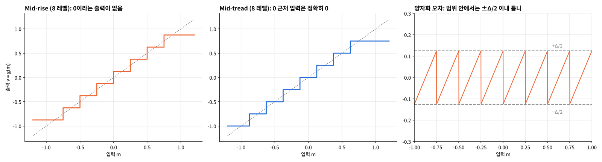
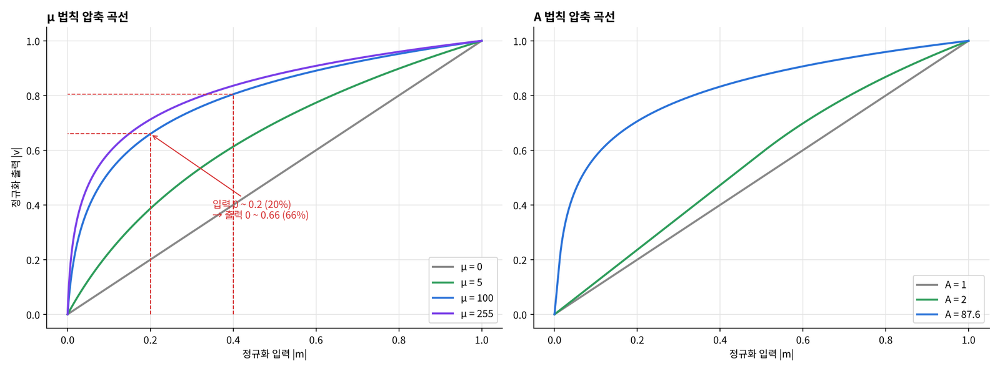
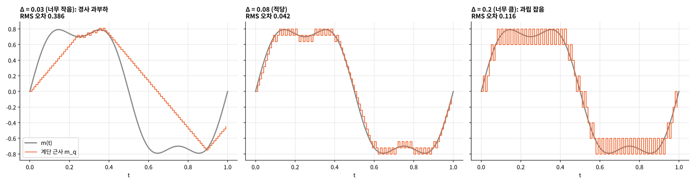
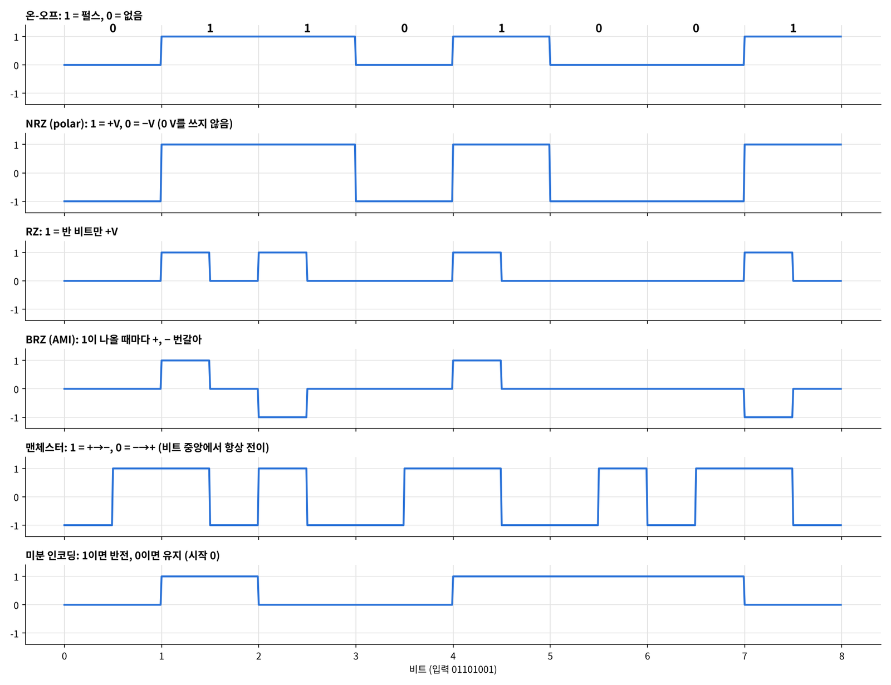
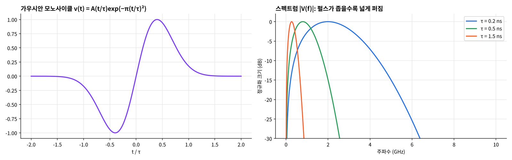

## 학습 목표

- 진폭 양자화의 정의와 결정 수준, 표현 수준, 양자화 잡음 이해
- MSE와 SQNR로 양자화 품질을 숫자로 표현하기
- PCM의 3단계(표본화, 양자화, 부호화)와 비트율 $$R_b = n f_s$$ 계산
- 불균일 양자화(μ 법칙, A 법칙)가 필요한 이유
- 샘플 간 상관성을 이용하는 DPCM, 그 극단인 델타 변조(DM)
- DM의 두 가지 왜곡(경사 과부하, 과립 잡음)과 해결책(ADM, 델타-시그마)
- 비트를 전기 신호로 바꾸는 선코드, 여러 신호를 한 채널에 싣는 TDM

> 09장 샘플링이 **시간**을 이산화했다면, 이번 장은 **진폭**을 이산화하고(양자화) 그 값을 **비트**로 바꾸는(부호화) 과정이다. 그리고 "비트를 덜 쓰는 방법(DPCM, DM)"과 "비트를 전선에 싣는 방법(선코드)"까지 이어진다.
{: .prompt-info }


---

## 1. 진폭 양자화

### 왜 양자화해도 되나

- 음성 같은 실제 신호의 진폭은 연속적인 값을 가진다
- 하지만 **정확한 진폭을 보낼 필요는 없다**. 사람의 귀나 눈은 **유한한 세기의 차이**만 감지하기 때문
- 그래서 진폭을 유한 개의 값 중 하나로 반올림해도 사람이 느끼는 품질은 거의 그대로다

### 정의

시간 $$t = nT_s$$의 샘플 $$m(nT_s)$$를 유한 개의 값 중 하나 $$v$$로 바꾸는 과정. 시간 첨자를 빼고 간단히

$$
v = g(m)
$$

- **무기억적이고 순시적**: $$t = nT_s$$의 값만 보고 결정하며, 이전이나 이후 샘플의 영향을 받지 않는다 (뒤의 DPCM과 대비되는 성질)
- **결정 수준(decision level, threshold)** $$a_i$$: 입력 축을 나누는 경계. 총 $$L$$개의 입력 구간을 만든다
- **표현 수준(representation, reconstruction level)** $$\hat{x}_i$$: 각 구간이 내보내는 출력 값. 총 $$L$$개

8레벨이면 각 표현 수준에 3비트 코드(000 ~ 111)를 붙일 수 있다.

### Mid-rise와 Mid-tread


_8레벨 양자화기의 두 종류와 양자화 오차_

> 필기: 강의 자료의 8레벨 예시는 **mid-rise** 구조. 0을 기준으로 계단이 "올라가는(rise)" 지점에 원점이 있어서 **0이라는 출력 값이 없다**. 반대로 mid-tread는 계단의 "디딤판(tread)" 위에 원점이 있어 작은 입력은 정확히 0이 된다.
{: .prompt-tip }

- Mid-rise: 레벨이 $$\pm\frac{\Delta}{2}, \pm\frac{3\Delta}{2}, \dots$$로 0에 대해 대칭. 짝수 개 레벨($$2^n$$)과 잘 맞는다
- Mid-tread: 0을 포함하므로 레벨 수가 홀수여야 대칭. 짝수로 만들면(09장의 2의 보수 ADC처럼) 한쪽이 한 칸 모자란다
- 오른쪽 그림처럼 범위 안에서는 오차가 항상 $$-\frac{\Delta}{2}$$ ~ $$+\frac{\Delta}{2}$$ 사이의 톱니 모양. 범위를 넘으면 잘려서(clipping) 오차가 커진다

---

## 2. 양자화 잡음: MSE와 SQNR

샘플링된 값 $$x$$는 연속 확률변수 $$X$$, 양자화된 값 $$\hat{x}$$는 불연속(이산) 확률변수 $$\hat{X}$$로 볼 수 있다. 둘의 차이가 **양자화 잡음** $$\tilde{x} = x - \hat{x}$$.

### 제곱 오차와 MSE

$$
d(x, \hat{x}) = (x - \hat{x})^2, \qquad D = E\left[(X - \hat{X})^2\right]
$$

8레벨 양자화기에 PDF가 $$f_X(x)$$인 입력이 들어오면, 구간마다 "그 구간의 표현 수준과의 거리의 제곱"을 확률로 가중해 더한다.

$$
D = \int_{-\infty}^{a_1} (x - \hat{x}_1)^2 f_X(x)\,dx + \sum_{i = 2}^{7}\int_{a_{i-1}}^{a_i} (x - \hat{x}_i)^2 f_X(x)\,dx + \int_{a_7}^{\infty} (x - \hat{x}_8)^2 f_X(x)\,dx
$$

- 맨 앞과 맨 뒤 구간은 $$\pm\infty$$까지 이어지는 **과부하(overload) 구간**
- 이 식은 08장의 기대값 $$E[g(X)] = \int g(x)f_X(x)\,dx$$를 그대로 쓴 것

**균일 양자화의 MSE**: 간격이 $$\Delta$$로 일정하고 입력이 한 구간 안에서 고르게 퍼져 있다면 오차는 $$[-\frac{\Delta}{2}, \frac{\Delta}{2}]$$의 균일분포를 따른다. 08장의 균일분포 분산 공식으로

$$
D = \frac{\Delta^2}{12}
$$

### SQNR (Signal-to-Quantization Noise Ratio)

$$
\mathrm{SQNR} = \frac{E[X^2]}{E[(X - \hat{X})^2]} = \frac{P_X}{P_{\tilde{X}}}
$$

신호 파워와 잡음 파워는 모두 시간 평균

$$
P_X = \lim_{T \to \infty}\frac{1}{T}\int_{-T/2}^{T/2} E[X^2(t)]\,dt, \qquad P_{\tilde{X}} = \lim_{T \to \infty}\frac{1}{T}\int_{-T/2}^{T/2} E\left[(X(t) - \hat{X}(t))^2\right]dt
$$

비트를 하나 늘리면 $$\Delta$$가 절반 → $$D$$는 $$\frac{1}{4}$$ → SQNR이 약 **6 dB씩** 좋아진다 (09장에서 확인한 $$6.02n + 1.76$$ dB).

---

## 3. PCM (Pulse Code Modulation)

아날로그 신호를 **표본화 → 양자화 → 부호화**로 디지털 신호로 바꾸는 방식.

| 단계 | 하는 일 | 필기 |
| --- | --- | --- |
| 표본화 | $$f_m$$ Hz로 대역제한된 신호를 $$f_s \ge 2f_m$$으로 샘플링 → PAM 신호 $$x(kT_s)$$ | **전제 조건**, 나이퀴스트 율 |
| 양자화 | $$L = 2^n$$개 레벨 중 하나로 → $$x_q(kT_s)$$ | 특정 레벨로 만듦. 예: 8레벨이면 $$2^3$$, $$n = 3$$ |
| 부호화 | 레벨 번호를 $$n = \log_2 L$$ 비트로 | 하나의 샘플을 여러 비트로 표현 |

> 필기: **부호화**에 별표. 부호화기의 출력 비트율은
> $$R_b = n f_s \text{ [bps]}$$
> 여기서 나오는 것이 비로소 **디지털 신호**다.
{: .prompt-warning }

### 3비트 PCM과 음성 PCM

- 3비트 PCM: 레벨 8개($$2^3$$), 샘플당 3비트
- **음성(전화) PCM**: $$f_m = 3.4$$ kHz → $$f_s = 8$$ k샘플/초 (나이퀴스트 6.8 kHz보다 여유 있게), 256 = $$2^8$$ 레벨 → 샘플당 8비트

$$
R_b = 8 \times 8000 = 64{,}000 \text{ bps} = 64 \text{ kbps}
$$

64 kbps는 디지털 전화망의 기본 채널(DS0) 속도다.

### PCM 신호의 대역폭

- 부호화된 비트열은 펄스(단극 1 V/0 V, 양극 +1 V/−1 V)로 바뀌어 채널로 나간다
- 출력 비트율이 $$nf_s$$이므로 그만큼의 대역폭이 필요하다고 강의에서는 정리했다
- 보충: 이론적인 최소 대역폭은 그 절반인 $$\frac{nf_s}{2}$$(나이퀴스트 펄스를 쓸 때)이고, 사각 펄스의 주엽(main lobe) 폭은 $$nf_s$$다. 어떤 정의를 쓰느냐의 차이이고, **비트 수 $$n$$에 비례해서 대역폭이 커진다**는 점이 핵심. 품질(SQNR)과 대역폭이 trade-off 관계

### 예제: $$x(t) = 8\cos(300\pi t)$$

1. **나이퀴스트 율의 2배로 샘플링하면?** (필기: $$2\pi f = 300\pi$$ → $$f = 150$$, $$f_m$$은 대역폭의 최댓값)

$$
f_m = 150 \text{ Hz}, \quad f_N = 2f_m = 300 \text{ Hz}, \quad f_s = 2f_N = 600 \text{ Hz}
$$

2. **6비트 PCM의 양자화 레벨 간격은?** 진폭 범위가 −8 V ~ 8 V(16 V), 레벨 수 $$2^6 = 64$$

$$
\Delta V = \frac{16 \text{ V}}{2^6} = 0.25 \text{ V}
$$

3. **비트율은?** 초당 600번 샘플, 샘플당 6비트 (필기: $$n \cdot f_s$$)

$$
R_b = 6 \times 600 = 3600 \text{ bps}
$$

---

## 4. 불균일 양자화: μ 법칙과 A 법칙

### 왜 불균일하게 나누나

음성에서는 **큰 진폭이 드물고 작은 진폭이 대부분**이다. 균일 양자화는 모든 구간의 간격이 같아서

- 큰 소리: 간격 대비 신호가 커서 SQNR이 좋음
- 작은 소리: 간격 대비 신호가 작아서 SQNR이 나쁨 → 조용한 말소리가 뭉개짐

그래서 **작은 진폭은 촘촘하게, 큰 진폭은 넓게** 나누는 것이 불균일 양자화다. 이것은 신호를 먼저 **압축기(compressor)**로 통과시킨 뒤 균일 양자화하는 것과 같다. 수신 쪽에서는 반대 곡선(확장기, expander)으로 되돌린다. 둘을 합쳐 **압신(companding)**.

### μ 법칙 (미국, 일본, μ = 255)

$$
\lvert v \rvert = \frac{\log(1 + \mu\lvert m \rvert)}{\log(1 + \mu)}, \qquad \frac{d\lvert m \rvert}{d\lvert v \rvert} = \frac{\log(1 + \mu)}{\mu}(1 + \mu\lvert m \rvert)
$$

($$m$$: 정규화된 입력 전압, $$v$$: 정규화된 출력 전압)

필기에서 근사식을 직접 정리한 부분:

- **낮은 입력($$\mu\lvert m \rvert \ll 1$$)**: $$\log(1 + x) \approx x$$이므로
  $$\lvert v \rvert \approx \frac{\mu\lvert m \rvert}{\log(1 + \mu)}$$ → **선형**(기울기 일정)
- **높은 입력($$\mu\lvert m \rvert \gg 1$$)**: $$1$$을 무시하면
  $$\lvert v \rvert \approx \frac{\log(\mu\lvert m \rvert)}{\log(1 + \mu)} = \frac{\log\mu + \log\lvert m \rvert}{\log(1 + \mu)}$$ → **로그**

### A 법칙 (유럽, A = 87.6)

$$
\lvert v \rvert =
\begin{cases}
\dfrac{A\lvert m \rvert}{1 + \log A}, & 0 \le \lvert m \rvert \le \dfrac{1}{A} \\[2mm]
\dfrac{1 + \log(A\lvert m \rvert)}{1 + \log A}, & \dfrac{1}{A} \le \lvert m \rvert \le 1
\end{cases}
$$

- 낮은 입력($$0 \le \lvert m \rvert \le \frac{1}{A}$$)에서는 처음부터 **정확히 선형**으로 정의
- 높은 입력에서는 로그. $$\frac{d\lvert m \rvert}{d\lvert v \rvert}$$가 $$\lvert m \rvert$$에 비례 → 간격이 입력 크기에 비례해서 넓어짐 → **상대 오차(SQNR)가 일정**


_μ 법칙과 A 법칙 압축 곡선_

> 필기: μ = 100 곡선에서 입력 0.2와 0.4에 선을 그어 본 부분. 직접 계산하면 **입력의 아래 20%(0 ~ 0.2)가 출력의 66%를 차지**하고, 0.4까지 가면 80%다. 즉 균일 양자화기의 레벨 3분의 2를 작은 신호에 몰아주는 셈이다.
{: .prompt-tip }

### 실제로 얼마나 좋아지나 (검산)

음성처럼 0 근처에 몰린 라플라스 분포 신호를 8비트로 양자화해 SQNR을 비교해 봤다.

```python
import numpy as np
rng = np.random.default_rng(0)

def q_uniform(x, b):                    # 8비트 mid-rise 균일 양자화 (-1 ~ 1)
    d = 2 / 2**b
    return np.clip(d * (np.floor(x / d) + 0.5), -1 + d/2, 1 - d/2)
mulaw  = lambda x, u=255: np.sign(x) * np.log1p(u * np.abs(x)) / np.log1p(u)
imulaw = lambda y, u=255: np.sign(y) * ((1 + u) ** np.abs(y) - 1) / u

for rms in [0.3, 0.03, 0.003]:          # 큰 소리 → 아주 작은 소리
    s = np.clip(rng.laplace(0, rms / np.sqrt(2), 200000), -1, 1)
    sqnr = lambda a: 10 * np.log10(np.mean(s**2) / np.mean((s - a)**2))
    print(f"rms {rms}: 균일 {sqnr(q_uniform(s, 8)):.1f} dB, "
          f"μ-law {sqnr(imulaw(q_uniform(mulaw(s), 8))):.1f} dB")
```

```text
rms 0.3: 균일 42.2 dB, μ-law 37.2 dB
rms 0.03: 균일 22.5 dB, μ-law 37.3 dB
rms 0.003: 균일 1.2 dB, μ-law 31.5 dB
```

- 균일 양자화는 소리가 10배 작아질 때마다 SQNR이 20 dB씩 떨어져서, 아주 작은 소리(rms 0.003)는 **1.2 dB**로 사실상 잡음에 묻힌다
- μ 법칙은 **31 ~ 37 dB로 거의 일정**하다. 큰 소리에서는 5 dB 손해지만, 넓은 범위의 음량을 고르게 처리한다
- 이것이 "큰 진폭은 드무니 덜 세밀하게"의 실제 의미

---

## 5. DPCM (Differential PCM)

### PCM의 한계

- 샘플마다 **독립적으로** 양자화, 부호화한다
- 그래서 음성 64 kbps처럼 비트율이 높고 넓은 대역폭이 필요하다

### 현실 신호의 특징: 상관성

- 음성, 비디오 같은 실제 신호는 **이웃 샘플끼리 상관성(correlation)**이 크다. 즉 샘플 사이에 **중복(redundancy)**이 있다
- 이전 샘플이 다음 샘플의 정보를 상당 부분 담고 있으므로, 이전 값으로 다음 값을 **예측**할 수 있다
- 예측이 잘 맞으면 **실제 값과 예측 값의 차이**는 작다. 작은 값은 적은 비트로 표현할 수 있다 → 비트율, 대역폭 절약

### DPCM의 원리

몇 개의 이전 샘플로 다음 샘플을 예측하고, **예측 오차(차이)만 양자화**해서 보낸다.

- **선형 예측기**: 이전 샘플들의 선형 결합

$$
\hat{x}_n = \sum_{i = 1}^{p} a_i x_{n - i}
$$

- 가장 단순한 경우($$p = 1$$, $$a_1 = 1$$)는 예측기가 그냥 **직전 값을 기억하는 메모리**다

### 강의 예제와 수업 중 바꾼 예제

강의 자료는 샘플 2, 3, 5, 4, 3에 대해 단순 메모리 예측기와 $$\hat{x}_n = 0.7x_{n-1} + 0.3x_{n-2}$$를 비교한다. 그런데 직접 계산해 보면 **선형 예측기 쪽이 오히려 오차가 크다**.

| 예측기 | 오차 | 절댓값 합 | 제곱 평균 |
| --- | --- | --- | --- |
| 단순 메모리 ($$a_1 = 1$$) | +2, +1, +2, −1, −1 | 7.0 | 2.20 |
| $$0.7x_{n-1} + 0.3x_{n-2}$$ | +2, +1.6, +2.3, −0.4, −1.3 | 7.6 | 2.74 |

> 필기: 그래서 수업에서는 표를 고쳐서 **샘플 2, 4, 6, 7, 7**(꾸준히 증가하는 신호)과 계수 **$$a_1 = 1.5$$, $$a_2 = -0.5$$**로 다시 계산했다. 필기의 "절댓값 합 7.0 / 분산 2.60"과 "절댓값 합 4.5 / 분산 1.25"가 그 결과다.
{: .prompt-tip }

| 예측기 (샘플 2, 4, 6, 7, 7) | 예측 값 | 오차 | 절댓값 합 | 제곱 평균 |
| --- | --- | --- | --- | --- |
| 단순 메모리 | 0, 2, 4, 6, 7 | +2, +2, +2, +1, 0 | 7.0 | 2.60 |
| $$1.5x_{n-1} - 0.5x_{n-2}$$ | 0, 3, 5, 7, 7.5 | +2, +1, +1, 0, −0.5 | **4.5** | **1.25** |

- $$1.5x_{n-1} - 0.5x_{n-2} = x_{n-1} + 0.5(x_{n-1} - x_{n-2})$$로 바꿔 쓰면 의미가 보인다. **직전 값에 최근 증가분의 절반을 더한다**, 즉 추세를 따라가는 예측이다. 꾸준히 증가하는 신호에서 잘 맞을 수밖에 없다
- 필기의 "분산"은 정확히는 오차의 **제곱 평균(평균 전력)**이다. 오차 평균을 빼지 않았다 (예: $$\frac{4 + 4 + 4 + 1 + 0}{5} = 2.6$$)
- 교훈: **예측기 계수는 신호의 통계(상관성)에 맞춰야 한다**. 아무 계수나 쓰면 단순 메모리보다 나빠질 수도 있다. 실제로는 오차 제곱 평균을 최소화하는 계수를 데이터로부터 구한다(Wiener-Hopf 방정식)

### 부호기와 복호기

- **부호기**: 차이(오차) $$Y_n = X_n - \hat{X}_n$$을 양자화해서 보낸다 (강의 자료는 단순 메모리 예측기 기준으로 $$X_n - X_{n-1}$$로 적었다)
- **복호기**: 송신 쪽과 **똑같은 예측기**를 두고, 받은 $$\hat{Y}_n$$에 예측기 출력을 더해 $$\hat{X}_n$$을 복원
- 실제 구현에서는 송신 쪽 예측기도 원래 샘플이 아니라 **복원된 값**으로 예측한다. 수신 쪽이 가진 정보와 맞춰야 오차가 누적되지 않기 때문

### 디코딩: 코드워드 → 진폭

$$R$$비트 코드워드의 각 비트에 자리 가중치 $$2^0, 2^1, \dots, 2^{R-1}$$을 곱해 더한다.

$$
A = \sum_{i = 0}^{R - 1} c_i 2^i
$$

강의 그림의 4비트 예는 0000 = −8, 1111 = 7이므로 위 합에서 8을 뺀 **오프셋 이진(offset binary)** 표현이다 (1000이 0).

### 예제: PCM vs DPCM

음성이 3 kHz로 대역제한, 8 kHz로 샘플링. 같은 왜곡 품질에 PCM은 샘플당 8비트, DPCM은 4비트가 필요하다.

$$
R_b^{\mathrm{PCM}} = 8 \times 8000 = 64{,}000 \text{ bps}, \qquad R_b^{\mathrm{DPCM}} = 4 \times 8000 = 32{,}000 \text{ bps}
$$

**절반의 비트율로 같은 수준의 품질**을 낼 수 있다. 상관성을 이용한 덕분.

---

## 6. 델타 변조 (DM, Delta Modulation)

### 아이디어

- 나이퀴스트 율보다 **훨씬 빠르게 샘플링(오버샘플링)**하면 샘플 사이 상관성이 매우 높아진다 (필기: 매우 촘촘하게 샘플링했을 때 → 옆의 신호와 거의 비슷해짐)
- 그러면 **직전 값 하나로만 예측해도** 오차가 작다
- 오차를 크기 없이 **부호(+ 또는 −)만**으로 양자화 → **샘플당 1비트**
- 즉 DM은 **1비트 DPCM**
- 장점: DPCM보다 부호기, 복호기 하드웨어가 훨씬 간단하다

### 수식

$$
e(nT_s) = \underbrace{m(nT_s)}_{\text{current}} - \underbrace{m_q((n - 1)T_s)}_{\text{previous approx.}}, \qquad e_q(nT_s) = \Delta\,\mathrm{sgn}(e(nT_s))
$$

$$
m_q(nT_s) = m_q((n - 1)T_s) + e_q(nT_s)
$$

- 차이를 양자화할 때 **+1 또는 −1**(× 스텝 $$\Delta$$)로만 양자화. $$\mathrm{sgn}(x)$$는 $$x \ge 0$$이면 +1, 음수면 −1인 부호 함수
- 전송하는 것은 1(+)과 0(−)뿐이고, 수신 쪽은 1이면 $$\Delta$$ 올리고 0이면 $$\Delta$$ 내려서 **계단 근사** $$m_q(t)$$를 만든다

### DM 시스템의 구성

| 블록 | 역할 |
| --- | --- |
| 비교기(comparator) | 입력과 직전 근사값의 차이 계산 |
| 양자화기 | 부호 함수의 스케일 버전인 **하드 리미터** |
| 누산기(accumulator) | ±Δ를 계속 더해 원 신호에 근사하는 계단 신호 생성 |

### 두 가지 양자화 오차


_같은 신호를 스텝 크기만 바꿔 델타 변조한 결과_

| 왜곡 | 원인 | 모양 | 필기 |
| --- | --- | --- | --- |
| **경사 과부하(slope overload)** | 신호 기울기에 비해 $$\Delta$$가 너무 **작음** | 계단이 신호를 못 따라가고 뒤처짐 | Δ↓: 신호를 따라가기 힘듦 |
| **과립 잡음(granular)** | 신호 변화가 완만한데 $$\Delta$$가 너무 **큼** | 평평한 곳에서 위아래로 계속 진동 | Δ↑: 변화는 잘 따라가지만 평평한 곳에서 + −를 반복 |

경사 과부하가 없으려면 한 샘플 동안 올라갈 수 있는 양이 신호의 최대 기울기보다 커야 한다.

$$
\frac{\Delta}{T_s} \ge \max\left\lvert \frac{dm(t)}{dt} \right\rvert
$$

위 그림에서 RMS 오차는 Δ = 0.03일 때 0.386, 0.08일 때 0.042, 0.2일 때 0.116이었다. **너무 작아도, 너무 커도 나쁘고 그 사이에 최적값이 있다.**

### 적응 델타 변조 (ADM)

고정된 $$\Delta$$로는 두 왜곡을 동시에 피할 수 없으니, 최근 출력 부호열을 보고 스텝을 바꾼다.

- **같은 부호가 연속**(+++ 또는 −−−): 신호를 못 따라가는 중(경사 과부하) → 스텝을 **키움**
- **부호가 번갈아**(+−+−): 평평한 곳에서 진동 중(과립 잡음) → 스텝을 **줄임**

### 델타-시그마 변조

- 델타 변조는 복조 신호에 **누적된 오차**로 인한 잡음이 있다
- 그래서 델타 변조 **전에 메시지를 적분**한다. 적분(Σ) 후 델타(Δ)라 **시그마-델타**라고도 부른다
- 장점
  - 입력을 적분하면 **저주파 성분이 강조**되어 SNR이 개선됨
  - 인접 샘플 사이 관계가 강해지고, **양자화 잡음이 고주파 대역으로 몰림**(noise shaping). 복호기의 LPF로 걸러 낼 수 있음
  - 수신단 구조가 간단해짐 (송신 쪽 적분과 수신 쪽 미분이 상쇄되어 LPF만 남음)
- 오늘날 오디오 ADC, DAC의 대부분이 이 방식이다

---

## 7. 선코드 (Line Code)

PCM, DM, DPCM의 결과는 1과 0의 배열이다. 이것을 실제 전선이나 채널에 보내려면 **전기적 파형**으로 바꿔야 하는데, 그 규칙이 선코드다.


_입력 01101001을 여섯 가지 선코드로 표현_

| 선코드 | 규칙 | 필기, 특징 |
| --- | --- | --- |
| 1. 온-오프 | 1 = 일정 크기 펄스, 0 = 펄스 없음 | 1, 0이 그대로 전압 |
| 2. NRZ (Non-Return-to-Zero) | 1 = 양의 펄스, 0 = 음의 펄스 | **0 V를 사용하지 않음** |
| 3. RZ (Return-to-Zero) | 1 = **반 주기 동안만** 양의 펄스, 0 = 없음 | 1일 때 절반만 사용. 매 1마다 0으로 돌아와 동기 맞추기 쉬움 |
| 4. BRZ (Bipolar RZ, AMI) | 0 = 펄스 없음, 1 = +펄스와 −펄스를 **번갈아** | 평균(DC)이 0이 되고, 규칙 위반으로 오류 검출 가능 |
| 5. 맨체스터 (split-phase) | 1 = 1에서 0으로, 0 = 0에서 1로 변하는 펄스 | 비트 가운데서 항상 전이 → 클록 복원 쉬움, 대신 대역폭 2배 |
| 6. 미분 인코딩 | 아래 참고 | 극성이 뒤집혀도 복원 가능 |

### 미분 인코딩 (시험 출제)

> 필기: 슬라이드 양쪽에 별표와 **"출제"**. 인코딩과 디코딩을 손으로 할 수 있어야 한다.
{: .prompt-warning }

- **인코딩**: 입력이 **0이면 출력 유지**, **1이면 출력 반전(toggle)**
- **디코딩**: 수신 신호가 **바뀌면(0→1, 1→0) 1**, **유지되면 0**

입력 01101001, 시작 상태 0으로 가정:

| 입력 비트 | 0 | 1 | 1 | 0 | 1 | 0 | 0 | 1 |
| --- | --- | --- | --- | --- | --- | --- | --- | --- |
| 직전 출력 | 0 | 0 | 1 | 0 | 0 | 1 | 1 | 1 |
| 규칙 | 유지 | 반전 | 반전 | 유지 | 반전 | 유지 | 유지 | 반전 |
| **출력(송신)** | **0** | **1** | **0** | **0** | **1** | **1** | **1** | **0** |

수신 쪽도 시작을 0으로 가정하고 "직전과 같으면 0, 다르면 1"을 적용하면

| 수신 비트 | 0 | 1 | 0 | 0 | 1 | 1 | 1 | 0 |
| --- | --- | --- | --- | --- | --- | --- | --- | --- |
| 직전 수신 | 0 | 0 | 1 | 0 | 0 | 1 | 1 | 1 |
| **복원** | **0** | **1** | **1** | **0** | **1** | **0** | **0** | **1** |

원래 입력 01101001이 그대로 나온다. 첫 비트는 0→0으로 유지라서 0이다.

```python
inp, state, out = "01101001", 0, ""
for b in inp:
    state ^= int(b)          # 1이면 반전(XOR), 0이면 유지
    out += str(state)
prev, dec = 0, ""
for b in out:
    dec += str(int(b) ^ prev)  # 바뀌면 1, 유지면 0
    prev = int(b)
print(out, dec)              # 01001110 01101001
```

**왜 쓰나**: 정보가 "전압의 값"이 아니라 "**전압이 바뀌었는지**"에 들어 있다. 그래서 선이 뒤바뀌어 신호 전체의 극성이 반전되어도(0과 1이 모두 뒤집혀도) 변화 여부는 그대로라 똑같이 복원된다. 11장 BPSK에서 수신기가 위상을 180° 잘못 잡는 문제도 이 방식(DPSK)으로 해결한다.

---

## 8. 시분할 다중화 (TDM, Time-Division Multiplexing)

- 여러 개의 독립적인 메시지가 **서로 간섭 없이 하나의 채널을 시간을 나눠** 같이 쓰는 방식
- 각 입력은 먼저 LPF(안티 에일리어싱 필터)로 대역을 제한한다
- **정류기(commutator)**: 클록 펄스에 맞춰 여러 입력을 **순서대로 스위칭**해 한 줄로 만든다 (강의 자료의 "cummotator"는 commutator의 오타)
- **역정류기(decommutator)**: 수신 쪽에서 같은 클록에 맞춰 각 사용자 채널로 다시 나눈다
- **동기화**: 수신 쪽이 송신 쪽과 정확히 같은 순서로 스위칭해야 하므로, 프레임 끝에 동기용 코드나 펄스를 따로 넣어 주기적으로 보낸다

TDM의 전체 비트율 (필기: $$N$$ = 메시지 개수, $$R$$ = 샘플당 비트 수 $$n$$, $$f_s$$ = 초당 샘플 수)

$$
R_{\mathrm{TDM}} = N \times R \times f_s \text{ [bps]}
$$

예: 음성 PCM(8비트, 8 kHz) 24채널을 묶으면 $$24 \times 8 \times 8000 = 1.536$$ Mbps. 여기에 프레임 동기 비트(프레임당 1비트 × 8000 프레임/초 = 8 kbps)를 더한 1.544 Mbps가 북미 T1 회선이다.

---

## 9. 임펄스 라디오 (Impulse Radio)

- 반송파 없이 **아주 좁은 펄스**를 시간 축에 띄엄띄엄 보내 정보를 전송
- 펄스가 아주 좁으므로 스펙트럼은 아주 넓다 (필기: $$\delta(t) \rightleftharpoons 1$$. 폭이 0인 임펄스의 스펙트럼은 모든 주파수에 평평하다)
- 사용하는 펄스는 **가우시안 모노사이클**

$$
v(t) = A\left(\frac{t}{\tau}\right)\exp\left(-\pi\left(\frac{t}{\tau}\right)^2\right)
$$

- 펄스 폭 $$\tau$$는 0.2 ~ 1.5 ns → **초광대역(UWB, Ultra-Wideband)** 전송에 사용


_가우시안 모노사이클과 그 스펙트럼_

모노사이클은 가우시안을 미분한 모양이라 스펙트럼이 $$f\,e^{-\pi(f\tau)^2}$$ 꼴이다. 직접 계산해 보면

| τ | 스펙트럼 최고점 | −10 dB 상한 |
| --- | --- | --- |
| 0.2 ns | 2.0 GHz | 4.4 GHz |
| 0.25 ns | 1.6 GHz | 3.5 GHz |
| 1.5 ns | 0.27 GHz | 0.59 GHz |
| 10 ns | 0.04 GHz | 0.09 GHz |

강의 자료의 "τ = 10 ns에서 주파수 범위 0 ~ 4 GHz"는 계산과 맞지 않는다. 0 ~ 4 GHz는 τ가 0.2 ~ 0.25 ns 정도일 때의 값이라 **10 ns는 오타로 보인다** (바로 위 줄에서도 τ를 0.2 ~ 1.5 ns라고 했다).

### PPM과 함께 쓰기

- 09장의 **PPM(펄스 위치 변조)**이 임펄스 라디오의 대표적인 디지털 변조 방식
- 필기: **기준(reference) 위치가 일정하게 정해져 있고**, 펄스가 기준보다 **빨리 오면 0, 늦게 오면 1**
- 수신단은 펄스가 빠른지 느린지(타이밍)로 복조한다

| 장점 | 단점 |
| --- | --- |
| 신호 전력이 아주 넓은 대역에 퍼져서, 특정 협대역 채널에 떨어지는 전력은 아주 적다 (다른 시스템에 거의 안 보임) | 반대로 **모든** 협대역 채널에 조금씩 전력이 떨어진다 |
| | 일반 라디오(협대역)에 간섭을 줄 수 있어 **수백 미터 이내**로 제한해서 사용 |

---

### 강의 자료에서 정정, 보충한 부분 정리

| 위치 | 강의 자료 | 정정, 보충 | 이유 |
| --- | --- | --- | --- |
| 강의 자료 15쪽 | PCM에 $$nf_s$$의 대역폭이 필요 | 이론적 최소는 $$\frac{nf_s}{2}$$ | 나이퀴스트 펄스 기준. 주엽 폭 정의로는 $$nf_s$$ |
| 강의 자료 21쪽 | 선형 예측기(0.7, 0.3)를 단순 메모리와 비교 | 이 샘플에서는 선형 예측기가 더 나쁨 (절댓값 합 7.6 vs 7.0) | 수업에서 샘플 2, 4, 6, 7, 7과 계수 1.5, −0.5로 바꿔 다시 계산 |
| 강의 자료 22쪽 | $$Y_n = X_n - X_{n-1}$$ | 일반적으로 $$Y_n = X_n - \hat{X}_n$$ (예측 값과의 차이) | $$X_{n-1}$$은 단순 메모리 예측기일 때의 특수한 경우 |
| 강의 자료 24쪽 | $$A = \sum c_i 2^i$$, 0000 = −8 | 그림은 오프셋 이진 ($$\sum c_i 2^i - 8$$) | 식 그대로면 0000 = 0 |
| 강의 자료 40쪽 | cummotator, 정류기 | commutator (정류자, 전환기) | 오타 |
| 강의 자료 41쪽 | τ = 10 ns에서 0 ~ 4 GHz | τ ≈ 0.2 ~ 0.25 ns일 때 0 ~ 4 GHz | 모노사이클 스펙트럼 계산 |

---

## 최종 핵심 정리

1. 양자화는 샘플 진폭을 $$L$$개의 표현 수준 중 하나로 바꾸는 **무기억, 순시** 과정. 결정 수준 $$L$$개 구간 → 표현 수준 $$L$$개 출력. 강의 예시는 0 출력이 없는 mid-rise
2. 양자화 잡음은 MSE $$D = E[(X - \hat{X})^2]$$로 측정. 균일 양자화는 $$\frac{\Delta^2}{12}$$. SQNR = 신호 전력 / 잡음 전력, 비트 하나당 약 6 dB
3. PCM = 표본화($$f_s \ge 2f_m$$) → 양자화($$L = 2^n$$) → 부호화($$n$$ bit/표본). **비트율 $$R_b = nf_s$$**. 음성 PCM은 $$8 \times 8000 = 64$$ kbps
4. 예제 $$8\cos(300\pi t)$$: $$f_m = 150$$, $$f_s = 600$$ Hz, 6비트면 $$\Delta V = 16/64 = 0.25$$ V, 비트율 3600 bps
5. μ 법칙(미국, 255), A 법칙(유럽, 87.6)은 작은 진폭을 촘촘하게 나누는 압신. 작은 입력에서 선형, 큰 입력에서 로그. μ = 100이면 입력 하위 20%가 출력의 66%를 차지하고, 음량이 작아져도 SQNR이 거의 일정
6. DPCM은 샘플 간 상관성을 이용해 **예측 오차만** 보낸다. PCM 8비트 → DPCM 4비트로 같은 품질에 비트율 절반(64 → 32 kbps). 예측기 계수는 신호에 맞아야 효과가 있다
7. DM은 오버샘플링한 신호를 **±Δ(1비트)**로 따라가는 1비트 DPCM. Δ가 작으면 경사 과부하, 크면 과립 잡음. ADM은 같은 부호가 이어지면 Δ를 키우고 번갈면 줄인다. 델타-시그마는 적분 후 DM으로 잡음을 고주파로 밀어냄
8. 선코드: 온-오프, NRZ(0 V 안 씀), RZ(반 비트), BRZ(1마다 ± 교대), 맨체스터(비트 중앙 전이), **미분 인코딩(1이면 반전, 0이면 유지 / 바뀌면 1, 유지면 0, 시험 출제)**. 01101001 → 01001110 → 01101001
9. TDM은 정류기로 여러 신호를 시간을 나눠 한 채널에. $$R_{\mathrm{TDM}} = N \times R \times f_s$$, 동기화가 필수
10. 임펄스 라디오는 좁은 가우시안 모노사이클로 UWB 전송, PPM으로 기준보다 빠르면 0, 늦으면 1. 간섭 때문에 수백 미터 이내로 제한

---

End.
