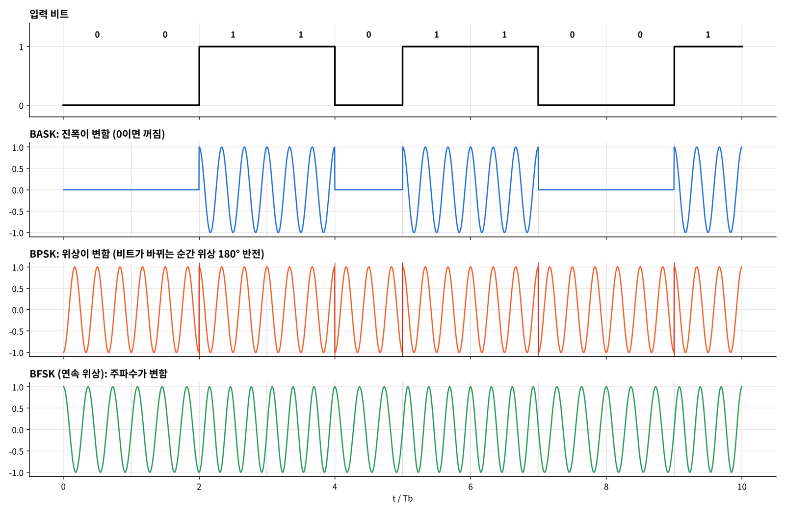
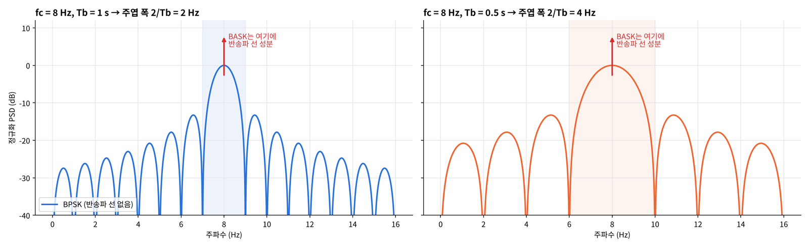
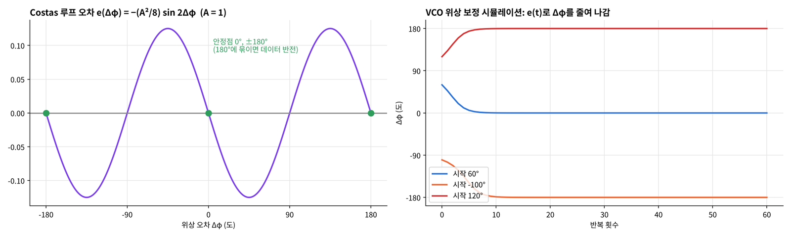
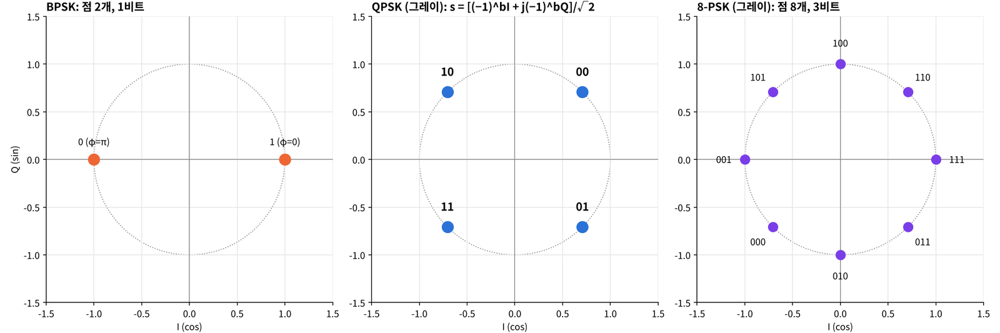
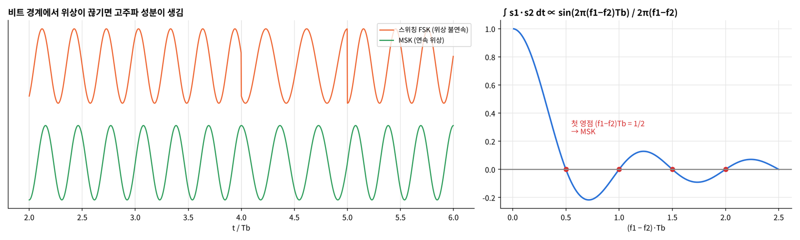

## 학습 목표

- 2진 변조 세 가지(BASK, BPSK, BFSK)가 반송파의 무엇을 바꾸는지 구분
- BASK, BPSK의 전력 스펙트럼과 대역폭 $$B = \frac{2}{T_b}$$
- BPSK가 DSB-SC의 특별한 경우라는 것, 생성기와 동기 검파기 구조
- 수신 쪽에서 반송파를 되살리는 두 방법: 제곱 회로, Costas 루프
- QPSK = BPSK 두 개, 그레이 인코딩과 디비트
- M진 PSK가 대역폭을 $$\log_2 M$$배 줄이는 원리
- 직교 조건에서 MSK의 주파수 간격 $$\frac{1}{2T_b}$$ 유도

> 04, 05장의 AM, FM, PM은 **아날로그 메시지**를 반송파에 실었다. 이번 장은 10장에서 만든 **비트열**을 반송파에 싣는다. 구조는 같고 메시지만 0/1 파형으로 바뀐 것이라, AM ↔ ASK, PM ↔ PSK, FM ↔ FSK로 대응시켜 보면 훨씬 쉽다.
{: .prompt-info }

---

## 1. 2진 변조의 세 가지 형태

반송파 $$c(t) = A_c\cos(2\pi f_ct + \phi_c)$$의 세 가지 성질(진폭, 위상, 주파수) 중 **하나만** 비트에 따라 바꾼다. 필기: 변조된 파형은 $$s(t) = b(t)\cdot c(t)$$.

| 방식 | 바꾸는 것 | 고정된 것 | 필기 |
| --- | --- | --- | --- |
| BASK (Amplitude-Shift Keying) | 진폭 | 주파수, 위상 | 진폭이 변함 |
| BPSK (Phase-Shift Keying) | 위상 | 진폭, 주파수 | 위상이 변함 |
| BFSK (Frequency-Shift Keying) | 주파수 | 진폭, 위상 | 주파수가 변함 |

_같은 비트열 0011011001을 세 방식으로 변조 (빨간 선: BPSK 위상 반전 지점)_

---

## 2. BASK

비트당 에너지를 $$E_b$$라 하고 온-오프 2진 파형을

$$
b(t) = \begin{cases} \sqrt{E_b}, & \text{symbol } 1 \\ 0, & \text{symbol } 0 \end{cases}
$$

로 두면, 단위 에너지 반송파 $$\sqrt{\frac{2}{T_b}}\cos(2\pi f_ct)$$를 곱해서 ($$\phi_c = 0$$)

$$
s(t) = \begin{cases} \sqrt{\dfrac{2E_b}{T_b}}\cos(2\pi f_ct), & \text{symbol } 1 \\ 0, & \text{symbol } 0 \end{cases}
$$

### BASK 스펙트럼

- $$f = f_c$$에 **선 성분(반송파 성분)**이 있다. 필기: **AM = DSB-LC** 구조. $$b(t)$$의 평균이 0이 아니라서(0 또는 $$\sqrt{E_b}$$) 반송파가 그대로 남는다
- $$f_c$$가 2배가 되면 스펙트럼 중심만 2배로 이동 (모양은 그대로)
- $$T_b$$가 절반이 되면 **주엽(main lobe) 폭이 2배**. 필기: 0.5초로 더 촘촘하게 칠수록 주파수는 2배 커짐
- 주엽 폭을 대역폭으로 정의하면

$$
B_{\mathrm{BASK}} = \frac{2}{T_b}
$$

이유: 비트 하나는 폭 $$T_b$$짜리 사각 펄스이고, 그 스펙트럼은 $$\mathrm{sinc}(fT_b)$$로 첫 영점이 $$\pm\frac{1}{T_b}$$다. 반송파를 곱하면 $$f_c$$로 옮겨져 $$f_c - \frac{1}{T_b}$$ ~ $$f_c + \frac{1}{T_b}$$, 폭 $$\frac{2}{T_b}$$가 된다(02장 FT의 시간-주파수 반비례).

_BPSK의 주엽은 Tb가 절반이면 2배로 넓어진다. BASK는 같은 모양에 반송파 선 성분이 더해진다_

---

## 3. BPSK

### 신호

$$
s(t) = \begin{cases} \sqrt{\dfrac{2E_b}{T_b}}\cos(2\pi f_ct), & \text{symbol } 1 \quad (\phi = 0) \\[2mm] \sqrt{\dfrac{2E_b}{T_b}}\cos(2\pi f_ct + \pi) = -\sqrt{\dfrac{2E_b}{T_b}}\cos(2\pi f_ct), & \text{symbol } 0 \quad (\phi = \pi) \end{cases}
$$

- BASK와 달리 **모든 시간에 진폭 $$\sqrt{2E_b/T_b}$$를 유지**한다
- 그래서 비트당 전송 에너지가 일정하다 (**전송되는 평균 전력이 일정**)
- 위상 $$\pi$$는 부호 반전과 같다. 즉 **1이면 $$+\cos$$, 0이면 $$-\cos$$**

### BPSK 생성: DSB-SC의 특별한 경우

1. **NRZ 레벨 인코더**: 심볼 1, 0을 $$+V$$, $$-V$$로 (10장의 polar NRZ)
2. **곱셈 변조기**: 인코딩된 신호에 반송파 $$\sqrt{2/T_b}\cos(2\pi f_ct)$$를 곱함

> 필기: BPSK는 "cos를 $$b(t) = \pm 1$$로 바꿔 주는 것". $$b(t) = +1$$이면 $$\cos$$, $$-1$$이면 $$-\cos$$. 메시지가 ±1인 **DSB-SC**라서 $$b(t)$$가 부호를 바꾸는 순간 반송파 위상이 뒤집힌다(**phase reversal**). 04장 DSB-SC에서 메시지가 0을 지날 때 위상이 반전되던 것과 같은 현상이다.
{: .prompt-tip }

### BPSK 스펙트럼

- $$b(t)$$의 평균이 0이라(±1이 반반) **반송파 선 성분이 없다** (필기: **DSB-SC 구조**)
- 대역폭은 BASK와 같다

$$
B_{\mathrm{BPSK}} = \frac{2}{T_b} = 2R_b
$$

- 필기: $$T_b = 1/2$$초(pulse duration 0.5)면 대역폭이 2배

### BPSK 검파 (동기 검파)

| 블록 | 역할 |
| --- | --- |
| 곱셈 변조기 | 송신 반송파와 **똑같은** $$c(t)$$를 곱함 |
| 저역 통과 필터 | 곱한 뒤 생긴 $$2f_c$$ 성분 제거 |
| 샘플러 | $$T_b$$마다 샘플링 |
| 판정 장치 | 임계값보다 크면 1, 아니면 0 |

필기: $$\int\cos\cdot\cos = +A$$(심볼 1), $$\int\cos\cdot(-\cos) = -A$$(심볼 0). 그래서 임계값은 0이다.

핵심은 수신 쪽이 **송신 반송파와 같은 주파수, 같은 위상**의 반송파를 갖고 있어야 한다는 점. 그런데 BPSK 신호에는 반송파 선 성분이 없어서 그냥 필터로 뽑아낼 수 없다. 그래서 다음 두 방법이 필요하다.

---

## 4. 반송파 복원 1: 제곱 회로

수신 신호 $$s(t) = A\cos(2\pi f_ct + \phi)$$, $$\phi = 0$$(심볼 1) 또는 $$\pi$$(심볼 0).

**1단계, 제곱**: $$\cos^2 x = \frac{1 + \cos 2x}{2}$$로

$$
A^2\cos^2(2\pi f_ct + \phi) = \frac{A^2}{2} + \frac{A^2}{2}\cos(4\pi f_ct + 2\phi)
$$

$$2\phi = 0$$ 또는 $$2\pi$$이므로 **위상 반전 효과가 사라진다**. 데이터와 상관없이 항상 같은 $$2f_c$$ 정현파가 나온다.

**2단계, BPF**: 중심 주파수 $$2f_c$$인 대역 통과 필터로 DC 성분 $$\frac{A^2}{2}$$ 제거

**3단계, 2:1 주파수 분할기**: $$2f_c$$ → $$f_c$$. 반송파와 같은 주파수의 정현파를 얻음

**4단계, 동기 검파**: $$\cos A\cos B = \frac{1}{2}[\cos(A + B) + \cos(A - B)]$$로

$$
s(t)\cos(2\pi f_ct) = A\cos(2\pi f_ct + \phi)\cos(2\pi f_ct) = \frac{A}{2}\left[\cos\phi + \cos(4\pi f_ct + \phi)\right]
$$

LPF로 $$2f_c$$ 항을 지우면 $$\frac{A}{2}\cos\phi = \pm\frac{A}{2}$$. 심볼 1이면 $$+$$, 0이면 $$-$$.

> 강의 그림의 물음표 두 개: 분할기 출력이 $$\cos(\omega_ct)$$인지 $$-\cos(\omega_ct)$$인지 **알 수 없다**. $$2f_c$$를 반으로 나누면 시작 위상이 0인지 $$\pi$$인지 정할 근거가 없기 때문이다. 잘못 잡으면 모든 비트가 뒤집힌다(**180° 위상 모호성**). 실제로는 10장의 **미분 인코딩**으로 이 문제를 피한다(DPSK).
{: .prompt-warning }

(참고로 강의 자료의 제목 "제곱근을 이용한 반송파 복원"은 **제곱(squaring)**이 맞다. 회로가 $$(\cdot)^2$$다.)

---

## 5. 반송파 복원 2: Costas 루프

수신 신호를 $$s(t) = m(t)A\cos(2\pi f_ct)$$, $$m(t) = \pm 1$$로 두고, VCO 출력을 $$\cos(2\pi f_ct + \Delta\phi)$$라고 하자($$\Delta\phi$$는 VCO의 위상 오차).

### 두 팔(arm)

- **위쪽(Q) 팔**: VCO 출력을 90° 밀어서 $$-\sin(\omega_ct + \Delta\phi)$$를 곱함

$$
\pm A\cos(\omega_ct)\left(-\sin(\omega_ct + \Delta\phi)\right) = \mp\frac{A}{2}\left[\sin(2\omega_ct + \Delta\phi) + \sin(\Delta\phi)\right] \xrightarrow{\text{LPF}} \mp\frac{A}{2}\sin(\Delta\phi)
$$

- **아래쪽(I) 팔**: VCO 출력 $$\cos(\omega_ct + \Delta\phi)$$를 그대로 곱함

$$
\pm A\cos(\omega_ct)\cos(\omega_ct + \Delta\phi) = \pm\frac{A}{2}\left[\cos(2\omega_ct + \Delta\phi) + \cos(\Delta\phi)\right] \xrightarrow{\text{LPF}} \pm\frac{A}{2}\cos(\Delta\phi)
$$

> 필기: 강의 그림은 아래쪽 팔에 들어가는 신호도 $$-\sin(2\pi f_ct + \Delta\phi)$$로 적혀 있는데, 수업에서 **$$\cos(2\pi f_ct + \Delta\phi)$$로 고쳤다**. 아래쪽 출력이 $$\cos(\Delta\phi)$$가 되려면 VCO 출력이 90° 이동 없이 그대로 들어가야 한다.
{: .prompt-tip }

### 오차 신호 (필기: 두 팔 출력의 곱을 취한 것)

$$
e(t) = \left(\mp\frac{A}{2}\sin\Delta\phi\right)\left(\pm\frac{A}{2}\cos\Delta\phi\right) = -\frac{A^2}{4}\sin\Delta\phi\cos\Delta\phi = -\frac{A^2}{8}\sin(2\Delta\phi)
$$

- 두 팔의 부호 $$\pm$$, $$\mp$$가 곱해지면서 **데이터 $$m(t)$$가 사라진다**. 그래서 데이터와 무관하게 위상 오차만 남는다 (제곱 회로에서 $$2\phi$$로 데이터가 사라진 것과 같은 원리)
- $$\Delta\phi > 0$$이면 $$e(t) < 0$$ → VCO 출력 주파수(위상)를 **낮춰** $$\Delta\phi$$가 줄어든다. 반대도 마찬가지 → 자동으로 동기가 맞는다

_왼쪽: Costas 루프의 오차 곡선. 오른쪽: 오차를 반복해서 VCO에 되먹였을 때 위상 오차의 변화_

- 오차 곡선이 $$\sin 2\Delta\phi$$라서 0이 되는 안정점이 **0°와 ±180° 두 곳**이다. 시작 위상 오차가 90°를 넘으면(오른쪽 그림의 120°, −100°) 180°에 묶인다
- 180°에 묶이면 아래쪽 출력이 $$-\frac{A}{2}m(t)$$가 되어 **데이터 전체가 반전**된다. 제곱 회로와 같은 180° 모호성이다

### 동기가 맞은 뒤 ($$\Delta\phi = 0$$)

$$
s(t)c(t) = \pm A\cos(\omega_ct)\cos(\omega_ct) = \pm\frac{A}{2}\left[\cos 0 + \cos(2\omega_ct)\right] \xrightarrow{\text{LPF}} \pm\frac{A}{2} = \frac{A}{2}m(t)
$$

필기: $$2\omega_c$$ 항(주파수 2배)은 LPF로 제거, $$m(t)$$는 1이면 $$+$$, 0이면 $$-$$.

---

## 6. QPSK (Quadriphase-Shift Keying)

필기: BPSK는 0/1 → 1비트. **4개 = $$2^2$$ → 한 번에 2비트를 보냄**.

반송파의 위상이 $$\frac{\pi}{4}, \frac{3\pi}{4}, \frac{5\pi}{4}, \frac{7\pi}{4}$$ 중 하나

$$
s(t) = \sqrt{\frac{2E}{T}}\cos\left(2\pi f_ct + (2i - 1)\frac{\pi}{4}\right), \qquad 0 \le t \le T, \ i = 1, 2, 3, 4
$$

$$\cos(A + B) = \cos A\cos B - \sin A\sin B$$로 펼치면

$$
s(t) = \underbrace{\sqrt{\frac{2E}{T}}\cos\left((2i - 1)\frac{\pi}{4}\right)}_{a_1}\cos(2\pi f_ct) - \underbrace{\sqrt{\frac{2E}{T}}\sin\left((2i - 1)\frac{\pi}{4}\right)}_{a_2}\sin(2\pi f_ct)
$$

**QPSK = 두 BPSK의 합**. $$\cos$$ 쪽(동위상, I)과 $$\sin$$ 쪽(직교위상, Q)이 서로 직교해서 같은 주파수 대역에 겹쳐 실어도 수신 쪽에서 분리된다. 그래서 **같은 대역폭에 비트를 2배** 보낼 수 있다.

### 그레이 인코딩과 디비트

- **디비트(dibit)**: 2개 비트의 묶음
- **그레이 인코딩**: **이웃한 심볼끼리 1비트만 다르게** 배치. 잡음 때문에 이웃 심볼로 잘못 판정해도 2비트 중 1비트만 틀린다
- I 채널과 Q 채널의 **부호**에 각 비트를 하나씩 매핑하면 자동으로 그레이가 된다

$$
s = \frac{1}{\sqrt{2}}\left[(-1)^{b_I} + j(-1)^{b_Q}\right], \qquad b_I, b_Q \in \{0, 1\}
$$

→ 00 → 1사분면, 10 → 2사분면, 11 → 3사분면, 01 → 4사분면

_BPSK, QPSK, 8-PSK의 신호 공간 (모두 그레이 배치)_

> 주의: 강의 자료에는 디비트 배치가 **세 가지**로 나온다. 위 식(00 → 1사분면), 교재 Table 7.1($$\frac{\pi}{4}$$ = 10, $$\frac{3\pi}{4}$$ = 00, $$\frac{5\pi}{4}$$ = 01, $$\frac{7\pi}{4}$$ = 11), 21쪽 검파 표($$\frac{\pi}{4}$$ = 11, $$\frac{3\pi}{4}$$ = 01, $$\frac{5\pi}{4}$$ = 00, $$\frac{7\pi}{4}$$ = 10). **셋 다 이웃이 1비트만 다른 그레이 배치**라 원리는 같지만, 어떤 비트를 어느 사분면에 두는지는 다르다. 시험에서는 문제에 주어진 규칙을 따라야 한다.
{: .prompt-warning }

### QPSK 생성과 검파

- **생성**: 비트를 NRZ로 ±1로 바꾼 뒤 **역다중화기(demux)**로 홀수/짝수 비트를 나눔 → 각각 $$\sqrt{2/T}\cos(2\pi f_ct)$$, $$\sqrt{2/T}\sin(2\pi f_ct)$$를 곱함(BPSK 2개) → 둘을 **빼서** QPSK 완성 (위 식의 $$-$$ 부호)
- **검파**: I 채널($$\cos$$ 곱)과 Q 채널($$\sin$$ 곱) 각각 곱셈 → LPF → 샘플러 → 판정. 필기: $$+A$$면 1, $$-A$$면 0 ($$s\cdot s \to +A$$, $$-s\cdot s \to -A$$). 마지막에 **다중화기(mux, 병렬-직렬 변환)**로 원래 비트열 복원

---

## 7. M진 디지털 변조

- 심볼 주기 $$T$$ 동안 $$M$$종류의 신호 $$s_1(t), \dots, s_M(t)$$ 중 하나를 보냄
- 보통 $$M = 2^m$$. 심볼 하나가 $$m$$비트를 담으므로 **심볼 주기 $$T = mT_b$$**
- 예: 16진이면 $$16 = 2^4$$ → 4비트. 심볼 하나를 보내는 데 비트 주기의 4배가 걸림
- 필기: **QPSK = 4-ary PSK**
- **전력 증가와 시스템 복잡도 증가를 감수하더라도 대역폭을 아껴야 할 때** 사용

### M진 PSK

$$
s_i(t) = \sqrt{\frac{2E}{T}}\cos\left(2\pi f_ct + \frac{2\pi}{M}i\right) = \sqrt{\frac{2E}{T}}\cos\left(\frac{2\pi}{M}i\right)\cos(2\pi f_ct) - \sqrt{\frac{2E}{T}}\sin\left(\frac{2\pi}{M}i\right)\sin(2\pi f_ct)
$$

- $$2\pi$$를 $$M$$등분한 위상 중 하나를 사용
- BPSK로 보내면 대역폭 $$\frac{1}{T_b}$$에 비례, $$m$$비트씩 묶어 보내면 $$\frac{1}{mT_b}$$ → **대역폭이 $$m = \log_2 M$$배 줄어든다**
- 필기: 4PSK는 판정 영역이 **4개의 구간**, 8PSK는 **8개의 구간**. 수신된 점이 어느 부채꼴에 떨어지느냐로 심볼을 판정한다
- 대가: 같은 에너지 $$E$$로 원 위에 점이 촘촘해져서 이웃 점과의 거리가 줄어든다 → 잡음에 약해짐 → 같은 오류율을 위해 **전력이 더 필요**

---

## 8. BFSK

심볼에 따라 반송파 주파수를 바꾼다.

$$
s(t) = \begin{cases} s_1(t) = \sqrt{\dfrac{2E_b}{T_b}}\cos(2\pi f_1t), & \text{symbol } 1 \\[2mm] s_2(t) = \sqrt{\dfrac{2E_b}{T_b}}\cos(2\pi f_2t), & \text{symbol } 0 \end{cases}
$$

- 두 송신 주파수를 서로 **직교**하도록 정하면 $$s_1, s_2$$를 **직교 신호(orthogonal signal)**라 부른다

$$
\int_0^{T_b} s_1(t)s_2(t)\,dt = 0
$$

- 수신기는 $$f_1$$용, $$f_2$$용 상관기 두 개를 두고 큰 쪽을 고른다. 직교라서 $$f_1$$ 상관기에 $$s_2$$가 들어오면 출력이 0이다
- **스펙트럼**: $$f_1$$과 $$f_2$$에 **두 개의 선 스펙트럼**이 있다 (필기: 임펄스 존재)

### 위상 불연속 문제와 CPFSK

필기: 두 발진기 $$f_1$$, $$f_2$$ 사이를 스위치로 바꾸면 **특정 시점에서 위상이 다를 수 있다**. 비트 경계에서 파형이 뚝 끊기면 그 순간 고주파 성분이 생겨 전송 대역폭이 넓어진다.

**연속 위상 FSK (CPFSK)**: 발진기를 바꾸지 않고 **하나의 VCO의 주파수를 데이터에 따라 조금씩 올리고 내린다** (필기: VCO가 $$f_c + \Delta f$$와 $$f_c - \Delta f$$ 사이를 오가는 그림)

$$
s_{\mathrm{CPFSK}}(t) = A\cos\left(2\pi f_ct + \frac{hd\pi t}{T_b}\right) = A\cos\left(2\pi(f_c \pm \Delta f)t\right), \qquad h: \text{편이비}, \ d = \pm 1
$$

- 위상 $$\frac{hd\pi t}{T_b}$$가 시간에 대해 연속으로 쌓이므로 비트 경계에서 끊기지 않는다
- 예: **블루투스** (정확히는 Gaussian FSK)

_왼쪽: 스위칭 FSK는 비트 경계(t = 4, 5)에서 파형이 끊김. 오른쪽: 두 주파수의 상관값은 (f1 − f2)Tb = 1/2의 배수에서 0_

---

## 9. MSK (Minimum Shift Keying)

필기: **최소 편이 변조**, CPFSK에서 $$\Delta f$$의 최솟값.

### 직교 조건 유도

$$\cos A\cos B = \frac{1}{2}[\cos(A + B) + \cos(A - B)]$$로

$$
\int_0^{T_b} \cos(2\pi f_1t)\cos(2\pi f_2t)\,dt = \frac{1}{2}\left[\frac{\sin(2\pi(f_1 + f_2)t)}{2\pi(f_1 + f_2)}\right]_0^{T_b} + \frac{1}{2}\left[\frac{\sin(2\pi(f_1 - f_2)t)}{2\pi(f_1 - f_2)}\right]_0^{T_b} \approx \frac{\sin(2\pi(f_1 - f_2)T_b)}{4\pi(f_1 - f_2)}
$$

- 첫째 항은 $$f_1 + f_2$$가 아주 커서(반송파 대역) 분모가 크니 거의 0
- 직교하려면(필기: **직교하기 위한 조건**)

$$
\sin(2\pi(f_1 - f_2)T_b) = 0 \;\Rightarrow\; 2\pi(f_1 - f_2)T_b = k\pi \;\Rightarrow\; f_1 - f_2 = \frac{k}{2T_b}
$$

- 필기: $$f_1 \ne f_2$$여야 하므로 $$k \ne 0$$. 가장 작은 간격은 **$$k = 1$$**

$$
f_1 - f_2 = \frac{1}{2T_b} = \frac{R_b}{2}, \qquad \pm\Delta f = \frac{f_1 - f_2}{2} = \frac{1}{4T_b} = \frac{R_b}{4}
$$

필기: $$k = 1$$일 때 $$f_1$$, $$f_2$$가 가장 가까워질 수 있다 → 대역폭이 가장 좁다.

### MSK 신호

- CPFSK의 일종으로 **두 주파수의 차이를 직교가 유지되는 최소값**으로 둠
- 편위 $$\delta f = f_1 - f_2 = \frac{1}{2T_b}$$, 반송파는 두 주파수의 산술 평균 $$f_c = \frac{1}{2}(f_1 + f_2)$$

$$
f_1 = f_c + \frac{\delta f}{2} = f_c + \frac{1}{4T_b}, \qquad f_2 = f_c - \frac{\delta f}{2} = f_c - \frac{1}{4T_b}
$$

- 이 두 주파수를 쓰면 **연속 위상**이 보장된다

$$
s(t) = \sqrt{\frac{2E_b}{T_b}}\cos\left(2\pi f_ct + \theta(t)\right), \qquad \theta(t) = \pm 2\pi\frac{\delta f}{2}t = \pm\frac{\pi t}{2T_b}
$$

- 비트 하나($$T_b$$) 동안 위상이 정확히 $$\pm\frac{\pi}{2}$$만큼 직선으로 변한다
- 필기: minimum일 때, 즉 $$k = 1$$일 때 **편이비 $$h = 0.5$$**. 실제로 $$h = (f_1 - f_2)T_b = \frac{1}{2}$$
- 필기: **가우시안 LPF만 추가하면 2G 이동통신(GSM)**에 쓰인다 → **GMSK**

검산: $$f_1 - f_2 = 0.5, 0.25, 1.0$$ Hz($$T_b = 1$$)로 수치 적분하면 상관값이 각각 0, 0.318, 0이다. 0.25일 때 $$\frac{1}{2}\cdot\frac{\sin(\pi/2)}{\pi/2} = 0.318$$로 위 식의 $$\frac{1}{2}$$ 계수까지 맞는다.

---

## 10. 세 가지 2진 변조 요약 (시험 출제)

> 필기: 이 표 양쪽에 별표와 **"시험에 출제할 것"**.
{: .prompt-warning }

| 방식 | 바뀌는 변수 | $$s_1(t)$$ (symbol 1) | $$s_2(t)$$ (symbol 0) | 위상자 |
| --- | --- | --- | --- | --- |
| BASK | 반송파 진폭 $$A_c$$: $$\sqrt{2/T_b}$$ 또는 0 | $$\sqrt{\frac{2E_b}{T_b}}\cos(2\pi f_ct)$$ | $$0$$ | 0은 원점, 1은 오른쪽 화살표 |
| BPSK | 반송파 위상 $$\phi_c$$: 0 또는 $$\pi$$ | $$\sqrt{\frac{2E_b}{T_b}}\cos(2\pi f_ct)$$ | $$\sqrt{\frac{2E_b}{T_b}}\cos(2\pi f_ct + \pi)$$ | 0은 왼쪽, 1은 오른쪽 (반대 방향) |
| BFSK | 반송파 주파수 $$f_c$$: $$f_1$$ 또는 $$f_2$$ | $$\sqrt{\frac{2E_b}{T_b}}\cos(2\pi f_1t)$$ | $$\sqrt{\frac{2E_b}{T_b}}\cos(2\pi f_2t)$$ | 0은 위쪽, 1은 오른쪽 (직각) |

($$T_b$$: 비트 주기, $$E_b$$: 비트당 에너지, 반송파 $$c(t) = A_c\cos(2\pi f_ct + \phi_c)$$, BASK와 BFSK는 $$\phi_c = 0$$)

위상자 그림으로 보면 세 방식의 차이가 바로 보인다.

- **BASK**: 두 점 사이 거리 $$\sqrt{E_b}$$ (한쪽이 원점)
- **BFSK**: 두 점이 **직교** → 거리 $$\sqrt{2E_b}$$
- **BPSK**: 두 점이 **정반대** → 거리 $$2\sqrt{E_b}$$로 가장 멂

같은 비트당 에너지로 두 점이 가장 멀리 떨어진 BPSK가 잡음에 가장 강하다. (BASK는 0일 때 에너지를 안 쓰므로 평균 에너지를 맞추면 BFSK와 같은 거리가 된다.)

| 비교 | BASK | BPSK | BFSK |
| --- | --- | --- | --- |
| 아날로그 대응 | AM (DSB-LC) | DSB-SC | FM |
| 반송파 선 성분 | 있음 | 없음 | $$f_1$$, $$f_2$$에 있음 |
| 대역폭 (주엽) | $$2/T_b$$ | $$2/T_b$$ | 더 넓음 ($$\lvert f_1 - f_2 \rvert$$만큼 추가) |
| 포락선 | 일정하지 않음 | 일정 | 일정 |
| 수신기 | 포락선 검파도 가능 | 동기 검파 필요 (반송파 복원) | 상관기 2개 또는 비동기 검파 |

---

### 강의 자료에서 정정한 부분 정리

| 위치 | 강의 자료 | 정정 | 이유 |
| --- | --- | --- | --- |
| 강의 자료 4쪽 | BASK: 정보 데이터 1bit를 두 개의 **위상**으로 전송 | 두 개의 **진폭**으로 | ASK는 진폭으로 구분 (복사 오류로 보임) |
| 강의 자료 11, 12쪽 | 제곱**근**을 이용한 반송파 복원 | 제곱(squaring)을 이용한 | 회로가 $$(\cdot)^2$$ |
| 강의 자료 14, 15쪽 | 아래쪽 팔 입력 $$-\sin(2\pi f_ct + \Delta\phi)$$ | $$\cos(2\pi f_ct + \Delta\phi)$$ | 수업에서 정정. 출력이 $$\cos\Delta\phi$$가 되려면 |
| 강의 자료 19, 21쪽 | 디비트 배치 3종류 | 모두 그레이지만 서로 다름 | 문제에 주어진 규칙을 따를 것 |
| 강의 자료 30쪽 | $$\int\cos\cos\,dt = \int\cos(\text{sum}) + \int\cos(\text{diff})$$ | 각 항에 $$\frac{1}{2}$$ | 곱을 합으로 바꾸는 공식. 결론($$f_1 - f_2 = \frac{k}{2T_b}$$)은 같음 |
| 강의 자료 30쪽 | "연속 위상이 될 조건" | 직교 조건 | 식 자체는 $$s_1, s_2$$의 직교 조건 |

---

## 최종 핵심 정리

1. 2진 변조는 반송파의 진폭(BASK), 위상(BPSK), 주파수(BFSK) 중 하나를 비트에 따라 바꾼다. $$s(t) = b(t)c(t)$$
2. BASK는 AM(DSB-LC)처럼 $$f_c$$에 반송파 선 성분이 있고, BPSK는 DSB-SC라 선 성분이 없다. 둘 다 주엽 대역폭 $$B = \frac{2}{T_b} = 2R_b$$. $$T_b$$가 절반이면 대역폭 2배
3. BPSK = NRZ(±V) × 반송파. 진폭이 일정해서 평균 전력이 일정하다. 동기 검파: 곱 → LPF → $$T_b$$마다 샘플 → 0과 비교
4. 반송파 복원은 제곱 회로($$2\phi$$로 데이터 제거 → $$2f_c$$ BPF → 2:1 분할)나 Costas 루프($$e = -\frac{A^2}{8}\sin 2\Delta\phi$$로 VCO 보정). 둘 다 180° 모호성이 있어 미분 인코딩으로 해결
5. QPSK는 I(cos), Q(sin) 두 BPSK의 합으로 같은 대역에 2비트. 그레이 인코딩으로 이웃 심볼은 1비트만 다르게. $$s = \frac{1}{\sqrt{2}}[(-1)^{b_I} + j(-1)^{b_Q}]$$
6. M진 PSK는 $$m = \log_2 M$$비트를 한 심볼에 담아 대역폭을 $$m$$배 줄이지만, 점 사이 거리가 줄어 전력이 더 필요
7. BFSK의 두 신호는 $$f_1 - f_2 = \frac{k}{2T_b}$$일 때 직교. 스위칭 FSK는 위상이 끊겨 대역이 넓어지므로 하나의 VCO로 위상을 이어 가는 CPFSK를 쓴다
8. MSK는 직교가 되는 최소 간격 $$f_1 - f_2 = \frac{1}{2T_b}$$ ($$\Delta f = \frac{1}{4T_b}$$, $$h = 0.5$$)인 CPFSK. 가우시안 필터를 더하면 GSM의 GMSK
9. **세 가지 2진 변조 요약표(시험 출제)**: 위상자 거리 BASK $$\sqrt{E_b}$$, BFSK $$\sqrt{2E_b}$$, BPSK $$2\sqrt{E_b}$$로 BPSK가 잡음에 가장 강하다

---

End.
