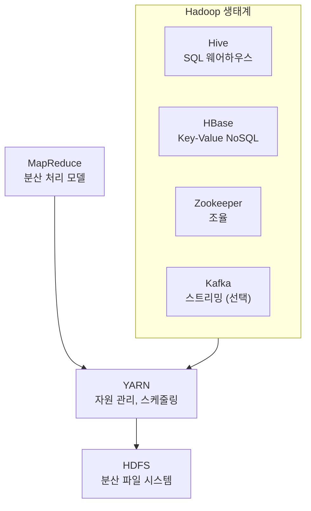
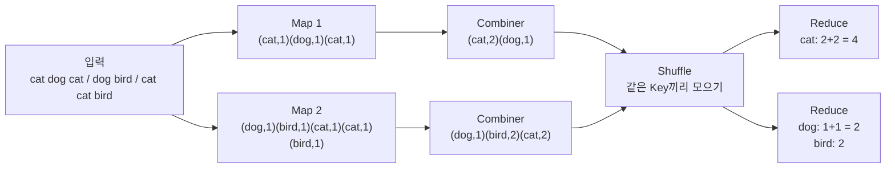
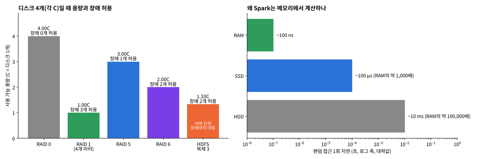

## 학습 목표

- 빅데이터의 3V와 전통 RDBMS가 한계에 부딪힌 이유
- Data Lake, Data Warehouse, Lakehouse의 차이
- Hadoop의 구성 요소: HDFS, MapReduce, YARN, 생태계
- MapReduce의 Map → Combiner → Shuffle → Reduce 흐름
- RAID 수준별 용량과 장애 허용, HDFS 복제와의 비교
- Spark가 MapReduce를 대체하게 된 이유와 구조
- PySpark로 CSV를 만들고 불러오기 (과제 4)

> 1 ~ 10편이 "데이터 한 개를 어떻게 분석하나"였다면, 이번 편은 "데이터가 서버 한 대에 들어가지 않을 때 어떻게 하나"다. 과제 4 노트북은 이 글을 쓰며 PySpark 4.3.0으로 다시 실행했고, 강의 내용을 확인하는 짧은 실험을 덧붙였다.
{: .prompt-info }

---

## 1. 빅데이터와 3V

- 2000년대 중반부터 스마트폰, 인터넷, SNS가 퍼지면서 데이터가 폭증했다. 정형 데이터 중심에서 영상, 로그, IoT 같은 다양한 데이터로 확대
- 빅데이터의 진짜 가치는 **수집, 저장이 아니라 분석과 활용**(데이터 기반 의사결정)
- AI와의 관계: **빅데이터는 AI의 학습 재료, AI는 빅데이터의 가치를 증폭하는 도구**. Hadoop, Spark, 클라우드 파이프라인과 AI 학습, 예측이 하나의 Data-AI Cycle을 이룬다

| V | 의미 | 강의 예시 |
| --- | --- | --- |
| Volume (양) | 규모가 폭발적으로 증가 | 유튜브에 매분 수백 시간 영상 업로드, 반도체 공정 센서 데이터 하루 수 TB |
| Velocity (속도) | 빠르게 생성되고 실시간 처리 필요 | 이상 거래 탐지, 자율주행 센서 분석 |
| Variety (다양성) | 정형, 반정형, 비정형 | 카톡 텍스트, 사진, 영상, GPS 위치 |

---

## 2. 전통 RDBMS와 그 한계

### ACID (참고)

RDBMS는 트랜잭션의 정확성을 강하게 보장한다.

| 성질 | 의미 | 예 |
| --- | --- | --- |
| Atomicity (원자성) | 모두 실행되거나 전혀 실행되지 않거나 | A → B 10만 원 송금에서 출금과 입금 중 하나라도 실패하면 둘 다 취소 |
| Consistency (일관성) | 전후 모두 제약 조건 만족 | 잔액 음수 금지 규칙이 있으면 트랜잭션 후에도 지켜짐 |
| Isolation (고립성) | 동시 실행되어도 서로의 중간 결과를 못 봄 | B는 A의 수정이 끝난 상태만 봄 |
| Durability (지속성) | 성공한 결과는 전원이 나가도 유지 | 디스크에 안전하게 기록 |

### 한계

- **Scale-Up 의존**: 서버 한 대의 성능을 올리는 방식이라 비용이 급격히 늘고, 그 한 대가 죽으면 전체가 멈춘다(단일 장애점)
- **고정 스키마**: 표 형태의 정형 데이터에 최적화. 웹 로그, 클릭, SNS, IoT 같은 비정형 데이터 처리가 어려움
- 그래서 **여러 서버에 나눠 저장, 처리하는 Scale-Out** 방식이 필요해졌고, Google의 GFS와 MapReduce 논문을 바탕으로 Hadoop이 등장했다

> 스키마(schema)는 그리스어 σχήμα(형태, 틀)에서 온 말로, 데이터의 설계도다. 어떤 테이블과 컬럼이 있고, 타입과 제약 조건이 무엇인지 정한다. 8절 실습의 `inferSchema` 문제가 바로 이 스키마 이야기다.
{: .prompt-tip }

### 그래도 SQL은 중요하다

- 배우기 쉽고, **선언적**(무엇을 원하는지만 쓰면 엔진이 방법을 정함)이며, 범용적이다
- 그래서 빅데이터 엔진들도 Hive, Spark SQL처럼 **SQL 인터페이스를 채택**했다. 분산 저장, 병렬 처리를 하면서 JSON, 로그 같은 반정형 데이터까지 SQL로 다룰 수 있게 확장
- 강의의 SQL 예제(SELECT, WHERE, ORDER BY, GROUP BY + AVG, JOIN)는 2024년 SQL 정리 글과 같은 내용이라, 여기서는 8절에서 Spark SQL로 다시 써 봤다

### Data Lake, Data Warehouse, Lakehouse

| 저장소 | 저장 형태 | 용도 |
| --- | --- | --- |
| Data Lake | 가공하지 않은 **원천(raw)** 상태 그대로, 정형 ~ 비정형 모두 | 필요할 때 꺼내서 처리, 분석 |
| Data Warehouse | **ETL**(추출, 변환, 적재)로 정제, 구조화된 데이터 | 경영 분석, BI 리포트, 통계 |
| Lakehouse | 원본 저장 + 정제된 분석 환경을 함께 | AI/ML 분석과 BI 분석을 한 플랫폼에서 |

---

## 3. Hadoop

대규모 데이터를 분산 환경에서 저장, 처리하기 위한 Apache 오픈소스 프레임워크. **저렴한 범용 서버 여러 대를 묶어 하나의 큰 시스템처럼** 동작시킨다.

| 특징 | 내용 |
| --- | --- |
| 저비용 분산 처리 | 고가 장비 없이 범용 하드웨어(commodity hardware)로 수평 확장 |
| 고장 허용 (Fault Tolerance) | 일부 노드가 죽어도 복제본과 재처리로 작업 계속 |
| 수평 확장 (Scale-Out) | 노드를 추가하는 것만으로 성능, 용량 증가 |
| 대용량 처리 최적화 | 데이터를 나눠 저장하고 병렬로 처리 |

### 핵심 구성 요소



| 구성 요소 | 역할 | 강의 비유 |
| --- | --- | --- |
| HDFS | 대용량 파일을 여러 노드에 분산 저장. 한 번 쓰고 여러 번 빠르게 읽는 데 최적화 | 데이터 저장 창고 |
| MapReduce | 작업을 쪼개 여러 노드에서 병렬 처리하고 결과를 합침 | |
| YARN | CPU, 메모리 같은 클러스터 자원 관리, 작업 실행 조정 | 교통, 도로망 |
| Hive | 데이터 웨어하우스 (SQL 질의) | 도서관, 검색 시스템 |
| HBase | 분산 Key-Value 저장소 | 빠른 조회가 되는 NoSQL 창고 |
| Zookeeper | 분산 시스템 조율 | 동물들이 멋대로 움직이지 않게 하는 사육사 |
| Kafka | 실시간 데이터 전달 | 우편 배송 서비스 |

요즘 기업들은 Spark + Cloud + Lakehouse 쪽으로 옮겨 가는 중이지만, HDFS, YARN, Hive, HBase는 여전히 많이 쓰인다.

---

## 4. HDFS

강의의 학교 비유가 이해하기 좋았다.

| HDFS | 학교 비유 |
| --- | --- |
| **NameNode** | 교장. 과제를 직접 보관하지 않고, **어떤 과제(블록)가 어느 반(DataNode)에 있는지** 기록, 관리 |
| **DataNode** | 반. 실제로 과제를 보관하고, 정상 보관 중인지 교장에게 주기적으로 보고(**Heartbeat**) |
| 블록 단위 저장 | 너무 큰 과제는 여러 조각으로 나눠 여러 반에 배정 |
| 복제 (Replication) | 사고에 대비해 같은 조각을 여러 반에 복사 (**기본 3개**) |

- 마스터(NameNode) - 슬레이브(DataNode) 구조
- NameNode는 파일 이름, 블록 위치, 접근 권한 같은 **메타데이터**만 갖는다
- **블록 크기는 128MB 또는 256MB**로 일반 파일 시스템(보통 4KB)보다 훨씬 크다. 큰 파일을 순차로 읽는 데 유리하고, NameNode가 관리할 블록 수(메타데이터)가 줄어든다

### 블록으로 나누고 다시 합치기

350MB 파일은 128MB 블록 기준으로

$$
350 = 128 + 128 + 94
$$

세 블록이 되고, 마지막 블록은 94MB만 차지한다(128MB를 다 쓰지 않는다). 각 블록은 3개씩 복제되므로 실제로 저장되는 블록은 9개다.

읽을 때는

1. 클라이언트가 파일 읽기 요청
2. NameNode가 블록 위치(메타데이터)를 알려 줌
3. 클라이언트가 **각 DataNode에 직접** 연결해 블록을 가져옴 (데이터가 NameNode를 거치지 않음)
4. 클라이언트가 블록을 순서대로 합쳐 원본 복원

---

## 5. MapReduce

대용량 데이터를 **Map**과 **Reduce** 두 단계로 나눠 여러 노드에서 동시에 처리하는 프로그래밍 모델.



| 단계 | 하는 일 |
| --- | --- |
| **Map** | 데이터를 조각으로 나눠 여러 Map Task가 병렬 처리. 결과는 **(Key, Value)** 쌍 |
| **Combiner** (선택) | Map 결과를 **로컬에서 미리 합침**. (cat, 1)을 5번 보내는 대신 (cat, 5) 하나만 보내 네트워크 전송량을 줄임 |
| **Shuffle** | 여러 Map 결과에서 **같은 Key끼리** 모아 재분배, Key 기준 정렬, 그룹화 |
| **Reduce** | Key별로 Value들을 집계해 최종 결과 생성 |

최종 결과도 HDFS에 블록 단위로 저장된다. 그리고 **블록 복구는 HDFS 담당, 실패한 태스크 재실행은 MapReduce 담당**이다.

같은 흐름을 PySpark RDD로 돌려 봤다.

```python
text = ["cat dog cat", "dog bird", "cat cat bird"]
rdd = spark.sparkContext.parallelize(text, 2)              # 2개 파티션 = 2개 Map
mapped = rdd.flatMap(lambda l: [(w, 1) for w in l.split()])
mapped.collect()
# [('cat',1), ('dog',1), ('cat',1), ('dog',1), ('bird',1), ('cat',1), ('cat',1), ('bird',1)]
sorted(mapped.reduceByKey(lambda a, b: a + b).collect())
# [('bird', 2), ('cat', 4), ('dog', 2)]
```

`reduceByKey`는 Spark에서 Combiner + Shuffle + Reduce를 한 번에 해 준다. 각 파티션 안에서 먼저 합치고(Combiner 역할) 그 결과만 섞는다.

---

## 6. RAID와 HDFS 복제

### 세상에 절대 안전한 저장 장치는 없다

HDD는 헤드, 모터 같은 움직이는 부품이 있어 충격에 약하고, SSD도 메모리 셀과 제어 회로가 고장 난다. 강의는 장애 유형을 저장장치, 제어기, 전원, 냉각, 네트워크, 소프트웨어, 데이터 손상, 과부하, 운영 실수, 보안 사고, 재해까지 11가지로 정리했다. 그래서 **중복성(redundancy)**이 필요하다.

### RAID (Redundant Array of Independent Disks)

여러 물리 디스크를 **하나의 논리 저장 장치**로 묶는 기술. 원리는 세 가지다.

| 원리 | 데이터 배치 | 효과 |
| --- | --- | --- |
| 스트라이핑 (Striping) | 데이터를 나눠 여러 디스크에 | 병렬 접근으로 성능 향상 |
| 미러링 (Mirroring) | 같은 데이터를 여러 디스크에 | 복제본으로 장애 대응 |
| 패리티 (Parity) | 복구용 계산 값을 함께 저장 | 남은 데이터 + 패리티로 손실 데이터 재구성 |

**RAID 번호는 구성 방식의 구분일 뿐, 성능이나 우수성의 순위가 아니다.**

| 수준 | 구조 | 최소 디스크 | 허용 장애 | 사용 가능 용량 |
| --- | --- | --- | --- | --- |
| RAID 0 | 스트라이핑만 | 2 | 0 (하나만 죽어도 전체 사용 불가) | $$N \times C$$ |
| RAID 1 | 미러링 | 2 | 복제본이 남아 있는 한 계속 | $$C$$ |
| RAID 5 | 블록 스트라이핑 + 분산 패리티 1개 | 3 | 임의의 1개 | $$(N - 1) \times C$$ |
| RAID 6 | 블록 스트라이핑 + 분산 패리티 2개 | 4 | 임의의 2개 | $$(N - 2) \times C$$ |

($$N$$: 디스크 수, $$C$$: 디스크 1개 용량)

- **RAID 2, 3, 4가 드문 이유**: RAID 2(비트 단위 + Hamming code)는 디스크 자체의 오류 정정으로 필요가 줄었고, RAID 3(바이트 단위)은 작은 요청에도 모든 디스크가 움직여 병렬 처리에 불리하며, RAID 4(블록 단위)는 **전용 패리티 디스크 하나에 쓰기가 몰려** 병목이 된다. RAID 5는 패리티를 여러 디스크에 **분산**해서 이 병목을 없앤 것


_왼쪽: 디스크 4개일 때 수준별 용량과 장애 허용. 오른쪽: 저장 장치별 접근 지연(대략값)_

### XOR 패리티로 복구하기

배타적 논리합(XOR, $$\oplus$$)은 같으면 0, 다르면 1이다. 그리고 $$X \oplus X = 0$$, $$X \oplus 0 = X$$라서

$$
P = A \oplus B \;\Rightarrow\; P \oplus B = A \oplus B \oplus B = A
$$

디스크 A가 사라져도 **남은 B와 패리티 P를 XOR하면 A가 그대로 복구**된다. 강의 예: $$A = 1, B = 1 \Rightarrow P = 0$$, A 소실 시 $$A = P \oplus B = 0 \oplus 1 = 1$$. 여러 비트에서도 똑같다.

```python
A, B = 0b1011, 0b0110
P = A ^ B          # 0b1101  (패리티)
P ^ B == A         # True    (A 복구)
```

RAID 6이 패리티를 2개 두는 이유: 큰 디스크를 RAID 5로 묶으면 디스크 하나가 죽고 **재구성(rebuild)하는 몇 시간 동안 하나만 더 죽어도** 데이터를 잃는다. 디스크가 클수록 그 시간이 길어져서 2개 장애를 견디는 RAID 6를 쓴다.

### RAID 1 vs HDFS 복제

| 비교 | RAID 1 | HDFS 블록 복제 |
| --- | --- | --- |
| 복제본 위치 | 한 서버 안의 여러 디스크 | **서로 다른 DataNode(서버)** |
| 장애 감지, 제어 | RAID 제어기 또는 OS | NameNode가 **Heartbeat**로 감지, 재복제 위치 결정 |
| 복구 | 교체 디스크에 복사 | DataNode끼리 직접 블록 전송 |
| 대응 범위 | 디스크 장애 | 디스크, **서버**, 배치 정책에 따라 **랙** 장애까지 |

공통 원리는 **정상 복제본으로 읽기를 계속하면서 중복성을 다시 채우는 것**. 복제 계수 3이면 하나가 죽어도 남은 2개로 읽으면서 다른 서버에 하나를 새로 복제한다.

> 강의 50쪽 "소 잃고 외양간 고친다": 장애가 난 뒤에 대책을 세우면 늦다. 중복성은 미리 설계해야 한다는 의미로 받아들였다.
{: .prompt-tip }

---

## 7. Spark

### 왜 MapReduce로는 부족했나

- MapReduce는 안정적이지만 **각 단계 결과를 매번 디스크(HDFS)에 썼다 읽는다**
- 머신러닝 학습, 그래프 분석처럼 **같은 데이터를 여러 번 반복**해서 계산하는 작업은 반복할 때마다 디스크 I/O가 생긴다
- 강의의 속도 비교: RAM은 SSD보다 약 100 ~ 1,000배, HDD보다 약 10,000 ~ 100,000배 빠르다 (빛, 빠른 자동차, 자전거). RAM은 반도체로 직접 랜덤 접근하고 CPU와 버스로 가깝게 붙어 있지만, 디스크는 블록 단위로 접근하고 I/O 드라이버 계층을 거치며 HDD는 헤드가 물리적으로 움직여야 한다

Spark는 중간 결과를 **메모리에 두고(in-memory)** 이어서 계산해서 이 문제를 해결했다.

### 구조

| 구성 요소 | 하는 일 | 강의 비유 |
| --- | --- | --- |
| **Driver** | 메인 프로세스. 실행 계획을 세우고 최적화, Task를 Executor에 분배, 결과 수집 | 프로젝트 매니저 |
| **Executor** | 각 노드에서 Task 실행, 실제 연산, 변환, 집계, 필요 시 메모리 캐싱 | 실무 개발자 |
| **Cluster Manager** | 자원 관리, Executor 위치와 자원 할당 (Standalone, YARN, Mesos, Kubernetes) | HR 매니저 |

### 지연 평가 (보충, 직접 확인)

Spark는 `filter`, `withColumn` 같은 **변환(transformation)**을 바로 실행하지 않고 계획만 쌓아 둔다. `count`, `show`, `collect` 같은 **액션(action)**이 호출될 때 Driver가 전체 계획을 최적화해서 한 번에 실행한다.

```python
t = time.time(); big = spark.range(0, 20_000_000).withColumn("m", F.col("id") % 7)
print(time.time() - t)        # 0.036초 → 2천만 행을 만들지 않고 계획만 세움
t = time.time(); big.groupBy("m").count().collect()
print(time.time() - t)        # 0.844초 → 여기서 실제 계산
```

---

## 8. 과제 4: 매점 판매 데이터를 Spark로 불러오기

### 과제 내용

교내 매점 판매 기록(상품명, 수량)을 직접 입력하고 CSV로 저장한 뒤 Spark로 불러오는 개인 자율 실습. 판매 기록 3건(생수 3, 빵 2, 우유 1)에 **한 줄을 직접 추가**하는 것이 요구 사항이었다.

### 내가 한 것

```python
rows = [
    ("생수", 3),
    ("빵", 2),
    ("우유", 1),
    ("주스", 4),  # 직접 추가한 판매 기록
]
print(f"직접 추가한 판매 기록: {rows[-1][0]} {rows[-1][1]}개")   # 주스 4개

import csv
file_name = "sales.csv"
with open(file_name, "w", encoding="utf-8", newline="") as file:
    writer = csv.writer(file)
    writer.writerow(["item", "quantity"])      # 헤더
    writer.writerows(rows)

from pyspark.sql import SparkSession
spark = SparkSession.builder.master("local[2]").appName("week11-store").getOrCreate()
sales = spark.read.csv(file_name, header=True)
sales.show(truncate=False)
```

```text
+----+--------+
|item|quantity|
+----+--------+
|생수|3       |
|빵  |2       |
|우유|1       |
|주스|4       |
+----+--------+
```

- `master("local[2]")`: 클러스터 없이 내 컴퓨터에서 **CPU 코어 2개**를 Executor처럼 써서 실행. 7절의 Driver와 Executor가 한 프로세스 안에 함께 있는 셈
- `header=True`: CSV 첫 줄을 열 이름으로 사용
- 제출 당시 macOS에서 실행했을 때 Spark가 "hostname이 루프백 주소로 해석된다"는 WARN을 냈는데, 결과에는 영향이 없는 로컬 네트워크 설정 경고다

### 다시 실행해 보고 발견한 것: 숫자가 문자열이다

```python
sales.printSchema()
# root
#  |-- item: string (nullable = true)
#  |-- quantity: string (nullable = true)    ← 정수가 아니라 문자열
```

`header=True`만 주면 Spark는 **모든 열을 문자열**로 읽는다. 표로 볼 때는 티가 안 나지만, 계산하면 문제가 된다. 과자 10개를 추가해서 정렬과 최댓값을 구해 봤다.

```python
a = spark.read.csv("sales2.csv", header=True)                     # 문자열
b = spark.read.csv("sales2.csv", header=True, inferSchema=True)   # 타입 추론
```

```text
string desc: ['4', '3', '2', '10', '1']     ← 문자 비교라 '10'이 '2'보다 작음
int desc:    [10, 4, 3, 2, 1]
string max: 4   int max: 10
```

문자열은 첫 글자부터 사전 순으로 비교하므로 "10"이 "2"보다 작다. **가장 많이 팔린 상품이 주스(4)로 잘못 나온다.** `inferSchema=True`를 주거나, 더 확실하게는 스키마를 직접 지정해야 한다.

```python
from pyspark.sql.types import StructType, StructField, StringType, IntegerType
schema = StructType([StructField("item", StringType()), StructField("quantity", IntegerType())])
sales = spark.read.csv(file_name, header=True, schema=schema)
```

### 조금 더: 집계와 Spark SQL

타입을 맞추고 나면 2절의 SQL을 그대로 쓸 수 있다.

```python
s2.agg(F.sum("quantity").alias("total")).show()          # total = 10 (과자 추가 전)
s2.createOrReplaceTempView("sales")
spark.sql("SELECT item, quantity FROM sales WHERE quantity >= 2 ORDER BY quantity DESC").show()
```

```text
+----+--------+
|item|quantity|
+----+--------+
|주스|       4|
|생수|       3|
|  빵|       2|
+----+--------+
```

DataFrame API와 SQL은 같은 실행 엔진(Catalyst 최적화기)을 거치므로 결과도 성능도 같다. 편한 쪽을 쓰면 된다.

---

## 9. 느낀 점

- 과제 자체는 네 줄짜리 CSV를 불러오는 간단한 실습이었지만, 다시 열어 보고 **숫자가 문자열로 읽혔다는 것**을 발견한 게 가장 큰 수확이었다. `show()`로 본 표는 완벽해 보였는데 `printSchema()` 한 줄로 문제가 드러났다. 데이터를 불러오면 값보다 **스키마부터 확인**하는 습관을 들여야겠다
- 4개 행을 처리하는 데 Spark를 띄우는 건 과하다. Spark가 시작하는 데만 몇 초가 걸리고, pandas였으면 즉시 끝났다. 분산 처리는 **데이터가 서버 한 대를 넘을 때** 의미가 있고, 작은 데이터에서는 오히려 오버헤드라는 걸 체감했다. 실제로 메모리 캐싱도 이번처럼 다시 계산하는 비용이 작은 데이터에서는 차이가 거의 나지 않았다
- HDFS 학교 비유와 RAID 표 덕분에 "복제를 어디에 두느냐(같은 서버의 디스크 vs 다른 서버)"가 장애 대응 범위를 결정한다는 게 명확해졌다. XOR 패리티 복구는 직접 계산해 보니 생각보다 단순하고 우아했다
- MapReduce의 Combiner를 Spark에서는 `reduceByKey`가 자동으로 해 준다는 걸 확인하면서, 새로운 도구가 이전 도구의 아이디어를 버린 게 아니라 **감춰서 자동화**했다는 걸 알았다

## 10. 개선 사항과 더 해 보고 싶은 것

| 항목 | 내용 |
| --- | --- |
| 스키마 명시 | 과제 코드에 `inferSchema=True` 또는 `StructType` 스키마를 넣어 수량을 정수로 읽기 |
| 집계 추가 | 상품별 판매 합계, 매출(단가 열 추가) 계산으로 "불러오기"에서 "분석"까지 이어 가기 |
| 데이터 키우기 | 7주차 빅데이터속세상의 `flights.csv`(약 35MB, 33만 행)처럼 큰 파일을 pandas와 Spark로 같은 집계를 해서 시간 비교 |
| Parquet | CSV 대신 열 지향 포맷 Parquet으로 저장해 파일 크기와 읽기 속도, 스키마 보존 여부 비교 |
| Spark UI | Docker 실행 시 연 4040 포트의 Spark UI에서 Stage, Task, Shuffle 크기를 직접 확인 |
| 캐싱 실험 | 계산 비용이 큰 파이프라인(조인 + 그룹화)을 여러 번 반복할 때 `cache()`의 효과 측정 |

---

## 최종 핵심 정리

1. 빅데이터는 Volume, Velocity, Variety(3V). 가치는 저장이 아니라 분석과 활용에 있고, AI와 서로를 키우는 관계
2. 전통 RDBMS는 ACID를 보장하지만 Scale-Up과 고정 스키마에 의존해 한계. 해법은 여러 서버로 나누는 Scale-Out
3. Data Lake(원본 그대로), Data Warehouse(ETL로 정제), Lakehouse(둘의 결합)
4. Hadoop = HDFS(저장) + MapReduce(처리) + YARN(자원 관리) + 생태계(Hive, HBase, Zookeeper, Kafka)
5. HDFS: NameNode(메타데이터, 교장) + DataNode(실제 블록, 반), 블록 128/256MB, 기본 복제 3, Heartbeat로 상태 보고. 350MB = 128 + 128 + 94
6. MapReduce: Map((Key, Value) 생성) → Combiner(로컬 미리 합산, 선택) → Shuffle(같은 Key끼리) → Reduce(집계)
7. RAID 0(스트라이핑, 중복 없음), 1(미러링), 5(분산 패리티 1개, $$(N-1)C$$, 1개 장애), 6(패리티 2개, $$(N-2)C$$, 2개 장애). XOR 패리티로 $$A = P \oplus B$$ 복구. HDFS 복제는 서버, 랙 장애까지 대응
8. Spark는 MapReduce의 단계별 디스크 I/O 문제를 메모리 계산으로 해결. Driver(계획, 분배) + Executor(실행) + Cluster Manager(자원). 변환은 지연 평가, 액션에서 실행
9. 과제 4: CSV를 만들고 `spark.read.csv(header=True)`로 불러옴. **`inferSchema`나 스키마 지정이 없으면 숫자가 문자열**로 읽혀 정렬, 최댓값이 틀린다('10' < '2')

---

End.
