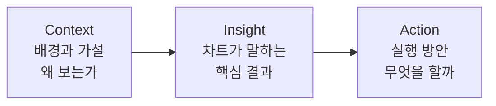
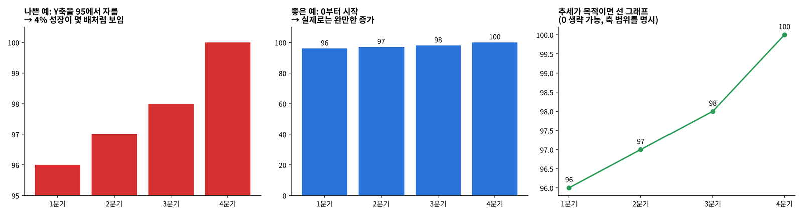
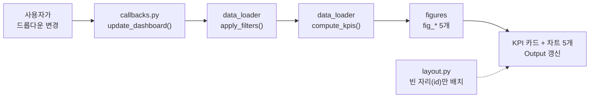
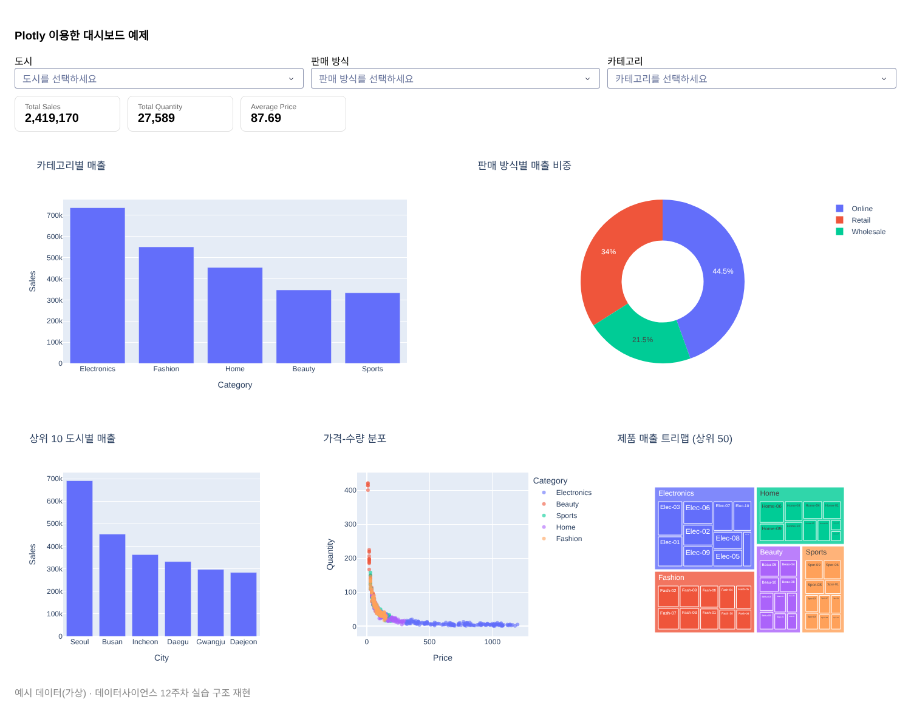
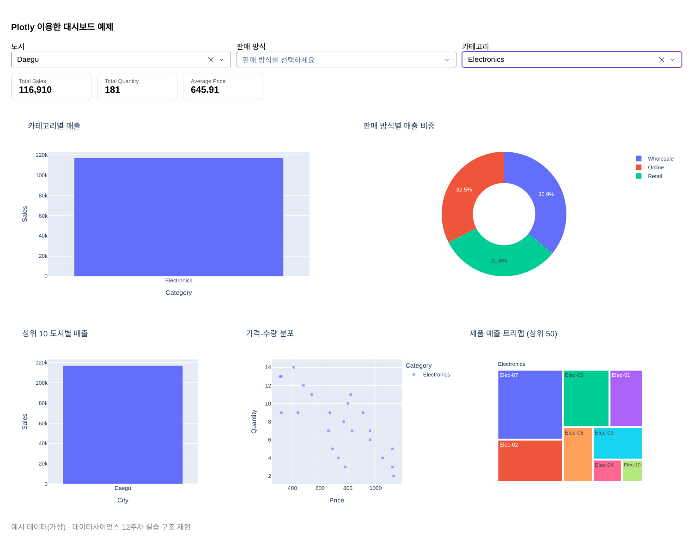

## 학습 목표

- 시각화를 "그림"이 아니라 **커뮤니케이션 도구**로 설계하기
- 목적(추세, 관계, 분포, 구성, 순위, 다변량)에 맞는 차트 고르기
- 대시보드 레이아웃, 색상, 강조, KPI 선정 원칙
- Plotly(그래프)와 Dash(웹 프레임워크)의 역할과 콜백 구조
- 기능별로 모듈을 나눈 대시보드 프로젝트 구조

> 강의 마지막에 실습 데이터셋으로 대시보드를 만드는 과정이 있었는데, 데이터셋 원본은 내 폴더에 없어서 **강의와 같은 열 구조(도시, 판매 방식, 카테고리, 제품, 가격, 수량)의 가상 데이터를 직접 만들어** 강의의 폴더 구조 그대로 구현했다. 그래서 화면의 숫자는 강의 화면과 다르다.
{: .prompt-info }

---

## 1. 시각화는 커뮤니케이션 도구다

- 복잡한 수치, 표, 모델 결과를 **한눈에 이해**하게 하고, 이해관계자가 **정확하게 판단**하도록 돕는다
- 좋은 시각화는 별도 설명 없이 핵심 메시지가 전달되고, 숫자의 나열을 "이해"에서 "공감"으로 바꾼다
- 리포트, 발표, 대시보드에서 핵심 정보의 **요약, 강조, 경고**를 시각적 신호로 전달한다

### 대시보드의 스토리라인



차트를 나열하는 것이 아니라 **배경 → 발견 → 행동**으로 이어지는 이야기를 만들어야 한다.

---

## 2. 왜 이 차트를 선택했는가

### 선택 기준 체크리스트

| 고려 요소 | 핵심 질문 |
| --- | --- |
| 데이터 유형 | 수치형인가, 범주형인가? (연속 vs 범주) |
| 분석 목표 | 비교, 분포, 추세, 상관, 구성 중 무엇인가? |
| 강조 포인트 | 이상치, 변화율, 상관 구조 중 무엇을 강조할까? |
| 대상의 문해력 | 독자의 데이터 이해 수준은? (단순 vs 고급 차트) |
| 맥락, 제약 | 보고용, 인쇄용, 모바일 중 어디서 쓰나? |

### 목적에 따른 차트 선택

| 목적 | 흔한 실수 | 권장 차트 |
| --- | --- | --- |
| 시간 추세 | 막대 그래프 | 선(line), 영역(area) |
| 두 변수 관계 | 막대 그래프 | 산점도, 회귀선 |
| 분포 파악 | 선 또는 막대 | 히스토그램, KDE, 바이올린 |
| 구성비 비교 | 선 그래프 | 파이, 도넛, 스택형 막대 |
| 순위 비교 | 파이 차트 | **가로 막대** |
| 다변량 상관 | 다중 선 그래프 | 히트맵, 페어플롯, 평행좌표 |

순위 비교에 파이를 쓰면 안 되는 이유: 사람의 눈은 **각도와 면적보다 길이를 훨씬 정확하게** 비교한다. 비슷한 크기의 조각 여러 개는 순서를 알아보기 어렵지만, 가로 막대로 정렬하면 바로 보인다.

---

## 3. 좋은 시각화와 나쁜 시각화

| 좋은 시각화 | 나쁜 시각화 |
| --- | --- |
| 축, 단위, 범례가 명확 | 3D 효과, 과도한 장식으로 정보 전달 방해 |
| 불필요한 요소를 줄여 데이터에 집중 | 조각이 너무 많은 파이 차트 |
| 색은 의미 전달용, 색약, 색맹 고려 | 메시지 없이 차트만 나열 |
| 다음 행동을 떠올리게 하는 방향성 | **Y축 절단**으로 시각적 왜곡 |
| 핵심 메시지를 주석(annotation)으로 강조 | |

Y축 절단이 얼마나 위험한지 같은 숫자로 그려 봤다.


_96 → 100(약 4% 증가)을 세 가지 방법으로 그리기_

왼쪽은 4분기 막대가 1분기의 5배처럼 보이지만 실제로는 4% 차이다. **막대 그래프는 길이로 크기를 비교하므로 반드시 0에서 시작해야 한다.** 반면 선 그래프는 위치(기울기)로 변화를 보여 주므로 0을 생략해도 되지만, 축 범위를 명확히 표시해야 한다.

---

## 4. 대시보드 설계 원칙

대시보드는 다양한 데이터를 한눈에 파악하도록 핵심 정보를 정리한 화면이다. 목적은 사용자가 **빠르게 상황을 이해하고 의사결정**하도록 돕는 것.

- 어떤 지표를, 어떤 형태로, 어떤 흐름으로 배치할지가 핵심
- 사용자에 따라 다르다. **경영진**은 요약 KPI 중심의 전략형, **실무자**는 세부 지표와 실행 중심의 운영형

| 항목 | 좋은 대시보드 | 나쁜 대시보드 |
| --- | --- | --- |
| 정보 우선순위 | 핵심 지표 위주, 시선 흐름 설계 | 너무 많은 지표가 동시에 노출 |
| 시각적 복잡성 | 단순, 가독성, 여백 활용 | 장식 과다, 3D, 시각적 피로 |
| 해석 용이성 | 축, 단위, 범례 명확 | 해석 난해 |
| 의사결정 | 인사이트 → 행동 | 보여주기용 |
| 사용자 경험 | 빠른 이해, 즉시 대응 | 사용자가 데이터를 내려받아 다시 가공 |

마지막 줄이 인상적이었다. **사용자가 엑셀로 내려받아 다시 계산하고 있다면 그 대시보드는 실패한 것**이다.

### 레이아웃: 시선의 흐름

| 패턴 | 구조 | 적합한 경우 |
| --- | --- | --- |
| **3-Panel** | 상단: 핵심 KPI, 전체 요약 / 좌측: 세부 지표, 추세, 상세 분석 / 우측: 알림, 인사이트, 액션, 컨트롤 | 정보 계층이 분명한 운영형 대시보드 |
| **F-Pattern** | 상단 왼쪽 → 오른쪽 → 다시 왼쪽으로 내려오며 스캔 | 정보가 많은 화면. 핵심 KPI와 제목을 상단 왼쪽에 |
| **Z-Pattern** | 상단 왼쪽 → 상단 오른쪽 → 하단 왼쪽 → 하단 오른쪽 | 내용이 적은 발표형, 단일 화면 요약. 상단 제목과 필터, 중앙 주요 시각 정보, 하단 결론과 CTA(Call to Action) |

### 색상과 강조

- 색은 **의미를 전달하는 도구이지 장식이 아니다**
- 상태나 중요도에 따라 **일관되게** 사용 (초록: 좋음, 노랑: 주의, 빨강: 위험)
- 색 수는 최소화하고, **색각 이상**을 고려한 팔레트 선택
- 강조할 데이터만 다른 색으로 → 눈이 그곳에 집중
- 핵심 데이터 포인트는 색상, 굵기, 크기, 주석으로 강조하되 **한 화면에 한두 개만**. 모두 강조하면 아무것도 강조되지 않는다
- 시선은 보통 왼쪽 위에서 시작해 오른쪽, 아래로 이동 → 중요한 정보를 가장 먼저 닿는 곳에, 여백과 정렬로 흐름 유도

---

## 5. KPI 선정 전략

**KPI(Key Performance Indicator, 핵심 성과 지표)**: 목표 달성 정도를 측정하는 핵심 지표. 단순한 숫자가 아니라 **전략과 실행을 연결하는 나침반**이고, "좋다, 나쁘다"를 넘어 필요한 행동을 이끌어 내야 한다.

| 분야 | KPI 예 |
| --- | --- |
| 마케팅 | 전환율, 고객 획득 비용, 재구매율 |
| 제조 | 불량률, 생산성, 장비 가동률 |
| 교육 | 학습 성취도, 출석률, 수업 만족도 |
| IT 서비스 | 시스템 가용성, 응답 속도, 장애 발생률 |

### 좋은 KPI의 네 가지 조건

1. **조직 목표와 직접 연결**: "왜 이 지표를 재는가?"에 답할 수 있어야 하고, 전략과 맞지 않으면 과감히 뺀다
2. **선행 지표와 후행 지표의 균형**: 후행 지표(Lagging, 예: 매출)는 결과 확인용, 선행 지표(Leading, 예: 방문자 수, 장바구니 담기)는 개선 행동을 이끈다. 후행 지표만 보면 문제를 알았을 때 이미 늦다
3. **측정 가능성과 수집 용이성**: 계속 측정할 수 있어야 하고, 수집 비용이 과하면 안 된다. 자동 수집, 자동 갱신 가능한 지표 우선
4. **개수 최소화**: 조직 단위 **3 ~ 5개**, 팀 단위 **5 ~ 7개**. 많을수록 초점이 흐려진다

---

## 6. 언어별 시각화, 대시보드 도구

| 언어 | 시각화 | 대시보드 | 비고 |
| --- | --- | --- | --- |
| Python | Matplotlib, Seaborn | Dash, Streamlit | 기본은 정적 출력. Streamlit은 커스텀 UI에 한계 |
| R | ggplot2 | Shiny | 서버 구성, 성능 튜닝 필요 |
| JavaScript | D3.js, ECharts | Dash for JS, Looker, Superset | 자유도 최고, 학습 부담 큼 |
| Java | JFreeChart | JSP 기반 커스텀, Tableau 연동 | 외부 BI 연계가 일반적 |
| C# (.NET) | Power BI | Power BI | 라이선스 비용 |
| No-code | | Looker Studio, Tableau | 비개발자 친화, 복잡한 로직에 한계 |

### 상황별 추천

| 상황 | 추천 |
| --- | --- |
| 빠른 프로토타입 | Streamlit, Shiny |
| 교육, 연구, AI 모델 시각화 | **Plotly + Dash** |
| 엔터프라이즈, 대규모 운영 | Power BI, React + D3/ECharts, Spring Boot |
| 정교한 커스텀 UI/UX | React + D3.js/ECharts |
| 리포트, 문서화 | Power BI, R Markdown, JasperReports |

---

## 7. Plotly와 Dash

| | Plotly | Dash |
| --- | --- | --- |
| 정체 | **그래프를 그리는** 시각화 라이브러리 | **웹앱, 대시보드를 만드는** 프레임워크 |
| 하는 일 | 줌, 팬, 마우스 오버 툴팁, 범례 제어 같은 상호작용이 기본인 차트 | 레이아웃, 버튼, 드롭다운, 슬라이더 같은 UI + 웹 서버 + **콜백** |
| 장점 | Python만으로 웹용 인터랙티브 차트, 3D, 트리맵, 지도, Sankey까지 | 프론트엔드(HTML, CSS, JS) 없이 Python만으로 웹앱 |
| 단점 | 대규모 데이터에서 렌더링 지연, 라이브러리 용량 큼 | UI가 복잡해지면 코드가 길어짐, 대규모 트래픽 대응은 따로 고민 |

- 두 도구는 같은 회사(Plotly)가 만들어 자연스럽게 연결된다: **시각화 → 공유 → 대시보드화 → 서비스화**
- Dash는 **Plotly + Flask + React**를 묶은 프레임워크다. 서버는 Flask, 화면은 React가 그리고, 우리는 Python만 쓴다

### 콜백 (Callback)

**콜백 함수**: "나중에 특정 시점에 호출되도록 다른 함수에 넘겨주는 함수". 개발자가 직접 부르지 않고 **시스템이나 프레임워크가 이벤트에 맞춰 호출**한다.

| 특징 | 의미 |
| --- | --- |
| 지연 실행 (Deferred Execution) | 즉시 실행되지 않고 조건이나 이벤트가 생길 때 실행 |
| 함수 전달 (Function as Argument) | 함수 자체를 다른 함수의 인자로 넘겨 실행 흐름을 위임 |
| 이벤트 기반 (Event-Driven) | 클릭, 데이터 수신, 작업 완료 같은 이벤트와 궁합이 좋음 |
| 제어 흐름 역전 (Inversion of Control) | 언제 실행할지 개발자가 아니라 프레임워크가 결정 |

Dash의 콜백은 **UI 컴포넌트(Input)가 바뀌면 자동 실행되어 데이터를 계산하고 화면(Output)을 갱신**하는 함수다.

---

## 8. 대시보드 직접 구현하기

### 실행 환경 구조

실무에서는 사용자 → 웹 서버(nginx) → 미들웨어(WSGI: gunicorn / ASGI: uvicorn) → 애플리케이션(Flask, Django, FastAPI ...) 구조지만, 실습은 Dash(Flask)의 **개발용 웹 서버**로 로컬에서 바로 실행한다(`http://127.0.0.1:8050`).

### 권장 폴더 구조와 각 모듈의 책임

```text
your-workspace/
├─ app.py              # 엔트리 포인트: 초기화, 조립, 실행
├─ config.py           # 전역 설정: 경로, 서버, 스타일을 한 곳에
├─ services/
│  ├─ data_loader.py   # 데이터 로딩, 정제, 파생 지표
│  ├─ figures.py       # Figure 생성 (함수 하나 = 차트 하나)
│  ├─ layout.py        # 화면 골격 (무엇을 어디에)
│  └─ callbacks.py     # 입력 → 계산 → 출력
└─ files/
   └─ sales_data.csv
```

핵심은 **관심사의 분리(Separation of Concerns)**. 데이터, 그림, 배치, 동작을 따로 두면 하나를 바꿀 때 다른 것을 건드리지 않는다.



### data_loader.py

```python
def load_data(path=DATA_PATH) -> pd.DataFrame:
    df = pd.read_csv(path, parse_dates=["Date"])
    df = df.dropna(subset=["Price", "Quantity"])                 # 결측 행 제거
    df = df[(df["Price"] > 0) & (df["Quantity"] > 0)].copy()     # 잘못된 값 제거
    df["Sales"] = df["Price"] * df["Quantity"]                   # 파생 지표
    return df

def compute_kpis(df):
    sales, qty = df["Sales"].sum(), df["Quantity"].sum()
    return {"Total Sales": sales, "Total Quantity": qty,
            "Average Price": sales / qty if qty else 0}          # 수량 가중 평균 단가
```

결측값이 있는 6행이 정제 단계에서 빠져서 600행 중 594행이 남았다.

### figures.py: 함수 하나가 차트 하나

```python
def fig_category_bar(df):
    g = df.groupby("Category", as_index=False)["Sales"].sum().sort_values("Sales", ascending=False)
    return px.bar(g, x="Category", y="Sales", title="카테고리별 매출")

def fig_channel_donut(df):
    g = df.groupby("Channel", as_index=False)["Sales"].sum()
    return px.pie(g, names="Channel", values="Sales", hole=0.5, title="판매 방식별 매출 비중")
# fig_city_topn, fig_price_qty_scatter, fig_product_treemap도 같은 형태
```

### layout.py: 자리만 잡아 두기

```python
html.Div([dropdown("f-city", "도시", ...), dropdown("f-channel", "판매 방식", ...),
          dropdown("f-category", "카테고리", ...)], style={"display": "flex"}),     # 필터 행
html.Div(id="kpi-row"),                                                          # KPI 행: 내용은 콜백이 주입
html.Div([dcc.Graph(id="g-category"), dcc.Graph(id="g-channel")]),               # 상단 차트 2개
html.Div([dcc.Graph(id="g-city"), dcc.Graph(id="g-scatter"), dcc.Graph(id="g-treemap")]),  # 하단 차트 3개
```

### callbacks.py: 단일 진입점

```python
def register_callbacks(app, df):
    @app.callback(
        Output("kpi-row", "children"),
        Output("g-category", "figure"), Output("g-channel", "figure"),
        Output("g-city", "figure"), Output("g-scatter", "figure"), Output("g-treemap", "figure"),
        Input("f-city", "value"), Input("f-channel", "value"), Input("f-category", "value"),
    )
    def update_dashboard(cities, channels, categories):
        d = apply_filters(df, cities, channels, categories)     # 1) 데이터 준비
        k = compute_kpis(d)                                      # 2) KPI 계산
        cards = [kpi_card("Total Sales", f"{k['Total Sales']:,.0f}"), ...]   # 3) 표시용 문자열
        return (cards, fig_category_bar(d), fig_channel_donut(d),            # 4) Output 순서대로
                fig_city_topn(d), fig_price_qty_scatter(d), fig_product_treemap(d))
```

`update_dashboard`를 직접 부르는 코드는 어디에도 없다. 드롭다운이 바뀌면 **Dash가 알아서 부른다**. 이게 7절의 "제어 흐름 역전"이다.

### 결과


_필터 없음: 강의의 목표 UI와 같은 배치 (가상 데이터)_


_도시 Daegu, 카테고리 Electronics를 고르자 KPI와 차트 5개가 한 번에 갱신됨_

---

## 9. 구현하면서 발견한 것

### (1) "평균 단가"를 어떻게 계산하느냐

처음에는 `df["Price"].mean()`으로 평균 단가를 구했는데, 수량 가중 평균(총매출 / 총수량)과 크게 달랐다.

```text
단순 평균 (거래 건당 가격의 평균):  283.94
수량 가중 평균 (총매출 / 총수량):     87.69
```

단순 평균은 **거래 한 건당** 가격의 평균이라, 수량이 1 ~ 2개인 고가 전자제품 거래와 수량이 수백 개인 저가 화장품 거래를 똑같이 센다. "고객이 실제로 낸 평균 가격"은 가중 평균이다. **KPI 카드에 숫자 하나만 쓸 때는 그 숫자의 정의를 반드시 명시**해야 한다는 걸 배웠다. 5절의 "왜 이 지표를 재는가"와 같은 이야기다.

### (2) 필터를 바꾸면 색이 바뀐다

두 스크린샷의 도넛 차트를 비교하면, 처음에는 Online이 파랑이었는데 필터 후에는 **Wholesale이 파랑**이 되었다. Plotly는 데이터가 나온 순서대로 색을 배정하기 때문이다. 4절에서 배운 "색은 일관되게"를 정면으로 어긴다. 사용자는 "파랑 = 온라인"이라고 기억하고 있을 테니 오해하기 쉽다. 해결은 색을 고정하는 것이다.

```python
CHANNEL_COLORS = {"Online": "#2a72d8", "Retail": "#ee6633", "Wholesale": "#2e9d5b"}   # config.py
px.pie(g, names="Channel", values="Sales", hole=0.5, color="Channel",
       color_discrete_map=CHANNEL_COLORS)
```

### (3) 필터 하나만 고르면 차트가 의미 없어진다

카테고리를 하나만 고르면 "카테고리별 매출" 막대는 막대 하나만 남는다(두 번째 스크린샷). 도시 하나를 고르면 "상위 10 도시"도 막대 하나다. 필터와 차트의 차원이 겹칠 때는 차트를 숨기거나 다른 정보(월별 추이 등)로 바꾸는 편이 낫다.

---

## 10. 느낀 점

- 이번 강의는 "어떻게 그리나"보다 **"왜 이렇게 그리나"**에 대한 강의였다. 3절에서 직접 Y축을 잘라 보니 같은 숫자로도 전혀 다른 이야기를 할 수 있다는 게 무서웠다. 시각화를 만드는 사람에게 책임이 있다는 걸 느꼈다
- 강의의 폴더 구조대로 나눠 보니 처음엔 파일이 많아 번거로웠지만, 9절의 색 문제를 고칠 때 `config.py`에 색 딕셔너리를 두고 `figures.py`의 한 줄만 바꾸면 됐다. 한 파일에 다 넣었다면 콜백 사이를 헤맸을 것이다. 이전 디자인패턴 수업에서 배운 단일 책임 원칙이 그대로 적용되는 예였다
- 콜백의 "제어 흐름 역전"을 직접 써 보니, 내가 함수를 부르지 않는데 함수가 실행되는 게 처음엔 어색했다. 하지만 입력 3개와 출력 6개를 데코레이터 한 곳에 선언하니 "무엇이 무엇에 반응하는지"가 한눈에 보였다
- 가장 크게 배운 건 9절 (1)이다. 대시보드는 그럴듯하게 동작했지만 KPI 하나의 정의가 3배 넘게 달랐다. 예쁜 화면보다 **숫자의 정의가 맞는지**가 먼저다

## 11. 개선 사항과 더 해 보고 싶은 것

| 항목 | 내용 |
| --- | --- |
| 색상 고정 | 채널, 카테고리마다 `color_discrete_map`으로 색을 고정하고, 색각 이상을 고려한 팔레트 적용 |
| KPI 정의 표시 | KPI 카드에 툴팁으로 계산식("총매출 / 총수량") 표시 |
| 선행 지표 추가 | 매출(후행)만 있으니, 월별 추이와 전월 대비 증감률 같은 변화 지표 추가 |
| 레이아웃 | 3-Panel로 바꿔 우측에 "이번 달 이상치" 같은 인사이트, 액션 영역 추가 |
| 필터와 차트 겹침 | 선택된 차원의 차트는 다른 차트(예: 월별 추이)로 자동 전환 |
| 성능 | 데이터가 커지면 매 콜백마다 groupby를 다시 하므로, 집계 결과 캐싱이나 12편의 Spark로 미리 집계 |
| 배포 | 개발 서버 대신 gunicorn + nginx로 배포해 보기 (강의 48쪽의 실무 구조) |
| 실제 데이터 | 강의 데이터셋으로 같은 코드를 실행해 강의 화면(Total Sales 577,600, Average Price 232.60)과 비교. 특히 Average Price가 단순 평균인지 가중 평균인지 확인 |

---

## 최종 핵심 정리

1. 시각화는 커뮤니케이션 도구. 대시보드는 Context(배경) → Insight(발견) → Action(행동)의 이야기
2. 목적별 차트: 추세는 선, 관계는 산점도, 분포는 히스토그램, KDE, 바이올린, 구성은 파이, 스택 막대, **순위는 가로 막대**, 다변량은 히트맵
3. 나쁜 시각화: 3D, 장식 과다, 조각 많은 파이, 메시지 없는 나열, **Y축 절단**. 막대는 0부터
4. 레이아웃은 시선 흐름: 3-Panel(상단 KPI, 좌 세부, 우 액션), F-Pattern(정보 많은 화면), Z-Pattern(발표형 요약)
5. 색은 의미 전달용으로 일관되게, 최소한으로, 색각 이상 고려. 강조는 한 화면에 한두 개
6. 좋은 KPI: 목표와 직결, 선행과 후행 지표의 균형, 측정 가능, 개수 최소(조직 3 ~ 5, 팀 5 ~ 7)
7. Plotly는 인터랙티브 그래프, Dash는 Plotly + Flask + React로 Python만으로 웹 대시보드. 콜백은 Input이 바뀌면 프레임워크가 호출해 Output을 갱신(제어 흐름 역전)
8. 폴더 구조: app(조립), config(설정), data_loader(정제, 파생), figures(차트 하나씩), layout(골격), callbacks(입력 → 계산 → 출력)로 관심사 분리
9. 직접 구현해 보니 **평균 단가 정의**(단순 283.94 vs 가중 87.69)와 **필터에 따라 색이 바뀌는 문제**가 있었다. 숫자의 정의와 색의 일관성이 화면의 완성도보다 먼저

---

End.
